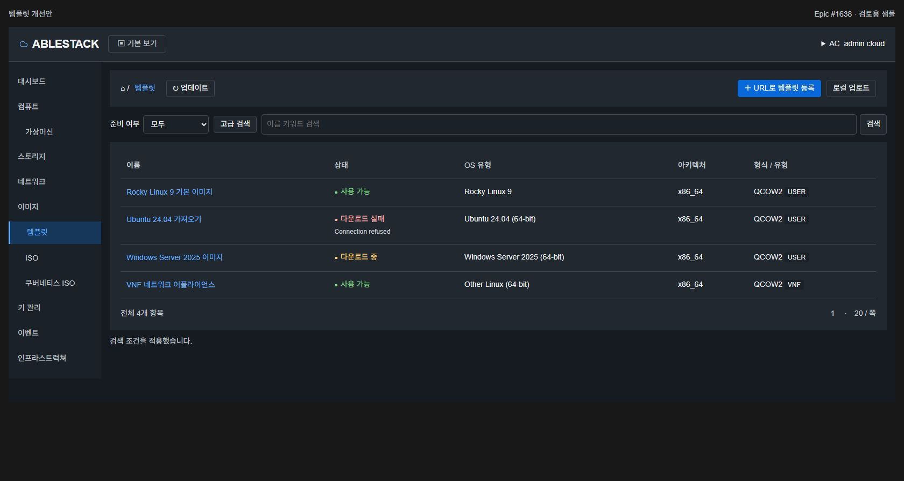
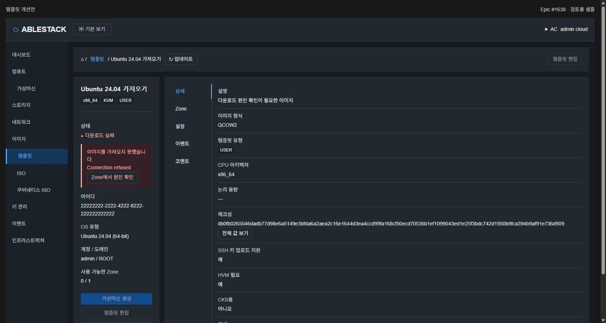
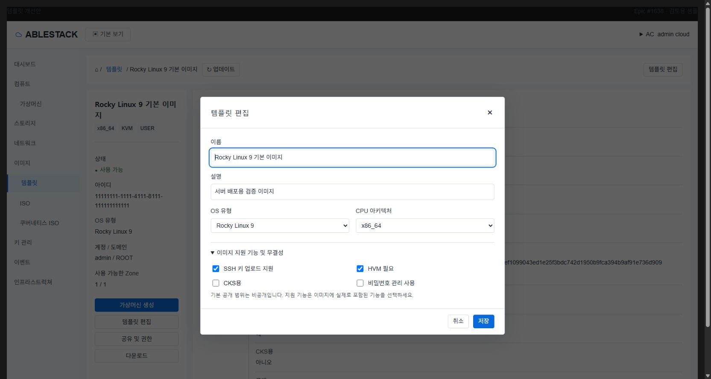
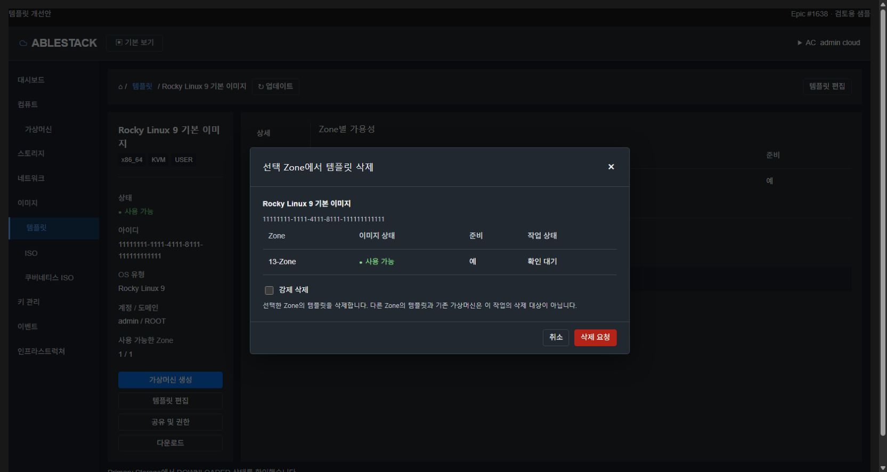
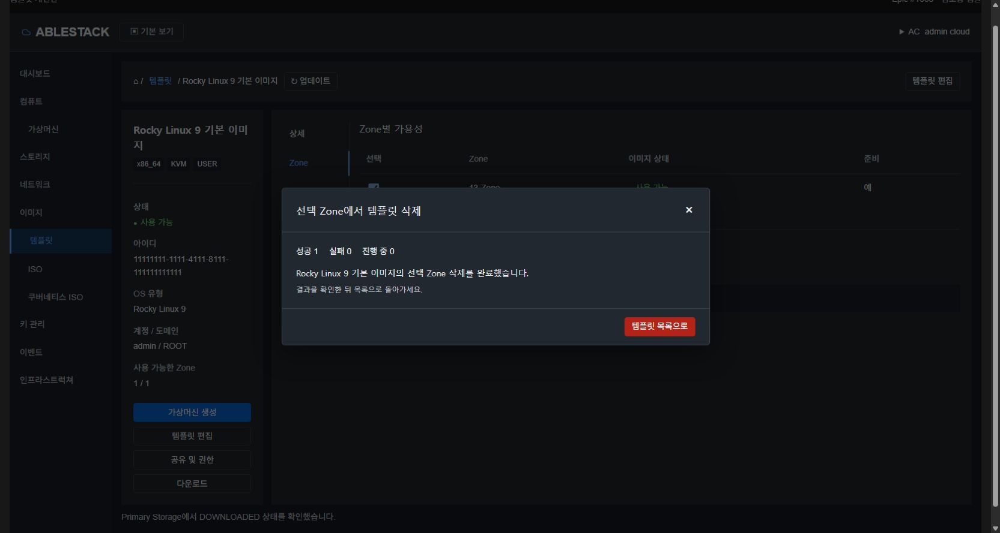
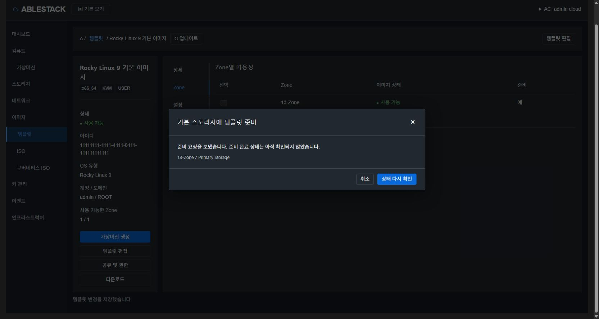
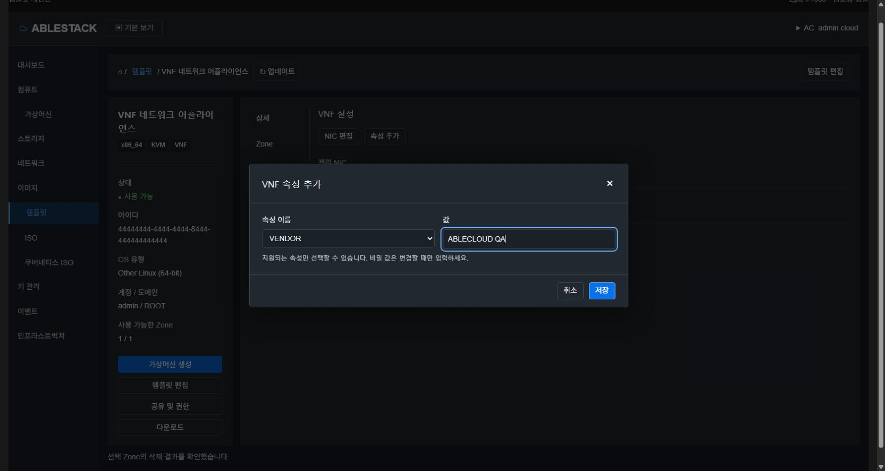
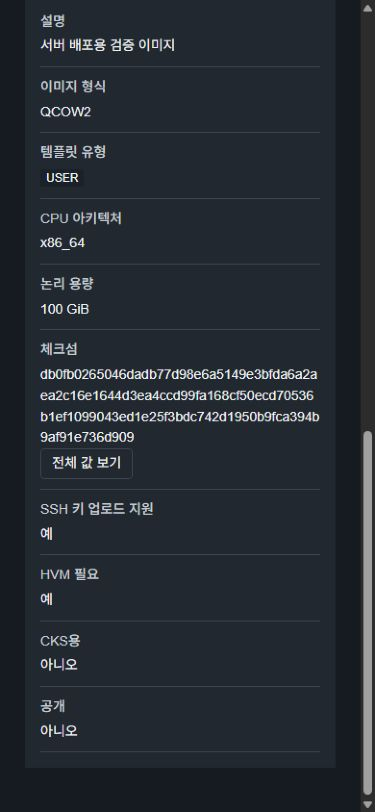

<!--
Licensed to the Apache Software Foundation (ASF) under one or more
contributor license agreements. See the NOTICE file distributed with this work
for additional information regarding copyright ownership. The ASF licenses this
file to you under the Apache License, Version 2.0 (the "License"); you may not use
this file except in compliance with the License. You may obtain a copy at
http://www.apache.org/licenses/LICENSE-2.0 . Unless required by applicable law or
agreed to in writing, software distributed under the License is distributed on
an "AS IS" BASIS, WITHOUT WARRANTIES OR CONDITIONS OF ANY KIND. See the License
for the specific language governing permissions and limitations.
-->

# 템플릿 Epic #1638 개발 준비

[상위 Epic #1638](https://github.com/ablecloud-team/ablestack-cloud/issues/1638) · 2026-11-13 KST

이 패키지는 8개 하위 이슈, 의존 관계, 현재 운영 UI 스타일의 목업, 구현 설계와 수용 검증 계획이다. **제품 기능 구현·13번 배포를 수행한 PR이 아니다.**

## 개발 순서

~~~text
P1: T01 #1639 ────────┐
P1: T02 #1640 ──┬─────┴──→ T04 #1642
               └────────→ T03 #1641
                         T03 + T04 + T02
                                ↓
                            T05 #1643
                           ↙         ↘
                  T06 #1644          T07 #1645
                           ↘         ↙
                T01–T07 모두 → T08 #1646
~~~

상세 필수 선행은 [설계의 순서 표](design.ko.md#1-개발-순서와-의존-관계)에 있다. 네이티브 parent/blocked_by의 검증 스냅샷은 [issues-verified.json](issues-verified.json)이다. 제목/본문뿐 아니라 GitHub 관계로 연결했다.

## 문서

- [구현 설계](design.ko.md): 상태/범위 모델, API·폼, UI 표준, Zone 작업·사전 준비, VNF 계약.
- [검증·개발 준비 체크리스트](validation-plan.ko.md): 작업별 테스트 목표와 미실행 실환경 행렬.
- [작업 범위 원본](issue-plan.json): 8개 작업의 소스 대상·설계·완료 기준.
- [목업 검증 기록](mockup-validation.json): 21 PASS. 운영 기능의 PASS가 아니다.

## 목업

[브라우저용 목업](mockup.html) / [대화형 원본](template-ui-prototype.html)

저장소를 내려받은 뒤 서버에서 열 수 있다:

~~~sh
python3 -m http.server 8764 --bind 127.0.0.1 --directory docs/design/epic-1638-templates
# 브라우저: http://localhost:8764/mockup.html
~~~

목록의 이름 → 상세 → Zone/VNF 탭 → 대화상자를 눌러 검토한다. admin cloud 메뉴에서 테마를 바꾼다. 예시 데이터만 사용하며 Cloud API·외부 서버로 요청하지 않는다. 화면 내 생성·변경·삭제는 메모리상의 목업 상태다. 실제 파일 업로드·다운로드, 권한 위임, VM 생성/부팅을 수행하지 않는다.

운영 화면의 shell/breadcrumb/좌측 요약/세로 탭/색상과 기존 MoldDialog 크기를 기준으로 구성했다. 새 배지형 대시보드로 재설계하지 않았다. 기존 source token은 `ui/src/style/theme/tokens.less`, 표준 대화상자는 `ui/src/components/view/MoldDialog.vue`를 따른다.

목업의 상태 전환은 예상 UX를 보여주는 시뮬레이션이다. prepareTemplate의 동기 접수 응답과 내부 background preload를 구분하고, 실제 구현은 선택 Primary의 관측을 통해 완료를 판정해야 한다.

| 화면 | 예시 |
|---|---|
| 목록과 실패 상태 |  |
| 원인과 요약을 함께 보여주는 상세 |  |
| 아키텍처 초기값·지원 기능 |  |
| 원본 상태와 확인 대기를 구분한 삭제 |  |
| 마지막 Zone 삭제 후 결과 유지 |  |
| 접수와 완료를 구분한 준비 |  |
| 지원 속성을 선택하는 VNF |  |
| 모바일 긴 체크섬 |  |

## 검증 범위와 한계

- JS 문법, 오프라인 동작·요청 코드 부재, 기본 레이블/DOM, 320/390/1024/1680px의 주요 화면을 확인했다.
- 검색/고급 검색, 실패 상세/원인, 편집의 값 보존·false, 준비 접수/관측, 선택 삭제/완료 결과, VNF 허용 키·비밀 값 입력 유형, 체크섬 오류/등록 접수, 양 테마·ESC 초점 복귀를 직접 조작했다.
- 미리보기 iframe에서는 filechooser 이벤트를 관찰하지 못했으나, 독립 목업 파일에서 지원되는 chooser로 QA 파일을 선택하고 필수 파일 폼의 접수 흐름까지 재검증했다. 최종 21개 항목이 PASS이며 실제 Cloud 업로드/네트워크 전송은 수행하지 않는다.
- 실제 Mold의 버그 수정/회귀, 권한/다중 Zone/게스트 부팅/다운로드 파일 수신/Primary 준비는 T08 등 구현 단계의 수용 검증이다.
- 준비 단계에 전체 Cloud/UI build나 운영 서비스 재시작이 필요하지 않아 실행하지 않았다.

## Git 및 배포 경계

- base: `ablestack-europa`, local/origin/upstream 모두 `8ad2d1ecd47092fd3bba8d445fd2c639c7f4be7c`, local ↔ upstream `0 0`.
- 작업 브랜치: `dhslove/epic-1638-template-ui`.
- origin에만 작업 브랜치를 push하고 upstream Europa의 Draft PR로 검토한다. 준비 PR 링크는 Epic 본문에서 확인한다.
- 다음 구현 시작 시 upstream fetch → local base 갱신 → 작업 브랜치 rebase 순서를 다시 적용한다.
- 현 준비 범위에 제품 소스·JAR·운영 UI·DB 변경은 없다. T06의 server 검증 보완 필요 범위는 설계에 명시했다.

## 관계 API 근거

네이티브 계층과 의존 관계의 의미는 GitHub의 [sub-issues 문서](https://docs.github.com/en/rest/issues/sub-issues), [issue dependencies 문서](https://docs.github.com/en/rest/issues/issue-dependencies)를 기준으로 했다. 이 문서는 native 관계의 읽기 검증 스냅샷을 제공하며 자동으로 이슈를 생성/변경하는 스크립트를 포함하지 않는다.
