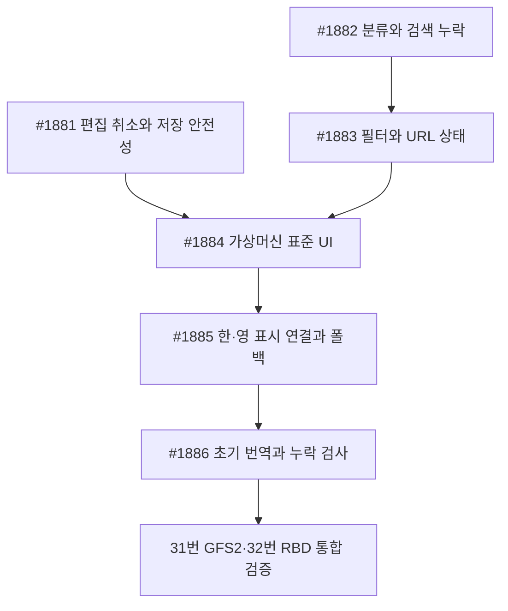

<!--
Licensed to the Apache Software Foundation (ASF) under one
or more contributor license agreements.  See the NOTICE file
distributed with this work for additional information
regarding copyright ownership.  The ASF licenses this file
to you under the Apache License, Version 2.0 (the
"License"); you may not use this file except in compliance
with the License.  You may obtain a copy of the License at

  http://www.apache.org/licenses/LICENSE-2.0

Unless required by applicable law or agreed to in writing,
software distributed under the License is distributed on an
"AS IS" BASIS, WITHOUT WARRANTIES OR CONDITIONS OF ANY
KIND, either express or implied.  See the License for the
specific language governing permissions and limitations
under the License.
-->

# 글로벌설정 Epic #1874 구현·검증 계획

Mold **구성 → 글로벌 설정**의 편집과 검색 결함을 수정하고 가상머신 UI 표준과 한·영 설명을 적용한다. 하위 이슈별 범위와 완료 기준은 [Epic #1874](https://github.com/ablecloud-team/ablestack-cloud/issues/1874)에서 추적한다.

## 기준 브랜치

- Upstream과 포크의 `ablestack-europa` 기준 커밋은 `31ccb55df5a3717c5dbdc1df7e5b58a3b566bc31`이다.
- 통합 작업 브랜치는 `dhslove:dhslove/epic-1874-global-settings`다.

## 구현 순서와 의존 관계

편집 취소와 계층 조회는 독립적으로 착수할 수 있다. 분류 결과의 표시 규칙을 확정한 후 필터와 URL 상태를 연결한다. 편집·조회 계약이 안정되면 공통 화면을 적용한다. 이어서 영어 원문과 한국어 카탈로그를 연결하고, 지원하는 설정의 번역을 검수한다.

| 순서 | 하위 이슈 | 선행 이슈 | 31·32번 클러스터의 핵심 검증 |
| --- | --- | --- | --- |
| 1 | [#1881 편집 취소와 저장 안전성](https://github.com/ablecloud-team/ablestack-cloud/issues/1881) | 없음 | `default.ui.page.size`의 Esc → Enter 무요청, 명시적 저장, 취소와 재설정, UI·API·DB 복원 |
| 2 | [#1882 분류와 검색 누락](https://github.com/ablecloud-team/ablestack-cloud/issues/1882) | 없음 | Agent 자식 단독 검색의 API·UI 1건 일치, Others의 다른 분류 부모 연결 |
| 3 | [#1883 필터와 URL 상태](https://github.com/ablecloud-team/ablestack-cloud/issues/1883) | #1882 | `category`·`name`·`keyword` 요청 대조, 직접 진입·새로고침·뒤로/앞으로 가기 |
| 4 | [#1884 가상머신 표준 UI](https://github.com/ablecloud-team/ablestack-cloud/issues/1884) | #1881, #1882, #1883 | 목록·상세·탭 도구·모달 비교, 현재값·기본값·적용 시점, 라이트·다크 |
| 5 | [#1885 한·영 표시 연결과 폴백](https://github.com/ablecloud-team/ablestack-cloud/issues/1885) | #1884 | 표시 경로의 한·영 전환, DB/API 원문 대조, 퇴행 테스트로 누락·불일치 폴백 확인 |
| 6 | [#1886 초기 번역과 누락 검사](https://github.com/ablecloud-team/ablestack-cloud/issues/1886) | #1885 | 양쪽 설정 메타데이터 합집합을 카탈로그와 대조하고 분류·설명의 번역 범위 확인 |

## 한·영 관리 계약

영어 UI는 DB에서 전달된 API `displaytext`·`description`을 사용한다. 한국어 UI는 `ui/src/locales/global-settings/ko_KR.json`에서 리터럴 설정 키와 필드별로 원문이 일치하는 번역을 선택한다. 일치하는 번역이 없으면 해당 필드에 API의 현재 원문을 표시한다. 분류 라벨은 공통 로캘에 둔다. 초기 수집과 배포 대조에는 설정의 이름·표시명·설명 및 분류 이름만 사용한다. 변경 PR은 한국어 문구와 검수 기준 원문을 함께 갱신한다. [원문·번역 구조와 갱신 규칙](https://github.com/ablecloud-team/ablestack-cloud/issues/1874)

## 글로벌설정 번역 검사와 배포 전 대조

- 번역 파일은 `ui/src/locales/global-settings/ko_KR.json`이다. 키·필드별로 API의 영어 원문과 검수한 한국어를 짝으로 저장한다. 설정을 추가하거나 원문을 바꿀 때 해당 번역을 같은 PR에서 검토한다. 예를 들어 `default.ui.page.size`의 `description`에는 `{ "enSource": "The default pagesize to be used by UI and other clients when making list* API calls", "ko": "UI와 다른 클라이언트가 목록 조회 API(list*)를 호출할 때 사용하는 기본 페이지 크기입니다." }`를 넣는다.
- 설정 선언과 마이그레이션에서 키, 자료형, 기본값, 적용 범위를 확인한다. 실제 사용 코드에서 단위, 값별 분기, 비활성화 조건, 적용 시점과 재시작 여부를 확인하고 검토한 파일이나 변경 이력을 PR에 남긴다. 지원 버전별 동작이 다르면 해당 버전의 코드와 원문을 확인하고, 동작을 확인하지 못한 원문은 영어 폴백으로 유지한다.
- 표시명은 짧은 명사구로 쓰고 설명은 완결된 문장으로 쓴다. 제품에서 쓰는 용어인 가상머신, 존, 스토리지 풀과 관리 서버를 일관되게 사용한다. 설정 키, API 이름, 열거형 값과 단위는 원래 의미가 유지되도록 표기한다.
- WSL의 `ui` 디렉터리에서 `npm run check:global-settings-i18n`을 실행하면 JSON의 키·원문 중복, 누락된 필드와 빈 문구를 검사한다. PR의 Lint 워크플로에서도 같은 검사를 실행한다.
- 배포 전에는 두 클러스터에서 `listConfigurations`의 `name`, `displaytext`, `description`과 `listConfigurationGroups`의 그룹·하위 그룹 이름을 추출한다. 메타데이터 파일은 `cluster` 문자열, `settings` 배열, `groups` 배열을 담는다. `settings`는 앞서 열거한 세 필드만, `groups`는 `name`과 하위 그룹 문자열 배열인 `subgroups`만 포함한다.
- `npm run check:global-settings-i18n -- metadata-31.json metadata-32.json`으로 배포 후보를 양쪽 메타데이터에 대조한다. 검사 결과는 클러스터·설정 키·필드별로 누락 또는 원문 불일치를 보여 준다. 둘 이상의 원문이 지원되는 설정은 해당 원문별 번역을 유지한다.

## 통합 검증

- [ ] 31번 GFS2와 32번 RBD에 동일한 후보 UI를 적용하고, 클러스터별 UI 번들과 API 결과를 기록한다. 변경 범위를 중심으로 관리자 UI에서 전체 목록과 분류 탭을 검증한다.
- [ ] 숫자 편집의 Esc·취소·Enter 경로와 명시적 저장·재설정을 브라우저 요청으로 대조한다. 시험 설정의 최초 상태를 기록하고 마지막에 UI·API·관리 서버 로컬 DB로 복원 여부를 확인한다.
- [ ] `agent.load.threshold`와 `backup.data.operation.timeout`에서 검색·분류·상위 이동을 검증한다. 설정 키와 범주 필터의 API 인자, 페이지·탭·브라우저 이력 복원, 빠른 조건 변경을 확인한다.
- [ ] VM의 목록·상세·볼륨 탭·편집 모달과 대조한다. 두 테마와 좁은 화면에서 목록·분류·초기화 모달 및 키보드 이동을 확인한다.
- [ ] 양쪽 API 메타데이터의 합집합과 초기 카탈로그를 대조하고, 한·영 전환과 원문 변경 폴백을 검증한다. 실제 클러스터 결과와 제어 응답을 사용한 회귀 결과를 구분해 남긴다.

기존 Cube 포트, 공통 breadcrumb와 자동 갱신, 개별 설정값 업무 효과는 선행 검증 이력으로 참조한다. [Cube 포트 #1187](https://github.com/ablecloud-team/ablestack-cloud/issues/1187) · [공통 breadcrumb #1605](https://github.com/ablecloud-team/ablestack-cloud/issues/1605) · [자동 갱신 #1078](https://github.com/ablecloud-team/ablestack-cloud/issues/1078)
