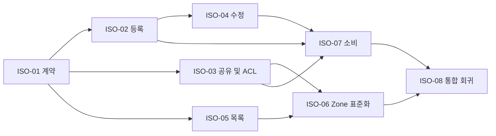

<!--
Licensed to the Apache Software Foundation (ASF) under one
or more contributor license agreements. See the NOTICE file
distributed with this work for additional information
regarding copyright ownership. The ASF licenses this file
to you under the Apache License, Version 2.0 (the
"License"); you may not use this file except in compliance
with the License. You may obtain a copy of the License at

  http://www.apache.org/licenses/LICENSE-2.0

Unless required by applicable law or agreed to in writing,
software distributed under the License is distributed on an
"AS IS" BASIS, WITHOUT WARRANTIES OR CONDITIONS OF ANY
KIND, either express or implied. See the License for the
specific language governing permissions and limitations
under the License.
-->

# ISO 기능 UI 검토 및 개선 설계

검토일: 2026-11-14~15 KST. 대상: 13번 Mold의 **이미지 > ISO**.
이번 산출물은 현상 분석과 개선 Epic이다. 제품 코드 수정, 제품 빌드, 배포, 서버 전역 설정 변경, SystemVM 재생성은 수행하지 않았다.

## 검토 기준과 환경

- 템플릿 Epic #1638 및 후속 #1661·#1662와 같은 UI 우선 원칙을 적용한다. 기능은 실제 UI에서 조작하고, 운영 UI의 API 문서와 소스로 계약 및 원인 후보를 대조한다. API 직접 호출만으로 UI 성공을 대신하지 않는다.
- 기준 소스: `ablestack-europa` `2c4045f1606f58085188c5cb1a203429cad0bf3e`. upstream/origin fetch 후 로컬 기준 브랜치와 upstream의 차이 `0 0`을 확인하고 문서 브랜치를 만들었다.
- 13번은 단일 `13-Zone`·KVM 환경이다. 다중 Zone 복사 및 비KVM 실행 결과는 미검증으로 남긴다. 기능을 삭제하거나 지원 범위를 축소하지 않는다.
- 현재 VM의 목록, breadcrumb, 상세 프레임, 설정/NIC 탭, 기존 네트워크 연결 대화상자를 읽기 전용으로 비교했다. 기존 VM은 변경하지 않았다.
- 일반/다크 화면을 확인했다. 네이티브 Chrome 창 1680×1018 및 복원 창 약 811×975에서 확인했으며, 이를 정확한 웹 viewport나 모바일 전수 검증으로 표현하지 않는다.
- 등록 미디어는 자체 생성한 데이터 전용 ISO다. 실제 OS 설치·부팅 성공을 주장하지 않는다.

## 확인 결과

| 구분 | 실제 UI에서 확인한 현상 | 판정 및 개선 방향 |
|---|---|---|
| P1 등록 | 로컬 파일과 사용자 데이터·APPEND를 함께 지정하면 요청 실패. ISO 행은 먼저 생성되지만 파일 업로드는 시작되지 않음 | 등록 ID를 보존하고 단계별 결과·재개·정리 경로를 제공. 실패 후 새 ISO 재등록으로 재시도하지 않도록 한다 |
| P1 등록 후 정리 | 위 대기 ISO는 일반 삭제도 거절됨. 운영 `upload.operation.timeout`은 60분 | 전역 시간을 낮추거나 DB 상태를 바꾸지 않음. 취소/만료/오류 상태의 안전한 정리 계약을 설계하고 UI에 반영 |
| P1 공유 상세 | 전용 일반 계정에 공유한 ISO는 목록/상세에서 조회되지만 Zone은 총 1개인데 행이 표시되지 않음 | 제한 응답과 선택적 필드를 허용하는 행 모델·렌더링. 저장소 세부 정보 권한과 Zone 기본 행을 분리 |
| P1 공유 회수 | 실제 공유 수신자 조회가 확인됐는데 권한 대화상자의 삭제 모드에는 회수할 계정이 없어 선택적 회수가 불가능 | listIsoPermissions 응답 해석과 현재 권한 현황을 교정. 전용 ISO만 재설정해 시험 공유 정리 |
| P1 체크섬 후속 검증 | 로컬 업로드에 MD5를 입력하고 Ready가 됐지만 상세에 체크섬이 없음. URL 등록 SHA-256/MD5는 보임 | API는 checksum을 지원한다. UI·서버 전달·저장·검증 결과를 연결하고 잘못된 체크섬 음성 시험을 추가. 현재 파일 무결성 우회가 재현됐다고 주장하지 않음 |
| P2 수정 | 상세 x86_64와 달리 편집의 아키텍처 초기값이 비어 있음 | 현재 값과 false/null을 구분해 초기화하고, 미변경 값은 보존 |
| P2 수정 검색 | 아키텍처에 존재하지 않는 검색어를 입력해도 x86_64/aarch64/s390x가 모두 표시됨 | option label/value 기준 검색으로 교정 |
| P2 API 누락 | updateIso는 bootable을 지원하지만 수정 UI에는 부팅 가능 항목이 없음 | 부팅 가능·OS 유형 연계와 변경 영향 안내를 설계 |
| P2 API 불일치 | 로컬 업로드 UI에는 아키텍처 선택이 있지만 운영 getUploadParamsForIso에는 arch가 없음 | URL/로컬의 실제 API capability를 구분. 지원을 추가하거나 제한을 명확히 안내하며 조용한 무시를 금지 |
| P2 입력 검증 | 잘못된 URL은 클라이언트를 통과해 서버의 URI 오류가 표시됨. URL 필수 오류 문구는 '로컬에서 ISO 업로드' | URL·파일·체크섬 형식과 필수 안내를 올바른 필드에 제공하고 입력 유지 |
| P2 목록 복귀 | 키워드 검색 또는 공유 필터에서 상세로 갔다가 breadcrumb로 돌아오면 조건이 사라짐 | 목록의 검색·필터·페이지·페이지 크기·정렬 상태를 복원 |
| P2 필터 표시 | 공유 필터를 선택하면 `label.isofilter : shared`와 `필터 : shared`가 중복 표시됨 | 번역된 하나의 필터 표시로 정리 |
| P2 목록/상세 | 긴 이름이 여러 줄이고 표가 가로로 확장됨. 작은 ISO는 0.00 GiB. 상세 boolean은 true/false이며 체크섬 복사 없음 | 이름 우선 폭·한 줄 ellipsis/전체 tooltip. 부가 열도 한 줄. 적절한 용량 단위와 현지화된 상태, 정확한 복사 제공 |
| P2 Zone 스타일 | 상단 도구 모음이 없고 선택 시 전폭 빨간 삭제 버튼이 생겨 표가 아래로 이동. 다크 펼침 표는 흰 배경, 진행률/상태는 100·DOWNLOADED·Successfully Installed | VM 탭의 도구 모음/표/페이지 배치와 공통 테마·상태 컴포넌트 사용. 선택 전후 위치 고정 |
| P1/P2 작업 조건 | 시스템 ISO는 개별 삭제/복사를 숨기지만 선택하면 일괄 삭제 버튼이 보임. 상세 작업 메뉴에는 수정/공유/다운로드가 노출 | 소유자·프로젝트·시스템 리소스·API 권한에 대한 공통 판단 사용. 실제 시스템 ISO 변경/삭제는 제출하지 않았고 서버 권한 우회를 주장하지 않음 |
| P2 만료 상태 | 정상 만료 후 펼침 저장소는 ABANDONED인데 요약은 대기 중, Zone 상태는 Processing | 실패·만료를 진행 중과 구분하는 공통 상태 매핑과 갱신 적용 |
| P2 소비 경로 | 비부팅 Ready ISO에도 VM 생성 rocket이 활성. 클릭하면 ISO 유형이 잠긴 빈 이미지 목록과 비활성 생성 버튼에 도달 | 부팅 미디어와 추가 데이터 미디어 경로를 구분하고 가능한 작업만 안내. 실제 VM 생성은 수행하지 않음 |
| P2 빈 상태 | 비공유 ISO 직접 접근은 빈 상세 후 긴 서버 권한 오류가 표시됨. 복사 대상 Zone이 없는 경우 빈 선택 대화상자만 열림 | 권한 없음·대상 없음·실패·로딩을 구별하고 가능한 복귀/재시도 경로 제공 |
| P2 대화상자 | 등록·로컬 업로드·복사·권한 창의 크기, 긴 본문 스크롤, 본문 안의 확인/취소 배치가 VM 표준과 다름 | MoldDialog의 고정 Header/Footer, Body만 스크롤, 필드 순서·초점·중복 제출 방지 적용. 이미 표준화된 ISO 편집은 보존·보완 |

## API ↔ UI 대조

운영 UI의 API 문서에서 `getUploadParamsForIso`, `updateIso`, `listIsos` 파라미터를 직접 열어 확인했다. 상속 API의 공통 설명만으로 실제 ISO 동작을 판정하지 않는다.

| API/기능 | UI 및 계약 확인 | 개발 범위 |
|---|---|---|
| listIsos | UI 고급 검색: name/zoneid/tags/arch/oscategoryid 및 관리자 storageid/imagestoreid. API의 bootable/isready/ispublic/hypervisor/userdataid는 UI 필터에 없음 | 사용 목적에 맞는 누락 필터 추가, 권한별 허용, 서버 count/page 유지. storageid/imagestoreid는 관리자 API가 지원하므로 잘못된 필터로 분류하지 않음 |
| registerIso | 관리자 SHA-256 URL ISO와 일반 계정 MD5 URL ISO가 Ready. **bootable=false**로 등록됨 | 이름/설명·Zone·소유 범위·arch·부팅/OS·체크섬·공유 속성의 실제 지원 계약 보존 |
| getUploadParamsForIso | 일반 로컬 파일은 Ready. 사용자 데이터 동시 지정 실패. 응답은 id/postURL/metadata/expires/signature이며 iso[]가 아님 | 정확한 응답 처리, 파일 업로드/Ready/후속 연결 구분, 만료·부분 실패·중복 방지 |
| updateIso | 이름·설명과 사용자 데이터 APPEND 변경이 실제 저장됨. arch/bootable/details/cleanupdetails API 지원 확인 | arch 초기값·검색, bootable UI 추가. 세부 설정은 유효한 ISO 운영 키와 저장/조회 계약을 먼저 확정 |
| details 설정 | 현재 ISO 탭에는 설정이 없음. API 공통 details/cleanupdetails 존재 | 임의 VM/템플릿 전용 키를 복제하지 않음. ISO에 유효한 키가 확인되면 공통 설정 표를 재사용하고 저장 값/후보/읽기 전용을 구분 |
| updateIsoPermissions / listIsoPermissions | 계정 공유 후 일반 계정에서 실제 조회됨. 빈 대상 제출은 올바르게 차단됨. 일반 소유자의 extractable false→true 저장 및 다운로드 메뉴 노출 정상. 공유 회수의 계정 선택 목록 누락은 오류로 확인했으며, 전용 ISO의 재설정 후 수신 목록 1→0을 확인 | 현재 권한 현황·추가/제거/초기화와 소유자/비소유자/프로젝트 조건, 공통 API 설명의 ISO 예외 정합성 |
| copyIso | 단일 Zone이라 실제 목적지 없음. 성공 복사는 미검증 | 다중 목적지 기능 유지, 대상 없음 안내, 작업 접수·실제 완료·Zone Ready 분리. 상속된 copytemplateresponse라는 기존 응답을 이름만 보고 오류로 바꾸지 않음 |
| deleteIso | 일반 소유자 Ready ISO 삭제 완료 및 목록 0 복귀. 실패 등록 ISO는 대기 중 삭제 차단 | 단일/일괄 결과, 대상 이름·Zone·영향, 부분 실패·새로고침·선택 보존, 안전한 정리 |
| extractIso | UI에서 추출 완료. 사용자 직접 파일 수신 후 실제 로컬 파일 크기/SHA-256을 대조해 일치 | 한국어 결과와 명확한 다운로드 버튼·상태 제공. HTTP 외 옵션은 운영 필요성·지원 여부 확인 없이 무조건 추가하지 않음 |
| VM ISO 연결/해제 | 기존 #1124·#1157 공통 구현을 재사용할 대상. 이번에는 비부팅 ISO 생성 연결의 막힌 경로만 실제 확인 | 기존 ISO 탭/작업 메뉴를 중복 구현하지 않음. 실제 attach/detach/게스트 부팅은 구현 단계 회귀에 포함 |
| 태그/코멘트/이벤트 | 전용 일반 소유 ISO의 태그 생성/삭제, 관리자 ISO 코멘트 생성/삭제, ISO 생성·편집·추출 이벤트 정상 | 공통 컴포넌트 정상 동작 보존 |

검색 의미도 보존한다. 키워드 `Driver`는 VirtIO Driver 1건을 찾고, 고급 이름 `Driver`는 정확 일치 대상이 없어 0건이다. 도움말이 필요하면 필드 tooltip으로 제공한다. breadcrumb와 목록 사이에 상시 설명 문구를 추가하지 않는다.

## VM 표준에 맞춘 화면 설계

- **목록:** VM의 공통 목록 프레임과 breadcrumb/업데이트/작업/검색 배치를 사용한다. ISO 이름에 우선 폭을 배정하고 상태·OS·arch 등 부가 정보는 제한 폭과 한 줄 ellipsis/tooltip을 사용한다. VM 목록에 남은 줄바꿈 문제까지 복제하는 것을 표준 적용으로 보지 않는다.
- **상세:** ResourceLayout·ResourceView·InfoCard를 재사용한다. 원문 ID/체크섬/URL은 전체 값 확인·정확한 복사가 가능해야 한다. 상태/공유/부팅 속성을 알아보기 쉽게 묶고 크기를 유효한 단위로 표시한다.
- **탭:** ISO의 상세·Zone·이벤트·코멘트 구조를 유지한다. ISO 유효 설정 항목이 확정되면 Zone 다음에 설정을 배치한다. 템플릿의 VNF/SHAREDFS 탭을 ISO에 기계적으로 추가하지 않는다.
- **Zone 콘텐츠:** 상단 좌측 작업/업데이트, 우측 검색, 아래 동일 폭 표와 페이지 영역으로 배치한다. 선택 수·삭제 버튼을 고정 도구 영역에서 표시한다. 저장소 세부 정보는 Primary/Secondary 구분과 테마 토큰, 지역화된 상태, 백분율로 표현한다.
- **대화상자:** #1213의 VM/MoldDialog 계약을 사용한다. 제목·대상 요약, 고정 Footer의 의미 있는 버튼, Body만 스크롤, inline 오류·입력 보존, 제출 중 닫기/중복 방지, Esc와 초점 복귀를 적용한다. URL/로컬 지원 필드와 소유 범위를 정확히 분리한다.
- **접근성/반응형:** rocket 같은 내부 아이콘명을 작업 이름으로 읽지 않도록 레이블을 제공한다. 키보드 조작, 일반/다크의 텍스트·배경·경계·선택·오류·비활성 상태, 긴 이름과 좁은 화면을 구현 단계에서 검증한다.

## 개발 작업 및 의존 관계

아래는 최초 분석 시 정의한 작업 단위다. 이후 실제 하위 이슈 #1666~#1673과 선행 관계를 연결했으며 [단계별 구현 준비](implementation-plan.ko.md)에서 착수/검증 게이트를 관리한다.

| 순서/ID | 우선순위 | 작업 | 선행 조건 | 핵심 완료 기준 |
|---|---|---|---|---|
| 1 ISO-01 | P1 | ISO API capability·응답·상태·작업 권한 공통 모델 | 없음 | URL/로컬/조회/수정/공유 차이와 선택적 필드·시스템 리소스 조건을 테스트로 고정 |
| 2 ISO-02 | P1 | 등록·로컬 업로드·사용자 데이터·체크섬·실패 정리 | ISO-01 | 로컬+사용자 데이터 성공, 체크섬 전달/저장/일치·불일치 검증, 부분 실패와 만료 재시도로 중복/방치 없음 |
| 3 ISO-03 | P1 | 공유 ISO Zone 렌더링·ACL·공유 관리 정합성 | ISO-01 | 일반 공유 수신자도 Zone 행 표시, 권한별 메뉴/선택/제출 일치, 실제 계정 공유·회수 검증. 공통 권한 보정 시 템플릿 추가/제거/초기화 회귀 포함 |
| 4 ISO-04 | P2 | 수정 대화상자와 부팅/arch·설정 계약 | ISO-01, ISO-02 | 저장 값 초기화/검색, 부팅 가능/OS 연계, false 보존, 사용자 데이터 연결·해제, 유효 설정 범위 확정 |
| 5 ISO-05 | P2 | 목록·breadcrumb·검색 상태와 이름 우선 열 | ISO-01 | 누락 필터·번역/중복 칩·복귀 상태·한 줄 ellipsis/tooltip, 서버 count/page와 일치 |
| 6 ISO-06 | P2 | 상세·Zone·복사/삭제 대화상자 VM 표준화 | ISO-03, ISO-05 | 일반/다크 동일 구조, 고정 도구 영역, 상태/진행/용량/복사, 복사·삭제 완료/부분 실패 표시 |
| 7 ISO-07 | P2 | 다운로드 및 VM ISO 소비 경로 정합성 | ISO-02, ISO-03, ISO-04 | 파일 크기/hash, 비부팅 데이터 미디어·부팅 ISO 경로 구분, 기존 VM 공통 연결/해제 보존 |
| 8 ISO-08 | P1 완료 게이트 | 실계정 ACL·통합 UI 회귀 및 필요한 변경만 13번 검증 | ISO-01~07 | 아래 회귀 행렬과 정리 결과를 API/실제 상태·UI로 대조. 기존 CI 부채와 신규 회귀를 분리 |

ISO-02와 ISO-03은 ISO-01 뒤 독립 진행할 수 있다. 표의 순서는 통합 순서이며 P1 두 결함을 시각 정리보다 먼저 해결한다. ISO-08의 P1은 최종 완료 조건의 중요도이고 선행 개발보다 먼저 실행한다는 뜻이 아니다.

## 구현 단계 필수 회귀

- 역할: 관리자, 일반 소유자, 일반 공유 수신자, 미공유 사용자, 도메인 관리자, 프로젝트 소유/구성원/비구성원, 읽기 전용 및 API 일부 허용/거부. 목록·직접 상세·Zone·선택·작업·제출·비동기 완료까지 확인한다. 이번 검토에서 실제 실행한 것은 관리자와 전용 일반 계정의 소유/미공유/공유 일부 경로이며 전체 ACL 행렬 통과를 주장하지 않는다.
- URL/로컬: 부팅 가능/불가, x86_64 및 지원 arch, MD5/SHA-256 형식·정상·불일치, 사용자 데이터 연결/해제/APPEND 등 정책, 취소·만료·부분 실패·새로고침·재시도·중복 제출.
- 업로드 호환성: 기존 템플릿 검증 원칙처럼 **4.21 계열과 4.23 계열 SystemVM에서 각각 실제 로컬 업로드를 완료**해야 한다. 이번 분석에서 SystemVM을 재생성하지 않았으며 두 계열 ISO 회귀를 완료했다고 표시하지 않는다.
- 일반/다크, 데스크톱 및 좁은/낮은 화면, 긴 이름·OS명·체크섬, loading/empty/permission/error/stale, 페이지 경계, 키보드 Enter/Esc/Tab·초점 복귀. 정확한 viewport 검증은 구현 단계에 수행한다.
- 복사: 다중 Zone 성공·기존 대상·부분 실패·삭제 경합은 추가 환경에서 검증한다. 13번에 없는 환경은 NOT_RUN으로 구분하고 실제 기능을 유지한다.
- VM: 전용 자원에서 설치 ISO·추가 데이터 ISO, 단일/다중 연결·해제·이미 연결됨·한도·권한, 실제 시작/부팅 및 정리. 기존 사용자 VM은 변경하지 않는다.
- 변경 범위 lint/unit/build와 UI 기능 검증을 구분한다. 전체 저장소 CI #926·#1044는 별도 유지하며 신규 실패를 기존 부채로 덮지 않는다.

## 소스 원인 근거와 해석의 한계

기준 SHA의 다음 위치는 UI에서 확인한 현상을 보강하는 근거다.

- `RegisterOrUploadIso.vue:632~634`: getuploadparams를 읽은 직후 사용자 데이터 분기에서 `postuploadisoresponse.iso[0].id`를 읽는다. 로컬 분기에는 정책 인자도 전달하지 않는다. 등록 접수 후 업로드가 시작되지 않는 현상과 일치한다.
- `UpdateTemplateIsoPermissions.vue:245~250`: ISO 권한 응답에서 templatepermission 하위만 읽는다. 실제로 공유한 계정이 제거 모드에서 누락된 현상에 대해 응답 루트/하위 형태를 대조해야 한다.
- `UpdateISO.vue:208`: 초기화 목록에 arch가 없다. `:130`과 등록 `:221`은 option.children 구조에 의존한다.
- `IsoZones.vue:40`: downloaddetails.length를 무조건 읽는다. 공유 수신자의 빈 Zone 행 현상의 원인 후보이며 런타임 예외 stack을 직접 수집한 것으로 표현하지 않는다.
- `IsoZones.vue:22~28`: 일괄 삭제는 API 존재+선택 수 조건이다. 개별 작업의 소유자/시스템 조건과 일치하지 않는다. `image.js:300/322/337/363`은 시스템 domainid를 숫자 1로 비교한다.
- `AbstractGetUploadParamsCmd.java:43`은 checksum을 지원한다. `TemplateAdapterBase.java:546~552`의 IsoUploadParams 구성과 `UploadParamsBase.java:90~103`의 생성자는 checksum을 전달·설정하지 않는다. UI의 로컬 체크섬 미표시와 연결해 수정/음성 검증이 필요하다.
- `TemplateManagerImpl.java:1917~1922`는 ISO 소유자의 extractable 변경을 허용하는 예외가 있다. 공통 API 설명의 root-only 문구만으로 정상 소유자 동작을 버그로 분류하지 않는다.
- CopyIsoCmd는 CopyTemplateCmd를 상속하며 기존 getCommandName 경로가 copytemplateresponse를 사용한다. 실제 복사를 실행하지 않고 응답명만 보고 결함으로 단정하지 않는다.

## 테스트 자원 및 파일 무결성

데이터 ISO 크기: **1,525,760 bytes**. SHA-256: `171cc1569c3078e9b4b9e0d88338ba8ac990fb0843a431193c63d60669662ca4`.
MD5: `d1cfa4ad592ccaa06f1b733142ce1fdf`.
사용자가 직접 다운로드한 `qa-iso-url-20261114.iso`를 로컬 파일에서 해시 계산해 원본과 일치함을 확인했다. 다운로드 링크를 생성한 것만으로 성공 처리하지 않았다.

최종 정리 결과는 `cleanup-result.json` 및 `resource-ledger.json`에 기록한다. 임시 HTTP fixture 삭제 후 404, 제품 index/color/config/WEB-INF의 SHA-256과 Mold PID 보존을 확인했다. 기존 ISO 8개와 기존 계정 3개, 기존 VM/네트워크/스토리지는 보존 대상이다. 시험용 ISO 4개·계정 1개·사용자 데이터 1개와 임시 HTTP fixture만 정리한다. 로컬 증거와 사용자 다운로드 파일은 검토 자료로 보존한다.

## 최종 정리 완료

2026-11-15 KST 최종 UI에서 **기존 ISO 8개 ID 전부 일치, 시험 ISO 4개 삭제, 시험 계정 1개 삭제 후 기존 3개 보존, 시험 사용자 데이터 1개 삭제 후 0개, 시험 공유 재설정 후 수신 목록 0개**를 확인했다. 업로드 미시작 ISO는 정상 ABANDONED 만료 후 UI로 삭제했으며 DB/전역 설정을 변경하지 않았다. 태그와 코멘트도 생성/삭제 확인을 마쳤다. 시험 VM/네트워크는 생성하지 않았다. 원래 다크 테마와 Chrome 복원 창 크기로 되돌렸다.

[최종 ISO 목록](screens/iso-cleanup-baseline-eight-dark.png) · [정상 만료 상태 불일치](screens/orphan-expired-abandoned-status-mismatch-dark.png)

## 증거

`ui-cases.json`은 UI 실행 기록, `source-anchors.json`은 소스 대조 위치, `screens/`는 실제 화면이다. 화면은 성공/실패/추론/미검증을 구분해 위 표와 함께 읽는다. 다운로드용 임시 URL, 로그인 값, API 키/비밀키, 세션/서명/헤더는 보고서에 저장하지 않는다.

- [로컬 업로드와 사용자 데이터 실패](screens/local-upload-userdata-error.png)
- [공유 수신자의 Zone 1개/행 0개](screens/shared-iso-zone-count-one-no-row-light.png)
- [Zone 다크 모드](screens/zone-expanded-dark-before.png)
- [VM 표준 NIC 탭](screens/vm-nic-standard-dark.png)
- [VM 표준 대화상자](screens/vm-dialog-standard-dark.png)
- [수정 아키텍처 검색 오류](screens/edit-architecture-search-broken.png)
- [운영 업로드 API](screens/live-api-upload-iso-parameters-light.png)
- [운영 수정 API](screens/live-api-update-iso-parameters-light.png)
- [운영 목록 API](screens/live-api-list-iso-parameters-light.png)

관련: #1638, #1661, #1662, #1213, #1124, #1157. Kubernetes ISO 전용 Epic #1227/#1230과 범위를 혼합하지 않는다. CI 부채 #926·#1044는 OPEN 별도 관리한다.

## 단계별 구현 준비 완료

하위 이슈 #1666~#1673 및 GitHub 실제 의존 관계 17개를 연결했다. 첫 구현 대상은 **#1666 (ISO-01)**이다. [구현 준비·설계·검증 행렬](implementation-plan.ko.md)을 참조한다. 준비용 기존 관련 테스트 5 suites/64 tests는 통과했으며 제품 구현과 13번 실환경 검증은 아직 수행하지 않았다.
