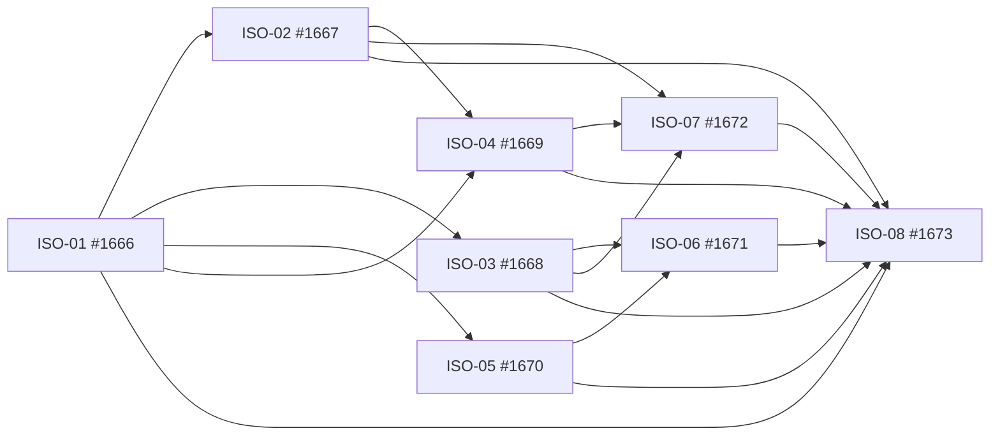

<!--
Licensed to the Apache Software Foundation (ASF) under one
or more contributor license agreements. See the NOTICE file
distributed with this work for additional information
regarding copyright ownership. The ASF licenses this file
to you under the Apache License, Version 2.0 (the
"License"); you may not use this file except in compliance
with the License. You may obtain a copy of the License at

  http://www.apache.org/licenses/LICENSE-2.0

Unless required by applicable law or agreed to in writing,
software distributed under the License is distributed on an
"AS IS" BASIS, WITHOUT WARRANTIES OR CONDITIONS OF ANY
KIND, either express or implied. See the License for the
specific language governing permissions and limitations
under the License.
-->

# Epic #1664 단계별 구현 준비

작성일: 2026-11-15 KST. 이번 변경은 설계/검증 명세와 이슈 연결만 포함한다. 제품 구현·제품 배포·13번 자원 변경은 수행하지 않았다. 기존 README의 2c4045 검토 시점/실제 UI 근거는 이력으로 보존한다.

## 착수 상태

- [x] 로컬 기준 브랜치 갱신 후 준비 브랜치를 rebase했다.
- [x] 로컬/`origin/ablestack-europa`/`upstream/ablestack-europa`가 모두 `1046a5dc3f21cb9cca0ab6881dd906d64b591e80`, 차이는 각각 `0 0`이다. origin 기준은 기존 upstream 커밋으로만 fast-forward 동기화했다. 작업 커밋은 origin 작업 브랜치에만 push하고 upstream에는 PR로 반영한다.
- [x] GitHub 실제 하위 이슈 8개를 Epic에 개발 순서대로 연결하고 선행 blocked-by 관계 17개를 재조회 검증했다.
- [x] 각 이슈에 문제/설계/변경 대상/완료 조건/테스트/필요 배포 범위를 작성했다. 이슈 완료 조건은 아직 미실행이다.
- [x] 구현 도구 Node 20.20.2·npm 10.8.2·Java 17·Maven 3.6.3과 기존 UI 의존성 사용을 확인했다. Docker는 설치되어 있지 않으며 WSL ext4의 직접 UI/모듈 빌드가 준비 경로다.
- [x] 최신 기준의 관련 기존 UI 5개 스위트/64건이 통과했다. 이는 준비용 baseline이며 ISO 신규 구현/실환경 검증 결과가 아니다. 기존 Browserslist/중복 등록 경고와 전체 CI 부채는 구분한다.
- [x] 로컬 구현 브랜치 `dhslove/epic-1664-iso`를 갱신된 로컬 기준에서 생성했다. 현재 기준 SHA만 가리키며 첫 제품 커밋 뒤 origin push/구현 Draft PR을 생성한다.

**첫 구현 대상은 ISO-01 #1666이다.** API 지원·원문 응답·상태·작업 권한을 정의하고 실제 상태/작업 노출 소비 지점에 연결하는 범위다. 이 계약을 먼저 고정해야 로컬 업로드와 공유 수정이 서로 다른 Ready/ACL/오류 기준을 사용하지 않는다.

## 이슈와 통합 순서

| 순서 | 이슈 | 우선순위 | 작업 | 선행 | 현재 착수 상태 |
|---|---|---|---|---|---|
| 1 | [ISO-01 #1666](https://github.com/ablecloud-team/ablestack-cloud/issues/1666) | P1 | [ISO-01][Europa][P1] ISO API·응답·상태·작업 권한 공통 계약 정리 | 없음 | 착수 가능 |
| 2 | [ISO-02 #1667](https://github.com/ablecloud-team/ablestack-cloud/issues/1667) | P1 | [ISO-02][Europa][P1] ISO 등록·로컬 업로드의 사용자 데이터·체크섬·실패 정리 개선 | #1666 | 선행 완료 후 |
| 3 | [ISO-03 #1668](https://github.com/ablecloud-team/ablestack-cloud/issues/1668) | P1 | [ISO-03][Europa][P1] 공유 ISO Zone 행과 권한 회수 목록·ACL 정합성 개선 | #1666 | 선행 완료 후 |
| 4 | [ISO-04 #1669](https://github.com/ablecloud-team/ablestack-cloud/issues/1669) | P2 | [ISO-04][Europa][P2] ISO 수정의 부팅 가능·아키텍처·사용자 데이터 및 설정 계약 보완 | #1666, #1667 | 선행 완료 후 |
| 5 | [ISO-05 #1670](https://github.com/ablecloud-team/ablestack-cloud/issues/1670) | P2 | [ISO-05][Europa][P2] ISO 목록·breadcrumb·검색 조건 복원과 이름 우선 열 개선 | #1666 | 선행 완료 후 |
| 6 | [ISO-06 #1671](https://github.com/ablecloud-team/ablestack-cloud/issues/1671) | P2 | [ISO-06][Europa][P2] ISO 상세·Zone·복사 및 삭제 대화상자를 VM 표준으로 통일 | #1668, #1670 | 선행 완료 후 |
| 7 | [ISO-07 #1672](https://github.com/ablecloud-team/ablestack-cloud/issues/1672) | P2 | [ISO-07][Europa][P2] ISO 다운로드 결과와 VM 부팅·데이터 미디어 소비 경로 개선 | #1667, #1668, #1669 | 선행 완료 후 |
| 8 | [ISO-08 #1673](https://github.com/ablecloud-team/ablestack-cloud/issues/1673) | P1 최종 게이트 | [ISO-08][Europa][P1] 13번 ISO 실계정 ACL 전체 행렬·통합 UI 회귀 및 자원 정리 | #1666, #1667, #1668, #1669, #1670, #1671, #1672 | 선행 완료 후 |

ISO-01 완료 뒤 ISO-02와 ISO-03은 독립적으로 진행할 수 있다. 기본 통합 순서는 표와 같고 P1 결함을 P2 시각 정리보다 먼저 검증한다. ISO-05도 ISO-01 후 기술적으로 착수 가능하지만 P1 둘을 먼저 처리한다. ISO-08의 P1은 종료 게이트 중요도이며 첫 작업이라는 뜻이 아니다.

## 단계별 게이트와 범위 경계

| 단계 | 대상 | 단계가 끝나는 조건 |
|---|---|---|
| G0 준비 | 이 문서·PR #1665 | 기준/도구/문제 근거·하위/선행 관계·설계·검증 시나리오 준비. 제품 코드는 시작하지 않음 |
| G1 계약 | #1666 | 작은 ISO adapter와 상태/권한/capability 규약, 기존 상태·작업 소비 지점 연결 및 관련 회귀/UI 확인. 등록 폼과 공유 렌더링을 대규모로 재작성하지 않음 |
| G2 P1 기능 | #1667 → #1668 | 로컬+사용자 데이터·체크섬·재시도/정리, 공유 행/특정 권한 회수 성공. #1667 종료 전 4.21→4.23 양 계열 실제 업로드 통과 |
| G3 수정/목록 | #1669 → #1670 | bootable/OS·arch 초기값/검색·false·부분 성공, 유효 설정 계약, 검색/복귀/이름 우선 열. ISO 유효 설정이 없으면 그 결론을 명시 |
| G4 표준/소비 | #1671 → #1672 | VM 표준 Zone/대화상자·다크/반응형, 명확한 추출 및 부팅/데이터 ISO 소비·기존 VM 공통 경로 회귀 |
| G5 통합 | #1673 | 실제 계정 전체 행렬·UI/API/실제 상태·필요 보정 배포·자원 정리 대조. 미지원 환경은 NOT_RUN과 완료 범위로 명시. 하위/PR/Epic 결과 갱신 뒤 종료 판단 |

이슈 #1666은 상태·작업 조건 helper 및 소비 지점, #1667은 등록/업로드와 필요한 API/server 전달, #1668은 공유 Zone 읽기/렌더링과 공통 권한 응답, #1671은 그 위의 최종 배치/스타일을 소유한다. 단순히 같은 파일을 사용한다는 이유로 각 이슈에서 다른 정책을 중복 구현하지 않는다.

## ISO-01의 첫 코드 작업

1. `ui/src/config/section/image.js`, `RegisterOrUploadIso.vue`, `UpdateISO.vue`, `IsoZones.vue`, `UpdateTemplateIsoPermissions.vue`와 API 명령/상속 응답을 읽고 actual wire fixture를 고정한다.
2. 신규 예정 `ui/src/utils/isoModel.js`에 작은 capability/행/표시 상태/작업 조건 계약을 둔다. 기존 templateAvailability 등의 공통 의미는 재사용하되 listTemplates/templatefilter/템플릿 전용 설정 호출을 ISO에 섞지 않는다.
3. 다음 표의 기대값을 단위 테스트로 고정하고 목록·InfoCard 상태와 상세/행/선택 작업 판단에 연결한다. 다음 이름은 계획이며 아직 테스트 파일을 생성하지 않았다: `tests/unit/utils/isoModel.spec.js` 및 ISO 소비 지점 통합 회귀.
4. 변경 경로 lint/unit/build를 통과하고 13번 현재 배포 상태를 새로 캡처한 뒤 UI 자산만 필요한 범위에 배포하여 상태/작업 노출을 확인한다.
5. 이슈/구현 PR에 커밋·UI 근거·제한·정리 결과를 기록해 #1666을 종료하면 #1667·#1668·#1670의 선행 차단이 해소된다.

| 입력/권한 fixture | 기대 계약 |
|---|---|
| Ready=false + ABANDONED/UPLOAD_ERROR | 실패/만료 표시. 대기 중/Processing으로 합산하지 않음 |
| Ready=true + 저장소 세부 필드 없음 | Ready 기본 행 유지. 저장소 정보가 없다는 이유로 렌더 예외/실패 처리하지 않음 |
| 다운로드 100 + Ready=false | 준비 확인 중, 배포 가능으로 조기 판정하지 않음 |
| 원문 boolean false/문자열 false/누락 | false와 unknown을 구분하고 truthy 문자열로 권한을 확대하지 않음 |
| 1개 대표 Zone / 전체 관측 불완전 | 전체 Zone 완료로 과장하지 않음. 관측 ID·scope·count 검증 |
| system 소유 ISO + domain UUID | 숫자 domainid=1 비교 제거. 상세/행/선택 작업 조건 일치 |
| API 일부 허용·읽기 전용 | roletype 이름만으로 쓰기 허용하지 않음. API 및 소유/프로젝트 조건을 함께 적용 |
| getUploadParamsForIso만 허용 | URL 등록 capability와 분리. 실제 폼 적용은 #1667에서 완료 |
| 로컬 arch 없는 메타데이터 | 지원 없음 명시, 조용히 전송/무시 금지. #1667에서 전달/API 보완 |
| 권한 조회 실패/잘못된 payload | 정상 빈 허용 목록으로 취급하지 않음. #1668의 보호된 재시도에 사용 |

## UI 배치 및 컴포넌트 계약

- 목록은 공통 breadcrumb/업데이트/작업/검색 프레임을 사용한다. 이름에 우선 폭을 주고 상태·OS·arch 등 부가 열도 한 줄 ellipsis/전체 tooltip으로 처리한다. 검색 의미 설명은 필요한 필드 도움말에만 둔다.
- 상세는 ResourceLayout/ResourceView/InfoCard를 유지한다. 원문 ID/체크섬/URL의 정확한 복사와 유효 용량 단위를 제공하고 상태/부팅/공유 속성을 알아보기 쉽게 묶는다.
- Zone은 좌측 작업·업데이트/선택 수, 우측 검색, 아래 표·페이지 영역이다. 선택 전후 높이를 고정한다. Primary/Secondary 저장소는 공통 테마/진행/상태를 쓰며 제한 권한에서 기본 행을 잃지 않는다.
- 대화상자는 VM/MoldDialog의 고정 Header/Footer·Body 스크롤, 대상 요약, inline 오류/입력 보존·중복 방지·초점 복귀를 사용한다. 등록/권한/수정 이슈에서 적용한 공통 구조를 스타일 이슈가 다시 별도 구현하지 않는다.
- ISO의 상세·Zone·이벤트·코멘트를 유지하고, 유효한 ISO 설정 키가 확인되면 Zone 뒤에 공통 설정 표를 둔다. VNF/SHAREDFS와 VM/템플릿 전용 키를 기계적으로 추가하지 않는다.

## 실계정 ACL 전체 행렬 준비

현재 아래 통합 행렬은 **NOT_RUN**이다. 검토 당시 관리자/일반 소유·공유·미공유 일부 경로와 준비용 64건 단위 테스트를 이 표의 통과로 표시하지 않는다.

모든 행에서 목록/직접 상세/Zone 기본 행·저장소 상세/행·선택·일괄 작업/대화상자 필드/제출/비동기 완료/권한 회수 후 재조회까지 확인한다. 기대 권한은 실제 서버 API ACL·소유/도메인·프로젝트 범위에서 확정하고 UUID 문자열이나 role 이름만으로 추정하지 않는다.

| 행 | 실제 계정/범위 | 집중 검증 |
|---|---|---|
| A01 | Root Admin, 일반 ISO | 전체 관리 및 실제 결과/정리 |
| A02 | Root Admin, 시스템 ISO | 읽기와 보호된 작업 노출. 시스템 원본 변경/삭제 시험 금지 |
| A03 | 일반 사용자, 자신 소유 | 등록/수정/공유·extractable 예외·복사/삭제·소비 |
| A04 | 일반 사용자, 공유 수신 | 목록/직접 상세/Zone 행, 허용된 소비와 관리 작업 제한 |
| A05 | 일반 사용자, 미공유 비공개 | 데이터/작업 차단과 명확한 오류·복귀 |
| A06 | Domain Admin, 자기 하위 도메인 | 실제 API 허용 범위와 선택/일괄 일치 |
| A07 | Domain Admin, 범위 밖 도메인 | 교차 범위 차단 |
| A08 | 프로젝트 소유자/관리자 | project scope·공유/관리 및 페이지 복원 |
| A09 | 프로젝트 일반 구성원 | project role별 읽기/쓰기 차이 |
| A10 | 프로젝트 비구성원 | 직접 URL/조회/제출 차단 |
| A11 | Read-Only User, 자신/공유 | 읽기 유지·쓰기/선택/제출 차단 |
| A12 | Read-Only Admin | Admin roletype만으로 쓰기 노출하지 않음 |
| A13 | listIsos+로컬 업로드 API만 허용 | URL 등록과 독립된 로컬 경로 |
| A14 | listIsos+URL 등록 API만 허용 | 로컬 업로드 미지원 상태 |
| A15 | 권한 조회/갱신 API 각각 거부 | 현황 오류와 안전한 쓰기/초기화 차단·재시도 |
| A16 | 삭제/복사/배포/추출 API 각각 거부 | 상세·행·선택·일괄·제출의 API별 교차 행렬 |

A13~A16은 API별 허용/거부 조합을 개별 케이스로 확장한다. 계정 생성·권한 부여/회수·삭제 자체도 실제 UI로 진행하며 운영자의 기존 계정은 시험용으로 바꾸지 않는다.

## 업로드·소비·화면 통합 시나리오

| ID | 시나리오 | 완료 근거 |
|---|---|---|
| U01 | URL/로컬, 부팅 가능/불가, 지원 arch | 입력·API 저장·Zone Ready·UI 일치 |
| U02 | MD5/SHA-256 정상/불일치/형식 오류 | 원본/저장/서버 검증/실제 수신 파일, 불일치 Ready 금지 |
| U03 | 사용자 데이터 없음/APPEND/정책 변경/해제 | 실제 연결·정책과 부분 성공 결과 |
| U04 | 전송 전 취소/전송 중 실패/후속 연결 실패/서명 만료 | 같은 등록 ID 재시도·중복 없음·정상 정리 |
| U05 | 반복 클릭/새로고침/목록 재방문/늦은 응답 | 다른 scope/새 자원에 오래된 상태 반영 금지 |
| U06 | 4.21 SystemVM 실제 로컬 업로드 | 버전·배포 커밋/자산·Ready·hash·정리 |
| U07 | 이후 4.23 SystemVM 재생성 및 동일 업로드 | U06과 별도 PASS, 최종 운영 계열/정리 확인 |
| C01 | 공유 추가·특정 대상 회수·초기화 | 수신 목록/직접 상세 접근과 타 공유 보존 |
| Z01 | 단일 Zone 목적지 없음·다중 목적지 복사·부분 실패 | 접수/job/각 Zone Ready 구분, 부족 환경 NOT_RUN |
| Z02 | 단일/일괄·마지막 Zone 삭제·사용 중/만료 | 대상/영향·개별 결과·목록 복귀·잔여 0 |
| V01 | 부팅 ISO 생성 및 데이터 ISO 기존 VM 연결 | 목적에 맞는 진입/선택, 실제 지원 한도/상태 |
| V02 | 단일/다중 ISO 연결·해제·이미 연결됨·오류 | #1124/#1157 공통 경로 및 실제 VM 상태 |
| D01 | 추출/실제 파일 받기 | 사용자 수신 또는 브라우저 수신 후 크기/SHA-256 |
| X01 | 일반/다크·1440×1000/1280×720/390×844/390×480 | 정확한 viewport·긴 값·상태·대화상자·스크롤 |
| X02 | Enter/Esc/Tab·초점 복귀·copy/paste | 자동/사용자 수동 근거를 구분한 실제 결과 |

13번의 현재 SystemVM·UI/서버 배포 버전은 구현 직전에 다시 확인한다. U06 후 U07을 수행하고 양 계열이 모두 성공하기 전 #1667을 닫지 않는다. #1673에서는 검증 커밋/런타임이 같은 U06/U07 근거를 재사용하고, 업로드 관련 후속 변경/새 실패가 있을 때만 영향 범위를 반복 검증한다. 다중 Zone·비KVM은 추가 환경 없음을 명시하고 기존 기능을 유지한다.

## 빌드·배포·종료 절차

1. 변경 경로 lint와 해당 UI/JUnit 회귀를 먼저 수행한다. UI는 WSL `ui`에서 `npm run test:unit -- --runTestsByPath <관련 파일> --runInBand`, 필요 UI production build는 `npm run build`다. 전체 저장소 Lint가 기존 부채로 실패하는 것과 새 변경 진단을 구분한다.
2. #1667의 API/server 변경은 필요한 의존 모듈과 함께 `-pl api,server -am`으로 테스트/빌드한다. `-DskipTests package`는 해당 테스트 통과 후 중복 실행 생략에만 사용하며 테스트 성공을 대신하지 않는다. 신규 스키마는 현재 계획하지 않으며 필요 시 정확한 테이블/열·migration을 기록한다.
3. UI 전용 이슈는 UI 자산만, backend가 필요한 이슈는 현재 13번 런타임과 ABI/의존성을 맞춘 변경 산출물만 배포한다. 최신 소스 전체 JAR·Cloud 트리·agent를 일괄 교체하지 않는다. 현재 config/WEB-INF/보호 파일·서비스/자원 ID·복구본을 배포 직전에 확보한다.
4. 실제 UI 조작 → API/저장/작업 결과 → 실제 Ready/파일/VM 상태 → 정상 자원 정리 순으로 검증한다. 데이터 전용 ISO를 OS 부팅 성공 근거로 쓰지 않는다. 테스트 ID·파일·커밋·자산·계정 scope를 근거에 연결하되 인증값은 저장하지 않는다.
5. 선행 이슈는 기능별 필수 검증과 필요한 13번 배포/UI 확인 뒤 종료한다. 하위 이슈 종료와 전체 Epic/PR 병합은 별도로 판단한다. 준비 문서 PR #1665의 병합이 구현 이슈를 자동 종료하지 않는다.
6. CI #926·#1044는 별도 OPEN 추적한다. 신규 실패를 그 부채로 덮거나 기능 구현에 CI 정비를 끼워 넣지 않는다.

## 브랜치와 PR

- 기준: `ablestack-europa` = origin/upstream = `1046a5dc3f21cb9cca0ab6881dd906d64b591e80`.
- 준비 문서 브랜치/PR: `dhslove/iso-ui-review-20261115`, [Draft #1665](https://github.com/ablecloud-team/ablestack-cloud/pull/1665). 최초 분석 문서 커밋은 rebase했으며 이번 준비 커밋도 문서만 포함한다.
- 로컬 구현 브랜치: `dhslove/epic-1664-iso`, 갱신된 로컬 기준에서 생성했으며 아직 제품 커밋/배포가 없다.
- 첫 제품 커밋 뒤 origin 구현 브랜치 push → upstream/ablestack-europa 대상 Draft PR. 예정 제목: `[Europa][ISO] API·UI 정합성과 가상머신 표준 UX 개선 (Epic #1664)`.
- Windows 체크아웃의 기존 작업 파일은 수정하지 않는다. 현재 활성 소스는 WSL `/root/work/ablestack-cloud`다.

## 연결 검증 자료

- [이슈 목록](implementation-issues.json) · [실제 부모·의존 관계 확인](implementation-relationships.json)
- [기준 동기화](preparation-base-sync.json) · [도구/소스 영향](preparation-preflight.json) · [준비용 5 suites/64 tests](preparation-baseline-tests.json)
- 이슈별 검토 가능한 본문: [ISO-01](issues/ISO-01.ko.md) · [ISO-02](issues/ISO-02.ko.md) · [ISO-03](issues/ISO-03.ko.md) · [ISO-04](issues/ISO-04.ko.md) · [ISO-05](issues/ISO-05.ko.md) · [ISO-06](issues/ISO-06.ko.md) · [ISO-07](issues/ISO-07.ko.md) · [ISO-08](issues/ISO-08.ko.md)
- GitHub의 [sub-issues API](https://docs.github.com/en/rest/issues/sub-issues)와 [issue dependencies API](https://docs.github.com/en/rest/issues/issue-dependencies)로 실제 관계를 등록·재조회했다.
