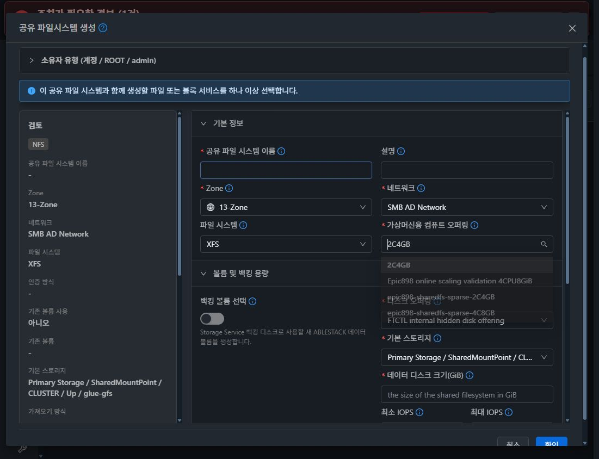
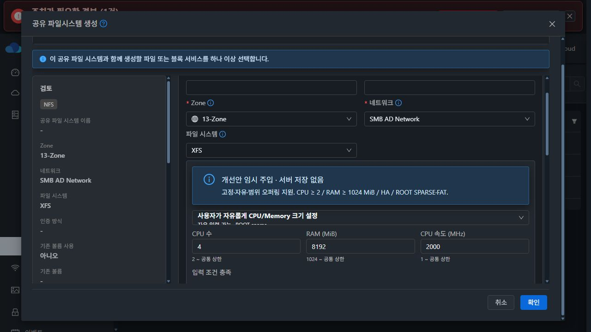
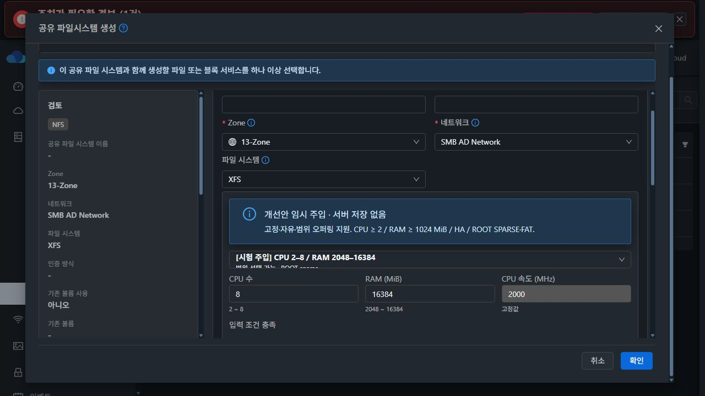
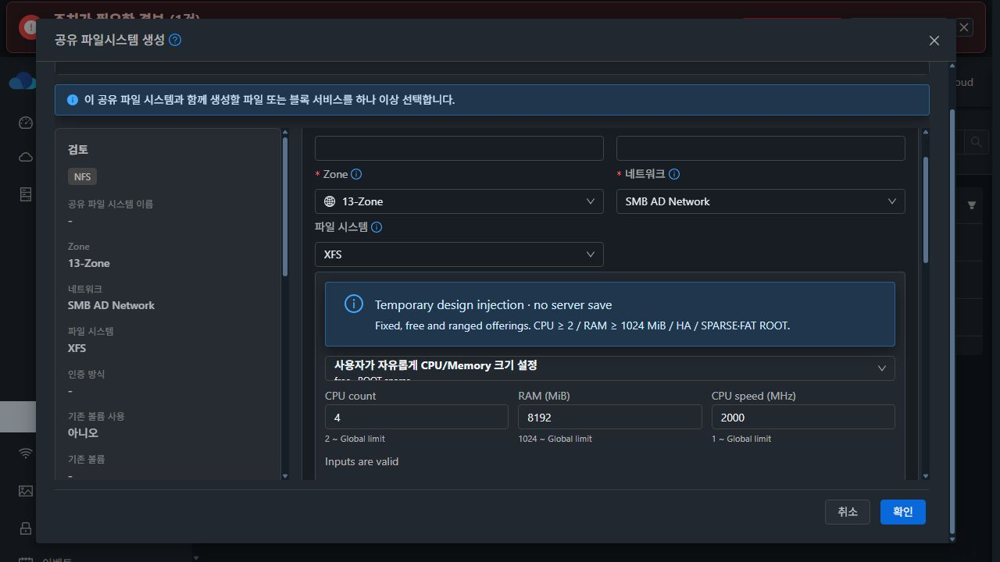

# #1441 코드 수준 설계 및 배포 UI 주입 검증 — 2026-10-21

## 결론과 작업 범위

**설계와 현재 배포 UI의 임시 코드 주입 검증을 완료했다. 제품 구현·모듈 빌드·정식 배포·새 SharedFS 생성은 하지 않았다. #1441은 OPEN이며 기능 인수 항목은 미완료다.**

최종 설계는 SharedFS 초기 생성에서 **고정·자유 입력·범위 제한 컴퓨트 오퍼링을 지원**하면서 CPU/RAM 최소값, HA, ROOT SPARSE/FAT 및 기존 권한·범위 검사를 유지하는 것이다. 사용자가 추가 요청한 커스텀 지원을 같은 이슈의 설계에 반영한다.

NFS ACL·클라이언트 I/O·백업/복원·운영 중 오퍼링 변경·온라인 확장 강제·최종 UI 표준화는 범위에 넣지 않는다. 초기 고정 전용 프로토타입은 현행 제약을 설명하기 위한 비교이며, **고정 전용 제한을 최종 설계에 유지하지 않는다.** 아래 고정/자유/범위 계약과 최종 35개 검사가 현재 기준이다.

## 1. 실제 코드·배포본·실행 자원 근거

- 소스: epic/1438-sharedfs / **8e36a5a9d11d9615565644f3f5236cb6046150b4**. 로컬 Europa와 upstream은 **0e6b5093d51079f0cfd9bfc88b6e37a795be55a3**, divergence 0 0 확인 후 조사했다.
- 실제 10.10.13.10의 mold.service는 active / PID **2983986**이었다. 설치 fat JAR SHA-256은 **69afe59ca4ebf3108f4963c8f30b01c9fbf2dce759633258804bfeb97164a41d**로 직전 통합 배포 영수증과 일치했다.
- 설치 JAR에서 StorageVmSharedFSLifeCycle·SharedFSServiceImpl·ServiceOfferingJoinDaoImpl 클래스를 읽기 전용으로 추출해 해시를 기록했다. 로컬 javap으로 실제 배포 checkPrerequisites의 **CPU/RAM null 거절·최소값·HA 검사**를 확인했다. 관리 서버에 javap이 없어 클래스만 추출해 WSL 도구를 사용했으며 서버에 도구를 설치하지 않았다.
- 실제 UI는 app.cd850811.js / vendors.4b0e4ea2.js / 생성 화면 chunk-65f3dbd4.7e1eec4a.js다. 실행 Vue는 **3.2.37**, 소스 Ant Design Vue 의존성은 **^3.2.20**이다.
- 실제 UI listServiceOfferings 응답은 **6개**다. 현행 폼은 iscustomized·CPU/RAM·HA 필터 뒤 **4개만 표시**하고 ROOT thin인 **2C4GB를 기본 선택**한다. 커스텀과 HA 미충족 후보가 사유 없이 사라진다.
- ROOT 정책은 DATA diskofferingid로 판단하지 않는다. service_offering.disk_offering_id → disk_offering.provisioning_type를 읽기 전용 DB로 대조해 UI 응답과 일치함을 확인했다.
- 배포 서비스 VM 8b4fa66a-434a-4248-98f1-a98cf081f752의 ROOT는 **5d5ef65b-37bd-4939-8664-0071e0745ef9 / sparse / QCOW2 / Ready**, ROOT offering은 **90b3f7d0-bf5b-46dc-bb6c-d46c57fa8774**였다. 기존 실행 ROOT 확인이며 이 VM을 새 생성 시험으로 재사용한 것이 아니다.
- 실제 설정은 CPU 최소 **2**, RAM 최소 **1024 MiB**, vm.serviceoffering.cpu.cores.max와 vm.serviceoffering.ram.size.max는 **0(추가 전역 상한 없음)**이었다. 실제 자유 오퍼링에는 min/max details가 없다.
- 선호 SystemVM 아키텍처와 시스템 템플릿 저장 표기는 **x86_64**, zone override는 없었다. **ServiceOffering 응답에는 아키텍처 필드가 없다.** 존재하지 않는 offering.arch를 가정해 필터하지 않는다.

[배포·ROOT·설정 근거](evidence/deployed-runtime-proof.json) · [배포 checkPrerequisites 역어셈블](evidence/deployed-checkPrerequisites.txt) · [실제 UI 조회 응답](evidence/ui-offering-responses.json).

## 2. 고정 오퍼링만 허용한 원인과 개선 가능성

현재 SharedFS의 **입력·API·배포 인자 연결이 빠져 있다.** 인프라가 커스텀 VM을 만들 수 없는 구조는 아니다.

| 실제 코드 | 현재 동작 |
|---|---|
| CreateSharedFS.vue:1579–1607 | iscustomized === false만 남기고 첫 항목 선택. 커스텀 CPU/RAM/속도 입력과 사유 안내 없음 |
| CreateSharedFSCmd.java:136–141 | serviceofferingid를 받고 커스텀 CPU/RAM/속도 인자는 없음 |
| StorageVmSharedFSLifeCycle.java:225–245 | CPU/RAM이 null이면 즉시 거절 |
| 같은 파일:156–204 | VM 생성 customParameterMap에는 minIopsDo/maxIopsDo만 넣음 |
| UserVmManagerImpl.java:1637–1677 | 일반 VM의 자유/범위 CPU·RAM·전역 상한, 속도 필수/양수, 고정 필드 덮어쓰기 거절을 이미 구현 |
| ServiceOfferingDaoImpl.java:206–219 | 선택값이 반영된 오퍼링 사본을 만듦. 원본을 저장하지 않음 |
| UserVmManagerImpl.java:4871–4874 | 일반 VM 생성에서 위 검증·사본 구체화 호출 |
| DeployVM.vue:3220–3230 | 변경 가능한 필드만 cpuNumber/cpuSpeed/memory로 전달 |
| ServiceOfferingDaoImpl.java:172–180 | 기존 vm_instance_details로 VM의 커스텀 자원을 다시 구체화 |

따라서 고정 전용 필터와 null 무조건 거절을 **입력값 검증·구체화**로 바꾸고 기존 일반 VM의 검증·생성·저장 경로를 재사용하면 지원할 수 있다. null을 0으로 바꾸거나 누락값을 서버가 임의 보충해 통과시키지 않는다.

## 3. 최종 요구사항 계약

| 항목 | 설계 |
|---|---|
| 고정 | 기존 CPU/RAM/속도 사용. 커스텀 인자를 보내지 않으며 외부에서 보낸 덮어쓰기 거절 |
| 자유 입력 | null인 CPU/RAM/속도만 입력. CPU/RAM은 SharedFS 최소와 전역 상한 준수. 필요한 속도는 양의 정수 MHz |
| 범위 제한 | 오퍼링 min/max와 SharedFS·전역 제한의 교집합 표시·검사. 교집합이 비면 선택 불가 이유 반환 |
| 부분 커스텀 | 필드별 고정/입력 구분. RAM만 변하면 memory만 제출. iscustomized 한 값으로 세 필드를 모두 덮어쓰지 않음 |
| HA | 기존 필수 조건 유지 |
| ROOT | 실제 연결된 ROOT offering의 intent/legacy 정책 검사. thin/off·미확인 계약 자동 선택/생성 금지. sparse/fat 및 기존 할당 계약의 대응 intent는 기존 capability 검사도 통과해야 함 |
| 아키텍처 | zone 선호값과 실제 준비된 SystemVM 템플릿 비교. amd64/x86_64/x86-64, arm64/aarch64 별칭 정규화. 알 수 없는 값을 기본값으로 추정하지 않음 |
| 동적 확장 | 정보/안내만 제공. false만으로 생성 부적합 처리하지 않으며 #1464 강제 정책은 착수하지 않음 |

~~~text
CPU 하한 = max(일반 VM 하한 1, offering minCPU, SharedFS minCPU)
RAM 하한 = max(일반 VM 하한 32 MiB, offering minRAM, SharedFS minRAM)
CPU/RAM 상한 = min(offering max, 0이 아닌 전역 max, Integer.MAX_VALUE)
~~~

범위가 없으면 일반 VM의 기존 제한을 따른다. 잘못된 문자열/음수/뒤집힌 구간을 무제한으로 해석하지 않는다. 단위는 CPU 개수·RAM MiB·CPU 속도 MHz다.

**목록에서 선택 가능(selectable)과 현재 입력으로 생성 가능(valid)을 분리한다.** 커스텀은 입력 전이라는 이유로 숨기거나 비활성화하지 않는다. 적법한 구간이 존재하면 선택 가능하며, 선택 후 필요한 값이 모두 유효해야 생성 가능하다.

ROOT 생성 정책과 관측된 실제 allocation evidence도 구분한다. legacy sparse를 확인한 결과를 실제 preallocation 보증으로 확대하지 않는다. 새로운 할당 backend를 개발하지 않으며 기존 #1422의 creation-intent/capability 검사는 유지한다.

## 4. 코드 변경 지점

### 4-1. SharedFS 전용 읽기 API — 미구현

제안 이름은 **listSharedFileSystemServiceOfferings**다.

- 새 ListSharedFSServiceOfferingsCmd는 기존 ListServiceOfferingsCmd의 조회·페이징·계정/도메인/프로젝트 범위를 재사용한다. zoneid는 필수이며 생성용 일반 Active 오퍼링만 다룬다. 운영 VM 오퍼링 변경/system offering 입력은 이 API에서 받지 않는다.
- execute에서 기존 _queryService.searchForServiceOfferings(this)가 반환한 **권한 내 후보만** SharedFS 결과로 감싼다. 전체 DAO 조회로 접근 불가 후보를 추가하지 않는다.
- 새 SharedFSServiceOfferingResponse에 기존 offering과 eligibility를 담는다. 공통 listServiceOfferings의 응답/필터는 변경하지 않는다.
- SharedFSService / SharedFSServiceImpl에 결과 구성 메서드를 추가하고 provider의 동일 검사기를 호출한다. API 등록·발견·기존 SharedFS 사용 역할의 조회 권한도 함께 반영한다.
- 허용된 후보의 ROOT 정책/근거만 반환하며 파일 경로 등 불필요한 내부 정보는 추가하지 않는다.

~~~json
{
  "offering": {"id":"...", "name":"...", "iscustomized":true},
  "eligibility": {
    "selectable": true,
    "inputrequired": true,
    "mode": "free",
    "constraints": {
      "cpunumber": {"custom":true,"min":2,"max":null},
      "memory": {"custom":true,"min":1024,"max":null},
      "cpuspeed": {"custom":true,"min":1,"max":2147483647}
    },
    "root": {"diskofferingid":"...","policy":"sparse","source":"legacy"},
    "reasons": [],
    "requirements": {"ha":true,"dynamicscalingrequired":false}
  }
}
~~~

max:null은 추가 offering/설정 상한이 없다는 표시 계약이며 API Integer 제한까지 없다는 뜻이 아니다.

### 4-2. 목록·생성의 동일 검사기

api의 SharedFS 패키지에 eligibility/constraint 값 타입을 추가하고 StorageVm provider에 **evaluateCreationOffering(zone, offeringId, customValues, phase)**를 둔다.

- CATALOG: 요구값·ROOT·준비 템플릿과 가능한 CPU/RAM 구간을 반환한다. 미입력은 선택 불가 이유로 삼지 않는다.
- REQUEST: 기존 owner/offering/zone 접근 검사를 유지한 뒤 값을 정규화한다. **UserVmManager.validateCustomParameters**와 **ServiceOfferingDao.getComputeOffering**을 재사용한다. 구체화된 사본으로 SharedFS 최소값·HA·ROOT/arch를 검사한다.
- 원본 ServiceOfferingVO를 변경/persist하지 않는다. 기존 getComputeOffering의 사본을 사용한다.
- 기존 checkPrerequisites를 사용하는 운영 중 오퍼링 변경 경로에 새 커스텀/ROOT 정책을 무조건 적용하지 않는다. **초기 생성용 checkCreationPrerequisites를 별도 진입점으로 두고 기본 자원 검사 helper를 공유**한다.
- arch 정규화/ready template 조회 helper는 목록 검사와 deploySharedFSVM의 기존 findSystemVMReadyTemplate 호출에서 공유한다. UI에서만 별칭을 허용하고 실제 검색은 다른 문자열로 실패하는 불일치를 막는다. 전역 CPU enum과 다른 VM 기능은 수정하지 않는다.

### 4-3. 생성 API와 VM 인자 전달

CreateSharedFSCmd에 선택적 Integer **cpunumber / cpuspeed / memory** 3개를 추가한다. 임의 details/Map을 개방하지 않는다. 기존 고정 요청은 새 인자 없이 호환된다.

~~~java
// 설계 의사 코드: 제품에는 아직 추가하지 않았다.
Map<String, String> values = cmd.getCustomComputeParameters();
// cpuNumber / cpuSpeed / memory 허용 키로만 변환

CreationOfferingCheck checked =
    lifeCycle.checkCreationPrerequisites(zone, cmd.getServiceOfferingId(), values);

// allocSharedFS: 기존 persist 전에 검사
// deploySharedFS: 비동기 실행 직전 같은 검사 재확인
lifeCycle.deploySharedFS(sharedFS, networkId, diskOfferingId, storageId,
    size, minIops, maxIops, checked.getCustomParameters());
~~~

- SharedFSLifeCycle에 검증된 Map을 받는 overload를 추가하고 기존 signature는 emptyMap으로 위임한다.
- StorageVmSharedFSLifeCycle.deploySharedFSVM의 customParameterMap에 3개 허용 키를 추가한다. 기존 minIopsDo/maxIopsDo는 보존한다.
- 원본 offering과 정규화한 map을 기존 createAdvancedVirtualMachine에 전달한다. 일반 VM의 기존 검증·구체화·권한/자원 검사가 계속 실행된다.
- CPU/RAM/속도는 기존 VM detail 저장 경로를 따른다. 고정 필드는 제외하고 Integer는 String.valueOf로 변환한다. 새 SharedFS 테이블/컬럼은 필요 없다.
- UI 표시 이후 제한/상태가 바뀌면 최종 검사가 이유를 반환한다. 값을 바꿔 자동 재시도하지 않는다.
- 기존 VM detail/restore 경로의 값 재사용은 유지하되 백업/복원 기능 개발이나 별도 복원 인수를 이 이슈에 추가하지 않는다.

### 4-4. UI 변경

대상은 **CreateSharedFS.vue·SharedFS용 입력 adapter/component·en/ko locale·해당 시험**이다.

1. 고정 전용 필터를 없애고 전용 API의 selectable/reasons/constraints를 쓴다. 조건을 UI에서 별도로 다시 구현하지 않는다.
2. 권한 내 적합/부적합 후보를 모두 표시한다. 부적합은 a-select-option disabled와 사유 전문을 표시한다. 긴 문구는 줄바꿈/tooltip으로 확인할 수 있게 한다.
3. 이전 선택이 적합하면 유지하고, 아니면 적합 후보만 선택한다. THIN/불명 ROOT를 자동 선택하지 않는다. 0건·조회 실패·zone/owner 재조회 중에는 선택을 비우고 확인을 비활성화한다. 이전 응답으로 선택을 되돌리지 않는다.
4. 고정 필드는 입력을 숨기거나 읽기 전용 표시한다. 자유/범위는 필드별 CPU/RAM/속도 입력을 표시한다. 기존 ComputeSelection.vue의 범위/수치 입력 패턴과 Mold a-row/a-col, a-input-number, a-slider, a-form-item을 재사용하는 SharedFS adapter를 둔다. 공통 컴포넌트의 기본 동작은 바꾸지 않는다.
5. bounds는 서버의 교집합 값을 사용한다. 공백·소수·범위 밖 입력을 기본값으로 채워 보내지 않는다. 오류를 필드에 표시하고 확인을 막는다. 다른 오퍼링/고정으로 전환하면 이전 custom 값과 validation을 정리한다.
6. handleSubmit에서 가변 필드만 새 3개 인자로 제출한다. 기존 초기 서비스 생성·polling 흐름은 유지한다.
7. 적합 후보가 없으면 요구 조건과 관리 링크를 제공한다. 오퍼링 관리/생성 권한이 있는 사용자에게만 링크를 제공하고 나머지는 관리자 요청을 안내한다.
8. 이유와 새 입력 문구를 en/ko로 번역한다. 전체 상세 탭/모달 표준화는 하지 않고 새 항목에 필요한 행 배치만 조정한다.

### 4-5. 오류 계약

사유는 **code + field + params**로 구성한다. HA_REQUIRED, ROOT_POLICY_THIN, ROOT_POLICY_UNKNOWN, SYSTEMVM_ARCH_UNAVAILABLE 및 CPU/MEMORY/SPEED의 REQUIRED/OUT_OF_RANGE/FIXED_OVERRIDE/RANGE_EMPTY 등을 정의한다.

최종 거절은 기존 InvalidParameterValueException의 파라미터 오류를 유지하고 **SHAREDFS_OFFERING_INELIGIBLE:** 뒤에 구조화한 이유를 제공한다. UI는 해당 prefix와 알려진 code만 번역하며 영어 문자열 부분 비교나 HTML 렌더링을 하지 않는다. 예상 밖 진단은 유지하고 일반 VM/전체 API의 오류 처리를 재설계하지 않는다.

## 5. 실제 배포 UI 주입 검증

접속 대상은 **10.10.13.10:8080/client의 실제 SharedFS 생성 화면**이다. localhost 별도 목업을 배포 UI 검증으로 제시한 것이 아니다. 현재 Vue 3.2.37과 Mold appContext.components의 ASelect/AInputNumber/AAlert/AButton을 사용해 브라우저 메모리 안에 프로토타입을 주입했다.

서버의 클래스·JS·설정 파일을 바꾸거나 새 API를 배포하지 않았고 VM·ROOT·DATA를 생성하지 않았다.

| 검사 | 실제 관측 |
|---|---|
| 수정 전 비교 | 6 후보 중 4 후보만 표시, ROOT THIN인 2C4GB 기본 선택 |
| 선택 이유 | THIN disabled/이유 표시와 클릭 시 선택 보존 확인 |
| 자유 입력 | 실재하는 사용자 정의 오퍼링에 **4 CPU / 8192 MiB / 2000 MHz**를 UI 입력해 로컬 검사 valid=true |
| 자유 인자 | API cpunumber/cpuspeed/memory와 VM용 cpuNumber/cpuSpeed/memory 구성을 확인 |
| 범위 입력 | 브라우저에만 주입한 **CPU 2–8 / RAM 2048–16384 fixture**에서 8/16384 입력 valid=true |
| 고정 비제출 | 범위 fixture의 고정 2000 MHz는 읽기 전용, 전송 인자에서 제외 |
| 최종 조건 검사 | 고정·자유·범위·부분 custom, 누락/소수/범위 밖/전역 상한/고정 덮어쓰기, HA/ROOT/arch/동적 확장의 **35개 모두 기대 결과** |
| 영문 | 자유/범위 안내·단위·고정 표시·검증 결과·관리 링크의 영문 확인. 전체 UI locale 회귀를 의미하지 않음 |
| 무전송 | 마지막 실제 검증 버튼 구간의 Network 이벤트는 누락 없음, 생성/갱신/POST 요청 0. 프로토타입 검사에는 제품 API 호출 없음 |
| 원복 | sub-app unmount, 원래 select/부모 행 복원, reload 후 주입 변수/패널 부재와 기존 SharedFS 3개 표시 확인 |

[35개 검사 결과](evidence/custom-design-matrix-results.json) · [자유 입력 결과](evidence/custom-free-ui-result.json) · [범위 입력 결과](evidence/custom-range-ui-result.json) · [최종 무전송 구간](evidence/final-validation-no-api.json) · [원복](evidence/cleanup-result.json).

**검증 한계:** explicit allocation의 프로토타입 검사는 intent 분류만 다룬다. 저장 계약의 형식/완전성 및 backend capability 판정은 기존 VolumeAllocationPolicy 검사를 재사용하는 구현 단계에서 별도 확인한다. 아직 없는 새 API/백엔드의 성공, 커스텀 SharedFS 실VM 생성과 실제 CPU/RAM 할당을 확인한 결과는 아니다. 범위 fixture를 13번 DB에 실재하는 오퍼링으로 기록하지 않는다. 기존 ROOT 관측 근거와 프로토타입의 intent 판정도 구분한다. 초기 고정 전용 검사 20개는 최종 커스텀 지원 검증 수치에 합산하지 않는다.

초기 render 직접 래핑 실험에서는 시험 코드가 새 props 객체를 render 중 반복 설정해 시험 탭이 불안정해졌다. 제품 장애로 처리하지 않고 **기존 render를 바꾸지 않는 독립 sub-app 방식으로 교정**해 최종 검증했다. 이전 시험 탭은 renderer crash 상태를 반환했다. 최종 검증 탭은 주입 제거·배포 원본 정상 복귀를 별도로 확인했고 서버/VM 변경은 없다.

## 6. 수정 전 화면과 개선 목업 구분

### A. 현행 실제 배포 UI — 수정 전

커스텀이 사라지고 ROOT THIN인 2C4GB가 선택된다. 부적합 이유 안내가 없다.

### B. 개선 목업 — 자유 입력 / 임시 주입·미구현

실재하는 자유 오퍼링을 선택해 입력했다. “개선안 임시 주입·서버 저장 없음”은 증거 구분용 표시이며 제품 문구가 아니다.

### C. 개선 목업 — 범위 선택 / 임시 주입·미구현

“시험 주입” 범위 후보는 DB에 생성하지 않았다. 고정 속도는 비편집·비제출한다.

### D. 개선 목업 — 새 문구 영문 / 임시 주입·미구현

## 7. 구현 후 #1441 범위의 검증 계획

1. **단위:** 기존 고정 요청 호환, 자유/범위/부분 custom의 값 구체화, 허용 키만의 Map, 최소/최대·누락·소수·권한·ROOT/arch 및 목록/최종 생성의 일치. 기존 validator/getComputeOffering 사용과 원본 오퍼링 불변, VM 호출로 전달되는 Map을 확인한다.
2. **UI:** 실제 CreateSharedFS와 입력 adapter를 mount해 후보/이유/0건/실패/재조회, 입력 전환·고정 필드 미제출·en/ko·정확한 생성 인자를 확인한다.
3. **빌드:** api·server·plugins/storage/sharedfs/storagevm과 필요 의존성, UI 모듈을 빌드한다. KVM agent·guest storagectl·SystemVM 템플릿 변경은 필요 없다.
4. **배포:** 관리 API/provider를 먼저 맞춘 뒤 UI를 배포한다. 새 API가 없는 서버를 커스텀 지원으로 표시하거나 구 API로 조용히 대체하지 않는다. DB migration은 없다.
5. **실제 13번 UI 인수:** 새 고정·자유·범위 SharedFS 각 1개를 만들어 선택한 CPU/RAM/필요 속도·Ready·ROOT SPARSE/FAT를 UI/API와 필요한 읽기 전용 상태로 비교한다. 범위 후보가 없다면 그 구현 검증 라운드에서 UI로 준비한다. THIN/미확인 ROOT를 만들지 않는다. 범위 밖·누락·고정 override의 생성 전 거절과 정상 값의 VM 생성 전달을 확인한다.
6. #1441과 Epic PR에 근거를 남긴 뒤 이슈 완료를 판단한다. **NFS ACL/클라이언트 I/O·백업/복원·운영 중 스케일업이나 다른 오퍼링 변경은 추가 종료 조건으로 넣지 않는다.**

이번에 완료한 것은 **근거 확인·코드 설계·배포 UI 임시 주입 검증·설계 기록**이다. 구현·정식 빌드·배포·실VM 기능 인수는 다음 지시 후 진행한다.
