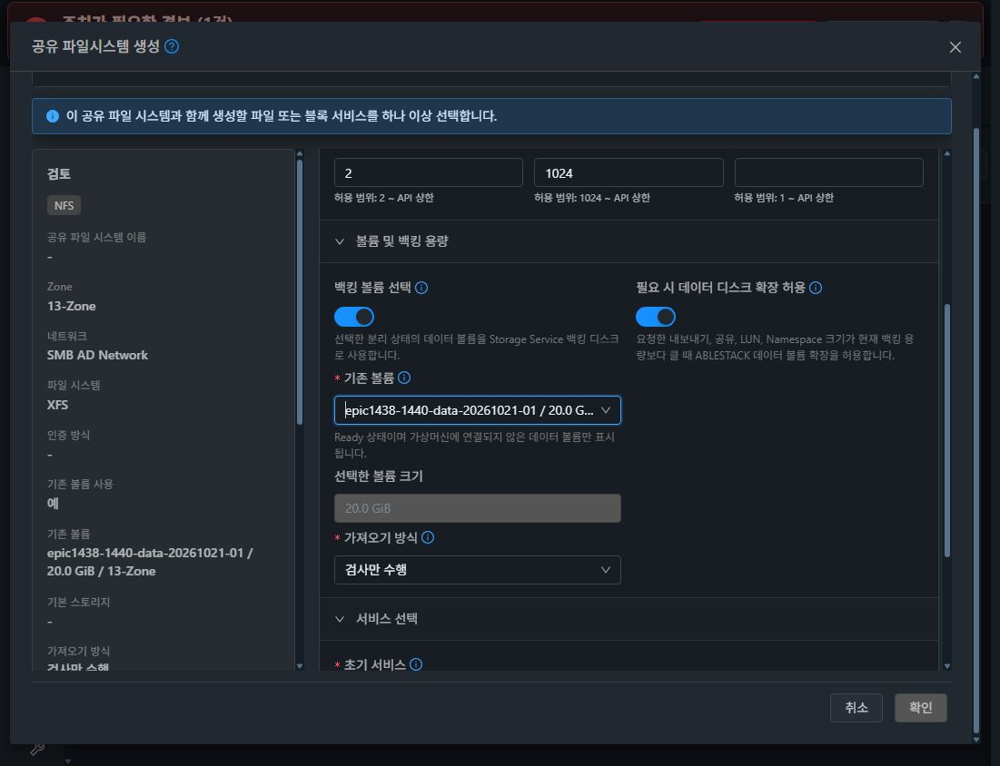
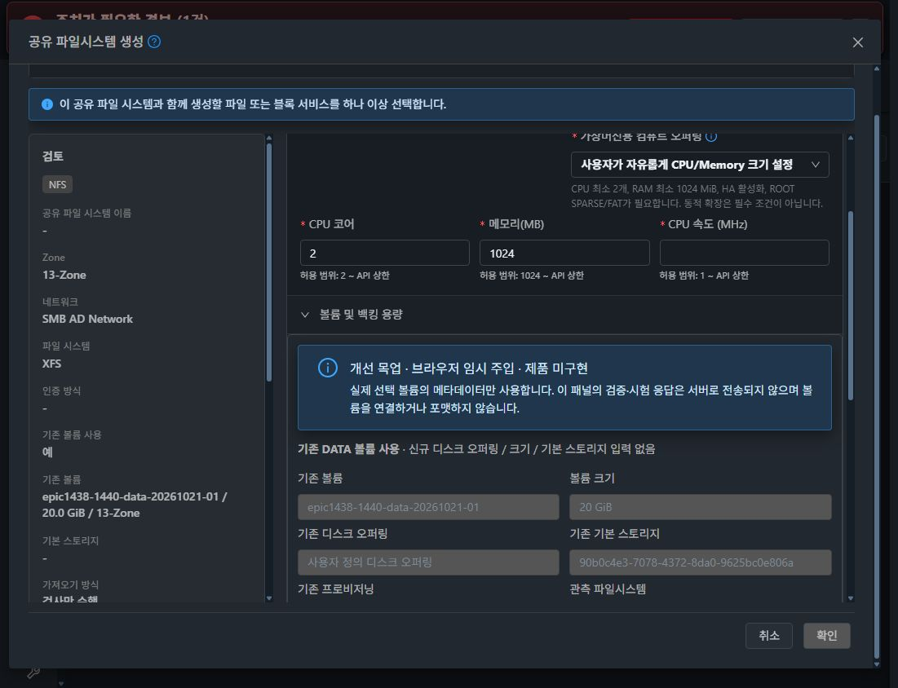
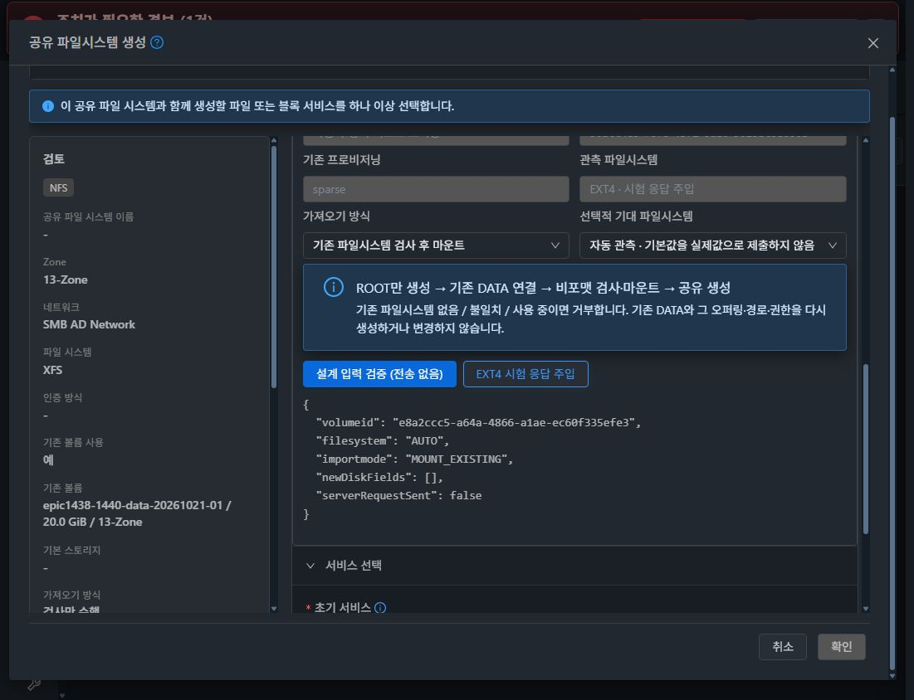

# #1442 코드 수준 설계 — 기존 볼륨을 사용하는 SharedFS 초기 생성

**설계·현재 배포본 조사·임시 주입 검증만 완료했다. 제품 구현, 빌드, 정식 배포, 새 자원 생성 및 실볼륨 연결/마운트 시험은 시작하지 않았다. 이슈는 OPEN이고 기능 인수 항목은 미완료다.**

## 1. 범위와 현재 기준

대상은 #1442의 신규/기존 백킹 볼륨 분리, 기존 XFS/EXT4 데이터 보존, 파일시스템 의도 유지, 초기 연결 실패 보상 및 부분 할당/응답 유실 시 VM·볼륨 중복 방지다.

#1441의 컴퓨트 오퍼링 검사와 커스텀 인자 전달, 공통 Volume API의 권한·수명주기·스토리지 호환/할당 정책, 볼륨 메타데이터 경로 보존을 유지한다. 공통 볼륨 UI/배치 엔진, NFS ACL, raw 블록 가져오기, 백업/복원, 일반 운영 설정 롤백(#1444), 일반 삭제 보존 정책(#1461), 최종 UI(#1468)를 새 개발 과제로 확장하지 않는다.

- 소스: epic/1438-sharedfs / **5584782db8c1d998623e2650902d3b2450d6031d**.
- fetch 후 local ablestack-europa와 upstream/ablestack-europa는 **0e6b5093d51079f0cfd9bfc88b6e37a795be55a3**, divergence **0 0**.
- 실제 관리 서버 10.10.13.10 / mold.service **active, PID 3003800**.
- 실제 JAR SHA-256 **fde8f1b25207256c19b0e858d299d24eed061d126eefa17b9703d6607223d83d**, UI index **e4a47cba8d2d7739f28bb6f177b08e2cd1868fa8a06e1a17b89d98d81a3c59cd**. 직전 #1441 배포와 일치한다.
- 설치 JAR의 CreateSharedFSCmd·SharedFSServiceImpl·StorageVmSharedFSLifeCycle·StorageServiceManagerImpl을 읽기 전용으로 추출해 클래스 해시와 javap 근거를 남겼다.
- 실제 SharedFS **6개 Ready**. 관측 VM **b6a39a5d-c451-4b60-9a68-3e4d102a4ea4 / i-2-105-VM / 13.3**의 DATA **3af8261e-6877-4479-8815-0b64a1b50910**는 XFS, 정상 mount/serial/20 GiB가 확인됐다.
- 해당 VM의 storagectl SHA **c48dea1de2a4637292a26185af18a0bcd8aa6a1105a41269e92df371c107ca27**, volume_identity.py SHA **7c54976b70e389abf7e25077412f7fd78cf52e34404d7f32bd9e5b83838b7371**는 현재 소스와 동일하다. QGA는 이 파일 해시·lsblk·findmnt를 읽는 진단에만 사용했다.
- 실제 UI의 분리 DATA 후보 **e8a2ccc5-a64a-4866-a1ae-ec60f335efe3**는 Ready / DATADISK / unattached / **sparse QCOW2 / 20 GiB**, pool **90b0c4e3-7078-4372-8da0-9625bc0e806a / /mnt/glue-gfs**, offering **c48ab8d8-faba-4d43-85a6-e98a9ecc0cd5**다. **이 분리 볼륨의 실제 파일시스템은 아직 관측하지 않았다.** 실행 VM의 XFS나 목업 EXT4를 이 볼륨의 실제 값으로 기록하지 않는다.

[관리 서버 무결성](evidence/deployed-runtime-proof.json) · [guest 소스/실행 자원](evidence/guest-readonly-proof.json) · [실제 DB](evidence/db-before.json)

## 2. 확인한 문제와 영향

| 실제 코드/배포 메서드 | 확인 내용 | #1442에서 바꿀 부분 |
|---|---|---|
| CreateSharedFS.vue:345–460, 1423 | 기존 모드에서 신규 입력을 숨기지만 required 규칙/선택값이 남음 | 신규/기존 조건부 검증 및 제출 분리 |
| 같은 파일:1933–1976, 2586–2601 | 실제 builder는 기존 volume ID를 보내지 않고 기존 용량을 신규 size=20으로 변환. handleRemoveFields 뒤 숨은 offering/storage는 사라짐 | 기존 mode는 volumeid/importmode/기대 FS만 명시적으로 whitelist |
| CreateSharedFSCmd:113–118 | 설치 annotation/API discovery 모두 diskofferingid required=true. 기존 볼륨 파라미터 없음 | 조건부 서버 검증으로 전환 |
| SharedFSServiceImpl:470–483 | 모든 생성에 신규 disk offering/storage 검사 | NEW만 기존 검사, EXISTING은 실제 volume 검사 |
| StorageVmSharedFSLifeCycle:377–403 | 항상 새 DATA를 만들고 DATADISK 없으면 실패 | EXISTING만 ROOT-only VM + 기존 DATA attach |
| CreateSharedFS.vue:2185–2267 | 기존 모드도 먼저 NFS export에 **FORMAT_IF_EMPTY**, 그 뒤 attach API에 사용자의 INSPECT_ONLY/MOUNT_EXISTING | 검사·마운트 완료 후 공유 생성, 기존 모드에서 FORMAT 요청 금지·중복 attach 제거 |
| SharedFSTab.vue:6951, 7013 | 실제 reset 메서드는 복사한 EXT4 resource에서도 NFS/SMB filesystem을 xfs로 초기화 | CURRENT backing의 관측값/서비스 의도 사용, 새 볼륨의 포맷 선택과 분리 |
| guest volume_attach_inspect | blank INSPECT 결과에 요청값 xfs가 fallback될 수 있음. path/createDirectory를 주면 검사 모드도 하위 디렉터리를 만들 수 있음 | 생성 전용 안전 payload와 결과 정규화로 회피; 공통 guest 수정 불필요 |
| SharedFS provider deploy/delete | VM ID 저장이 배포 반환 뒤이며 일반 expunge/delete는 DATA를 파괴할 수 있음 | 초기 생성 소유권 기록/재조회 및 별도 보상 경로; 기존 DATA에 일반 delete 호출 금지 |

실제 UI 메서드를 **서버 호출 스텁으로 격리**해 두 가져오기 방식 모두 FORMAT_IF_EMPTY → attach 순서를 확인했다. 이미 서버 API가 거절하는 잘못된 생성 요청을 실제 전송해 재현하지는 않았다.

[배포 UI의 실제 builder/순서](evidence/deployed-ui-characterization.json) · [후속 FS 기본값의 실제 메서드](evidence/deployed-later-filesystem-default-probe.json)

## 3. 최소 변경 원칙과 요청 계약

### NEW

기존 size/diskofferingid/storageid/IOPS/filesystem 검증·VM DATA 할당을 유지한다. XFS/EXT4 선택 의도는 기존 shared_filesystem.fs_type에 저장한다. #1441 CPU/RAM/속도 및 ROOT 검사도 그대로 사용한다.

### EXISTING

- createSharedFileSystem에 선택적 **volumeid, importmode, requestid**를 추가한다. backing mode는 volumeid 유무로 서버가 판정한다. 임의 details/map을 열지 않는다.
- diskofferingid와 filesystem의 annotation required를 제거하고 **NEW에서 서버가 기존 필수 조건을 그대로 검사**한다.
- EXISTING은 신규 diskofferingid/storageid/size/miniops/maxiops를 보내지 않는다. 외부 요청에서 혼합해 보내면 모호하게 우선순위를 정하지 않고 명확히 거절한다. UI builder는 이전 모드의 숨은 값도 제거한다.
- filesystem은 EXISTING에서 **AUTO(기본)** 또는 선택적 기대 XFS/EXT4다. AUTO는 새 볼륨 포맷 값이 아니며 관측 전 상태다. 실제 XFS/EXT4와 기대값이 다르면 마운트 전에 거절한다.
- importmode는 **MOUNT_EXISTING(기본)** 또는 INSPECT_ONLY다. FORMAT_NEW/FORMAT_EMPTY/FORMAT_IF_EMPTY는 기존 볼륨 초기 생성에 허용하지 않는다.
- INSPECT_ONLY는 검사 결과를 보여주고 Allocated/INSPECTED로 남긴다. 정상 공유 Ready로 표시하지 않는다. 같은 생성 요청에서 명시적으로 마운트를 이어갈 수 있게 한다.
- 기존 오퍼링은 실제 volume의 이력 정보로 표시한다. 새 offering 선택/검증으로 대체하지 않는다. 필요하면 삭제된 이력 표시를 사용하고, 현재의 공통 attach/capability 보호를 우회하지 않는다.

~~~json
{
  "name": "new-sharedfs-name",
  "zoneid": "<zone>",
  "serviceofferingid": "<compute>",
  "networkid": "<network>",
  "volumeid": "<existing-data-volume>",
  "filesystem": "AUTO",
  "importmode": "MOUNT_EXISTING",
  "requestid": "<client-generated-uuid>"
}
~~~

계정/프로젝트와 정적 네트워크 인자는 기존 계약대로 포함한다. 신규 디스크 관련 다섯 인자는 없다. requestid는 인증키가 아니며 사용자 재전송을 식별하는 소유자 범위 키다.

## 4. 서버·provider 변경 설계

### 4-1. 사전 검사와 기존 볼륨 점유

SharedFSServiceImpl에 생성 전용 immutable BackingPlan helper를 둔다.

- 기존 accountMgr owner 접근, zone/network/compute/ROOT 권한 검사는 유지한다.
- EXISTING은 **owner/project 일치, zone, DATADISK, Ready, removed 없음, 초기 미연결, pool 및 현재 호스트/하이퍼바이저 호환**을 검사한다.
- shared_filesystem 및 Storage Service NFS/SMB/block binding의 **활성 참조/초기 생성 예약**을 전역 volume ID로 확인한다. 현재 instance 내 검사만으로 대체하지 않는다.
- volume row lock과 SharedFS 생성 레코드 저장을 짧은 DB transaction에서 수행해 두 요청이 같은 분리 볼륨을 동시에 점유하지 못하게 한다. 긴 guest/네트워크 작업 동안 DB transaction을 유지하지 않는다.
- 재개할 때는 같은 plan의 VM에 이미 연결된 상태만 허용한다. 다른 VM에 붙은 볼륨, 다른 요청의 예약은 거절한다.
- 기존 pool/경로를 바꾸는 자동 이동·변환을 이 기능에서 새로 실행하지 않는다. 기존 attach 경로의 호환 조건을 먼저 확인하고, 해당 host에서 안전하게 유지할 수 없으면 연결 전에 거절한다.

### 4-2. ROOT-only와 준비 순서

일반 UserVmManagerImpl의 **비 ISO + diskOfferingId=null** 경로는 추가 DATA 할당을 하지 않는다. fsvm-init.yml도 legacy DATA 자동 포맷/마운트를 건너뛴다. 이를 재사용한다. 현재 SharedFS provider의 DATA 필수 가정만 EXISTING 분기에서 분리한다.

~~~text
요청/volume 예약 저장
→ 계획한 VM UUID로 ROOT-only 할당 (추가 DATA offering/size=null)
→ VM binding을 시작/후속 작업 전에 저장
→ VM 시작·기존 정적 네트워크 설정
→ 기존 DATA를 한 번 연결
→ 안전한 INSPECT_ONLY
→ 관측 FS/UUID 확인
→ MOUNT_EXISTING 및 같은 device/FS UUID의 mount 확인
→ SharedFS.volume_id / 관측 fs_type / 준비 phase 확정
→ Ready 및 Storage Service 동기화
→ UI의 기존 초기 공유 생성 (MOUNT_EXISTING, 추가 attach 없음)
~~~

**bootstrap DATA는 만들지 않는 안으로 설계한다.** 새 할당 정책이나 공통 VM 생성 경로를 재작성하지 않는다. ROOT-only + 기존 DATA가 실제 13번에서 완성되는지는 구현 후 첫 인수로 확인한다. 이번 설계 논리 시험을 실VM 성공으로 과장하지 않는다.

초기 준비용 compatibility instance가 필요하면 VM/volume binding 후 Allocated 상태로 확보하며 프로토콜을 활성화하지 않는다. 현재 sync 함수가 예외를 warning으로 삼는 특성이 준비 실패를 감추지 않게, 생성 전용 경로에서 instance 존재를 명시적으로 확인한다.

### 4-3. 공통 guest를 변경하지 않는 안전 호출

신규 관리 helper prepareInitialImportedBackingVolume은 현재 dispatcher의 **volume attach inspect**를 그대로 사용한다.

- 첫 검사 payload는 volume UUID/size/instance만 포함하고 **path/relativeSharePath를 비우며 createDirectory=false**로 고정한다. 현재 guest에서 이 조합의 INSPECT_ONLY는 mount/fstab/디렉터리 쓰기를 하지 않는다.
- 검사 결과는 volume UUID를 대조한 뒤 filesystemUuid/fsUuid가 있는 실제 XFS/EXT4만 관측 완료로 인정한다. FS UUID가 없으면 filesystem의 fallback 문자열을 실제 포맷으로 인정하지 않고 UNFORMATTED/UNKNOWN으로 정규화한다.
- MOUNT_EXISTING은 위 검사에 성공한 볼륨에서만 실행한다. 실패/불일치/blank에 FORMAT으로 대체하거나 자동 재시도하지 않는다.
- mount root는 현재 guest의 volume UUID 경로를 사용한다. 초기 호출에서 share ID를 만들지 않으며 guest의 기존 volume-UUID fallback mount marker를 사용한다.
- 후속 **EXISTING primary volume의 attach-inspect payload에만** 같은 volume scope를 적용한다. shareUuid/shareId를 넣지 않는 guest의 기존 fallback 계약을 사용하고 DB의 실제 share identity는 유지한다. 그러면 처음과 후속 호출이 같은 fstab marker/mount root를 사용해 중복 엔트리를 만들지 않는다.
- 일반 share/NEW 볼륨/다른 명령의 payload와 guest 스크립트는 유지한다. filesystem resize 등의 share ID를 임의 제거하지 않는다.

안전 payload의 read-only 동작과 blank 식별은 **배포와 해시가 같은 guest Python 블록에 I/O 스텁을 주입한 시험**으로 검증했다. 따라서 #1442에 guest/runtime updater 또는 새 SystemVM 템플릿 변경을 추가할 필요가 없다.

[guest 현재 동작·안전 payload의 7개 경우](evidence/guest-characterization.json)

## 5. 초기 생성의 재조회·중복 방지와 실패 보상

### 5-1. 필요한 최소 영속 정보

현재 shared_filesystem에는 별도 생성 계획/요청키가 없고 fs_type은 NOT NULL이다. 메모리/Vue snapshot만으로 응답 유실을 처리하지 않는다.

**계획 DDL — 이번에 실행하지 않음:**

~~~sql
ALTER TABLE cloud.shared_filesystem
  ADD COLUMN creation_request_id VARCHAR(36) CHARACTER SET ascii COLLATE ascii_bin NULL,
  ADD COLUMN creation_context TEXT NULL,
  ADD UNIQUE KEY uk_sharedfs_creation_owner (account_id, creation_request_id);
~~~

creation_context는 서버가 만드는 제한된 version 1 JSON이다. backing origin NEW/EXISTING, source volume ID, 변경 불가 요청 fingerprint, planned VM UUID, owned VM/ROOT IDs, phase, 실제 관측 FS/UUID/boot/mount, 마지막 job ID, reservation/보상 상태만 저장한다. 비밀번호·API 비밀·SMB/AD 인증정보·guest command 원문은 저장하지 않는다. 외부에서 JSON을 받아 그대로 persist하지 않는다.

- 기존 행은 두 컬럼 NULL로 유지하며 기존 경로를 따른다.
- FileSystemType에 생성 중 **AUTO**를 추가해 관측 전을 표현한다. 현재 DB varchar(10)에 들어가며 fs_type nullable 변경은 필요 없다. NEW는 AUTO를 거절하고 Ready는 반드시 실제 XFS/EXT4여야 한다.
- 기존 Europa의 동일 버전 migration registry를 재사용한다. **europa-sharedfs-initial-backing-v1**의 별도 단계와 idempotent 정보 스키마 검사를 추가한다. 이미 Complete인 S5B SQL에만 문장을 덧붙여 배포하지 않는다.
- 예정 변경점: DatabaseUpgradeChecker / EuropaSchemaUpgrade의 별도 단계, 생성 전용 schema helper·SQL·시험. 실제 컬럼/인덱스 확인 후 새 JAR를 올린다. 이번에는 migration 파일/DB를 만들거나 실행하지 않았다.

이는 #1442의 부분 할당·응답 유실 기준을 위한 생성 전용 정보다. 일반 workflow 엔진·모든 프로토콜 설정의 영속화로 확장하지 않는다.

### 5-2. 재전송과 이어하기

- UI가 제출 전에 requestid를 만들고 같은 요청의 결과 확인/이어하기 동안 유지한다. 이름 검색만으로 새 요청을 같은 작업으로 취급하지 않는다. 비밀은 브라우저 저장소에도 넣지 않는다.
- 같은 owner+key+fingerprint는 기존 entity/job/phase를 반환·재개한다. 같은 key에 다른 입력이면 충돌 오류다.
- SharedFS DAO와 기존 DB lock table 기능을 재사용해 생성 단위를 직렬화한다. selected volume의 점유는 별도 짧은 volume row lock으로 보호한다.
- VM UUID는 plan에 먼저 결정하고 기존 UserVm API의 internal customId 경로로 전달한다. 생성 응답이 유실돼도 UUID·owner·zone·SharedFS VM type 및 plan binding을 재조회한다. 이름/시간 유사성만으로 다른 VM을 채택하지 않는다.
- VM·attach가 실제로 끝났는지 불명확하면 **OBSERVATION_PENDING**으로 표시하고 조회를 먼저 한다. 알 수 없는 결과를 없는 자원으로 간주해 두 번째 VM/ROOT/DATA를 만들지 않는다.
- listSharedFileSystems에 소유자 범위를 유지하는 requestid 필터와 안전한 준비 상태를 추가한다. 새 **resumeSharedFileSystemCreation(id, requestid, action)**은 위 plan만 재개한다. action은 CONTINUE / MOUNT_EXISTING / CANCEL_PREPARATION으로 제한한다. 임의 기존 운영 VM의 restart로 사용하지 않는다.
- Error → Allocated의 CreationResumeRequested 이벤트는 생성 context를 검증한 이 API에서만 사용한다. INSPECTED는 Allocated, 성공은 기존 OperationSucceeded → Ready, 실패는 기존 Error 전이를 사용한다. 일반 restart의 Ready/Stopped 제한은 바꾸지 않는다.

### 5-3. 보상 경계

이번 생성이 만든 연결/instance/VM/ROOT만 추적한다. 기존 DATA는 항상 external/pre-existing이다.

1. 이번 요청의 미완료 공유·연결만 제거한다. 기존/다른 요청의 공유·mount는 정리하지 않는다.
2. 실제 연결 대상과 consumer를 확인하고 이번 mount/attach만 해제한다. 새 디렉터리는 이번에 만들었다는 근거가 있고 비어 있을 때만 정리한다. 재귀 삭제·권한 초기화는 하지 않는다.
3. 기존 DATA가 안전하게 분리된 것을 확인한 뒤 새 VM/ROOT만 기존 VM API로 정리한다.
4. 일반 deleteSharedFS/expungeVm을 기존 DATA가 붙은 상태로 호출하지 않는다. SharedFS 볼륨 참조는 creation_context에 원래 ID를 남기고 정리 순서에 맞춰 해제한다.
5. cleanup 자체가 실패하거나 결과가 불명확하면 소유권과 CLEANUP_PENDING/실제 오류를 유지한다. DATA를 지우거나 새 자원을 중복 할당해 숨기지 않는다.

새 EXISTING 자원에 기존 일반 delete/redeploy-cleanup이 무심코 DATA를 파괴하지 않게 생성 origin을 검사하는 좁은 보호를 넣는다. 일반 운영 자원의 보존 정책/사용자 옵션은 #1461로 남기며 여기서 새로 구현하지 않는다.

## 6. UI 변경 지점과 계약

### CreateSharedFS.vue

- useexistingvolume 토글에 맞춰 diskoffering/storage/size/IOPS를 조건부 검증한다. **공통 handleRemoveFields mixin은 변경하지 않고** 신규 builder가 raw form에서 필요한 backing 인자만 whitelist한다.
- 기존 volume 목록은 zone·owner/project 범위와 stale 응답/빈 결과/실패를 처리한다. 기존 listVolumes를 재사용하며 첫 페이지에 없다는 이유로 사용 가능한 볼륨이 없다고 오판하지 않게 페이징한다.
- 신규 모드의 입력/레이아웃은 유지한다. 기존 모드는 기존 offering·pool·size·provisioning을 읽기 전용으로 표시한다.
- 실제 FS는 검사 전 “관측 전”, 검사 후 관측값으로 표시한다. AUTO/선택적 기대값 및 새 볼륨의 포맷 선택과 혼동하지 않는다. 실제 listVolumes에 없는 filesystem 값을 만들어 표시하지 않는다.
- 기존 FORMAT_NEW 선택지는 제거한다. 검사만/마운트를 구분하고 검사만을 서비스 준비 완료로 알리지 않는다. 검토 영역도 같은 mode/의도/관측 모델을 사용한다.
- 생성 실패·응답 유실은 같은 request/entity의 조회/초기 준비 이어하기로 연결한다. 새 create 버튼을 자동으로 다시 누르지 않는다.
- 기존 파일 서비스 생성은 준비된 volume ID와 실제 FS·MOUNT_EXISTING을 사용한다. 선행 FORMAT_IF_EMPTY 및 후행 attachInitialVolume의 중복 실행을 제거한다.
- import 시 기존 파일에 추천 POSIX 값·재귀 권한 변경을 자동 제출하지 않는다. 일반 ACL/권한 기능 자체를 이 이슈에서 재설계하지 않는다.

### SharedFSTab.vue

CURRENT 볼륨의 새 NFS/SMB 폼에서 lastInspection의 실제 FS → 검증된 SharedFS FS 의도를 사용한다. 관측 전 AUTO를 xfs로 바꾸지 않는다. 다른 신규 볼륨은 명시적인 포맷 선택을 사용한다. 기존 볼륨의 표시를 위한 값과 포맷 API 인자를 분리한다.

공유 생성/조회 UI 전체·탭 배치·최종 모달 표준화는 변경하지 않는다. ko/en은 이 기능의 조건·준비·이어하기·안전 오류 문구만 추가한다.

## 7. 이번에 수행한 설계 검증과 한계

| 종류 | 실제 수행 | 판정 범위 |
|---|---|---|
| 배포본·자원 | 관리 JAR/UI/4개 class, 실행 guest 2개 파일, 현재 XFS mount와 분리 DATA metadata 대조 | 현재 코드/환경 근거 |
| 현행 UI 메서드 | 실제 builder 및 NFS 순서를 스텁 컨텍스트로 호출 | 요청 누락/FORMAT 선행 확인. 서버에 생성 요청 없음 |
| 후속 기본값 | 실제 reset 메서드에 분리한 EXT4 resource fixture 전달 | 여전히 xfs 초기화 확인. 실제 EXT4 DATA 시험 아님 |
| 개선 목업 | 실제 Vue **3.2.37**와 Mold appContext AntD 컴포넌트에 독립 sub-app 임시 주입 | 읽기 전용 정보·AUTO·가져오기 방식·신규 인자 비제출 확인 |
| 설계 계약 | 신규/기존 요청, 금지 mode, 상태/타입/연결, 관측 FS, 응답 유실/보상 모델 **22개** | 논리/목업 검사. DB 동시성/실VM 생성 인수 아님 |
| guest | 배포와 동일한 원문의 Python 블록을 사용하고 모든 장치/프로세스/파일 I/O를 스텁한 **7개 경우** | 실제 기존 XFS/EXT4 연결·mount 성공을 뜻하지 않음 |
| 무변경 | 최종 짧은 구간 Network 이벤트 13개 중 API **GET 11개**, 변경 요청 **0**, truncated=false | 해당 검증 구간 근거 |
| 원복 | sub-app unmount·임시 노드/변수 제거·모달 닫기·reload | 원본 UI 복귀. 서버 코드/설정 주입 없음 |
| 데이터/자원 보존 | 전후 DB checkpoint 동일, 6개 SharedFS/선택한 분리 DATA 연결 상태 동일 | 기존 DATA 포맷/연결/삭제 없음 |

초기 장시간 네트워크 trace는 buffer 유실과 새로고침 뒤 관측 해제로 완전하지 않아 무전송 근거로 사용하지 않았다. 관측을 다시 활성화한 짧은 별도 구간에서 실제 조회 이벤트가 잡히는 것을 확인하고 최종 증거를 남겼다. 최초 시험 컨텍스트와 I/O 스텁의 부적절한 부분도 자체 교정했고 최종 결과는 격리한 plain context/메모리 I/O 시험이다.

제품 소스/운영 schema/모듈을 수정하지 않았다. 설계 자료만 저장한다. 기존 볼륨을 실제로 연결하거나 새 VM을 만들어 근거 없이 구현 인수로 표시하지 않는다.

[22개 설계 계약](evidence/design-contract-results.json) · [무변경 네트워크](evidence/ui-network-no-mutation.json) · [원복](evidence/cleanup-result.json) · [전후 자원 보존](evidence/preservation-result.json)

## 8. 문제 UI와 개선 목업의 명확한 구분

### A. 현행 배포 UI — 문제 화면

기존 모드는 offering/storage를 숨기고 크기만 보여준다. 기본 FS XFS/검사만이 남지만 실제 최초 API 계약과 일치하지 않는다.

### B. 개선 목업 — 임시 주입, 제품 미구현

실제 선택 볼륨의 metadata로 읽기 전용 정보를 표시한다. 이 패널은 기존 생성 모달의 볼륨 영역만 대체한 설계 목업이다. 원래 좌측 검토 영역과 다른 폼의 전체 구현을 완료한 것이 아니다.

### C. 개선 목업 — 명시적인 EXT4 시험 응답

EXT4는 시험용 응답 주입이며 실제 선택 볼륨을 검사한 결과가 아니다.

## 9. 구현 후 #1442에 한정한 인수 계획

1. 신규 분기 회귀: 새 SPARSE ROOT/DATA SharedFS에서 XFS/EXT4 선택·기존 compute/network 전달·Ready 및 FS 의도 저장 확인.
2. 기존 분기: 새 SPARSE 시험 DATA 두 개를 새 클라이언트에서 XFS/EXT4로 한 번만 준비하고 알려진 파일·checksum·UID/GID/mode를 만든 뒤 정상 unmount/분리한다. 실제 UI로 새 ROOT-only SharedFS에 가져와 **추가 DATA 0개**, offering/size/storage 신규 인자 없음, 선택한 volume ID/pool/path/size와 FS UUID 보존을 확인한다.
3. 실제 UI에서 검사만 → 같은 ID로 마운트 이어하기, 빈 FS/기대값 불일치/잘못된 zone·owner·타입·상태·이미 사용 중인 볼륨의 변경 전 거절을 확인한다.
4. 후속 NFS/SMB CURRENT 폼의 EXT4 유지와 기존 데이터 checksum/권한 보존을 필요한 클라이언트 콘솔로 확인한다. ACL 기능 자체의 시험을 추가하지 않는다.
5. VM 할당 반환 전후, attach 반환 전후, mount/관계 저장 실패와 응답 유실을 시험 전용 fault injection으로 재현한다. request/key와 VM/root/volume 개수·연결·소유권을 비교해 중복 생성과 잘못된 정리가 없음을 검증한다.
6. rollback은 새 시험 자원만 대상으로 한다. 제품 오류는 최초 근거와 원인을 보존하고 반복 재시도하지 않는다. 단순 표시 차이와 시험 코드 실수는 정해진 원칙대로 구분한다.
7. 그때 관련 schema/API/server/provider/UI 모듈 빌드·13번 배포·실제 UI 인수와 Epic PR 반영 후 #1442를 닫는다. 이번에는 이 단계에 착수하지 않는다.
