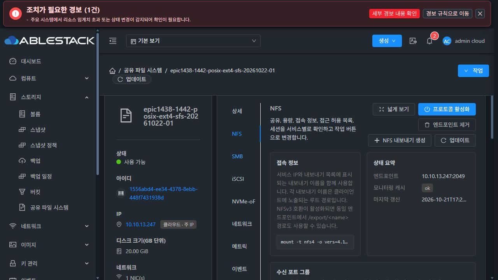
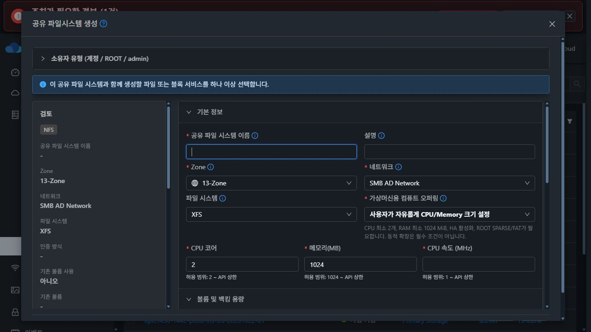
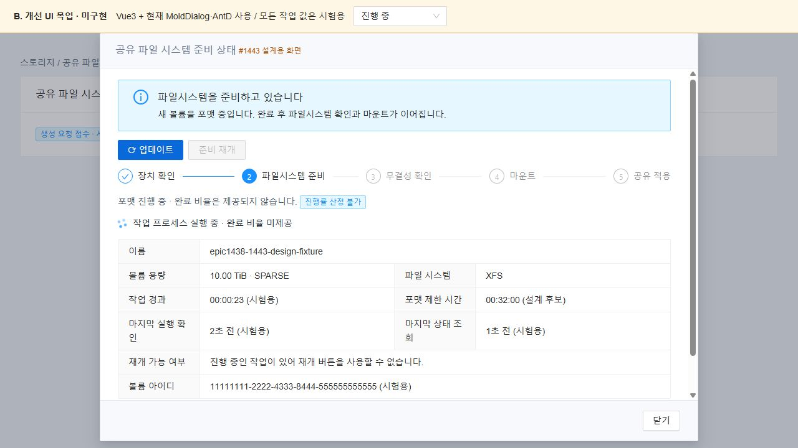
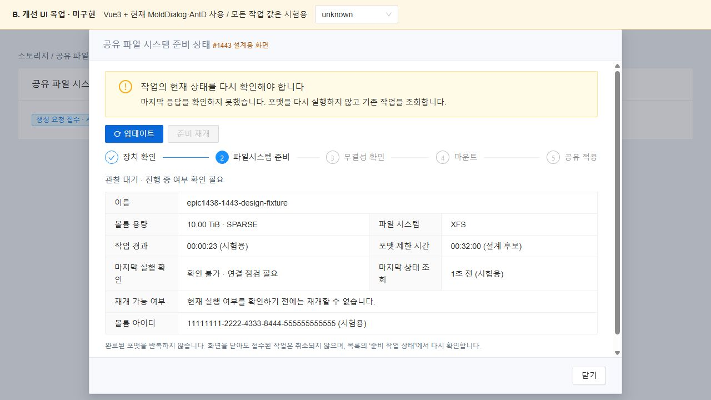
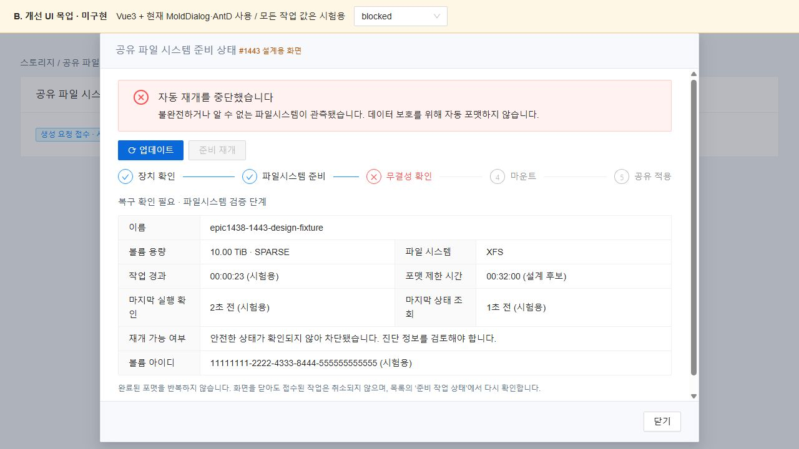
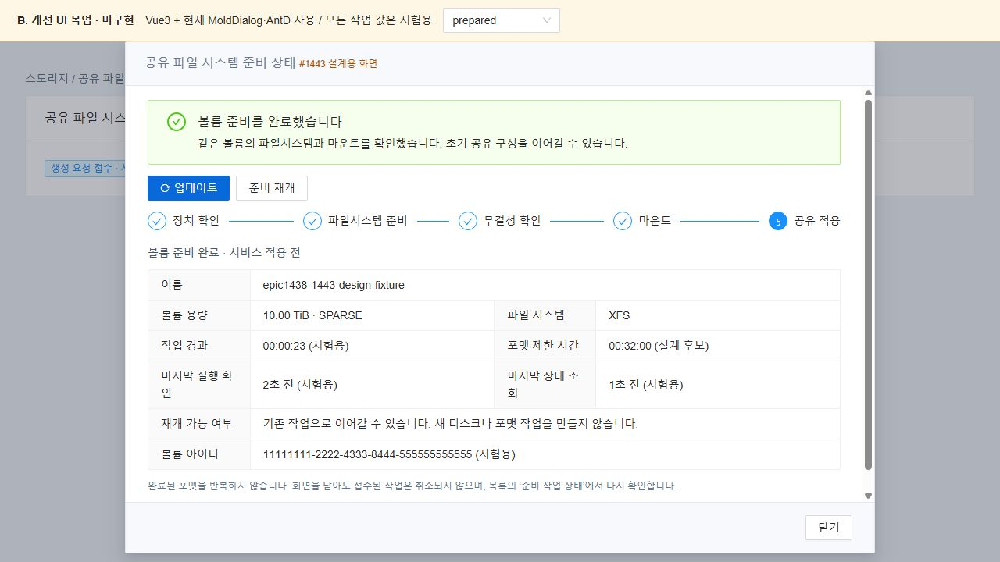

# #1443 대용량 초기 백킹 볼륨 준비: 코드 수준 설계

**설계·현재 배포본 대조·격리 주입 검증만 완료했다. 제품 구현·정식 모듈 빌드·배포·대용량 실포맷 인수는 시작하지 않았다. #1443은 OPEN이며 인수 항목은 미완료다.**

## 1. 범위와 실제 기준

대상은 **새 SharedFS의 초기 DATA 준비**다. 2TB급 기존 보고와 10TiB급 SPARSE XFS/EXT4, 긴 포맷·마운트 제한 시간, 응답 유실·재시작 후 관찰/재개, 중복 포맷 방지, UI 상태 표시를 다룬다.

기존 볼륨 import/POSIX 보존(#1442), 오퍼링(#1440/#1441), NFS ACL(#1460), 일반 추가 볼륨 포맷·블록 LUN·백업/복원·범용 작업 엔진·최종 UI(#1468)는 새 개발 대상으로 확장하지 않는다. 이번에는 VM/디스크를 만들거나 포맷하지 않았다. 조사 DATA는 SPARSE/QCOW2 20GiB이고 실제 장치에 쓰지 않았다.

- fetch 후 local/upstream Europa **0e6b5093d51079f0cfd9bfc88b6e37a795be55a3**, divergence **0 0**.
- epic/1438-sharedfs / 조사 HEAD **cd63783aa25919a4b9340d37a6f3438d7f1585cf**. 제품 파일은 직전 검증 소스 15ea52315437과 같다.
- 10.10.13.10 / mold.service active, PID **3032495**.
- 설치 JAR SHA-256 **6e22a0e03e63a68f356d4993745dcbf038b8b43ad97cbd6681a8cb3623c7f078**, UI index **1e87fd0541134f0ef2dec2c5ded05a4d47efdef2eb504a742908011358a6ec79**.
- 설치 SHA와 동일한 산출물의 SharedFSServiceImpl·StorageServiceManagerImpl·SharedFSResponse·StorageServiceHostCommand가 현재 compiled class와 byte 동일하다.
- SharedFS **11 Ready + 이전 취소 Error 예약 1개**다. Error 예약은 VM/DATA가 없는 과거 기록이다. 조사 전후 12개 상태/관계 동일, 생성/삭제 0개.
- 실제 UI/주입 대상: SharedFS **1556abd4-ee34-4378-8ebb-448f7431938d**, VM **38e1cc60-9de7-3241-a62c-ec9aff998d21 / i-2-112-VM / 13.3**, SPARSE DATA **c8aef987-45a4-47aa-a1b9-37ab54c5d629**.
- guest storagectl **7bc6d441378cfc57e95cf05faead9c5cee2115eb88a676753ad0d4b15407f489**, identity helper **7c54976b70e389abf7e25077412f7fd78cf52e34404d7f32bd9e5b83838b7371**. 추출한 volume_attach_inspect Python 전체가 현행 소스와 byte 동일하다.
- host wrapper 클래스 SHA **f8156a04ef6c65dda5099a09a6e0db0845cf62505b9e0089d54ef665574dabf1**, 현행 compiled class와 동일하다. 기존 일반 operation 전달을 쓰므로 **host agent 코드/JAR 변경은 없다**.

[소스·클래스](evidence/source-runtime-integrity.json) · [현재 자원](evidence/db-before.json) · [보존 확인](evidence/preservation-result.json).

## 2. 현재 실패 경로

| 실제 코드 | 확인 내용 |
|---|---|
| storagectl volume_attach_inspect:2663 / run:2682 / format_empty_device:2860 | lsblk·blkid·findmnt·mount·mkfs가 공통 timeout=20을 사용한다. mkfs 예외는 상태 기록 없이 traceback으로 올라간다. |
| StorageServiceManagerImpl.prepareFileShareBackingVolume:1458 / inspectAttachedFileShareVolume | 초기 NFS/SMB 안에서 동기 포맷/마운트하며 실패하면 공유 생성 실패 정리 경로로 간다. |
| SharedFSServiceImpl.continueCreation:665 | NEW는 VM/DATA 할당 후 READY를 저장한다. 실제 포맷은 후속 파일 서비스 구성에서 수행돼 생성 journal만으로 준비 완료를 판정할 수 없다. |
| StorageServiceCommandTimeout | 실제 설정 **300초**다. guest 20초가 먼저 끝나므로 이 값만 늘려도 해결되지 않는다. |
| StorageServiceHostCommand / KVM wrapper | QGA timeoutSeconds 완료 대기 및 executeInSequence=true다. 긴 mkfs를 RPC 안에서 기다리면 host의 다른 명령도 지연할 수 있다. |
| CreateSharedFS.vue.pollStorageServiceSetupJob:2502 | 기본 120회×2초 = **명목 240초**(HTTP 시간 별도), 최초 생성은 240회×2초. formatter 단계/heartbeat/불명확 결과 UI가 없다. |
| 같은 UI runInitialStorageServiceSetup:2145 | Ready 이외 상태의 정지는 EXISTING에 한정된다. NEW 준비 상태를 추가하면서 UI를 그대로 두면 공유 적용으로 진행할 수 있다. |

정확한 모든 함수 위치와 SHA는 [소스 대조 JSON](evidence/source-runtime-integrity.json)이 기준이다.

#1240은 별도 환경의 **2TB/SPARSE/none-cache/XFS/20초** 보고다. 동일 제한이 현재 코드·배포 guest에도 있음을 확인했다. #1240 환경의 새 재현이나 해결/종료를 뜻하지 않는다.

## 3. 격리 코드 주입으로 확인한 것

| 시험 | 실측/관찰 | 한계 |
|---|---|---|
| 배포 guest에서 실제 run 함수 AST 추출, /bin/sleep 21 | **20.02초에 TimeoutExpired(timeout=20)** | 실제 mkfs나 디스크 I/O 없음 |
| 메모리 안 timeout 인자 분리 스케치 | 같은 sleep 21이 timeout=30에서 **21.0초에 완료** | 제품에 설치하지 않음 |
| 실제 format_empty_device + 실행 스텁 | XFS/EXT4 명령 캡처, timeout의 비구조화 탈출 확인 | 캡처 mkfs는 실행하지 않음 |
| 실제 identity 함수 + 장치 응답 fixture | 정확 serial·모호한 serial·ROOT 차단 확인. legacy 크기 fallback은 다른 serial의 같은 크기 blank를 선택할 수 있으나 fallback=false는 차단 | 실장치를 잘못 선택하게 만든 시험 아님 |
| 실제 CreateSharedFS 메서드 + API 스텁 4종 | 240초 폴링 종료, raw timeout 전달, 가상 NEW PREPARING의 공유 구성 진행, 기존 INSPECTED 정지 확인 | 현 서버가 그 가상 상태를 반환했다는 뜻 아님 |
| 실제 VM systemd transient /bin/sleep 8 | QGA 기동 **0.033초** 반환, 기동 QGA 종료 후 unit active, 완료 후 not-found/inactive 자동 정리 | 실제 formatter worker/재부팅/전원 차단 인수 아님 |

따라서 긴 작업을 짧은 QGA 기동/상태 RPC로 분리할 수 있고, UI와 Backend 준비 계약을 함께 바꿔야 하며, 크기 fallback은 새 포맷 허가로 쓸 수 없음을 검증했다. 아래 journal·복구 worker 전체는 아직 설계다.

guest/fstab/원본 파일 SHA·UID/GID/mode는 주입 전후 동일했다. 원본 EXT4 파일은 **09df9a6d745892c7391ed661f5d9f5c75b3ece9c8206da41c19439113c6c9d4b**, 디렉터리 **1234:2345/0750**, 파일 **1234:2345/0640**이다. 관리 서버 PID/JAR/UI/보호 파일과 자원 관계도 동일하다. 임시 sleep unit은 제거됐고 영구 unit·실제 포맷·데이터 쓰기·제품 함수 교체는 없다.

[guest 주입](evidence/guest-injection-result.json) · [UI 소스 주입](evidence/ui-source-injection-result.json) · [분리 기동](evidence/detached-launch-probe.json).

## 4. 확정 흐름과 최소 변경

### 4.1 기존 생성 흐름 재사용

NEW만 **기존 VM/DATA 할당 → durable 준비 의도 → guest 작업 기동 → 관찰 → FS/마운트 검증 → 기존 READY 저장 → 기존 초기 NFS/SMB 적용·검증**으로 바꾼다.

- 기존 CloudStack async create job을 사용한다. 정상 준비 중은 jobstatus=0, 정상 종료는 검증된 Ready다. 별도 범용 Job/Operation 테이블·엔진을 만들지 않는다.
- continueCreation을 **짧은 locked step + NEW 관찰 대기**로 분리한다. 할당·동일 key·소유권·의도·최종 관계 저장 때 기존 sharedfs-initial 잠금을 쓴다. 기다리는 동안 잠금/DB transaction/긴 host RPC를 유지하지 않고, 매 step 같은 fs/VM/DATA/operation을 재검증한다.
- guest가 실행 중이면 기존 async job에서 5초마다 관찰한다. 같은 요청의 create/resume는 새 작업을 만들지 않는다.
- 응답 불명확·관리 서버 재시작/async job 취소·deadline은 **OBSERVATION_PENDING**으로 남긴다. 일반 실패 cleanup에 넘겨 VM/DATA를 지우지 않는다. job 결과와 물리 작업 결과를 구분한다.
- 기존 resumeSharedFileSystemCreation의 CONTINUE·같은 request ID를 재사용한다. worker alive면 관찰, 종료가 확인되면 FS 검증·마운트만 이어간다. format/reset/force 옵션은 열지 않는다.
- EXISTING은 #1442의 INSPECT_ONLY/MOUNT_EXISTING 및 POSIX 보존을 유지하고 새 포맷 worker로 보내지 않는다.

### 4.2 guest worker와 기존 함수 hook

신규 volume_preparation.py는 root 소유 transient systemd unit으로 실행한다. CLI 상수 operation은 **volume prepare start / status / resume**다. 배포 host의 일반 operation/기존 dispatcher로 전달하므로 agent 수정은 없다.

실제 formatter·mount·fstab을 복제하지 않는다. 기존 volume_attach_inspect에 optional preparation context를 넣어 기존 함수를 재사용하고 worker 호출에서만 명령별 timeout/단계 hook을 켠다. context 없는 기존 호출은 동작을 유지한다.

단계: **VERIFYING_IDENTITY → FORMATTING → VERIFYING_FILESYSTEM → MOUNTING → PERSISTING_MOUNT → PREPARED**. transport OBSERVATION_PENDING과 복구 차단 RECOVERY_REQUIRED는 구분한다. PREPARED는 볼륨 준비 완료이며 전체 초기 구성 완료는 기존 verifyInitialStorageServiceSetup까지 통과해야 한다.

- guest journal: /var/lib/ablestack-storage/volume-preparation/volumeUuid.json. root 전용, symlink 거부, UUID/operation 검증, 원자 replace와 파일/디렉터리 fsync.
- volume별 flock으로 worker 하나만 허용한다. **mkfs 전에 FORMAT_INTENT를 영속 기록**한다. 동일 operation start 재전송은 관찰만 한다. 모호한 이전 실행을 새 blank로 취급하지 않는다.
- operation ID는 원래 생성 key·VM·ROOT·DATA에 결합해 서버에서 한 번 생성한다. PID만으로 실행을 판정하지 않고 unit/boot ID/PID 시작 식별을 함께 확인한다.
- root 소유 journal을 검증한 context만 받는다. 사용자 API에 shell·/dev 경로·임의 timeout·force flag를 받지 않는다.
- heartbeat 5초. 완료 비율을 제공하지 않는 mkfs는 progresspercent=null이며 경과 시간/크기로 퍼센트를 만들지 않는다.
- formatter deadline은 worker가 관리한다. 도달하면 자기 formatter process group만 종료·회수하고 검증/RECOVERY_REQUIRED로 남긴다. GET timeout은 formatter를 종료하거나 새로 만들지 않는다.

### 4.3 안전한 관찰·재개

| 관측 | 허용 동작 |
|---|---|
| 이번 생성의 NEW DATA, 정확 UUID/serial·크기·소유/연결, ROOT/child/mount 제외, 서명 없음·포맷 시작 이력 없음 | 한 번만 포맷 |
| 동일 operation worker 살아 있음 | 관찰만. 중복 포맷·초기 취소/detach 정리 차단 |
| 응답 유실 뒤 같은 FS UUID/mount/fstab 확인 | 검증·관계 저장만 재개. mkfs 0회 |
| VM 재부팅으로 worker 종료, 같은 DATA의 유효한 FS 관측 | 읽기 전용 무결성 검사 후 동일 FS 마운트·기록만 재개 |
| FORMAT_INTENT 뒤 blank/partial/unknown FS, 손상/없는 journal, 다른 UUID/ROOT, 모호한 매핑 | RECOVERY_REQUIRED/OBSERVATION_PENDING. 자동 포맷·자동 삭제 금지 |

새 포맷 전 기존 resolver에 **allow_blank_size_fallback=false**를 지정하고 UUID/serial 매칭만 승인한다. legacy resolver 전체는 바꾸지 않는다. FS UUID/크기만으로 새 포맷을 허가하지 않는다. 서버 owner·attachment·pool/path/size·ownedVolumeIds도 확인한다.

불명확한 포맷은 blkid만으로 완료 판정하지 않는다. 미마운트 상태의 XFS xfs_repair -n / EXT4 e2fsck -fn 등 **읽기 전용 검사**를 제한 시간 내 실행한다. 실패·불명·기한 초과는 차단이며 자동 repair/재포맷하지 않는다. 정상 mkfs exit·서명/UUID·mount/fstab도 별개 검증이다.

worker의 volume mount와 기존 share별 fstab marker가 중복되지 않도록 **준비 완료 primary DATA만** #1442와 같은 volumeUuid mount path/marker를 재사용한다. 초기 NFS/SMB와 그 prepared CURRENT는 MOUNT_EXISTING이다. 새 NFS의 기존 POSIX 기본값·SMB 설정 및 기존 import 보존 정책은 유지한다. FORMAT_IF_EMPTY 재진입 0회와 fstab 중복 0회를 필수 시험으로 둔다.

## 5. 시간 예산

현재 전역 storage.service.command.timeout=300, job.cancel.threshold.minutes=60을 올려 해결하지 않는다. [실제 job 설정](evidence/runtime-job-settings.json).

| 대상 | 설계 후보 |
|---|---|
| 장치 probe/start/status/resume RPC | 각 20초 이내, 기존 RPC 설정을 초과하지 않음 |
| mkfs | max(300, 120+180×ceil(sizeGiB/1024))초: 2TiB 480초, 10TiB 1920초 |
| format cap | 초기 준비용 ConfigKey 한 개 sharedfs.initial.backing.format.max.seconds, 기본 3600초. 서버에서 범위/남은 job 예산 검증 |
| 읽기 전용 무결성 검사 | 별도 예산, 최대 600초 후보 |
| mount/fstab | 별도 120초 후보 |
| UI | phase deadline/heartbeat 기반. 일반 프로토콜의 120회 폴링 제한을 일괄 확장하지 않음 |

이는 **설계 후보이며 실제 대용량 성능 보증이 아니다**. 구현 시험에서 단계별 시간을 측정한다. 남은 Cloud async job 예산에서 검증·mount·안전 여유를 뺀 뒤 format deadline을 확정·저장한다. 안전한 최소 예산이 없으면 시작하지 않고 같은 자원 재개를 안내한다. 조회/재시작마다 deadline을 밀지 않는다. async job 취소 후에도 guest/journal은 관찰 가능해야 한다.

## 6. 저장 모델과 API

**새 테이블·컬럼·DDL은 없다.** 기존 cloud.shared_filesystem.creation_context TEXT에 optional preparation v1을 넣는다. 생성 key/fingerprint/ownedVolumeIds를 재사용하며 서버 진행 상태를 요청 fingerprint에 섞지 않는다. 과거 journal의 필드 부재는 허용한다.

필드: operationId, vmUuid/rootVolumeUuid/volumeUuid, phase/status, formatEverStarted, observedFilesystem/filesystemUuid, bootId, mountPath, startedAt/deadlineAt/heartbeatAt/lastObservedAt, phaseTimeoutSeconds, errorCode/reason. 객체 8KiB·진단 문자열 2KiB 이내, 기존 65,535 UTF-8 byte guard 유지. 비밀번호/키/무제한 stdout 저장 금지.

- create/resume의 기존 key/ownership 계약 유지, 사용자 format 인자 추가 없음.
- 신규 읽기 API **getSharedFileSystemPreparation(id, requestid)**는 기존 권한 검사 후 그 VM/operation 상태만 반환한다. status 조회는 포맷·mount·start·DB desired state를 변경하지 않는다.
- listSharedFileSystems의 optional preparation 요약은 DB snapshot만 쓴다. 목록 전체에 QGA probe를 붙이지 않는다.
- 응답: phase/status/volumeid/sizebytes/filesystem/heartbeatat/lastobservedat/deadlineat/elapsedseconds/progresspercent/canresume/blockedreason/observationavailable. 과거 정상 자원은 null.
- canresume는 fresh 관찰과 서버 재검증으로 결정한다. 통신 실패 시 이전 true를 재사용하지 않는다. partial/unknown FS·alive formatter·identity 불일치는 false.
- 새 guest capability가 없으면 RUNTIME_UPGRADE_REQUIRED. 구 20초 경로로 조용히 fallback하지 않는다.
- active/unknown 준비는 CANCEL_PREPARATION의 파괴적 정리에서 보호한다. 일반 삭제 정책으로 범위를 넓히지 않는다.
- UI는 job 코드만으로 물리 준비 완료를 판정하지 않는다. Ready가 아니면 공유 적용/pending key 삭제 금지. 예상된 관찰 유실을 전체 재생성으로 복구하지 않는다.

## 7. UI 계약과 A/B 화면

상세 정보 탭에 작업 섹션을 넣지 않는다. **기존 생성 흐름 + 목록 ‘준비 작업 상태’**에서 MoldDialog를 재사용한다. 최종 UI #1468은 여전히 미착수다.

- POST 응답 id를 pending에 즉시 저장. 응답 유실은 기존 requestid 조회로 같은 자원을 찾는다.
- 최초 준비 전용 관찰을 5초 간격으로 수행한다. 화면 종료 시 조회만 정지하고 실제 작업/pending key를 취소·삭제하지 않는다.
- Ready/백킹 PREPARED 확인 뒤 기존 초기 NFS/SMB 적용·검증으로 진행한다. pending/unknown에서 다음 API를 호출하지 않는다.
- 새 브라우저에서 wizard snapshot이 없으면 목록에서 서버 작업 상태/볼륨 준비를 다시 연다. 저장되지 않은 SMB 인증정보/초기 프로토콜 선택을 임의 복원하지 않고 정상 UI에서 재입력한다.
- 제목은 고정 헤더, 닫기는 고정 푸터, 내용만 스크롤. 왼쪽 첫 파란 ‘업데이트’(아이콘), 허용될 때만 ‘준비 재개’ 활성화. 단계·시간·최근 관찰·차단 사유 표시, 임의 퍼센트 없음.

### A. 현행 배포 UI — 실제 화면과 한계

아래는 **13번 정상 20GiB EXT4와 제출하지 않은 현행 생성 폼**이다. 대용량 실패를 새로 일으킨 사진이 아니다. 문제 근거는 #1240의 별도 환경 보고 및 실제 함수/UI 메서드 주입 결과다. 현행 UI에는 전용 formatter phase/heartbeat/안전한 재개 패널이 없다.

### B. 개선 UI 목업 — 설계용·미구현

실제 프로젝트 **Vue 3.2.37 / AntD 3.2.20 / MoldDialog.vue / mold-dialog.less / theme tokens**로 만든 로컬 목업이다. 용량·단계·시간·UUID는 fixture이며 API와 연결되지 않는다. 상단에 미구현/시험용 표시를 넣었다.

## 8. 구현 예정 변경 지점

| 파일/영역 | 예정 변경 |
|---|---|
| systemvm/.../ablestack-storagectl | volume prepare start/status/resume 및 초기 worker 한정 timeout/단계 hook. 기존 함수/옵션 재사용 |
| systemvm/.../volume_preparation.py (신규 예정) | volume journal/lock·systemd 분리·상태·비포맷 재개 |
| api/.../SharedFSCreationContext.java | optional bounded preparation, 기존 TEXT/key/크기 보호 유지 |
| api/.../SharedFSService.java, dataservice/StorageService.java | 초기 DATA 전용 start/observe/resume 내부 계약 |
| api/.../GetSharedFileSystemPreparationCmd.java 및 응답(신규 예정), SharedFSResponse | 권한 내 상태 조회/optional 목록 요약 |
| server/.../SharedFSServiceImpl.java | NEW 준비·짧은 잠금 step/관찰 분리·Ready gate·불명확 cleanup 차단 |
| server/.../StorageServiceManagerImpl.java | 기존 dispatcher 사용, prepared primary의 비포맷 재사용/canonical mount |
| UI CreateSharedFS.vue / SharedFSTab.vue / storage section / 상태 대화상자·문구 | 초기 준비 관찰/재개·Ready gate·prepared CURRENT의 MOUNT_EXISTING |

host wrapper·StorageServiceHostCommand·일반 VM lifecycle·공통 Volume allocation·범용 backup/restore·identity helper 자체·기존 mkfs 옵션은 바꾸지 않는다.

## 9. 구현 후 빌드·배포·인수 계획 — 이번에 미실행

1. 검증된 Europa 이미지에 guest 모듈을 반영하고 capability·해시·비대상 파일 무결성 검증, 실제 UI로 SYSTEM 템플릿 등록. API/server와 UI는 같은 준비 계약으로 배포한다. 구 runtime은 명시적으로 차단하고 기존 정상 VM을 일괄 교체하지 않는다.
2. 관련 API/schema/server/sharedfs provider 모듈·UI를 빌드한다. #1442의 실제 DAO·POSIX/데이터 보존 회귀를 유지한다. 추가 DDL·host agent 배포 없음.
3. **2TB급(시험 값 2048GiB 명시) SPARSE/none-cache XFS → 10240GiB SPARSE XFS → 10240GiB SPARSE EXT4** 순차 검증. #1240 “2TB”의 정확 단위는 미상으로 기록하고 시험 byte size를 별도로 남긴다. ROOT/클라이언트도 SPARSE/FAT, 사례별 새 VM/DATA, MAC 수동 변경 없음.
4. 현재 pool 물리 총량 약 3.71TiB/가용 약 3.45TiB, 기존 pool overprovision factor=4, allocated 총 16,319,648,235,520 / 사용 1,646,307,458,416 bytes, 임계 0.85다. 현 snapshot에 10TiB 하나의 여유는 있으나 **모든 사례 동시 보관을 전제하지 않는다**. 매 시험 전 UI/Cloud admission 재확인, 이전 전용 시험의 용량 반환 후 다음 사례 진행. 전역 factor/임계/검사 차단으로 통과시키지 않는다.
5. 생성·설정·재개·재부팅·정리는 Mold UI, NFS/SMB LOCAL 읽기·쓰기/hash/stat은 새 클라이언트의 실제 콘솔로 한다. 긴 작업·UI reload·응답 유실·관리 서버/SystemVM 재시작 뒤 operation/VM/DATA/FS UUID·파일·권한을 비교한다. API/DB/QGA는 보조 관찰이며 UI 단계를 대신하지 않는다.
6. 최초 formatter 1회, 중복 start 추가 0회, 완료 후 재개 mkfs 0회, unknown/alive 취소·cleanup 차단, 다른 serial·ROOT·크기 fallback·partial/unknown FS·손상 journal의 포맷 0회를 검증한다. 초기 NFS/SMB의 FORMAT_IF_EMPTY 재진입이나 fstab 중복은 실패다.
7. 20GiB NEW XFS/EXT4와 #1442 EXISTING/POSIX 보존을 회귀 확인한다. 실제 제품 오류는 첫 근거·원인·개선 방향을 기록하고 중단한다. 시험 코드/입력 실수는 교정하며 새 이슈로 분기하지 않는다.

이번 주입은 실제 대용량 포맷·전원 차단·재부팅 journal 내구성·NFS/SMB 인수를 대체하지 않는다. 이는 구현 이후 종료 조건이며 지금 #1443을 닫거나 기능 완료로 표기하지 않는다.
