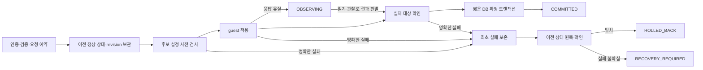

# #1444 설정 변경 원복·상태 복구 코드 수준 설계

**설계와 격리 실증만 완료했다. 제품 소스 수정, 운영 DB 변경, 모듈 배포, 실서비스 실패 주입, 이슈 종료는 하지 않았다.**

기준 소스는 `c6df1cc42ea512aa2ad5b3ae19318eaebb2c892e`, local/upstream Europa는 `a7543feb62a` 비교0/0이다. #1443의 준비·포맷·STATIC/DHCP 코드와 기존 볼륨/POSIX 보호를 유지한다. #1460 제한 CIDR 문제, 백업/복원, 런타임 번들 업그레이드 및 #1468 전면 UI 정리 구현으로 범위를 넓히지 않는다. 추가 요청한 VM 표준·다크 모드·간격은 이번 관련 UI 설계와 최종 공통 기준에 반영한다.

## 1. 실제 코드·배포 자원 확인

| 계층 | 확인 근거 |
|---|---|
| 관리 서버 | 설치 JAR의 StorageServiceManagerImpl·StorageServiceGuestCommandDispatcherImpl class SHA가 현재 compiled class와 각각 일치 |
| KVM | 13.3의 LibvirtStorageServiceHostCommandWrapper class와 현재 compiled class 일치. 기존 transport는 실패 exit에도 stdout/resultJson을 전달하고, 새 읽기 operation 문자열도 기존 검증 범위로 전달 가능 |
| SystemVM | SharedFS e9ed9f67-492e-497c-b738-810cc85f3ee7 / VM8144aac2-225b-3b0f-95ae-f2d490d4ef76 / i-2-118-VM / 13.3. 실제 storagectl SHA db4c648179c23f12b746d550e6b7ccf49a9be063c81b06c5117b601a948d61cb와 소스 일치 |
| 실제 UI | 실제 요청에서 로드된 chunk-c0835970.b82b48a2.js와 세 함수의 제어 흐름을 추출해 대조. NFS/SMB Ready·DATA20GiB를 UI에서 확인 |
| 보존 | 주입 전후 제품/설정/계정18개 파일 SHA, VM boot ID, NFS·SMB 데몬 PID/active 상태 동일. 새 VM/디스크0개, 실제 서비스 재시작0회, 실제 configfs 쓰기0회 |

새 디스크는 만들지 않았다. 기존 SPARSE 시험 서비스의 VM 안에서 임시 디렉터리·정규 파일과 모형 실행기를 이용했다. nvmetcli는 이 VM에 없으므로 설치하거나 새 엔진으로 전환하지 않았고, 현재 코드의 직접 configfs 경로를 확인했다.

## 2. 확인된 실패 경계

### DB·관리 서버

- `StorageServiceManagerImpl.updateStorageNfsExport:633` / `updateStorageSmbShare:916`: 변경값을 DAO에 저장한 후 guest 적용. 실패해도 원래 필드로 복구하지 않고 Error로 남긴다.
- `deleteStorageNfsExport:684`, `deleteStorageSmbShare:964`, `deleteStorageIscsiTarget:1763`, `deleteStorageNvmeOfSubsystem:1890`: 관계/레코드를 먼저 제거하고 runtime 적용. 설치본과 동일한 실제 class의 네 삭제 메서드에 실패를 주입한 격리 호출에서 삭제 표지가 그대로 남았다. DAO/guest 경계는 모형이며 운영 행을 삭제한 시험은 아니다.
- `rollbackProtocolEnable:5506`: enabled/IP/port/state만 복원하고 configJson을 복원하지 않는다. 실제 메서드 호출로 이 차이를 확인했다.
- `cleanupFailedFileShareCreate:1549`: 원복 실패는 경고 로그에만 남고, 원래 실패/원복 결과를 조회 가능한 별도 작업 기록으로 보존하지 않는다. configuration 실패에서 DATA 자동 삭제로 이어지지 않도록 분리해야 한다.

### SystemVM

- NFS `write_ganesha_configs:3841`: 기존 conf를 지운 뒤 새 내용을 생성한다. 뒤의 렌더/적용/검사 실패가 이전 파일·실행 상태를 복원하지 않는다.
- SMB `apply_smb_shares:4946–4964`: smb.conf와 접근/용량 JSON을 먼저 쓰고 testparm을 호출한다. 이후 restart 오류도 일부 best-effort다. **실제 VM의 testparm을 명시적 임시 conf에 실행해** 검증 실패 후 임시 이전 파일이 덮어써지는 순서를 재현했다.
- iSCSI `5867–5933`: 기존 대상/backstore를 지우고 생성한다. rollback_created는 새 생성분만 지우며 이전 대상을 되살리지 않는다. 실제 분기와 모형 targetcli 실행기로 재현했다.
- NVMe `write_required_configfs:6030`, `6413–6456`: 뒤 속성 실패 전에 앞 속성이 바뀔 수 있다. 실제 함수와 임시 정규 파일로 재현했다. 실제 kernel configfs를 변경한 시험은 아니다.

### UI

`SharedFSTab.runStorageAction:5363`은 job 접수 후 poll을 기다리지 않고 반환하며, 오류도 통지 후 반환한다. `submitActionModal:7368`은 이후 무조건 닫는다. 실제 소스 함수의 격리 호출에서 job 진행 중·POST 실패·로컬 검증 미전송 세 경우 모두 닫힘을 확인했다. 입력 객체가 즉시 삭제되는 것으로 과장하지 않는다. 닫힌 뒤 다시 편집을 열면 현재 레코드로 폼을 다시 구성하므로 시도값과 실패 작업의 연결이 사라지는 것이 문제다.

## 3. 원복 계약과 처리 순서

여기서 원자성은 DB와 VM을 한 SQL 트랜잭션으로 묶는다는 뜻이 아니다. **성공 확정 시 같은 새 revision, 원복 검증 성공 시 같은 이전 revision, 불확실/원복 실패 시 미확인 상태와 필요한 조치를 그대로 표시**하는 계약이다. 끊긴 TCP 세션을 되감거나 포맷/재귀 권한 변경을 원복했다고 주장하지 않는다.



1. 기존 API의 인증/소유권/입력 검증을 먼저 유지한다. instance 단위 짧은 행 잠금으로 requestid·expectedrevision·active operation을 예약한다. RPC 동안 SQL 트랜잭션을 열어 두지 않는다.
2. 동일 requestid와 같은 공개 설정은 기존 작업/결과를 반환한다. 다른 공개 설정은 충돌로 거부한다. 비밀값은 hash/진단에 넣지 않는다. 이미 접수된 키로 다른 비밀값을 보내도 새 적용하지 않으며, 새 비밀 변경은 새 요청 키가 필요하다.
3. 수정은 VO 복사본으로 후보를 구성한다. 삭제는 확정 전 DAO.remove 하지 않는다. 생성에 필요한 임시 ID는 Creating/작업 소유 예약으로만 만들고 정상 desired-state에서 제외한다. 동일 자연 키/경로/대상/namespace 중복도 같은 잠금 안에서 검사한다.
4. 기존 desired-state builder에 후보 overlay를 적용한다. 권한/endpoint/volume resolver와 형식 규칙을 재사용하고 프로토콜 전체 엔진을 새로 쓰지 않는다.
5. guest는 해당 작업이 참조하는 VM/볼륨 stable identity, baseline revision/hash, 대상 소유권을 확인하고 per-instance flock·durable journal을 기록한다. 후보 검사 → 적용 → 관찰을 수행한다. 다른 프로토콜·기존 DATA는 건드리지 않는다.
6. 명확한 실패만 원복한다. 최초 실패는 원복 전에 write-once로 기록하고 원복 성공/실패를 별도 필드에 기록한다. 원복 후 실제 대상 확인이 통과해야 ROLLED_BACK이다.
7. RPC timeout이나 DB commit 응답 유실은 곧바로 재적용/원복하지 않는다. OBSERVING으로 같은 작업의 guest journal·revision·실제 상태와 DB 확정 여부를 읽어 확인한다. GET/업데이트는 변경 요청을 보내지 않는다. 결과를 확인할 수 없으면 RECOVERY_REQUIRED를 유지한다.
8. DB 확정은 active operation·base revision을 다시 확인하는 짧은 트랜잭션이다. 성공 후 guest 확정 메타데이터 ACK는 idempotent다. commit 여부가 불명확한데 이전 설정으로 되돌리는 경로를 금지한다.
9. 재시작 후에도 작업/최초 실패/원복 결과는 남는다. 죽은 작업의 잠금을 시간 경과만으로 지우지 않는다. 같은 identity가 확인된 명시적 복구 재개 외에는 새 변경을 차단한다.

포맷·볼륨 생성/확장/축소·재귀 chown/chmod·외부 AD 가입/탈퇴는 위 설정 트랜잭션으로 되감지 않는다. 기존 기능을 삭제하지 않고 해당 작업의 기존 별도 단계/보호/명시적 동의를 유지한다. 이미 실행된 비가역 작업은 자동 원복 성공으로 표시하지 않는다. SMB 공유/계정·ACL 설정 원복을 설계하되 새 AD 기능을 구현하지 않는다.

## 4. 파일·API·DB 변경안 — 아직 미구현

| 위치 | 최소 변경안 |
|---|---|
| api/.../dataservice/BaseStorageServiceConfigurationCmd.java (신규) | 현재29개 설정 명령이 모두 BaseAsyncCmd임을 확인. 공통 optional requestid/expectedrevision만 추가하고 기존 각 API 명·응답·권한·이벤트 타입 유지 |
| StorageServiceManagerImpl | 29개 protocol/export/share/target/namespace/ACL 변경 진입점을 작은 coordinator로 감싼다. 기존 validate/resolve/build/apply 함수 재사용. 기존 configJson 포함 before-image 보존, 확정 전 삭제 금지 |
| StorageServiceConfigurationCoordinator/Plan (신규) | 요청 예약·후보 overlay·revision fence·적용/관찰/원복·진단. 범용 작업 엔진이나 새 프로토콜 구현은 만들지 않음 |
| StorageServiceConfigurationOperationVO/Dao (신규) | bounded 작업 기록·불변 최초 실패·별도 원복 결과·동일 요청 조회 |
| get/listStorageServiceConfigurationOperation(s) + resumeStorageServiceConfigurationOperation (신규) | get/list는 instance/operation/requestid/jobid/대상 필터와 페이지네이션의 읽기 전용 API. queued 행 미생성은 빈 list로 관찰. resume는 원래 operation의 안전한 복구만 명시적 POST로 수행하며 변경값을 새로 받지 않음 |
| 기존 instance/resource 응답 | 선택적 configurationrevision/operationid/설정 보호 상태. 기존 Ready와 최근 변경 실패를 혼동하지 않게 구분 |
| guest configuration_transaction.py (신규) + storagectl 네 apply 경계 | 작은 journal/snapshot/검증·원복 공통부와 프로토콜별 어댑터. production에서 AST 추출을 사용하지 않음. 이번 AST는 설계 시험 전용 |
| KVM transport | 변경 불필요. 기존 문자열 검증·QGA·실패 stdout/resultJson 전달 재사용. capability 확인과 operation show는 guest CLI/manager만 추가 |
| SharedFSTab.vue | config 작업만 terminal 결과를 await, 모달을 성공일 때만 닫음. 실패/검증/불확실은 입력·상태 유지 |
| CreateSharedFS.vue:2592 runStorageServiceSetup | 최초 서비스 설정 API에도 공통 요청 키/진단 observer 연결. 기존 VM/볼륨 준비·#1443 observer는 유지 |
| StorageConfigurationOperationPanel.vue / storageConfigOperation.js (신규) | 공통 읽기 패널·typed decoder·관찰 수명주기. ResourceLayout/InfoCard/ListView/MoldDialog/MoldDialogActions 재사용 |
| SharedFS 관련 scoped style·한/영 locale | 아래 UI 기준. 전역 테마·VM 화면·공통 컴포넌트 동작은 변경하지 않음 |

VM이 없는 기존 Allocated 서비스의 DB-only 설정 저장 경로는 유지하되 runtime 검증 성공으로 표시하지 않는다. 실제 SharedFS VM이 있는 변경은 실행 가능 상태를 수정 전에 검사한다. 일반 볼륨 생성/포맷/연결 엔진을 이번 설정 요청의 중복 제어로 대체하지 않는다.

초기 SharedFS wizard의 여러 설정 API는 **단계별 변경**이다. 앞에서 성공한 NFS를 뒤의 SMB 실패 때문에 전체 삭제하지 않는다. pending setup의 공개 입력·설정 requestid를 보존하고 기존 준비 재개 화면과 작업 내역에서 진단한다. 비밀값은 재시작 후 다시 입력한다. 과거 원복이 확인된 뒤 사용자가 재개할 때만 새 논리 키를 만들고, 조회/관찰 중에는 같은 키를 유지한다. configuration 실패에서 cleanupVolumeOnFailure 값만 믿고 기존/불확실 DATA를 삭제하지 않는다. DATA 정리는 확인된 소유권과 기존 명시적 정리 절차로 분리한다.

### DB 제안

현재 schema SQL/VO에는 아래 목적의 revision·원복 작업 저장소가 없다. 운영 DB에 DDL을 실행하지 않았다. 기존 AsyncJob/event는 처리 결과와 감사 기록이며 before-image·revision fence·삭제 후 진단 저장소로 덮어쓰지 않는다. 요청별 원복 기록을 위해 목적이 다른 저장소를 재사용하는 대신 전용 표 하나와 instance의 두 필드만 제안한다. 구현 시 기존 DatabaseUpgradeChecker.runEuropaPhase 경로에 전용 idempotent upgrade를 연결하며, 런타임 번들 업그레이드 테이블을 재활용하지 않는다.

- `cloud.storage_service_instance.configuration_revision BIGINT UNSIGNED NOT NULL DEFAULT 0`
- `cloud.storage_service_instance.active_configuration_operation_id BIGINT UNSIGNED NULL`
- 신규 `cloud.storage_service_configuration_operation`, InnoDB/utf8mb4:
  - id BIGINT UNSIGNED PK, uuid VARCHAR(36) ASCII/ascii_bin UNIQUE
  - instance_id/account_id/domain_id BIGINT UNSIGNED NOT NULL, job_id BIGINT UNSIGNED NULL
  - request_id VARCHAR(36) ASCII/ascii_bin NOT NULL, request_hash CHAR(64) ASCII NOT NULL
  - protocol VARCHAR(16), resource_type VARCHAR(32), resource_uuid VARCHAR(36), action VARCHAR(16)
  - base_revision/target_revision BIGINT UNSIGNED, state/phase VARCHAR(32)
  - before_snapshot/candidate_snapshot MEDIUMTEXT; UTF-8 byte 상한을 **각1MiB로 변경 전에** 검사
  - original_failure_json/rollback_result_json/guest_observation_json TEXT
  - created/updated DATETIME NOT NULL, completed DATETIME NULL
  - UNIQUE uk_ss_cfg_op_request(instance_id,request_id), INDEX idx_ss_cfg_op_instance_created(instance_id,created)
- 기존 데이터는 revision0에서 첫 정상 baseline을 확인한다. JSON 순서·기본값·단순 표시 차이는 정규화하고 필수 대상 identity·실효 설정만 판정한다.
- 미해결/비단말 작업의 snapshot과 실패 진단은 자동 삭제하지 않는다. 성공/확인된 terminal snapshot 정리는 기존 감사 보존 정책과 분리해 메타 진단을 잃지 않도록 구현 시 검증한다.
- VO의 LOB/type 매핑과 실제 MariaDB DAO 저장·갱신·재조회, UTF-8 경계·손상 행 격리·중복 키/동시 요청 시험을 구현 단계의 필수 게이트로 둔다.

### 상태·복구 API 계약

- state: PENDING / RUNNING / COMMITTED / ROLLED_BACK / RECOVERY_REQUIRED.
- phase: PREPARING / VALIDATING / APPLYING / VERIFYING / COMMITTING / ROLLING_BACK / VERIFYING_ROLLBACK / OBSERVING / COMPLETED. OBSERVING은 실패 확정이 아닌 관찰 단계다.
- rollback.state: NOT_NEEDED / PENDING / RUNNING / SUCCEEDED / FAILED / UNKNOWN. 적용 전 거부는 NOT_NEEDED로 표시한다.
- 관리 서버 재시작으로 실행자가 사라져도 조회만으로 새 apply를 실행하지 않는다. UI의 명시적 복구 재개는 같은 operation/plan/예약을 검증한 뒤 이미 적용된 새 상태의 확정 또는 이전 상태 원복을 이어가며 새 자원을 만들지 않는다. 미확인/비가역/다른 identity는 수동 확인 상태를 유지한다.
- guest RPC의 원래300초 설정과 기존 AsyncJob 틀을 유지한다. 응답 유실 때 동일 guest journal을 관찰하며, getter는 짧은 읽기 경로만 사용한다. UI GET은 원복/재적용/DB 확정을 실행하지 않는다.

### 읽기 응답 envelope

실제 ApiResponseSerializer와 설계 전용 DTO로 아래 envelope를 검증했다. 이 API가 현재 배포되어 있다는 뜻은 아니다.

```json
{"getstorageserviceconfigurationoperationresponse":{"configurationoperation":{"id":"design-operation","requestid":"design-request","state":"ROLLED_BACK","originalfailure":{"code":"VERIFY_FAILED","phase":"VERIFYING"},"rollback":{"state":"SUCCEEDED"}}}}
```

operation에는 revision/대상/phase/시각/관찰 가능 여부/허용 다음 동작을 추가한다. originalfailure는 최초 확인된 실패, rollback은 별도 결과다. 관찰 유실은 독립 관찰 경고로 다루고 실제 실패로 단정하지 않는다. password·CHAP key·TDB 원문·원문 command/stderr는 응답/진단 DB/로그에 넣지 않는다. guest의 기존 자격 저장소/필요한 사용자별 hash 복구 자료는 root 전용이며 관리 서버로 복제하지 않는다.

기존 VM은 새 capability를 확인한 뒤 보호 경로를 사용한다. 미지원 VM에 불완전한 legacy 원복을 조용히 적용하지 않고 DB/설정 변경 전에 필요한 모듈 버전을 안내한다. operation show는 쓰기 flock·signature 검사·서비스 재시작을 기다리지 않고 원자적으로 게시된 안전한 journal 상태만 읽는다. 기존 읽기는 유지하고, 구현 시 기존 VM에 해당 guest 모듈만 반영하여 데이터나 VM을 재생성하도록 강제하지 않는다. 활성 formatter가 있는 참조 DATA는 기존 준비 상태로 먼저 판정하며 새 signature 검사나 중복 포맷을 추가하지 않는다.

## 5. 프로토콜별 적용·원복 경계

| 프로토콜 | 유지/보완 |
|---|---|
| NFS | 현행 render/endpoint/visibility 함수 재사용. 후보를 staging에 렌더·검사한 후 대상 파일만 교체하고 변경 endpoint만 적용. 이전 conf/desired-state·alias/fstab·대상 디렉터리 ACL/uid/gid/mode·실행 endpoint를 보관/원복. 검증 전에 기존 conf 전체 삭제 금지 |
| SMB | 같은 render 결과를 명시적 후보 경로 testparm으로 먼저 검사. 검증 후 교체·가능한 reload를 우선하며 불필요한 전체 restart를 피함. 기존 사용자/그룹·Samba 계정 상태·대상 POSIX ACL·smb.conf/접근·용량 JSON을 필요한 범위만 복구. 사용자 제공 로그인 비밀을 시험 파일에 저장하지 않음 |
| iSCSI | 기존 입력/volume identity/CHAP 검증을 유지. targetcli 삭제 후 재생성 경로를 그대로 원복기로 사용하지 않음. 동일 대상의 ACL/속성은 delta, 새 대상은 비노출 상태에서 준비. 삭제/이름·backing 변경은 활성 세션 영향과 원복 가능성을 먼저 검사. snapshot의 소유 대상/LUN/portal/ACL/backstore만 복구 |
| NVMe-oF | 현행 kernel nvmet 경로 유지. 필요한 속성/키 경로를 전부 사전 검사하고 namespaces/hosts/ports/links/enable 상태의 변경분만 기록. 불완전 실패에 먼저 바뀐 속성을 원복. 신규 namespace는 검증 전 노출하지 않고 다른 subsystem/configfs를 정리하지 않음 |
| 서비스 IP/포트 | primary NIC/MAC·STATIC/DHCP guard는 수정하지 않음. 기존 protocol configJson 전체 및 secondary IP의 원래 관계를 보관. 해당 작업이 만든 주소/참조만 되돌리고 다른 서비스가 쓰는 주소는 유지 |

configfs는 일반 파일처럼 rename/copy 복구하지 않는다. 커널이 허용하는 쓰기·enable·link 순서를 어댑터에서 확인한다. 변경할 기존 비밀의 안전한 before-image를 확보할 수 없으면 그 비밀 변경만 적용 전에 차단한다. 비밀을 바꾸지 않는 ACL/설정 변경에 새 비밀을 요구하지 않는다.

파일 데이터·활성 TCP 세션을 임의 snapshot 복사로 되감지 않는다. 기존 연결을 깨는 파괴적 재생성이 필요한 변경은 사전 차단/기존 유지보수 절차로 분리하며, 클라이언트 검증에서 연결 유지/정상 재접속과 데이터 보존을 각각 확인한다. 실제 소켓/커널 원복은 아래 구현 후 실환경 인수 대상이다.

## 6. UI 동작과 VM 표준

- 정상 편집 → 확인: 같은 modal requestid를 유지하여 한 번 전송. POST 접수만으로 닫거나 loading을 끝내지 않는다.
- 적용/확인/원복 중: 편집/확인 재전송 차단, phase/시각 표시. 업데이트는 GET만 수행한다.
- ROLLED_BACK: 원래 실패와 원복 성공을 각각 표시하고 시도값을 유지. 사용자가 명시적으로 재확인할 때 새 논리 요청 키/현재 revision으로 재시도한다.
- RECOVERY_REQUIRED/관찰 불가: 원래 실패/실제 관찰/필요 조치를 구분하고 확인 비활성. 업데이트로 새 변경을 보내지 않는다.
- COMMITTED: 성공 확정 후 닫고 대상 탭을 한 번 갱신. 모달 닫기와 서버 작업 취소를 혼동하지 않는다.
- 재조회·화면 재진입·관리 서버/VM 재시작 후에는 저장된 작업을 조회한다. 최신 실패의 공개 입력은 operation candidate에서 복원하며 비밀값은 재입력한다. 진단만 여는 작업 내역 모드는 읽기 전용이다. observer는 resource/operation/request/auth scope·generation으로 응답을 구분하고 이전 응답이 다른 폼을 닫거나 값을 덮지 못하게 한다.
- 상세 탭은 정보 전용. 변경은 네 프로토콜 탭, 과거 실패 진단은 별도 **작업 내역 세로 탭**에서 조회한다.
- VM ListView/ResourceLayout/InfoCard/InstanceTab 구조, 한글 update 아이콘+업데이트, 메인 파란 버튼 맨 왼쪽, 다른 버튼 좌측 그룹, 네 프로토콜의 넓게 보기는 그 그룹 마지막 위치를 유지한다.
- 기존 폼의 필드·세로 순서는 유지한다. 필요한 상태 요약만 추가한다. 제목은 대화상자 헤더, 확인/취소는 고정 푸터, 긴 본문만 스크롤한다. 탭 콘텐츠에 탭 이름을 중복 제목으로 쓰지 않는다.
- MoldDialog/MoldDialogActions·기존 theme tokens를 사용한다. 관련 modal/toolbar에만 필요한 scoped override를 두며 공통 VM·전역 dark 스타일을 변경하지 않는다.

구체적 측정치, 밝은/어두운 대비, 간격·스크롤 검증과 A/B 이미지는 [UI 검토](ui-review.ko.md)에 구분했다.

## 7. 이번 설계 검증과 한계

- 실행 class/guest 코드의 SHA 대조 후, 실제 manager의 네 삭제·protocol rollback 메서드를 격리 호출하여 기존 실패 경계를 재현했다.
- 실제 SystemVM에서 설치된 함수의 NFS·SMB·iSCSI·NVMe 실패 경계를 실행했다. SMB는 실제 testparm, NFS/SMB는 임시 파일, iSCSI는 모형 executor, NVMe는 정규 파일 속성이다.
- before-image 원복 스케치, 원래 실패/원복 실패 분리, JSON 재조회, 같은 키 중복·revision 충돌 차단을 임시 환경에서 확인했다.
- UI 현재 세 함수의 격리 동작과 GET-only 결과 스케치를 검증하고 배포 청크의 함수 제어 흐름도 보존했다. 새 DTO의 실제 직렬화 envelope를 확인했다.
- 운영18개 파일·boot/PID 불변, 임시 디렉터리 제거, 새 디스크/서비스 변경0. 실제 DB 행 롤백·다중 관리 서버 경쟁·kernel LIO/NVMe 연결·실서비스 실패 복구 전체를 통과했다고 주장하지 않는다.

## 8. 구현 시 순서와 인수 계획 — 지금 실행하지 않음

1. bounded DAO/요청 예약·불변 진단·candidate overlay와 실제 MariaDB 회귀부터 구현. 스키마 누락/부분 적용은 시작 전 명확히 검출.
2. guest staging/어댑터·capability를 구현하고 **제품 반영 전에 SystemVM 격리 사전 시험**. 현재 보호/정상 동작 회귀 후 모듈 빌드. KVM은 transport 변경이 없으므로 교체하지 않음.
3. UI common observer/모달·작업 내역, 최초 설정 helper를 연결. 실제 serializer fixture로 성공/실패/원복 실패/조회 불가·중복 클릭·로컬 검증·stale 응답/재진입·GET-only 시험.
4. 13번에 변경 모듈만 배포하고, 새 시험 ROOT/DATA는 SPARSE 이상. 기존 정상 서비스의 설정·권한·데이터를 보존.
5. 네 프로토콜 각각 생성/수정/삭제와 ACL/계정·endpoint 실패를 preflight/적용 중/확인/원복에서 순차 주입. DB/파일/실제 runtime·비대상 프로토콜·클라이언트 I/O/기존 데이터·권한을 전후 대조.
6. 응답 유실·관리 서버/VM 재시작·중복 요청·원복 실패를 실제 UI에서 검증. 미확인 결과를 성공으로 표시하거나 무조건 다시 apply하지 않음.
7. 기존 NEW/EXISTING NFS 초기 생성·POSIX 보호, 고정/가변 offering, #1443 준비 모듈·STATIC/DHCP 정상 경로를 필요한 smoke로 확인. 포맷 코드를 바꾸지 않은 이번 과제에서 대용량 포맷 자체를 다시 개발하지 않음.
8. 위 인수 전에는 #1444를 닫지 않는다. 지금은 설계만 기록하고 다음 구현 지시를 기다린다.

[배포 대조](evidence/deployed-runtime-identity.json) · [host transport 대조](evidence/deployed-host-wrapper-identity.json) · [SystemVM 주입](evidence/guest-injection-result.json) · [보존](evidence/preservation.json) · [manager 실제 class 격리 호출](evidence/manager-failure-probe.log) · [UI 함수 시험](evidence/ui-failure-design-probe.json) · [실제 serializer](evidence/design-wire-fixture.json)
