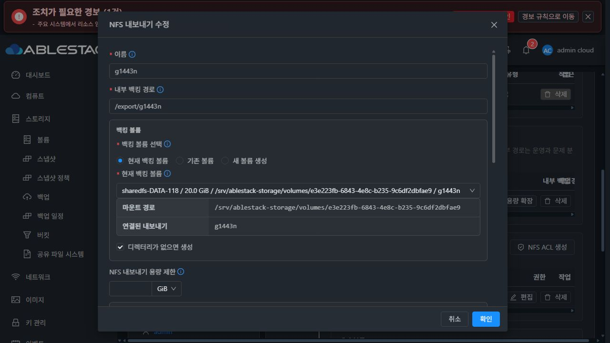
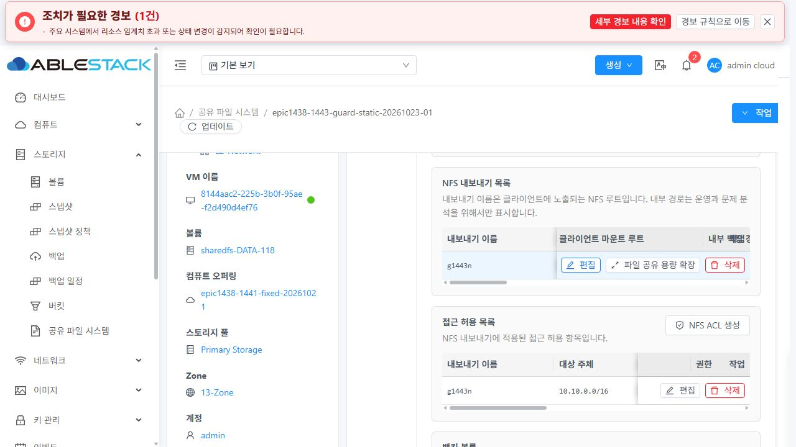
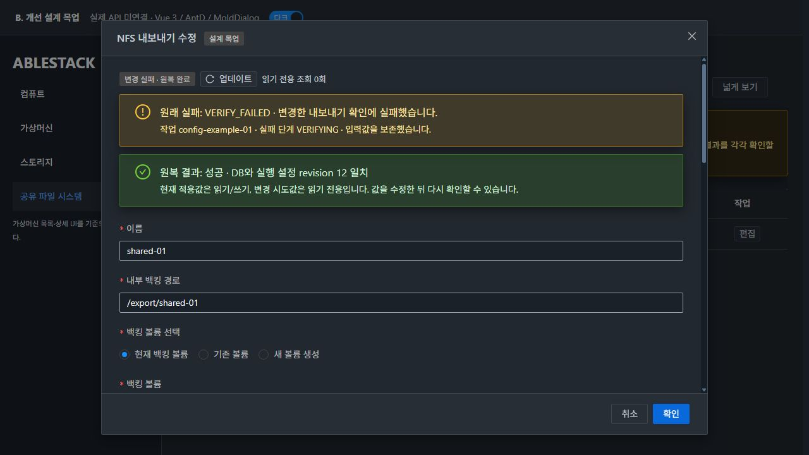
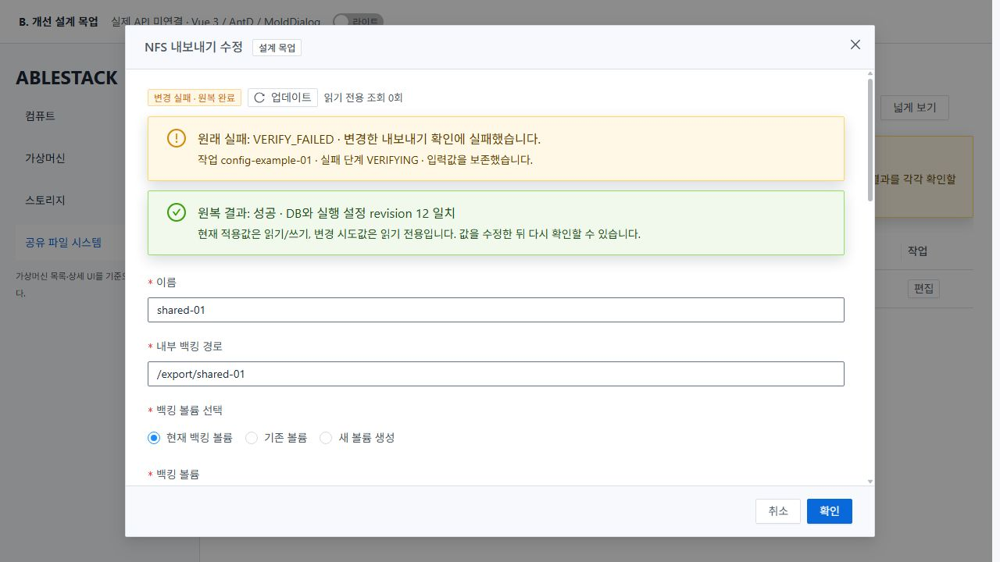
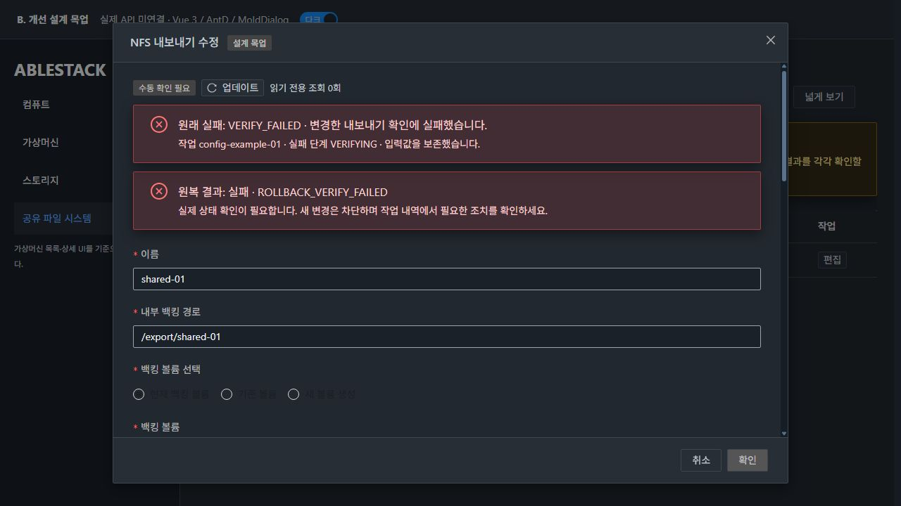
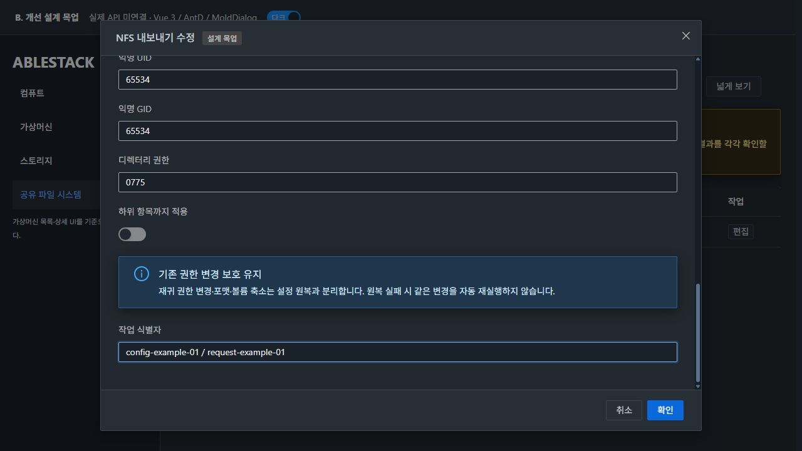
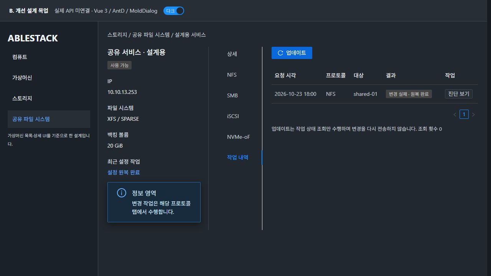
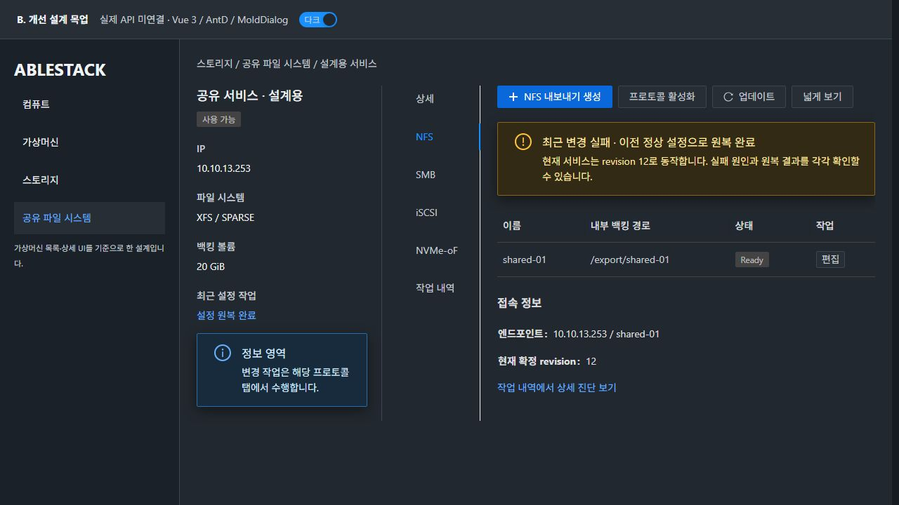

# #1444 UI 표준·다크 모드·간격 검토

**A는 실제 배포 UI, B는 개선 설계 목업이다. B의 상태·revision·작업 ID는 fixture이며 실제 API에 연결하지 않았다. 제품 UI 구현은 시작하지 않았다. 입력 폼과 표의 내용은 NFS 대표 예제이며, 다른 프로토콜은 배치 참고다. 실제 구현에서는 각 프로토콜의 기존 필드·컬럼을 그대로 재사용한다.**

## 기준 화면·컴포넌트

실제 13번 `컴퓨트 > 가상머신` 목록, 상세, 볼륨 탭, 생성 및 연결 대화상자를 열어 비교했다. 폼에서는 SPARSE offering만 선택해 열람했고 확인/생성은 실행하지 않았다. 기존 SharedFS NFS 편집도 열람·취소만 수행했다. 원래 테마는 dark였으며 비교 후 실제 Mold의 테마를 dark로 복원했다.

- 목록: `ui/src/config/section/compute.js` + `ListView.vue`. 표/검색/필터/선택/페이지네이션의 공통 구조를 유지한다. 별도 카드형 목록을 만들지 않는다.
- 상세: `ResourceLayout.vue` / `InfoCard.vue` / `InstanceTab.vue`. 왼쪽 자원 요약, 세로 탭, 오른쪽 탭 콘텐츠 구조를 유지한다. 실제 VM 탭은 같은 x좌표에서 y가 증가하는 세로 배치임을 측정했다.
- 설정 변경: SharedFSTab의 actionModal에 공통 `MoldDialog.vue` / `MoldDialogActions.vue`를 사용한다. 기존 필드와 세로 순서를 유지하고 원래 실패/원복 결과 패널만 필요한 만큼 추가한다.
- 색상: 기존 `style/theme/tokens.less` / `theme/feedback.less`의 ui-text/background/info/success/warning/error/action 토큰을 사용한다. 새 전역 palette나 VM 화면 수정은 없다.
- 이번 prototype은 실제 Vue3·ant-design-vue3.2·MoldDialog/MoldDialogActions와 현재 Mold less를 빌드한 독립 앱이다. 단순 이미지 편집으로 실제 UI처럼 표시한 목업이 아니다.

## 표준 적용 행렬

| 영역 | 설계 기준 |
|---|---|
| 목록 | VM ListView의 행·열·정렬·검색/필터·페이지네이션 사용. 이번 과제에서 다른 목록의 구조를 바꾸지 않음 |
| 상세 | InfoCard 자원 정보와 상세 탭은 정보 전용. 변경 작업을 정보 탭에 모으지 않음 |
| 탭 | VM과 같은 세로 탭. NFS/SMB/iSCSI/NVMe-oF에서 각각 작업, 별도 작업 내역 탭에서 과거 진단을 조회 |
| 탭 콘텐츠 | 탭 이름을 별도 큰 제목으로 반복하지 않음. 왼쪽부터 파란 메인 액션 → 나머지 작업 → 아이콘+업데이트 → 넓게 보기. 넓게 보기는 네 프로토콜에만 있고 좌측 버튼 그룹 마지막이며 화면 오른쪽으로 밀지 않음 |
| 도구 모음 | 실제 VM 버튼32px, 인접 버튼8px 간격을 확인. flex-wrap으로 좁은 화면에서 줄바꿈하며 버튼 간 임의 margin 중첩을 없앰 |
| 폼·구역 | 기존 세로 배치/항목 순서 유지. 필드 간20px, 구역24px, 상태 메시지12px, label/입력 분리. 내용 변경이 필요한 상태 패널 외 불필요한 재배치/누락 금지 |
| 대화상자 | 제목은 헤더, 확인/취소는 푸터, 화면 안에 고정. 긴 본문만 스크롤. 크기는 공통 preset을 선택하고 과도한 고정 viewport 높이를 새로 도입하지 않음 |
| 처리 중 | 입력/중복 확인 차단, 상태 갱신은 읽기 전용. 원복 실패에서 확인 비활성·업데이트 활성. 원래 실패/원복 결과를 별도 텍스트+아이콘으로 표시 |
| 다크/라이트 | 본문·상태/읽기 전용 값·placeholder/버튼·태그·링크·포커스를 구분해 검토. 색만으로 성공/실패를 구별하지 않음 |

실제 VM의 볼륨 대화상자는 폭520px, 헤더16×24px/본문24px/푸터10×16px인 기존 크기다. SharedFS 설정은 필드가 많으므로 기존 공통 MoldDialog lg(960px) preset을 선택했다. preset의 헤더16×24px/본문24×28px/푸터16×28px를 그대로 사용하며 새로운 전역 규격을 만들지 않는다. 구현 시 실제 ResourceLayout/InfoCard를 재사용하고 모형의 문구/샘플 자원을 복사하지 않는다.

## 실제 가독성·스크롤 검토

관찰 viewport는1280×720이다. 표본별 computed color/background를 합성해 대비를 계산했다. 일반 텍스트4.5:1, 필수 비텍스트 경계/상태3:1을 검토 기준으로 사용한다. 이는 전체 Mold에 대한 인증 판정이 아니다.

- 참고 기준: [W3C 텍스트 대비](https://www.w3.org/WAI/WCAG22/Understanding/contrast-minimum.html), [비텍스트 대비](https://www.w3.org/WAI/WCAG22/Understanding/non-text-contrast.html). 비활성 컨트롤 예외와 실제 읽기 전용 정보의 가독성을 구분한다.
- 목업 초기 원복 실패의 readonly 값은4.09:1이어서 읽기 가능한 ui-text-primary/ui-bg-input으로 해당 modal에만 보완했다. 전역 스타일은 수정하지 않았다.
- 탭 도구 모음의 기본 AntD primary는3.24:1이어서 기존 Mold의 ui-action-primary 토큰을 해당 도구 모음에 사용했다. 새 색을 발명하거나 버튼을 흰색으로 바꾸지 않았다.
- 최종 표본 값·geometry는 [검토 집계](evidence/ui-review-summary.json), 개별 audit JSON에 기록한다. DOM/테마 전환 애니메이션 도중의 중간값을 최종 판정에 사용하지 않는다.
- 긴 폼의 맨 아래 필드로 포커스를 이동해 본문 scrollTop이 변해도 header/footer의 y좌표가 같고 화면 내에 남는 것을 확인한다.
- 배포 화면에서 현재 header/footer가 이미 고정되는 부분은 유지한다. “모든 기존 대화상자가 깨져 있다”고 확대하지 않는다.
- 원래 실패·원복 성공/실패, 활성/비활성, 재시작 후 진단 재조회는 구현 후 실제 API/UI 인수 대상이다. 지금 목업과 isolated 함수 시험을 실제 전체 흐름 통과로 대체하지 않는다.
- 좁은 viewport/200% 확대, keyboard focus/스크린리더, 긴 번역/식별자·모든 프로토콜 폼은 구현 단계의 공통 UI 회귀 항목이다.

## A. 현재 배포 UI — 실제 실패 POST를 보낸 화면 아님

실제 정상 NFS 편집창이다. 실패 때 즉시 닫히는 제어 흐름은 설치 청크/현행 함수의 격리 시험으로 검증했다. 이 사진을 운영 실패 장면으로 표시하지 않는다.

## B. 개선 설계 목업 — 아직 미구현

첫 실패와 원복 결과를 각각 보존하고 실패한 입력을 유지한다. 실제 서비스 정보와 혼동하지 않도록 “설계 목업 / 실제 API 미연결”을 표시한다.

## 기준·재현 자료

- VM 실화면: evidence/03~06,08~09 이미지와 vm-layout-light.json / vm-standard-dialog-dark-geometry.json.
- 실화면 측정: current-modal-dark-geometry.json, current-modal-light-colors.json, current-modal-dark-colors.json.
- 목업 source: [App.vue](mockup/App.vue), 기존 공통 MoldDialog/Actions는 원본을 import.
- 독립 preview 빌드만 수행했다. product UI build/13번 배포는 하지 않았다.

기존 전 탭의 일괄 재배치/스타일 치환은 #1468 착수 전 보고·지시 대기 조건을 유지한다. 이번은 요청받은 공통 기준의 설계 반영이며 전면 UI 정리 구현을 시작한 것이 아니다.
