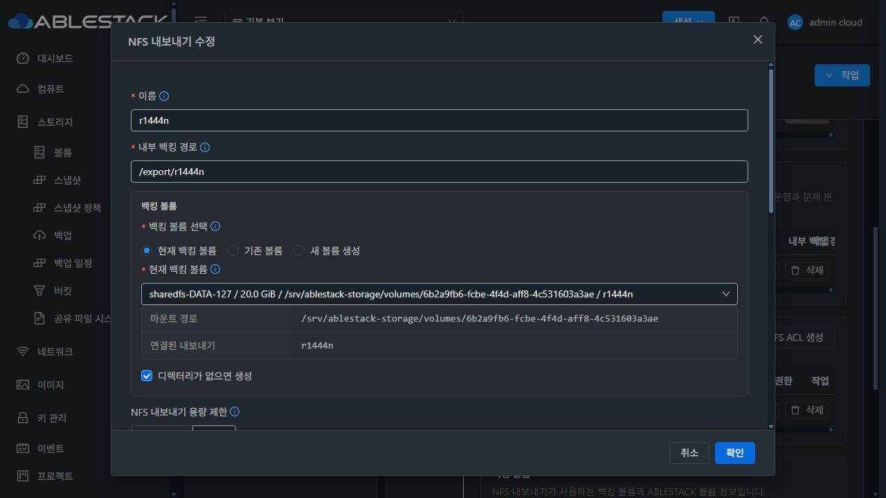
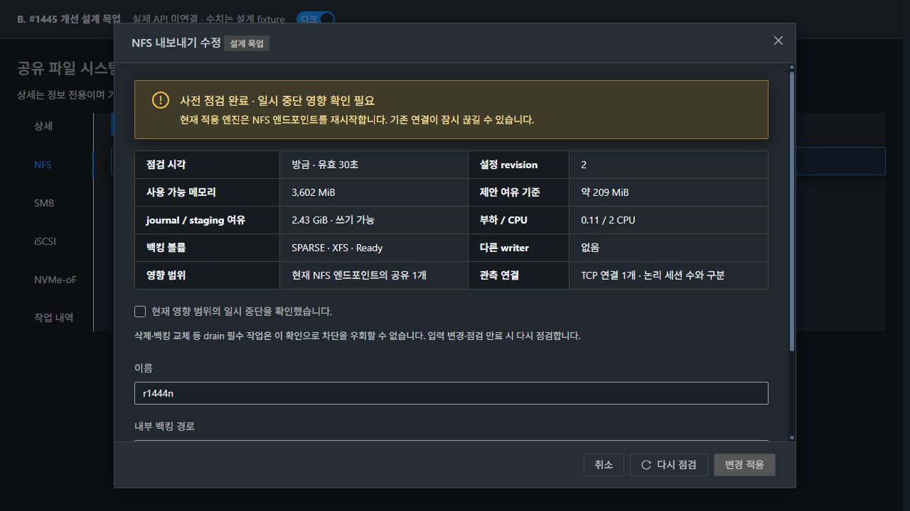
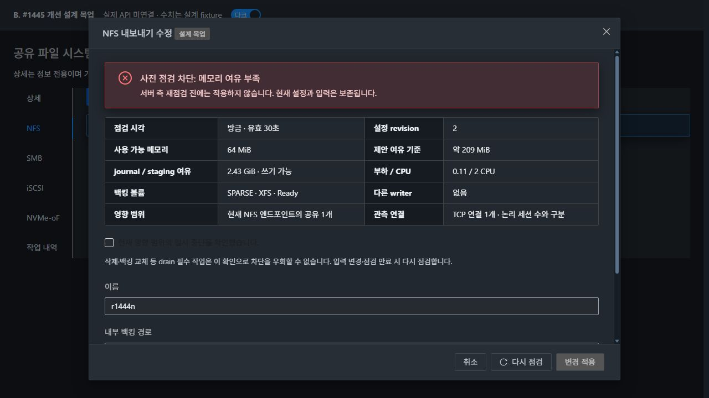
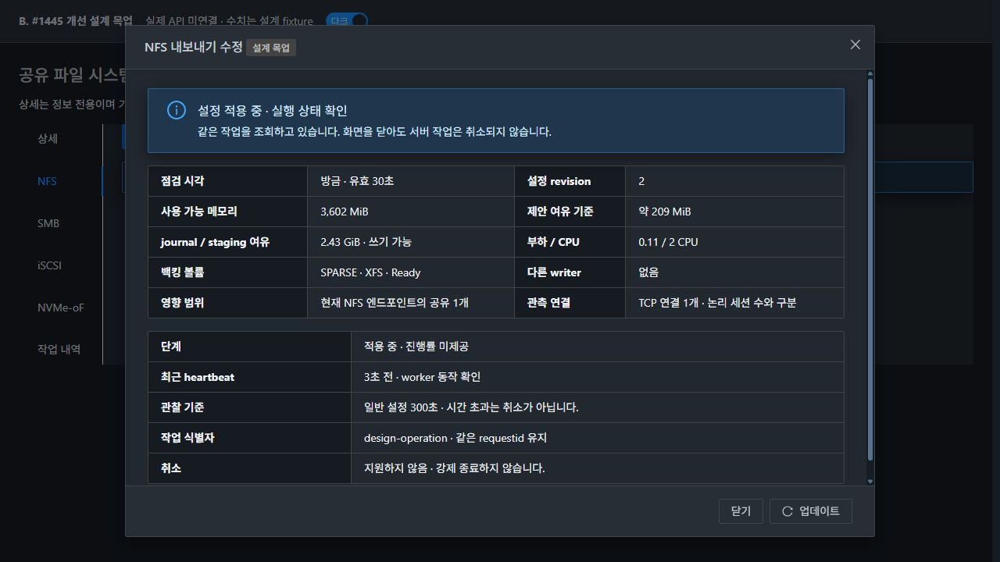
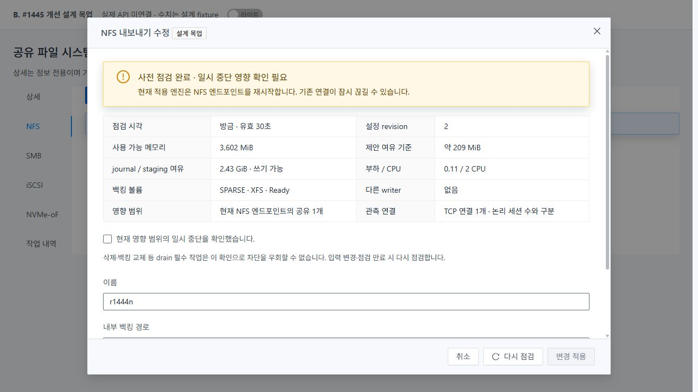

# #1445 코드 수준 설계 — 사전 점검·장시간 관찰·장애 격리

**설계·격리 실증 완료 / 제품 구현·배포·기능 인수 미착수. #1445는 OPEN이다.**
기준 소스는 `4b532f55f6c548fce5f95196057c191b9530001b`, local/upstream Europa는 `a7543feb62a728a5a806283b1e0e6134a7305260`이고 fetch 후 비교0/0이었다. 설계 자료만 추가한다.

## 1. 실제 기준과 확인 범위

13번의 기존 전용 SharedFS `bd9bf00f-579c-4a22-a7d7-40eed014872c`, instance `3730ab80-bd6c-4e33-b2db-13b1a55ee691`, VM `5d261ca7-7c62-34a0-bf9d-4a18c91464d0`(13.2, 10.10.13.250)를 확인했다.

- 설치 management JAR SHA8e911db81386, UI index72df1d943baf. Manager/Coordinator/OperationResponse/RuntimeUpgradeManager **4개 설치 class와 현재 compiled class가 byte 동일**했다. [전체 SHA](deployed-identity.json)
- 실제 storagectl6134eba4acd6·configuration_transaction99dba671f64f·nvmeof_identity12272fe888ed가 #1444 최종 소스와 일치한다.
- 실제 UI에서 기존 ROOT1+DATA5 모두 Ready/sparse를 확인했다. 새 VM·디스크·공유·ACL은 만들지 않았고 THIN·MAC 변경·포맷은 없다. [볼륨](evidence/existing-sparse-volumes.json)
- SystemVM available memory 약3,602MiB, ROOT/journal 여유 약2.43GiB, load1 0.11/2CPU였다. NFS/SMB/iSCSI TCP각1, NVMe TCP3개를 관측했다. **TCP 연결/전송 큐 수를 논리 세션 수로 표시하지 않는다.**
- 실제 서비스 변경0, 전후 보호 파일21개 SHA·5개 daemon PID/InvocationID·boot ID 동일, 실제 설정 journal18개 유지. 임시 snapshot/journal은 정리했다. [보존 결과](preservation.json)

## 2. 재사용할 구현과 실제 빈틈

| 현재 코드 | 재사용 | #1445 보완점 |
|---|---|---|
| Coordinator.execute:67~167 | SQL row 예약·requestid/revision·후보/원복 | 사전 자원/영향 점검과 장시간 관찰 연결 |
| Transaction.execute:149~262 | guest flock·중복 차단·원래 실패/원복·재개 | 기존 엔진 앞의 자원 gate, healthy worker와 관찰 실패 구분 |
| RuntimeAdapter.preflight:281~300 | VM/instance/명령·인증 before-image 보호 | 메모리·공간·busy volume·세션/영향 관측 |
| RuntimeAdapter.run:449~469 | 독립 supervisor·PID/boot/start ticks | 고정275초 대기를 작업별 관찰 기준으로 분리 |
| run_child:831~852 | 실제 기존 storagectl 실행 | 무제한 communicate capture를 bounded drain으로 보완, heartbeat |
| ConfigurationPlan 생성자 | 동일 instance 후보/commit 모델 | 전역 listAll을 먼저 적재하지 않도록 기존 scoped DAO 조회 사용 |
| SharedFSTab.submitActionModal:7582~7633 | 기존 폼 검증·실행·보호 | 새 볼륨 createVolume **전** UI 사전 점검·입력 변경 시 무효화 |
| storageConfigOperation.js | GET 관찰·같은 작업 복구 | 고정600초 화면 관찰과 실행 deadline 구분·heartbeat/다음 행동 |

현재 NFS 엔진은 바뀐 endpoint를 재시작하고 SMB apply는 smbd/nmbd/winbind를 재시작한다(storagectl3916~,4986~). 이를 무중단으로 표시하지 않는다. iSCSI는 기존 세션 대상의 LUN/portal 제거를 막고 start 경로를, NVMe는 destructive namespace/backing 변경의 연결 검사를 이미 사용한다(5924~,6502~). 이 보호를 유지한다.

기존 runtime-upgrade의 **preflight()는 다운로드·SQL persist·guest 전송까지 수행**한다(158~206). #1445의 읽기 전용 점검에 이 메서드를 호출하지 않는다. 서명·catalog·upgrade 엔진을 다시 개발하지 않는다.

## 3. 최소 변경 구조

| 파일/메서드 | 계획 |
|---|---|
| API: 새 PreflightStorageServiceConfigurationCmd/Response | synchronous 읽기 전용 점검 DTO. 임의 API 실행 경로를 만들지 않음 |
| StorageService / ManagerImpl.getCommands, 새 preflight 메서드 | 기존 권한·instance/resource/volume 조회를 재사용해 read-only intent 작성 |
| 새 StorageServiceConfigurationPreflight | intent/영향·자원 정책·public 결과를 한 곳에서 조립 |
| Coordinator.execute / 새 observeUntilDecision | 예약 후 후보 준비 전 재검사, 실제 적용 전 최종검사, 동일 작업 GET 관찰 |
| ConfigurationPlan 생성자 | FS/Block의 listByInstanceIdAndProtocol 및 ACL listByResource 재사용 |
| BaseStorageServiceConfigurationCmd / requestHash | optional impactack, control metadata를 business hash에서 제외 |
| RuntimeUpgradeManager.upgrade/rollback 진입 | 공통 instance row lock 아래 config writer와의 상호 fence만 추가 |
| 새 configuration_preflight.py / storagectl dispatch/capability | read-only 자원 관측·gate. 기존 transaction version1 유지, additive capability 제공 |
| configuration_transaction.py의 preflight/run/run_child/show | gate·heartbeat·bounded output·alive/unknown 분리. 기존 apply/rollback 엔진 재사용 |
| SharedFSTab / utils / OperationPanel / locale | 기존 modal에 사전 점검·영향·heartbeat·닫기/취소 구분만 추가 |

**DB 추가 DDL 없음.** 기존 operation의 candidate_snapshot/publicRequest와 guest_observation_json을 재사용한다. 공개 점검 결과는32KiB 이하, heartbeat는4KiB 이하로 제한한다. before-image/비밀/원문 stderr를 UI/SQL 공개 진단에 넣지 않는다.

KVM wrapper는 generic operation 문자열을 검증·전달하는 기존 경로를 사용하므로 새 host command/agent 교체를 계획하지 않는다. 공통 볼륨 API·메타데이터·포맷 엔진 및 #1468 전면 UI 정리는 변경하지 않는다.

## 4. UI부터 서버까지의 실행 순서

1. 기존 폼에서 공개 intent를 만든다. name 같은 기본값은 한 번 확정한다. 이 단계에서 createVolume/attach/format/서비스 적용은 하지 않는다.
2. 사용자가 **사전 점검**을 누르면 새 읽기 API를 호출한다. 응답에 자원·writer·볼륨 상태·실제 영향 범위·관측 신뢰도·작업 profile을 표시한다.
3. BLOCKED/필수 관측 UNKNOWN이면 적용을 막는다. 일시 중단 작업만 현재 영향 fingerprint에 대한 확인을 받는다. CPU 부하 경고 하나로 무조건 차단하지 않는다.
4. 폼/instance/account/revision 변경 또는30초 경과 시 UI 캐시/확인을 무효화한다. ‘업데이트/다시 점검’은 apply를 재전송하지 않는다.
5. 사용자 적용 후 기존 동작을 실행한다. NEW 볼륨은 이때 기존 createVolume 경로를 사용한다. 같은 accepted 요청의 불확실 상태에서 새 볼륨을 다시 만들지 않는다.
6. 서버는 먼저 같은 requestid를 조회한다. 이미 받은 동일 business 요청은 기존 작업을 돌려주며 새 자원 점검/실행을 시작하지 않는다. 다른 요청만 기존 instance SQL 예약과 revision 검사를 거친다.
7. 예약 후 **candidate.get()보다 먼저** guest 자원/충돌/영향을 재검사한다. candidate가 attach/초기화를 준비할 수 있으므로 이 위치가 중요하다. 전체 후보가 만들어진 후 프로토콜 적용 직전에도 정확한 범위를 다시 검사한다.
8. 현재 metric과 volume/세션/영향은 서버가 다시 판단한다. UI 결과/체크박스는 서버 gate를 대체하지 않는다. 새 볼륨의 동적 UUID는 영향 fingerprint와 UI 입력 hash를 구분해 취급하며, 실제 볼륨의 소유권·정책·상태는 기존 resolver로 검증한다.
9. 기존 apply→verify→DB commit/원복을 실행한다. 최초 실패·원복·#1444의 재진입 보호는 유지한다.

NEW 경로의 gate 추가로 생기는 lifecycle도 처리한다. 이미 할당된 새 volume ID는 같은 draft에 보존하고, 서버의 accepted publicRequest를 gate보다 먼저 checkpoint한다. gate 차단/재진입 시 owner·instance·intent가 맞고 아직 참조되지 않은 준비 볼륨을 재사용한다. 새 createVolume을 무조건 반복하거나 사용 중 볼륨을 자동 삭제하지 않는다. 이 범위의 회귀가 필요하며 범용 Cloud createVolume idempotency를 새로 개발하지 않는다.

첫 gate는 후보의 사전 준비 전, 두 번째는 실제 서비스 변경 전의 검사다. 이를 기존 신규 디스크 준비까지 전부 ‘원자적 취소’된다는 뜻으로 확대하지 않는다. 기존 DATA 신원·signature·POSIX·SPARSE 보호는 유지한다.

## 5. 새 읽기 API와 계약

`preflightStorageServiceConfiguration`은 instanceid와 최대4KiB의 **비밀 없는 intent**를 받는다. api/action은 현재29개 설정 명령의 고정 허용 목록으로 제한한다. 선택 resource의 instance 소속·volume 소유권/zone/state를 기존 DAO/권한 검사로 확인한다. password/secret/CHAP key 및 알 수 없는 필드는 받지 않는다. credential 변경은 값 대신 변경 여부만 표시한다.

UI는 긴 URL을 피하려고 기존 postAPI의 body와 timeout30000/preserveOnFailure 옵션을 사용할 수 있다. **HTTP POST 전송이어도 이 endpoint는 job/DB/guest 설정을 만들지 않는 읽기 연산**이다. 기존 ‘업데이트’ GET 계약은 그대로다.

응답은 아래와 같은 **단일 객체**다. [실제 ApiResponseSerializer를 실행한 설계 DTO 출력](preflight-wire.json)은 root/객체/배열/날짜/boolean 계약을 검증한 스케치이며 배포 API가 아니다.

```text
preflightstorageserviceconfigurationresponse.configurationpreflight
  status: READY | BLOCKED | UNKNOWN
  revision, observedat, expiresat, intenthash, fingerprint
  checks[]: code, severity, blocking, measured/required bytes, source, observedat
  impact: class, affected count/sample, connections, confidence, drainrequired
  profile: soft deadline, poll interval, observation deadline
  cancellationsupported: false
```

fingerprint는 영향 범위/현재 revision의 확인값이며 인증 토큰이나 권한 확대 수단이 아니다. UI intenthash는 입력 변경을 감지한다. 실제 동적 volume ID와 준비 전 NEW 사양을 구분하고 영향이 달라지면 재확인을 요구한다. 서버는 매번 실제 조건을 다시 검사한다. 같은 accepted requestid의 business hash에 impactack/관찰 metadata를 넣어 새 요청처럼 취급하지 않는다.

새 guest capability는 configurationPreflightVersion/observation version을 additive로 제공한다. 없으면 명확히 지원 불가로 차단하고 부정확한 PASS로 fallback하지 않는다. 기존 configurationTransactionVersion1/응답 DTO는 호환 유지한다.

## 6. 자원·충돌 gate

필수 관측은 MemAvailable, 적용 프로세스에 유효한 확인된 memory limit, journal/config/staging 파일시스템의 bavail/inode/read-only, 선택 볼륨 상태, 진행 중 준비 작업, 영향받는 연결이다. 같은 st_dev의 공간을 중복 합산하지 않는다. DATA의 가상20GiB/10TiB를 RAM 또는 ROOT의 실제 필요 공간으로 계산하지 않는다.

초기 정책은 **제안값**이며 현재 한 서비스에서 OOM 방지를 증명한 값이 아니다. candidate4MiB·before-image8MiB 등 기존 상한을 그대로 유지한다.

- 필요 메모리 = reserve128MiB + 처리여유64MiB + 8×(request bytes + 추정 snapshot bytes) + bounded result 여유16MiB.
- 필요 공간 = reserve64MiB + 2×(request + snapshot bytes) + bounded result 여유16MiB. 파일시스템별 요구량으로 검사한다.
- live 표본의 snapshot13,321B, Python allocation peak155,542B, 약0.015초였다. 이것은 snapshot 구간만의 측정이며 전체 worker RSS/대용량 부하 측정으로 확대하지 않는다. 스케치의 해당 요청 여유 기준은 약209MiB/80MiB다.
- 부하/CPU가 높으면 경고·예상 지연을 표시한다. 필수 자원/관측 실패와 구분한다.
- volume-preparation Store/alive metadata를 먼저 읽고 진행 중이면 대상 변경을 막는다. mkfs 중 signature probe/포맷/재개를 사전 점검에서 호출하지 않는다. #1443 formatter와 그 timeout은 바꾸지 않는다.

Manager의 ConfigurationPlan은 현재 share/target/rules listAll을 먼저 적재한다. 기존 scoped DAO 메서드로 선택 instance/protocol/resource만 읽는다. 실제 현재 Plan과 DAO 계약을 사용한 **mock DAO 스케치**에서303행 대신3행으로 같은 snapshot을 만들었다. 실제 DB 부하 성능 시험이나 제품 변경 결과는 아니다. [출력](scoped-read-probe.json)

writer 제어는 기존 SQL 예약을 유지한다. runtime의 활성화/원복도 같은 instance row lock 안에서 config owner를 확인하고 자기 phase를 원자적으로 표시한다. config 진입도 해당 쓰기 phase를 확인한다. 단순 PREFLIGHT_READY를 무조건 writer로 취급해 무기한 설정을 막지 않는다. runtime preflight/download/서명 기능을 새로 만들지 않는다. 관측 불확실·재시작 후에는 SQL 소유권과 실제 worker metadata를 함께 확인하며 임의 lease 만료/동일 변경 재실행은 하지 않는다.

## 7. 영향·drain·취소의 정확한 의미

| 종류 | 동작 |
|---|---|
| 기존 iSCSI/NVMe의 호환 가능한 추가/동일 요청 | 기존 start/증분 경로와 중복 억제 재사용 |
| NFS/SMB의 기존 restart가 필요한 변경 | 실제 endpoint/공유 영향과 일시 중단을 표시하고 명시 확인. 무중단으로 표시하지 않음 |
| 삭제·백킹 교체·portal/허용 철회 등 drain 필수 | 실제 영향 범위 연결과 kernel 상태를 재관측. active/unknown이면 차단. 체크박스로 우회 불가 |
| 실제 안전한 취소가 없는 실행 | cancellationsupported=false, 강제 kill/취소 API 추가 없음 |

NVMe TCP 큐를 특정 namespace의 확정 세션으로 간주하지 않는다. target 귀속이 불확실하면 endpoint 전체를 보수적으로 확인한다. 적용 직전 기존 live guard도 다시 실행해 새 연결이 관측되면 막는다. 새로운 연결을 원자적으로 차단하는 전역 maintenance 모드를 제공했다고 주장하지 않는다. 그 수준의 유지보수 보장이 필요한 변경은 지원 절차가 확인될 때까지 자동 진행하지 않는다. 자동 세션 강제 종료·ACL 완화·가짜 maintenance 체크는 없다.

UI의 ‘취소’는 실행 전 draft 닫기다. accepted 실행 이후에는 **닫기(작업 계속)**와 읽기 전용 업데이트만 허용한다. closeActionModal의 loading 차단을 이 경우에만 분리하되 instance operation/requestid/generation을 지우지 않는다. route를 떠났다가 돌아와도 #1444 서버 보호/같은 작업 복구를 사용한다.

## 8. 시간·heartbeat·출력 경계

현재 global command timeout300초, guest child wait275초, UI observer 약600초는 서로 다른 경계다. 기본 read20초는 유지한다. 일반 설정300초/recursive POSIX1800초는 초기 **soft deadline 제안**이며 취소/kill 시간이 아니다. 기존 formatter profile은 별도 그대로다.

RuntimeAdapter.run을 poll/상태 갱신으로 보완하고 run_child에서5초 주기 heartbeat를 쓴다. PID·boot ID·start ticks와 child identity를 함께 기록한다. step index/count는 표시할 수 있지만 engine이 제공하지 않는 백분율·정확한 ETA를 만들지 않는다. heartbeat는 생존 신호이며 실제 진행을 증명하지 않는다.

- worker alive면 관찰 기준 경과 후에도 RUNNING/overdue로 표시하고 새 apply/원복/kill을 자동 실행하지 않는다.
- transport 응답 유실 때 Coordinator는 같은 operation show만 관찰한다. SQL transaction을 RPC 동안 유지하지 않는다. 정상 VERIFIED 후 기존 commit/응답을 사용한다.
- 관리 서버 재시작으로 caller가 사라져도 guest 결과와 SQL 예약을 읽는다. worker가 종료되고 검증된 결과가 있으면 기존 같은 작업 resume/commit, 확정 실패면 원복, 불명확하면 보호/수동 확인이다.
- UI는 server profile/poll interval에 맞춰 순차 조회한다. 관찰을 중단한 사실을 실행 실패/취소로 표현하지 않고 수동 업데이트를 남긴다.
- stdout/result는 bounded8MiB, stderr 진단 tail64KiB를 제안한다. 계속 drain하되 비밀 없는 최종 JSON만 선택한다. cap 초과/결과 누락은 먼저 관찰 불명확으로 취급하며 출력 때문에 성공했을 수 있는 변경을 재실행하거나 즉시 원복하지 않는다.

실제 SystemVM의 설치 Transaction/RuntimeAdapter를 private copy에서 호출하되 storagectl 자식만 안전한 Python으로 바꾼 실험에서 caller 대기0.15초 만료 후 workerActive, getter0변경, 다른 writer 차단, apply1회, resume재실행0, 최종COMMITTED를 확인했다. prototype heartbeat와 현재 제품 heartbeat 부재도 구분했다. 실제 QGA 단절/VM 재시작 인수나30분 실부하 시험은 아니다.

별도 bounded-output 실험은2,097,426B를 drain하고64KiB만 유지하면서 최종 JSON을 읽었다. 이는 기법 실증이며 제품의 최종8MiB 계약 전체를 통과한 결과가 아니다.

## 9. 구현 시 필수 회귀·인수

- 실제 DAO scoped read/소유권·revision·서로 다른/같은 requestid·runtime activate와의 admission 경합. 기존 #1444 보호/원복/serializer 회귀 유지.
- read-only API가 job/persist/createVolume/attach/format/apply를 호출하지 않는 계약. 새 볼륨 생성 전 점검, gate 재차단 후 준비 ID 재사용과 재진입에서 createVolume 중복 없음.
- 4MiB payload/8MiB before-image/결과 cap 경계·unknown 관측·1GiB 최소 SystemVM의 정상 소규모 요청을 검증한다. 제안 reserve를 임의로 기존 신원/권한 검사를 완화해 맞추지 않는다.
- 실제 SFC에서 입력/instance 변경·만료·모달 재진입·응답 유실·healthy-long job·닫기/취소 구분·권한 없는 request를 검증한다.
- 필요한 모듈 구현/빌드 후 guest→API/backend→UI 순서로 정렬 배포한다. KVM agent와 DB DDL 변경은 계획하지 않는다.
- 실제 13번 UI에서 사전 차단, 정상 적용, long delay/재시작/QGA 단절 후 같은 작업 추적, actual drain/재접속·원복·데이터/권한 보존을 검증한다. 새 디스크는 SPARSE/FAT만 사용한다.
- 이 단계들이 통과하기 전 #1445를 닫거나 전체 기능 완료로 표시하지 않는다.

## 10. A. 현재 배포 UI / B. 개선 목업

**A는 현재 정상 편집창의 실제 캡처다. 실패 POST를 보낸 사진이 아니다. B는 Vue3·실제 AntD·현재 MoldDialog/Actions/less를 빌드한 독립 설계 앱이다. 실제 API에 연결되지 않았고 metric/state는 fixture이며 기존 폼의 선택 필드만 발췌했다.**







VM 표준 공통 dialog의 헤더/푸터와 본문 스크롤을 사용한다. 표본1280×720에서 본문 scrollTop0→156에도 header y33/footer y622가 같았다. 다크/라이트의 본문·도움말·상태/읽기 전용 값을 확인했다. 전체 Mold 접근성 인증이나 모든 화면 정리를 주장하지 않는다. 탭 제목 중복 없이 좌측 파란 주요 버튼·아이콘+업데이트·좌측 그룹 마지막 넓게 보기를 유지한다.

## 11. 실증 결과와 한계

[SystemVM 설계 실험](native-design-validation.json) · [보존/출력 경계](preservation.json) · [wire](preflight-wire.json) · [scoped DAO mock](scoped-read-probe.json) · [요약](summary.json)

자원 조건9그룹, 실제 Transaction 앞 gate3경로, 비동기 관찰 실험과 bounded-output 실험, 실제 Serializer/Plan의 격리 Java 스케치가 설계 타당성을 뒷받침한다. 메모리64MiB/공간1B/formatter active 등은 **측정값 주입**이며 실제 OOM·디스크 포화·실서비스 장애를 만들지 않았다. private snapshot/read 및 안전한 자식만 실행했다. 새 API·UI 기능 자체의 실제 배포 인수는 하지 않았다.

제품 소스·설치 모듈·서비스 설정·DB schema/실제 작업은 변경하지 않았다. 구현 지시를 기다린다.
