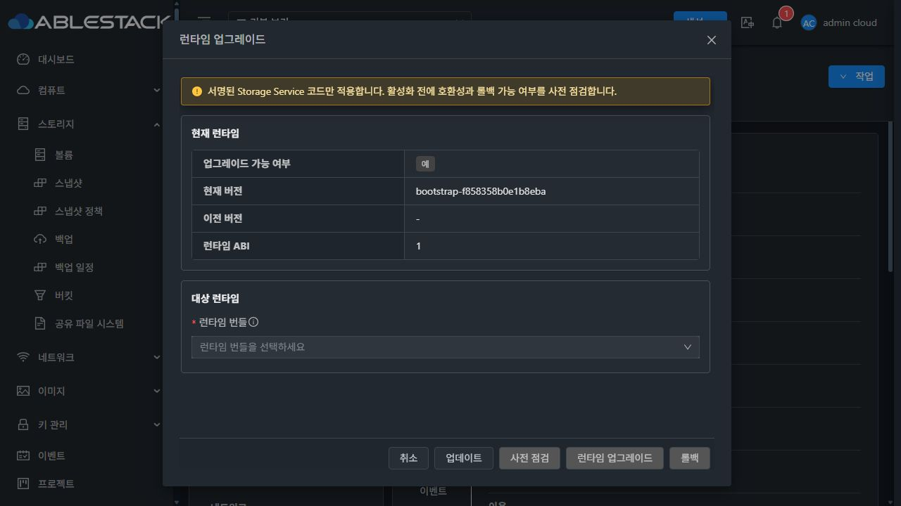
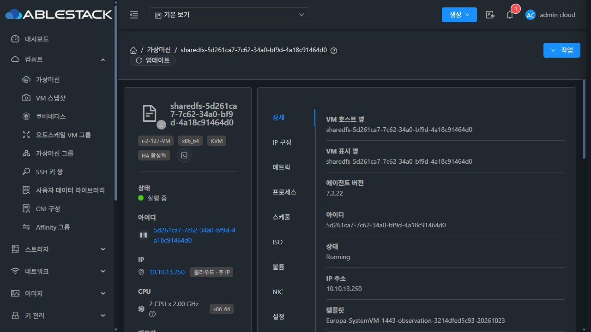
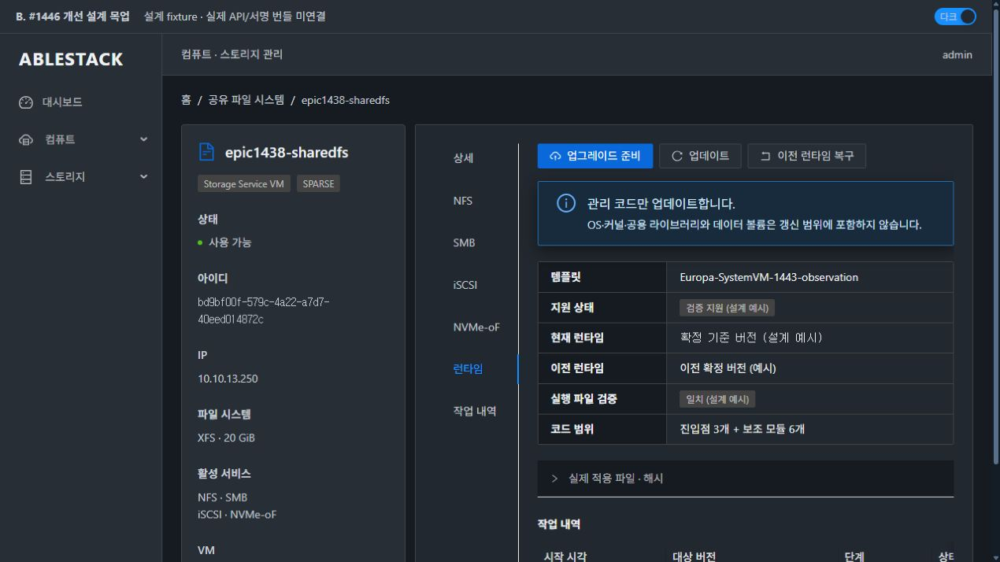
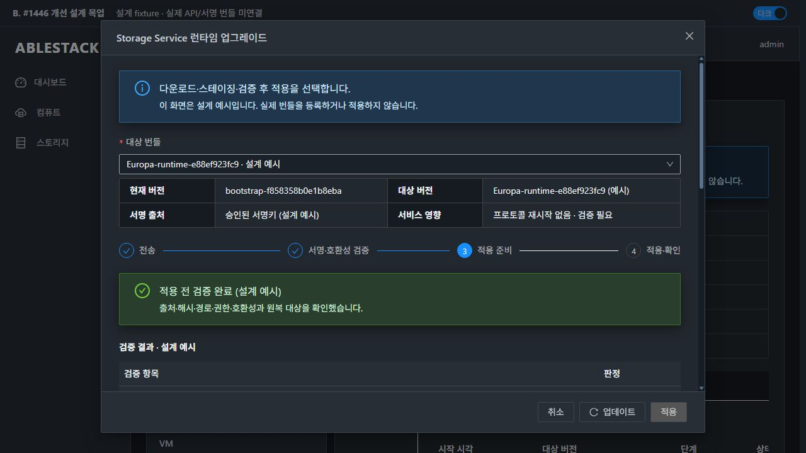
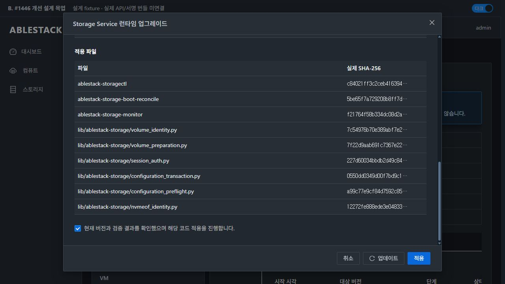
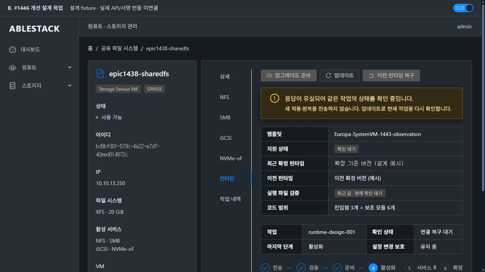
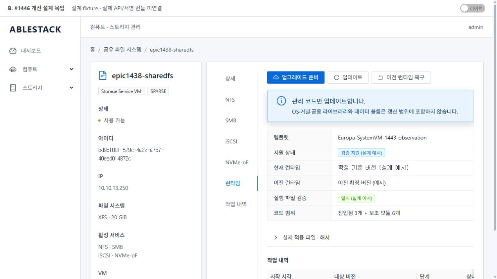

# #1446 코드 수준 설계 — Storage Service 런타임 인플레이스 업그레이드

**설계·격리 실증 완료 / 제품 구현·배포·실제 업그레이드 인수 미착수. #1446은 OPEN이다.** VM 표준에 맞춘 개선 목업을 포함한다. 아래 제안과 현재 구현을 구분한다.

## 1. 범위와 실제 기준

목표는 SystemVM 교체 없이 **Storage Service 소유 코드만** 안전하게 갱신하는 것이다. OS·커널·공용 Python/시스템 라이브러리·데이터 볼륨·네트워크 설정·템플릿 교체는 갱신 대상이 아니다. 카탈로그 등록·배포·수명주기 전체인 #1447을 여기서 재작성하지 않는다. 이미 있는 register/list API를 소비하며, 유효한 서명 번들1개를 확보하는 준비 조건과 #1447 전체 완료를 구분한다. #1468 전면 UI 정리는 시작하지 않는다.

- 소스: canonical WSL /root/work/ablestack-cloud, epic/1438-sharedfs, e88ef923fc96912d566f1702052cfac7dcf801f8.
- fetch 후 local/upstream Europa a7543feb62a728a5a806283b1e0e6134a7305260 비교0/0, feature/origin0/0, 시작 working tree clean.
- 실제13번: SharedFS bd9bf00f-579c-4a22-a7d7-40eed014872c, instance3730ab80-bd6c-4e33-b2db-13b1a55ee691, VM5d261ca7-7c62-34a0-bf9d-4a18c91464d0(13.2/i-2-127-VM/13.250). 기존 NFS·SMB·iSCSI·NVMe-oF 구성과 SPARSE DATA를 사용했다. 새 ROOT/DATA 생성·THIN 사용·MAC 변경은 없다.
- management JAR SHA2f3567a3610be2af29b16e1d4c6c6f313e7ec8a21371ad76556a7ef49eb183d5. Runtime manager/dispatcher/capability/upgrade DTO **4class가 현재 compiled class와 byte 동일**. embedded updater와 실제 VM의 updater SHA5c41f8fd624f0cbe2e955a5fa1bc7bc4376040a02525ab6e00d712b7f5321334도 소스와 동일하다.
- 실제13.2 KVM wrapper class ef85a4f638a5f6faf2e0761c134044a6180795b252fa32bd582dc298ec9165b2가 local compiled와 동일하다.
- 실제 UI에서 capability/listBundles/listUpgrades 조회3개 모두 HTTP200. updater available=true·entrypointsmanaged=true·ABI/schema1, currentVersion=bootstrap-f858358b0e1b8eba, 번들·작업 목록은 비어 있다.
- 실제 bootstrap.json의 storagectl 기준은 db4c648179c2…, 실행 파일은 c84021ff3c2c…다. 이는 이전에 승인된 모듈 반영 이후 **기준 기록과 실행 코드가 다른 상태**이며, 파일 시스템 손상으로 판정하지 않는다. 현재 버전 문자열만으로 코드 무결성을 주장하면 안 된다.

[배포 코드 대조](evidence/deployed-code-identity.json) · [실제 API](evidence/current-runtime-api.json) · [native 기준 요약](evidence/native-baseline.json)

## 2. 재사용할 코드와 확인한 빈틈

| 현재 코드 | 재사용할 기반 | 보완할 경계 |
|---|---|---|
| RuntimeUpgradeManagerImpl register/list/preflight | 기존 bundle/upgrade DAO·다운로드 상한·chunk 전송·관리 리소스 | 동일 요청 식별·단계 재진입·관측 불명확 보호·실제 결과 기준 DB 확정 |
| runtime_updater.begin/finalize/verify | 파일 전송·해시·Ed25519·안전한 archive 검사 | helper 의존성 폐쇄, 단계 간 immutable 검증, 정확한 공간 계산 |
| runtime_updater.activate/rollback | current/previous의 atomic symlink | ACTIVATE 직전 재검증·확정 분리·stale/반복 원복·이전 코드 무결성 |
| RuntimeHostCommandWrapper | QGA 전송과 고정 파일 유형 | bootstrap shim/key의 원자 설치·전체 파일 hash·전용 요청 경로 |
| #1444/45 설정 보호 | SQL instance row lock·설정 journal·실패/원복 진단 | runtime의 불확실 상태와 native 설정/준비 작업·boot reconcile까지 fence |
| StorageServiceRuntimeUpgrade.vue | 현재 API·번들 선택·작업 표시 | VM 표준 별도 탭·단계별 대화상자·같은 작업 관찰·실행 파일 hash |

현재 번들 builder와 guest 허용 목록은 CLI/boot-reconcile/monitor **3개 파일만** 관리한다. 실제 CLI는 volume_identity, session_auth, volume_preparation, configuration_transaction, configuration_preflight, nvmeof_identity를 절대 경로로 사용한다. 일부 코드만 바뀌는 혼합 버전을 정상 번들로 판정할 수 있다.

실제 activate는 preflight 뒤 manifest의 서명·ABI·impact를 다시 검증하지 않는다. rollback은 과거 작업인지와 이전 파일의 실제 hash를 검사하지 않는다. manager는 activation 응답 유실도 catch→fail→FAILED로 기록할 수 있어, native가 이미 전환됐는데 DB가 실패로 표시되고 설정 보호가 풀릴 수 있다. 이것은 코드 경로 분석이며, 라이브 DB에 이 실패를 발생시킨 결과로 확대하지 않는다.

호스트 writeChunk는 고정 실행 파일을 w+b로 직접 쓰고 최종 chunk에서 chmod만 한다. 전송 중단 시 기존 updater를 반쪽 파일로 만들 수 있다. executeUpdater 요청은 공용 /tmp의 이름을 사용하고 w+b로 연다. 시험 전용 symlink에서 실제 QGA가 대상 파일을 따라 쓰는 것을 확인했으므로 전용 root 경로와 NOFOLLOW·atomic publish가 필요하다. 시스템 파일을 대상으로 시험하지 않았다.

## 3. 관리할 payload와 버전

새 payload는 **3진입점 + 6보조 모듈**의 명시 허용 목록으로 닫는다.

- root: ablestack-storagectl, ablestack-storage-boot-reconcile, ablestack-storage-monitor.
- lib/ablestack-storage/: volume_identity.py, session_auth.py, volume_preparation.py, configuration_transaction.py, configuration_preflight.py, nvmeof_identity.py.
- runtime_updater 자체와 runtime-bootstrap, sharedfs_bootstrap_network는 신뢰 기반/VM 부트스트랩 영역으로 분리한다. bundle이 verifier·신뢰키·OS 파일을 임의 교체하게 하지 않는다.

기존 CLI ABI와 desired schema를 바꾸지 않는 패치는 ABI1/schema1을 유지한다. **manifestFormat/payloadLayout2, updater/host transport 기능 버전**을 별도로 검사한다. 오래된 updater가 새 경로를 거부하는 현재 fail-closed 동작을 유지한다. layout1 번들은 새 온라인 적용 대상으로 승인하지 않고, 검증된 이전 기반의 관찰·원복과 구분한다.

tools/build에 한 관리 파일 목록을 두고 bundle builder·template 기본 payload·verifier가 같은 목록을 사용한다. 파일마다 path/bytes/SHA256/mode/owner/group을 기록한다. 진입점0755, helper0644, root:root를 고정한다. 정확한 허용 경로 외 절대 경로·상위 이동·중복·symlink/hardlink·추가 파일·소유자/권한 불일치를 거부한다. 부모 경로도 trusted root 내부인지 검사한다.

CLI는 자신의 **resolved release**에서 helper 디렉터리를 한 번 선택한다. layout2면 그 release의 lib를 사용하고, 검증한 legacy baseline은 기존 global helper 경로를 사용한다. global helper를 묶음마다 덮어쓰지 않아 legacy 원복 영향을 줄인다. legacy 외부 helper의 hash도 baseline에 묶어 확인한다. boot-reconcile/monitor도 한 실행 동안 같은 release의 CLI를 사용해 중간 세대가 섞이지 않게 한다.

현재 기록이 다른 VM은 bootstrap.json을 덮어 ‘정상’으로 만들지 않는다. 관리 서버의 승인된 baseline profile과 실제3+6파일 hash·권한을 대조한 뒤 그 실제 코드의 이전 기준을 보존한다. 불일치·미확인 profile은 유지보수 필요로 차단한다. baseline origin과 실제 서명 bundle origin을 구분하며 bootstrap을 임의의 vendor 서명 버전으로 꾸미지 않는다.

## 4. 단계·트랜잭션·복구

### 준비와 보호

UI가 선택한 요청에 requestid를 한 번 부여한다. 서버는 기존 transaction_id/unique index·findByTransactionId를 재사용하여 같은 요청을 조회한다. 같은 instance/request의 bundle·hash가 다르면 거부한다. 준비·새 적용 전에 기존 row를 먼저 확인하고 response 유실로 새 전송/활성화를 시작하지 않는다.

단계는 DOWNLOADING → RECEIVING → VERIFIED → PREFLIGHT_READY → ACTIVATING → ACTIVATED/VERIFYING → COMPLETE로 구분한다. 확실한 적용 전 거부, 실제 ROLLED_BACK, 관측 불가 OBSERVATION_PENDING을 구분한다. 실패 문자열 하나로 모두 FAILED 처리하지 않는다.

- SQL instance lock 아래 runtime writer 예약과 #1444/45 설정 writer를 함께 검사한다.
- preflight의 다운로드·staging 자체와 실제 활성화 writer를 구분한다. 읽기 전용 점검처럼 안내하지 않는다.
- 활성화 직전 같은 config journal lock과 runtime lock을 비차단·일관된 순서로 확보한다. 준비 중 formatter·활성 configuration 작업·boot reconcile이 있으면 전환하지 않는다.
- configuration_preflight의 resource/volume 상태 관측을 재사용하되 같은 runtime transaction을 자기 충돌로 오인하지 않도록 owner를 전달한다. 대용량 준비 엔진을 수정하거나 signature/format을 새로 실행하지 않는다.
- 압축 크기만의3배를 여유 공간으로 쓰지 않는다. 서명 manifest의 파일 크기 합·archive·이전 기준/진단 보존·reserve를 **추출 전에** 계산한다. 현재64MiB 압축/128MiB 확장 상한을 유지한다.

### 활성화와 확정

activate 직전에 immutable manifest SHA/서명/메타데이터·ABI/schema/impact·실제 release 파일/권한·현재/이전 기준·writer 보호를 다시 검사한다. 사전 점검 뒤 artifact가 바뀌면 전환0회다.

native는 current를 atomic 전환한 후 아직 ACTIVATED/미확정으로 남긴다. manager가 기존 health와 실제 활성 프로토콜의 inventory/desired binding/인증·device identity를 대조한 뒤 확정한다. 신규 host enum을 불필요하게 늘리지 않고 기존 ACTIVATE request의 명시적 confirmActivation 기능을 updater capability로 협상한다. 구버전이 이를 지원한다고 추정하지 않는다.

응답 유실은 기존 STATUS/CAPABILITIES와 동일 transaction으로 **읽기 관찰**한다. native current/previous/phase/무결성과 DB를 대조하기 전 새 apply/원복·lease 강제 해제를 하지 않는다. heartbeat 만료는 취소·재실행 허가가 아니다. STATUS/CAPABILITIES는 writer lock을 새로 잡거나 상태를 바꾸지 않는다. 활성 worker PID/boot/start 정보는 생존 신호로만 사용하며 실제 진행률로 꾸미지 않는다.

### 원복

- **업그레이드 실패 자동 원복**: 검증한 이전 코드로 되돌리고, 적용 직전 private snapshot의 desired/config/auth 상태와 서비스를 함께 확인·복원한다. #1444의 검증된 before-image·원복 로직을 재사용한다. 비밀 원문은 public JSON/로그에 넣지 않는다.
- **성공 후 수동 런타임 원복**: 최신 유효 작업의 현재 버전이 그 작업의 target인지 확인한다. 이후 사용자 설정을 과거 snapshot으로 되감지 않는다. 현재 desired schema와 이전 코드가 호환될 때 현재 설정을 유지하여 복구한다.
- 과거 작업으로 더 최신 runtime을 덮는 요청은 ROLLBACK_STALE_OPERATION으로 거부한다. 이미 원복한 동일 요청은 같은 결과를 반환하며 DB current/previous를 다시 toggle하지 않는다.
- 이전 release와 legacy 외부 의존성도 저장된 hash·권한으로 확인한다. 경로 존재만으로 신뢰하지 않는다. previous bundle ID가 null인 template baseline도 native version/origin으로 정확하게 처리한다.
- DB 포인터는 관측·확정한 실제 version과 해당 catalog/baseline의 매핑으로 설정한다. 단순 current/previous 교환으로 판정하지 않는다.

부팅 시 bootstrap은 확정된 current를 보존한다. 미확정 전환이 있으면 protocol boot reconcile보다 먼저 journal과 current를 대조해 검증된 이전 기준으로 복구하고 상태를 남긴다. 알 수 없는 코드를 그대로 boot reconcile하지 않는다. 현재 confirmed 경로의 STATIC/DHCP 부트스트랩은 바꾸지 않는다.

**단일 VM 재부팅에서는 기존 TCP 연결 자체가 유지될 수 없다.** 온라인 NONE 적용은 기존 세션·daemon PID·I/O 무중단을 입증해야 한다. 재부팅 시험은 확정 버전 지속성, client retry/재접속에 따른 I/O 회복과 데이터 보존을 별도로 판정한다. 재부팅을 무중단으로 표시하지 않는다.

## 5. 관리 서버·agent·DB 변경 지점

| 위치 | 필요한 최소 변경 |
|---|---|
| build-storage-runtime-bundle.sh + 공통 payload spec | 정확한3+6파일, layout/크기·hash·mode, template와 단일 산출물 |
| storagectl/boot-reconcile/monitor | resolved release helper/CLI pinning. 프로토콜 알고리즘 재작성 없음 |
| runtime_updater.py | nested 정확 허용 목록·단계별 재검증·확정 분리·stale/반복 원복·boot recovery |
| trusted bootstrap 및 systemvm-kvm workflow | feature2 협상, 기준/키 검증, stable signer, template 기본 runtime 동일화 |
| RuntimeHostCommand/Wrapper | 전체 SHA/크기 전달, root 전용 request/수신 경로, NOFOLLOW 및 atomic 설치 |
| RuntimeUpgradeManagerImpl | 동일 요청 조회·중복 예약, fresh activation gate, UNKNOWN 관찰과 실제 결과 확정, 현재 desired 보호 |
| 기존 runtime DAO/VO/Response | 기존 필드 재사용, OBSERVATION_PENDING 등 구분, 실제 관측·지원 사유·파일 hash 추가 |
| SharedFSTab/기존 RuntimeUpgrade.vue/storage.js | 독립 runtime 탭과 기존 shortcut 연결. VM ResourceView/ResourceLayout/InfoCard·MoldDialog 사용 |
| UI runtime observer/회귀 | 원래 job 진행과 재개 가능을 구분. 같은 작업 GET 관찰·재진입·늦은 응답 보호 |

호스트 wrapper는 현재 직접 실행 파일을 덮어쓰므로 **관리/UI만 배포하면 끝난다고 설계하지 않는다.** 호환되는 관리/API/KVM 변경 class를 모듈 빌드·정렬 배포해야 한다. 기존 shared host runtime의 전체 신버전 jar를 무분별하게 교체하지 않고 기존 런타임에 맞는 class 세트 또는 정렬된 패키지를 사용한다. hostTransportVersion2가 확인되지 않으면 안전 bootstrap을 강행하지 않는다.

bootstrap/key는 transaction private 수신 파일에 chunk를 받으며 전체 크기·hash 검증과 fsync 후 고정 경로로 atomic publish한다. 전송 중단·잘못된 최종 hash는 기존 실행 파일을 보존한다. 요청 JSON도 공용 /tmp 대신 root0700 전용 디렉터리·안전 생성 파일을 사용한다. 같은 key ID의 기존 공개키와 다른 fingerprint는 자동 덮어쓰지 않는다.

기존 storage_service_runtime_upgrade는 transaction_id varchar128 unique, state varchar32, phase varchar64, heartbeat와 preflight_json/verification_json/rollback_result_json MEDIUMTEXT를 정의한다. 별도 테이블/요청 ID 열을 새로 만들 필요가 없는 설계다. 실제 index 존재는 구현 전 schema 점검으로 확인하고 필요할 때 기존 migration의 누락만 보완한다. 이 설계 단계에서 DB migration은 실행하지 않았다.

## 6. 서명 경로와 template/bundle 일치

실제 VM의 dev 공개키와 management 내장 공개키는 같은 PEM SHA01bd6c60ce29…이고 SPKI DER SHA는8cb21907e446d6dc826ae40f79bbac2bbc54c8cbd79d1546a17c08e15e2c5f13다. 개인키를 읽거나 설치하지 않았다. 실제 등록 bundle은0개다.

현재 workflow의 정식 입력은 secrets.storage_runtime_signing_private_key, key ID는 ablestack-runtime-release다. 입력이 없으면 ephemeral 키를 생성하는 fallback이 있다. repository 직접 secret 목록에는 해당 이름이 없었고, organization secret metadata는 현재 gh token의 admin:org scope 부족403으로 확인하지 못했다. **실효 서명키가 없다고 단정하거나 stable signer가 있다고 주장하지 않는다.**

정식 release에서는 stable 보호 키가 없으면 실패하도록 하고, 격리 CI fixture의 ephemeral 키와 구분한다. 실제 인수 전 승인된 키/정상 서명 artifact와 VM/management의 신뢰 fingerprint 정합성을 확보해야 한다. 임의 키를 라이브 신뢰 목록에 추가해 통과시키지 않는다. 카탈로그에 서명된 번들1개가 필요한 준비 조건을 기록하며 #1447 전체를 새 필수 선행 과제로 만들지 않는다.

checkout한 실제 git rev-parse HEAD와 한 runtime version으로 payload/manifest를 먼저 만들고, 그 **동일 payload**를 template 기본 current에도 넣는다. 이미지 안의 파일 hash와 별도 tar manifest가 일치함을 offline 확인한 뒤 함께 발행한다. 현재 workflow는 bundle을 image 뒤에 별도 생성하고 buildCommit에 github.sha를 써서 inputs.ref와 다른 provenance가 될 수 있으므로 이 순서를 바로잡는다. 개인키는 이미지에 넣지 않는다. template 버전과 effective runtime 버전을 따로 표시한다.

[서명 metadata 확인 범위](evidence/signing-path-metadata.json)

## 7. 실제 SystemVM 격리 실증

설치된 updater와 실제 bundle builder/CLI를 **별도 /var/tmp/epic1446-design-20261024**에서 실행했다. runtime/state/trust/bin/lock5개 root를 private fixture로 분리했고 protocol apply는 호출하지 않았다.

| 실제 실행한 시험 | 현재 결과 | 설계 반영 |
|---|---|---|
| 정상 fixture 서명·활성화·원복 | private v2 적용·baseline 원복 성공 | 기존 골격 재사용 |
| manifest 서명 직접 변조 | SIGNATURE_INVALID | 기존 서명 검증 유지 |
| preflight 후 ABI/impact/manifest 변조 | 기존 activate가 COMPLETE로 수락 | 활성화 직전 digest·서명·호환성 재검증 |
| v2→v3 뒤 과거 v2 작업으로 원복 | 더 최신v3에서 baseline으로 전환 수락 | 현재 target/최신 작업 guard |
| 이전 baseline 파일 변조 후 원복 | 기존 rollback 수락 | 이전 코드 무결성 필수 |
| 활성화 검증 실패 주입 | 이전 링크 복원·ROLLED_BACK | 기존 실패 원복 기반 유지·서비스 검증 추가 |
| 실제 CLI helper 경로 격리 | helper 없을 때 exit2,6개 제공 시 capability exit0/version1 | payload 의존성 폐쇄·같은 release 사용 |
| 실제 QGA의 시험 symlink 쓰기 | 시험 sentinel을 따라 씀 | private request path·NOFOLLOW·atomic publish |
| atomic publish 설계 스케치 | bad hash 거부·old 보존, good data 원자 발행 | 안전 전송 설계의 파일시스템 기법 확인 |

fixture의 일시 개인키는 private 임시 경로에서 생성하고 시험 후 제거했다. 라이브 trust에 넣지 않았다. **이 정상 fixture 서명을 현재 운영 dev/release 키의 정상 배포 검증으로 확대하지 않는다.** sketch gate와 atomic sketch는 제품 구현이 아니다.

전후3진입점·8module hash, current/previous 링크, 보호 파일22개·3SMB unit PID/InvocationID·Ganesha PID·boot ID·라이브 runtime transaction 목록이 모두 동일하다. 기존4프로토콜 데이터의 native 읽기 SHA도 기존 기준과 같았다. 이는 격리 시험의 보존 확인이며 실제 upgrade 중 client 동시 I/O 인수가 아니다.

[원본 updater 실증](evidence/native-design-probe.json) · [전송 경로](evidence/transport-probe.json) · [atomic sketch](evidence/atomic-proof.json) · [보존](evidence/preservation.json) · [데이터 읽기](evidence/data-preservation.json)

## 8. UI 표준과 목업

### A. 현재 배포 화면

실제 ‘작업→런타임 업그레이드’ 모달이다. version/available만 보여 실행 파일 차이를 판단할 수 없고, 빈 bundle 안내·현재/목표/작업 관계가 부족하다. Footer에 취소/업데이트/점검/업그레이드/원복이 나란히 있으며 API의 쓰기 staging을 ‘사전 점검’으로 표시한다. 기존 스타일을 그대로 두는 것으로 설계하지 않는다.

### 기준: 컴퓨트 > 가상머신

실제 VM 화면의 좌측 정보 카드·우측 세로 탭·내용 정렬과 공통 대화상자를 기준으로 한다.

### B. 개선 목업과 코드 반영 계획

독립 Vue3 앱에서 실제 AntD, Mold ResourceLayout, MoldDialog, MoldDialogActions와 ui/style/index.less를 import했다. 실제 API가 없는 설계 앱이다. 기본 sidebar/정보값은 fixture이며 제품 InfoCard를 새로 작성하는 제안이 아니다. 구현에서는 기존 ResourceView/InfoCard를 재사용한다.

- 상세는 정보 전용으로 유지하고 ‘런타임’ 세로 탭에 운영 정보를 분리한다. 탭 제목과 중복되는 본문 제목은 넣지 않는다.
- 좌측 그룹의 맨 왼쪽 파란 주요 버튼1개, 이어서 아이콘+‘업데이트’, 검증된 이전 코드 복구를 배치한다. 이 탭에 ‘넓게 보기’를 새로 넣지 않는다.
- template/effective/previous 버전, 마지막 확인 값과 현재 관측을 구분한다. 연결 유실을 FAILED나 ‘현재 버전 확인 완료’로 표시하지 않는다.
- updater 도달 가능과 실제 upgrade 가능을 구분한다. stopped VM·QGA 단절·지원 불가 template·파일 drift·신뢰키/번들 없음의 이유를 나눠 표시하고 위험한 action을 비활성화한다.
- VM 표준 여백24/16/8, 한 열 정보 요약과 표의 고정 column/필요 시 가로 스크롤을 사용해 좁은 탭에서 label을 찢어 배치하지 않는다.
- 기존 고정폭 카드/흰 배경/수동 dark 색상들을 Mold의 --ui-bg/--ui-text/--ui-border/--ui-action token으로 정리한다. 다크·라이트에서 본문·보조글·readonly/hash·disabled를 확인한다.
- 대화상자 제목 header/확인·취소 footer 고정, 본문만 스크롤한다. 준비→검증→명시 적용과 작업 상세를 구분하며 한 단계에서 주 버튼1개만 둔다. 접속 유실/실행 중 닫기는 실행 취소가 아니다.

1280×720에서 모달 본문 scrollTop0→830, header y33/footer y622가 그대로였다. 다크 표 background rgb39,46,54 / text rgb240,243,246을 확인했다. 목업 수치/예시 성공은 실환경 적용 성공이 아니다.

## 9. 구현 후 필요한 인수와 종료 조건

1. 정상 실제 신뢰키의 bundle을 Mold UI에서 준비·적용하고 잘못된 signature/hash/path/mode/owner/ABI/schema·일치하지 않는 source metadata를 거부한다.
2. 신규3+6payload/template hash 동일, 현재·이전 actual 파일 hash를 API/UI로 대조한다. legacy template별 지원 사유를 실제 확인한다.
3. 각 단계 실패·전송 중단·QGA 유실·관리 서버 재시작·동일 requestid 재진입에서 적용/원복 중복0·같은 transaction·불확실 상태 보호를 확인한다. 실제 DAO 저장/재조회·동시 요청·원래 job 전이·실제 Serializer/SFC 회귀를 추가한다.
4. 정식 bundle NONE 온라인 적용에서4프로토콜 동시 client I/O·같은 daemon/session/device identity·데이터·권한을 확인한다. NONE 선언만으로 무중단을 판정하지 않는다.
5. 실패 자동 원복·성공 후 수동 코드 원복을 분리하고 최신 desired/auth 상태·volume identity·데이터를 보존한다.
6. 성공 및 원복 뒤 UI VM 재시작에서 확정 runtime 지속과 client I/O 회복을 확인한다. 새 시험 ROOT/DATA는 SPARSE/FAT만 사용하고 MAC은 Mold 할당을 유지한다.
7. 관련 모듈 관리/KVM/guest/UI를 정렬 빌드·13번 배포·실제 UI/API·클라이언트 검증 후 Epic PR에 구현을 반영하고 완료 기록 뒤 #1446을 닫는다.

현재는 위 기능 인수·제품 구현을 시작하지 않았다. 설계 자료와 격리 시험만 기록한다.
