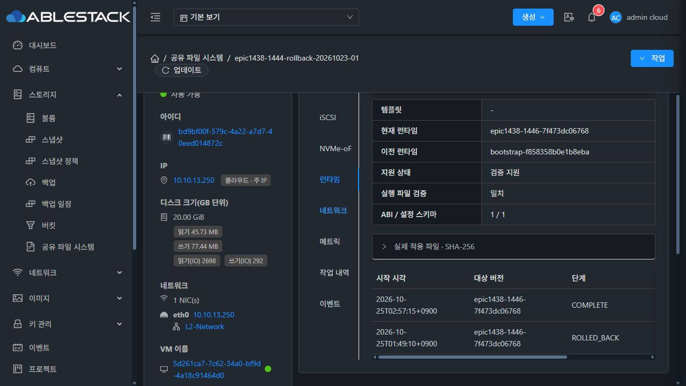
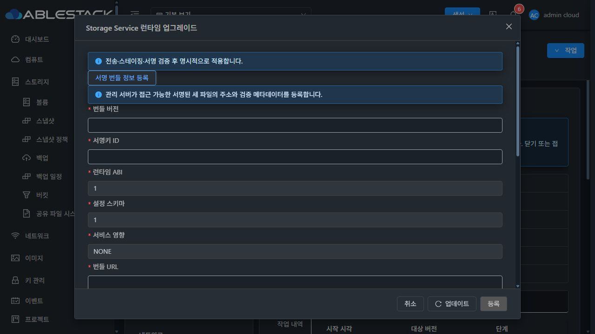
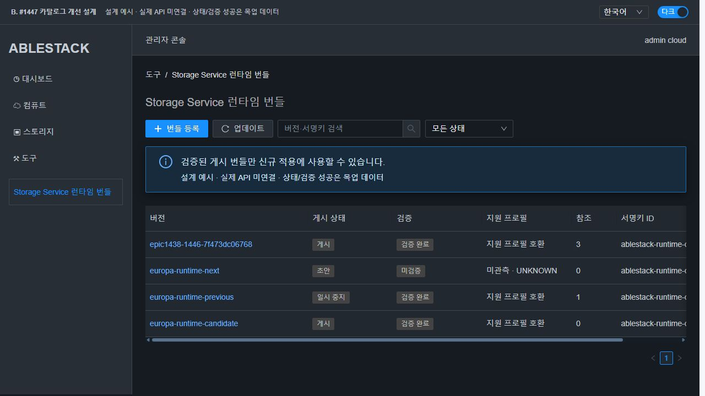
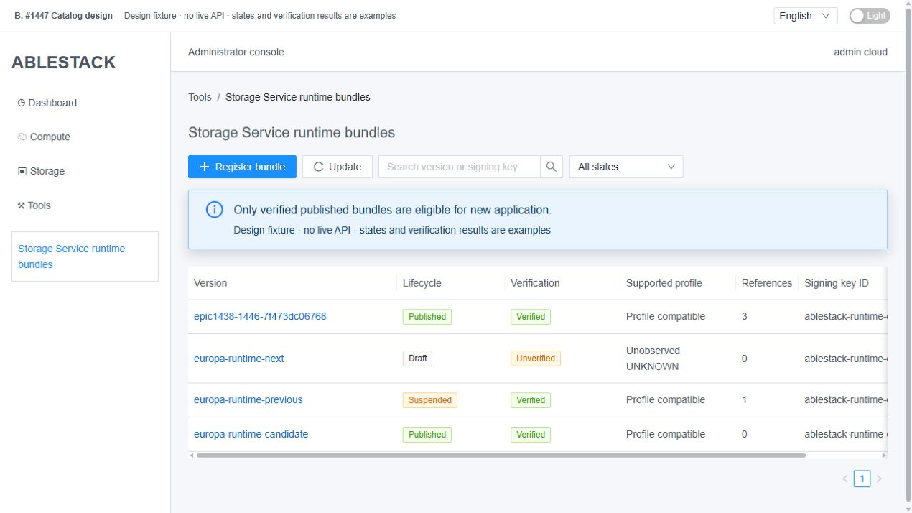
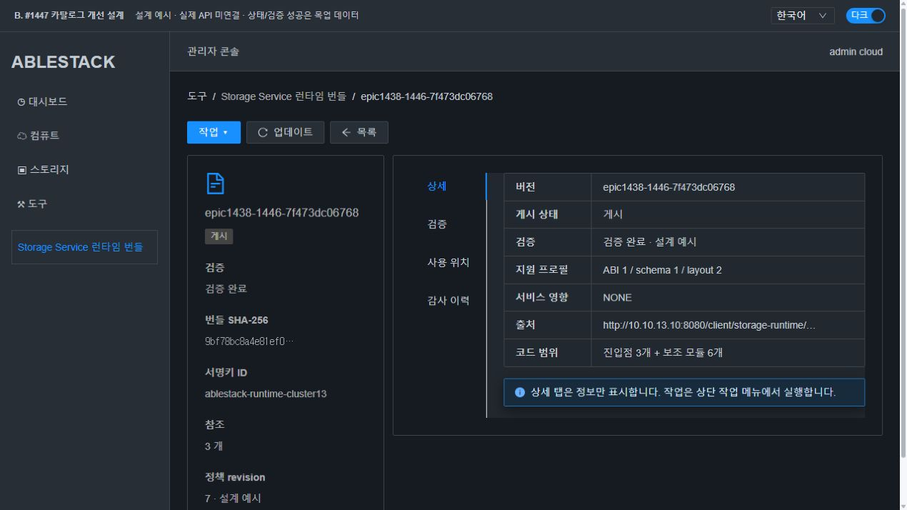
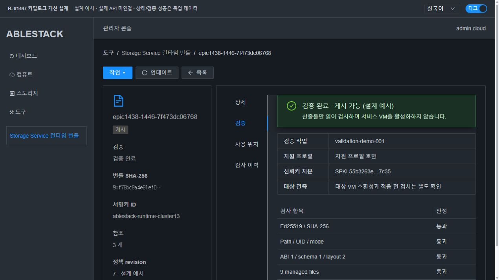
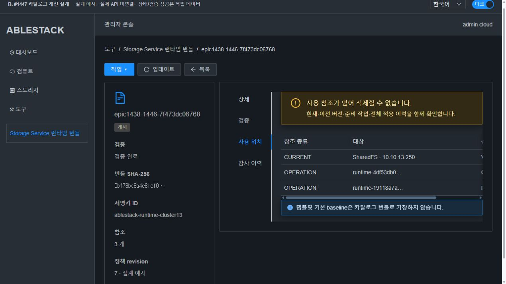
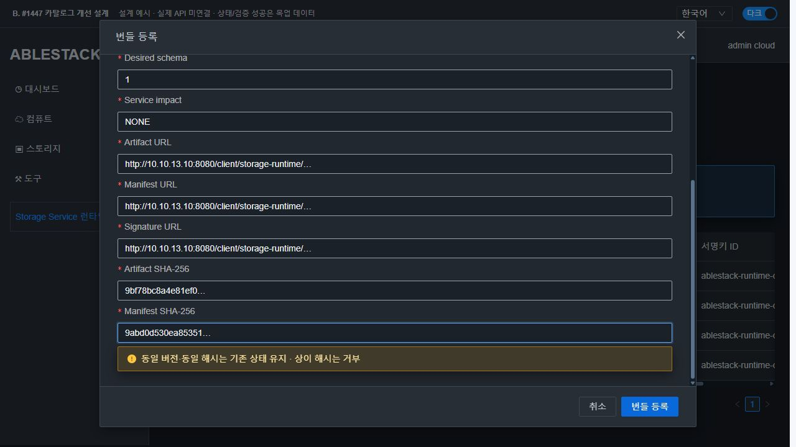
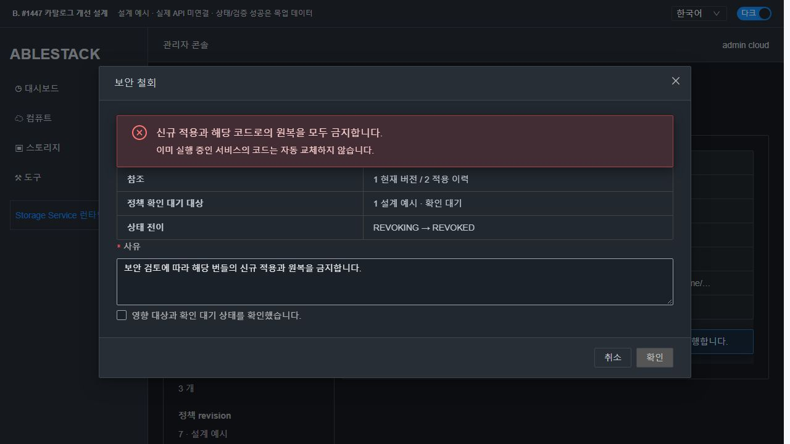
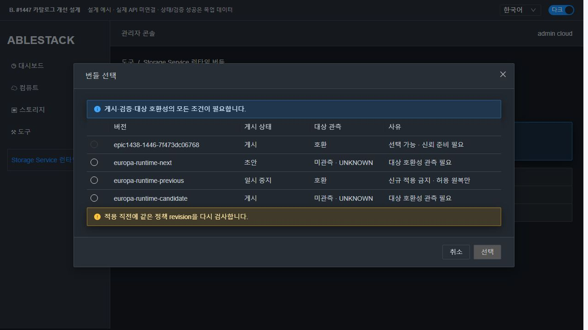

# #1447 코드 수준 설계 — 런타임 번들 전역 카탈로그

**설계·격리 실증만 완료. 제품 구현·모듈 배포·카탈로그 상태 변경은 시작하지 않았다. #1447은 OPEN으로 유지한다.** A는 실제 배포 화면, B는 설계 목업이다.

## 1. 범위와 현재 기준

목표는 Root Admin의 **도구 > Storage Service 런타임 번들**에서 등록·검증·게시·중지·폐기/삭제와 사용·감사를 관리하고 기존 SharedFS 업그레이드 화면이 같은 카탈로그의 허용 대상만 소비하게 하는 것이다. #1446의 전송·서명·3+6 payload·활성화·원복 엔진을 재작성하지 않는다. 프로토콜6개 helper, DATA 포맷, OS/커널, MAC, AD 기능과 #1468 전면 UI 정리는 범위 밖이다.

- canonical WSL /root/work/ablestack-cloud, epic/1438-sharedfs HEAD/origin **0675c29582046bf6a3dd5e84b96ce0d22200f225**, 비교0/0. fetch 후 local/upstream Europa **a7543feb62a728a5a806283b1e0e6134a7305260**, 비교0/0. 시작 tree clean.
- 관리 서버 JAR **775e269b5fa2dab878c9edf865a4a3523fc902bd0a796e390a6bd024dee15531**가 실행 중이다. manager/VO/DAO/response4개 class는 로컬 compiled class와 byte 동일하다.
- UI index **d6b87e080071768b531bd0e4cfa9077751f2e7aa001d0d978be53f129d170c94**.
- 실제 SharedFS bd9bf00f-579c-4a22-a7d7-40eed014872c / instance3730ab80-bd6c-4e33-b2db-13b1a55ee691 / VM5d261ca7-7c62-34a0-bf9d-4a18c91464d0 / 13.2 i-2-127-VM / 10.10.13.250.
- 실제 실행 runtime **epic1438-1446-7f473dc06768**, 이전 baseline bootstrap-f858358b0e1b8eba. updater2·host transport2·ABI1/schema1/layout2·실제9개 hash 검증 true.
- native updater SHA **65618c2aa35db2ea8efb1cfb11dd5581ceac730c00f625074fcf9476234c3f40**가 관리 서버 내장·소스·VM에 동일하다. 관리 서버 Python3.9.25, SystemVM Python3.11.2다.
- 실제 카탈로그는 정상 서명 번들1개가 AVAILABLE이며 현재 사용1개·적용 이력2개(COMPLETE/ROLLED_BACK)와 연결된다. 전역 검증/게시 이력은 없다. 이를 전역 검증·게시 완료로 승계하지 않는다.
- 새 디스크/VM 생성 없이 기존 SPARSE ROOT/DATA를 읽었다. THIN 생성·MAC 변경·라이브 runtime 전환·프로토콜 재시작은 수행하지 않았다.

[현재 API](evidence/current-runtime-api.json) · [코드 일치](evidence/code-identity.json) · [SystemVM 기준](evidence/native-before.json)

## 2. 실제 코드의 연결 지점

| 현재 위치 | 관찰과 최소 변경 |
|---|---|
| server/.../StorageServiceRuntimeUpgradeManagerImpl.java register84/list117 | 등록은 문법만 확인하고 즉시 AVAILABLE. 기존 API를 유지하되 DRAFT/UNVERIFIED로 저장하고 게시 소비와 관리 조회를 구분한다. |
| 동일 manager preflight162/upgrade233/rollback348 | 세 경로가 모두 requireBundle(AVAILABLE) 하나를 사용한다. metadata 조회와 apply/rollback/recovery 정책을 분리한다. |
| 동일 manager observeInterruptedPreparation390 | 관찰도 AVAILABLE를 요구한다. 게시 중지·철회 후에도 같은 작업의 상태 관찰은 가능해야 한다. |
| BundleVO.State | AVAILABLE/DISABLED만 존재. 게시 상태와 검증 상태를 각각 표현한다. |
| BundleDaoImpl.listAvailable / findByVersion | AVAILABLE만 조회, id/version 조회는 상태 필터가 없다. purpose/context/페이지 필터와 removed 포함 identity 조회를 명시한다. |
| schema-42210to42300.sql1274–1327 및 기존 migration 계열 | version/uuid unique·state VARCHAR32·upgrade MEDIUMTEXT와 instance current/previous pointer를 재사용한다. 현재 스키마에는 참조 FK가 선언되지 않아 삭제 보호를 FK가 대신한다고 가정하지 않는다. |
| runtime_updater.py | 현재 카탈로그 정책을 검사하지 않는다. crypto/파일 검사는 재사용하고 통제 shim에 영구 policy fence만 보완한다. |
| ui/.../StorageServiceRuntimeUpgrade.vue | 전역 등록 폼은 도구로 이동하고 SharedFS에는 읽기·선택·준비/적용·관찰/원복만 유지한다. |
| ui/config/section/tools.js | 전역 메뉴 및 기존 ResourceList/ResourceView 방식의 카탈로그 리소스를 추가한다. |
| image.js의 template tabs, infra/managementServers.js tabs | 공통 읽기 컴포넌트로 동일 카탈로그를 표시한다. 전역 mutation을 복제하지 않는다. |
| GenericDaoBase.findOneIncludingRemovedBy929 | 삭제 tombstone을 포함한 버전 identity 조회에 사용한다. |

기존 다운로드의64MiB/manifest1MiB/signature16KiB 상한·HTTP200·redirect 금지, guest archive 확장128MiB 및 정확한 허용 파일 계약을 유지한다. 새로운 저장소 제공자·자격증명 관리·템플릿 이미지 분석기는 만들지 않는다.

## 3. 상태 모델과 동작 정책

게시 수명주기와 검증 결과를 한 값으로 섞지 않는다.

- lifecycle: **DRAFT, PUBLISHED, SUSPENDED, RETIRED, REVOKING, REVOKED, DELETED**
- validation: **UNVERIFIED, RUNNING, VERIFIED, FAILED, UNKNOWN**
- context compatibility: **COMPATIBLE, INCOMPATIBLE, UNKNOWN**. 조회 시점·boot/instance 식별·근거·사유를 포함한다.

| 행위 | 선행 조건 / 결과 |
|---|---|
| 등록 | 새 identity → DRAFT/UNVERIFIED. 등록 자체는 검증·게시·VM 적용이 아니다. |
| 검증 | immutable metadata를 snapshot하고 receipt 생성 → RUNNING → VERIFIED/FAILED/UNKNOWN. DB lock은 짧게 잡고 다운로드/검증 중 유지하지 않는다. |
| 게시 | DRAFT 또는 SUSPENDED, 최신 VERIFIED receipt·현재 신뢰키/지원 프로필 지문 일치 필요. UNKNOWN/FAILED는 거부. |
| 일시 중지 | PUBLISHED → SUSPENDED. 신규 적용 금지, 이미 확인된 해당 코드로의 정책상 원복은 허용. 같은 receipt가 유효하면 재게시 가능. |
| 폐기 | DRAFT/PUBLISHED/SUSPENDED → RETIRED. 새 적용/재게시 금지. 확인된 이전 코드에 대한 복구 원복은 허용한다. 수정 버전은 새 identity로 등록한다. |
| 보안 철회 | 허용 lifecycle → REVOKING/REVOKED. 신규 적용과 철회된 코드를 목적지로 하는 원복을 모두 금지한다. 사유 필수, 일반 재게시로 되돌리지 않는다. |
| 삭제 | 참조0·진행 작업0인 DRAFT/RETIRED만 논리 삭제. 버전/해시 tombstone·검증/감사 기록을 보존한다. 외부 URL의 파일·VM·이미지를 삭제하지 않는다. |

원복 허용은 임의의 과거 번들을 선택할 권한이 아니다. #1446의 **같은 VM의 확인된 이전 코드·최신 유효 작업·실제 hash·schema 호환성** 조건을 함께 만족해야 한다. SUSPENDED/RETIRED는 VERIFIED 근거가 유효한 복구 목적지에만 허용한다. REVOKING/REVOKED 목적지는 금지한다. 반면 철회된 현재 코드에서 정상 이전 코드로 벗어나는 복구·정상 새 코드 업그레이드는 막지 않는다. 비카탈로그 baseline은 #1446의 승인된 baseline 검증을 유지하고 PUBLISHED bundle로 가장하지 않는다.

### 멱등성과 삭제

version + archive SHA + manifest SHA identity는 변경하지 않는다. 같은 버전/동일 두 hash 재등록은 기존 UUID와 상태를 반환하며 URL·상태를 자동 변경하거나 다시 게시하지 않는다. ABI/schema/key/impact의 명백한 선언 충돌은 거부한다. 다른 hash는 VERSION_CONFLICT다. DELETED의 같은 identity 재등록도 tombstone을 반환하고 부활시키지 않는다. DAO는 removed 포함 조회를 사용하므로 DB unique 오류에만 의존하지 않는다.

사용 관계는 다음 실제 저장 필드에서 union 조회한다.

1. storage_service_instance.current_runtime_bundle_id / previous_runtime_bundle_id
2. storage_service_runtime_upgrade.bundle_id / previous_bundle_id의 준비·진행·관찰 대기와 **전체 이력**
3. 추후 이미 존재하는 명시적 catalogue reference가 확인될 경우에만 해당 소비자 참조

현재/이전0개만 보고 삭제하지 않는다. 과거 사용 이력도 삭제를 막으며 감사와 native 복구 identity를 보존한다. 참조 조회 실패는0개로 변환하지 않는다. Root Admin은 사용 대상의 실제 SharedFS/VM/작업으로 이동할 수 있다.

## 4. 전역 산출물 검증과 대상 호환성

### 전역 검증 worker

새 StorageServiceRuntimeCatalogManagerImpl이 기존 register/list와 DAO를 사용한다. 검증은 VM 선택과 독립된 비특권 프로세스다.

- 기존 runtime_updater의 manifest·Ed25519·허용 목록과 archive 검사 정책을 **공통 읽기 전용 stream walker**로 추출한다. 관리 worker는 payload를 실행하거나 파일시스템에 풀지 않는다. native extract_release는 같은 walker 뒤 기존 설치 소유자·실제 파일 hash/문법 검사를 유지한다.
- server 내장 verifier resource와 현재 관리 서버의 승인된 공개키 로더를 재사용한다. artifact 안의 공개키를 스스로 신뢰하지 않는다. 개인키는 카탈로그/DB/API/UI에 전달하지 않는다.
- 등록된 archive/manifest hash·size, 서명·key ID, signed version/ABI/schema/impact, 경로·중복·link·header UID/GID/mode·파일별 크기/hash·확장 상한·관리3+6 폐쇄를 검사한다.
- 관리 서버 Python3.9를 guest Python3.11과 같다고 가정하지 않는다. 전역 VERIFIED는 산출물 무결성과 **명시적 지원 프로필** 검증이다. 실제 guest 문법·설치 상태·서비스·writer 검사는 #1446의 준비/활성화 직전에 다시 수행한다.
- 현재 지원 프로필은 ABI1/schema1/layout2 및 updater 통제 기능·host transport 요구를 명시한다. 버전 이름·최신 날짜·SYSTEM 템플릿 표시 이름만으로 호환을 추정하지 않는다.
- crypto/구조 오류는 FAILED, 전송/관측 중단이나 현재 근거가 불명확한 작업은 UNKNOWN이다. last successful receipt를 별도 보존하며 UNKNOWN을 VERIFIED로 표시하지 않는다.
- 공개 HTTP(S) 정적 주소의 현재 동작을 유지한다. URI user-info/비밀을 실어 보내는 주소는 지원하지 않으며 오류·감사에는 query/fragment 등 민감 문자열을 노출하지 않는다. redirect/certificate 검증을 우회하지 않는다.

receipt는 metadata digest, archive/manifest hash, key SPKI fingerprint, verifier digest, 지원 profile revision, 시작/완료/heartbeat, phase, error code 및 원래 async job을 기록한다. 동일 requestid 재호출은 같은 receipt를 반환한다. 실행 중 작업을 heartbeat 만료만으로 새 검증으로 재시작하지 않는다. job 종료와 worker 관측 후 같은 작업 결과를 확정한다.

### 대상 소비

list API의 purpose=apply에는 PUBLISHED + 최신 VERIFIED + profile 지원 조건을 적용한다. SharedFS context의 실제 capabilities를 읽어 호환성과 준비 상태를 각각 반환한다. 호환성 UNKNOWN/INCOMPATIBLE은 선택 불가이며 이유를 표시한다.

- ABI/schema가 실제 관측되고 신뢰 부트스트랩으로 올릴 수 있는 알려진 구형 shim은 '규격 호환 / 신뢰 부트스트랩·baseline 확인 필요'로 표시한다. **호환=이미 적용 준비 완료**로 표시하지 않는다.
- QGA 단절·미관측 ABI/schema·알 수 없는 template/host는 UNKNOWN으로 남기고 선택을 막는다. 읽기 점검은 bootstrap/전송/활성화를 실행하지 않는다.
- Template와 관리 서버 인프라 화면은 RuntimeBundleCatalogSummary를 재사용해 같은 버전·게시 상태·검증 근거와 전역 도구 링크를 표시한다. 현재 코드는 template 기본 runtime과 catalog UUID의 영구 binding/관측 API가 없으므로 그 context는 UNKNOWN이다. 이번 이슈에서 이미지 스캔·새 image binding 관리·OS 교체를 만들지 않는다.
- 템플릿 파일 안에 비슷한 버전 문자열이 있다는 이유로 catalogue 사용 참조를 만들지 않는다. 명시적 catalogue 참조가 있는 데이터만 사용 관계로 취급하고, 관측이 없는 것을 호환 완료나 참조 조사 성공으로 표시하지 않는다.

## 5. 원자적 정책 변경과 보안 철회

### SQL에서의 적용·원복 허가

requireBundle(AVAILABLE)을 없애고 **loadMetadata / requireApplyAllowed / requireRollbackDestinationAllowed / requireObservationAllowed**로 분리한다. 중지·폐기·철회 후에도 metadata와 원래 작업 상태는 읽을 수 있다.

- catalog metadata/state 변경과 동일 버전 등록은 bundle row lock과 unique(version)로 직렬화한다.
- 적용/원복 예약은 관련 bundle ID를 정렬해 잠근 뒤 instance row를 잠근다. 이 순서를 모든 writer에서 같게 한다. 기존 설정 coordinator는 instance 단위 writer 보호를 유지한다.
- 글로벌 검증 결과·게시/중지 변경은 expectedRevision과 requestid/CAS로 비교한다. 오래된 검증 응답이 철회나 새 receipt를 덮지 못하게 한다.
- 실제 코드 전환·원복 목적지에 대해 policy epoch를 다시 확인한다. 준비 당시 게시됐다는 사실만으로 나중 적용을 허가하지 않는다. ordinary 중지 전에 이미 예약된 호출과 아직 준비만 된 작업을 구분해 UI에 표시한다.
- SQL lock을 QGA/다운로드 동안 유지하지 않는다. catalog_policy_json에 목적지 UUID/manifest hash/revision/허가 종류를 pin하고 진행·UNKNOWN grant를 사용 관계에 포함한다.

### native 영구 fence가 필요한 이유

현재 updater는 request의 catalogState/revision을 검사하지 않는다. 실증에서 **격리 native rollback이 REVOKED 필드를 무시하고 수행**되는 것을 확인했다. DB 상태만 바꿔서는 실제 pointer 전환과 재시작 후 fallback을 통제할 수 없다.

최소 변경은 trusted control shim에만 둔다. payload3+6·프로토콜 엔진은 바꾸지 않는다.

1. SYNC_CATALOG_POLICY host/native operation을 명시적으로 추가한다. CAPABILITIES/STATUS의 읽기 전용 계약에 쓰기를 섞지 않는다.
2. VM/instance 식별과 bundle UUID/manifest hash/policy revision을 검증하고 root0600 정책 파일을 atomic+fsync로 저장한다. 낮은 revision의 덮어쓰기를 거부한다.
3. activate·수동 rollback·실패 복구·boot의 미확정 fallback 각각에서 **목적지**의 로컬 정책을 검사한다. source가 철회됐다는 이유로 관찰·정상 코드로 탈출하는 복구를 막지 않는다. 명시 철회된 목적지로 우회 원복하지 않는다.
4. shim feature3와 관리/API/KVM의 정렬 배포가 필요하다. #1446의 hash 기반 shim 갱신·전체 hash 원자 전송을 재사용하며 Payload ABI1과 통제 기능 버전을 혼동하지 않는다.
5. 기존 in-flight 작업은 관찰·정상 종료/복구 후 정책을 설치한다. 구형 미확정 작업과 policy 미관측 상태를 강제로 성공 처리하거나 fence를 해제하지 않는다.

철회는 새 Mgt admission을 즉시 막되 **REVOKING** 동안 이미 허가된 호출/오프라인 대상의 확인이 미완료임을 명시한다. native acknowledge 및 진행/관찰 대기 작업 정리가 끝나야 REVOKED가 된다. 오프라인 VM의 상태를 성공으로 추정하지 않으며 자동 기동/정지·일괄 코드 교체를 하지 않는다. 새 정책을 모르는 오프라인 native에 즉시 전역 철회가 완료됐다고 주장하지 않는다. 안전한 이전 목적지가 없으면 MANUAL_RECOVERY/OBSERVATION_PENDING을 보존한다.

이미 실행 중인 코드와 서비스는 카탈로그 상태 전환만으로 자동 교체하지 않는다. 사용 위치에 보안 경고와 확인 대기/수동 조치가 보인다. 물리 VM 재부팅의 무중단 TCP 연결을 보장하는 설계도 아니다.

## 6. API·DB·UI의 구체적 변경 지점

### API

| API | 변경/신규 계약 |
|---|---|
| registerStorageServiceRuntimeBundle | 유지. DRAFT/UNVERIFIED·전체 identity 멱등, removed 포함 충돌 검사 |
| listStorageServiceRuntimeBundles | purpose=catalog/apply, lifecycle/validation/keyword/context·page/pagesize 필터. 같은 response root 유지, 상태·receipt·eligibility 사유 확장 |
| validateStorageServiceRuntimeBundle | 신규 async. bundleid/requestid/expectedrevision → 같은 validation receipt/job |
| listStorageServiceRuntimeBundleValidations | 신규. root 관리의 검증 상세/과거 receipt |
| transitionStorageServiceRuntimeBundle | 신규 async facade. 고정 action=PUBLISH/SUSPEND/RETIRE/REVOKE/DELETE, requestid/expectedrevision/reason. 반환 state와 job 완료를 구분 |
| listStorageServiceRuntimeBundleUsages / Events | 신규 조회. 실제 대상·참조 종류·상태와 감사 페이지 |
| #1446 preflight/upgrade/rollback/listUpgrades | 기존 외부 계약 유지, 공통 catalog guard 및 목적지/fence 연동. 관찰과 metadata 조회를 게시 상태로 막지 않음 |

모든 mutation은 API authorized RoleType.Admin과 별도로 AccountManager.isRootAdmin(caller.getId())로 서버에서 검사한다. DomainAdmin/User/권한 없는 custom role은 다운로드·쓰기 전에 거부한다. UI 숨김은 권한 검사 대신이 아니다. reason/error는 비밀·private snapshot을 포함하지 않는다. 동작을 잘못 유도하지 않는 범위에서 지원하지 않는 전이는409 성격의 명시 오류다.

### DB

기존 테이블과 필드가 있으므로 카탈로그를 새로 복제하지 않는다. 구현 시 migration 대상과 길이는 다음으로 확정한다.

- storage_service_runtime_bundle: 기존 state VARCHAR32 사용. 추가 state_revision BIGINT UNSIGNED NOT NULL DEFAULT0, validation_status VARCHAR32 NOT NULL DEFAULT'UNKNOWN', current_validation_id BIGINT UNSIGNED NULL.
- storage_service_runtime_bundle_validation: id/uuid/bundle_id/request_id, observed_revision, state/phase, original_job_id/heartbeat/started/completed/created, metadata_digest CHAR64, trust_fingerprint CHAR64, verifier_digest CHAR64, profile_id VARCHAR128, compatibility VARCHAR32, result_json MEDIUMTEXT, error_code VARCHAR128/error_message VARCHAR1024. unique(uuid), unique(bundle_id,request_id), index(bundle_id,created).
- storage_service_runtime_bundle_event: id/uuid/bundle_id/request_id, actor_user_id/account_id, action/from_state/to_state/from_revision/to_revision, reason VARCHAR1024, result_code VARCHAR128, validation_id/job_id nullable, created. unique(uuid), unique(bundle_id,request_id), index(bundle_id,created).
- storage_service_runtime_upgrade: catalog_policy_json MEDIUMTEXT NULL 추가. 기존 preflight/verification/rollback JSON과 current/previous ID를 덮어 다른 의미로 사용하지 않는다.
- 사용 관계는 기존 instance/upgrade를 조회한다. 단순 화면 조회를 catalogue binding으로 저장하는 새 usage 테이블은 만들지 않는다.

migration은 재실행 가능해야 하며 새 설치 SQL과 Europa/Diplo의 실제 로딩 경로를 함께 갱신한다. source에 정의된 열이 실제 배포에 없으면 쓰기 전에 명시적으로 차단한다. 이 설계 작업에서는 DDL을 실행하지 않았다. 실제 DAO 저장·재조회와 MEDIUMTEXT/unique/CAS/동시 참조/감사 원자성 시험은 구현 인수에 필수다.

### UI

- tools.js에 단일 전역 리소스. 공통 ResourceList/ResourceView/ResourceLayout/InfoCard·AntD table/filter/pager·MoldDialog/Actions 사용.
- 상세는 정보만, 세로 탭 **상세 / 검증 / 사용 위치 / 감사 이력**. 중복 탭 제목을 본문에 넣지 않는다. 주 버튼은 좌측 맨 앞 파란 버튼, 아이콘+업데이트, 나머지 작업은 같은 좌측 그룹이다.
- 등록/게시/중지/폐기/철회/삭제 대화상자 제목 header·확인/취소 footer 고정, 본문만 스크롤. 철회는 적용·목적지 원복의 금지와 확인 대기를 분명히 표시하고 사유를 요구한다.
- SharedFS에서는 전역 등록 폼을 제거해 전역 도구 링크·게시된 호환 번들 선택·기존 준비/적용/원복만 제공한다. UNKNOWN은 선택 불가, '규격 호환'과 '적용 준비 완료'를 나눈다.
- Template/ManagementServer는 공통 읽기 패널만 재사용한다. 전역 등록/게시 버튼을 각 화면에 복사하지 않는다.
- ko/en 키와 공통 --ui-bg/text/border/action token을 사용한다. 상태를 색상만으로 구분하지 않고 미검증/실패/미관측/확인 대기를 텍스트로 읽게 한다. VM 기준24/16/8 간격과 표 최소 폭/가로 스크롤을 적용한다.

## 7. 실제 실증과 한계

| 시험 | 관찰 |
|---|---|
| 관리 서버 uid65534·Python3.9.25, 배포된 verifier 정책 사용 | 실제 정상 서명9파일·386,246bytes를 추출/실행 없이 stream 검사 성공. 변조 서명은 SIGNATURE_INVALID |
| SystemVM root·Python3.11.2 | 동일 정상 bundle stream 검사 및 기존 begin/finalize/verify만 수행해 VERIFIED. private current가 없어도 검증 완료 |
| 기존 native의 catalog 필드 처리 | 격리 current에서 REVOKED/revision을 추가한 rollback이 수락됨. native fence 필요성을 입증 |
| 독립 정책 스케치14사례 | 미검증/미게시/UNKNOWN/실패/중지 적용/중지·폐기 원복/철회/참조 삭제/진행 작업 삭제/무참조 삭제의 기대 결과 통과 |
| 원자 정책 파일 스케치 | 새로 읽은 REVOKED로 apply/rollback 모두 거부, 낮은 revision 거부 |

기존 코드와 정책 스케치의 결과를 구분한다. 이 시험은 **새 catalog API/DAO/native fence가 이미 구현됐다는 증거가 아니다.** 실제 설치 verifier를 읽고, 라이브와 다른 runtime/state/trust/entrypoint/lock5개 root에서만 pointer를 전환했다. private 경로와 시험용 stage는 종료 시 제거했다. 코드 주입은 별도 /var/tmp 시험 스크립트이며 라이브 모듈을 덮어쓰지 않았다. 개인키를 읽거나 추가하지 않았다. 시험 전후 service runtime/updater·9파일 hash·boot ID·Samba PID/InvocationID가 모두 동일했고 관리 서버 JAR/UI index도 동일했다. 실제 UI 재조회에서 기존 번들과 두 작업 이력이 유지됐다. 상세 결과는 preservation.json에 기록했다.

[비특권 관리 worker 실증](evidence/management-probe.json) · [SystemVM 실증](evidence/native-probe.json) · [전후 보존](evidence/preservation.json)

## 8. 현재 UI(A)와 개선 목업(B)

### A — 현재 배포된 화면

전역 수명주기 메뉴가 없고 SharedFS 준비 모달에서 등록한다. 실제 row 상태 AVAILABLE를 PUBLISHED/VERIFIED로 해석하지 않는다.

### B — 개선 설계 목업

별도 Vue3 앱에서 실제 AntD·Mold ResourceLayout·MoldDialog/Actions 및 ui/style/index.less를 import했다. 모든 B 화면에 **설계 fixture/실제 API 미연결**을 표시한다. 정상 배포 번들의 version/hash는 입력 자료이고 게시/검증/철회 상태는 이행 후의 예시다.

[등록 모달 실측](evidence/modal-scroll-geometry.json): 본문 scrollTop0→317에서 header top33/bottom88, footer top622/bottom687이 동일했다. 본문만 overflow-y:auto로 스크롤했다.

목업 성공/전이는 실제 API 성공으로 계산하지 않는다. 구현 시 기존 ResourceView/InfoCard를 재사용하며 목업의 고정 sidebar/fixture 값을 제품에 복사하지 않는다.

## 9. 구현 순서와 종료 조건

1. 기존 열/enum/사용 관계·Root Admin 경계를 실제 DB와 API로 확인하고 migration·DAO·동일 identity/CAS/감사 트랜잭션을 먼저 준비한다.
2. 같은 stream 정책 worker와 실제 Serializer/SFC 요청 계약 회귀를 추가한다. 관리 서비스 계정에서 정상 서명/해시/경로/권한/ABI 오류와 UNKNOWN을 검증한다.
3. native 통제 shim과 policy sync를 격리 SystemVM에서 먼저 시험한다. 기존3+6 helper/프로토콜·SPARSE/data·기존 원복을 보존한다.
4. #1446 controller와 목적지 정책·동시 writer·준비 후 중지/철회·응답 유실/재시작을 연결한다. 관리/API/KVM/shim 정렬 모듈 배포를 한다.
5. 전역 도구와 공통 소비 UI를 빌드·13번 배포하고 실제 UI 등록→검증→게시→SharedFS 선택·적용→중지/재게시/원복→폐기/삭제 보호·보안 철회/확인 대기를 검사한다.
6. 권한·동일/상이 hash·사용 중 삭제·UNKNOWN·재시작 후 이력/사용 관계·라이트/다크/ko/en을 실제 UI/API로 확인한다. 라이브 데이터 조작은 UI에서 실행한다.
7. 실제 클라이언트4프로토콜·데이터/권한·writer 보호를 확인한 구현 commit/모듈/대상/version과 결과를 이슈·Epic PR에 남긴 뒤 종료한다.

### 이행 조건

현재 AVAILABLE/DISABLED는 검증 근거가 없는 legacy 값이다. enum은 먼저 읽을 수 있게 유지한 뒤 AVAILABLE→DRAFT/UNKNOWN, DISABLED→SUSPENDED/UNKNOWN으로 이행한다. 현재 실행 코드·이전 pointer·두 적용 이력은 그대로 보존한다. Root Admin이 기존 번들을 다시 검증하고 명시적으로 게시한다. 새 정책 활성화 전에 in-flight #1446 작업을 관찰·종료하고 shim/fence 정책 수신을 확인한다. 미관측을 녹색으로 승격하거나 사용 관계를 지우지 않는다.

현재 수행한 것은 설계·조회·격리 시험·목업뿐이다. 제품 구현, DDL, module 배포, live catalog 전이와 실제 서비스 적용은 시작하지 않았다.
