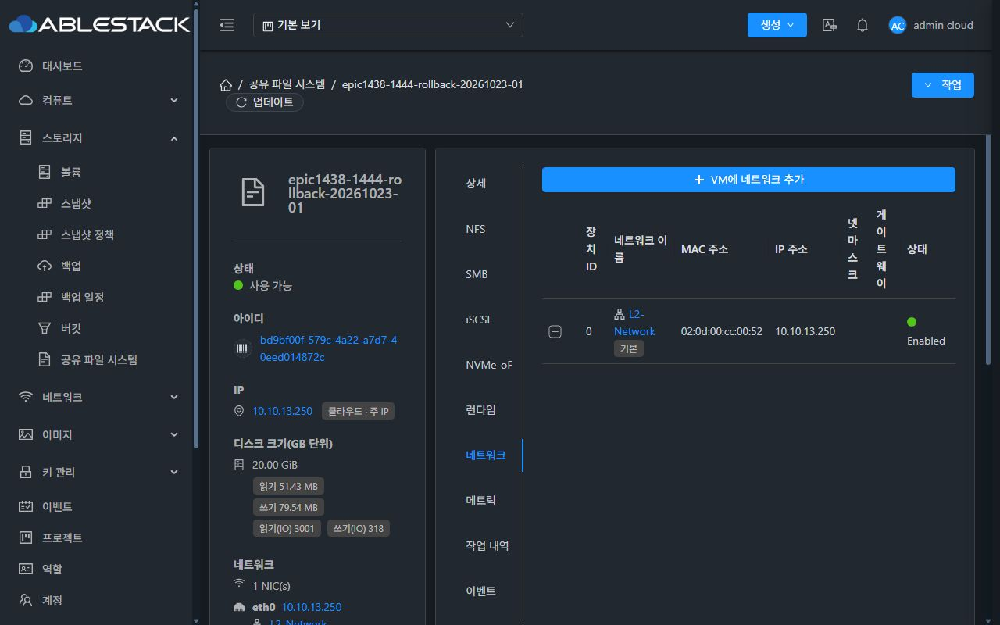
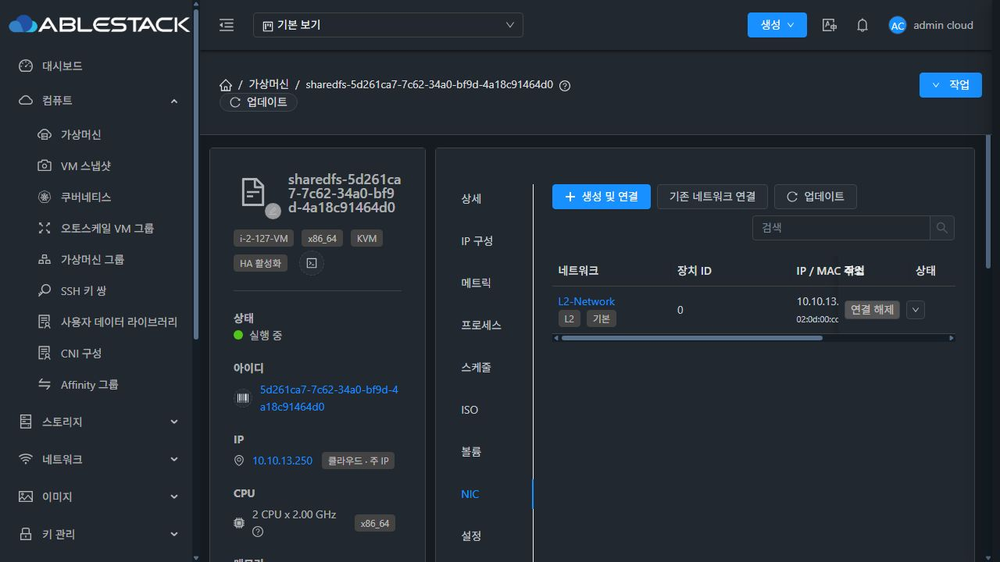
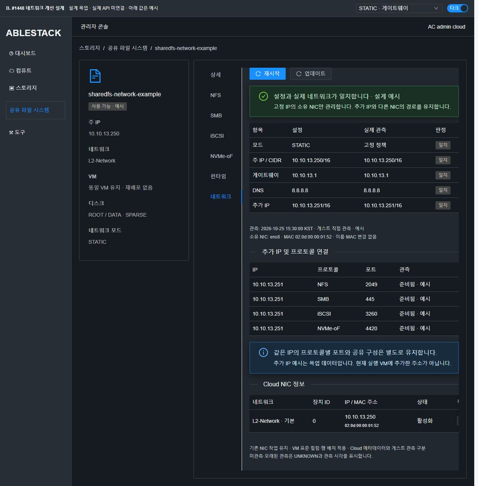
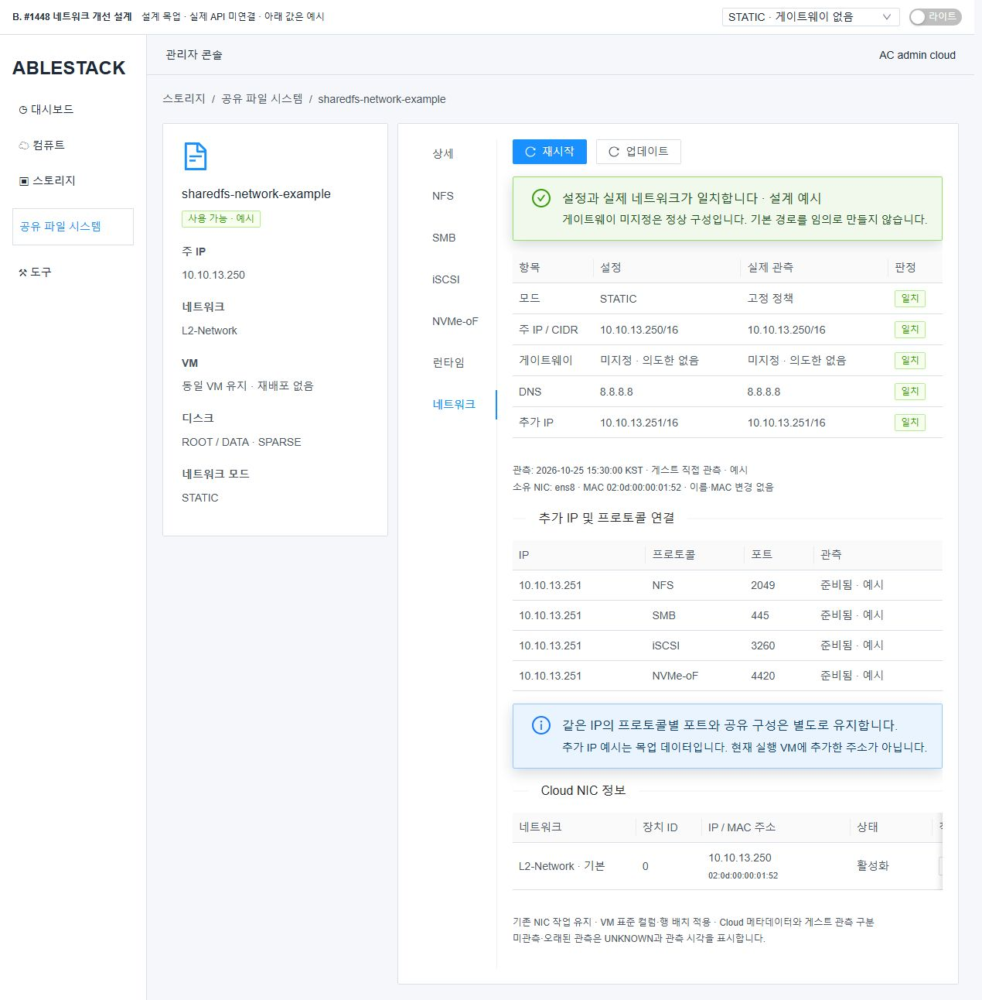
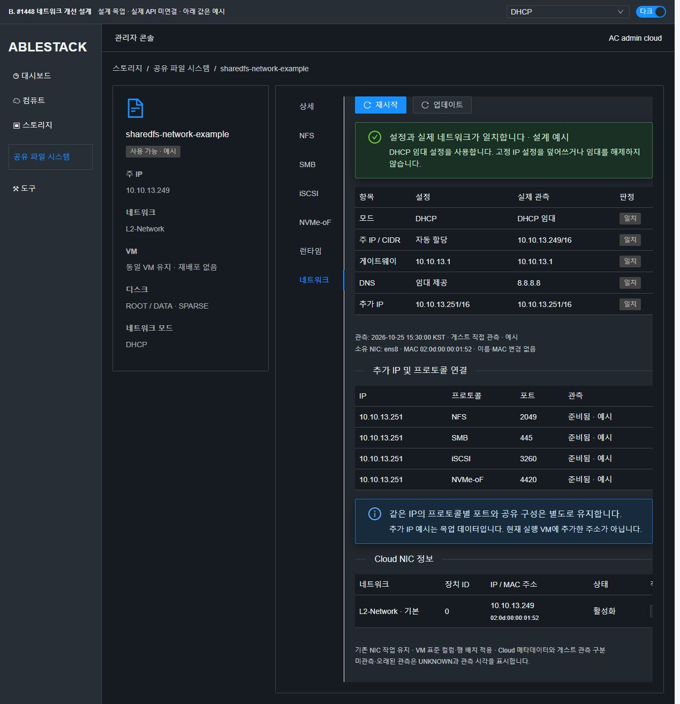
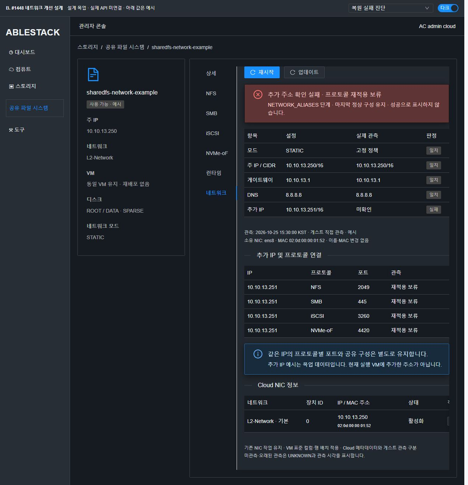
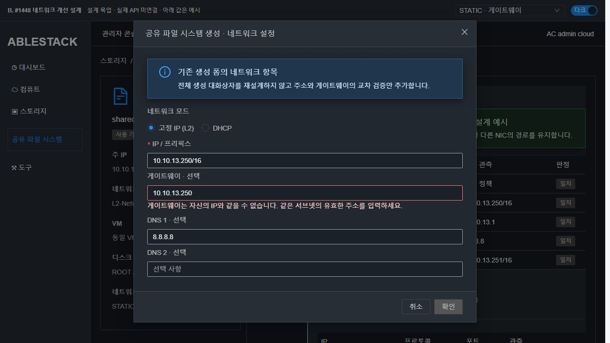
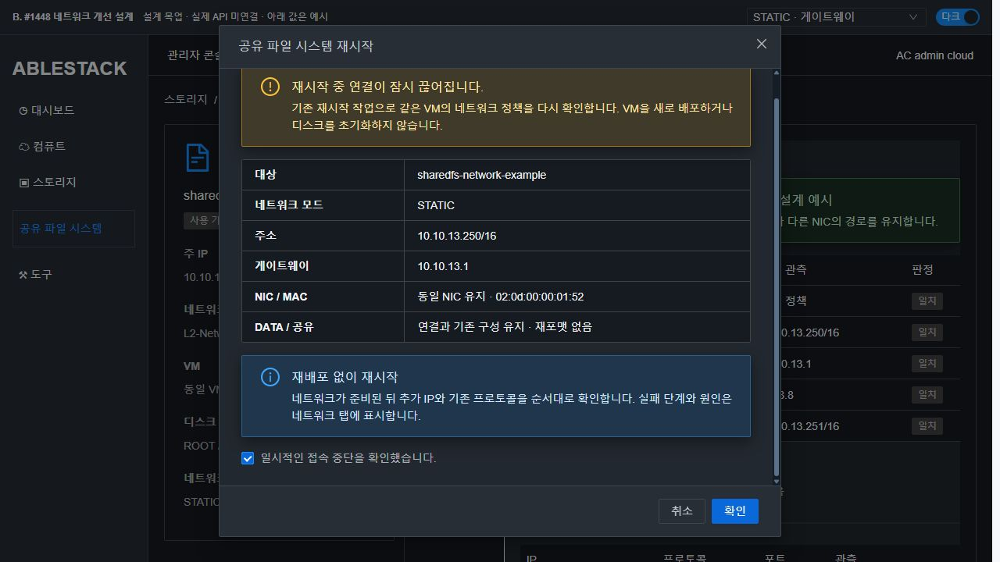

# #1448 코드 수준 설계 — L2 네트워크 정책 지속성

상태: **설계·격리 주입 실증 완료 / 제품 구현·배포·인수 시험 미착수** (2026-10-25).
상위 Epic #1438. 설계 기준 소스 `3a2c515c8c279bddd4c27a160ae31bc2a04f1f00`.
본 문서와 mockup/은 설계 산출물이다. 제품 코드나 실행 중인 네트워크를 수정하지 않았다.

## 1. 실제 실행 자원과 코드 확인

|항목|이번에 직접 확인한 사실|
|---|---|
|SharedFS / VM|bd9bf00f-579c-4a22-a7d7-40eed014872c / 5d261ca7-7c62-34a0-bf9d-4a18c91464d0|
|실행 위치|10.10.13.2 / i-2-127-VM|
|저장 정책|STATIC, 10.10.13.250, CIDR 10.10.0.0/16, gateway 10.10.13.1, DNS 8.8.8.8|
|실제 커널|eth0에 10.10.13.250/16, default via 10.10.13.1 dev eth0, 연결 경로 10.10.0.0/16|
|NIC|02:0d:00:cc:00:52, 실제 이름 eth0, 대체 이름 enp0s3/ens3|
|네 프로토콜|2049·445·3260·4420 listener 확인. endpoint 상태 파일의 마지막 port=4420만으로 다른 포트가 덮어써졌다고 판단하지 않는다. 이 파일은 IP 연결 등록부다.|
|디스크|실제 VM 볼륨 UI에서 ROOT 포함 6개 모두 기존 sparse 값 확인. 신규 디스크 생성·포맷 없음.|
|DHCP 소유자|dhclient/NetworkManager/networkd 실행 없음. cloud-dhclient@.service도 설치되어 있지 않음.|
|부팅 진단|networking.service는 unknown interface eth0로 실패했으나 cloud-early-config와 SharedFS STATIC unit은 성공. 실제 주소/경로는 정상이다.|

**현재 VM에서 게이트웨이가 유실되거나 DHCP가 고정 IP를 덮어쓴 장애가 발생했다고 단정하지 않는다.** 아래 결함은 설치된 코드를 격리 실행하고 경계 조건을 주입해 확인한 것이다.

코드 동일성은 [code-identity.json](evidence/code-identity.json)에 기록했다.

- 호스트 wrapper 클래스는 배포본과 로컬 컴파일본 SHA-256 동일.
- 호스트 Java의 내장 STATIC helper와 VM 설치 파일 SHA-256 동일: `7e74d3213c7bcb9eed461ed3554f7b1a924a9392f35340e99282a08647347e94`.
- bootstrap Python도 소스와 VM 파일 일치.
- 관리 서버 클래스 전체 해시는 다르다. 그러나 `javap -c -p` 전체가 같고, `javap -v -p`에서도 파일 메타데이터·소스 LineNumberTable을 제외하면 동일하다. 바이너리 전체가 같다고 과장하지 않는다.
- 이번 범위의 관리 서버, 호스트, 게스트 경로를 연결해 확인했다. SystemVM 이미지 전체의 무결성 인증을 의미하지 않는다.

## 2. 문제 경로와 기존 기능 재사용

|실제 코드 위치|확인 결과|최소 변경|
|---|---|---|
|`SharedFSServiceImpl.validateStaticNetworkConfiguration()`, 375행 부근|L2·주소·prefix 0..32·서브넷·중복 IP 검증이 이미 있음. gateway=self/network/broadcast 선검증은 부족.|기존 검증에 gateway 교차 조건만 추가. DHCP의 UserData 조건 유지.|
|`configureStaticNetwork()`, 433행 부근|MAC을 전달하며 최초 부팅 guard/PENDING·STATIC 대기 처리가 이미 있음.|기존 guard와 대기 예산 유지. 검증된 정책 저장과 실제 적용 완료를 구분.|
|`LibvirtStorageServiceHostCommandWrapper`, 내장 helper/253행 부근 shell|매번 global IPv4 전체 flush → 기본 IP 추가 → 해당 NIC default 삭제. DNS 파일 전체 교체. 없는 DHCP unit의 disable 실패 무시.|공통 helper를 단일 소스로 추출하고 소유 항목의 차이만 적용. 실재하는 DHCP 소유자를 확인.|
|`sharedfs_bootstrap_network.py`, `sharedfsvm.sh`|유효한 저장 STATIC 정책을 DHCP보다 먼저 복원하는 경로가 이미 있음. DHCP 실행부는 eth0/pid/lease 이름에 의존.|신뢰 파일·MAC 검증과 잘못된 STATIC의 DHCP fallback 금지를 보존. 관리 NIC를 확정한 뒤 동일 NIC에만 적용.|
|`ablestack-storagectl network_endpoint_apply()`|추가 IP 등록/재적용 기능 있음. NIC 선택이 첫 서브넷 후보 등으로 모호해질 수 있음.|manager의 NIC MAC 전달, 단일 소유 NIC 확인, 모호·손상 상태는 UNKNOWN/오류. 다른 프로토콜의 포트 저장 경로는 변경하지 않음.|
|`ablestack-storage-boot-reconcile`, 80행 부근|추가 IP reconcile 오류를 `|| true`로 무시한 뒤 프로토콜 apply 실행.|네트워크 준비 단계를 선행 조건으로 처리하고 정확한 실패 단계를 남김.|
|`ablestack-storage-reconcile.service`|없는 cloud-dhclient@eth0를 순서 조건으로 사용. STATIC unit 순서가 명시되지 않음.|모드에 맞는 실제 준비 확인을 추가. 기존 runtime-bootstrap 의존성과 시간 제한 유지.|
|`SharedFSTab.vue` network 탭, 1322행 부근|기존 NicsTab만 표시. Cloud NIC gateway/netmask가 비어 있어 실제 게스트 상태를 알 수 없음.|네트워크 탭에 설정/실측 비교를 추가. 기존 기능은 유지하며 관련 표시만 VM 표준에 맞춤.|
|`CreateSharedFS.vue`|STATIC/DHCP·IP/prefix·선택 gateway/DNS 입력은 이미 있음.|기존 폼 배치를 유지하며 gateway·DNS 교차 검증만 보완.|

관리 서버 경로는 기존 create/start/restart를 재사용한다. `restartSharedFileSystem(cleanup=false)`는 같은 VM의 stop/start를 거쳐 STATIC 적용을 다시 호출한다. 새 네트워크 변경 API, 기존 VM의 모드 전환/임의 IP 편집 기능, DB migration을 만들지 않는다.

## 3. 적용 알고리즘과 보호 조건

### 정책 검증 → 소유 NIC 관측 → 차이 적용 → 실측 검증

1. 서버·UI·게스트가 같은 IPv4 규칙을 사용한다. prefix 0..32 계약을 유지한다. 0..30은 주 IP와 gateway의 network/broadcast 사용을 거부한다. gateway는 선택이며, 입력 시 IPv4 unicast·같은 서브넷·자기 주소 아님을 확인한다. /31 peer와 /32 무gateway는 기존 서버 계약대로 취급한다.
2. 저장 MAC과 일치하는 NIC가 정확히 하나여야 한다. 이름은 조회 결과를 사용하고 NIC rename/MAC 변경은 하지 않는다. 추가 IP도 manager가 전달한 MAC으로 연결한다. 구버전 payload는 primary IP가 유일하게 일치하는 경우에만 호환 처리한다. 첫 서브넷 후보를 임의 선택하지 않는다.
3. **동일한 주 IP/prefix는 주소 변경 명령 자체를 생략한다. global flush를 제거한다.** 변경이 필요한 경우에도 이전 소유 주 주소만 정확히 식별해 교체하고 추가 IP·다른 NIC·IPv6는 보존한다. 미확인 주소를 삭제하지 않는다.
4. 기본 경로도 정확한 소유 항목만 조정한다. 이전 gateway/dev/metric/protocol을 확인하고 다른 NIC/비기본/커널 connected route를 건드리지 않는다. gateway가 없는 구성은 정상이며 임의 gateway를 생성하지 않는다. /0의 connected route를 단지 dst=default라는 이유로 삭제하지 않는다.
5. 이전 적용 항목 추적은 게스트 로컬 root 0600의 작은 `sharedfs-network-applied.json`에 version·MAC·주 주소·소유 default route·관리 nameserver를 기록한다. Mold DB 테이블을 추가하지 않는다. 기존 VM은 저장 정책과 정확히 일치하는 항목만 최초 소유 상태로 채택한다. 불일치·모호 상태는 OWNER_CONFLICT로 보고하고 일괄 삭제하지 않는다.
6. DNS는 소유 nameserver만 변경하며 search/options·비관리 항목은 유지한다. 현재 VM의 일반 root 소유 resolv.conf가 지원 기준이다. 알 수 없는 symlink/외부 resolver 소유자는 덮어쓰지 않고 UNKNOWN으로 진단한다. 전역 NetworkManager/systemd-resolved를 끄지 않는다.
7. 유효한 desired 정책은 원자 저장한다. **기존 첫 부팅 guard 전에 저장 정책이 보이는 순서는 유지한다.** 검증되지 않은 입력을 저장하지 않으며 PENDING은 적용 성공으로 표시하지 않는다. 기존 신뢰 경로·파일 권한 검증·재개 조건·타임아웃을 유지한다.
8. 적용 직전/직후 주 주소·소유 경로·DNS·추가 IP를 재관측한다. helper 실행은 같은 관리 NIC에 대한 잠금으로 직렬화한다. 상태 조회는 읽기 전용이며 네트워크를 교정하거나 서비스를 재시작하지 않는다.

### DHCP와 STATIC의 관리 주체 구분

- STATIC 상태가 유효하고 MAC이 일치하는 NIC만 DHCP 재진입을 차단한다. 실제 PID/lease/interface를 대조하고 그 NIC의 소유 프로세스만 다룬다. 없는 unit의 disable 성공을 가정하거나 전체 dhclient를 kill하지 않는다.
- 설치된 Debian `/sbin/dhclient-script`는 enter hook의 단순 return 실패를 무시하고 case 분기로 진행한다. 전용 enter hook은 관리 STATIC NIC에서 PREINIT/BOUND/RENEW/REBIND/REBOOT/EXPIRE/FAIL/STOP 처리를 **DHCP 명령 전에 종료**시켜야 한다. 단순 return 1이나 exit hook으로는 부족하다.
- 정상 DHCP 모드와 무관한 NIC/IPv6는 기존 handler로 통과한다. STATIC 파일이 손상됐을 때 DHCP로 조용히 fallback하지 않는다. 단, 대상 MAC조차 확인할 수 없는 상황에서 다른 NIC까지 차단하지 않는다. 소유 NIC를 확정할 수 없으면 부트스트랩 실패와 원인을 명시한다.
- DHCP/no-state 최초 부팅의 기존 흐름을 유지한다. SharedFS 전용 실행부에서 Cloud NIC_MACS/확정된 MAC으로 실제 인터페이스와 pid/lease 경로를 선택한다. 공통 SystemVM NIC rename 로직 전체를 바꾸지 않는다.
- 관측된 ifup의 eth0 선언 누락은 현재 장애 원인으로 과장하지 않는다. SharedFS가 직접 관리하는 NIC의 manual 설정/auto 등록만 서로 일관되게 하고 공통 네트워크 초기화 전체를 재작성하지 않는다.

### 네트워크 준비 후 프로토콜 복원

순서는 `기존 bootstrap → 모드별 주 네트워크 확인 → 추가 IP reconcile/검증 → 기존 프로토콜 복원`이다.

- unit의 하드코딩된 DHCP instance 의존을 제거하고 STATIC helper 및 모드별 readiness를 연결한다. DHCP에서는 STATIC unit이 Condition으로 건너뛰어져도 정상적으로 DHCP readiness를 확인한다.
- 네트워크 검사 실패 시 phase/code/MAC/iface/expected/observed를 남기고 프로토콜 apply를 실행하지 않는다. 실행 중인 기존 서비스를 정지하거나 정상 desired 파일을 빈 값으로 덮지 않는다.
- 기존 boot reconcile 재시도 횟수·120초 unit 예산 안에서 처리한다. 새 무한 대기를 추가하지 않는다.
- 현재 같은 IP의 4개 listener는 정상이다. listener 포트 모델/SMB 구성 전체를 재작성하지 않고 기존 포트·공유·target·namespace 식별자와 데이터 보존을 회귀 기준으로 둔다.

## 4. UI/API 설계

- **기존 네트워크 세로 탭 안에 배치**한다. 상세 탭에 작업 섹션을 추가하지 않는다. 설정과 관측을 분리해 mode/IP/prefix/gateway/DNS·NIC/MAC·추가 IP 연결·실패 단계·관측 시각을 표시한다.
- `listSharedFileSystems`의 기존 networkmode/ipaddress/cidr/gateway/dns 필드를 설정값으로 사용한다. 기존 `listStorageServiceHealth` 및 inventory의 `network.addresses`를 보존하면서 optional `network.policy`를 추가한다. policy에는 schemaVersion, source, mode, interface, MAC, gateway/routes, DNS, owner, aliases, phase/error, observedAt을 둔다. 서버는 기존 resultjson 전달 계약을 재사용한다.
- 캐시·30초 stale 기준과 request scope 보호를 유지한다. 구버전 guest/누락 필드는 UNKNOWN과 관측 시각을 표시한다. Cloud NIC의 빈 gateway를 실제 gateway 없음으로 해석하지 않는다.
- 주 작업은 왼쪽 첫 **파란 재시작**, 다음은 **아이콘+업데이트**다. 기존 `restartSharedFileSystem(id, cleanup=false)`를 호출하고 `cleanup=false`는 UI에서 변경할 수 없게 한다. 기존 권한·작업 중 보호·configurationprotection을 유지한다. 관측 업데이트는 읽기 전용이다.
- 재시작 대화상자는 MoldDialog/MoldDialogActions로 제목·확인/취소 고정, 본문만 스크롤한다. 같은 VM/NIC/MAC/DATA 유지와 접속 중단을 명시한다.
- 실제 VM NIC 탭은 `VmNicsTab.vue`를 쓰고 현재 SharedFS는 구형 `network/NicsTab.vue`를 쓴다는 차이를 확인했다. 관련 Cloud NIC 표시는 VM의 네트워크/장치 ID/IP·MAC/상태/행 작업 배치에 맞춘다. 기존 NicsTab/NicsTable에 기본값이 기존 표시인 opt-in presentation을 두어 SharedFS에서만 활성화한다. 기존 NIC 작업 handler·권한은 보존하며 VM의 신규 NIC 기능/API를 복사하지 않는다. 다른 호출자는 변경하지 않는다.
- 새 UI는 ResourceLayout, AntD의 세로 tabs/table/alert, MoldDialog를 사용한다. card 20~24px, 섹션 16px, 작업 간격 12px; 좁은 표는 내부 수평 스크롤. 별도의 중복 탭 제목은 없다.
- 실제 theme tokens `--ui-bg-page/surface/elevated`, `--ui-text-primary/secondary`, `--ui-border`를 사용한다. 다크/라이트 오류·경고·disabled·divider 텍스트를 확인한다.
- 생성 폼은 선택 gateway 유지, 자기 IP/서브넷 밖/network/broadcast/잘못된 prefix/DNS를 변경 전에 표시·거부한다. 일반 STATIC·DHCP 제출 계약은 유지한다.

## 5. 문제 UI(A)와 개선 목업(B)

**A는 현재 실제 배포 화면**, **B는 API 미연결 설계 목업**이다. B의 추가 IP/성공/실패 상태는 예시이며 실제 검증 성공을 의미하지 않는다.

### A. 실제 SharedFS 네트워크 탭

현재 Cloud NIC 표에는 gateway/netmask가 비어 있다. 게스트 직접 관측으로는 gateway 10.10.13.1과 /16이 정상이다. 문제는 실제 정책·복원 단계·실패 원인을 이 탭에서 비교할 수 없다는 것이다.

### 기준. 컴퓨트 > 가상머신 NIC 탭

### B. STATIC·게이트웨이 설정/실측 비교 (다크)

### B. 게이트웨이 없음은 정상 (라이트)

### B. DHCP / 실패 단계

### B. 생성 입력 검증 / 같은 VM 재시작

목업은 실제 Vue3+AntD 및 저장소의 ResourceLayout/MoldDialog/MoldDialogActions/스타일을 사용한다. 현재 서버에 제품 UI를 배포한 것이 아니다. 재시작 모달은 1280px 폭/720px 높이 기준 header 33~88, body 88~622, footer 622~687px를 확인했다. 본문 scrollTop 0→29에서도 header/footer 좌표가 같았다.

## 6. 구현 전 실제 SystemVM 주입 실증

[evidence/systemvm-design-probe.json](evidence/systemvm-design-probe.json), [evidence/kernel-netns-probe.json](evidence/kernel-netns-probe.json).

|시험|실제 수행과 결과|판정 한계|
|---|---|---|
|설치 STATIC helper 경계 조건|실제 VM 설치 소스를 메모리에서 실행. subprocess·sysfs·resolv 경로만 격리 fixture로 치환. 동일 설정에도 global flush, 추가 IP 유실, DNS search/options 유실 경로 확인. 잘못된 gateway가 변경 명령 전 검증되지 않음.|실제 NIC에 잘못된 gateway를 적용하지 않음. 명령 호출 경로의 재현이다.|
|후보 계획 함수|13개 조건 통과: noop/alias 유지, 무gateway 소유 경로만 삭제, DHCP 무변경, non-eth0, 잘못된 gateway 5종, 모호 MAC, /31·/32·잘못된 prefix.|제품 구현이 아닌 최소 설계 스케치다.|
|실제 dhclient-script hook 계약|실제 설치 스크립트의 private copy에 hook/command fixture 주입. STATIC 8개 reason에서 명령 실행 전 종료. DHCP EXPIRE는 원래 handler에 도달함.|DHCP handler 진입 뒤 실제 처리 직전에 fixture가 종료. 실제 DHCP 서버·임대 만료 시험 아님.|
|실제 boot reconcile 소스|private copy에서 endpoint 실패를 주입했는데 현재 코드는 NFS apply까지 진행하고 exit 0. 최소 gate 스케치는 exit 1 / 프로토콜 호출 0.|실제 서비스를 재시작하지 않음.|
|실제 커널 namespace|같은 SystemVM에서 별도 net namespace 생성 후 dummy ens8/ens9로 검증. 동일 primary noop·추가 IP 보존·다른 NIC default/connected 경로 보존·/31 peer route·/32 무gateway 정상.|서비스 VM의 원래 net namespace와 다름을 먼저 assert. namespace는 child 종료로 제거. 실제 L2 외부 연결/재부팅 시험 아님.|

주입 전후 8개 정책·실행 파일 hash, 원래 주소·route·listener 집합, boot ID, smbd PID/InvocationID와 관련 unit 상태가 동일하다. 원래 NIC/MAC·디스크·프로토콜 설정을 변경하지 않았다. private fixture는 종료 시 정리됐다. [evidence/nonmutation-audit.json](evidence/nonmutation-audit.json).

## 7. 구현 시 변경·배포 단위와 회귀 시험

아직 이 단계를 실행하지 않았다.

- 서버: 기존 SharedFS STATIC 입력 검증과 alias payload의 MAC 전달만 보완. DB schema 변경 없음.
- 호스트 KVM: helper 단일 소스 로딩/설치, full validation, 기존 guard 보존. 공통 SystemVM이 아닌 SharedFS command 경로에 한정.
- 게스트: STATIC helper + bootstrap의 NIC 결정 + DHCP enter hook + boot network readiness + health/inventory 관측.
- UI: SharedFS network 전용 상태 컴포넌트/기존 탭 연결/생성 cross validation, opt-in NIC presentation, 관련 i18n.
- 신규 템플릿과 기존 VM에는 **같은 helper bytes**를 사용한다. 기존 VM은 기존 trusted host configure 경로로 helper/hook을 설치한 후 같은 VM 재시작으로 확인한다. 네트워크 helper는 #1447의 서명 payload 3+6 whitelist 밖에 있으므로 카탈로그 whitelist를 임의 확장하지 않는다. storagectl/boot-reconcile 변경은 기존 signed runtime 경로와 호스트 설치 순서를 맞춘다. 구버전 helper와 신버전 boot 로직을 섞은 중간 상태를 검증 성공으로 취급하지 않는다.
- unit/실제 소스 회귀: 명령 recorder에서 global flush 없음, 실패 전 무변경, root/MAC 신뢰 유지, 다른 NIC/IPv6 유지, 단일 소유자, 같은 정책 반복의 무변경 확인.
- 실제 컴포넌트/API 직렬화 fixture: 기존 listSharedFS/health resultjson(캐시·구버전 필드 누락 포함)으로 게이트웨이 없음·DHCP·UNKNOWN·실패 단계, 기존 restart cleanup=false, guard/권한, request scope, 기존 presentation 기본값을 확인.

|구현 후 인수 시나리오|UI 순서와 확인|
|---|---|
|STATIC+gateway / 무gateway / DHCP|실제 UI로 새 VM·SPARSE ROOT/DATA 생성 → 모드 선택 → 네트워크 탭 설정/실측 확인 → UI 재시작 → 원래 IP 콘솔/클라이언트 재접속. DHCP는 시험 네트워크의 UserData/ConfigDrive 제공 여부를 먼저 확인.|
|DHCP 갱신/만료 경계|UI 콘솔로 관리 NIC/임대 소유자를 확인하고 이벤트 재현 → STATIC 주 IP/alias/경로/DNS 보존, DHCP 모드 정상 갱신 확인. 실제 원래 namespace에서 검증하며 recorder 결과로 대체하지 않음.|
|동일 IP 네 프로토콜|UI에서 같은 listen IP에 2049/445/3260/4420 구성 → 새 클라이언트 UI 콘솔에서 접속·파일 해시/권한·블록 식별자 기록 → UI VM 재시작 → 동일 endpoint/데이터/권한 확인.|
|추가 주소 복원 실패|폐기 가능한 자원에 최소 실패 주입 → NETWORK_ALIASES 단계와 실패 원인 UI 표시 → 원래 설정/진단 보존, 네 프로토콜 apply 미실행 확인.|
|기존 VM / 신규 템플릿|같은 helper hash 확인 후 각 UI 재시작 → MAC/NIC 유지, 재포맷 없음, 같은 정책/관측 결과. non-eth0 및 gateway 자기주소/서브넷 밖/network/broadcast·prefix33 거부 포함.|
|보호 회귀|STATIC 최초 부팅 guard/PENDING, DHCP 흐름, NFS/SMB/iSCSI/NVMe 기존 구성, 기존 #1444/#1445 보호와 중복 방지 유지.|

실제 L2 접속·DHCP 서버·재부팅·새 템플릿 인수는 **미실행**이다. 이슈 인수 체크는 모두 미완료로 유지한다.

## 8. 범위 경계

#1449 SMB 구성 재작성, #1459 개별 프로토콜 시간 제한, #1462 백업/복원, #1467 템플릿 전면 교체, #1468 전체 UI 정리는 이번 설계에 포함하지 않는다.
IPv6·새 IPAM·라우트 CRUD·DHCP 서버 신설·기존 VM의 네트워크 모드 변경·임의 MAC 변경을 추가하지 않는다.
