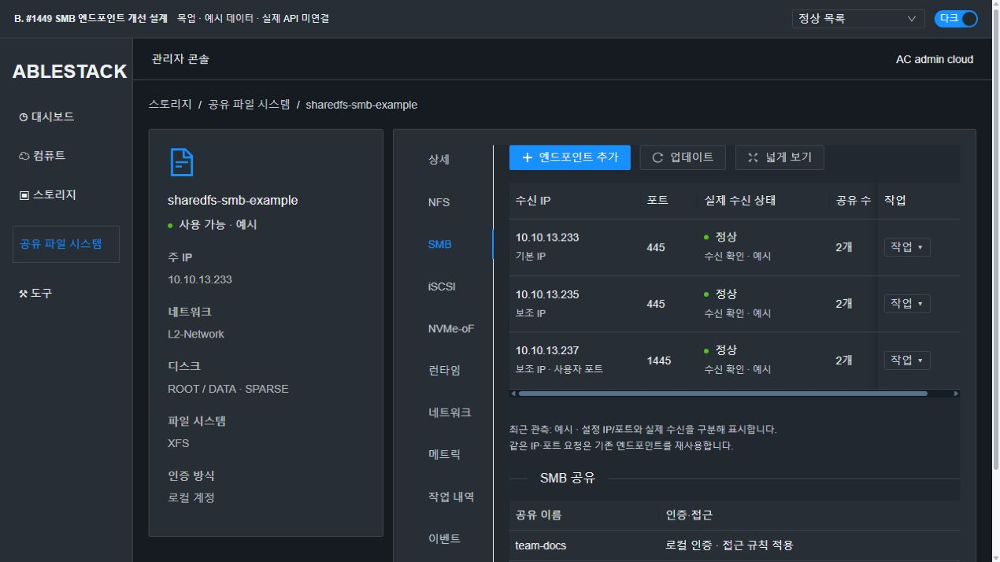
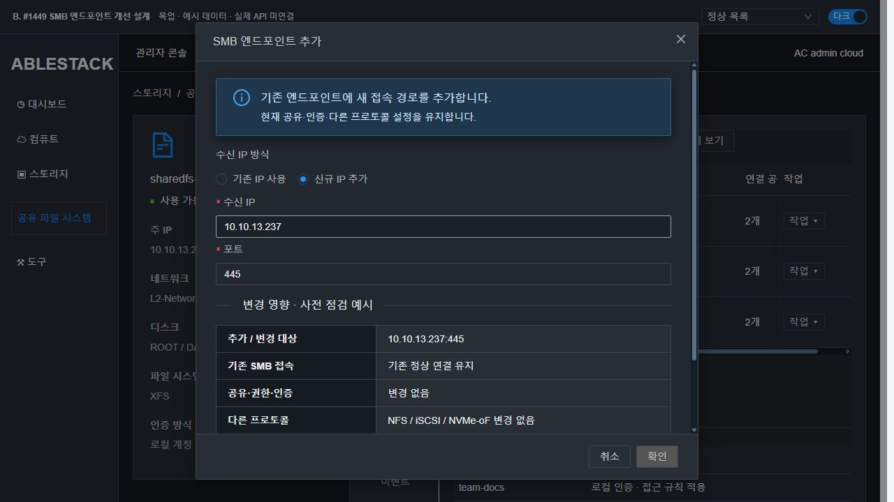

# #1449 SMB 엔드포인트 코드 수준 설계

2026-10-26 · Epic #1438 · **설계·실증만 완료 / 제품 구현·배포·이슈 종료 미실행**

## 1. 범위와 확인 기준

대상은 SMB 반복 활성화·개별 endpoint 추가/수정/삭제·정확한 tuple 멱등성·실패 시 기존 서비스 보존이다. SMB 공유/ACL/로컬·AD 인증 정책 자체, 볼륨·백업·클론·다른 프로토콜 엔진, 전체 UI 정리 #1468로 확장하지 않는다.

- 소스: `epic/1438-sharedfs`의 `8f331ee617d431c843e849ec2970b82651cde457`. fetch 후 local Europa와 upstream `b71bb69f28c` 차이 0/0 확인.
- 배포: 13번 관리 JAR `bc7044751fe17b4f382cab05c9dd56a788fe3bcbad3ae6132981114304fc9da7`.
- manager 실제 class와 로컬 시험 class SHA 모두 `7cf5e0b01d56d24327356a7704b4b37959ff6f271b2aafa9c0d94b4457f3ecf8`.
- SystemVM: SharedFS `8b03d48c-0a8c-47bb-aac8-ce5546b25eed`, VM `867bfbfb-e370-345d-b5f9-ccd20d044219`, host13.1 / i-2-132-VM. ROOT/DATA SPARSE, DATA5GiB. 새 VM·디스크는 만들지 않았다. [실제 볼륨 탭 SPARSE 재확인](images/S-systemvm-sparse.png).
- 실행 storagectl과 소스 SHA 모두 `e05d322bd4c8bbead7bda6ad7e346ecd67039686e1050a5de24d22988e8e527a`. transaction helper `0550dd0349d0...`, 실제 Samba `4.17.12-Debian`.
- 실제 SMB UI/API는 .235:445 한 행이다. 이 운영 자원에 두 번째 활성화를 실행해 기존 행을 파괴하지 않았다. 해당 덮어쓰기는 동일 배포 class의 실제 candidate 메서드를 격리된 DAO stub으로 실행해 재현했다.

## 2. 현재 코드의 정확한 결함과 재사용할 부분

| 경로 | 확인 내용 | 설계 반영 |
|---|---|---|
| StorageServiceManagerImpl 575–620, 4849–4872 | isEndpointProtocol에 NFS/iSCSI/NVMe만 포함. SMB는 findByInstanceIdAndProtocol 단일 행을 가져와 IP/port를 덮어씀 | SMB도 정확한 tuple 조회. 기존 UUID 유지/새 tuple 새 UUID 구분 |
| 같은 클래스 2617–2653 | 이미 모든 enabled SMB 행을 listeners 배열로 집계 | 이 builder와 공유/인증 데이터 재사용 |
| 같은 클래스 3044–3049 | 개별 endpoint 삭제는 SMB를 지원하지 않음 | SMB 전용 삭제 handler 추가. NFS 삭제 함수를 그대로 호출하지 않음 |
| 같은 클래스 5108–5124 | removeSecondaryListenAddress 자체에는 다른 소비자 참조 검사 없음 | SMB 전용 삭제에서 모든 protocol/공유 참조 확인 후 필요한 경우만 호출 |
| storagectl 4845–4872 | IP 집합과 port 집합을 따로 합쳐 Samba global interfaces/smb ports로 렌더링 | 서로 다른 tuple의 원하지 않은 교차 수신 방지 필요 |
| configuration_transaction.py verify/restore | SMB 전역 설정·계정·현재 daemon 기준 | listener-only 원복 범위를 개별 실행 단위로 한정 |
| Coordinator 164–168, 226–240 | SQL commit 때 보호 해제, guest commit ACK 실패를 무시 | SMB listener 변경만 마무리 확인을 필수화. 다른 작업 분기는 유지 |
| SharedFSTab smbListenerRows / protocolListenerColumns / enableProtocol·deleteEndpoint | 공통 컬럼·tuple key, 활성화/삭제 UI, UUID 기반 편집 없음 | SMB 영역만 안정된 UUID row key·편집·삭제 보호·실측 상태 추가 |

storage_service_protocol은 UUID/instance/protocol/listen_ip/port와 MEDIUMTEXT config를 이미 갖고 있고 DAO는 여러 행 조회를 지원한다. 기존 instance row lock, requestid/hash, revision, configurationprotection, candidate overlay와 작업 이력을 재사용한다. **새 테이블·컬럼·강제 데이터 정리·중복 행 삭제는 계획하지 않는다.**

## 3. 구현 전 실증 결과

### 실제 배포 class의 candidate 경로

[evidence/CandidateProbe1449.java](evidence/CandidateProbe1449.java)는 실제 private enableStorageServiceProtocolCandidate를 호출한다. DAO·게스트 전송은 stub이며 실제 DB 저장/동시성 인수 시험이라고 주장하지 않는다.

- 현재 class: A(.2:445)→B(.3:445) 활성화에서 **같은 UUID 한 행이 B로 바뀌고 A 유실**.
- 설계용 subclass에서 SMB endpoint 분류만 켠 경우: A/B 두 행, 같은 B 재요청은 같은 UUID, C 적용의 통제 실패는 기존 A/B 보존.
- 결과: [candidate-result.json](evidence/candidate-result.json). 제품 Java 소스/실행 class를 바꾸지 않았다.

### 실제 SystemVM의 Samba 주입 시험

코드는 /tmp의 전용 fixture에만 주입하고 별도의 **network·PID·mount namespace**에서 실제 smbd/smbclient/testparm을 실행했다. 운영 NIC·MAC·socket·Samba 설정을 바꾸지 않았다. 임시 로컬 인증 비밀번호는 메모리/pipe/environment로만 전달했고 fixture 인증 DB는 시험 종료 때 제거했다.

| 실증 | 실제 결과 | 설계 결정 |
|---|---|---|
| 기존 단일 daemon에 새 IP를 넣고 HUP reload | 기존 인증 세션 유지, 새 IP listener는 열리지 않음 | 재로드만으로 신규 listener 완료 처리 불가 |
| 현재 renderer에 .2:14446 + .3:14447 입력 | 두 IP×두 port의 **4 socket 모두 수신** | DB에 SMB를 추가하는 한 줄 수정만으로는 불충분 |
| 공통 share/auth 설정 include + 개별 IP/port profile | 정확한 socket 소유 PID 확인, 두 경로 로컬 인증 성공 | 기존 share/auth 엔진 재사용 + binding overlay |
| 새 profile 추가·후보 bind 실패 | 기존 인증 client를 재접속시키지 않고 같은 세션에서 파일 재읽기 성공 | 후보만 제거하는 listener-only 원복 |
| profile 하나 종료 | 다른 profile의 같은 인증 세션 계속 사용 | 종료는 개별 process group/CGroup으로 제한 |
| 계정·운영 config·code·passdb 및 기존 NFS marker | 원본 보존, 운영 smbd PID1947 유지, 시험 주소/port가 live namespace에 없음 | 시험이 운영 설정 변경을 대신한 것이 아님 |

파일 잠금·state/cache·private/passdb는 공유하고 **PID 디렉터리·프로세스 종료 범위만 분리**했다. 파일 잠금 DB를 endpoint마다 나누는 설계는 채택하지 않는다.

초기 harness의 종료 코드 가정과 process group 격리 누락을 교정했다. 최종 v3에서 전체 시험을 통과했고 fixture를 모두 제거했다. [최종 native 결과·보존 확인](evidence/native-result.json) · [실행 코드](evidence/native-probe.py). 이 시험은 runtime 실행 방식의 타당성 증거이며 systemd 감독·SQL 장애·재부팅 인수를 모두 끝냈다는 뜻은 아니다.

## 4. 서버/API 설계

### 4.1 tuple과 identity

정규 키는 `(instanceId, SMB, normalizedListenIp, effectivePort)`다. blank/null IP는 기존 0.0.0.0 의미를 유지하고 null port는445로 비교한다. 새 SMB 행은 정규 값을 저장하며 기존 행은 읽을 때 정규화한다.

- endpointid 없는 enable: 같은 tuple은 같은 UUID 재사용, 다른 tuple은 새 행. 기존 행 IP/port 덮어쓰기 금지.
- 명시 편집: endpointid가 가리키는 같은 instance/SMB 행만 변경. 기존 UUID 유지. 다른 UUID가 이미 점유한 tuple로 편집하면 변경 전 거부하고 두 행을 임의 병합하지 않는다.
- 명시 삭제: 선택한 UUID/tuple만 제거. protocol-only 기존 호출은 전체 SMB 중지 의미와 기존 공유/도메인 보호를 유지한다.
- 동일 요청/동시 요청은 기존 instance lock·requestid/revision을 사용한다. UUID/tuple 충돌은 guest 호출 전에 판정한다. 중복·모호한 기존 행을 발견하면 자동 삭제/임의 canonical 선택 없이 차단 사유를 반환한다.

EnableStorageServiceProtocolCmd와 DeleteStorageServiceProtocolCmd에 optional `endpointid`를 추가한다. 현 ProtocolResponse에는 EntityReference가 없으므로 무리한 UUID entity 매핑을 새로 만들지 않고 **STRING + 엄격한 UUID 검증 + DAO.findByUuid + instance/protocol 권한 검사**를 사용한다. 기존 인자는 계속 지원한다. reflection 기반 publicRequest/requestHash에 새 @Parameter가 포함됨을 회귀 시험한다. BaseResponse jobid를 중복 선언하지 않는다.

### 4.2 개별 삭제·주소 보호

deleteSmbProtocolEndpointCandidate 및 hasSmbEndpointAddressConsumers 같은 SMB 전용 경로를 둔다. 다른 프로토콜의 삭제 로직은 바꾸지 않는다.

- 공유 또는 domain이 남았는데 마지막 유효 SMB 접속 경로를 없애는 작업은 사전 거부한다.
- 기본 NIC IP는 listener를 없애더라도 삭제하지 않는다.
- 다른 SMB tuple, NFS/iSCSI/NVMe listener·공유, wildcard의 실제 사용 범위가 남으면 주소를 보존한다. 참조가 불명확해도 보존하고 확인 화면에 이유를 표시한다.
- 새 작업이 소유한 전용 secondary이며 후보 상태의 모든 참조가0인 경우에만 DB secondary와 guest alias를 해제한다. 삭제된 SMB 행만 보고 주소를 제거하지 않는다.
- legacy wildcard는 기존 실제 범위를 유지한다. 같은 port의 개별 tuple이 그 wildcard에 포함되면 중복 daemon을 만들지 않고 coverage를 명시한다. 참조 중인 wildcard의 제거/축소는 보호하고 의존 항목을 표시한다. 무중단 전환이 검증되지 않은 wildcard를 자동 분할하지 않는다.

### 4.3 API의 설정·실측 구분

기존 id/listenip/port/listenertype/effectiveendpoints/identitystatus는 유지한다. SMB의 runtimestate는 DB Ready를 복사하지 않고 profile/PID/socket 관측으로 READY/COVERED/UNKNOWN/PENDING/FAILED를 구분한다. 관측 시각과 coveredbyid 같은 optional 필드가 필요하면 SMB에만 추가한다. 모든 SMB endpoint의 linkedresourcecount는 기본 port445만 세는 방식이 아니라 실제 서비스 공유 범위를 반영한다.

기존 NIC 일관성 보호 #1448을 우회하지 않는다. 정상 소켓·실제 상태를 확인하기 전 UI/API에서 성공으로 추정하지 않는다.

## 5. 게스트 실행·원복 설계

### 5.1 현재 SMB 엔진과 payload 유지

수정 후보는 기존 storagectl과 configuration_transaction.py 두 파일이다. 기존 3+6 runtime 파일 집합과 명령 allowlist를 유지하고 `smb share apply` payload에 `listenerOnly=true`와 안정된 listener UUID 목록을 추가하는 방향이다. 새 Python helper나 별도 배포 경로를 추가하지 않는다.

- endpoint 작업은 공유·ACL·계정·디렉터리 권한 적용 함수를 다시 실행하지 않는다. 검증된 /etc/samba/smb.conf를 공통 base로 include한다.
- 생성 profile은 include 후 [global]에서 IP/port·고유 PID 경로만 override한다. 명시 IP profile에는 lo를 임의 추가하지 않는다.
- lock/state/cache/private/passdb는 같은 서비스의 기존 저장소를 공유한다. PID 경로·process group과 systemd transient unit/CGroup은 UUID별로 분리한다.
- profile·manifest는 /etc/ablestack-storage/smb-listeners/ 및 smb-listeners.json에 root 전용으로 원자 저장한다. 이는 generated config이며 runtime payload 파일 추가가 아니다.
- 감독은 UUID를 검증한 `ablestack-smb-<uuid>` transient unit으로 계획한다. 실행은 `smbd -F -s <profile>`의 독립 process group을 사용하고 PID/PGID/CGroup을 확인한다. `--no-process-group`을 별도 격리 없이 사용하지 않는다. native v3는 start_new_session으로 같은 격리 조건을 실증했다. 임의 shell 문자열/전역 pkill/systemctl restart smbd로 후보를 관리하지 않는다. 기존 boot-reconcile의 SMB 재적용에서 manifest로 동일 실행 단위를 재생성한다.
- smbd 실행 성공 코드나 port 열림만으로 판정하지 않는다. config hash·실행 파일/인자·MainPID/start time·해당 PID가 소유한 정확한 IP:port socket을 확인한다. 같은 tuple/digest가 이미 정상이라면 새 프로세스를 만들지 않는다.

기존 단일 legacy daemon은 저장 desired/config와 실제 socket이 명확히 일치할 때만 그대로 인수해 PID/세션을 유지한다. 참조 관계가 모호한 수동 daemon/config를 추정해서 죽이거나 덮어쓰지 않는다.

공유·ACL·인증 변경은 기존 엔진을 계속 사용한다. 기존 보안 변경이 모든 활성 경로에 적용되도록 그 경로에서 관리 profile 전체를 갱신/재시작하는 연결부만 추가한다. listener-only 작업에 그 전체 재시작을 적용하지 않는다.

### 5.2 검증·SQL commit·정리 순서

`후보 시작 → 기존 연결과 신규 socket 검증 → SQL 반영 → 구 listener 정리 → 정확한 최종 관측 → 완료`로 둔다.

현재 Coordinator는 SQL commit에서 보호를 해제하고 guest commit ACK 실패를 무시한다. 여기에 중요한 정리를 밀어 넣으면 삭제가 끝나지 않아도 성공할 수 있다. 따라서 **SMB endpoint 작업에 한해** 다음 scoped finalize 분기를 계획한다.

1. 기존 before/candidate overlay·preflight·작업 ID를 재사용한다. 새 후보를 시작하는 동안 기존 listener를 멈추지 않는다.
2. listenerOnly snapshot/restore는 profile/manifest·이 작업이 추가한 alias만 대상으로 하고 계정 복원·SMB 전역 재시작을 하지 않는다.
3. SQL 반영 때 target revision은 저장하되 active operation 보호를 유지한다. 기존 RUNNING/RECOVERY_REQUIRED와 FINALIZING phase를 사용하며 새 SQL column은 만들지 않는다.
4. guest commit에서 삭제/교체된 listener만 종료하고 최종 socket 집합을 확인한다. 확인된 뒤 COMMITTED와 보호 해제를 기록한다.
5. SQL 이후 응답/QGA가 불확실하면 같은 operation을 FINALIZING 복구 대상으로 남긴다. SQL을 되돌리거나 신규 요청을 반복하지 않는다. 재개는 apply/SQL을 중복하지 않고 미완료 정리만 확인한다.
6. 다른 protocol·일반 SMB share/ACL 작업은 현재 commit 분기를 그대로 유지한다.

capability에 optional SMB listener-profile 버전을 추가하고 서버/guest 두 변경 파일이 모두 정렬됐을 때만 새 경로를 허용한다. 구 runtime에서 listenerOnly가 무시돼 전역 적용으로 실행되지 않도록 **변경 전 capability 차단**한다.

## 6. UI 설계 — A와 B 구분

- **S:** 실제 컴퓨트 > 가상머신 > NIC의 세로 탭·좌측 주 버튼·업데이트·표/행 작업을 기준으로 확인.
- **A:** 현재 13번 실제 SMB 목록과 활성화 대화상자. 행 하나가 보인다는 이유만으로 다중 endpoint 구현 완료라고 판단하지 않는다.
- **B:** Vue3 + 현재 AntD + 실제 Mold ResourceLayout/MoldDialog/MoldDialogActions를 쓰는 **설계 목업**. 예시 데이터·API 미연결을 상단에 명시한다.

| A 현재 | B 개선 |
|---|---|
| 프로토콜 활성화라는 전체 작업으로 보임 | 엔드포인트 추가·UUID별 편집/삭제를 구분 |
| SMB 제목 반복, 공통 넓은 표와 삭제만 제공 | 중복 탭 제목 제거, SMB endpoint 전용 VM 표준 컬럼·행 작업 |
| 변경 대상/보존 대상이 초기 화면에 불명확 | 현재 tuple, 변경 tuple, 기존 연결·공유/인증·타 프로토콜 영향 사전 표시 |
| DB Ready가 runtime 상태로 표시될 수 있음 | 실제 수신·미관측·진행/마무리 상태 구분 |
| 마지막/참조 listener 보호가 명확하지 않음 | 서버 사유를 확인 대화상자에 표시하고 확인 비활성화 |

주 버튼은 왼쪽 첫 파란 버튼, 그 뒤 아이콘+업데이트, **같은 좌측 버튼 묶음의 끝에** 넓게 보기를 둔다. 전체 화면 우측으로 밀지 않는다. SMB endpoint 영역만 정리하고 상세 정보 탭에 작업을 넣지 않는다. 기존 다른 서비스 영역/탭을 전면 개편하지 않는다.

SMB만 smbListenerColumns와 UUID row key를 사용하고 NFS/블록 공통 컬럼은 보존한다. action context에는 endpointid/기존 tuple/revision을 고정한다. 사전 점검 뒤 입력이 바뀌면 점검을 무효화하고, 같은 modal 재진입/새로고침에도 서버 configurationprotection을 반영한다. FINALIZING은 완료로 표시하지 않고 기존 작업 내역에서 동일 요청을 확인한다.

목업에서 body scrollTop 0→218 동안 header y49 / 확인 버튼 y639가 그대로였음을 실측했다. 본문만 스크롤하며 헤더·취소/확인은 고정이다. 다크모드 divider의 검은 글씨를 수정했고 최종 색상 rgb(240,243,246), 입력·표·경고·실패·비활성 상태와 라이트모드를 확인했다. toolbar/table 사이16px, 대화상자 항목16px 간격과 표의 고정 행 작업을 확인했다. 전체 접근성 인증을 주장하지 않는다.

[S VM 기준](images/S-vm-nic-standard-dark.png) · [A 실제 endpoint 행](images/A-current-smb-endpoint-dark.png) · [A 실제 상단](images/A-current-smb-dark.png) · [A 실제 대화상자](images/A-current-enable-dialog-dark.png)

[본문 스크롤/확인 footer](images/B-add-reviewed-dark.png) · [편집/라이트](images/B-edit-dialog-light.png) · [추가 실패/기존 행 보존](images/B-failure-preserved-dark.png) · [삭제 보호](images/B-delete-protection-dark.png)

## 7. 구현할 때의 회귀·배포·인수 순서

1. **API/server:** 실제 enable candidate의 두 tuple·동일 UUID 재요청·명시 편집·충돌·개별 삭제, cross-instance ID 거부, request hash/실제 serializer 계약을 시험한다. coordinator의 instance lock/실제 DAO 저장·재조회로 중복 방지를 확인한다.
2. **SystemVM 사전 주입:** 같은 설치 Samba에서 binding overlay·공유 인증·공유 잠금 경로와 개별 CGroup 감독을 검증한다. SMB2/3의 동일 파일 공유/바이트 잠금, wildcard coverage/삭제 보호, 기존 share/ACL 보안 변경이 모든 profile에 반영되는 시험을 추가한다. 이번 설계 시험으로 이 항목까지 완료됐다고 하지 않는다.
3. **원복/복구:** 후보 bind/검증 실패·SQL 전 실패는 기존 PID/인증 세션 보존, SQL 후 finalize/QGA 단절·관리 서버 재시작은 같은 operation/target revision으로 재개하는 실제 DAO·guest 회귀를 추가한다. 일반 protocol 및 기존 commit 경로를 대조한다.
4. **모듈 정렬:** API/server, 변경된 runtime2파일의 정상 서명 bundle·SystemVM 이미지, UI만 빌드/배포한다. 다른 host engine/volume 코드를 교체하지 않는다.
5. **실제 UI:** 새 전용 SPARSE 서비스에서 주 IP→보조 IP2개→같은 tuple 반복→편집→하나 삭제→보호 거부→실패 원복→VM/관리 서버 재시작을 순서대로 확인한다. 준비를 숨은 API로 대신하지 않는다.
6. **클라이언트:** 실제 noVNC에서 모든 SMB 경로 로컬 인증·기존 공유 RW·재접속·파일 SHA/권한과 연결 유지, 같은 IP의 NFS/iSCSI/NVMe 포트·I/O 보존을 확인한다. MAC은 Mold 정책 그대로 사용한다.

제품 오류는 최초 증거/원인을 분석해 중단하고, 시험 harness 실수는 스스로 교정한다. 모든 구현 인수 기준은 아직 미완료다.

## 8. 참고와 현재 종료 상태

- [Samba4.17 smbd 재로드/연결 계약](https://www.samba.org/samba/docs/4.17/man-html/smbd.8.html)
- [Samba4.17 global interfaces·smb ports·lock directory](https://www.samba.org/samba/docs/4.17/man-html/smb.conf.5.html)
- [Samba4.17 smbclient 인증 입력 계약](https://www.samba.org/samba/docs/4.17/man-html/smbclient.1.html)

프로파일 실행·공유 설정 재사용의 핵심 타당성은 실제 SystemVM으로 실증했다. systemd 감독·실제 DB finalize 장애·재부팅·SMB2/3 잠금 등 전체 구현 인수는 후속 구현 단계의 필수 시험이다. **현재 제품 소스·실행 code/config 변경 없음, 기존 SMB PID/계정·NFS 원본 보존, 임시 fixture 정리 완료, 이슈 OPEN 유지.** 별도 목업 PR이나 새 하위 이슈는 만들지 않는다.
