# #1450 NFS squash·POSIX 코드 수준 설계 (2026-10-27)

**설계·사전 실증만 완료. 제품 구현·모듈 배포·기능 인수는 시작하지 않았다. 인수 체크 항목은 미완료로 유지한다.** 상위 Epic #1438 / 기존 Draft PR #1470을 사용하며 목업용 새 PR을 만들지 않는다.

## 1. 조사 기준과 범위

origin/upstream fetch 후 로컬 ablestack-europa와 upstream의 차이는0/0이다. 기준 base b71bb69f28cc53342c55e656742c27d9c6f8f8a5, Epic source a8922d9cb08cd2526eb5272e79083587605da536.

현재 운영 중인 13번 SharedFS bd9bf00f-579c-4a22-a7d7-40eed014872c / instance3730ab80-bd6c-4e33-b2db-13b1a55ee691 / VM5d261ca7-7c62-34a0-bf9d-4a18c91464d0, IP10.10.13.250를 읽기 전용 조사했다. NFS r1444n, UUIDc6583367-fc3e-46cf-8e57-1ce80321c8c3, V4_ONLY/2049, ACL10.10.0.0/16이다. 실제 디렉터리65534:65534/0775, 기존 파일65534:65534/0640을 확인했다. 저장 config의 과거 lastInspection을 현재 stat으로 취급하지 않았다.

관리 서버 JAR SHA dd155223894579a2eb6e8c6a1f315a8faf4b4c9987715b0f261a9c4ef6f1be36와 배포된 StorageServiceManagerImpl class SHA3852e215b510578bb26ba7380ffa79915c7b63aa8b2253d36aa8c544452ea44e를 확인했다. class는 현재 server/target/classes와 일치한다.

실제 active signed runtime은 epic1438-1449-smb-r2-2e24f2514d96이다. storagectl SHA011f92122503f843914fe82b76fc9a5ad3d905566129cca41d5144a1606f7856, transaction helper SHA6f7efc80740dc7e311d7c5ef3f96fb9ebe3d1a27bfcbad8dabfdbd444bd0603a는 소스와 바이트가 같다. [소스 무결성](evidence/source-integrity.json) · [현재 guest/설정/stat](evidence/deployed-before.json)

VM의 볼륨 UI에서도 기존 ROOT806cd1f8-6c52-4345-8926-c59bdf17b590와 DATA6b2a9fb6-fcbe-4f4d-aff8-4c531603a3ae의 sparse 표시를 확인했다. 새 디스크·VM·포맷0, MAC 변경0이다. 사전 코드는 /var/tmp의 격리된 임시 디렉터리만 변경했으며 운영 공유를 재구성하지 않았다.

이번 범위는 NFS의 squash×RO/RW 안내, 권장값/현재값/변경 의도 분리, 미변경 POSIX 비제출, 기존 권한 보존과 명시한 권한 변경의 preview/원복이다. NFSv4 ID mapping #1451, 교차 프로토콜 권한 단일화 #1452, 중첩 경로 #1455, 디렉터리별 ACL 관리 #1465, 제한 CIDR probe #1460, 전체 UI 정리 #1468을 새 기능으로 구현하지 않는다.

## 2. 현재 코드에서 확인한 경로

| 위치 | 확인한 동작과 영향 |
|---|---|
| SharedFSTab.vue resetNfsExportForm():7368 | 생성 폼 owner/anon65534:65534·0775 고정 초기값. No Root Squash로 바꿔도 owner가0:0 권장값으로 구분되지 않음 |
| effectiveNfsExportConfig():8656, populateNfsExportForm():7500 | 저장 config에 없는 owner/mode를 Root Squash/RW 기본값으로 합성한 뒤 편집 입력에 사용. 현재 실제 stat과 권장값을 구분할 수 없음 |
| applyNfsWritableDefaults():8671, updateNfsExport():7982 | 저장 직전 다시 기본값을 채우고 owneruid/ownergid/mode/recursivepermission을 변경 여부와 관계없이 요청에 포함 |
| create/updateNfsAcl():7950/8009 | 익명 mapping과 접근 정책을 별도 관리하나 상속값·권장값·입력 의도가 명확하지 않음 |
| Manager buildNfsConfigJson():4471, update candidate():907 | non-null 항목을 merge하고 update에서도 applyNfsWritableRootSquashDefaults(...,true) 호출. UI 비제출만으로 누락 필드의 자동 보충을 막지 못함 |
| storagectl effective_nfs_export_config():3495 | Root Squash/RW에서 owner/mode를 다시 보충. allSquash=true/rootSquash=false는 renderer의 All_Squash와 달리 기본값 보충에서 제외됨 |
| storagectl apply_posix_permissions():4443 | 전체 NFS desired apply마다 config의 owner/mode를 chown/chmod. 권한 의도가 없어도 과거 저장값을 재적용할 수 있음 |
| Transaction RuntimeAdapter snapshot()/restore():856/1127 | 기존 export 디렉터리의 uid/gid/mode/getfacl before-image와 원복 경로가 있음. 이 구조를 재사용하며 별도 transaction 엔진을 만들지 않음 |
| inventory→createExportResponse():6612 | export 응답의 config는 저장 설정이며 현재 디렉터리의 POSIX stat을 제공하지 않음. 이를 실제 권한이라고 표시하면 안 됨 |

현재 실제 SFC를 shallowMount해 updateNfsExport()의 runStorageAction 경계에서 요청을 가로챘다. 원본 config에 owner/mode가 없는데도 아무 POSIX 입력 변경 없이 owneruid65534/ownergid65534/mode0775가 포함됨을 확인했다. 실제 API POST는 하지 않았다. 신규 폼에서 No Root Squash 선택 후에도65534가 남는 사례도 확인했다. [실제 컴포넌트2건](evidence/current-ui-probe.log) · [가로챈 실제 요청](evidence/current-ui-request.json) · [시험 원본](evidence/CurrentNfsContract.spec.js)

이 사전 시험은 현재 코드의 계약을 확인한 것이다. 제품 오류를 실환경 변경으로 반복 재현하거나 운영 권한을 변경한 것이 아니다.

## 3. 정책·권장값 계약

판정 순서는 All Squash → Root Squash → No Root Squash다. UI는 세 가지 선택으로 보여주고 기존 두 boolean API를 유지한다. All 선택은 rootsquash=true/allsquash=true, Root는 true/false, None은 false/false로 보낸다. 기존 all=true/root=false도 읽을 때 All로 해석한다.

| 정책 | RW의 신규 디렉터리 권장값 | RO의 신규 디렉터리 권장값 | 사용자에게 설명할 의미 |
|---|---|---|---|
| Root Squash | 익명 UID:GID / 0775 | 0:0 / 0755 | root만 익명으로 매핑. 일반 사용자는 원래 숫자 UID/GID이므로 별도 POSIX 허용 필요 |
| No Root Squash | 0:0 / 0755 | 0:0 / 0755 | 클라이언트 UID/GID 유지, root는0:0. nobody 소유자를 묵시적으로 권장하지 않음 |
| All Squash | 익명 UID:GID / 0775 | 0:0 / 0755 | 모든 사용자 identity가 익명으로 매핑. RW에서 익명 identity와 디렉터리의 쓰기 권한을 함께 확인 |

익명 기본값65534:65534, 명시한 숫자 UID/GID로 바꿀 수 있다. 기존 지원 범위0–65535를 유지하고0을 빈 값으로 취급하지 않는다. mode는 같은8진수 표현을 정규화해0775와775를 같은 값으로 비교한다.

**이 표는 신규 디렉터리용 권장값이며 기존 경로의 권한 변경 명령이 아니다.** RO 전환·squash/ACL 편집·익명 UID/GID 변경 자체가 chown/chmod를 요청하지 않는다. RO는 NFS 접근 계층에서 쓰기를 거부한다. 디렉터리0755만으로 기존 파일의0640이나 POSIX ACL까지 읽기 허용으로 바뀌는 것은 아니다. 파일·상위 경로 권한은 자동 변경하지 않는다.

Root Squash/RW0775는 모든 numeric 사용자에게 쓰기를 허용하는 정책이 아니다. 사전 kernel 시험에서도 매핑된 익명 사용자는 쓰기 성공, 일반1001:1001은 쓰기 거부였다. 권한 불일치는 UI에 원인과 선택지를 안내하되 접근 정책만 바꾸려는 요청의 소유권을 자동 보정하지 않는다.

## 4. 최소 변경 설계

### 4.1 UI: 권장값·저장 설정·현재 관측·초안 분리

제품 후보 위치는 ui/src/utils/nfsPosixPolicy.js와 SharedFSTab.vue의 NFS 부분이다. 설계 프로토타입은 [mockup/policy.mjs](mockup/policy.mjs)에만 있으며 제품에서 import하지 않는다.

- recommendation(policy,readOnly,anonUid,anonGid)는 순수 계산만 한다. policy/RO 변경 watcher에서 편집 owner/mode를 바꾸지 않는다.
- 저장 config는 raw 그대로 보존한다. effectiveNfsExportConfig()로 합성한 owner/mode를 현재 권한이나 편집 baseline으로 사용하지 않는다.
- observedPosix는 새 readonly 관측 값이며 timestamp/status를 함께 표시한다. 관측 불가 시 ‘조회되지 않음’으로 표시하고 권장값으로 대체하지 않는다.
- 편집 기본은 ‘현재 권한 유지’, recursive 새 실행 기본은false다. 기존 config에 recursive=true가 있어도 폼 재진입으로 다시 실행하지 않는다.
- ‘권장값 사용’은 변경 초안에만 복사한다. 저장/적용을 실행하지 않으며 현재→변경 후·대상·범위를 확인해야 한다.
- owneruid/ownergid/mode는 사용자가 권한 변경을 켜고 실제로 바꾼 항목만 제출한다. anonuid/anongid는 NFS identity mapping의 별도 dirty 항목이다. 상속값을 보여줬다는 이유로 명시값을 제출하지 않는다.
- create/update·사전 점검은 동일한 정규화 요청 builder를 사용한다. 값이나 범위 변경 시 기존 사전 점검과 impactack을 무효화한다.
- ACL 대화상자에는 디렉터리 권한 편집을 넣지 않는다. export 정책 상속·명시 override·유효 익명 mapping을 구분하고 디렉터리 현재값은 readonly로 보여준다.

정책만 편집하는 예:

~~~json
{"id":"export-uuid","readonly":true,"rootsquash":true,"allsquash":false,"requestid":"same-attempt-uuid","expectedrevision":13}
~~~

위 요청에는 owneruid/ownergid/mode/recursivepermission이 없어야 한다. 숫자0이나 읽기 전용 전환을 누락 값으로 오해하지 않는다. [후보 계산·dirty 계약11건](evidence/candidate-policy-result.json)

### 4.2 서버: create 초기값과 update merge 분리

StorageServiceManagerImpl.buildNfsConfigJson()의 기존 merge·정수/mode 검증·NFS listener/path 검증을 보존한다.

- updateStorageNfsExportCandidate()에서는 writable 기본값 보충을 끈다. 생략 필드는 기존 config에 그대로 남으며 새 owner/mode를 합성하지 않는다.
- create의 초기값만 정책 표에 따라 계산한다. 익명 mapping의 기본값과 물리 디렉터리 초기화는 구분한다.
- #1442의 PRESERVE_EXISTING_INITIAL 우선순위를 유지한다. 초기 imported primary volume의 소유자/mode 자동 설정 금지, 기존 capability/path/volume identity 검증을 완화하지 않는다.
- 예전 config/desired-state를 일괄 이행하거나 chown하지 않는다. 기존0·명시 숫자 identity·현재0770 같은 사용자 mode를 권장값으로 덮어쓰지 않는다.
- DB migration이나 새 공개 mutation API는 만들지 않는다. 기존 owneruid/ownergid/mode/recursivepermission 및 impactack을 재사용한다.

현재 실제 권한을 표시하기 위해 기존 inventory의 NFS export별 readonly 관측과 StorageNfsExportResponse에 optional posixobservation을 추가한다. 기존 응답 필드는 바꾸지 않는다. status/owneruid/ownergid/mode/observedat가 공개 표시 대상이며 경로·Volume/FS identity·dev/inode·ACL hash는 점검 결합에 사용한다. 관측은 확인된 managed DATA 경로만 stat/lstat하고 mkdir·mount·chown을 하지 않는다. 구형 runtime은 UNAVAILABLE로 표시한다. DTO→ApiResponseSerializer→실제 mounted UI 응답 계약 시험을 추가한다.

### 4.3 실행 의도: UI만 고쳐도 guest가 다시 권한을 쓰는 경로 차단

‘요청에서 생략’과 ‘저장된 desired의 과거 owner 값’은 다르다. 저장된 owner가 있다는 이유로 ACL 변경 때 다시 적용하면 보호가 불완전하다.

기존 StorageServiceConfigurationCoordinator의 publicRequest(cmd)와 before/candidate journal을 사용해 **이번 NFS 작업에서 명시한 POSIX 키와 대상 export UUID만** 내부 posixIntent로 전달한다. 외부 API에 별도 권한 작업 API를 만들지 않는다.

~~~json
{"posixIntent":{"export-uuid":{"fields":{"ownerUid":1666,"mode":"0770"},"recursive":false,"expectedObservation":"preflight-bound-fingerprint"}}}
~~~

- RuntimeAdapter/NFS renderer는 이 intent가 없는 기존 export에 chown/chmod를 호출하지 않는다. 특히 ACL·RO·squash·익명 mapping만 바꾸는 경우 모든 기존 경로의 권한을 보존한다.
- 명시한 target과 키만 기존 apply_posix_permissions()에 전달한다. 생략한 ownerGid 등은-1/no-op으로 남긴다. 다른 export의 물리 metadata는 건드리지 않는다.
- 신규 디렉터리 초기화는 실제 volume_attach_inspect의 같은 작업에서 ‘생성 전 없음 → 생성됨’이 확인된 경우에만 허용한다. 단순히 빈 디렉터리이거나 오래된 lastInspection이 있다는 이유로 신규로 판정하지 않는다.
- 기존 resolve_backing_path()의 경로·디렉터리 검증을 재사용하고, 같은 작업/volume identity에 결합한 directoryCreated 관측을 부가한다. 기존 경로라면 추천 버튼/명시적 권한 요청 없이 자동 초기화하지 않는다.
- posixIntent는 transaction의 durable candidate에 포함해 원래 작업의 재개/원복이 같은 대상을 추적하게 한다. 일반 desired-state를 저장할 때 실행 intent를 제거한다. boot/reconcile은 존재하는 경로의 권한을 다시 초기화하지 않으며 실제 신규 생성·명시 요청과 구분한다.
- NFS-specific nfsPosixIntentVersion=1 capability를 기존 configuration capability show와 선행 version gate에 추가한다. 구형 guest에 새 의미의 요청을 조용히 보내지 않는다. 다른 프로토콜의 gate/엔진은 바꾸지 않는다.

이것은 신규 transaction 엔진이나 범용 ACL 관리가 아니라 기존 full NFS render 중 POSIX 쓰기의 실행 조건을 제한하는 변경이다. render의 squash/RO/CIDR·listener 적용·formatter·STATIC/DHCP·SMB/iSCSI/NVMe 코드는 그대로 둔다.

### 4.4 preview·보호·원복

기존 StorageServiceConfigurationPreflight.commandIntent()/관측/impactack의 NFS 항목에 POSIX delta·recursive 범위·실제 stat fingerprint를 포함한다. UI는 현재값→변경 후 값, 선택한 export 디렉터리/하위 포함 여부를 보여준다. 기존 서비스 영향 확인을 대체하거나 자원 부족/활성 작업 차단을 우회하지 않는다.

명시한 POSIX 변경은 apply 직전 Volume/FS/path/dev/inode 및 uid/gid/mode/ACL 관측을 다시 확인한다. 관측 불가·경로 교체·기준 변경은 변경 전에 거절하고 재점검을 안내한다. 정책-only 요청은 POSIX 쓰기를 하지 않는다.

기존 metadata snapshot과 chown/chmod/setfacl restore를 그대로 사용해 선택 디렉터리의 실패 원복을 수행한다. 최초 실패·원복 결과·requestid/revision은 #1444 방식으로 보존한다. recursive는 추천/재진입에서 켜지지 않으며 명시적 선택·영향 확인 없이 보내지 않는다. 비어 있지 않은 전체 하위 트리의 새 ACL/snapshot 엔진은 #1465 범위이므로 이번에 추가하거나 완료로 주장하지 않는다. 이번 원복 인수는 비재귀 디렉터리의 metadata와 하위 데이터 불변을 기준으로 한다.

## 5. 실제 SystemVM 사전 주입 결과와 한계

운영 storagectl의 NFS heredoc에서 실제 함수 AST를 추출하고, 제품 파일을 교체하지 않은 private 프로토타입으로 실행했다. 현재 helper를 사용한 root metadata restore 분기도 시험했다.

| 사전 시험 | 결과 |
|---|---|
| 현재 기본값 보충의 영향 | 격리 fixture1234:2345/0750→65534:65534/0775 재현 |
| 후보 정책-only 편집 | root·child UID/GID/mode·데이터 불변 |
| 명시한 권한 변경 확인 | 확인 누락 거절, 확인 후 root만 변경 |
| 오래된 preview | 실제 stat 변경 후 동일 관측 기준 적용 거절 |
| 실제 deployed restore의 metadata 분기 | chown/chmod/setfacl 원복, child 불변. 다른 서비스/네트워크 복구 단계는 no-op stub |
| Root/None/All × RO/RW6조합 | 실제 renderer Squash/RO/RW 계약과 effective UID의 kernel read 확인. RW의 mapped/root 사용자 쓰기 확인 |
| 일반 numeric1001, custom anon1234:2345 | Root Squash에서 일반 사용자의 쓰기 거부, custom 익명 identity 쓰기 성공 |
| 기존 validation | 음수/65536 UID·잘못된 mode 거절 유지 |
| 실제 상대 경로 resolver | export/team과 /export/team 허용, ../escape·export/team/nested·export 거절. 기존 경로/새로 생성한 경로 구분 확인 |

[주입 시험 코드](evidence/native-design-probe.py) · [native 결과](evidence/native-design-result.json) · [기존 경로 계약 시험](evidence/native-path-probe.py) · [경로 결과](evidence/native-path-result.json)

운영 NFS/SMB 파일 hash·config·Ganesha PID1542 불변, 임시 디렉터리/주입 코드 정리를 확인했다. NFS 원본 SHA d4aa35f7d126e31d0e98c254513a80d8b8528b0b6544a44ec0de1af6234855ba다. [정리](evidence/cleanup.json)

**이 시험은 제품 전체 인수가 아니다.** RO 쓰기 거부는 실제 renderer의 RO 계약까지 확인했으며 새 NFS 네트워크 mount6조합을 수행한 것이 아니다. 실제 restore의 root metadata 분기만 격리 실행했고 전체 transaction 장애 주입 완료로 확대하지 않는다. 새 DTO/버전 gate/intent 전송/초기 생성 receipt는 구현 후 통합 시험 대상이다. 최초 사전 스크립트의 함수명·미구성 테스트 객체는 교정했으며 제품 실패로 분류하지 않는다.

## 6. UI 표준·A/B 구분·목업

컴퓨트 > 가상머신의 실제 목록·상세·NIC 탭·기존 네트워크 연결 대화상자를 열어 비교하고 모두 취소했다. VM/SharedFS 자원 변경은 없었다.

| 영역 | VM 기준으로 반영할 계약 |
|---|---|
| Breadcrumb | AutogenView의 공통 breadcrumb-card/row와 실제 Breadcrumb.vue 재사용. home→공유 파일 시스템→자원, 업데이트/작업 배치 유지. 별도 SharedFS 전용 헤더를 만들지 않음 |
| 목록 | VM과 같은 small table·이름 링크·상태·검색/필터·pagination. VM 전용 필드가 아니라 SharedFS에 맞는 열만 사용 |
| 상세 | 공통 ResourceLayout의 좌측 정보 카드·우측 컨텐츠. 상세 탭은 정보 전용 |
| 탭 | 세로 a-tabs, 탭 제목의 컨텐츠 중복 없음 |
| NFS 탭 컨텐츠 | 좌측 파란 생성 주 버튼→활성화→ReloadOutlined+업데이트→같은 좌측 그룹 끝 넓게 보기. 기존 export/ACL 기능을 보존하고 실제 권한·mapping 안내를 보강 |
| 대화상자 | 실제 MoldDialog/MoldDialogActions, 고정 title/header·취소/확인 footer·body만 스크롤. 기본/백킹/수신/옵션/POSIX 그룹의 기존 순서를 유지하고 필요한 현재/권장/preview만 추가 |
| 간격/테마 | 공통 스타일의 form item 간격·상태 색·disabled 상태 사용, 그룹/row gutter16px. light/dark에서 비교하며 새로운 고정 흰 배경/텍스트 스타일을 만들지 않음 |

전체 화면 목업도 위 구조를 보여주지만 제품 목록/Breadcrumb의 공통 컴포넌트를 새로 재작성하지 않는다. 이번에 만지는 NFS 컨텐츠/대화상자가 표준을 따른다. 다른 프로토콜 탭 전체 재배치는 #1468 HOLD를 유지한다.

**A는 현재 배포 UI, B는 개선 설계 예시**다. B의1234:2345/0750은 의도 차이를 보여주기 위한 fixture이며 현재 운영 r1444n 값을 바꾼 결과가 아니다. 모든 목업에 ‘설계 예시·실제 API 미연결’을 표시한다.

### A. 현재 배포 화면

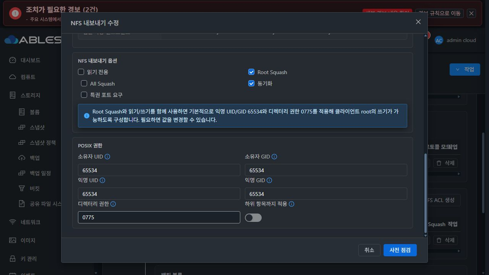

### S. 실제 가상머신 표준

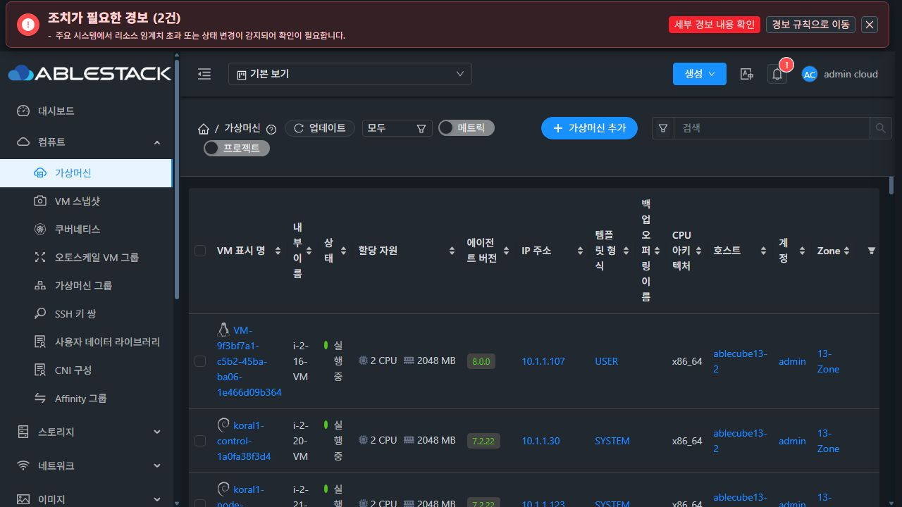
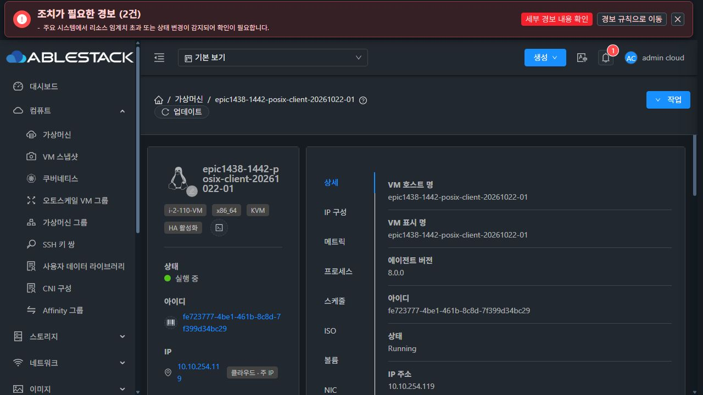
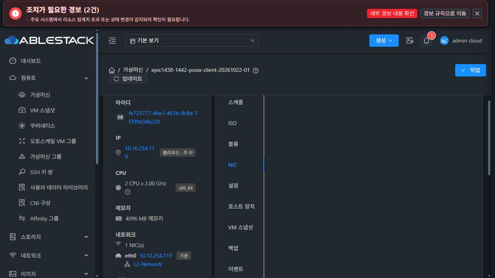
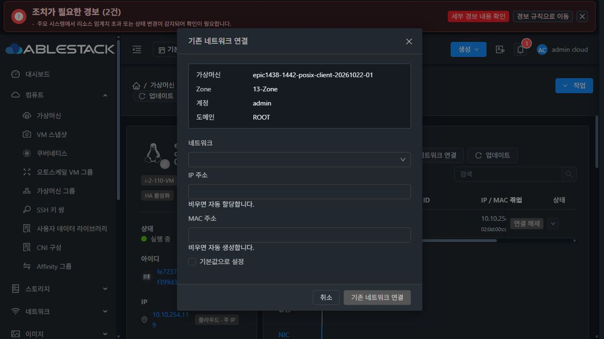

### B. 개선 목업

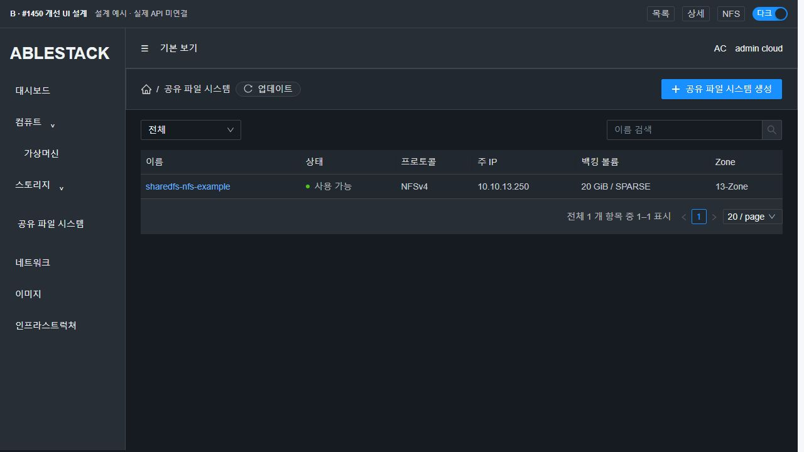
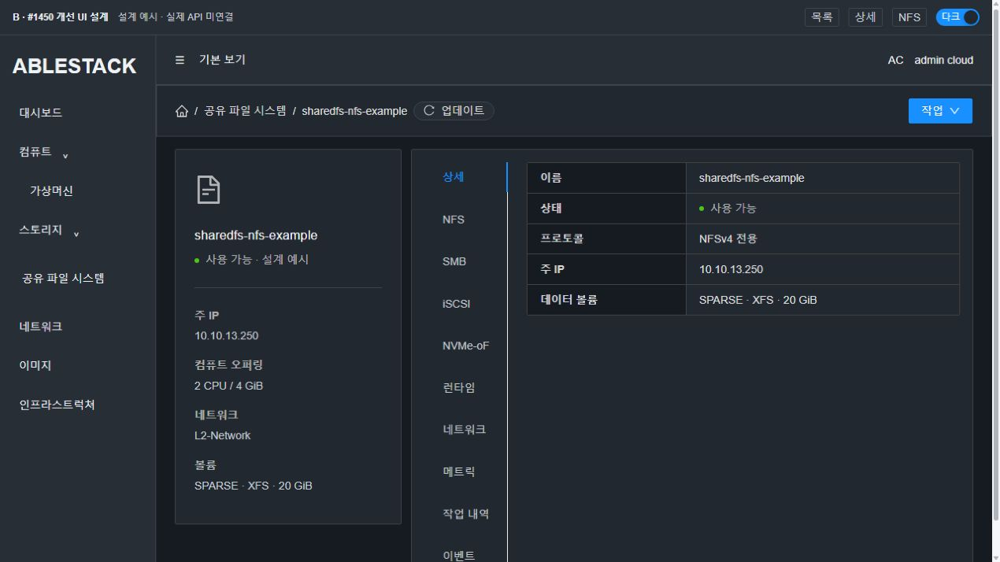
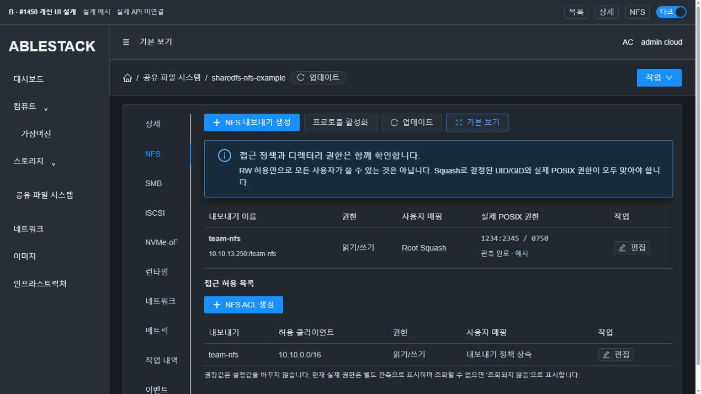
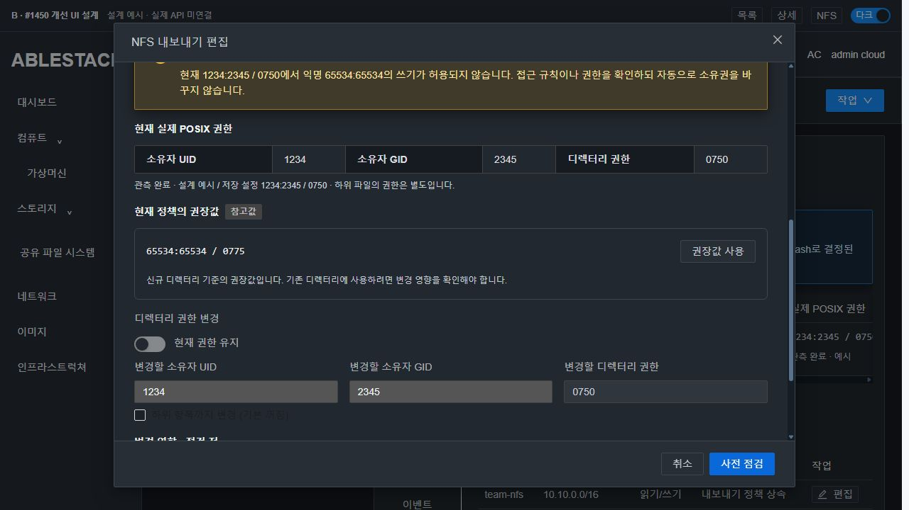
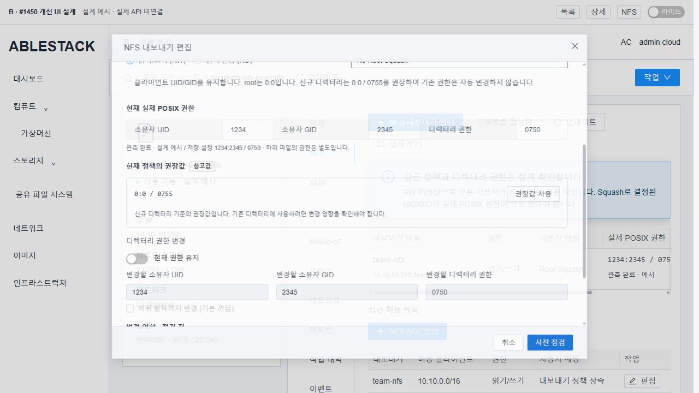
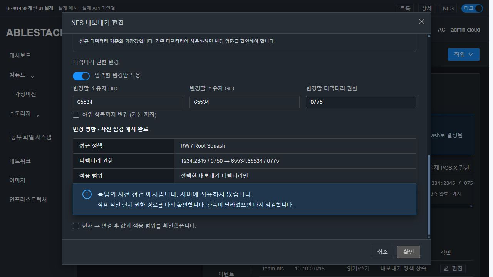
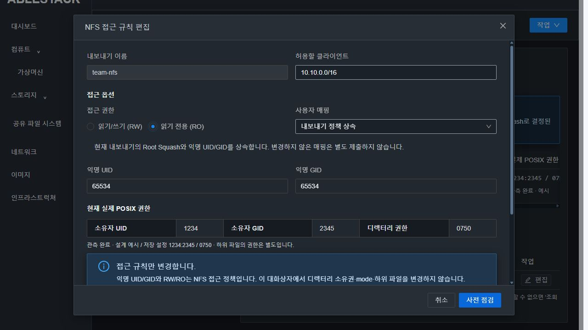

1280×720에서 body scrollTop0→494 동안 header y33/height55와 footer y622/height65가 그대로였다. body만 overflow-y:auto로 스크롤했다. 명시 변경 확인 전 버튼 비활성화, 확인 후 활성화·취소를 확인했다. 다크 모달 샘플 본문 대비13.35:1·보조 설명9.18:1이며 전체 접근성 인증을 의미하지 않는다. 공통 CSS의 실제 form item margin6px와 그룹/row16px를 구분해 기록했다. [실측](evidence/mockup-layout.json)

[목업 소스/실행법](mockup/README.md). 개발용 목업 bundle만 빌드했으며 제품 UI 빌드·배포는0이다.

## 7. 구현 후 검증 순서·완료 조건

1. 순수 정책 helper와 mounted SharedFSTab의 create/edit/ACL 요청 계약:6조합·부분 변경·UID0·상속·mode 정규화·재진입·취소. 미변경 POSIX 키가 요청 객체에 없어야 한다.
2. 실제 service/DTO 직렬화와 guest intent: update 기본값 미보충, 초기 imported 보존, explicit delta만 적용, 기존 다른 export no-op, 구형 capability 거절/관측 UNAVAILABLE, 같은 requestid 재개.
3. 사전 점검 후 실제 stat 변경·경로 교체 차단, 적용 후 의도한 실패의 root metadata/getfacl 원복·최초 진단 보존, 하위 파일 해시/소유권 불변. 기존 identity/format 보호 회귀.
4. 모듈만 빌드해13번 관리 서버/UI/guest에 정합하게 배포한 뒤 실제 UI 생성·정책 편집·권한 편집을 수행한다. SPARSE 이상을 사용하며 임의 MAC·재포맷·재귀 권한 보정으로 준비 상태를 만들지 않는다.
5. 새 전용 시험 디렉터리에서 Root/None/All×RO/RW를 실제 UI/API/stat/NFS 클라이언트의 root·1001·익명 숫자 identity로 확인한다. RO 쓰기 deny·RW 허용/거부·표본 파일 데이터/권한을 확인한다. existing-owner 경로의 권한 비제출, recommended 사용·명시 override·실패 원복을 대조한다.
6. 상대 경로는 현재 허용 계약의 직접 export child까지만 시험한다. 중첩 경로나32bit UID 확장을 완료 조건에 추가하지 않는다. Restricted CIDR의 별개 결함 #1460을 이 이슈에서 우회 수정하지 않는다.
7. 관련 UI의 Breadcrumb/목록/상세/탭/컨텐츠/대화상자와 light/dark·긴 본문·키보드·취소를 다시 확인한다. 실제 API 직렬화 응답을 fixture로 사용한다. 기능과 무관한 표시 차이만 최종 UI 이력으로 남긴다.
8. 모두 통과한 뒤 실제 구현/빌드/배포/인수 증거를 #1450와 Epic PR에 기록하고 이슈를 닫는다. 지금은 설계만 기록하고 OPEN을 유지한다.

제품 UI/API/Backend 오류가 나오면 해당 단계와 정확한 원인·증거를 분석하고 변이를 중단한다. 시험 코드/입력/사전 점검 오류는 자체 교정한다. 실제 UI 흐름을 숨은 API/QGA로 대체하지 않는다.
