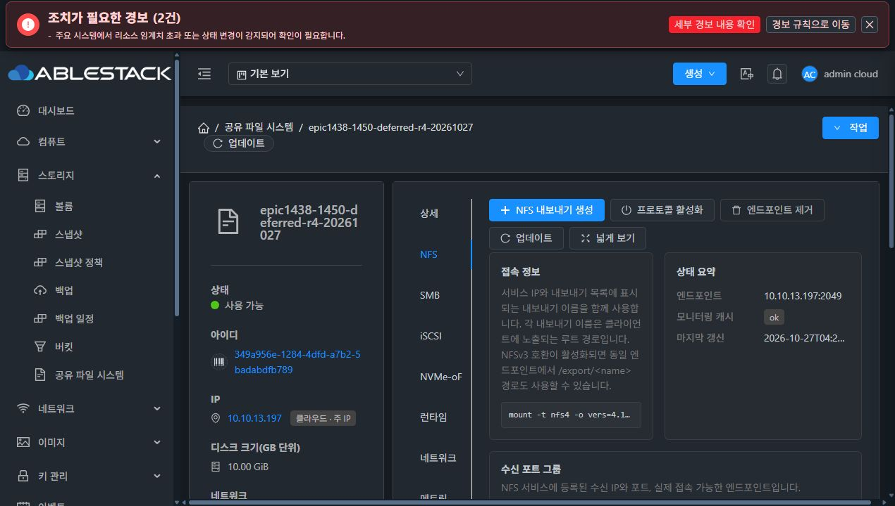
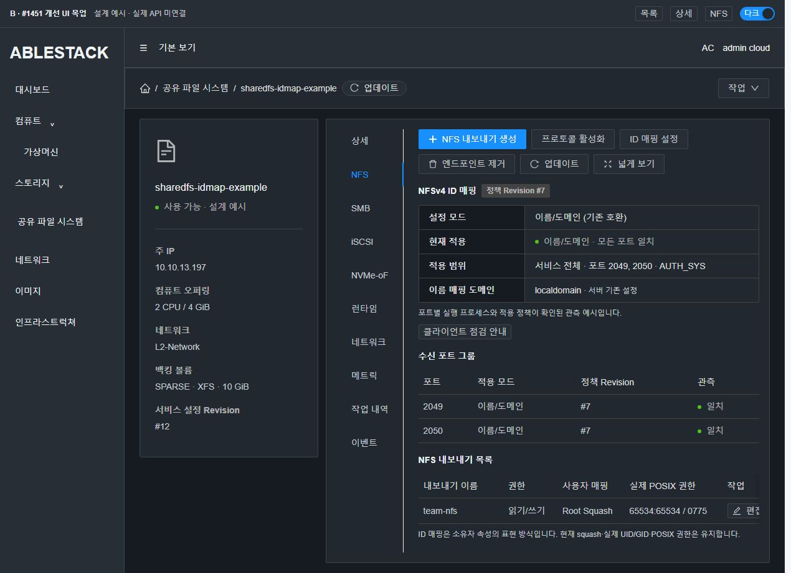
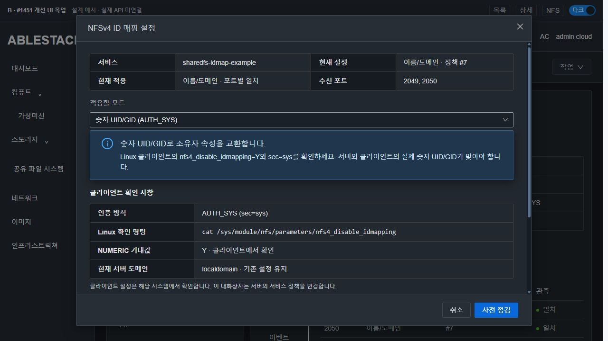
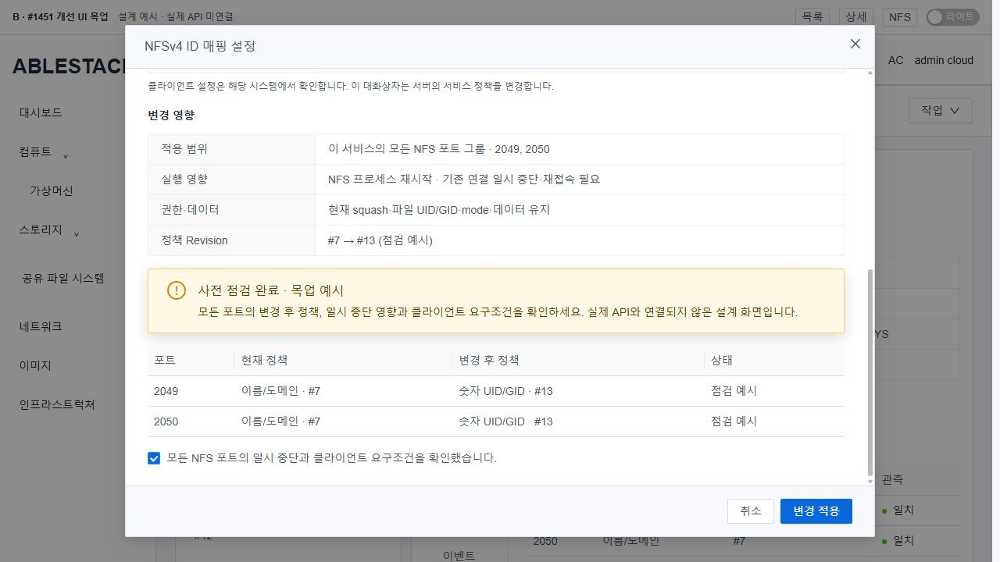
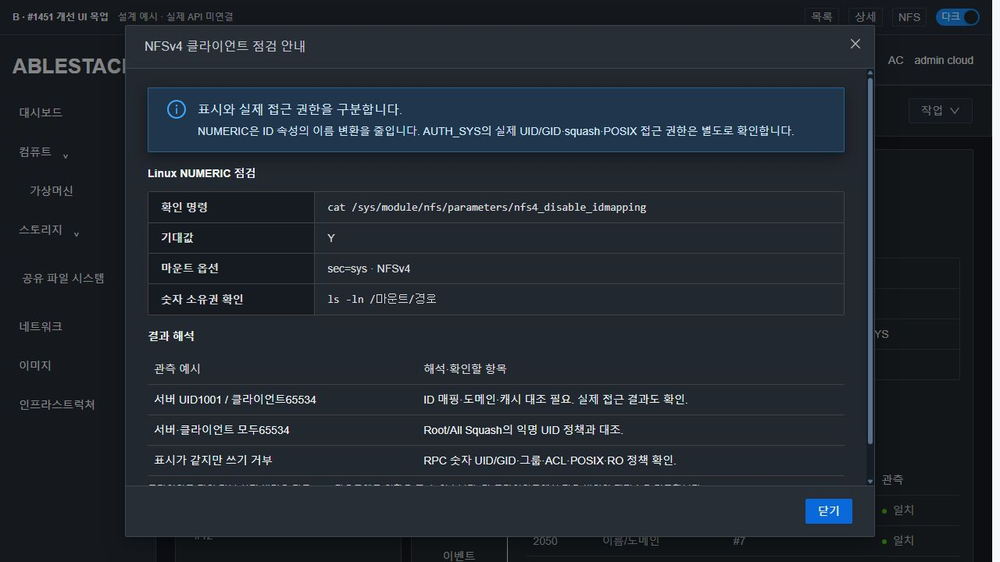

# #1451 NFSv4 ID 매핑 코드 수준 설계
2026-10-27 · Epic #1438 · **설계 완료 / 제품 구현·배포 미착수**

## 1. 범위와 기준선

목표는 NFSv4 소유자 속성의 NAME_DOMAIN/NUMERIC 모드를 서비스 단위로 관리하고 실제 적용·클라이언트 조건을 정확히 안내하는 것이다. export별 squash·POSIX 권한과 분리하며 파일 UID/GID를 자동 변환하지 않는다.

- source: epic/1438-sharedfs, **577301e6e10e45982ac6915df5ddda140e0b4c93**. origin/upstream fetch 후 로컬 ablestack-europa와 upstream 차이0/0, 작업 트리 깨끗한 상태에서 착수했다.
- 배포 management JAR978ce74bb62557ebb63a6d210669471ae9aae5ad99b505ab5c7eca0e375c2b12, UI index497ab6dd4e3637aa05a83a88124234209fa52056ca6bc3d2e6f71b5400eab15f.
- 실제 SharedFS349a956e-1284-4dfd-a7b2-5badabdfb789 / VMfd21e974-b7ef-3ac9-9772-da9335a1b25c(i-2-151-VM, host13.3), IP10.10.13.197. DATAe6468b3c-785b-4808-b746-57bf514f8137은 SPARSE/XFS10GiB, ROOT도 SPARSE다.
- 설치 Ganesha **4.3-2**, nfs-common2.6.2, libnfsidmap 사용. 실행은 기본 nfs-ganesha.service가 아니라 **ablestack-storage-ganesha@0.0.0.0_2049.service / PID9059**다. 실제 설정은 /etc/ganesha/ablestack-storage/0.0.0.0_2049.conf이며 샘플 /etc/ganesha/ganesha.conf를 실행 설정으로 간주하지 않았다.
- 실제 NFSV4 블록에는 Grace_Period5만 있고 ID 매핑 설정/API/UI는 없다. 기존 idmap 도메인은 **localdomain**, security는 **sys**다.
- 배포 storagectl SHAa9bcb86a0dd9cfc9d2a1c42e9cebebbbfe24384bf2883c830437490bf5859c0c, transaction SHA1031942cb73a5120899804fdc8c7b7fe263380c02b7b622f258b72070d86f2a6.
- 이번 작업은 신규 VM·디스크·포맷·MAC 변경0. 기존 SPARSE DATA의 별도 비공유 시험 경로와 격리 namespace만 사용했다.

## 2. 현재 코드에서 확인한 연결점

| 위치 (기준577301e6e10) | 확인한 동작 / 설계 연결 |
|---|---|
| StorageServiceManagerImpl.getCommands() L417 | 명령 등록 목록에 새 read/update2개 등록 필요 |
| enableStorageServiceProtocol() L585 | 기존 활성화는 endpoint 조작이다. 모드 변경용으로 호출하면 port/listener 의미와 섞이므로 별도 서비스 정책 API 사용 |
| applyNfsDesiredState() L2530 | 전체 NFS payload 생성. 여기에 서비스 정책2필드를 추가하고 기존 export/POSIX/ACL payload 유지 |
| resolveNfsServiceProtocolMode() L5129 | V4_ONLY/DUAL 선택과 ID mapping을 서로 다른 값으로 유지 |
| StorageServiceConfigurationPlan L52~95 | overlay는 protocol/share/target/rule DAO다. instance를 직접 갱신하지 않고 protocol.config_json에 정책 저장 |
| Preflight.APIS/parseIntent/commandIntent L47~133, resourcesdigest L229 | 새 API와 idmappingmode를 명시적으로 허용·검증하고 점검/적용의 같은 target을 digest에 바인딩 |
| Coordinator.execute L71~180 | 기존 requestid/revision/guest 확인/DB commit/원복 재사용. 새 기능만 capability 확인 |
| storagectl.write_ganesha_configs() L3916 | 서비스 payload로 모든 포트 설정을 생성. NFSV4 블록에 flags2개만 반영 |
| storagectl.start_ganesha_endpoints() L3978~4040 | 현재도 endpoint 단위 restart를 수행하므로 기존 적용 순서를 재사용 |
| configuration_transaction.RuntimeAdapter L873~ / restore L1319~ | 모드·revision 관측 검증 연결. 기존 before payload로 원복, POSIX intent는 빈 값 유지 |
| SharedFSTab.fetchStorageServiceData() L5106~ / configurationIntent L4563~ | 새 읽기는 별도 scope/loading으로 제한. 기존 초기 로딩·stale 응답 보호 유지 |
| storageConfigOperation.js / storageConfigPreflight.js | 새 API를 공통 작업 관찰·점검에 명시 등록. UI와 backend가 같은 clean target을 사용 |
| runtime-baseline-profile.json / runtime_updater.py | 기존 서명 3+6 파일 graph를 유지. 새 guest 파일을 추가하지 않음 |

## 3. 모드의 정확한 의미

| 값 | Ganesha4.3 반영 | 호환 의미 |
|---|---|---|
| NAME_DOMAIN | Allow_Numeric_Owners=true, Only_Numeric_Owners=false | 값 없는 기존 구성의 기본. 기존 NSS/idmap 도메인과 숫자 fallback 유지 |
| NUMERIC | Allow_Numeric_Owners=true, Only_Numeric_Owners=true | AUTH_SYS 범위. 소유자 속성을 숫자 문자열로 반환, Linux client의 nfs4_disable_idmapping=Y/sec=sys 안내 |

Ganesha4.3의 [설정 정의](https://github.com/nfs-ganesha/nfs-ganesha/blob/V4.3/src/support/nfs_read_conf.c)와 [ID encoder](https://github.com/nfs-ganesha/nfs-ganesha/blob/V4.3/src/idmapper/idmapper.c), [공식 ID Mapping 설명](https://github.com/nfs-ganesha/nfs-ganesha/wiki/ID-Mapping)을 배포 binary의 시험 결과와 대조했다.

NUMERIC은 실제 파일 owner를 바꾸거나 AUTH_SYS의 접근 자격 증명을 다른 사용자로 변환하지 않는다. NAME_DOMAIN도 AUTH_SYS 숫자 credential의 불일치를 해결하는 기능으로 안내하지 않는다. Linux에서 숫자 속성을 받아도 ls -l은 로컬 NSS 이름을 보여줄 수 있으므로 ls -ln/stat의 숫자를 대조한다. 실제 UID65534인 squash 결과의 nobody와, 실제 UID가 다른데 client가65534로 해석한 경우를 구분한다.

[Linux kernel 문서](https://www.kernel.org/doc/html/latest/admin-guide/kernel-parameters.html)의 client nfs.nfs4_disable_idmapping과 [Ganesha 안내](https://github.com/nfs-ganesha/nfs-ganesha/wiki/ID-Mapping)를 사용한다. userspace Ganesha에 kernel nfsd의 설정을 적용하는 설계를 하지 않는다. client 전역 값을 서버에서 자동 변경하거나 확인했다고 주장하지 않는다.

**제외:** AD/LDAP 가입·NSS 계정 관리·Kerberos 신규 지원·도메인 프로비저닝·POSIX chown/chmod·UID 범위 확대·프로토콜 hot 전환·전체 UI 정리. 도메인은 기존 서버 설정을 읽어 안내하며 이 이슈에 새 도메인 설정 API를 넣지 않는다.

## 4. 구현 전 실제 SystemVM 주입 시험

활성 코드·설정을 바꾸지 않고 동일 SystemVM의 private network namespace에서 **실제 설치된 ganesha.nfsd4.3**를 실행했다. private config/PID/log/recovery, 기존 SPARSE DATA의 전용 경로만 사용했다. 외부 연결 없는 dummy 주소는 namespace 안에만 존재했고 Mold NIC/MAC은 건드리지 않았다.

직접 NFSv4.0 COMPOUND(GETATTR/READ) 요청을 보내 실제 wire를 확인했다. 설치 binary의 공통 NFSv4 ID encoder 검증이며 Linux client 인수를 대신하지 않는다.

| 시험 | 실제 결과 |
|---|---|
| NAME_DOMAIN, private domain design.test | owner/group = daemon@design.test |
| config만 NUMERIC으로 편집 후 SIGHUP | 여전히 daemon@design.test — 단순 reload로 전환되지 않음 |
| NUMERIC으로 실제 process restart | owner/group = 1 |
| 잘못된 boolean 후보 | process exit2로 거부 |
| NAME_DOMAIN 설정으로 복구·재실행 | 다시 daemon@design.test |
| 각 정상 모드 AUTH_SYS UID1/GID1 READ | 동일 데이터 읽기 성공 |
| UID1001/GID1001 READ | 두 모드 모두 NFS ACCESS13 — 기존 POSIX에 맞는 기대 거부 |
| 실제 파일 | UID1/GID1/mode0640·SHA1bd6e4ab1ce36002fd46ab98505abdc44622770fcca93b91f09346440980ae17 유지 |

생산 config/source hash·PID9059·기존 데이터 hash가 시험 전후 동일했다. 프로세스·namespace·시험 DATA 경로·guest/host staging을 정리했다. 초기 격리 fixture의 IPv4 주소 인식/불필요 core 옵션은 시험 코드에서 교정했으며 제품 코드를 수정하지 않았다.

[실제 native 결과](evidence/native-design-validation.json) · [프로브 코드](evidence/native-probe.py) · [RPC 코드](evidence/rpc_probe.py) · [정리·무결성](evidence/cleanup-and-integrity.json)

실제 protocol config(protocolMode/listenerGroups)를 사용한 설계 모델18검사도 통과했다. 기본값·AUTH_SYS 제한·NFS row 전체 갱신·다른 프로토콜/리스너 보존·신규 endpoint의 정책만 상속·target/revision-bound ack·PID 변경/파일-실행 불일치·legacy 원복 의미를 확인한다. **제품 API/DAO 회귀 시험으로 간주하지 않는다.**

## 5. 저장·API 계약안

### 저장

기존 **storage_service_protocol.config_json**의 NFS row에 아래2필드를 추가한다. 새 표/열/DDL은 없다.

```json
{"nfs4IdentityMappingMode":"NUMERIC","nfs4IdentityPolicyRevision":13}
```

- missing → NAME_DOMAIN/0. 기존 데이터를 읽는 과정에서 backfill·재시작하지 않는다.
- policy revision은 **마지막 ID 정책 변경의 configuration target revision**이다. 다른 SMB 작업이 전역 configuration revision을 올렸다고 NFS 정책 revision을 강제로 바꾸지 않는다.
- update는 같은 instance의 NFS row 전체(비활성 row 포함)에 같은 mode/revision을 overlay로 설정한다. listenerGroups·protocolMode·IP/port·UUID·다른 config를 보존한다.
- 새 NFS listener에는 canonical mode/revision2필드만 상속한다. 이전 endpoint의 config 전체를 복사하지 않는다.
- 기존 row의 정책 모순은 DRIFT로 드러내고 임의로 첫 row를 선택하지 않는다. 정상 legacy missing 값은 모순으로 보지 않는다.
- 새 candidate가 target revision을 사용할 수 있도록 Plan에 targetRevision을 전달하는 작은 필드/할당만 추가한다. resume는 저장된 protocol snapshot/revision을 재사용한다.

### read / update

- GetStorageNfsIdentityMappingCmd / getStorageNfsIdentityMapping(instanceid)
- UpdateStorageNfsIdentityMappingCmd / updateStorageNfsIdentityMapping(instanceid,idmappingmode,requestid,expectedrevision,impactack)
- 새 DTO StorageNfsIdentityMappingResponse. update는 BaseStorageServiceConfigurationCmd와 상위 async jobid 계약을 사용한다. DTO에 jobid를 중복 선언하지 않는다.
- instance 소유권/계정 접근을 기존 requireInstance/checkAccess로 검증한다. NFS 미활성 update는 endpoint 생성·활성화 대신 명확하게 거부한다.
- mode는 NAME_DOMAIN/NUMERIC만 허용한다. NUMERIC은 effective security=sys만 허용하며 Kerberos 정책을 바꾸지 않는다.
- 현재 guest에 새 nfsIdentityMappingVersion1이 없으면 update 전에 런타임 업데이트 필요로 거부한다. 기존 NFS CRUD를 새 capability로 막지 않는다.

신규 GET 계약안(구현 첫 단계에서 실제 ApiResponseSerializer로 fixture 확정):

```json
{"getstoragenfsidentitymappingresponse":{"nfsidentitymapping":{
 "instanceid":"example","mode":"NAME_DOMAIN","policyrevision":0,
 "effectivemode":null,"observationstatus":"LEGACY_UNCONFIRMED",
 "observeddomain":"localdomain","securityflavors":["sys"],
 "endpoints":[{"port":2049,"configuredmode":"NAME_DOMAIN",
 "configuredrevision":0,"effectivemode":null,"observedrevision":null,
 "state":"LEGACY_UNCONFIRMED"}]
}}}
```

read 응답은 설정/실행 관측·시각·포트별 결과를 분리한다. source가 없는 effective 값을 설정값으로 채우지 않는다. 실행 대상 없는 endpoint는 NOT_RUNNING, 있어야 할 process/receipt가 빠졌으면 UNKNOWN/DRIFT로 구분한다. 실제 Linux client 환경은 서버의 확인 완료 항목으로 반환하지 않는다.

## 6. 점검·적용·원복 경로

1. 새 API를 Manager.getCommands()/StorageService에 등록하고 update를 기존 runConfiguration(NFS)으로 실행한다.
2. 같은 clean idmappingmode를 UI preflight intent와 실제 API에 사용한다. parseIntent/commandIntent에 새 key만 추가하고 enum 검증한다.
3. 기존 resourcesdigest에 **현재 NFS 정책/포트 vector + target mode**를 바인딩한다. 기존 guest fingerprint·4096-byte·revision/writer/drain 보호를 재사용한다. target을 바꾼 ack는 재사용하지 않는다.
4. beforeCommands는 기존 정책, candidate protocol overlay는 target 정책/revision이다. applyNfsDesiredState가 전역 mode/revision을 payload에 넣는다. export/ACL/POSIX 설정은 유지한다.
5. write_ganesha_configs는 단일 payload 정책을 모든 endpoint NFSV4 블록에 똑같이 반영한다. 현재 full restart 순서를 재사용한다. SIGHUP만 사용하지 않는다.
6. 포트별 process/listening과 ID 정책 관측을 검증한다. 실행 대상 endpoint가 하나라도 불일치하면 SQL mode/revision을 확정하지 않는다.
7. 기존 rollback이 before policy의 모든 endpoint를 복구한다. 최초 실패·원복 결과를 유지하고 복구 불확실이면 기존 RECOVERY_REQUIRED 보호를 사용한다.
8. 같은 requestid/동일 요청은 관찰/재개이며 두 번째 적용을 시작하지 않는다. 다른 mode로 같은 key를 재사용하면 conflict다.

### 실행 관측 — 설정 파일만으로 applied 판정하지 않음

NFS apply helper가 성공적으로 시작한 PID/boot ID/start ticks와 **canonical ID 정책 signature**·policy revision을 /run/ablestack-storage/ganesha의 root 전용 포트별 receipt로 발행한다. 관측기는 현재 process identity와 receipt, 현재 ID 관련 설정의 의미를 대조한다. byte가 바뀐 파일만 보고 새 mode라고 판정하지 않는다(SIGHUP 실증 근거).

- missing receipt: LEGACY_UNCONFIRMED, process 바뀜: UNKNOWN, file/receipt/정책 불일치: DRIFT.
- receipt는 volatile 실행 증거이므로 generic byte before-image로 과거 PID를 복구하지 않는다.
- 현재 restore는 before apply 후 설정 파일을 다시 복원한다. **legacy implicit NAME_DOMAIN/0와 explicit false/true defaults가 같은 canonical 정책임을 정규화**해, 원복된 옛 파일의 단순 byte 차이가 가짜 DRIFT를 만들지 않게 한다. runtime receipt는 원복 과정에서 실제로 시작한 새 PID와 before policy revision을 사용한다.
- mode/domain 의미가 달라진 경우는 동일하게 정규화하지 않고 불일치로 처리한다.
- boot reconcile은 기존 desired payload의 정책으로 재실행해 새 boot receipt를 만든다. 기본 unit만 수동 재시작해 receipt가 없다면 read가 자동 재적용하지 않는다.
- non-running/no-export 서비스는 policy 저장과 실행 관측 부재를 구분한다. posixOnly 지연 초기화 경로를 ID 관측 때문에 게시하거나 재시작하지 않는다.

### guest 파일 graph 보존

새 helper 파일을 만들면 기존 서명 3+6 allowlist를 확장해야 하므로 피한다. **configuration_transaction.py 내부 NfsIdentityMapping helper**로 정규화·render lines·receipt·검증을 모은다. storagectl과 monitor는 기존 module에서 import한다. boot reconcile 경로·기존9파일 graph/ABI/schema는 유지하며 변경 파일 hash/profile과 새 capability만 갱신한다.

## 7. 예상 변경 파일과 최소 영향 경계

| 파일/영역 | 예정 변경 |
|---|---|
| api/.../Get·UpdateStorageNfsIdentityMappingCmd.java | 새2명령, read/update 권한·기존 async 계약 |
| api/.../StorageNfsIdentityMappingResponse.java | 설정/관측/포트 결과 DTO |
| StorageService.java / ManagerImpl | 등록2개·NFS 정책 read/update·payload·listener 상속 |
| StorageNfsIdentityMapping.java (server helper) | JSON2필드·enum/정책 일치·security 검사 |
| ConfigurationPlan / Coordinator | targetRevision 전달과 새 API capability gate만 |
| ConfigurationPreflight | whitelist/같은 target intent·digest/영향 확인 |
| configuration_transaction.py | 기존 파일 안 helper, candidate/before ID 정책 검증 |
| storagectl / monitor | flags2개·launch receipt·읽기 전용 관측 |
| SharedFSTab.vue / 새 소규모 패널·다이얼로그 | NFS 탭 서비스 설정·관측·client 안내 |
| storageConfigOperation/Preflight util·ko/en | 새 API/모달만 명시 등록, 실제 serializer fixture로 decode 회귀 |
| runtime profile / 관련 테스트 | 기존3+6 hash 갱신, 대상 회귀 |

**그대로 유지:** CreateSharedFS 초기 wizard, #1450 POSIX intent/지연 초기화/권한 변경 보호, exporter squash/ACL/owner, 볼륨/포맷/네트워크/MAC, SMB/iSCSI/NVMe, catalog/서명 신뢰정책, list/detail의 기능 범위. NFSv3는 기존 숫자 UID/GID wire를 유지한다.

## 8. 현재 UI A와 개선 목업 B

A는 실제13번 현재 UI, B는 실제 API에 연결하지 않은 **설계 예시**다. 모드값/포트2049·2050/revision7·12·13은 B fixture이며 배포 상태로 해석하지 않는다.

- NFS 탭의 기존 생성·활성화·endpoint 제거·업데이트·넓게보기 유지. ID 매핑 설정만 같은 좌측 그룹에 추가한다. 생성이 파란 주 버튼 맨 왼쪽, 업데이트는 아이콘+문구, 넓게보기는 그룹 끝이다.
- ID 설정은 NFS 탭의 서비스 단위 패널/대화상자다. 상세 탭은 정보만 표시한다. 별도 NFS 탭 제목을 중복 추가하지 않는다.
- VM 표준 ResourceLayout/Breadcrumb/세로 탭/테이블/MoldDialog·MoldDialogActions 및 실제 Vue3+AntD를 사용했다.
- 다크 상태는 대비가 낮은 녹색 tag 대신 VM과 같은 badge+기본 본문색을 사용했다. 신규 간격8/16px을 확인했다. 실제 modal 본문/보조 문자 대비는13.35:1/9.18:1이며 UI 전체의 접근성 인증을 주장하지 않는다.
- 고정 header55px(y33)/footer65px(y622), body534px(y88)만 스크롤. preview에서 scrollTop0→494여도 header/footer 위치 동일 확인.
- client 조건은 mode별 안내이며 Linux 설정을 자동 변경하거나 원격 확인했다고 표시하지 않는다.
- API 미지원/legacy/NOT_RUNNING/UNKNOWN/DRIFT는 별도 상태. 선택 기능 읽기 실패가 전체 SharedFS 로딩을 막지 않게 한다. 기존 scope token·stale request 방어를 유지한다.

### A · 현재 배포 UI: mode 관리/관측 없음


### B · 개선 설계: 서비스 전체 정책과 포트별 관측





추가: [B 기존 미확인](images/B-legacy-unknown-dark.png), [B NAME_DOMAIN](images/B-settings-name-dark.png), [B 목록](images/B-list-dark.png), [B 상세](images/B-details-dark.png). [S 실제 VM 상세](images/S-vm-details-dark.png), [S VM 볼륨 탭/SPARSE](images/S-vm-volume-tab-dark.png), [S VM 목록](images/S-vm-list-dark.png), [S VM 아이콘 대화상자의 공통 프레임](images/S-vm-dialog-dark.png). 실제 VM 대화상자는 보기 후 닫았으며 업로드/설정 제출0이다.

목업 source는 mockup/에 있고 별도 목업 PR은 만들지 않는다. #1468 전면 UI 작업을 시작한 것이 아니다.

## 9. 구현 승인 후 인수 계획

1. 실제 ParamProcessWorker·권한/enum·4096-byte intent·same target ack·실제 DAO overlay/재조회·ApiResponseSerializer fixture부터 검증한다. mounted SharedFSTab에 실제 fixture를 넣어 GET/async/operation/미확인 전이를 확인한다.
2. 새 V4_ONLY SystemVM·SPARSE DATA와 **서로 다른 새 Linux client2대**를 UI로 만든다. 기존 client의 전역 idmap 값을 바꾸지 않는다. Y/N·일치/불일치 domain/NSS와 실제 RPC 숫자 UID를 통제해 표시/접근 오류를 구분한다.
3. 두 mode와 root/all/no squash×RO/RW의 UID0/1/1001/65534, read/write/deny·실제 stat/hash/owner 불변을 확인한다. 실제 nobody UID65534는 정책 결과와 구분한다.
4. 포트 그룹2개·별칭이 있는 상태에서 전체 동일 mode/정책 revision, 2번째 endpoint 실패 원복·최초 진단·중복 request/재개·VM/관리 서버 재시작을 실제 UI로 확인한다.
5. DUAL은 기존 생성 옵션으로 **별도 새 SPARSE 시험 서비스**를 순차 생성해 v3 숫자 동작 불변과 v4 ID mode를 대조한다. 기존 서비스의 protocol hot 전환 기능으로 확대하지 않는다.
6. 모듈/새 이미지·기존 runtime9파일 hash·capability·기존 기본 NFS 생성/ACL/POSIX 보호를 검증하고 배포한다. UI 관측 성공 후 코드·근거를 Epic PR에 반영하고 인수 완료 때만 이슈를 닫는다.

**이번에 하지 않은 것:** 제품 API/DAO/UI 구현·모듈 배포·두 새 client/실제 UI mode 변경·client kernel 설정 변경·재부팅 인수. native 실증과 설계 모델을 그 결과로 대체하지 않는다. 이슈는 OPEN/구현 지시 대기다.
