# #1452 코드 수준 설계 — 교차 프로토콜 디렉터리 POSIX 속성 단일화

- 작성: 2026-10-28 / Epic #1438 / 이슈 [#1452](https://github.com/ablecloud-team/ablestack-cloud/issues/1452)
- 상태: **설계 및 격리 SystemVM 주입 시험 완료. 제품 구현·DDL 적용·모듈 배포·인수 시험은 미착수.**
- 설계 기준 소스: `58c1f505c6a463a795bd18ca9c95883c5a265fbb`, `epic/1438-sharedfs`.
- 시작 시 origin·upstream fetch, 로컬 `ablestack-europa...upstream/ablestack-europa` **0 0**, base...작업 브랜치 **0 84** 확인.
- 문서와 목업만 변경한다. 기존 이슈의 완료 판정을 이번 기능의 인수 근거로 승계하지 않는다.

## 1. 범위와 결론

같은 **인스턴스·볼륨·실제 canonical 경로**의 owner UID/GID·mode·명시적 재귀 적용·정책 revision을 한 곳에서 소유한다. NFS export와 SMB share는 공통 정책을 참조한다. 두 프로토콜의 중복 chmod/chown, ACL 마스크에 의한 암묵적 mode 확대, 경합과 부분 실패를 기존 설정 트랜잭션 안에서 제어한다.

대상은 동일 디렉터리의 POSIX 관리뿐이다. NFS ID 매핑·squash·RO/RW, SMB 로컬/AD 인증·계정·생성 마스크, 볼륨 생성·포맷·확장, IP/MAC 정책, 다른 프로토콜은 재설계하지 않는다. 실제 디렉터리 mode와 ACL의 effective mask가 연관되므로 기존 SMB ACL 렌더러의 **공통 경로에 대한 POSIX 부작용만** 조정한다.

**최소 변경의 핵심**

1. 별도 공통 정책 레코드 + 기존 share의 JSON 참조. 자동 데이터 마이그레이션/재귀 chmod 금지.
2. 기존 instance writer, preflight/impact ACK, plan overlay, guest journal, SQL commit/recovery 재사용.
3. 공통 경로의 UID/GID/mode와 소유한 ACL을 한 번 계산·적용. 연결된 NFS/SMB 렌더러는 POSIX 재적용을 생략.
4. 실제 Ganesha 시험에서 외부 POSIX 변경 후 이전 속성 캐시가 남았다. **권한 변경 후 영향받는 NFS unit을 한 번 갱신하고, 원복 시에도 갱신한다.** 단순 chmod만으로 완료 판정하지 않는다.
5. 새 “공유 디렉터리” 세로 탭에서 편집. 각 프로토콜은 상속 값과 이동 링크를 표시한다. 상세 탭은 정보만 표시한다.

## 2. 배포본과 실제 자원 확인

| 항목 | 이번 확인 결과 |
|---|---|
| 관리 서버 | 10.10.13.10, mold.service active |
| 배포 JAR SHA-256 | `07c64a803b1702ebd22b652bcea2468351e38a89f81eff36e8ba47600972e9a4` |
| 배포 UI index SHA-256 | `9e0b33bcaa9858142d31d4ee199d8b1f82ff3be71338c65dbaeb448b655e88a3` |
| 서비스 | `2ef338ec-b260-4250-8b45-ae61a2e4bfa7`, epic1438-1451-r4-v4-20261028 |
| SystemVM / host | `13246a3e-76c3-3ed1-b869-dd39695a85aa`, i-2-176-VM / 10.10.13.1 |
| 주 IP | 10.10.13.193 |
| DATA | `78396639-cab6-46a8-9999-89f991abbd01`, **SPARSE·XFS·10 GiB** |
| ROOT | SPARSE, 5,242,880,000 bytes |
| 런타임 | epic1438-1451-idmap-4e6b7d88289-r4, manifest 9개 파일의 로컬/설치 SHA 일치 |
| native 버전 | Ganesha 4.3, Samba 4.17.12-Debian |
| 기존 서비스 | NFS NUMERIC/#7, 2049·2050 APPLIED, export/e1451, root 65534:65534/0777, 파일 61개 |
| 신규 공통 정책 capability | 아직 없음. 현재 기능으로 새 API가 동작한다고 간주하지 않는다. |

설치된 payload의 정확한 파일별 SHA는 [배포 근거](evidence/baseline-summary.json)에 남긴다. 설치 파일을 바꾸지 않고 실제 설치 함수/트랜잭션을 읽어 격리 프로세스에서 시험했다.

시험 데이터는 위 SPARSE DATA의 **활성 export 밖** `.epic1452-design-proof`에만 생성했다. 별도 network·mount namespace의 loopback NFS 23049 / SMB 23045를 사용했다. 실제 eth0·MAC·IP·계정·운영 Samba/Ganesha 설정·운영 프로세스는 바꾸지 않았다. 시험 후 전용 경로·namespace·프로세스를 정리하고 payload 9개, active config, 운영 Ganesha PID, 61개 파일의 내용·UID/GID/mode가 같음을 재조회했다.

이 주입 시험은 **설계 타당성 시험**이다. 제품 API/DAO 통합, 실제 Mold UI 적용, 별도 클라이언트 VM/로컬 인증 및 재부팅 인수를 완료한 것으로 표현하지 않는다.

## 3. 현재 코드와 재현한 원인

### 3.1 저장/요청 경로

| 실제 파일 | 확인 내용 |
|---|---|
| `engine/schema/src/main/java/org/apache/cloudstack/storage/dataservice/StorageFileShareVO.java` | 실제 테이블은 `storage_file_share`. NFS/SMB별 path·volume_id·config_json을 보유한다. 공통 정책 참조는 없다. |
| `engine/schema/src/main/java/org/apache/cloudstack/storage/dataservice/dao/StorageFileShareDao*.java` | 인스턴스·프로토콜별 목록이다. 같은 실제 디렉터리의 공통 유일 키가 없다. |
| `engine/schema/src/main/resources/META-INF/db/schema-Diplo-After.sql:122` | path VARCHAR(4096), config_json MEDIUMTEXT. 새 정책은 별도 테이블로 제안한다. |
| `server/src/main/java/org/apache/cloudstack/storage/dataservice/StorageServiceManagerImpl.java:5385` | SMB config를 기존 값과 병합, crossProtocol 기본 false, directoryMode 기본 0770. |
| `ui/src/views/storage/SharedFSTab.vue` | NFS는 실제 POSIX·권장값·명시적 변경 보호, SMB는 별도 directoryMode·crossProtocol 입력. 두 폼은 공통 owner가 없다. |

기존 NFS 미변경 POSIX 비제출·fingerprint 보호는 재사용한다. 단독 공유의 정상 편집은 그대로 둔다.

### 3.2 실제 SMB의 chmod 생략과 ACL 적용은 다른 문제다

`systemvm/debian/usr/local/bin/ablestack-storagectl:4893`의 `apply_directory_policy`는 crossProtocol=true이면 직접 chmod/reset ACL을 건너뛴다. 그러나 :4985~5005의 SMB 규칙 처리는 같은 경로에 `apply_posix_acl`을 호출한다. 이 함수의 `setfacl -m`은 ACL mask를 다시 계산한다.

설치 함수로 **0750 → crossProtocol=true → RW named ACL → 0770**을 재현했다. 즉, 체크박스만으로 NFS 권한을 보호할 수 없다. 반대로 standalone 경로의 reset/chmod 동작도 재현해 호환 경계를 확인했다. :5037~5038의 create mask=0660 / directory mask=0770은 새 파일 생성 정책이며 이 이슈에서 바꾸지 않는다.

### 3.3 NFS 서버 속성 캐시까지 포함해야 한다

같은 격리 경로를 실제 NFSv4.1·SMB에 연결해 상호 put/read를 확인한 뒤 root를 65534:65534/0770 → 1001:1001/0777로 변경했다.

- backing stat: 새 값 1001:1001/0777.
- 새 NFS mount에도 `nosharecache,actimeo=0,lookupcache=none`을 사용했지만 이전 값 65534:65534/0770을 관측.
- private Ganesha 프로세스를 새로 시작한 뒤 NFS가 1001:1001/0777로 일치.
- SMB 프로세스는 그대로 두고 양쪽 교차 I/O와 seed의 hash·UID/GID/mode를 보존.

따라서 클라이언트 캐시 설정으로 우회하거나 “FD chmod만 하고 서비스 갱신 없음”으로 구현하지 않는다. 전역 Ganesha cache를 끄지도 않는다. 기존 NFS 렌더러/unit 갱신 경로를 재사용하며, 해당 unit의 다른 export도 영향 preview에 포함한다. SIGHUP만으로 충분하다는 근거는 없으므로 그 방식은 채택하지 않는다.

[갱신 전 반례](evidence/cache-counterexample.json) / [설계 교정 후 결과](evidence/native-design-result.json)

## 4. 공통 정책 모델·DDL 제안

### 4.1 유일 키와 실체 검증을 분리

`key = (instance_id, volume_id, sha256(UTF-8 canonical volume-relative path))`.

- 클라이언트에 보이는 export/share 이름이나 lexical path만으로 합치지 않는다.
- 현재 `nfs_posix_observe`의 mount UUID·managed volume 경계·디렉터리 검증을 공통 helper로 추출한다.
- 기존 관측 함수는 같은 볼륨 안의 **상위 경로 별칭**을 realpath로 정규화한다. 이를 같은 key로 묶는 시험을 통과했다. leaf symlink와 볼륨 밖 경로는 거부한다.
- 검증된 volume root FD를 열고 resolved canonical 구성요소를 O_NOFOLLOW/openat로 연다. 적용 직전 FS UUID·inode·현재 UID/GID/mode·ACL fingerprint·참조 목록을 다시 확인한다.
- fingerprint는 현재 권한을 포함하므로 정책의 유일 키로 쓰지 않는다. st_dev 역시 재부팅 후 영속 키로 쓰지 않는다.
- hash 충돌 시 원문 canonical 경로를 비교하고 불일치면 거부한다. 다른 볼륨의 같은 문자열을 합치지 않는다.

### 4.2 정확한 새 테이블과 기존 테이블 영향

다음은 **미적용 DDL 설계**이다.

```sql
CREATE TABLE IF NOT EXISTS storage_directory_policy (
  id BIGINT UNSIGNED NOT NULL AUTO_INCREMENT,
  uuid VARCHAR(40) NOT NULL,
  instance_id BIGINT UNSIGNED NOT NULL,
  volume_id BIGINT UNSIGNED NOT NULL,
  canonical_path VARCHAR(4096) NOT NULL,
  canonical_hash CHAR(64) NOT NULL,
  owner_uid BIGINT UNSIGNED NOT NULL,
  owner_gid BIGINT UNSIGNED NOT NULL,
  mode CHAR(4) NOT NULL,
  revision BIGINT UNSIGNED NOT NULL DEFAULT 1,
  last_recursive TINYINT(1) NOT NULL DEFAULT 0,
  metadata_json MEDIUMTEXT NOT NULL,
  created DATETIME NOT NULL,
  updated DATETIME NULL,
  PRIMARY KEY (id),
  UNIQUE KEY uk_directory_policy_uuid (uuid),
  UNIQUE KEY uk_directory_policy_path (instance_id,volume_id,canonical_hash),
  KEY i_directory_policy_volume (volume_id)
) ENGINE=InnoDB DEFAULT CHARSET=utf8;
```

`metadata_json`: schemaVersion, 실제 FS UUID/inode, 마지막 검증 fingerprint, 관리 주체가 확인된 ACL 항목, 마지막 operation UUID. 관측 불가·drift·legacy 충돌은 list 응답에서 별도 진단하고 desired 값을 덮어쓰지 않는다. mode는 정규화한 4자리 8진수(예: 0770, 2770), UID/GID는 기존 NFS 입력 검증과 동일 범위. 특수비트 허용 범위도 기존 검증을 따른다.

기존 `storage_file_share`에는 새 column을 추가하지 않는다. `config_json.directoryPolicyUuid`를 참조로 저장하고 기존 unrelated config를 보존한다. 참조를 유지한 채 경로/볼륨만 바꾸는 요청은 거부하고, 새 경로의 유효한 정책을 명시적으로 선택하도록 한다. JSON ref이므로 SQL FK가 보장하지 않는 인스턴스·볼륨·canonical key 일치/삭제 보호를 manager·plan에서 검증하고 회귀 시험한다. 서비스 제거 시 종속 정책을 같은 정리 경로에서 제거한다. 마지막 공유만 삭제돼도 정책이나 실제 디렉터리를 자동 삭제하지 않는다.

새 `StorageDirectoryPolicyVO/Dao/DaoImpl`을 추가하고 기존 plan의 shadow DAO에 포함한다. 새 설치에는 `schema-Diplo-After.sql`, 이미 배포된 Europa에는 동일한 **idempotent 전용 DDL 배포 단계**를 제공한다. 이미 적용된 과거 버전 upgrade SQL만 수정해서 이행됐다고 간주하지 않는다. 구현 시 테이블·index 생성 및 DAO 실제 저장/재조회 확인을 배포 필수 검사로 삼는다. 이번에는 DDL을 실행하지 않았다.

## 5. API·관리 서버 설계

### 5.1 최소 API

| API | 계약 |
|---|---|
| `listStorageDirectoryPolicies` | instanceid 필수, 기존 page/pagesize 관례. 정책·실제 관측·NFS/SMB refs·legacy 충돌·관측 시각을 반환. guest 조회 실패는 UNAVAILABLE과 이유를 반환하고 목록 전체를 무한 로딩시키지 않는다. |
| `createStorageDirectoryPolicy` | **이미 존재하는 디렉터리를 현재 값 그대로 등록**. instanceid,volumeid,path,기존 configuration requestid/expectedrevision/impactack 사용. mkdir·포맷·권장값 적용 없음. 관측 값/ACL을 보존하며 모든 같은 경로 refs를 원자적으로 연결. |
| `updateStorageDirectoryPolicy` | policyid, expectedpolicyrevision, 명시적 dirty UID/GID/mode, recursive(요청별 기본 false), 기존 requestid/expectedrevision/impactack. 필드 미변경은 비제출. |

새 NFS/SMB 공유의 `directorypolicyid`는 선택적 참조다. 새 디렉터리는 기존 단독 생성 흐름으로 만든 후 현재 값으로 등록해 교차 공유할 수 있다. 별도 범용 파일 관리자나 추가 볼륨 생성 기능을 만들지 않는다.

같은 실제 경로에 두 프로토콜이 만나는 경우, 공통 정책이 없으면 **권한 변경 전** `DIRECTORY_POLICY_REQUIRED`와 기존 ref/실제 값/등록 안내를 반환한다. UI도 같은 경로를 확인해 등록 동선을 제공한다. crossProtocol 입력을 신뢰해 보호를 우회하지 않는다. 참조된 공유에서 owner/directoryMode/recursive 등 독립 변경 입력은 `DIRECTORY_POLICY_MANAGED`로 거부한다. UI 미제출만으로 서버 보호를 대체하지 않는다.

기존 단독·미참조 경로는 기존 NFS/SMB 계약을 유지한다. 같은 경로인지 판단할 수 없으면 동작 추정 대신 사전 점검에서 대기/차단한다.

### 5.2 기존 coordinator 확장 지점

`StorageServiceConfigurationCoordinator.execute`(:75~97)의 instance row lock, runtime writer 거부, request hash replay, active op, expected revision을 유지한다. 새 lock/별도 실행 큐를 만들지 않는다.

- 새 common command임을 명시적으로 판별하는 작은 분기를 둔다. operation resource_type은 **DirectoryPosixPolicy(20자)** 고정값. 클래스명/VARCHAR(32) 초과 문자열을 저장하지 않는다.
- 실제 `StorageServiceInstance.Protocol`에 FILE 같은 가상 listener enum을 추가하지 않는다. 해당 정책에 NFS ref가 있으면 기존 NFS를, 아니면 SMB를 operation의 **추적용 anchor**로 사용한다. 실제 영향은 정책의 NFS+SMB ref 배열이며 anchor 프로토콜만 실행하는 것이 아니다.
- `StorageServiceConfigurationPreflight.observe`의 api 이름→프로토콜 추론(:155~158)보다 **앞에서** directory command를 처리한다. 일반 프로토콜 분기는 그대로 둔다.
- capability `sharedDirectoryPolicyVersion=1`을 candidate 준비/쓰기 전에 확인. 구버전 VM은 공통 편집만 명확히 제한하며 기본 목록·단독 기능을 망가뜨리지 않는다.
- plan에 정책 shadow DAO와 config_json ref를 추가해 before/candidate snapshot에 함께 넣는다. guest 검증 뒤 정책·refs·instance revision을 같은 SQL transaction에서 commit한다.
- 공통 command에는 `directory policy apply` candidate를 넣고 NFS/SMB 중 필요한 render만 생성한다. 기존 NFS dirty intent 생성 분기는 공통 command에서 건너뛰고 새 **내부** policy intent를 사용한다.
- public response는 기존 async job 계약을 따른다. 상위 setJobId() 사용, 중복 jobid 필드 선언 없음.

### 5.3 preflight/intent/오류 전달

기존 preflight intent 4096자 및 별도 UTF-8 byte 제한·snapshot 1 MiB 제한은 유지한다. 공개 intent에는 policy UUID와 dirty 값 등 bounded 입력만 넣고 전체 refs/ACL before-image를 사용자 입력으로 받지 않는다. 서버가 실제 refs를 계산한다.

사전 점검과 최종 재검사에 묶을 값:

- instance revision + policy revision + request hash;
- canonical key, volume FS UUID/inode, UID/GID/mode 및 ACL fingerprint;
- 연결된 모든 NFS/SMB share·rule의 membership digest;
- 각 NFS unit과 같은 unit을 공유하는 **직접 대상 밖 export**의 목록·포트;
- 재귀 여부·대상 inode 집합/파일 수·스냅샷 용량·writer/작업 예산.

입력/참조/관측이 바뀌면 기존 impact ACK를 폐기한다. 예시 오류 코드는 `DIRECTORY_POLICY_CONFLICT`, `DIRECTORY_POLICY_STALE`, `DIRECTORY_IDENTITY_CHANGED`, `DIRECTORY_ACL_MASK_CONFLICT`, `DIRECTORY_SNAPSHOT_LIMIT`. 실제 적용 전 실패인지 원복 실패인지 구분하고 operation UUID를 UI에 보존한다. 오류를 빈 목록/성공 toast로 바꾸지 않는다.

## 6. SystemVM 적용·ACL·복구 설계

### 6.1 단일 적용 알고리즘

새 `shared_directory_policy.py`에 순수 정규화·관측·ACL 계산·FD mutation helper를 둔다. 기존 `configuration_transaction.py`는 `directory policy apply`를 검증된 allowlist에 추가하고 adapter에서 호출한다. host wrapper의 현재 operation 문자 검증은 이 명령을 허용하므로 새 host agent command나 전역 allowlist 완화는 필요 없다.

```text
instance writer 소유 → canonical/identity/revision/refs 재관측
 → bounded before-image 준비(UID/GID/mode/access+default ACL, registry)
 → ACL 요구/공통 mask 충돌 검사
 → canonical path별 한 번의 FD 적용(재귀는 inode 중복 제거)
 → bound NFS/SMB render: 공통 경로의 POSIX writer 생략
 → 영향 NFS unit만 한 번 갱신
 → stat/ACL + 관련 NFS/SMB 관측 확인
 → guest VERIFIED → SQL policy·refs·revision COMMIT → guest ACK
```

동일 operation 재조회·중복 request는 journal/replay로 기존 작업을 추적한다. 새 프로세스를 시작하거나 재귀 권한 작업을 다시 실행하지 않는다. 같은 inode에 alias가 여러 개 있어도 한 번만 처리한다. 복수 chown/chmod 호출을 커널의 단일 atomic syscall이라고 표현하지 않는다. **한 논리 트랜잭션에서 한 적용·확정 또는 원복**이라는 의미다. 중간 상태의 클라이언트 관측을 완전히 없애는 별도 파일시스템 snapshot 기능은 이 이슈에 도입하지 않는다.

### 6.2 ACL과 mode

- 현재 SMB 사용자/그룹 해석·인증 준비를 재사용한다. AD 가입·UID 강제 생성/재번호 기능을 추가하지 않는다.
- 같은 경로의 SMB 규칙을 모아 한 번만 계산. 자동 mask 재계산을 막는 **setfacl -n**과 명시적 mask를 사용한다. mode 0750의 mask r-x에 RW/rwx 요청은 자동 0770 확대하지 않고 변경 전 충돌로 표시한다.
- 공통 정책의 mode는 ACL mask를 포함한 실제 stat mode와 같아야 한다. mode 확대/축소와 실제 effective ACL의 차이를 preview한다. SMB share-level RO와 NFS RO가 서로 다를 수 있다는 이유만으로 충돌시키지 않는다.
- 관리자가 소유한 named ACL entry만 집계·변경한다. 기존 unmanaged/default ACL을 `setfacl -b/-k`로 제거하지 않는다. legacy ACL의 소유 주체가 불명확하면 진단과 명시적 등록/해결 없이 삭제·확대하지 않는다.
- 신규 local account 준비가 필요한 경우 기존 계정 준비와 before-image rollback을 먼저 수행하고 UID가 확정된 뒤 common ACL을 계산한다. 계정 준비를 무시하고 이름을 임의 숫자로 가정하지 않는다.
- bound 경로에서 기존 `apply_directory_policy/reset_directory_acl/apply_posix_acl`이 한 번 더 쓰지 않도록 내부 registry 확인으로 분기한다. 일반 미참조 SMB 경로에는 기존 behavior를 유지한다.
- 권장값은 참고/초안일 뿐이다. 등록에 권장값을 사용하지 않고 변경 없는 필드는 보내지 않는다.

### 6.3 재귀와 보존

기본은 **대상 디렉터리만 변경**. recursive는 중앙 정책에 마지막 적용 이력으로 남기되 다음 요청·렌더·부팅에서 자동 재사용하지 않는다.

명시적 recursive 요청은 bounded inode 목록과 전체 before-image를 먼저 만든다. child mount·다른 FS·symlink traversal은 거부하고 hardlink inode를 중복 적용하지 않는다. 기존 snapshot 상한/공간이 부족하면 한 파일도 변경하기 전에 거부한다. 활성 쓰기 세션이 있거나 작업 중 트리 변경을 배제할 수 없으면 유지보수/재점검을 요청한다. 작동 중인 대형 트리에 무제한 재귀 chmod를 시작하지 않는다. 중간 실패는 완료된 inode를 journal로 추적해 ACL·소유자·mode까지 원복한다. 데이터 내용은 쓰지 않는다.

### 6.4 실패·재시작·부팅

- before-image에 root 및 명시적 재귀 대상의 UID/GID/mode/access/default ACL, registry, 관련 render config를 함께 보존.
- 한쪽 프로토콜 검증 실패 → 파일 권한/ACL 원복 → 관련 렌더/registry 복원 → **영향 NFS unit 재갱신** → 양쪽 확인. 원래 실패와 rollback 결과를 별도 진단으로 보존.
- QGA 응답 단절·관리 서버 재시작은 기존 operation ID로 observe/recover. 불명확한 결과에 새 request/새 permission apply를 실행하지 않는다. SQL commit 후 ACK 손실도 기존 coordinator 절차를 유지.
- guest registry 제안 경로는 `/etc/ablestack-storage/desired-state/directory-policy.json`, root 전용 atomic fsync/replace. before/candidate journal에 포함한다.
- boot reconcile은 active journal/registry의 상태를 확인한 뒤 기존 NFS→SMB 재적용 흐름에서 **bound POSIX writes를 생략**한다. 권한과 실제 ACL을 관측만 하며 저장된 recursive=true를 재실행하지 않는다.
- 기존 미등록 교차 경로는 목록에서 REVIEW로 표시. boot의 protocol config 렌더는 유지하되 해당 경로의 destructive ACL reset/chown/chmod를 수행하지 않는다. 누락된 디렉터리나 identity mismatch를 임의 생성/보정하지 않는다. 공통 경로 변경 요청은 현재 값 등록 전 차단한다.
- 자동 마이그레이션을 안 하므로 단독 공유는 그대로 동작한다. 정책 등록 전후 child 파일·데이터·권한을 해시/숫자 stat으로 대조한다.

## 7. 최소 변경 파일 계획

| 영역 | 구현 때 변경할 곳 | 재사용/보존 |
|---|---|---|
| schema/DAO | 새 StorageDirectoryPolicyVO/Dao/Impl, 전용 idempotent DDL와 fresh schema | storage_file_share 기존 column/config 보존 |
| API | 3개 정책 Cmd/Response, NFS/SMB 선택적 directorypolicyid | 기존 async serialize·입력 byte 제한 |
| manager | 작은 StorageDirectoryPolicy 서비스/helper + 기존 manager 연결 | 기존 volume/tenant 검증·단독 요청·인증 |
| plan/coordinator/preflight | 정책 shadow table·common command 분기·전체 refs/impact | instance lock·replay·journal·snapshot 상한·commit/recovery |
| guest | 새 shared_directory_policy.py, storagectl inventory/내부 apply, transaction adapter | 기존 경로/volume identity, shell 미보간 FD syscall |
| render/boot | bound 경로 POSIX 생략, NFS affected-unit 갱신, registry 검증 | 일반 NFS/SMB 및 iSCSI/NVMe, network/format 무변경 |
| runtime packaging | 새 파일을 manifest builder/테스트/이미지에 포함해 payload와 함께 재서명 | 기존 신뢰키/검증 계약 유지; 서명 우회 금지 |
| UI | SharedFSTab에 작은 탭 연결, 새 SharedDirectoryPolicyPanel·Form | Breadcrumb/ResourceLayout/MoldDialog·scope stale 응답 보호 |

중앙 공통 기능을 위해 전체 SharedFSTab·서비스 manager·인증·볼륨 경로를 다시 작성하지 않는다. 파일 위치는 현재 실제 소스 루트 기준이며 별도 이슈로 분기하지 않는다.

## 8. UI 설계·목업 — A 현재 / B 개선 / S 표준

### A. 현재 배포 화면

아래는 실제 배포본에서 열고 **취소한** 폼이다. 생성/권한 변경을 제출하지 않았다.

| 실제 현재 NFS 폼 | 실제 현재 SMB 폼 |
|---|---|
| 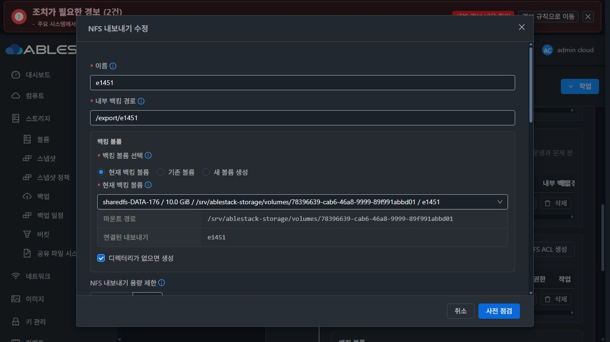 | 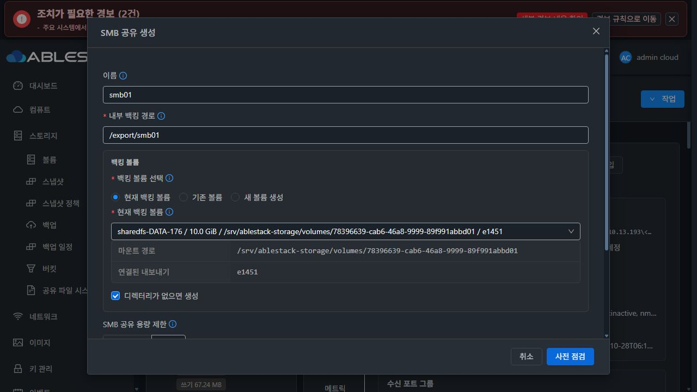 |

NFS의 현재 실제 값·권장값·미변경 보호는 유지할 가치가 있다. SMB에는 별도 directoryMode와 “NFS와 같은 경로 공유”가 있어 두 프로토콜의 영향/공통 소유권을 확인하기 어렵다.

### B. 개선 UI — 구현물이 아닌 Vue3·AntD 목업

[목업 소스](mockup/App.vue). 실제 Mold `Breadcrumb`, `ResourceLayout`, `MoldDialog`, `MoldDialogActions`와 현재 UI의 Vue3/AntD·index.less를 사용했다. 상단에 **설계 예시·실제 API 미연결**을 표시한다. API 호출·VM/볼륨 생성/설정 기능은 없다.

- 서비스 목록/Breadcrumb/작업 위치는 VM 표준 유지. 상세 탭에는 정보만 표시.
- 새 **공유 디렉터리 세로 탭**: 현재 실제 값/desired/revision/refs/불일치 진단. 현재 값 등록 → 필요 시 권한 변경 → 전체 영향 점검 → 명시적 ACK → 적용.
- 공통 정책의 UID/GID/mode를 한 곳에서 편집. 폼 초기값은 실제/desired 값, 권장값 자동 대입 금지. 그대로면 변경 버튼을 활성화하지 않는 목업 상태도 확인했다.
- NFS/SMB 참조 공유에는 read-only 상속 값과 중앙 관리 링크. 프로토콜 접근 설정만 바꾸면 POSIX 필드 비제출.
- 같은 NFS unit에 연결된 다른 export의 서비스 갱신 영향도 보여준다. 실패는 원인·operation·원복 결과를 구분.
- **탭 이름의 중복 제목 없음.** 탭 버튼은 좌측 묶음, 파란 primary를 맨 왼쪽. 업데이트는 Reload 아이콘+“업데이트”. “넓게 보기”는 NFS/SMB 탭의 **좌측 버튼 묶음 마지막**에 둔다.
- 모든 대화상자 제목은 헤더, 취소/확인 계열은 푸터 고정. 본문만 스크롤. 기본 필드/8px 버튼 gap/16px 섹션·폼 간격.
- 다크 모드는 theme token을 사용. 이번 컴포넌트 primary에는 AntD blue-7(#096dd9)을 사용해 흰 글자 대비를 확보하며 전역 VM 테마를 변경하지 않는다. 상태는 색과 텍스트를 함께 사용.

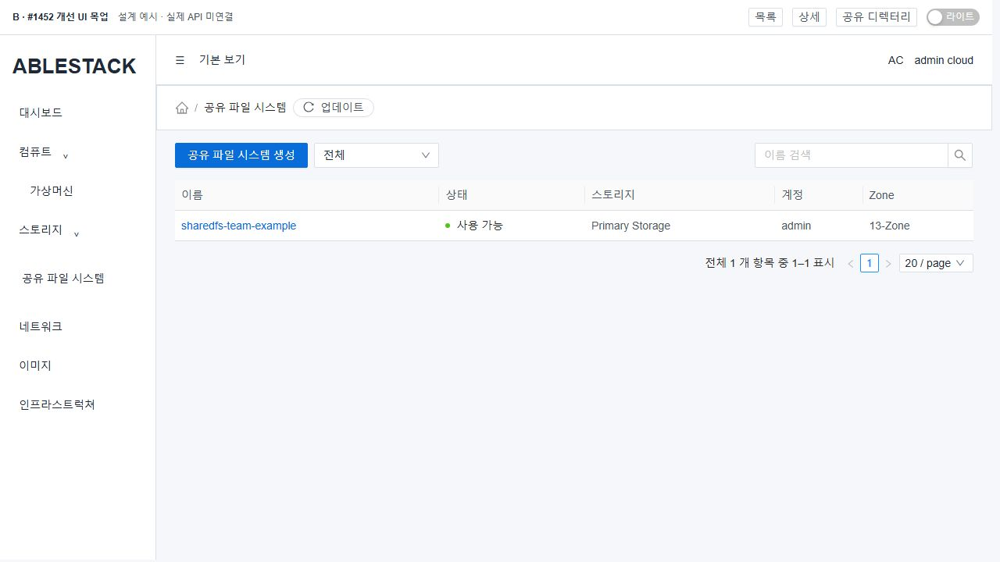
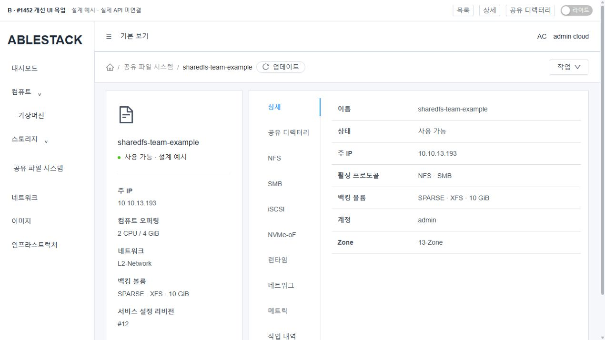
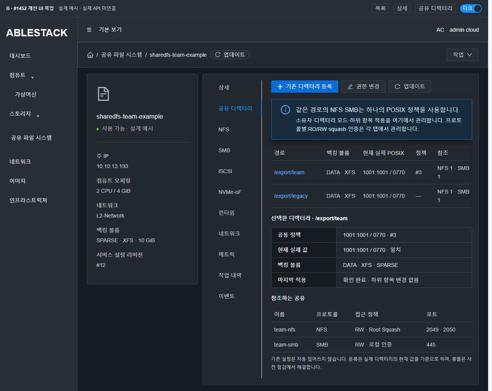
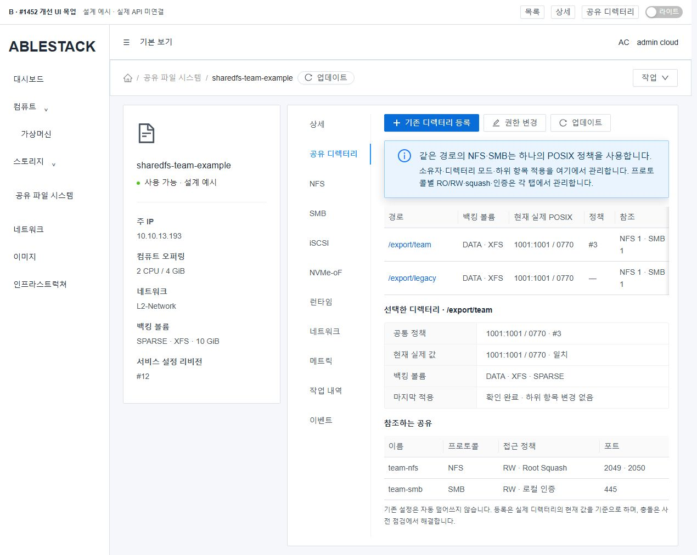
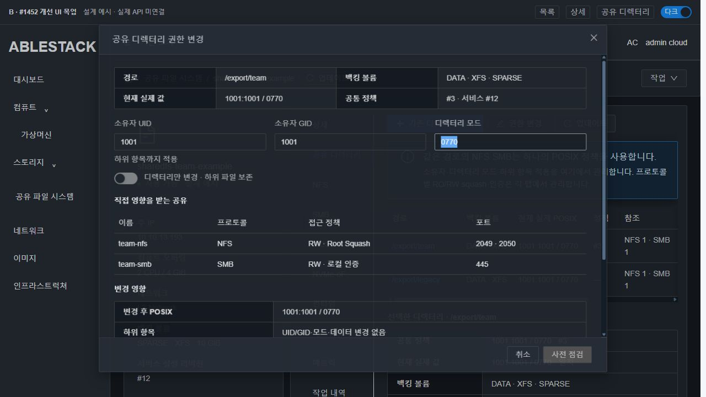
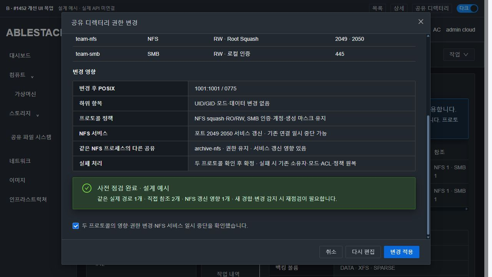
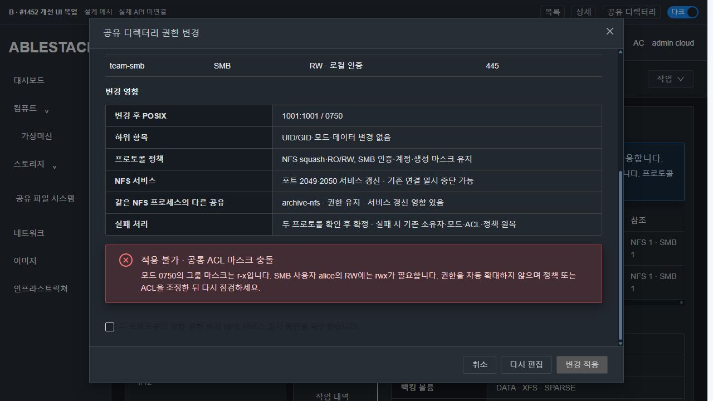
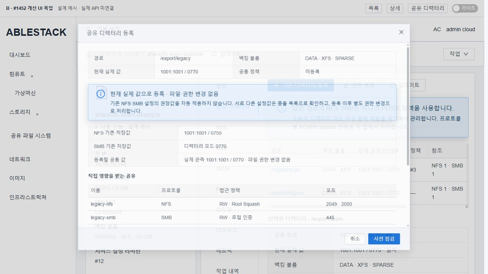
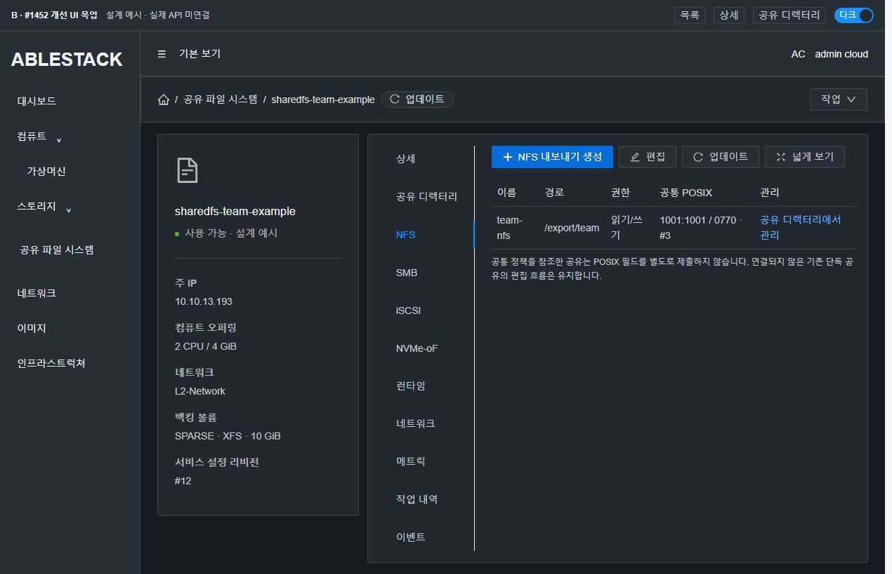
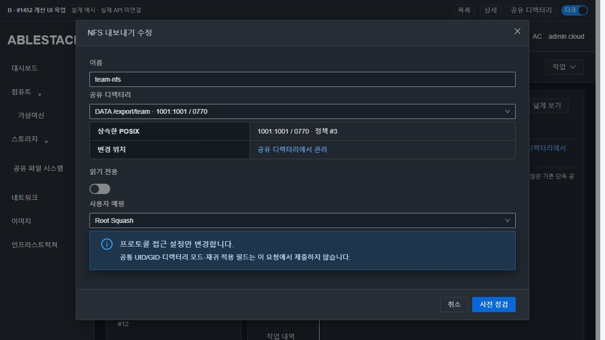

### S. 컴퓨트 > 가상머신 표준

실제 VM 상세·볼륨 탭·목록을 확인했다. 세로 탭, 좌측 정보/우측 컨텐츠, 상단 Breadcrumb, 목록/표 및 고정 dialog 규격을 참조한다. 다른 메뉴의 스타일을 변경하는 작업은 포함하지 않는다.

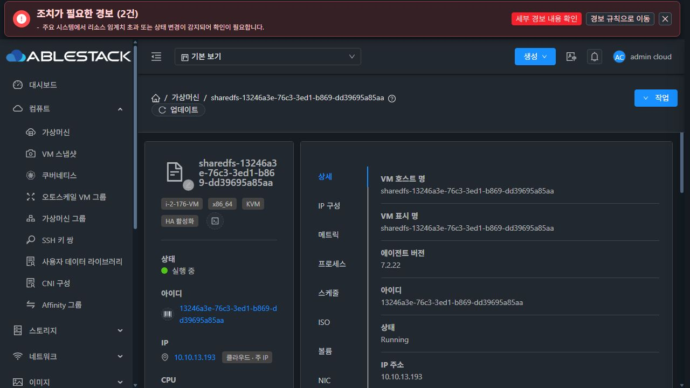
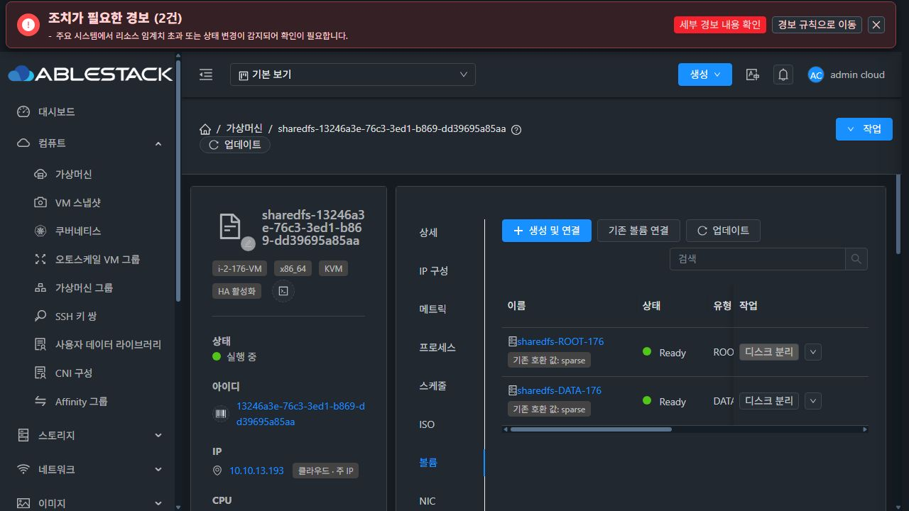
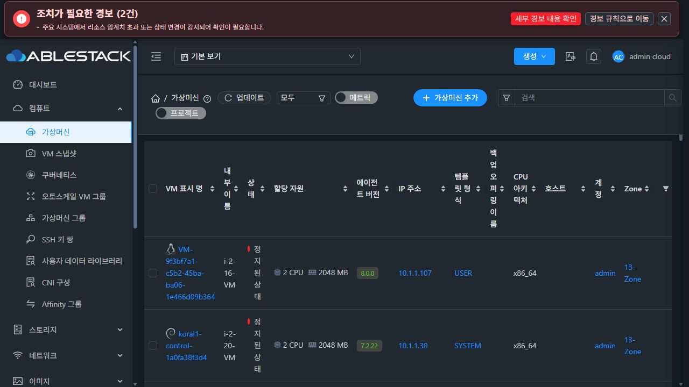
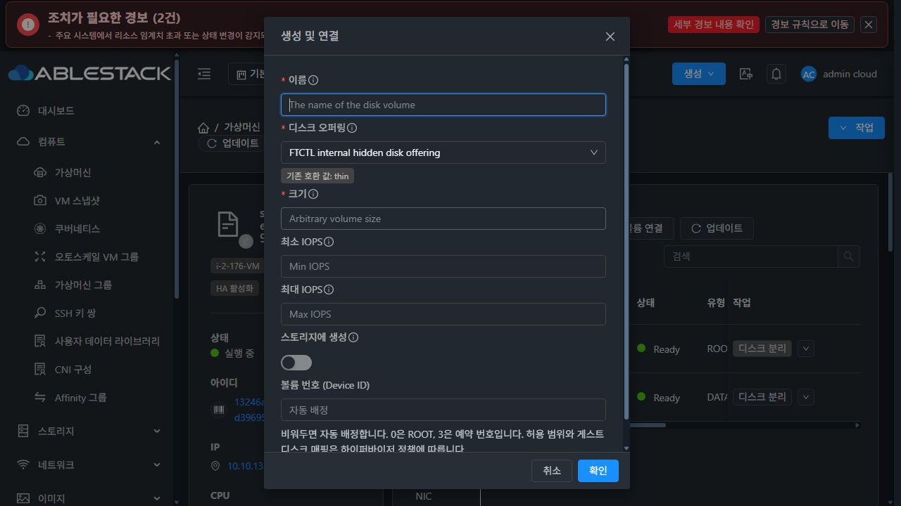

목업 DOM 실측: modal header y=33~88, footer y=622~687 고정. body y=88~622·overflow:auto, scrollHeight878, scrollTop0→344에서도 header/footer 위치 불변. 다크 대비 실측은 보조 글자 9.18:1, primary 흰 글자 5.00:1, 표 링크 6.61:1, 안내 제목 11.86:1이다. light/dark 및 미변경·충돌·ACK 보호 결과는 [UI 검토 근거](evidence/ui-review.json)에 기록한다.

### 목업 실행

```bash
cd docs/design/sharedfs-1452-shared-directory-posix-20261028/mockup
NODE_OPTIONS=--openssl-legacy-provider node build.cjs
python3 -m http.server 8802 --bind 127.0.0.1 --directory public
# http://localhost:8802/?view=directory&theme=dark
# view=list|details|directory|nfs|smb
# dialog=edit|adopt|reference, scenario=preview|conflict, theme=light|dark
```

generated public/app.js는 커밋하지 않는다. 목업을 위한 별도 PR을 만들지 않는다.

## 9. 이번 SystemVM 주입 시험의 결과와 한계

[시험 코드](evidence/native-design-probe.py) / [최종 결과](evidence/native-design-result.json)

| 실제 시험 | 결과 |
|---|---|
| 설치 SMB 함수 crossProtocol=true + ACL의 mode 변경 | 0750→0770 재현 |
| 기존 standalone SMB 경로 | 기존 reset/chmod 재현 |
| canonical 상위 별칭/경계 검사 | 같은 키로 합침, 볼륨 밖/leaf symlink 거부 |
| mode/ACL mask 충돌 및 -n 적용 | RW 확대 충돌 검출, mode 유지 |
| FD 기반 ACL/owner/mode before-image 원복 | access/default ACL·숫자 stat 일치 |
| 설치 Transaction: 2 refs/1 apply, commit/reopen/duplicate | 실제 applyCount=1, 중복 적용 없음 |
| stale revision / 별도 process writer 경합 | 거부 |
| peer 검증 실패 주입 | ROLLED_BACK, ACL/owner/mode·child data 원복 |
| 실제 Ganesha+Samba 교차 I/O | 변경 전후 NFS→SMB, SMB→NFS 읽기/쓰기 성공 |
| Ganesha 이전 속성 캐시 반례→unit refresh | 새 NFS mount도 이전 값; 프로세스 갱신 후 실제 값 일치 |
| nonrecursive 변경 후 seed | 내용 hash·UID/GID/mode 보존 |
| 시험 정리/기존 서비스 보존 | cleanup=true, productionUnchanged=true, 기존 61 files·설정·payload·운영 PID 동일 |

모델 adapter는 private filesystem을 변경하고 기존 guest Transaction을 사용했다. 새 operation allowlist는 **시험 프로세스 메모리에서만** 추가했다. 실제 Java DAO·서버 API/SMB 로컬 인증·여러 호스트·제품 부팅 경로·재귀 규모 제한은 아직 구현하지 않았으므로 통과라고 쓰지 않는다. 네트워크 namespace의 dummy 주소는 격리 Ganesha 주소 해석을 위한 시험 도구 설정이며 실제 VM NIC/MAC 변경이 아니다.

## 10. 구현 승인 후 검증 계획 — 이슈 범위 안

1. **단위/계약**: canonical key·alias/FS/inode 교체·다른 볼륨 구분, mode 정규화, named/default ACL mask·unmanaged 보존·충돌, dirty 비제출. 기존 NFS/SMB standalone 회귀. 각 새 API 실제 입력 검증·async 직렬화; 실제 coordinator→DAO 저장/재조회, JSON ref와 policy CAS·unique key·snapshot 제한.
2. **native 주입 선행**: 제품 adapter 후보를 같은 SystemVM의 전용 SPARSE 디렉터리에 적용해 실제 ACL·캐시 refresh·원복을 먼저 확인. recursive bounded 대상/alias·child mount·중간 실패·inode 교체/트리 경합 시험 포함. 실제 부팅 reapply가 권한·ACL을 다시 쓰지 않는지 호출 횟수로 확인.
3. **빌드/배포**: 변경 모듈과 UI lint/component regression, manifest 생성·서명·9개+새 파일 payload 일치. 13번에 전용 DDL 검증→변경 JAR/UI/runtime와 정합한 이미지 배포. 기존 기본 NFS 정상 기능 확인. THIN/MAC 임의 변경 금지.
4. **실제 Mold UI**: 새 시험 VM·SPARSE DATA·새 클라이언트 준비, 기존 디렉터리 현재 값 등록, NFS+SMB 같은 경로 선택, 공통 편집/미변경 요청·프로토콜별 RO/squash 유지, 두 refs와 collateral unit preview·ACK·revision 경합·오류 전달. API는 UI 요청/결과의 대조 근거로 사용하고 UI 준비를 숨은 API로 대체하지 않는다.
5. **실제 클라이언트**: Mold 콘솔에서 Linux NFS와 SMB 로컬 인증으로 같은 파일 교차 읽기/쓰기, 수치 UID/GID/mode·ACL·hash 확인. 공통 owner/mode 변경 후 양쪽 일치, 단독 공유 기존 동작, 허용/거부가 정책과 일치함을 확인. 특정 root가 의도적으로 거부되는 설정을 무조건 실패로 판정하지 않는다.
6. **동시/실패/재시작**: 같은/다른 alias 동시 요청·중복 replay, stale fingerprint, SMB peer failure·NFS refresh failure·rollback failure 진단, SystemVM/관리 서버 재시작·QGA 단절 후 같은 operation 추적. 데이터·child 권한·계정·다른 export 설정 보존. 새 결과 불명확 상태에서 새 권한 요청을 반복하지 않는다.
7. 모두 통과 후 구현 commit·빌드 SHA·배포 버전·실제 UI/API/클라이언트 근거를 #1452와 기존 Epic PR에 기록하고 이슈 종료. 제품 오류는 원인/증거를 분석해 중단 보고한다. 시험 도구 오류는 스스로 교정한다.

**이번 단계의 종료 조건은 설계 기록이다. 인수 체크 항목은 미체크로 유지하고 구현 지시를 기다린다.**
