# #1453 코드 수준 설계 — SMB 부모 UID/GID 상속

**설계·실제 SystemVM 주입 실증 완료, 제품 구현 미착수.** 이 문서는 #1453만 다룬다. 새 mask/force identity/중첩 export/하위 디렉터리 정책 편집기나 전면 UI 정리를 구현하지 않는다. 인수 체크 항목과 이슈는 열림을 유지한다.

## 1. 확인한 기준과 배포 무결성

- 로컬 Europa를 먼저 fetch/확인했다. local base와 upstream은 `37bceae693041b9c79cc52084053b050b577029d`, 차이 `0 0`. Epic 작업 브랜치는 `epic/1438-sharedfs`, 착수 head는 `f9e8e913f26573dbabb28efc52b01e22ce958db5`.
- 실제 관리 JAR SHA256 `39cd997647853bab1f686d6745eafa680f6e5a03e5acf56df80c11bd942be46c`, UI index SHA256 `277495a21b6ccdd6c7d284d9d04295e8d437b6e6a720241baf71a1826ad1b128`. mold.service active.
- 실제 SharedFS `1f9d218d-4fc1-4c7c-a96d-527cb0801436`, SystemVM `8c3a6de9-41cc-3cae-a61d-4f7d3d876526`/i-2-180-VM/13.241. DATA `b02bd1d2-ed62-44e8-8a95-8798b604f43e`는 **XFS10GiB/SPARSE**, ROOT도 SPARSE임을 실제 VM 볼륨 탭에서 재확인했다. 생성·포맷·MAC 변경은 하지 않았다.
- 설치 Samba는 **4.17.12-Debian**. 실제 `testparm` 결과 inherit owner=no, inherit permissions=No. 렌더러는 create mask0660/directory mask0770을 고정 출력한다.
- 설치 서명 profile의 관리 파일10개 해시가 실제 파일과 전부 일치했다. 런타임은 `epic1438-1452-posix-79e9433fc955-r1`, manifest SHA256 `c6c98ef0f9a6a9fee0b2ef23389074833cd27e8ab4bdc27205824397431fdd34`.
- 시험 전후 운영 코드·서명/profile·desired-state·SMB/Ganesha 설정·계정 파일·운영 PID/NIC와 기존6파일을 비교해 보존을 확인했다. 이번 변경은 이 문서·목업·설계 시험 근거뿐이다.

[소스 동기화](evidence/source-sync.json) · [실제 배포 관측](evidence/deployed-systemvm.json) · [전후 보존 확인](evidence/preservation-check.json)

## 2. 현재 코드에서 재사용할 것

| 실제 경로/함수 | 확인한 동작과 설계 판단 |
|---|---|
| `ablestack-storagectl:apply_smb_shares()` | config를 읽고 Samba share를 렌더한다. inherit owner는 출력하지 않는다. 기존 masks는 유지한다. |
| 같은 함수의 `apply_directory_policy()` | 기존 standalone 경로는 chmod/ACL 초기화가 가능하다. **상속 기능을 켜는 기존 경로는 #1452의 현재값 등록/공통 정책을 참조**해 이 writer를 생략한다. 자동 등록/마이그레이션은 하지 않는다. |
| `StorageServiceManagerImpl.create/updateStorageSmbShareCandidate()` | 기존 runConfiguration·shadow DAO·journal/recovery 경로를 재사용한다. 새 작업 유형이나 별도 writer를 만들지 않는다. |
| `StorageDirectoryPolicies.candidate()` | mode는 4자리 octal로 정규화한다. 저장 CHAR(4)에2770도 들어간다. |
| `shared_directory_policy.py:prepare/apply/verify/restore` | 실제 owner·inode·UUID·관측/정책 revision·ACL·unit topology를 검사한다. mode-only 변경은 fchown을 생략하고 fchmod한다. before-image/원복에 특수 비트도 보존한다. **setgid 엔진을 다시 만들 필요가 없다.** |
| `SmbListenerProfiles.configuration()` | endpoint config가 기존 /etc/samba/smb.conf를 include한다. 새 상속 directive도 이 기존 경로를 따른다. 소켓·PID/config 소유권 검증을 유지한다. |
| `configuration_preflight.py`·server preflight | 기존 자원/writer/영향·ACK·30초 fingerprint 재검사를 유지하고 상속 의도/부모 관측만 추가한다. |
| runtime_updater.py | 현재 updater4는 common helper **존재**로 directory-policy downgrade를 보호한다. 새 inherit owner 기능의 호환성을 존재 검사만으로 판정하면 부족하다. 아래 작은 호환성 guard를 함께 설계한다. |

기존 SGID mode 지원은 제품 API/DAO 신규 기능 구현의 성공 판정이 아니다. 설치된 **guest 엔진**의 재사용 가능성을 실제 주입 시험으로 확인한 결과다.

## 3. 두 정책의 소유권을 분리한다

### SMB 공유별 inherit owner

새 optional Boolean API 입력 **`inheritowner`**, 저장은 기존 `storage_file_share.config_json.inheritOwner`다. null/미제출은 기존 값 유지, 신규 미제출은 현재 동작(no)을 유지한다. 명시 true/false만 설정을 바꾼다.

true는 해당 share에 **`inherit owner = yes`**, false는 no를 출력한다. 이전 config에 필드가 없으면 directive를 생략해 현재 기본 동작을 보존한다. 이 옵션은 새 객체의 UID/Windows owner에 영향을 주고, 로그인 사용자·AD 가입/매핑·valid users/write list·기존 파일 owner를 바꾸지 않는다.

Samba의 yes는 UNIX와 Windows owner를 함께 상속한다. `unix only`는 Windows/UNIX owner를 분리하고 별도 NT ACL 저장 모델 검토가 필요하므로 이번 공개 옵션에 넣지 않는다. `inherit permissions=yes`는 기존 mask 동작을 바꾸므로 추가하지 않는다. 실제 시험에서도 필요하지 않았다. [Samba4.17 공식 계약](https://www.samba.org/samba/docs/4.17/man-html/smb.conf.5.html#INHERITOWNER), [inherit permissions](https://www.samba.org/samba/docs/4.17/man-html/smb.conf.5.html#INHERITPERMISSIONS).

### 실제 부모의 setgid

setgid는 SMB 전용 설정값이 아니라 **실제 디렉터리 inode의 mode 비트**다. 같은 경로의 NFS/SMB별로 서로 다른 true/false를 저장하지 않는다. #1452 공통 정책의 mode를 그대로 사용한다.

- 새 API/DB 컬럼/명령을 만들지 않는다.
- UI 전용 “부모 GID 상속 설정” 폼은 UID/GID/inode와 기본 권한을 **읽기 전용**으로 보여준다.
- 제출하는 변경은 `mode = (현재 관측 mode & ~02000) | (켜짐 ? 02000 : 0)` 하나다. expectedpolicyrevision/requestid/expectedrevision/ACK를 기존 API에 전달한다.
- UID/GID, 다른 특수 비트와 rwx, 기본/명명 ACL을 자동 변경하지 않는다. recursivepermission은 제출하지 않는다.
- 새 디렉터리는 부모 setgid를 이어받지만 **이미 있는 하위 디렉터리에는 재귀 chmod하지 않는다**. 해제도 기존 자식의 비트를 지우지 않는다.
- 현재 공통 정책이 DRIFT이거나 신원 관측이 불가능하면 이 간단한 setgid 폼은 차단하고 기존 명시적 권한 보정 흐름으로 안내한다.

inherit owner는 공유별 선택이고, setgid는 같은 실제 부모를 참조한 모든 공유에 공통이다. 둘을 하나의 가짜 작업으로 묶지 않는다. 각 변경은 기존 원자적 트랜잭션/원복을 사용하며, UI에 현재 적용된 두 값과 영향을 각각 보여준다.

## 4. 기존 경로와 새 공유의 안전한 UI 순서

1. 현재 부모 owner/GID/mode·UUID/inode를 읽는다. 미등록 경로는 공유 디렉터리 탭에서 **현재 값만 등록**한 뒤 참조한다. 등록 자체는 chmod/chown하지 않는다.
2. 필요한 경우 공통 setgid 비트만 변경하고 NFS 영향(해당2049/2050·같은 unit의 다른 참조)을 확인한다.
3. SMB 공유의 inherit owner를 변경한다. 이 요청은 독립 owneruid/ownergid/directorymode/recursivepermission을 보내지 않는다.
4. 새 객체가 만들어질 때의 인증 주체와 예상 숫자 UID/GID를 구분해 표시한다. 실제 mode는 기존 mask·부모 ACL·클라이언트 요청을 따른다.
5. 기존 standalone의 아무 정책도 바꾸지 않은 생성/편집은 그대로 유지한다. 새 경로/새 볼륨으로 곧바로 상속을 켜기 위해 초기 생성 흐름을 다시 만들지 않는다. 먼저 기존 기본 생성→현재 값 등록→상속 설정 순서로 안내한다. **기존 공통 정책을 선택한 새 share는 생성 요청에 inheritowner를 함께 지정할 수 있다.**

NFS UID/squash는 inherit owner로 변경하지 않는다. NFS의 쓰기/조회는 원래의 POSIX 숫자 UID/GID·ACL 권한으로 허용돼야 한다. AD 로그인 이름, Windows SID와 파일 UID는 동일한 개념으로 표시하지 않는다.

## 5. 정확한 변경 경로와 요청 계약

다음은 구현 승인 후 수정할 경로이며 이번에는 제품 소스를 수정하지 않았다.

| 경로 | 최소 변경 |
|---|---|
| api/.../CreateStorageSmbShareCmd.java, UpdateStorageSmbShareCmd.java | optional Boolean inheritowner/getInheritOwner. 기존 BaseStorageServiceConfigurationCmd와 setJobId 사용 유지. |
| server/.../StorageSmbParentInheritance.java (신규 예정) | effective bool/intent 정규화·충돌 검증의 작은 공통 helper. public preflight와 실제 Candidate가 같은 함수를 사용한다. |
| server/.../StorageServiceManagerImpl.java | buildSmbConfigJson의 null-preserve bool 병합, 두 Candidate에서 기존 directoryPolicies.guardShare 이후 상속 조건 검증. 옛 builder overload/기존 호출 계약 유지. prepareFileShareBackingVolume의 기존 보호를 바꾸지 않는다. |
| server/.../StorageServiceConfigurationPreflight.java | SMB share create/update에만 bounded `smbinheritance` intent 허용·정규화. UI/실제 command의 **effective bool + 정책 UUID**를 같은 코드로 계산한다. internal Long/UUID를 DAO로 같은 UUID로 정규화한다. |
| api/.../StorageServiceConfigurationPreflightResponse.java | optional `inheritancepreview` 전달. 기존 directorypreview와 의미를 섞지 않는다. 실제 API serializer→UI fixture 회귀를 추가한다. |
| server/.../StorageDirectoryPolicies.java | setgid를 새로 켜는 mode 변경에서 같은 canonical 경로의 고정 identity 충돌만 검사한다. 기존 mode 저장/신원/원복 엔진은 재사용한다. |
| systemvm/.../shared_directory_policy.py | 작은 상속/고정 identity 검증 함수와 capability 상수. mode/FD/snapshot/restore의 기존 구현을 재작성하지 않는다. |
| systemvm/.../ablestack-storagectl | 기존 SMB 렌더 블록에 yes/no directive만 추가. 파일/계정 변경 전에 조건 검사. inventory에 부모 actual 관측과 endpoint별 유효 설정을 추가한다. |
| systemvm/.../configuration_preflight.py | 정규화된 상속 의도·부모 fingerprint를 digest에 포함하고 preview를 반환한다. 기존4096-byte bound/자원/writer/ACK 보호 유지. |
| systemvm/.../configuration_transaction.py | 기존 SMB 적용/검증 및 capability show에 연결. 소유권이 확인된 실제 endpoint config의 testparm 값, 부모 inode/owner 보존을 검증한다. 새 객체 생성 시험을 운영 적용 과정에 몰래 실행하지 않는다. |
| systemvm/.../runtime_updater.py, runtime-baseline-profile.json | 아래 feature compatibility guard와 actual payload hash 갱신·기존 신뢰키 재서명. network/format/AD join은 변경하지 않는다. |
| ui/src/views/storage/SharedFSTab.vue | 기존 SMB 폼에 작은 상속 필드 부분만 추가. 부모 관측 loading/stale/error는 새 상속 컨트롤만 보호하며 다른 탭을 무한 로딩시키지 않는다. |
| ui/src/components/storage/StorageDirectoryPolicyPanel.vue | 기존 executeDirectoryPolicy/외부 보호 상태를 쓰는 setgid 전용 모드 폼 연결. 별도 REST writer를 만들지 않는다. |
| ui/src/components/storage/SmbParentInheritanceFields.vue, StorageDirectorySetgidDialog.vue (신규 예정) | 변경 범위가 작은 폼 부분 분리. MoldDialog/Actions, instance 단위 보호·expiry·generation 재사용. |
| ui/src/utils/smbParentInheritance.js (신규 예정), storageConfigPreflight.js, 관련 locale | dirty 비제출·special-bit 보존 계산과 UI/command intent 일치. 번역/부모 설명만 추가. |

DB schema 변경은 **없다**. config_json의 optional bool과 기존 directory policy CHAR(4) mode만 사용한다. 작업 유형/테이블/새 파일 마스크 파라미터도 추가하지 않는다. create/directory mask·force mode는 #1454, force user/group 설정 UI/API는 #1456의 범위다.

요청 예시:

```json
{
  "command": "updateStorageSmbShare",
  "id": "<SMB share UUID>",
  "inheritowner": true,
  "directorypolicyid": "<existing common policy UUID>",
  "requestid": "<UUID>",
  "expectedrevision": 20,
  "impactack": "<preflight fingerprint>"
}
```

미변경 폼은 inheritowner도 제출하지 않는다. 명시적으로 끌 때 false를 보낸다. 부모 mode/UID/GID를 SMB 요청에 함께 넣지 않는다.

setgid는 기존 계약을 그대로 사용한다.

```json
{
  "command": "updateStorageDirectoryPolicy",
  "id": "<policy UUID>",
  "expectedpolicyrevision": 4,
  "mode": "2770",
  "requestid": "<UUID>",
  "expectedrevision": 20,
  "impactack": "<preflight fingerprint>"
}
```

새 public intent는 `smbinheritance: {inheritOwner: true, directoryPolicyId: "<UUID>"}`만 추가한다. 입력 bool 타입·UUID·크기·권한 범위를 검사한다. 실행 직전 동일 intent/부모 신원/정책 revision으로 다시 점검하며 변경된 폼·만료된 ACK는 재사용하지 않는다.

## 6. 충돌·실패·런타임 호환성

- 부모 상속(UID 상속 또는 setgid)을 새로 켜려는 경로에 forceUser/forceGroup이 있으면 **SMB_PARENT_IDENTITY_CONFLICT**. 이 값을 설정하는 기능을 만들지는 않는다. 저장 config와 testparm 유효 설정을 대조하고 out-of-band 변경은 DRIFT로 안내한다.
- 실제 Samba는 inherit owner + force user 설정을 문법 오류로 거부하지 않았다. 따라서 testparm 성공만으로 충돌 검증을 대신하지 않는다.
- 사전 점검은 “새 객체의 identity 변화”와 “기존 파일 변경 없음”을 분리한다. SMB 설정 갱신은 기존 full apply가 다루는 SMB endpoint/참조 전체를, setgid는 기존 common policy의 NFS unit/참조를 보여준다.
- 반영 뒤 실제 testparm/소유 PID/config/parent fingerprint 검증이 실패하면 기존 before-image와 journal로 원복한다. setgid는 root1개만 변경·원복하고 자식의 owner/data는 건드리지 않는다.
- 기존 runtime updater4는 10파일 helper의 기능 버전까지 판정하지 않는다. 새 helper에 `SMB_PARENT_INHERITANCE_VERSION=1` 상수를 두고, updater5가 **이미 서명·hash 검증된 target helper의 AST 상수**를 읽어 active inheritOwner를 지원하지 않는 downgrade/rollback을 막도록 설계한다. 임의 candidate 코드를 실행해 판정하지 않는다.
- 신규 inheritOwner 활성화는 guest capability와 updater의 호환성 보호까지 확인한 뒤 허용한다. updater 자체는 기존 signed runtime bundle의 관리 파일에 포함되지 않는다. 따라서 **현재 updater4 VM에 새 bundle만 넣고 보호까지 완료했다고 주장하면 안 된다**. 구현 단계에서는 updater5가 포함된 검증된 baseline/새 SYSTEM 이미지로 인수한다. 기존 VM에서의 비지원 상태는 새 상속 요청만 차단하고 현재 공유는 유지한다. 기능 capability 부족과 baseline 보호 부족의 메시지를 구분하고, 후자는 “일반 번들 업데이트만으로 해결되지 않음”을 UI에 명시해 반복 갱신을 유도하지 않는다. SystemVM 자동 교체/마이그레이션 #1467을 이 과제로 끌어오지 않는다.
- parent setgid만 쓰는 기존 common mode 엔진은 현재 설치본에서도 동작함을 실증했다. inheritOwner가 없는 기존 bundle/standalone 동작과 현재9/10-file 호환 보호는 유지한다.

이 호환성 guard·제품 API 입력 검증·직렬화와 실제 UI 트랜잭션은 **구현 후 검증 대상**이다. 아래 설계 주입 시험을 그 성공으로 대체하지 않는다.

## 7. 실제 SystemVM 주입 시험

[자체 포함 시험 코드](evidence/native-inheritance-probe.py) · [최종 결과](evidence/native-design-result.json)

시험은 SystemVM에서 root로 `unshare --mount --propagation private python3 native-inheritance-probe.py`를 명시적으로 실행한다. 전용 SPARSE 볼륨 UUID와 실제 운영 참조를 코드에서 확인하고 실행해야 하며, private mount namespace/propagation 검사를 통과하지 못하면 자원 생성 전에 거부한다.

운영 VM 안에서 기존 SPARSE DATA의 전용 nonce 하위 디렉터리, private mount/network namespace, private Samba TDB/설정/데몬과 두 Ganesha listener를 사용했다. 설치 SMB 렌더러의 실제 AST 블록을 추출해 private conf를 만들고 **inherit owner 한 줄만** 후보로 주입했다. 신규 비밀은 메모리에서 생성해 stdin/환경으로만 전달했다. 시스템 계정을 추가하거나 실제 signed 파일/서비스 설정을 덮어쓰지 않았다. namespace 안의 시험 장치는 실제 VM NIC/MAC을 바꾸지 않는다.

### 네 조합 — 부모 UID0/GID65534, 생성자 UID1001/primary GID1001

| inherit owner | setgid | 새 파일 UID:GID / mode | 새 디렉터리 UID:GID / mode |
|---|---|---|---|
| no | off | 1001:1001 /0660 | 1001:1001 /0770 |
| no | on | 1001:65534 /0660 | 1001:65534 /2770 |
| yes | off | 0:1001 /0660 | 0:1001 /0770 |
| yes | on | 0:65534 /0660 | 0:65534 /2770 |

부모 UID1/GID1에서도 같은 네 조합을 확인했다. 총8조합에서 파일·child·nested 파일·grandchild·deep 파일 **40개 객체**를 실제 Samba로 만들고 숫자 stat/mode를 확인했다. 고정 mask0660/0770을 유지했고 inherit permissions는 추가하지 않았다.

| 검사 그룹 | 결과 |
|---|---|
| 실제 Samba 8조합/서로 다른 부모 | UID/GID와 새 하위 디렉터리 setgid 일치, 각 기존 seed 보존 |
| READ_ONLY / 인증 성공 가능하지만 share 미인가인 daemon | ACCESS_DENIED, 파일 생성 없음 |
| 바로 위 부모를 별도 UID1/GID1로 바꾼 시험 하위 경로 | 그 아래 새 객체1:1, 다른 부모와 기존 하위 파일 보존 |
| force user/group 충돌 | Samba parser는 허용함을 확인, prototype guard는 적용 전 거부·parent 불변 |
| private Samba reload/restart | 새 파일이 부모 UID0을 계속 상속 |
| NFS 두 포트 교차 I/O | SMB 파일을 NFS로 읽고 NFS 파일을 SMB로 읽음. NFS 생성 UID1001 유지/GID65534 상속 |
| 설치 common transaction | mode0770→2770→0770, root owner/GID/device/inode 보존, 자식 불변, 같은 journal 중복 무적용, peer 실패 ROLLED_BACK/SUCCEEDED |

NFS 클라이언트는 실제 권한이 있는 UID1001/primary GID1001/**supplementary GID65534**로 읽기·쓰기·stat했다. 초기 fixture의 부모 GID 권한/RootSquash 조회 주체를 구분하지 않은 명령은 교정했다. 서버 권한·squash·ACL을 완화해서 통과시키지 않았다. named ACL만으로 모든 NFS 접근이 허용된다는 결과를 주장하지 않는다.

최종 결과 **7개 검사 그룹 통과**, productionUnchanged=true, temporaryResourcesRemoved=true. 실제 운영6파일 hash/UID/GID/mode, installed10파일·manifest/profile·계정·desired/SMB/Ganesha 설정과 운영 PID/NIC 보존을 확인했다.

### 현재 시험의 한계

현재 대상은 **로컬 인증**, AD 미가입이다. private Samba 재시작은 실제 SystemVM UI 재부팅/제품 bootstrap 인수의 대체 결과가 아니다. 실제 AD 로그인·NSS/winbind 매핑, 새 API/실제 DAO/직렬화, 제품 UI의 적용/오류/호환성 차단과 모듈 빌드·배포·새 VM 부팅은 구현 승인 후 해야 한다. AD 준비가 없으면 AD 성공으로 체크하지 않는다.

## 8. UI — A 현재 / B 개선 목업 / S VM 표준

A는 실제 배포 UI에서 폼을 열고 **취소한** 이미지다. 선택 항목이 없다는 현 상태를 보여주며 현재 기능을 버그로 단정하지 않는다.

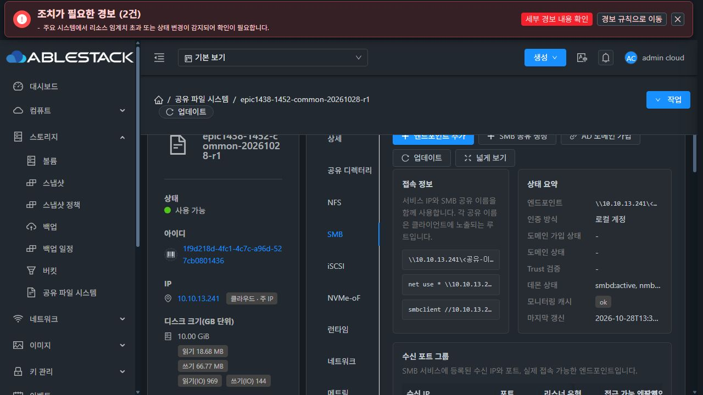
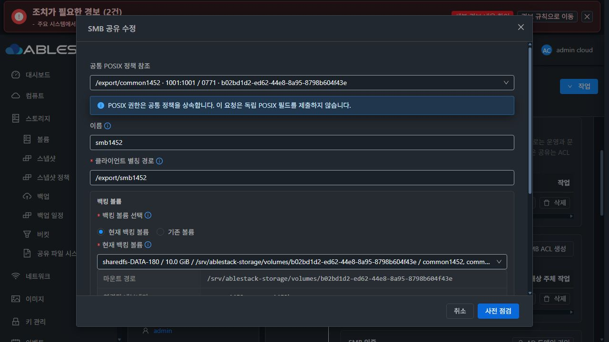


B의 UID1001/GID2000/생성자1101과 inode 값은 화면 설명용 예시이며 위 실제 시험 수치와 구분한다.

B는 **Vue3+AntD와 실제 Mold Breadcrumb/ResourceLayout/MoldDialog/MoldDialogActions**를 사용한 API 미연결 목업이다. 기존 폼의 이름/경로/볼륨/용량/권한 항목 순서를 유지하고 새 객체의 소유권 부분만 추가한다.

- Breadcrumb/목록/상세/세로 탭/탭 컨텐츠/대화상자는 “컴퓨트 > 가상머신”을 기준으로 한다.
- 상세 탭은 정보만 표시한다. 탭 제목을 컨텐츠에 반복하지 않는다.
- 주요 버튼은 좌측 묶음, 파란 primary가 첫 번째다. Reload+업데이트로 통일하고 NFS/SMB 넓게 보기는 **같은 좌측 버튼 묶음의 마지막**에 둔다.
- modal 제목 header와 취소/확인 footer는 고정, 본문만 스크롤한다. 버튼8px·MoldDialog 표준 폼 항목6px·섹션16px 간격을 사용한다.
- setgid 전용 폼의 UID/GID는 read-only다. high numeric AD UID를 UI 입력 범위로 clamp해 함께 제출하는 일을 피한다.
- 변경 없음/미지원 runtime/고정 identity 충돌/미확인 부모는 적용 불가다. 실제/권장/새 객체 예상값을 혼동하지 않게 표시한다.
- 라이트·다크 모두 실측하고 상태는 색+문구로 표시한다. header y33/footery622는 본문 scroll0→705에서도 유지됐고 body overflow:auto였다. 다크의 활성 primary 대비5.19:1·보조 설명9.18:1을 확인했다. [UI DOM 검토](evidence/ui-review.json).

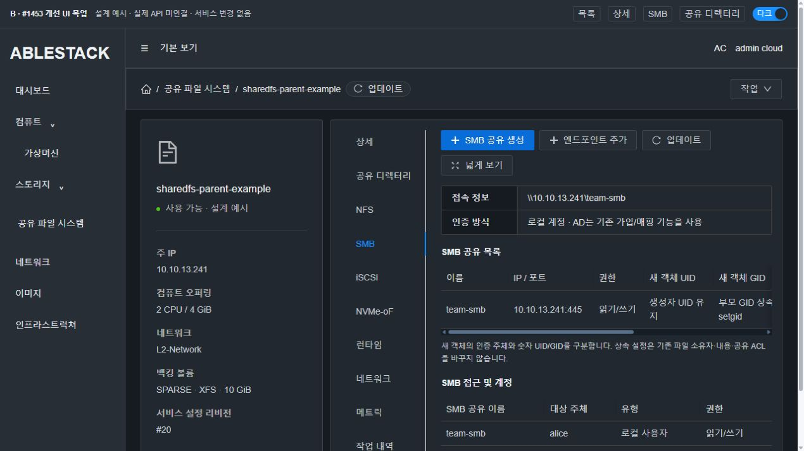
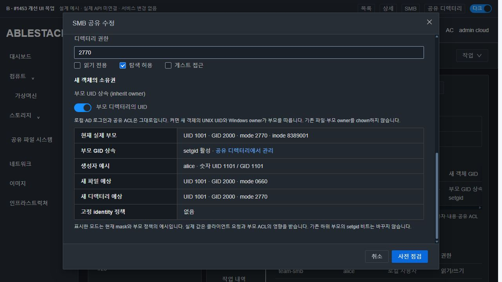
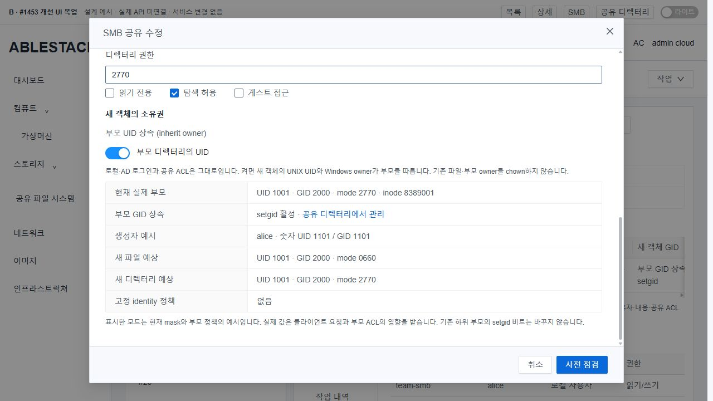
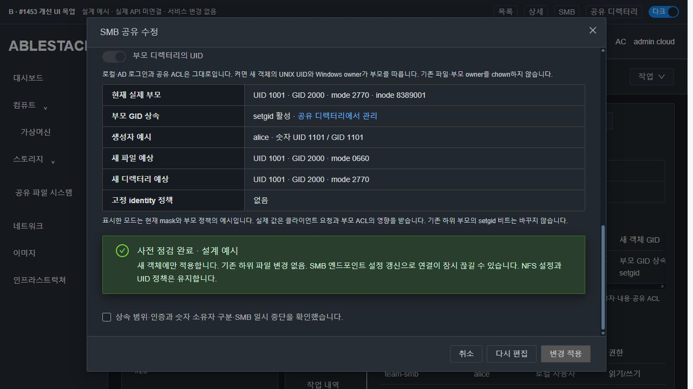
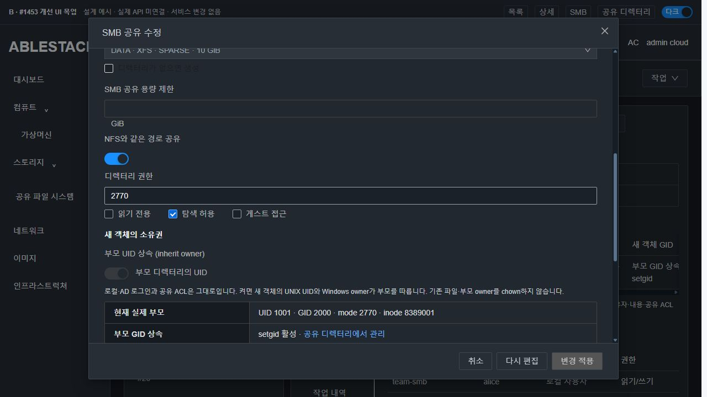
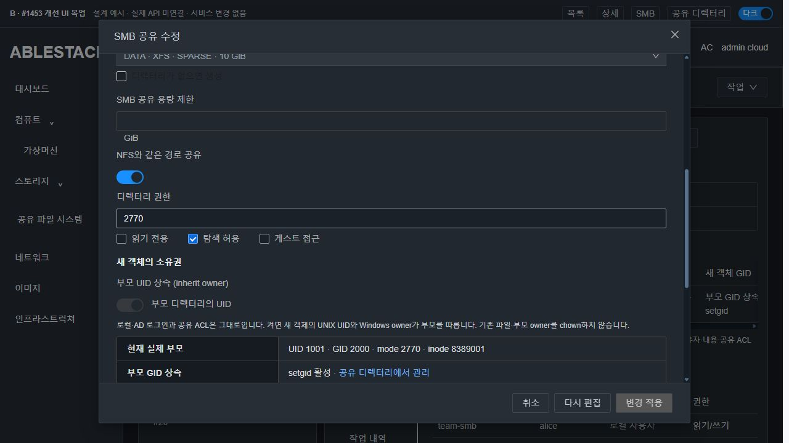
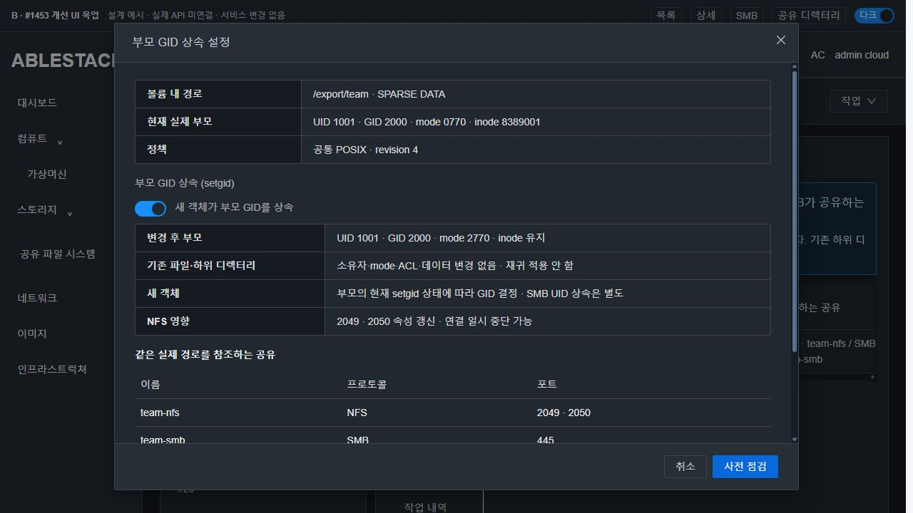
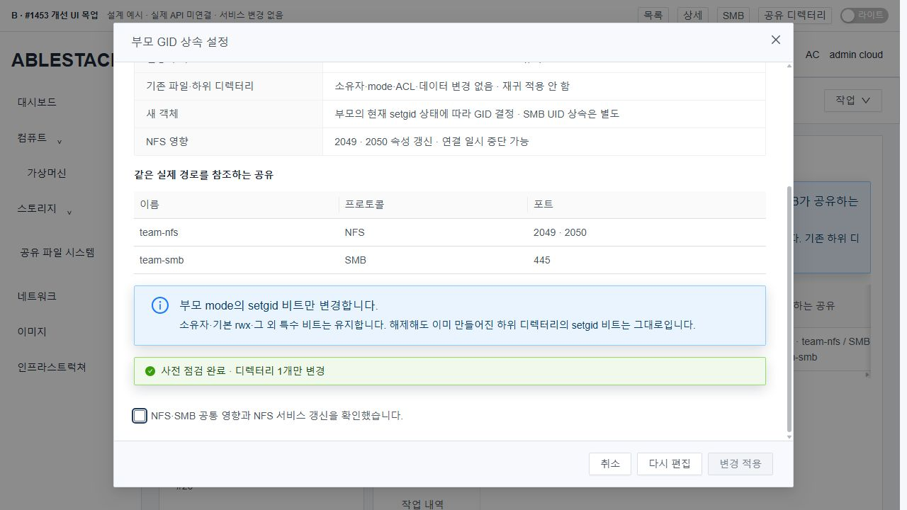
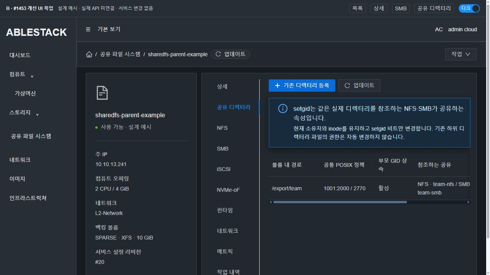
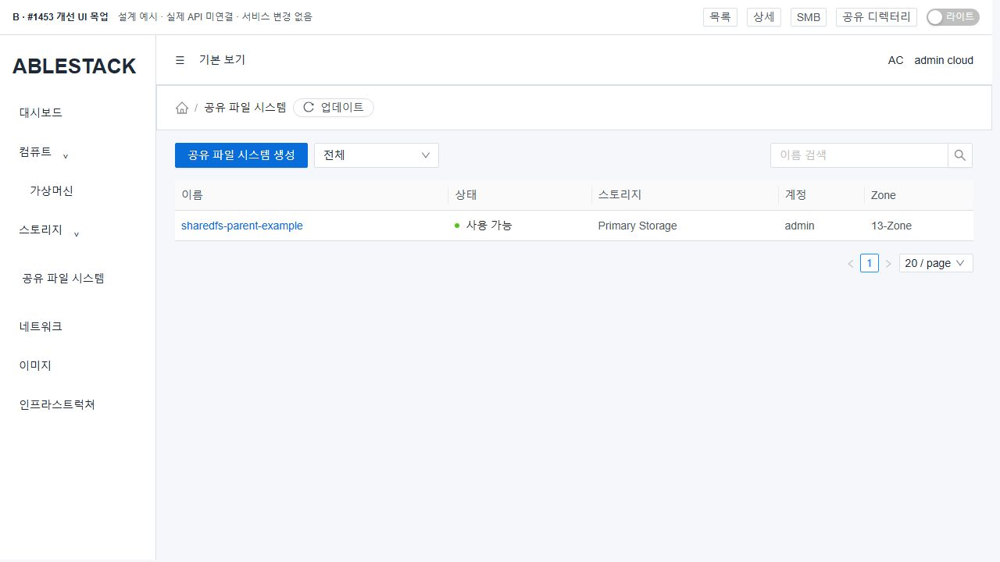
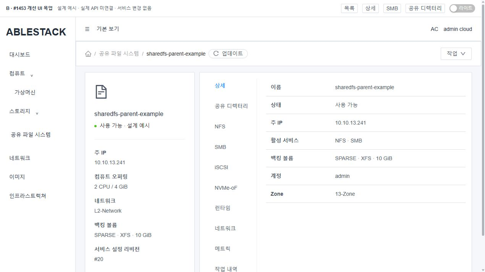

S는 현재 배포된 실제 가상머신 메뉴의 기준 화면이다.


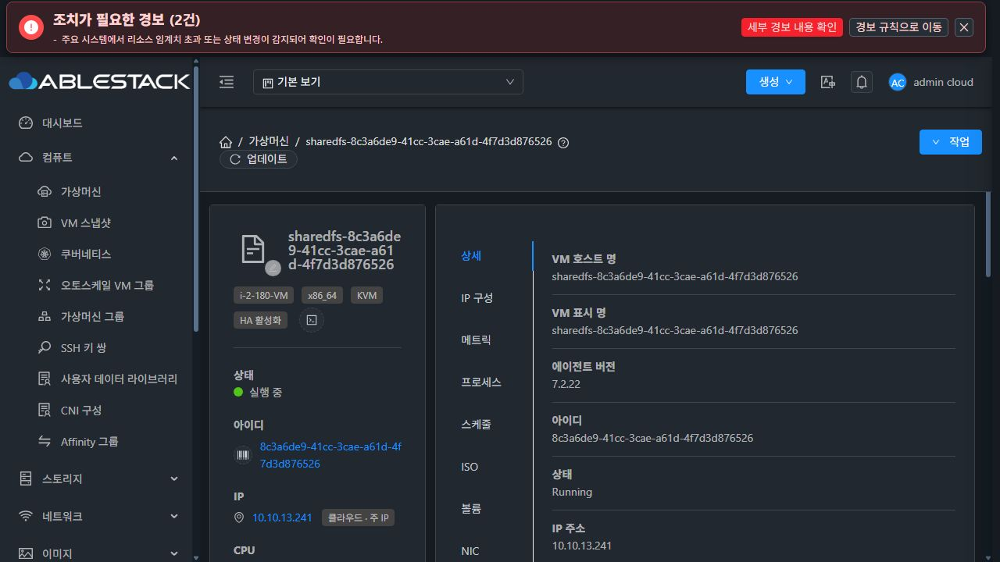
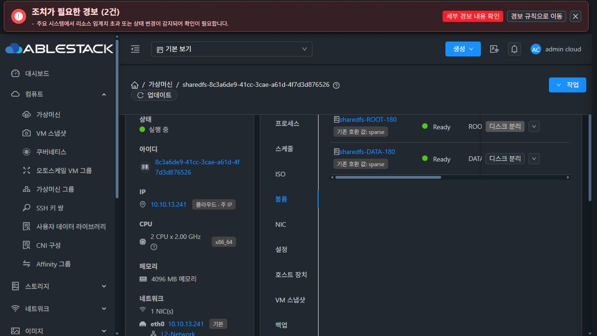
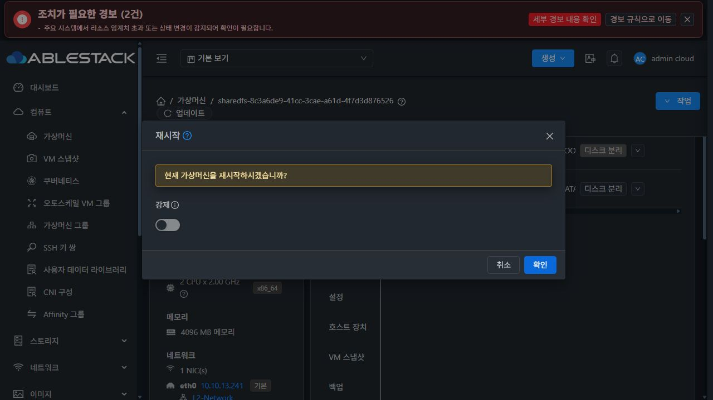

목업 실행:

```bash
cd docs/design/sharedfs-1453-parent-inheritance-20261028/mockup
NODE_OPTIONS=--openssl-legacy-provider node build.cjs
python3 -m http.server 8803 --bind 127.0.0.1 --directory public
# ?view=list|details|directory|smb|nfs&theme=light|dark
# &dialog=smb|setgid&changed=1
# &scenario=preview|conflict|unsupported
# setgid 켜기 예시: &parent=plain
```

generated public/app.js는 커밋하지 않으며 별도 목업 PR을 만들지 않는다.

## 9. 구현 승인 후 회귀·인수 계획

1. **서버 계약/실제 DAO**: null/false/true, 불량 bool·의도 크기·UUID 범위, 신규/편집·legacy/default, policy 미등록/다른 instance/path, force identity·capability 차단. 실제 coordinator→DAO 저장/재조회/실패 원복·32자 작업 유형·중복 요청과 revision을 확인한다.
2. **실제 API→UI 회귀**: 제품 API serializer가 만든 inheritancepreview/config fixture를 실제 폼에 넣는다. UI preflight/최종 POST의 intent·UUID/내부ID 정규화·null 비제출·명시 false가 일치해야 한다. setgid 전용 폼은 high UID/GID 부모에서도 mode만 보내고 owner/GID/recursive는 보내지 않는다.
3. **실제 SystemVM 사전 주입**: 이 설계 probe를 실제 후보 helper/renderer에 대해 재실행한다. 기존8조합·40객체, 두 부모, 부모1 inode/child 보존, NFS 두 포트, RO/미인가, peer 실패·중복을 확인한 뒤 모듈/서명 이미지를 빌드한다.
4. **패키징/호환성**: actual10파일·manifest/signature·baseline profile 일치, updater5 guard의 legacy/active feature/old target 거부·원복 보호, 최초/반복 bootstrap을 검증한다. 기존 신뢰키와 archive/path/신원 검증을 완화하지 않는다.
5. **13번 실제 UI**: 새 VM/ROOT/DATA/클라이언트는 SPARSE 이상·MAC 자동 정책을 사용한다. 기존 기본 생성, 현재 값 등록, 각 상속 설정/해제, 영향 ACK, 오류 전달·재진입·동시 변경 보호를 UI로 실행한다. API는 UI 요청/결과의 대조 근거다.
6. **실제 로컬/지원 AD 사용자**: 새 파일/dir/nested 생성의 숫자 UID/GID/mode·Windows owner 설명, READ_ONLY/미인가 거부, 기존 파일·NFS 교차 읽기/쓰기·권한/hash 보존을 확인한다. AD identity는 준비된 도메인의 실제 NSS/winbind 결과로 확인하고 이름만 바꾼 local 시험을 AD 성공으로 쓰지 않는다.
7. **재시작/원복**: 실제 UI VM 재부팅·원래IP·SMB 로컬/AD 재접속, 새 객체 상속·기존 데이터 보존, 관리서버 재시작 후 정책/이력, 오류·부분 실패 원복·진단을 확인한다.

제품 오류면 원인과 UI 흐름 개선 방향을 분석해 중단한다. 시험 코드/입력 실수는 스스로 교정한다. 설계 주입/목업은 구현·제품 인수로 표시하지 않는다.

## 10. 이번 단계의 종료 조건

설계와 실증·현재/개선/VM 표준 이미지, 정확한 변경 경로와 미검증 범위를 #1453에 기록한다. **제품 구현·모듈 빌드/배포는 시작하지 않고 이슈의 인수4항목은 미체크로 유지한다.** 다음 구현 지시를 기다린다.
