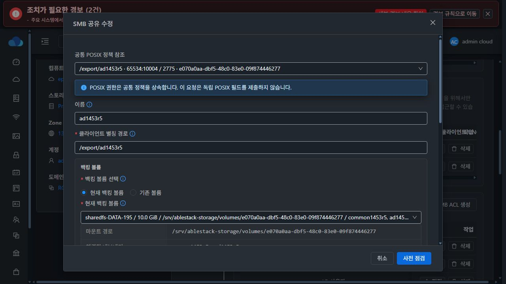
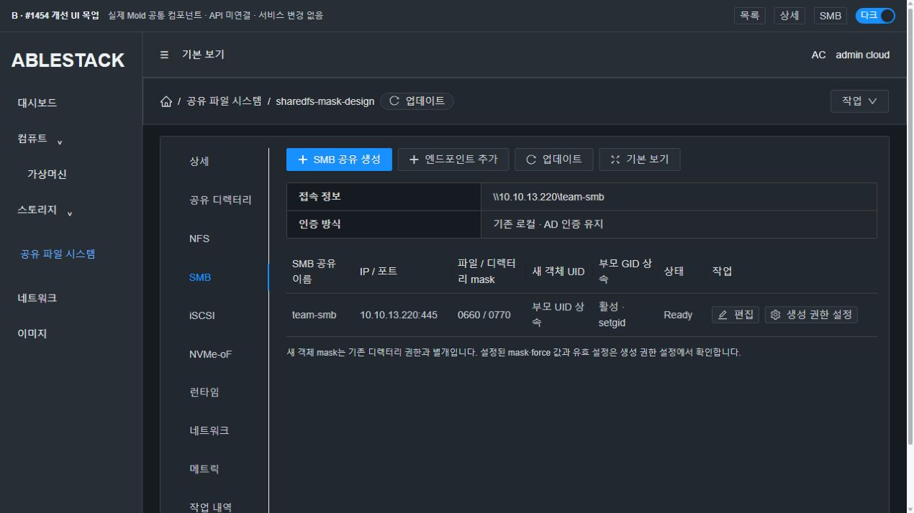
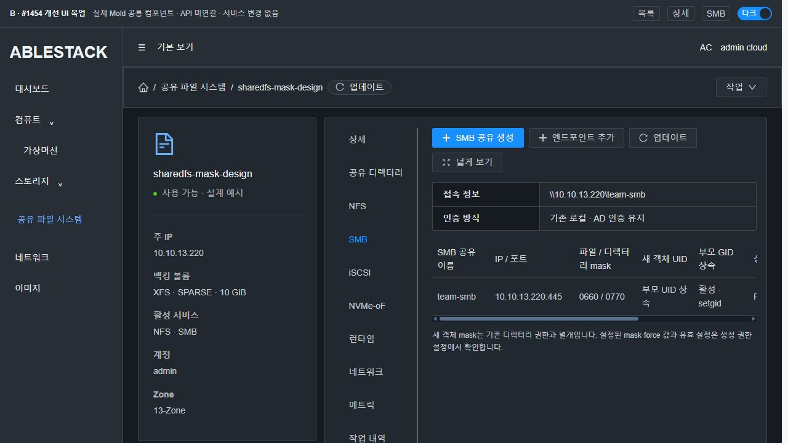
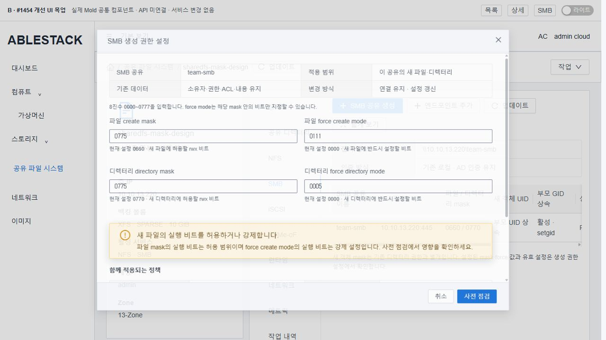
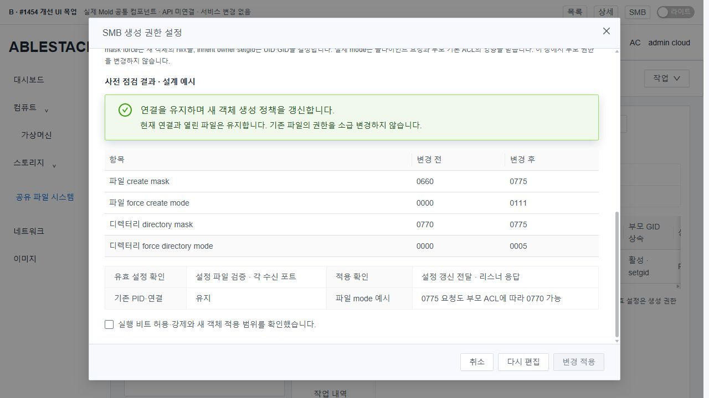
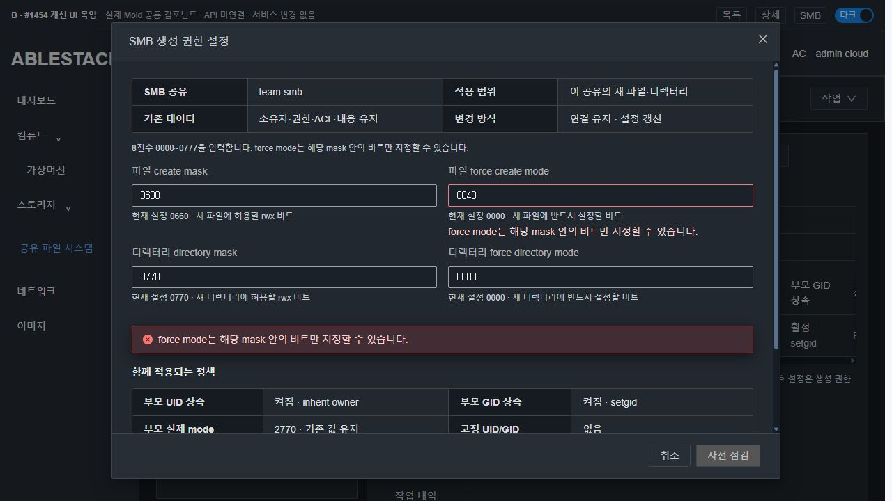
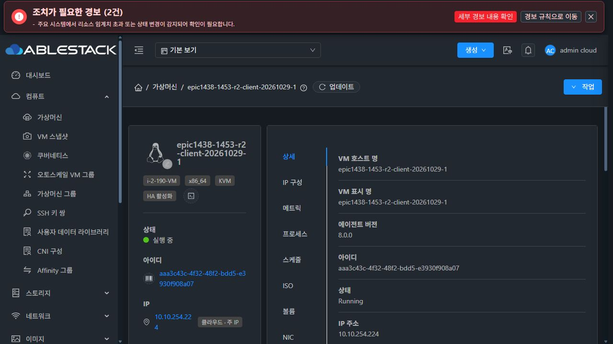
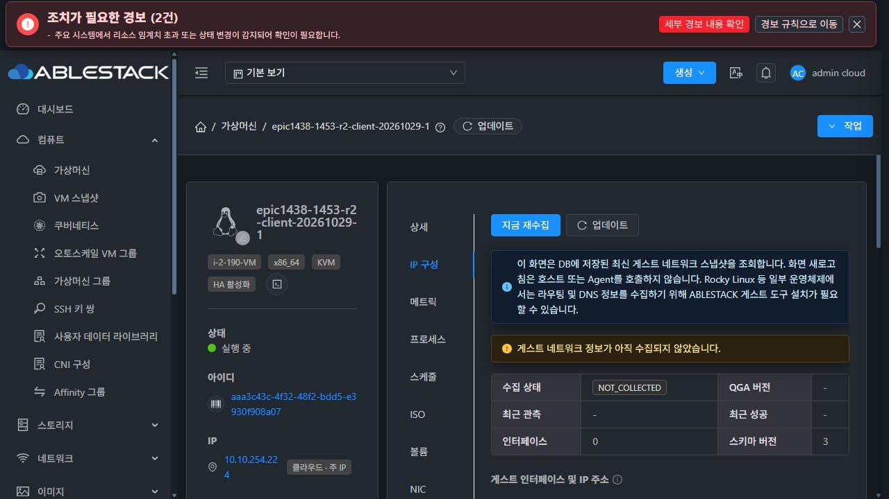
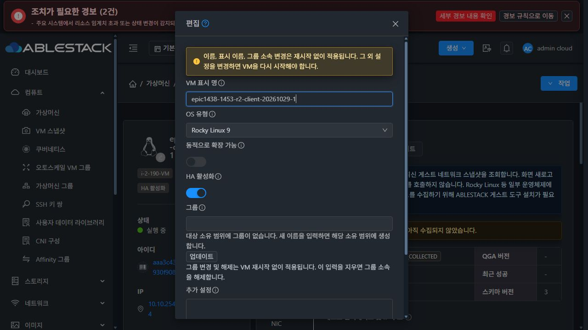

# #1454 — SMB 공유별 생성 mask·force mode: 코드 수준 설계

2026-10-31. **설계·실제 SystemVM 격리 주입 실증·목업만 완료. 제품 구현/빌드/배포는 미착수.** 이슈와 인수 체크는 OPEN/미완료로 유지한다. 새 이슈나 목업 PR는 만들지 않는다.

## 1. 실제 기준과 범위

- source **63bf9978604da78dfee89abb9f774ff70e884919**, branch **epic/1438-sharedfs**.
- fetch 후 local/origin/upstream Europa **1c5b169cd6283da23cc3e155d4b6d14e39e42793**, 차이 **0/0**, feature가 local base를 포함한다.
- 관리 JAR **587b5d405304be71e92875555d9e984041caa2241942a7d91c936b76b44d1d19**, UI index **c37069d7fdd460ae2719ec49a549a35094f20fcc6f618eaf2f9120b25a176a48**, mold active.
- SharedFS **3f0056db-4dfe-4f13-908d-b809dd565d34**, VM **d9c423e9-ce89-3ba9-9cd8-f48cdb791da2 /13.220**, runtime **1453.ad.winbind.r6**, Samba **4.17.12-Debian**.
- 실제 UI DATA **e070a0aa-dbf5-48c0-83e0-09f874446277 /XFS10GiB/SPARSE**, FS UUID **9c8ddfe9-3e23-46f0-9476-5c794b004841**. 새 디스크·THIN·포맷·MAC 변경 없음.
- 서명10파일 hash가 manifest와 모두 일치한다. 기본 smbd inactive/Winbind active/관리13.220:445 실행.
- 두 실제 공유의 testparm: **create0660 /directory0770 /force0000·0000 /inherit permissions=No**. 로컬 inherit owner=no, AD 공유는 windows and unix.

[배포 SystemVM](evidence/deployed-systemvm.json), [관리 확인](evidence/deployed-management.json), [동기화·source](evidence/source-sync.json).

목표는 네 생성 정책의 저장/표시/검증과 단순 옵션의 reload/실패 원복이다. 제외: 재귀 chmod/chown·새 ACL 편집기·inherit permissions 활성화 UI·force identity 편집(#1456)·AD 가입 개선·listener/전역 identity 무중단 변경·백업/복원·전면 UI #1468.

## 2. 현재 코드에서 확인한 제약

| 현재 코드 | 사실과 필요한 변경 |
|---|---|
| storagectl apply_smb_shares:5059~5060 | mask가0660/0770 literal. 기본 호환 유지 + 검증된 공유별 값 렌더링 |
| StorageServiceManagerImpl:1249~1351,2869~2935 | 기존 runConfiguration/shadow DAO/desired builder 재사용 |
| configuration_transaction.py SmbListenerProfiles.refresh:876~899 | 전체 SMB 프로필 stop/start. 단순 옵션만 별도 reload 분기 필요 |
| RuntimeAdapter.restore:1519~1545 | stop_all 후 before apply. 원복도 별도 reload 분기가 필요 |
| shared_directory_policy.py inheritance_preview:783~807 | preview mask도 고정. 같은 유효 정책을 읽도록 수정 |
| 기존 Preflight/Coordinator | fingerprint·impactack·writer·자원/drain·DB recovery 보존 |
| protected runtime_updater6 | POSIX/부모 상속 guard만 인식. custom mode downgrade 보호 필요 |
| SharedFSTab.vue | mask4필드 없음. 일반 편집은 여러 값을 함께 제출. 새 전용 폼 + dirty 제출 필요 |

현재 full apply의 restart는 기존 경로이며 이번에 새 제품 오류를 재현한 것으로 부르지 않는다. 현재 제품이 #1454를 이미 지원한다고 판정하지 않는다.

## 3. 정책·입력·저장 계약

| 기존 Create/Update API에 추가할 nullable STRING | config_json 키 | 기본 |
|---|---|---|
| createmask | createMask | 0660 |
| directorymask | directoryMask | 0770 |
| forcecreatemode | forceCreateMode | 0000 |
| forcedirectorymode | forceDirectoryMode | 0000 |

기존 **storage_file_share.config_json(MEDIUMTEXT)** 사용. 새 DDL/표/열/작업 유형 없음. 기존 **config 문자열 응답** 유지. UI가 새 object 응답을 임의로 가정하지 않게 실제 serializer fixture를 사용한다.

- @Parameter length=4. 문자열 `^0?[0-7]{3}$`만 허용,4자리 저장. 문자열660→0660. number/empty/0888/1777/00660/공백·기호 거부.
- UPDATE 미제출은 기존 raw key/값 유지. 신규/기존 missing은 기본값으로 읽으며 자동 backfill·권한 초기화 없음.
- `forceCreateMode & ~createMask != 0` 또는 directory 쌍의 같은 조건은 **SMB_FORCE_MODE_OUTSIDE_MASK**로 적용 전 차단. 이는 Samba보다 엄격한 이슈 보호 조건이다.
- 파일 mask의 실행 비트는 '허용', force는 '강제'다. 실행 비트/권한 확대 경고를 fingerprint에 포함하고 기존 **impactack=그 fingerprint**를 요구한다. bool 확인으로 대체하지 않는다.
- 입력2770은 범위 밖이다. 부모 setgid로 실제 디렉터리2770이 생기는 것은 정상이다. 특수 비트는 기존 공통 POSIX 기능에서 관리한다.

Samba는 요청 mode에 mask를 AND하고 force를 OR한다. inherit permissions는 이보다 우선할 수 있다. [Samba4.17 공식 smb.conf](https://www.samba.org/samba/docs/4.17/man-html/smb.conf.5.html)

| 상호 작용 | 처리 |
|---|---|
| 네 mask/force | 새 객체 rwx만 제어. 기존 객체 chmod/chown/setfacl 없음 |
| inherit owner | #1453 바로 위 부모 UID/Windows owner 유지 |
| setgid | 부모 GID 상속 유지. 네 필드에서 변경 안 함 |
| inherit permissions | 유효 값을 readonly 표시. true이면 custom mask가 무시되므로 **SMB_CREATION_POLICY_INHERIT_CONFLICT**. 몰래 false로 바꾸거나 활성화 UI를 추가하지 않음 |
| force user/group | 현재 유효 identity 관측 + 기존 #1453 충돌 보호. 편집 기능 추가 안 함 |
| 부모 default ACL | 최종 mode를 제한할 수 있음. 저장 mask를 실제 mode라고 표시하지 않음 |
| RO/SMB ACL | 기존 인증·접근 제한 유지. 생성 mask가 이를 우회하지 않음 |

**실증:** default ACL other---인 부모에서 mask0775/force0111이어도 실제 파일0770이었다. `(0666 & mask)|force`를 '보장된 최종 권한'으로 표시하지 않는다. UI는 설정값·파일 해석값·갱신 영수증·실제 객체 mode를 구분한다.

## 4. 수정 대상과 코드 계약

| 대상 | 설계 |
|---|---|
| CreateStorageSmbShareCmd /UpdateStorageSmbShareCmd | String4개/getter. 기존 API 권한/requestid/expectedrevision/impactack 유지 |
| **StorageSmbCreationPolicy.java(새 작은 helper)** | validate/normalize/merge/effective/option-diff를 공개 preflight와 candidate가 공유 |
| StorageServiceManagerImpl | 기존 buildSmbConfigJson 뒤 null-preserve merge. 기존 desired config 전달. 볼륨/공통 정책/ACL/AD builder 재작성 없음 |
| StorageServiceConfigurationPreflight | smbcreation4문자열·기존 단순 옵션 intent 정규화. 실제 current/config/PID vector·부모 identity/default ACL fingerprint 포함 |
| StorageServiceConfigurationCoordinator | 기존 SQL writer/shadow/journal/DB commit/recovery 사용. before/candidate 차이로 내부 reload plan 생성. public 플래그로 강제 불가 |
| shared_directory_policy.py | 네 값 검증·옵션 plan·관측 함수. inheritance preview 고정 mask를 같은 정책으로 교체 |
| configuration_transaction.py | RuntimeAdapter options-only snapshot/apply/verify/restore. owned PID targeted reload. 기존 타 프로토콜 분기 보존 |
| storagectl | 생성/부팅 전체 renderer가 네 값을 읽음. options-only는 계정/ACL/디렉터리 mutation loop에 진입하지 않음 |
| configuration_preflight.py | 새 intent/관측 fingerprint·ONLINE_RELOAD·실행 비트/ACL 안내. 자원/writer/identity 보호 유지 |
| runtime_updater.py /baseline profile | 활성 custom policy의 feature-version AST guard, payload hash/profile 재생성 |
| SharedFSTab /SmbCreationPolicyFields.vue /utils/smbCreationPolicy.js | 전용4필드·dirty patch·기존 모달 보호/추적 재사용. 일반 편집도 단순 옵션의 변경 값만 제출 |
| ko/en locales·회귀 fixture | 입력/충돌/우선순위/영향/원복 메시지와 실제 wire 계약 |

기존 getStorageServiceConfigurationPreflight의 intent:
```json
{"api":"updateStorageSmbShare","resourceid":"<share-uuid>","smbcreation":{"createMask":"0640"}}
```
적용은 기존 updateStorageSmbShare에 `id,createmask=0640,requestid,expectedrevision,impactack`만 제출한다. 미변경3필드·directorymode·UID/GID·recursivepermission·volume/path·암호를 끼워 넣지 않는다. 전체 desired의 기존 값은 서버가 보존한다.

## 5. reload·실패 원복·보호

### 안전한 분류
기존 공유의 UUID/name/path/backing/FS UUID·global/AD identity·listener·ACL/계정/secret·quota·부모 정책이 같고, 차이가 **mask4개와 readOnly/browseable/inheritOwner 같은 순수 공유 옵션 allowlist**에만 있을 때 ONLINE_RELOAD다. inheritOwner의 기존 공통 정책/충돌 검증은 유지한다.

guestOk는 현재 renderer가 부모 권한을 바꿀 수 있어 이 분기에 넣지 않는다. ACL/password·새/삭제/이름/경로/볼륨·부모 POSIX·quota·listener/전역 identity도 기존 영향 경로다. unsafe 혼합을 온라인으로 약속하지 않는다. server 플래그도 guest가 durable before/candidate로 재검사한다. SQL 예약 후 restart fallback으로 바꾸는 것은 금지한다.

owned profile의 exe/config cmdline/PID/starttime·manifest topology/hash를 검증한다. covered row는 소유 daemon 한 번으로 합친다. 동적 session 수·부모 mtime·자식 파일 hash를 fingerprint로 고정하지 않는다. 정상 I/O만으로 계속 stale되는 것을 피하며 부모 inode/device/FS UUID/UID/GID/mode/default ACL·config/PID 신원은 바인딩한다.

### 적용
1. 같은 operation에 base smb.conf·desired JSON·owner/mode/hash·PID vector/단계 영수증을 보호된 before-image로 저장한다. options-only에서 계정·부모 metadata·NFS를 mutation 대상으로 삼지 않는다.
2. 관리 생성 base의 **유일한 target share section**에서 allowlist 줄만 교체/추가한다. unknown include/중복 controlled 항목/모호한 section은 거부한다. 다른 share/global/auth bytes는 보존한다.
3. 후보와 실제 overlay를 testparm 검증한 뒤 원자 교체한다.
4. owned parent별 `smbcontrol -s <config> <pid> reload-config` 후 bounded ping/socket/PID/starttime/parsed config·desired hash 확인. close-share·stop/start·전역 all 호출 없음.
5. 같은 journal 영수증 뒤 기존 SQL commit/revision·확정 흐름을 사용한다. API job 접수와 native 완료를 구분한다.

PID 대상 reload는 공식 명령이다. [Samba4.17 smbcontrol](https://www.samba.org/samba/docs/4.17/man-html/smbcontrol.1.html)

testparm은 파일 해석이지 모든 연결의 메모리 상태를 읽는 API가 아니다. UI는 '설정 파일 검증/갱신 전달·리스너 응답/실제 객체 mode'를 구분한다. 이번 native 시험은 기존 CIFS tree의 **새 생성에도** 변경값이 반영됨을 확인했다. 제품 인수도 새 연결과 기존 연결의 새 생성을 모두 검증한다.

### 원복·재개
일부 reload/후속 검증 실패면 이전 bytes·desired를 복구하고 **동일 owned PID에 reload**한다. stop_all/full apply·계정/부모/ACL 복구·restart fallback을 쓰지 않는다. 확인 뒤 ROLLED_BACK/SUCCEEDED와 첫 실패/포트 진단 유지. 원복 검증 실패·PID 신원 변경은 RECOVERY_REQUIRED다.

같은 requestid는 기존 작업을 관찰한다. 파일 hash·reload 영수증으로 동일 작업을 재개하며 데이터/포맷 mutation은 없다. 중간 VM 부팅으로 PID가 달라지면 무중단 성공으로 표시하지 않고 기존 recovery를 따른다. **COMMITTED 뒤 재부팅**은 저장4값으로 일반 boot reconcile한다. 부팅에 live PID 유지 조건을 적용하지 않는다.

### downgrade 보호
현재 protected updater6은 custom mask를 인식하지 않는다. 기존 #1453 방식으로 **baseline7**에 helper **SMB_CREATION_POLICY_VERSION=1** AST 검사를 더한다. 활성 공유에 non-default4값이 있으면 구 helper activate/rollback을 차단한다.

capability에 smbCreationPolicyVersion/smbCreationPolicyProtectionVersion을 추가한다. 현재6인 VM은 새 정책 쓰기 전 지원 baseline 유지보수가 필요함을 UI에서 알리고 기존 공유는 유지한다. 일반 번들이 protected baseline도 교체한다고 가정하지 않는다. 서명 manifest/profile/실제 payload 일치·기존 guard를 검증한다. #1467 자동 교체로 범위를 확장하지 않는다.

추가로 실제 SystemVM에서 설치된6의 기존 compatibility 검사를 재사용하고 후보 AST 검사만 사설 경로에 결합했다. 기본값은 구 helper 허용, 활성 custom은 구 helper 거부, feature1 후보는 top-level 실행 없이 허용, disabled 참조 제외를 확인했다. [실제 guard 실증](evidence/native-compatibility-result.json) / [시험 코드](evidence/native-compatibility-probe.py). 이는 baseline7의 설계 검증이며 제품 baseline7을 설치한 결과가 아니다.

## 6. 실제 SystemVM 주입 실증

[시험 코드](evidence/native-mask-probe.py) / [최종 결과](evidence/native-design-result.json).

기존 SPARSE DATA의 nonce 디렉터리·private mount/net namespace·private auth TDB, SMB2포트23045/23046·NFS23049/23050을 사용했다. 설치 renderer의 실제 AST를 추출해 후보4값을 주입했다. 기존 계정 epic1453rw를 private TDB에서만 사용했으며 새 비밀은 메모리/환경/memfd로 전달했다. 평문 인증 파일 없음.

| 그룹 | 확인 |
|---|---|
| 기본/제한/force 실행/부모 UID 상속 ×2포트 | **8행 PASS**. 새 접속과 기존 CIFS tree의 새 생성에 같은 정책 반영 |
| 연결 유지 | 두 parent PID/session ID/tree ID 동일, 실제 열린 CIFS fd3으로 read/write/fsync 지속 |
| 계획된2번째 reload 실패 | 첫 프로필 갱신 뒤 실패→이전 bytes 복구·두 PID reload, 같은 session/tree/open fd I/O 유지 |
| 잘못된6입력 | octal·force-subset 적용 전 거부, config 불변 |
| inherit permissions | mask보다 우선하는 실제 동작을 확인해 충돌 차단 설계에 반영 |
| NFS2포트 | UID1001/GID1001/supplementary65534의 SMB 파일 읽기. Root Squash 유지 |
| 정리/보존 | **productionUnchanged=true /temporaryResourcesRemoved=true**. 운영 signed source/config/계정/desired/PID/NIC·전체36객체 비교 동일 |

부모65534:65534/2770/default ACL에서:
- 기본 file1001:65534/0660, dir1001:65534/2770.
- 제한 file0640, dir2750.
- mask0775/force0111은 file0770·dir2770(default ACL other---).
- inherit owner는 file/dir65534:65534, 기본 mode 유지.

처음 NFS 확인 코드는 root로 읽어 Root Squash에 걸렸다. 권한 있는 주체로 시험 코드만 교정했다. [첫 원문](evidence/native-design-input-correction.json)도 보존한다. 제품 보호 완화·같은 제품 오류의 반복 수정은 없다.

**경계:** 후보 옵션·실제 daemon 설계 실증이다. 새 제품 API/DAO·server 분류·UI 저장·SQL 원복·baseline7 인수 성공으로 대체하지 않는다. readOnly/browseable 등 allowlist의 제품 통합도 구현 후 검증 대상이다.

## 7. A 현재 /B 개선 /S 표준과 목업

- **A:** 실제13번 SMB 편집 폼을 열고 취소.4필드 부재와 실제 sparse 확인.
- **S:** 실제 컴퓨트 > 가상머신의 Breadcrumb/목록/정보 상세/세로 탭·컨텐츠/편집 확인. generic legacy VM 모달 실측과 새 공통 MoldDialog 고정 footer 계약을 구분한다. VM 메뉴 자체는 고치지 않는다.
- **B:** Vue3/Ant Design Vue와 실제 Breadcrumb/ResourceLayout/MoldDialog/MoldDialogActions·현재 theme/style을 import한 **API 미연결** 목업.

기존 Breadcrumb/list/detail/세로 탭 배치 유지, 상세는 정보 전용. SMB 표에 mask 요약·'생성 권한 설정'만 추가한다. 기존 생성/일반 편집 컨텐츠 배치는 유지한다. UI 흐름은 **공유 생성→필요한 생성 권한 설정→ACL 허용/접속**이다. 새 custom 값을 한 요청에 원하는 자동화는 Create optional4필드를 쓴다. 생성 폼 재구성/고급 섹션 추가는 이번 설계에서 하지 않는다.

중복 탭 제목 없음. 파란 주 버튼 좌측 첫 항목, 아이콘+'업데이트', 넓게보기는 좌측 버튼 묶음 마지막. 모달 lg960, 고정 header/footer·본문만 scroll. form margin6px/버튼 gap8px/섹션16px/gutter16px. 현재·후보·관련 상속·유효 설정을 구분하고 부모 POSIX는 제출하지 않는다. 미변경/충돌/미지원 차단, 실행 비트 명시 확인과 fingerprint ACK, 원복 진단/재진입 보호를 설계한다.

[실측·가독성·보호 상태](evidence/ui-review.json). 라이트/다크·error/disabled·scroll 전후 고정 영역과 버튼 상태를 검토했다.

**A 실제 현재**


**B 개선: API 미연결**






**S 실제 VM**





재현:
```bash
cd docs/design/sharedfs-1454-creation-policy-20261031/mockup
NODE_OPTIONS=--openssl-legacy-provider node build.cjs
python3 -m http.server 8794 --bind 127.0.0.1 --directory public
```
index.html?view=smb&dialog=policy&theme=dark 또는 light. view=list/details/smb, scenario=conflict/unchanged/inherited/unsupported/rollback은 설계 예시다. 생성 app.js는 Git에 넣지 않는다.

## 8. 구현 후 인수 — 아직 미실행

1. 실제 dispatcher STRING 검증·4값/충돌/null-preserve/default·잘못된 intent. coordinator→DAO persist/reload·실제 serializer config문자열·shadow 원복.
2. 순수 옵션/unsafe 혼합 분류, stale config/PID/부모 ACL·동시 writer·같은 requestid·위조 거부. 기존 ACL/identity/listener/volume/POSIX 보호 유지.
3. 이 probe를 최종 helper/RuntimeAdapter options-only에 연결해 Transaction apply/verify/commit·부분 reload/verify 실패·원복/원복 실패·동일 작업을 실증. stop_all/full apply 미호출,2포트 열린 핸들·계속 허용 I/O·모드·NFS 보존.
4. 변경 모듈 빌드·서명/profile/payload·baseline7 guard·구6 미지원·downgrade 거부 확인 뒤13번 정렬 배포. 기존 기본 공유/AD NSS/기본 smbd 차단 보존.
5. 실제 UI dirty4필드·미변경 POSIX 비제출·octal/충돌/실행 ACK/재진입 보호. 실제 noVNC client2대의 로컬/지원 AD·mask/owner/setgid/RO/RW·기존/새 연결과 파일/dir·PID/session/tree/open handle 대조.
6. COMMITTED 후 UI VM/관리 재시작, config·기존 metadata/ACL/hash·새 객체 정책·이력. 단발 reload 실패/부분 적용/원복/원복 실패를 UI/API 확인.
7. 모두 통과한 뒤만 완료 기록·Epic PR 반영·종료. 제품 오류는 원인 분석 후 중단, 시험 입력/코드 실수는 자체 교정.

현재는 **설계 완료·구현 미착수**이며 위 제품 인수는 미체크다.
