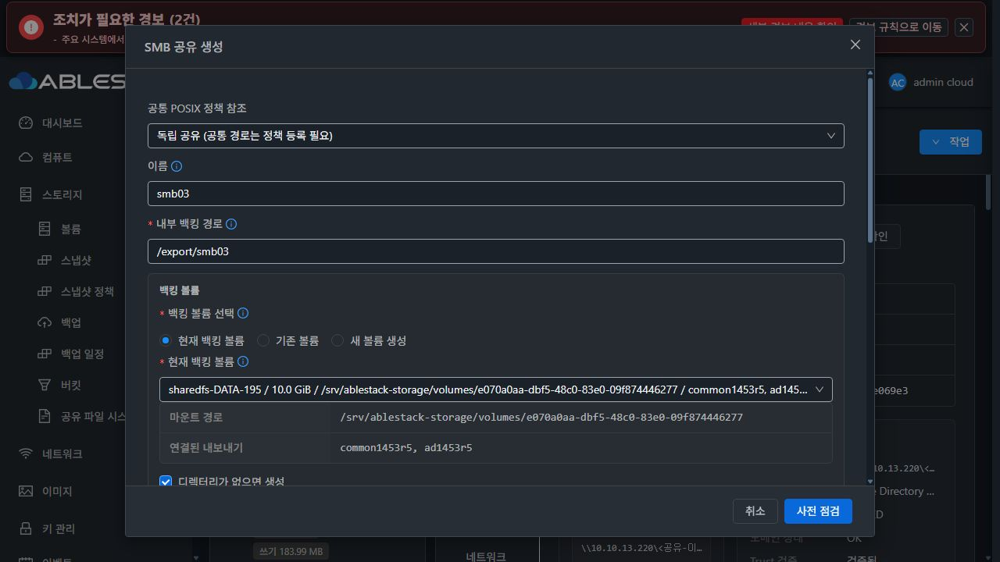
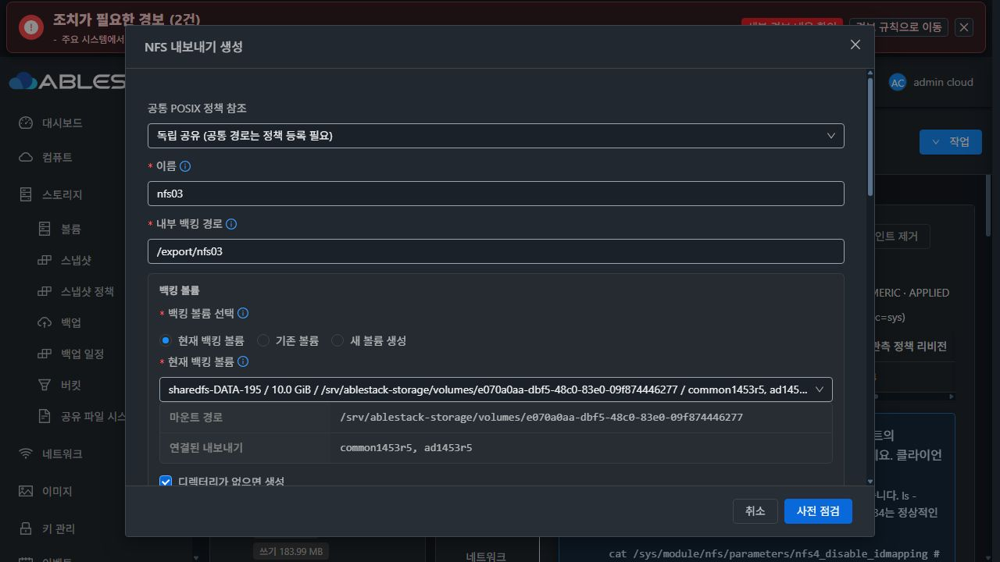
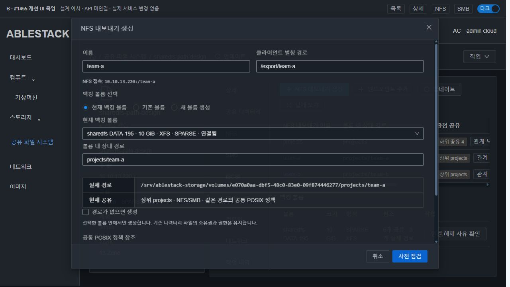
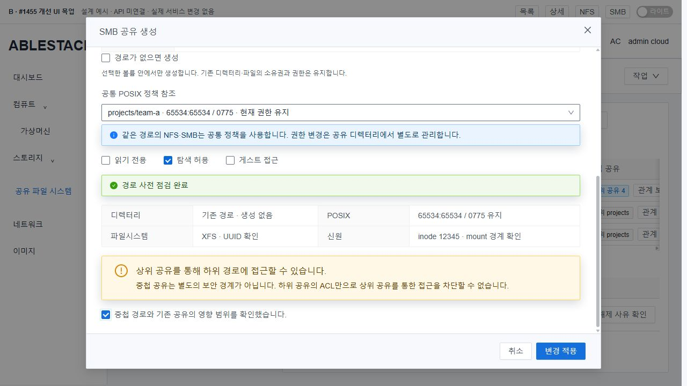
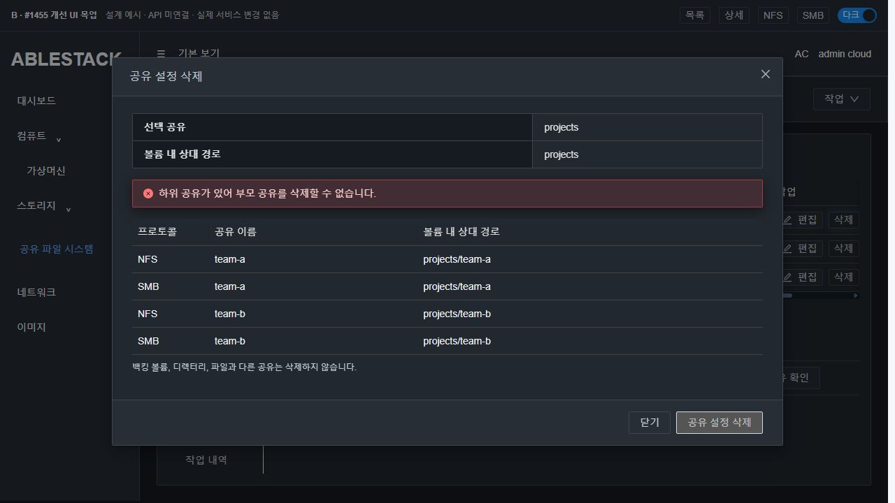
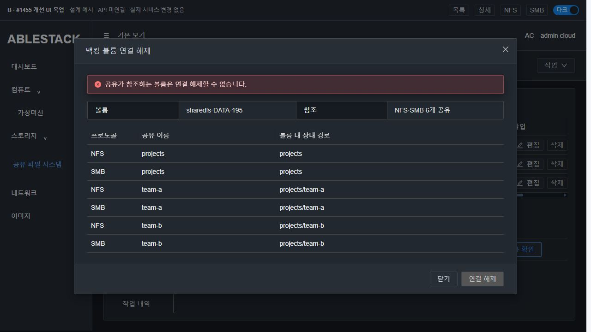
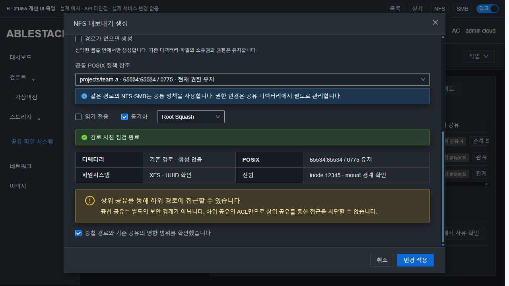
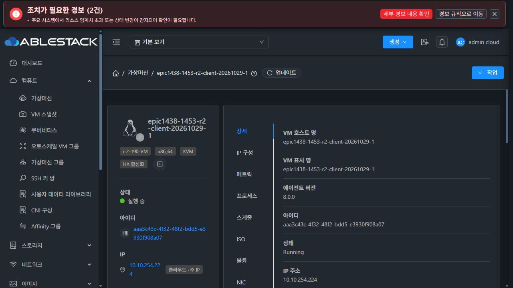
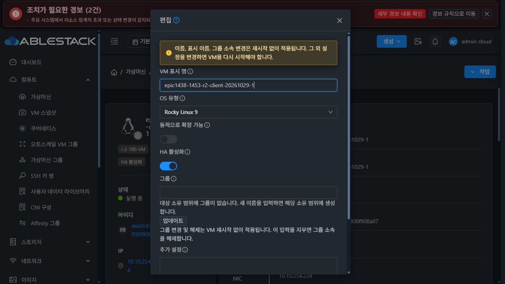

# #1455 코드 수준 설계 — 동일 볼륨 하위 경로의 중첩 NFS/SMB

**설계·실제 코드 대조·SystemVM 격리 주입·VM 표준 목업을 완료했다. 제품 구현, 모듈 빌드/배포, 실제 공유 추가/삭제, 이슈 종료는 시작하지 않았다. 인수 체크4개는 미완료로 유지한다.**

- [#1455](https://github.com/ablecloud-team/ablestack-cloud/issues/1455), 상위 [Epic #1438](https://github.com/ablecloud-team/ablestack-cloud/issues/1438). 기존 브랜치 `epic/1438-sharedfs`, 새 목업/기능 PR 없음.
- 착수 source HEAD `a9af946146b30811c33f1f8d664dbabec0bf4a72`. fetch 후 local/origin/upstream Europa `1c5b169cd6283da23cc3e155d4b6d14e39e42793`, local/upstream0/0, 작업 트리 clean.
- canonical WSL `/root/work/ablestack-cloud`를 사용했다. 추적 변경은 이 설계 폴더만이다.
- 아래의 클래스/필드 추가는 **구현할 설계**이며 현재 설치된 API/DB 계약으로 오인하면 안 된다.

## 1. 확인한 실제 배포와 코드

13번 관리 JAR SHA-256 `ec836625519820bac02eea1aeaf5ea00ffe5baa90e7bd61e265e7d832f06b0fd`, UI index `ede1f23e654b6116b848d65aa74512f2e58cb3239e194a1cc11f50d226293220`이며 설계 과정에서 불변이다.

관리 JAR의 StorageServiceManagerImpl/StorageDirectoryPolicies/StorageServiceConfigurationCoordinator **class bytes가 현재 WSL 컴파일 결과와 각각 일치**한다. 실제 코드 경로를 같은 class로 호출한 설계 harness 결과도 보존했다. DAO/적용 콜백은 harness에서 대체하므로 이 시험을 실제 API/DB 인수로 세지 않는다.

현재 서비스:
- SharedFS `3f0056db-4dfe-4f13-908d-b809dd565d34`, instance `c1eca707-a554-4c42-85cd-1e9e9744d804`.
- VM `d9c423e9-ce89-3ba9-9cd8-f48cdb791da2`, host13.2, current runtime `1454.creation.2`/protected baseline7.
- DATA `e070a0aa-dbf5-48c0-83e0-09f874446277`, **10GiB SPARSE XFS**, FS UUID `9c8ddfe9-3e23-46f0-9476-5c794b004841`.
- NFS2049, SMB445/1445, 13.220 IP/MAC 유지. 기존 common1453r5/ad1453r5와 데이터54객체를 보존했다.

[배포/소스 class 대조](evidence/deployed-management.json), [동기화](evidence/source-sync.json), [보존](evidence/preservation.json).

### 현재 부족한 연결

| 실제 위치 | 확인한 현재 동작 | 설계에서 바꿀 범위 |
|---|---|---|
| Create/UpdateStorageNfsExportCmd | relativepath 필드는 존재 | 이미 있는 파라미터를 실제 backing 선택에 연결 |
| Create/UpdateStorageSmbShareCmd | relativepath 필드 없음 | optional STRING 추가 |
| Manager create/update candidate | public path=/export/name를 생성·검증 | public 별칭 계약 유지, 실제 상대 경로를 별도 해석 |
| buildFileShareDirectoryConfigJson | relativeSharePath/relativesharepath를 제거 | 명시 입력/저장된 실제 backing을 보존 |
| prepareFileShareBackingVolume/buildManagedFileShareVolumeReuseConfigJson | 재사용 시 share.path를 물리 상대 경로로 사용 | 요청한 relativepath 또는 신뢰된 기존 backing을 사용 |
| validateFileSharePathAvailable | 주로 노출 alias의 중복/다른 볼륨 겹침 확인 | 물리 경로의 동일/부모/자식 관계를 별도 확인 |
| deleteStorageNfsExportCandidate/deleteStorageSmbShareCandidate | ACL/row 제거 전에 자식 공유 검사 없음 | 삭제 전에 strict-descendant 차단 |
| validateBackingVolumeUnused | 같은 volumeId의 모든 NFS/SMB/block 참조 차단 | 기존 로직 유지·참조 상세 표시 재사용 |
| VolumeApiServiceImpl.detachVolumeFromVM | SharedFSVM의 일반 detach를 이미 거부 | **공통 볼륨 API 변경 없음** |
| guest ensure_export_alias | 평면 /export/name bind alias와 데이터 경로 구분 | 노출 계약 유지, 새 상대 경로의 안전한 원본 FD 사용 |
| guest SMB renderer | path 문자열의 물리 디렉터리를 사용 | 새 경로 모드에서 검증 inode를 고정한 runtime bind root 사용 |

실제 Java harness에서 상대 경로 제거·alias 기반 backing 재계산·현재 부모 삭제 후보의 자식 미검사와 기존 detach 참조 차단을 확인했다. [결과](evidence/java-contract-result.json), [harness](evidence/DesignProbe.java).

## 2. 사용자/데이터 계약

노출 이름과 실제 데이터 경로를 분리한다.

| 의미 | 예 |
|---|---|
| NFS 이름/클라이언트 경로 | team-a / 10.10.13.220:/team-a |
| SMB 공유/클라이언트 경로 | team-a / Windows UNC의 team-a 루트 |
| 기존 내부 alias | /export/team-a, 평면 계약 유지 |
| 볼륨 내 상대 경로 | projects/team-a |
| 실제 backing | /srv/ablestack-storage/volumes/<volumeUuid>/projects/team-a |

중첩은 **물리 backing 경로**의 중첩이다. /export/projects/team-a 같은 새 public alias 규칙이나 SMB 공유 이름의 slash 허용을 만들지 않는다. 형제/부모/자식은 서로 다른 alias로 제공할 수 있다.

같은 물리 디렉터리를 여러 alias/프로토콜로 참조하면 #1452의 공통 POSIX 정책을 공유해야 한다. 서로 다른 하위 경로는 별도 정책을 가질 수 있다. **자식 공유의 RO/ACL이 부모 공유를 통한 경로 접근을 격리하는 것은 아니다.** 상위 공유의 접근 권한과 실제 POSIX도 함께 적용되므로 관계·영향과 명시 확인을 UI에 표시한다. 이 이슈에서 새로운 ACL 상속/격리 모델을 만들지 않는다.

## 3. API와 저장 — DDL 없음

### 기존 mutation API 재사용

- NFS의 기존 relativepath를 연결한다. SMB create/update에 같은 optional `relativepath` STRING(length255)를 추가한다.
- NFS에서 이전에 전달돼도 적용되지 않던 relativepath는 이번 설계의 의도적 수정 대상이다. 미입력 legacy 계약은 유지하지만 명시한 잘못된 경로를 계속 무시하지 않는다.
- `path`는 기존 alias 계약으로 유지한다. 이름/별칭의 기존 검증 함수를 완화하지 않는다.
- 선택 volume은 해당 instance가 관리하고 실제 mounted XFS/EXT4로 확인된 볼륨이어야 한다. relativepath 없는 기존 새 볼륨/초기 생성 흐름은 유지한다.
- mounted 볼륨에 하위 경로를 추가할 때 FORMAT_EMPTY/FORMAT_IF_EMPTY를 허용하지 않고 REUSE_ATTACHED/MOUNT_EXISTING 경로만 사용한다. 이미 쓰는 볼륨의 attach/format을 다시 실행하지 않는다.
- `createdirectory=true`를 명시한 경우에만 새 디렉터리 체인을 만든다. 새 경로 모드에서 생략 기본값은 false다. 기존 legacy 요청의 기본값을 전역 변경하지 않는다.
- update는 relativepath가 없으면 기존 물리 backing을 보존한다. 이름/alias 변경은 DATA 이동이나 새 경로 생성으로 해석하지 않는다. 상대 경로 변경은 별도 신원/권한/중첩 점검을 거친다.
- 경로를 바꿀 때 이전 directoryPolicyUuid를 무조건 새 경로에 덮어쓰지 않는다. 새 경로와 선택 정책의 canonical identity가 다르면 적용 전에 거부한다.

예: mounted 기존 볼륨에 자식 NFS를 연결하는 요청
```json
{
  "instanceid": "<instanceUuid>",
  "name": "team-a",
  "path": "/export/team-a",
  "volumeid": "<managedVolumeUuid>",
  "relativepath": "projects/team-a",
  "importmode": "REUSE_ATTACHED",
  "createdirectory": false,
  "directorypolicyid": "<same-canonical-directory-policy>"
}
```

### 기존 config_json 확장

`storage_file_share.config_json`의 기존 문자열 JSON을 사용한다. 새 테이블/컬럼/operation type은 만들지 않는다.

```json
{
  "relativeSharePath": "projects/team-a",
  "volumeMountPath": "/srv/ablestack-storage/volumes/<volumeUuid>",
  "backingPath": "/srv/ablestack-storage/volumes/<volumeUuid>/projects/team-a",
  "pathBindingVersion": 1,
  "pathIdentity": {
    "filesystemUuid": "<uuid>",
    "volumeRootInode": 128,
    "inode": 12345
  }
}
```

기존 마지막 inspection·공통 POSIX 참조·mask/force·인증 설정을 제거하지 않는다. 기존 row는 일괄 migration하지 않고 신뢰된 backing/mount 정보로 상대 경로를 표시용으로 파생한다. 읽기 요청은 저장하지 않는다.

mount ID/st_dev/PID는 부팅 시 바뀔 수 있는 **관측**이며 config의 영속 신원으로 저장하지 않는다. 영속 비교는 volume UUID + FS UUID + canonical 상대 경로 + root/target inode를 사용하고 부팅마다 runtime mount ID를 재관측한다.

### 조회/사전 점검의 추가 정보

- 기존 list NFS/SMB 응답에 optional relativepath/pathstatus/pathreason을 추가한다. 기존 config는 계속 **STRING JSON**이다.
- preflightStorageServiceConfiguration의 기존 intent allowlist에 volumeid/relativepath/createdirectory를 정확히 연결한다. UI 점검과 실제 commandIntent가 같은 해석 함수를 쓴다.
- 기존 preflight 응답에 **typed JsonObject pathpreview**를 추가한다. 볼륨 신원·물리 경로·exists·inode·새로 만들 경로 목록·같은 경로 alias·부모/자식·차단 사유를 담는다.
- actual ApiResponseSerializer에 예정 필드를 선언한 외부 설계 DTO를 통과시켜 pathpreview의 object/bool/number/leading-zero 문자열을 확인했다. **새 필드가 현재 배포 API에 이미 있다는 뜻은 아니다.**
- 새 mutation API/HTTP 오류 체계를 만들지 않는다. 기존 InvalidParameterValueException/preflight check/operation.originalfailure·rollback 계약을 사용한다.

[예정 응답의 실제 serializer fixture](evidence/path-preview-wire.json).

## 4. 관리 코드 변경 지점

### StorageFileSharePaths 새 내부 helper

1. strict relative 문법: 절대 경로·빈 segment·dot/dotdot·backslash·NUL/제어 문자를 거부한다. API255자/파일시스템 component255-byte 한계를 지킨다. filesystem 이름의 대소문자를 임의로 바꾸지 않는다.
2. 기존 resolveFileShareBackingPath/volume lookup를 재사용해 선택 mount 안의 logical target을 구성한다. 문자열 prefix만으로 안전하다고 판정하지 않고 guest 관측을 요구한다.
3. 같은 instance/volume의 모든 NFS/SMB row로 EXACT_ALIAS/ANCESTOR/DESCENDANT/SIBLING 관계를 만든다. projects와 projects2를 혼동하지 않는다. 다른 volume의 같은 FS UUID를 같은 데이터로 합치지 않는다.
4. 기존 natural key와 public alias 충돌은 유지한다. 새/변경 SMB 이름은 case-insensitive 충돌도 확인한다. 같은 물리 경로의 다중 alias는 공통 정책과 영향 확인 없이 조용히 허용하지 않는다.
5. 부모 delete/다른 경로로 retarget은 모든 프로토콜의 strict descendant가 있으면 **변경 전에 차단**한다. 같은 경로의 다른 프로토콜 alias는 자식과 구분한다.
6. 참조 목록은 실패/준비 중 row도 보수적으로 포함한다. 빈 조회/관측 실패를 자식0이나 안전함으로 바꾸지 않는다.

### Manager/DirectoryPolicies

- create/update 두 프로토콜에서 같은 helper를 호출하고 config 병합·경로 적용·상호 정책 확인을 한 번 해석한다.
- buildFileShareDirectoryConfigJson의 무조건 relative 제거와 재사용 경로의 alias 기반 덮어쓰기를 새 해석으로 대체한다.
- DirectoryPolicies.guardShare가 명시 경로를 선택 정책으로 조용히 덮어쓰지 않도록, 동일 canonical identity를 먼저 확인한다.
- 기존 경로는 chown/chmod/ACL reset을 하지 않는다. 독립 권한 변경이 필요하면 기존 공통 POSIX 정책 UI를 사용하도록 충돌을 명확히 안내한다. 새 디렉터리의 초기화만 기존 새 디렉터리 규칙을 적용한다.
- 기존 경로의 현재 값 채택은 기존 createStorageDirectoryPolicy(ADOPT)로 수행한다. 아직 공유가 없는 경로를 등록해야 하는 경우, 같은 mounted volume의 검증된 pathpreview target을 기존 observation 입력에 추가하는 좁은 확장만 허용한다. ADOPT는 실제 metadata를 읽어 등록하며 POSIX를 바꾸지 않는다.
- 새 중첩 SMB 모드의 ACL 없는 구성은 client에게 게시하지 않는다. 명시적 guest 접근 또는 검증된 ACL이 있어야 한다. 기존 인증/AD 가입/ACL 관리 모델을 다시 설계하지 않는다.
- delete candidate의 ACL/row remove 전에 descendant guard를 넣는다. 파일/디렉터리 삭제나 자동 volume 정리는 호출하지 않는다.
- detachStorageServiceBackingVolume는 기존 validateBackingVolumeUnused와 참조 표시를 재사용한다. 활성 설정/복구 작업도 사전 거부하고 기존 guest unmount/busy 보호를 유지한다. 공통 Volume API의 SharedFSVM detach 거부는 변경하지 않는다.

### Coordinator/Plan

requestid/revision·SQL reservation·guest durable journal·VERIFIED→SQL COMMIT→guest ACK·동일 요청 재개를 유지한다. 새 path 모드에만 capability와 fingerprint 검사를 추가한다. 새 operation 이름/VARCHAR(32) 문제를 만들지 않는다.

새 디렉터리는 guest 적용 때 inode가 정해진다. guest의 **operation/resource/volume에 묶인 pathbindings 영수증**을 op.guestObservationJson에 저장하고, commit(instance,op,plan)의 기존 SQL transaction에서 후보 row의 pathIdentity/config 및 재조회 가능한 candidate snapshot을 확정한다. resume도 같은 병합 함수를 사용한다. scope 밖 resource의 receipt는 거부한다.

응답의 config 문자열과 저장된 row가 다르지 않도록 새 경로 모드에 한해 확정 snapshot에서 public result를 갱신한다. 기존 다른 operation의 응답/commit 순서를 바꾸지 않는다. binding receipt 누락/불일치는 성공 처리하지 않으며 관찰/복구 상태와 원인을 보존한다.

## 5. SystemVM 경로와 inode 고정

### 사전/적용 시 공통 검사

기존 shared_directory_policy.py에 한 경로 helper를 두고 preflight, apply, verify, boot가 사용한다.

- mounted root의 UUID/FSTYPE/소유 volume 연결을 확인한다.
- root와 각 segment를 O_DIRECTORY|O_NOFOLLOW로 열고 FD로 이동한다.
- st_dev와 **/proc/self/fdinfo의 mnt_id**를 확인한다. 같은 FS bind도 root와 다른 mount ID면 거부한다.
- 현존 경로 inode·부모 metadata를 미리보기 fingerprint에 묶고 쓰기 직전에 다시 확인한다.
- createdirectory=false인 missing 경로는 차단한다. true면 계획에 포함된 missing segment만 dir_fd 기반으로 생성하고 생성한 inode를 기록한다. 기존 부모의 권한을 변경하지 않는다.
- 생성 예정 segment를 먼저 journal에 남기고 생성 직후 실제 inode를 기록한다. mkdir와 영수증 기록 사이의 중단 등으로 생성 주체/신원을 증명할 수 없으면 같은 이름의 경로를 추정 채택·삭제하지 않고 RECOVERY_REQUIRED로 보존한다.
- rollback은 기록한 신원이 같은 **빈 신규 디렉터리만** 역순으로 rmdir한다. 클라이언트 파일이 생겼다면 제거하지 않고 retained 경로를 진단에 남긴다. DATA의 rmtree나 formatter는 사용하지 않는다.

### 실제 Samba 시험으로 확인한 필요성

격리 시험에서 물리 pathname을 직접 쓰는 SMB root는 활성화 뒤 해당 경로를 symlink로 바꾸자 **outside-probe**를 읽었다. 이것은 현재 public API가 허용하지 않는 중첩 시나리오를 검증한 결과이며 운영 데이터 유출 시험이 아니다. 모든 marker는 전용 시험 DATA였다.

반면 FD를 /proc/self/fd로 bind한 root는 같은 inode와 **child-original**을 유지했다. 사전 realpath 검사만 추가하는 설계로는 이 경우를 해결하지 못하므로 새 모드에 runtime pin을 포함한다.

### 좁은 bind 적용 범위

- 기존 NFS 평면 alias 체계를 재사용한다. 새 mode는 원본 FD의 inode를 검증한 뒤 alias를 bind한다.
- 새 SMB mode는 root 소유의 /run/ablestack-storage/file-shares 아래에 resource UUID + FS UUID/inode로 유도한 고정 anchor를 만든다. 실제 metadata/ACL 검사는 물리 경로/FD에서 하고 SMB의 path만 검증 anchor로 렌더한다.
- retarget 시 새 신원의 anchor를 별도로 만들고 이전 anchor는 SQL 확정 전까지 보존한다. 실패 시 이전 설정을 복구하고 새 anchor만 정리한다.
- runtime anchor/일시적 mount ID는 별도 소유 registry와 operation journal에 둔다. 관리 desired JSON에 임시 PID/mount 관측을 섞어 #1454와 같은 baseline 오인을 만들지 않는다.
- 새 NFS alias를 unverified fstab mount로 먼저 열지 않는다. 새 mode의 bind는 DATA mount 후 기존 guarded boot-reconcile이 재생성한다. legacy fstab/기존 alias 동작은 그대로 둔다.
- 삭제는 소유 alias/anchor와 export/share 설정만 제거한다. physical DATA 디렉터리와 다른 resource의 anchor는 보존한다.
- 잘못된 신원/경계의 root는 게시하지 않는다. 부팅 중 문제가 난 경로는 실패를 표시하고, 이미 검증된 비대상 경로는 기존 reconcile 경로로 유지한다. runtime 실패를 desired DB를 바꾸거나 formatter 재시도로 숨기지 않는다.
- SMB 단순 옵션 변경의 #1454 targeted reload 경로는 유지한다. 새 경로 생성/변경/삭제는 기존 full configuration 영향/연결 정리 조건을 사용하며 무중단을 약속하지 않는다.

### 런타임 호환

예정 capability nestedFileSharePathVersion=1과 보호 flag가 준비 전 gate다. pathBindingVersion1이 활성 상태에서 이를 이해하지 못하는 helper로 원복할 수 없도록 기존 runtime_updater의 AST 호환 guard에 추가하고 protected baseline8을 설계한다. MANAGED_FILES10개와 서명/ABI/schema 체계는 유지한다.

다음 구현 단계에서 manifest/profile/실제 이미지10파일을 재생성·서명하고 최초/반복 bootstrap을 먼저 검증해야 한다. **이번 설계에서 baseline7이나 운영 current1454.creation.2를 변경하지 않았다.**

## 6. UI 설계와 목업

실제 UI A와 개선 목업 B, 실제 VM 표준 S를 구분했다.

- VM의 Breadcrumb 영역·목록·ResourceLayout 상세 card·세로 탭·MoldDialog/MoldDialogActions를 기준으로 실제 Mold 컴포넌트를 import했다. Vue3.2.37/AntD3.2.20이다.
- 상세 탭은 정보만 표시한다. 경로 작업은 기존 NFS/SMB·공유 디렉터리 탭에 배치한다. 새 top-level 메뉴/탭이나 파일 브라우저를 만들지 않는다.
- 새 상대 경로/물리 경로 미리보기·관계/충돌 표시를 기존 볼륨 선택 뒤에 삽입한다. alias는 이름에서 파생한 별칭임을 표시한다. 나머지 기존 NFS/SMB 옵션은 재작성하지 않는다.
- 새 볼륨/초기 기본 공유 흐름을 유지한다. 이 이슈의 추가 중첩 경로는 준비·마운트된 볼륨에서 선택한다. mounted 확인 전에는 경로 적용을 허용하지 않는다.
- 현재 권한/추천값/요청 값은 분리하고 기존 경로의 POSIX 필드를 자동 제출하지 않는다. 명시적 생성 checkbox가 없으면 mkdir하지 않는다.
- 점검 결과는 존재 여부·canonical 신원·생성할 segment·부모/자식과 같은 경로 참조·공통 정책/권한 불일치를 표시한다.
- 하위 ACL만으로 부모 경유 접근을 제한할 수 없다는 영향 안내와 확인을 둔다. blocking guard는 확인으로 우회할 수 없다.
- 부모 삭제/참조 중 detach는 사유와 대상 목록을 보여 주고 실행 버튼을 비활성화한다. leaf 삭제도 파일/디렉터리를 남긴다는 문구를 둔다.
- tab 제목을 다시 큰 제목으로 반복하지 않는다. main 생성 버튼은 파란 바탕으로 왼쪽 첫 위치, 업데이트는 아이콘+업데이트, 넓게 보기는 왼쪽 버튼 묶음 마지막이다.
- UI generation/expiry를 재사용해 volume/path/name/정책 변경 시 점검과 ack를 무효화한다. 늦은 응답을 다른 경로에 적용하지 않고 조회 실패를 무한 loading으로 두지 않는다.
- light/dark에서 header top33/footer top639를 유지하며 body scrollTop431/441을 확인했다. 본문 auto-scroll, 폼16px gutter와 공통 토큰을 사용한다. 목업 guard5개도 통과했다.

**A · 현재 배포 UI**



**B · 개선 목업**






**S · 현재 컴퓨트 > 가상머신 표준**



목업 source는 mockup/에 있고 API 미연결이다. 실행:
```sh
cd docs/design/sharedfs-1455-nested-paths-20261031/mockup
NODE_OPTIONS=--openssl-legacy-provider node build.cjs
python3 -m http.server 8795 --directory public
```
설계 검토용 localhost8795를 열어 두었다. 별도 목업 PR는 만들지 않았다.

## 7. 사전 실증 결과와 한계

| 시험 | 확인한 결과 | 대체하지 않는 것 |
|---|---|---|
| 배포 class/source 비교 | 관리 class3개 bytes 일치 | 새 제품 구현 |
| 실제 Java method harness | 현재 relative 제거/alias 재계산·자식 미검사·기존 volume guard 확인 | live API/DAO 저장 |
| actual API serializer의 설계 DTO | typed pathpreview와 0775 문자열 유지 | 아직 없는 배포 응답 필드 |
| 실제 SystemVM private 주입24개 | 부모/자식/형제, NFS2포트+SMB I/O, 문법/symlink/다른 mount/같은 FS bind/신원 교체 차단, inode pin, 설정 파일 복구·임시 서비스 재시작, 자식 설정 제거 후 데이터/형제 유지, 명시 체인 생성·빈 곳만 정리 | 신규 기능의 실제 Mold UI 인수·실제 VM 재부팅·완성 Coordinator/DAO 경로 |
| 운영 보존 | 기존54객체·FS UUID·설치 코드/계정/desired/서비스 PID/네트워크 불변, 임시 자원 정리 | 구현 후 재검증 |

[SystemVM 원문](evidence/native-design-result.json), [주입 prototype](evidence/probe_nested.py), [UI 검토](evidence/B-review.json).

시험 도구의 초기 same-FS bind cleanup 판정과 NFS client UID를 교정한 기록도 분리했다. 최종24개는 수정된 도구로 통과했으며 운영 제품 오류나 제품 코드 변경으로 세지 않았다. [기록](evidence/harness-corrections.json).

## 8. 구현 후 인수 순서 — 아직 실행하지 않음

1. 선택 relativepath가 API worker→manager builder→shadow DAO 후보→guest JSON→영수증→SQL config/응답 STRING까지 동일한지 실제 저장·재조회 회귀. legacy 미입력·rename·명시 retarget·동일 요청/재개도 확인한다.
2. 전용 SPARSE DATA에서 부모 projects, 자식 a/b, 손자 a/reports를 UI로 구성한다. 같은 volume UUID를 유지하며 재attach/mkfs가 호출되지 않는지 확인한다. 준비/공유/정책 채택/ACL은 UI로 수행한다.
3. 실제 client의 NFS/SMB 직접·부모 경유·형제 접근, UID/GID/mode/ACL/hash를 확인한다. 기존 경로 권한은 유지하고 불일치는 명확히 거부한다.
4. 절대/상위 이동/빈 segment/symlink, 다른 FS와 같은 FS bind, stale inode·선택 정책 mismatch·alias 충돌·관측 실패를 변경 전에 거부한다.
5. 부모 삭제/retarget은 모든 프로토콜의 자식을 목록으로 차단한다. leaf 공유 삭제는 파일/폴더·같은 경로의 다른 alias·형제를 보존한다. parent/child 한 참조만 남아도 detach가 차단돼야 한다.
6. 실패 후 원래 alias/anchor/설정·DB/진단이 맞는지, 새 디렉터리에 생긴 client 파일을 지우지 않는지 확인한다. 재개/SQL ACK 유실은 같은 작업 신원을 사용한다.
7. VM 재시작으로 DATA→경로 신원/pin→NFS/SMB 순서와 원래 IP/정책/데이터를 확인한다. 잘못된 신원은 실패를 표시하며 format/자동 retarget하지 않는다. 관리 재시작 뒤 관계·이력/원복 진단도 확인한다.
8. API와 실제 UI, VM 표준·라이트/다크·간격/모달 고정 영역을 검증한 뒤에만 최종 기능 인수/이슈 종료를 판정한다.

### 범위 밖

공통 볼륨 Epic 기능 재구현, 새 파일 관리자, 데이터 복제/이동/재포맷, AD 가입/계정 모델, NFS squash/SMB mask 재설계, 전역 runtime catalog, #1468 전체 UI 정리는 하지 않는다. 관련 이슈 번호를 새 차단 조건으로 만들지 않는다.
