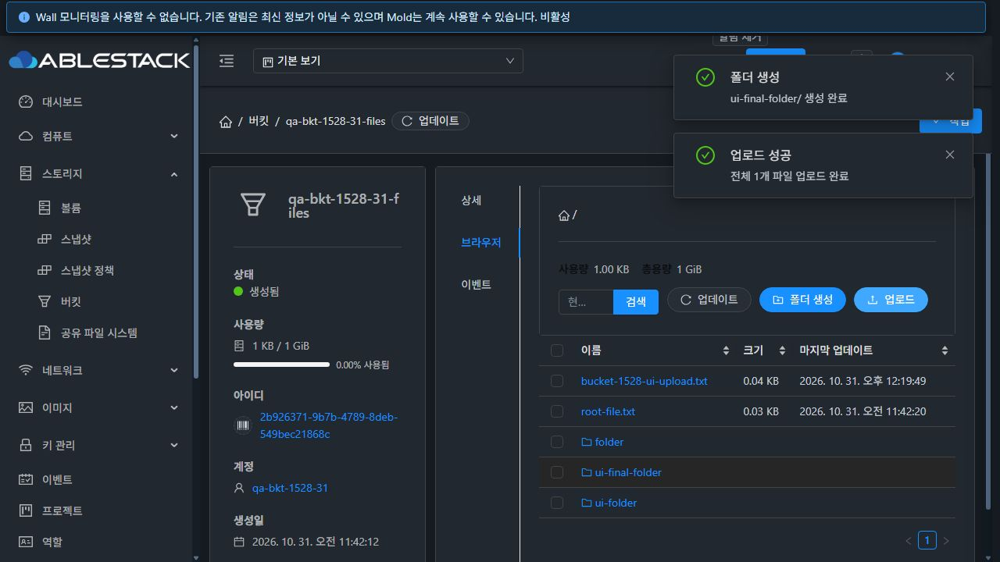
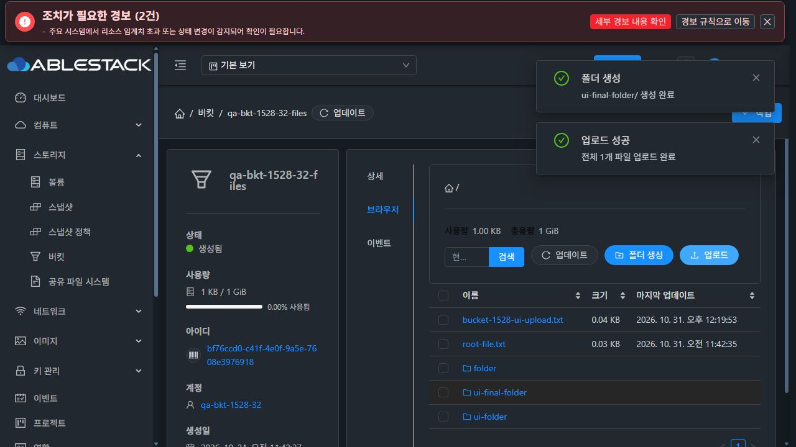
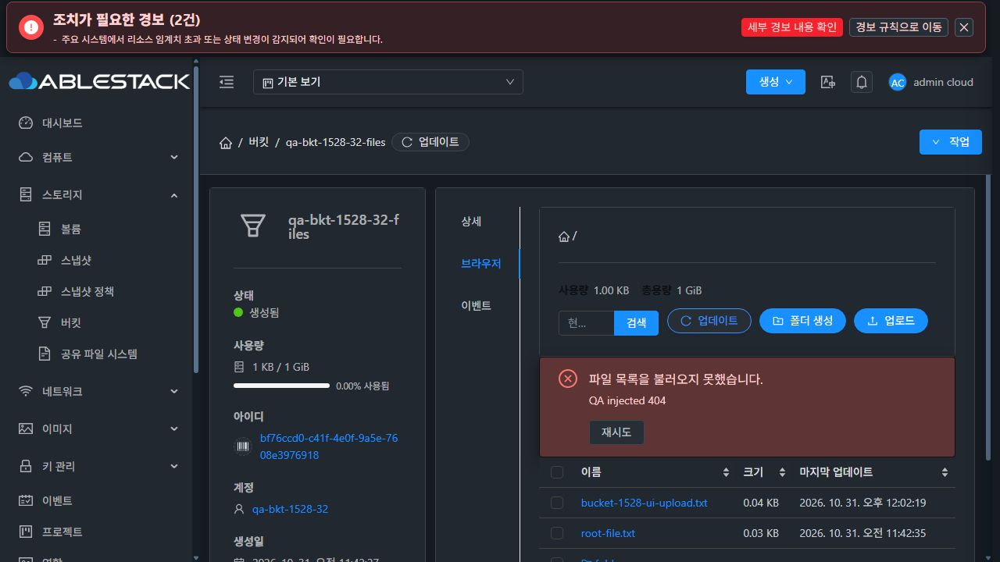
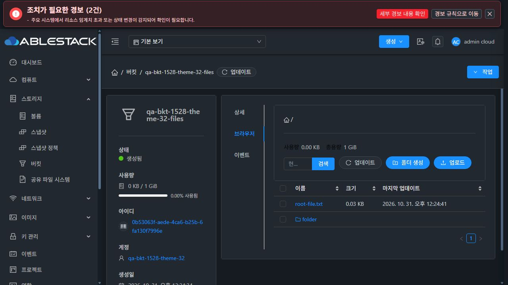

# #1528 버킷 브라우저 로딩·범위 전환 개선 검증

2026-10-31. Epic #1527 중 #1528 구현·31/32 배포·UI 검증 완료. 구현 커밋은 `40a013a8996`이며 이후 문서 커밋은 실행 코드를 변경하지 않는다. 다크 모드와 VM 스타일은 [별도 검토](STYLE-REVIEW.ko.md)에서 미준수로 판정했고 #1540을 OPEN으로 유지한다.

## 문제와 해결

1. URL에 browserPath를 추가하는 자신의 router.replace가 fullPath 기반 목록 scope를 바꾸면서 정상 S3 응답과 loading 해제를 모두 버렸다. URL 정규화 완료 후 목록을 시작하고 실제 S3 조건과 인증 범위에만 전용 scopeKey를 적용했다. 다른 mixin 호출자의 기본 동작은 유지했다.
2. 성공·error·close·취소·동기 예외·30초 timeout을 한 번만 완료하는 stream Promise를 추가했다. 이전 stream을 destroy하고 늦은 응답이 새 요청의 데이터나 spinner를 변경하지 못하게 했다. 같은 범위 갱신 실패는 마지막 성공 목록을 보존한다.
3. 상위 AutogenView가 tab=browser인 모든 이동에서 metadata 재조회를 생략해 다른 버킷 URL에도 이전 버킷 파일과 제목이 남았다. buckets의 ID 경로 변경은 새 resource를 조회하게 하고 URL ID와 다른 props의 client/파일을 재사용하지 않도록 했다.
4. 설치된 Ant Design Vue 3.2.20에서 지원하는 description 슬롯에 오류와 재시도 버튼을 표시했다. 실제 Ant Alert 렌더링 및 버튼 클릭 회귀 테스트를 추가했다.

## 실행 검증

- 수정 전 최초 진입·폴더 이동 회귀 2건 실패를 기록했고 수정 후 통과했다.
- Jest **6 suites / 66 tests PASS**, 변경 파일 lint PASS, production UI build PASS(기존 asset/entrypoint 크기 경고 2건). `source.json`, `regression-before.txt`, `tests-final.txt`, `lint.txt`, `build-summary.txt` 참조.
- 최종 실행본의 실제 UI **38건(31/32 각 19건)** 완료. 동적 테마 파일 보완 후 밝음·다크 전환과 목록 표시 6건을 추가해 총 **44건**을 확인했다. 계정/프로젝트/세션 전환, silent close와 동기 예외는 컴포넌트·stream 테스트로 검증했다. 실제 프로젝트 생성·전환을 수행한 것으로 주장하지 않는다.

| 최종 UI 검증 | 31 GFS2 | 32 RBD |
|---|---|---|
| 목록→상세→브라우저 첫 진입 | PASS | PASS |
| 다른 버킷 ID→빈 목록→원래 버킷, 이전 파일 격리 | PASS | PASS |
| 폴더/다단계 폴더, 직접 URL 새로고침, 뒤로/앞으로 | PASS | PASS |
| prefix 검색·초기화 | PASS | PASS |
| 403/404 오류 후 데이터 유지와 실제 재시도 버튼 클릭 | 403 PASS | 404 PASS |
| 응답 없는 요청의 30초 deadline·데이터 유지·재시도 | PASS | PASS |
| 취소·재시도, 늦은 이전 폴더 응답 격리 | PASS | PASS |
| 실제 폴더 생성·파일 업로드 후 목록 갱신 | PASS | PASS |

`bucket-ui-checks-final.json`의 모든 검사가 종료 시 loading=0, busy=0이다. `bucket-network-final.json`은 양쪽 실제 Glue HTTP 200 XML에 root-file.txt, 업로드 파일, 새 폴더가 있음을 확인한 결과다. 오류 주입은 전용 시험 버킷의 목록 요청에만 한정했으며 CORS 사전 요청은 정상 통과시켰다. 브라우저 전체 offline이나 운영 저장소 설정 변경을 사용하지 않았다. 계측·viewport는 해제했고 기존 다크 테마로 복원했다.

초기 배포 시험의 실패/진단 기록은 `bucket-ui-checks-initial.json`에 구분해 보존했다. 재시도 버튼과 버킷 ID 전환 문제를 발견한 뒤 최종 실행본에서 해당 경로와 나머지 주요 경로를 다시 검증했다.

## 배포 일치·보존

- 두 Mold에 동일 정적 파일 **626개**의 SHA256을 전수 대조했다. 최종 index SHA256: `221b546eb456e279b04a01158da1f8344b6627d7891ea72060d67249c6b6aae2`.
- 번들에 objectStoreRouteMatchesResource/objectStoreFetchGeneration/objectListScopeChanged와 기존 FTCTL markers를 확인했다.
- `/usr/share/cloudstack-management/webapp`의 정적 산출물만 반영했다. 서버 디렉터리·JAR·설정 19개 해시와 WEB-INF를 보존했다. 양쪽 Mold active, `/client/` HTTP 200, PID 유지(31: 4013130 / 32: 14288).
- JS/HTML 보강 backup은 31 `/var/tmp/bucket-1528-ui-20261031-r2/backup`, 32 `/nfs/bucket-1528-ui-20261031-r2/backup`이며, 최종 color.less backup은 각 경로의 `-r3/backup`에 보존했다. 첫 배포 이전 백업은 같은 경로의 `-r2` 없는 디렉터리에 보존했다.
- 사이트별 config.json/표시 설정은 보존했다. 이 결과는 RPM 메타데이터나 호스트 패키지를 모두 동일 버전으로 바꿨다는 의미가 아니다. 앞선 감사에서 정렬한 관리 JAR 실행본은 그대로 유지했다.

## 정리와 범위

기능 검증용 버킷 4개·Object Store 2개·전용 Cloud 계정 2개·RGW 사용자/키 3개를 정리했다. 이후 테마 보완 검증용 버킷 2개·Object Store 2개·Cloud 계정 2개·RGW 사용자/키 3개도 추가 정리했다. #1529 결함 때문에 삭제된 시험 계정의 원래 local-only IAM marker를 생성 응답에서 확인한 정확한 값으로 복원한 뒤 일반 deleteAccount API로 삭제했다. 운영 계정에 IAM 우회 값을 추가하지 않았다.

양쪽 활성 버킷/저장소가 없고 시험 계정 조회는 삭제 후 not-found이며, RGW 버킷 0개·dashboard 사용자만 유지·Glue HEALTH_OK를 확인했다. `cleanup.json`과 `cleanup-theme-final.json` 참조. 기존 Windows/WSL FTCTL 브랜치·추적 변경·해시도 그대로 보존했다.

전체 Cloud Maven 빌드, qemu 빌드와 full Cloud CI는 실행하지 않았다. backend/API 계약 변경은 없으며 #1529~#1540을 구현 완료로 표시하지 않는다. Epic은 1/13 부분 완료 상태다.

## 검증 화면

아래는 시험 자원 정리 전 최종 실행본 화면이다.

## 동적 테마 산출물 최종 대조

첫 정적 반영 목록에서 빠진 color.less를 최종 산출물 검사에서 발견해 보완했다. cloud.ico·cloud-image-templates.json·error.html·example.html도 동일 산출물 manifest에 포함했고 기존 파일과 같은 해시임을 확인했다. 마지막 변경 파일은 color.less 1개이며, JS/HTML과 index hash는 그대로다. 최종 manifest 626개를 양쪽에서 모두 대조했고, 새로운 전용 버킷에서 첫 목록 표시와 밝음/다크 전환을 다시 확인한 후 정리했다. `bucket-theme-final-checks.json` 참조.

최종 color.less SHA256은 `d4ff10b9e6dcf83d2dddf512c86c7fedc1e23b9f9544339cfe3fd32d0858c978`이다. 다크 레이블/객체 상세 고정 검은색과 툴바 순서 문제는 #1540의 미해결 사항이며 테마 산출물 보완을 표준 준수 완료로 간주하지 않는다.

