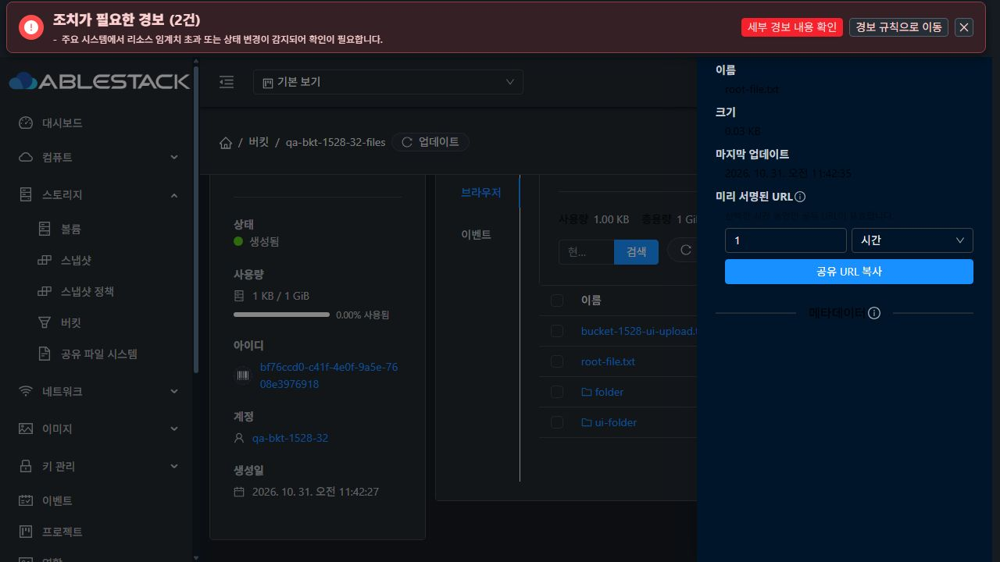

# 버킷 브라우저 다크 모드·VM UI 표준 비교

2026-10-31, 31 GFS2 / 32 RBD, 두 Mold 모두 32번 Glue RGW 사용. 결론은 **표준 미준수**이며 #1540을 OPEN으로 유지한다. #1528의 목록 요청·로딩 계약과 별도 완료 기준이다.

## 비교 기준과 결과

비교 기준은 실제 VM 상세의 볼륨 탭과 `ui/src/views/compute/VmVolumesTab.vue`다. VM이나 볼륨의 생성·연결·분리는 수행하지 않았다.

| 항목 | VM 기준 | 버킷 브라우저 실측 | 판정 |
|---|---|---|---|
| 툴바 순서 | 생성 및 연결 → 기존 볼륨 연결 → 업데이트 → 오른쪽 검색 | 검색 → 업데이트 → 폴더 생성 → 업로드 | 미준수 |
| 버튼 모양 | 공통 기본 버튼, radius 4px | round 지정, 작업 버튼 border-radius 32px | 미준수 |
| 다크 레이블 | 공통 테마의 밝은 전경색 | 사용량·총용량 rgba(0,0,0,0.65), 배경 rgb(34,40,47) | 미준수 |
| 객체 상세 값 | 테마에 맞는 본문 색 | drawer 값 rgba(0,0,0,0.85) 고정 | 미준수 |
| 좁은 폭의 검색·작업 접근 | 작업 줄바꿈 및 별도 검색 행 | 검색 폭 0, 업로드 오른쪽 끝이 화면 밖 | 미준수 |
| 갱신 실패 | 성공한 기존 목록 유지와 오류 안내 | #1528에서 데이터 유지·오류·재시도 제공 | 동작 확인, 전체 표준 PASS 의미 없음 |

31/32에서 밝음·어두움 모드를 모두 비교했다. 검증 후 기존 다크 테마를 복원했다.

## 반응형 실측

두 클러스터의 결과는 동일했다. Emulation 설정값만 신뢰하지 않고 DOM `innerWidth/innerHeight` 및 버튼 좌표를 읽었다.

| 실제 폭 | 검색 input 폭 | 작업 버튼 최우측 | 툴바 clientWidth |
|---|---:|---:|---:|
| 1440 | 144.25 | 1357.98 | 614 |
| 901 | 110.17 | 809.00 | 579 |
| 390 | 0 | 405.53 | 256 |
| 360 | 0 | 405.53 | 226 |

툴바의 `wrap=false`, 검색과 작업의 배치, 고정된 밝은 색 CSS가 원인이다. 390px에서는 15.53px, 360px에서는 45.53px가 viewport 밖으로 나간다. 필요한 객체 테이블 스크롤과 작업 버튼의 접근 제한을 구분해서 수정해야 한다.

## #1540 해결 방향

1. VM과 같은 공통 버튼을 사용하고 폴더 생성·업로드 등 주 작업을 앞에 배치한다. 업데이트를 보조 작업 끝에, 검색을 넓은 화면 오른쪽에 둔다.
2. 좁은 화면에서는 작업과 검색을 별도 행으로 줄바꿈하고 검색의 실제 입력 폭을 보장한다.
3. 사용량, 객체 상세, 업로드 상태의 색을 테마 token으로 전환한다. 밝은 테마 전용 배경/전경 고정을 제거한다.
4. 새 목록 오류·취소·시간 초과·재시도 UI도 같은 버튼/간격/키보드 규칙으로 통합한다. 목록 완료 처리는 #1528의 요청 소유권 규칙을 재사용한다.
5. 폴더와 객체의 클릭 요소는 키보드 접근과 의미 있는 role/이름도 검증한다. 이번 작업은 그 전체 접근성 PASS를 주장하지 않는다.

## 근거와 이미지 해석

`bucket-responsive.json`, `bucket-style-checks.json`, `vm-standard.json`과 JPEG를 함께 확인한다. 기본 캡처는 1280×720이다. 모바일 DOM은 390×844이지만 도구의 JPEG 미리보기는 390×219로 축소되므로 모바일 이미지를 원래 viewport 전체 해상도라고 해석하지 않는다. 좌표/폭 판정은 JSON의 실제 DOM 측정을 따른다. 시험 중 viewport override는 모두 해제했다.

최종 color.less 보완 후에도 31/32에서 밝음·다크 전환과 목록을 다시 확인했다. 사용량·총용량의 고정 검은색과 툴바 차이는 그대로이며 #1540은 OPEN이다. `bucket-theme-final-checks.json`과 `bucket-1528-theme-final-31.jpg`, `bucket-1528-theme-final-32.jpg` 참조.
