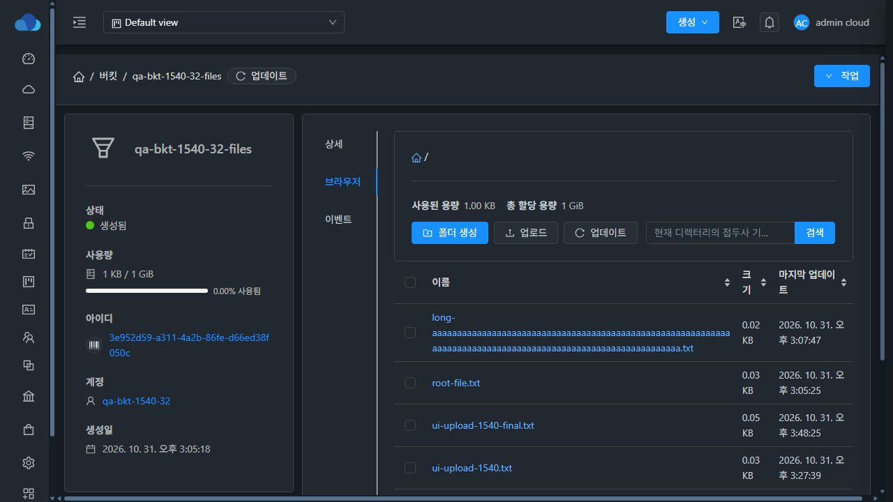

# #1529 Glue 계정 상세 보존과 저장소별 자격 증명 검증

검증일: 2026-10-31 KST. 기존 `dhslove/epic-1527-buckets` 브랜치/PR #1541에서 구현했고, 31 GFS2·32 RBD에 같은 실행본을 반영했다. 실제 버킷 데이터는 양쪽 모두 32번 Glue에 저장된다. #1529 범위의 구현·UI 검증과 정리는 완료했으며, 별도 quota 동시 처리 결함 #1531은 아래에 구분해 기록했다.

## 변경 결과

계정 상세 전체를 교체하던 Glue 경로를 제거했다. IAM origin·임의 상세·기존 legacy 키를 쓰거나 지우지 않고, account/store별 암호화된 credential 행과 실제 Glue 검증을 사용한다. 미존재만 생성하고 인증 거부·시간 초과를 미존재로 바꾸지 않는다. 기존 사용자/키를 삭제·회전하지 않는다.

검증 상태·시각을 API와 상세 화면에 추가했고, 실패 응답은 키를 전달하지 않는다. 브라우저는 오래된 키가 남아 있어도 미검증 상태의 SDK 사용을 차단한다. 재시도는 실제 부모의 메타데이터 조회로 연결되며 현재 언어로 안내를 갱신한다. 상세 상태는 VM 공용 Status, 날짜는 공용 표시를 사용한다. [구현·스키마·배포 계약](IMPLEMENTATION.ko.md).

## 실제 기능 검증

| 검사 | 31/32 결과 | 근거 |
|---|---|---|
| 일반 계정의 첫/추가 버킷 UI 동시 생성 | 각 2개 생성, credential 1행·외부 키 1개, 기존 IAM+임의 상세 3개 값/개수 보존 | initial-31/32.json |
| 한 계정의 저장소 2개 | 실제 서로 다른 유효 키 2개가 서로 덮어쓰지 않음, 버킷 3개 접근 유지 | store-isolation.json |
| Cloud 키 행 누락·다른 사용자 키 불일치 | UI 업데이트로 실제 Glue/버킷 관계를 확인해 복구, 외부 키 불변 | missing-recovery.json, stale-recovery.json |
| 실제 Glue 인증 403 | 미검증 상태·키 없는 응답·SDK 작업 차단, 신규 외부 사용자/Cloud 버킷 미생성 | auth-denied-create.json, ui-s3-objects.json |
| 인증 복구 후 Enter 재시도 | 부모 listBuckets 200 → 실제 S3 GET 200 → 기존 파일 표시 | keyboard-retry-final.json |
| Glue 사용자 생성 뒤 DB 저장 실패 | NeedsVerification·CreatedByCloud 기록, 기존 상세·외부 사용자/키 보존, 실패 조건 제거 후 같은 UI 폼 재시도 성공 | db-failure.json, db-failure-verify-recovered.json |
| 실제 UI 폴더 생성·파일 선택기 업로드 | 저장소 A/B 각각 성공, 파일·폴더 8개 S3 GET와 내용 SHA 확인 | ui-s3-objects.json |
| 계정·저장소 연결 정리 | IAM origin 수동 복원 없이 일반 계정 삭제 6개 성공, scoped 행 제거·외부 사용자 자동 삭제 없음 확인 | cleanup-early.json, cleanup.json |

두 저장소는 같은 `10.10.32.12:3333` Glue endpoint의 포트 표기 별칭으로 등록했다. 서로 독립된 Ceph 두 곳의 검증은 아니다. 그 안에서 실제 서로 다른 S3 키를 사용해 store scope 분리를 검증했다. timeout·suspended·잘못된 사용자·불완전한 키·provider 호환성은 backend 집중 검사에 포함한다. DB 실패의 생성 UI는 표준 530 오류를 표시하고 성공으로 처리하지 않았으며, SQL/키를 표시하지 않았다.

## VM UI 표준·다크모드·반응형

- 최종 app `js/app.72c8473b.js`를 실제 양쪽 브라우저에서 확인했다. 31/32 × 라이트/다크 × 한글/영문 × 1440/901/390/360px의 정상·오류 화면 **64조합 PASS**.
- VM 실제 볼륨 탭과 같은 32px 버튼·4px 모서리, 주 작업/업로드/업데이트 순서, 데스크톱 오른쪽 검색, 좁은 화면 검색 줄바꿈과 가로 경계를 확인했다. 표 내용의 내부 가로 스크롤은 허용한다.
- 검증 완료/필요 배지 **16조합 PASS**. 글자 대비는 라이트 약 6.98:1, 다크 약 7.13:1이다. 오류 설명은 약 10.26:1 / 7.60:1, 재시도는 7.56:1 / 8.47:1이다. 색상만으로 상태를 전달하지 않는다.
- 언어를 바꿔도 오류 안내가 이전 언어로 남지 않는지 실제 UI와 회귀 검사로 확인했다. 키보드 Enter 재시도 후 파일 목록 회복도 확인했다.
- JSON에 실제 DOM viewport와 좌표·대비·오류 목록을 기록했다. 모바일 JPEG는 **360×203 축소 미리보기**이며 DOM의 360×844와 구분한다. 최종 확인용 화면은 원래 1280×720 JPEG다. [이미지 크기 기록](screenshots.json).

## 빌드·스키마·실행본

- 변경 Maven 모듈 6개만 WSL ext4에서 빌드했다. backend 집중 검사 21건 + 실제 DAO 날짜 바인딩 2건 = **23건 PASS**. UI 최종 **7 suites / 80건 PASS**, 변경 파일 lint·production build/postbuild PASS.
- 실제 MySQL의 새 테이블 DDL, 기존 행을 가진 멱등 재실행, unique/FK와 계정/저장소 cascade를 검사했다. 같은 4.23 배포에서는 추가 SQL을 먼저 적용했다. 전체 신규 Mold 설치를 실행했다는 뜻은 아니다.
- Backend source `57e8fe086fd3ddd1c96b76605de898f166c91ffd`, UI source `37a8aa5de7b6c1a77e49bb450479ec254831d870`. 주 JAR SHA256 `7bee8728fee1ad8b92e8b61bf45f1f226af8c42ffca3e482f03a80621ba1c0d0`. 최종 index SHA256 `19a33faefc4686ee0304840ebd3d0aa769e8e5c81065df6cc6f3f0a7df4fd50f`.
- 설치된 flat uber JAR의 entry 40개를 반영했고, 다른 **204,552개 entry payload 해시를 보존**했다. 관리 라이브러리 9개와 최종 정적 파일 **626개**가 31/32에서 모두 같다.
- 주 JAR은 백업·원자 교체·기동/로그인 검사를 거쳤다. 시범 반영에서 같은 버전의 schema hook 미실행과 날짜 매핑 누락을 확인해 각각 명시적 선행 DDL 및 Temporal 매핑/회귀 검사로 보완했다. 실패 시 원본 JAR 자동 복구도 실행됐다.
- 정적 배포는 WEB-INF·기존 서버 파일/설정·관리 JAR·PID를 보존했다. META-INF는 양쪽 기존 설치에 없으며 새로 만들거나 삭제하지 않았다. Mold active·/client HTTP 200, 남긴 버킷 Verified·검증 시각을 확인했다.
- API 제품 버전은 양쪽 `4.23.0.0-Mold.Europa-202609222315`, UI 표시 버전은 기존 `V4.0-4.0.15`를 유지한다. 이는 실행 JAR/UI의 부분 반영이며 RPM 버전 재패키징은 아니다. Windows FTCTL 3개 파일과 WSL FTCTL 11개 변경의 HEAD·브랜치·차이를 보존했다.

## 정리 중 확인한 미해결 경계 — #1531

동시 생성은 credential을 한 행/한 외부 사용자로 직렬화했지만, 이후 기존 bucket quota/할당 카운터 갱신은 별도 경로여서 저장소 A가 2GiB 대신 1GiB만 반영됐다. 32번에서는 다른 시험 계정을 정리한 뒤에도 active bucket quota 합계 2GiB에 대해 allocated_size=1GiB였다. 31번은 두 번째 삭제에서 할당량 unsigned underflow로 530이 발생했고, 외부의 빈 버킷은 먼저 삭제된 상태였다.

이 결함은 **#1531에서 아직 해결하지 않았다**. 정리를 위해 전용 시험 저장소의 allocated_size만 active Cloud 버킷 quota 합계로 보정하고, bucket/object_storage 유형만 updateResourceCount API로 재계산했다. 31번에서 실패한 삭제의 빈 전용 A2 버킷만 재생성한 뒤 일반 삭제를 다시 실행했다. 기존 운영 버킷·확인용 저장소·IAM 상세는 변경하지 않았다. [보정 전후 기록](cleanup-quota-repair.json). 따라서 자격 증명 동시성 PASS를 quota 원장 동시성 PASS로 해석하면 안 된다.

## 최종 보존 상태와 검토 경계

전용 버킷 10개·객체/폴더 8개·계정 6개·저장소 4개·외부 QA 사용자/키를 정리했다. Cloud 정리 자체는 외부 사용자를 삭제하지 않는 것을 확인한 뒤, 소유한 6개 QA 사용자만 명시적으로 제거했다. Glue HEALTH_OK, 기존 dashboard 사용자 보존.

32번 **qa-bkt-1540-32-files** 하나와 그 계정·저장소·키를 남겼다. 원래 **11개 객체의 이름·크기·내용 SHA256**, 소유 계정 상세가 모두 같다. [확인용 브라우저](http://10.10.32.10:8080/client/#/buckets/3e952d59-a311-4a2b-86fe-d66ed38f050c?tab=browser) · [보존 검사](retained.json).

전체 Cloud build/Full CI·qemu 빌드·호스트 배포·실제 외부 IAM 서버 삭제 통합은 이번 범위 밖이다. 정상 상태 API/상세의 키 노출 제거·마스킹/명시적 회전은 #1533에 남아 있다. #1530~#1539의 미구현 계약은 종료하지 않는다. 기존 Epic PR #1541과 Epic #1527에 결과를 반영하고 #1529만 종료하는 작업이며 PR은 미병합, Epic은 OPEN이다.

