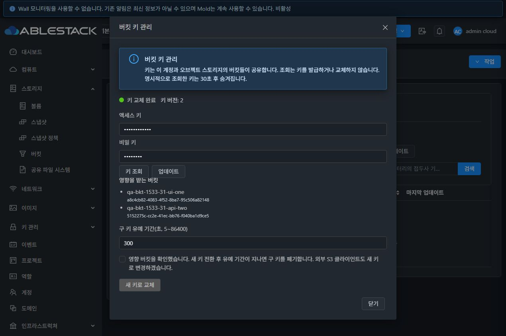
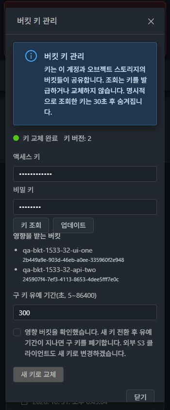
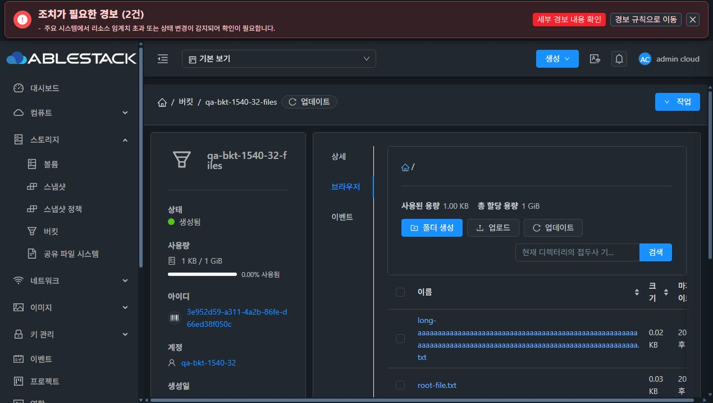

# #1533 버킷·Object Store 키 보호와 명시적 관리 검증

2026-10-31, Asia/Seoul. Epic [#1527](https://github.com/ablecloud-team/ablestack-cloud/issues/1527), 기존 PR [#1541](https://github.com/ablecloud-team/ablestack-cloud/pull/1541)의 `dhslove/epic-1527-buckets`에서 구현했다. #1533의 완료 기준을 31번(GFS2)·32번(RBD) Mold UI/API/DB와 **32번 Glue RGW/S3**에서 검증했다. GFS2/RBD에 버킷을 직접 저장한 시험은 아니다.

## 결과와 구현

일반 BucketResponse의 accesskey/usersecretkey 필드를 제거하고 상세 자동 표시도 없앴다. 새 POST API `getBucketCredentials(id,reveal=false)`는 기본 마스킹 정보·revision·영향 버킷·교체 상태를 반환한다. `reveal=true`에서 기존 ACL을 통과한 현재 검증 키만 반환하며 키를 발급하지 않는다. no-store/Pragma와 민감 응답 직렬화 마스킹을 적용했다. 조회·회전·저장소 등록/수정은 전역 설정과 관계없이 GET을 거부하고 요청 본문·쿼리를 관리 로그에 기록하지 않는다.

브라우저는 목록 응답의 키 대신 화면별 S3 세션을 사용한다. localStorage/sessionStorage/Vuex/라우트에 새 키를 저장하지 않는다. 로그아웃 시작·다른 탭 인증/프로젝트 변경·계정/버킷/프로젝트/관측 revision 변경에서 SDK와 미리보기를 폐기하고 늦은 응답도 버린다. 명시적 키 조회 후 30초 숨김, 닫기/범위 변경 시 폐기, 초기 조회 실패의 명시적 재시도를 구현했다.

`rotateBucketCredentials`는 account/store 분산 잠금, expectedrevision, 작업 UUID, Prepared→Grace→Retiring→Completed를 사용한다. 후보 ID를 먼저 저장하고 Glue가 secret을 생성한다. 모든 대상 버킷에서 새 키의 실제 S3 읽기를 검증한 후 현재/이전 키·revision·호환 스냅샷을 원자적으로 확정한다. 실패는 구 키와 동일 작업을 보존하며 배경 worker/명시적 재시도로 복구한다. 유예 후 기록된 구 키만 폐기한다. 같은 RGW 사용자의 같은 키를 다른 논리 저장소/legacy bucket이 참조하면 회전을 차단한다. 진행 중 quota와 키 교체 중 endpoint 변경/저장소 삭제도 차단한다.

관리자 키 교체는 이미 발급된 후보 쌍을 검증하고 URL/키/이름/용량을 짧은 DB 트랜잭션으로 갱신한다. 일부·빈 입력, 외부 검증 및 DB 저장 실패는 기존 연결을 보존한다. Glue 관리자 키를 발급하거나 외부 구 키를 폐기하는 API는 아니다. 입력은 password/autocomplete off이며 실패/성공/컨텍스트 전환 때 비운다.

공유 링크는 명시적 생성 후 읽기 전용 입력에서 직접 선택할 수 있다. 복사 Promise 완료 후 성공을 표시하고 실패 시 수동 복사를 안내한다. 객체/계정/키 컨텍스트 변경과 닫기에서 링크를 지우고 늦은 콜백을 버린다. S3 presigned URL의 access 식별자·파생 서명은 의도한 공유 계약이며 Secret Key를 포함하지 않는다.

[최종 설계](../../design/bucket-1527/1533-credential-management.ko.md) · [BKT-05 완료 기준](../../design/bucket-1527/BKT-05.ko.md)

## 실제 기능 검증

| 검증 | 31·32 결과 | 근거 |
|---|---|---|
| 일반 목록/상세/sync 비노출 | key 필드와 실제 키 값 없음 | api-contracts-31/32.json |
| 생성 async 결과 | 신규·과거 완료 작업 각 16개, 총 32개 응답에서 key 필드 없음 | async-response-contracts-31/32.json |
| 명시적 조회 | 기본 마스킹, reveal=true, owner User 허용/타 계정 531 거부, POST/no-store, 조회 전후 키 수 동일 | api-contracts-31/32.json |
| 관리자 키 교체 | 양쪽 UI 등록/실패/성공, 부분·빈·잘못된 쌍 거부, DB trigger 실패 시 URL/쌍 동시 rollback, 기존 tenant 연결 보존 | administrator-key-tests.json, ui-admin-replacement-31/32.json |
| 교체 실패 복구 | 새 후보 생성 후 활성화 DB 실패를 주입. Prepared+RecoveryRequired/구 키 유지 → 관리 서버 재시작 → UI에서 같은 UUID 재시도 → 두 버킷 revision 2/새 키 적용/구 키 폐기 | recovery-prepared/completed-31/32.json, backend-deployment-31/32.json |
| 정상 UI 회전 | 소유자 UI에서 영향 2개/동의/30초 유예로 실행. 두 버킷 모두 유예 중 신·구 키 GET 200, 이후 구 키 403/새 키 200. 다른 계정 영향 없음 | rotation-grace/completed-31/32.json |
| 보호 조건 | stale revision, 다른 작업 UUID, 이른 폐기, 잘못된 유예, 진행 중 endpoint 변경/저장소 삭제, 저장소 간 공유 키 회전 거부 | pending-rotation-guards.json, shared-alias-guard-31/32.json |
| 조회 장애 | QA 관리자 read 권한 장애로 첫 조회 실패 → 권한 복구 → UI 재시도만으로 정상 조회/오류 해제 | [31번 실패 UI](ui-31-lookup-failure.jpg)·[32번 실패 UI](ui-32-lookup-failure.jpg), UI 단위 테스트 |
| 키 수명 | 조회 후 33.6초 확인에서 숨김. 다른 탭 로그아웃 후 31번 442ms/32번 473ms에 조회 키 숨김과 SDK·목록 폐기 | ui-key-expiry.json, ui-cross-tab-immediate-31/32.json |
| 파일 브라우저 회귀 | UI 폴더 생성/탐색·파일 업로드(metadata 포함)·상세·공유 URL 생성·객체 삭제. 새 키 GET/공유 링크 GET의 원본 SHA256 동일, 삭제 후 S3 404 | ui-file-operations-31/32.json, ui-share-final.json |
| 로그 | 발급 후 폐기한 값을 포함한 시험 키 22개로 현재 관리/HTTP 로그와 당일 mold journal 검색, 실제 값 0건 | credential-log-scan.json |

UI 복구 화면은 [실패 상태](ui-32-recovery-prepared.jpg)와 [동일 작업 복구 완료](ui-32-recovery-completed.jpg)에 남겼다. 이 두 이미지는 입력 라벨 보강 전 복구 과정의 기록이다. 최종 배포본의 라벨·테마 검증은 아래 20개 화면을 따른다.

기존 #1538 객체 상세 metadata 표시 제약은 OPEN으로 유지한다. 이번에는 metadata 업로드와 표준 S3 GET 응답의 metadata 보존을 확인했다. 자동 복사는 검증 브라우저의 성공 신호와 Promise 계약을 확인했으며 OS 클립보드 전달 자체는 확인하지 못했다. **UI에 표시된 실제 공유 링크를 별도로 GET해 HTTP 200과 내용 SHA256을 확인했다.** 메모리 전용 저장은 소스/단위 테스트, 즉시 폐기는 실제 UI로 검증했다. raw CDP 저장소 조회는 브라우저가 지원하지 않아 실제 저장소 전체 덤프 검증으로 계산하지 않는다.

## VM 메뉴 스타일·다크모드·반응형

최종 `js/app.da7b8cc5.js`에서 키 관리 12개(2클러스터×라이트/다크×360/768/1280px), 관리자 교체 8개(2×2×360/1280px)를 검증했다. 모든 password/유예/확인 입력의 label 연결, autocomplete, 기본 마스킹과 버튼 활성 조건을 확인했다.

- 측정한 활성 텍스트 대비 4.5:1 미달 0건. 키 관리 최소 라이트 **6.98:1**, 다크 **7.13:1**; 관리자 폼 라이트 **7.56:1**, 다크 **7.13:1**.
- 모달/본문 수평 넘침 0건. 360px에서 모달 폭 328px, 내부 세로 스크롤 후 닫기 버튼 완전 노출/접근을 확인했다.
- 공통 action modal/Status/테마 토큰, 32px 폼 버튼·4px 모서리·14px 서체를 유지했다. 실제 VM 목록의 32px 주 작업 버튼과 24px 갱신 버튼 규격은 vm-standard-31/32.json에 별도로 기록했다. 목록 주 작업의 round 규격과 모달 폼 버튼 규격을 구분했다.
- ui-key-*/ui-admin-*.json에 DOM viewport/모달 좌표/본문 폭/대비/버튼/label/실제 이미지 크기를 함께 기록했다. fullPage JPEG는 스크롤바를 뺀 폭 1270/758/350px, 높이 844px다. 뷰포트 크기와 이미지 크기를 같다고 간주하지 않았다.

## 빌드·배포

| 항목 | 결과 |
|---|---|
| 작업본 | dhslove WSL ext4 `/home/ablecloud/work/dhslove/cloud-epic-1527` |
| backend 빌드 소스 | `f62c70d2be7429d430055d07a50b9285167925b1` |
| UI 빌드 소스 | `4538f566d59c553d9e0827b8ada32fe56bbb63c0` |
| 변경 Maven 모듈 | api, engine/api, engine/schema, server, plugins/storage/object/ceph |
| 집중 테스트 | server 61 + Glue 39 = backend 100, UI 6 suites/81 tests PASS |
| 정적 검사/패키징 | 변경 Java Checkstyle, UI lint, production build PASS |
| 주 JAR SHA256 | `24f1f0d298a16327345b385da514e2a99f80ca7b9d754fb3d69c8ccbabfb7537` |
| index.html SHA256 | `7992cc5cfaa3d0d8557173b20e127340daa26f5f4139cd730ba4ccaac21be0fe` |
| 31/32 정렬 | 실행 라이브러리 9개·정적 파일 630개 해시 일치 |
| 서비스 | 양쪽 Mold active, /client/ HTTP 200, API 로그인/새 API 동작, 호스트 각 3대 Up |
| Glue | HEALTH_OK, RGW 3/3 running |

같은 버전 DDL을 JAR 전에 적용했다. flat JAR의 변경 클래스/자원 59개를 덮고 나머지 204,556개 entry 해시를 보존했다. UI는 활성 webapp의 정적 파일만 갱신했고 WEB-INF/서버 설정을 보존했다. META-INF는 원래 양쪽에 없었다. FTCTL의 blockingLoadingState/fetchSyncProgress/extractJobId와 기존 quota/browser 표식도 확인했다.

전체 Cloud 빌드·Full CI·GitHub Actions·qemu 빌드는 실행하지 않았다. 변경 Java의 집중 Checkstyle을 모듈 전체 Checkstyle 통과로 계산하지 않는다(이전 검증에서 확인한 기존 import 오류 범위와 별도). API 표시 버전 `4.23.0.0-Mold.Europa-202609222315`, UI `V4.0-4.0.15`, RPM 메타데이터는 유지했다. 외부 구 클라이언트는 새 명시적 POST 조회로 전환해야 하며 기본 응답 키 노출을 켜는 호환 플래그는 제공하지 않는다.

## 정리·보존과 다음 작업

추가한 Cloud 버킷/저장소/4계정과 Glue 시험 사용자 5개·키를 정리했다. C 복구 fixture도 정상 API로 먼저 제거했다. 진행 중 키 교체·quota 작업·임시 예약·QA credential 행·fault trigger는 0이다. 계정 카운터는 삭제 전 0이며 수동 원장 보정은 사용하지 않았다. 기존 Windows/WSL FT 작업본의 HEAD/branch/diff/status 및 WSL untracked 해시를 보존했다.

**확인용 버킷 [qa-bkt-1540-32-files](http://10.10.32.10:8080/client/#/buckets/3e952d59-a311-4a2b-86fe-d66ed38f050c?tab=browser)을 유지했다.** 원래 11개 객체의 이름·크기·SHA256과 계정 상세가 같다. 현재 UI 최상위 목록은 8개 항목(중첩 경로 포함 전체 객체 11개)이고 로딩 0개다. 이 버킷/저장소/계정/기존 키는 회전하거나 삭제하지 않았다. Glue에는 해당 버킷과 기존 dashboard/qa-bkt-1540-admin/소유 사용자만 남는다.

ROOT 카운터는 31번 bucket/object_storage 0/0, 32번 1/1GiB다. 32번 기존 루트 공간 경보는 별도 운영 사항이며 최종 여유는 약 886MiB다. 배포/백업은 NFS stage를 사용했다.

Epic 진행은 **5/13 완료**, P1 잔여 #1530·#1532, P2 잔여 #1534~#1539다. 다음 권장 작업은 **[#1532 빈 버킷만 일반 삭제하고 버전·명시적 강제 정리를 분리하는 개선](https://github.com/ablecloud-team/ablestack-cloud/issues/1532)**이다. 기존 데이터 손실 위험을 먼저 줄이고 버전 조회/복구·선택 삭제와 실패 복구를 이어 검증한다. PR #1541은 OPEN/미병합, Epic #1527은 OPEN을 유지한다.
