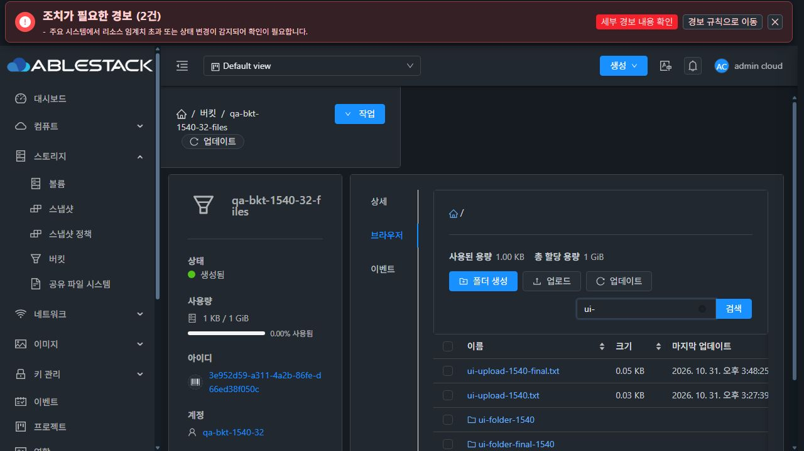

# #1540 버킷·오브젝트 스토리지 UI 표준 개선 검증

2026-10-31, Asia/Seoul. Epic #1527 / PR #1541의 같은 `dhslove/epic-1527-buckets` 브랜치에서 구현했다. 최종 UI 소스 `994319d3f68`. #1528의 요청 수명·범위 격리 계약을 유지하면서 #1540을 검증했다. 다른 11개 하위 이슈는 미해결이다.

## 변경 결과

- 실제 VM 볼륨 탭의 32px 높이·4px 모서리, 주 작업 → 보조 작업 → 업데이트 순서를 따랐다. 검색은 넓은 화면에서 같은 행 오른쪽, 좁은 화면에서 별도 행에 배치한다.
- 사용량/객체 상세/업로드 진행 영역은 공통 테마 토큰을 사용한다. 상태는 기존 Status 배지로 `생성됨`, 불리언은 `비활성화/활성화/알 수 없음`, 정책은 `공개/비공개`로 표시한다. 한국어 오브젝트 스토리지 용어를 통일했다.
- 폴더/객체/경로는 이름이 있는 native button이며 Enter로 조작한다. 객체 drawer는 화면 폭 안에 들어오고 Escape로 닫으면 원래 객체 버튼에 포커스를 복원한다.
- 폴더·업로드는 공통 MoldDialog로 전환했다. 버킷 생성/수정·인프라 등록 모달은 반응형 폭과 스크롤을 적용했다. 제출 중 버튼 상태와 폼 이벤트 처리도 보완했다.
- 표 선택은 SDK 객체 참조 대신 안정된 키를 사용한다. 갱신 후 새 레코드에 선택을 매핑하고 사라진 항목은 해제한다. 언어 전환 시 표 머리글을 갱신하며 업로드 알림도 locale을 사용한다.
- 인프라 상세의 byte 응답은 기존 단위 포맷터로 표시한다. 1TiB 추적 상한의 단위 표시를 검증했다. #1539의 수정 초기값/연결 상태 계약을 구현한 것으로 계산하지 않는다.

## 검증 결과

- Jest 7 suites / 76 tests PASS, 변경 파일 lint PASS. 실제 Ant Table 선택 갱신과 언어 전환 시 머리글 변경·중복 목록 요청 방지 회귀를 포함한다.
- production UI build PASS. 전체 Cloud Maven/qemu 빌드와 Full Cloud CI는 실행하지 않았다. 기존 Browserslist/asset 크기 경고는 build.txt에 보존한다.
- 최종 배포본 레이아웃 32건: 31/32 × light/dark × 한국어/영어 × 1440/901/390/360. 1440px에서 작업·검색은 같은 행이고, 좁은 폭에서 버튼과 입력이 viewport 안에 있다. 최소 검색 input 폭 89.69px. 사용량 레이블 대비는 밝음 7.56:1, 다크 9.18:1이었다. 해당 레이블의 실측이며 전체 앱 접근성 인증은 아니다.
- 중간 구현 `4f3d17e4716`의 실제 기능/폼/키보드 57건 PASS. 최종 구현의 추가/재확인 26건 PASS. 파일별 소스와 관찰값을 JSON에 구분했다.
- 폴더 생성·파일 선택기 업로드·갱신 후 선택 유지, 상세 포커스 복원, 폴더/검색/직접 URL/뒤로·앞으로/빈 버킷, 403/404·취소·30초 시간 초과·재시도를 실제 UI로 검증했다. 오류 주입은 전용 QA 버킷의 ListObjectsV2 요청에만 적용했다.
- 버킷 생성/수정과 인프라 등록/수정은 360px/1440px에서 키보드 취소·테마·경계를 검증했다. 생성 폼은 빈 값의 확인 버튼 Enter로 필수 검증을 확인했다. 계약 이슈가 남은 버킷 보호 옵션·인프라 크기 수정은 제출하지 않았다.

## 최종 배포

동일 정적 파일 626개 전체 SHA256을 양쪽 active webapp에서 확인했다. [관리 라이브러리 9개도 양쪽 해시가 일치](runtime-alignment.json)한다. index SHA256 `3d53dbabfb14557c2f12ab790b7ab82e410d14cfc153dd54b7826058379fab88`. dhslove WSL ext4 clone에서 UI만 빌드했다. index는 마지막에 교체하고 기존 정적 파일만 덮어썼다. WEB-INF/META-INF/설정/JAR 보호 파일은 양쪽 각각 19개 보존했고 Mold PID도 유지했다. 양쪽 active, /client/ HTTP 200. 31 GFS2와 32 RBD의 버킷은 모두 32번 Glue RGW를 사용한다. RPM/호스트 Agent/Glue 패키지 전체 버전 일치를 의미하지 않는다.

백업: 31 `/var/tmp/bucket-1540-ui-20261031-final/backup`, 32 `/nfs/bucket-1540-ui-20261031-final/backup`. 기존 Windows/WSL FTCTL의 브랜치·head·추적 변경 및 사전 지정 파일 해시를 보존했다.

## 확인용 버킷과 정리

사용자 요청에 따라 **32번 `qa-bkt-1540-32-files` 하나를 유지**했다. [Mold 브라우저 탭](http://10.10.32.10:8080/client/#/buckets/3e952d59-a311-4a2b-86fe-d66ed38f050c?tab=browser). 폴더/다단계 폴더/긴 한글·영문 이름/업로드 파일을 남겼다. 기능 유지에 필요한 시험 소유 계정·오브젝트 스토리지·RGW 관리자 키도 함께 남겼다. 자격 증명 값은 보고서/이미지에 싣지 않았다.

31번의 버킷·시험 계정·저장소와 32번 빈 버킷은 제거했다. RGW 버킷은 확인용 1개, 원래 dashboard 사용자는 보존했다. 전용 QA 계정의 원래 IAM marker만 복원했으며 다른 계정은 수정하지 않았다. Glue HEALTH_OK. 활성 자원 수와 실제 S3 목록은 cleanup.json 및 retained.json을 따른다.

## 근거

[최종 레이아웃](layout.json) · [중간 기능 검증](functional-interim.json) · [최종 UI 재확인](functional-final.json) · [VM 표준](vm-standard.json) · [화면·이미지 치수](screenshots.json) · [보호 변경 확인](protected.json) · [31 배포](deployment-31.json) · [32 배포](deployment-32.json) · [해시](manifest.json) · [정리](cleanup.json) · [남긴 버킷](retained.json) · [Jest](tests.txt) · [lint](lint.txt) · [빌드](build.txt) · [수정 전 비교](../bucket-1528-20261031/STYLE-REVIEW.ko.md)

모바일 JPEG는 도구가 축소한 미리보기다. DOM viewport와 decoded image 크기를 screenshots.json에 함께 기록했으며 원본 viewport와 동일한 해상도라고 표현하지 않는다.

## 레이아웃 실측

| 클러스터 | 테마 | 언어 | 실제 폭 px | 검색 input px | 레이블 대비 | 결과 |
|---|---|---|---|---|---|---|
| 31 | light | ko | 1440 | 155.17 | 7.56:1 | PASS |
| 31 | light | ko | 901 | 128.17 | 7.56:1 | PASS |
| 31 | light | ko | 390 | 140.23 | 7.56:1 | PASS |
| 31 | light | ko | 360 | 110.23 | 7.56:1 | PASS |
| 31 | light | en | 1440 | 116.69 | 7.56:1 | PASS |
| 31 | light | en | 901 | 89.69 | 7.56:1 | PASS |
| 31 | light | en | 390 | 124.86 | 7.56:1 | PASS |
| 31 | light | en | 360 | 94.86 | 7.56:1 | PASS |
| 31 | dark | en | 1440 | 116.69 | 9.18:1 | PASS |
| 31 | dark | en | 901 | 89.69 | 9.18:1 | PASS |
| 31 | dark | en | 390 | 124.86 | 9.18:1 | PASS |
| 31 | dark | en | 360 | 94.86 | 9.18:1 | PASS |
| 31 | dark | ko | 1440 | 155.17 | 9.18:1 | PASS |
| 31 | dark | ko | 901 | 128.17 | 9.18:1 | PASS |
| 31 | dark | ko | 390 | 140.23 | 9.18:1 | PASS |
| 31 | dark | ko | 360 | 110.23 | 9.18:1 | PASS |
| 32 | light | ko | 1440 | 155.17 | 7.56:1 | PASS |
| 32 | light | ko | 901 | 128.17 | 7.56:1 | PASS |
| 32 | light | ko | 390 | 140.23 | 7.56:1 | PASS |
| 32 | light | ko | 360 | 110.23 | 7.56:1 | PASS |
| 32 | light | en | 1440 | 116.69 | 7.56:1 | PASS |
| 32 | light | en | 901 | 89.69 | 7.56:1 | PASS |
| 32 | light | en | 390 | 124.86 | 7.56:1 | PASS |
| 32 | light | en | 360 | 94.86 | 7.56:1 | PASS |
| 32 | dark | en | 1440 | 116.69 | 9.18:1 | PASS |
| 32 | dark | en | 901 | 89.69 | 9.18:1 | PASS |
| 32 | dark | en | 390 | 124.86 | 9.18:1 | PASS |
| 32 | dark | en | 360 | 94.86 | 9.18:1 | PASS |
| 32 | dark | ko | 1440 | 155.17 | 9.18:1 | PASS |
| 32 | dark | ko | 901 | 128.17 | 9.18:1 | PASS |
| 32 | dark | ko | 390 | 140.23 | 9.18:1 | PASS |
| 32 | dark | ko | 360 | 110.23 | 9.18:1 | PASS |

후속 #1529~#1539는 OPEN이며 키 저장/노출, 보호 옵션, 할당량, 삭제 계약, 소유 범위, 저장소 검색, 사용량 수집, HEAD 메타데이터, 용량 수정·연결 관리 문제는 이번 화면 개선의 완료 범위가 아니다. PR은 미병합이고 Epic은 2/13 완료로 OPEN 유지한다.
