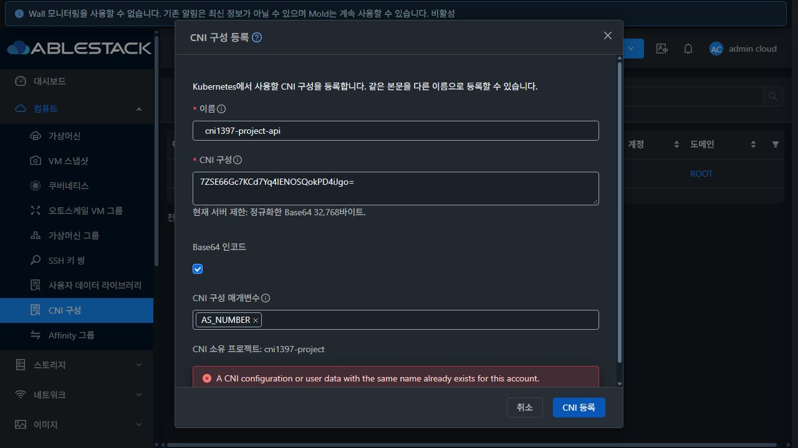
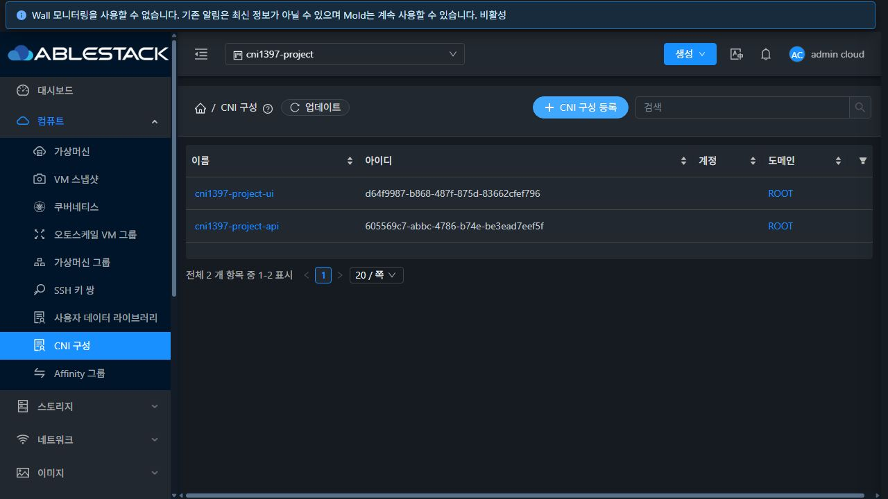
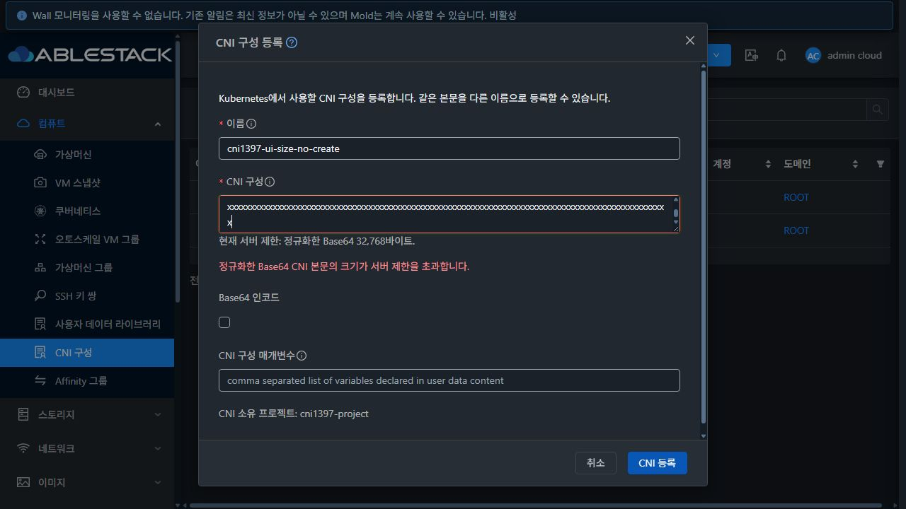
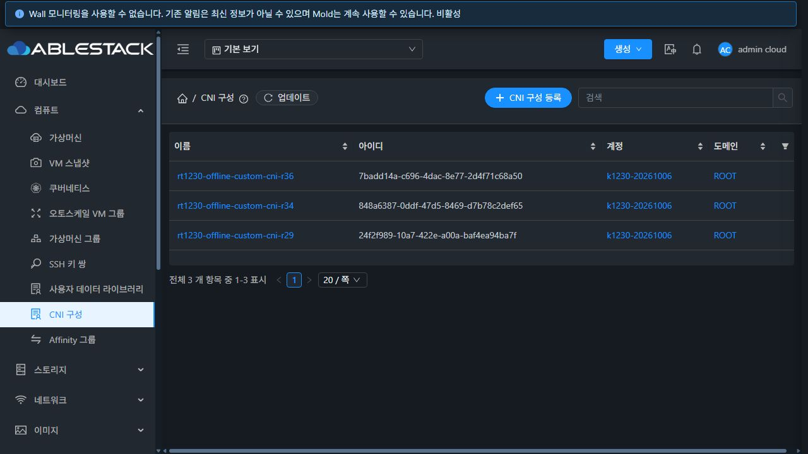

<!-- Licensed to the Apache Software Foundation (ASF) under one
or more contributor license agreements. See the NOTICE file
for additional information regarding copyright ownership.
The ASF licenses this file to You under the Apache License, Version 2.0
(the "License"); you may not use this file except in compliance
with the License. You may obtain a copy of the License at
http://www.apache.org/licenses/LICENSE-2.0
Unless required by applicable law or agreed to in writing, software
distributed under the License is distributed on an "AS IS" BASIS,
WITHOUT WARRANTIES OR CONDITIONS OF ANY KIND, either express or implied.
See the License for the specific language governing permissions and
limitations under the License. -->

# CNI 등록 검증 완료: #1397 / Epic #1395

2026-10-17, 테스트 클러스터 31. 구현 커밋 `59f7e0e598b`, 누적 브랜치 `dhslove/epic-1395-cni`, Epic 초안 PR #1409. 기반 Europa는 `dc31262567f2afe5f6278fae61c1cef7e307fe3e`이며 앞선 #1396 변경을 유지했다. [설계](../../design/cni-registration-1397.ko.md)의 등록 범위를 구현·배포·검증했다. 삭제/사용처/상세/전체 스타일 개선은 후속 이슈다.

## 결과

| 구분 | 결과 | 근거 |
| --- | --- | --- |
| API 변경 모듈 | BUILD SUCCESS, CNI 2 + 일반 UserData 3 = 5 tests | [Maven 로그](api-module-build.log) |
| server 변경 모듈 | BUILD SUCCESS, CNI 8 + 일반 UserData 8 = 16 tests | [Maven 로그](server-module-build.log) |
| UI 집중 회귀 | 3 suites / 108 tests PASS. CNI 계약, 일반 UserData 등록·복제 회귀 포함 | [Jest 로그](ui-tests.log) |
| UI lint / production build | PASS. bundle 크기 경고 2개 및 기존 Browserslist 갱신 안내 | [lint](ui-lint.log), [build](ui-build.log) |
| 직접 API | 58 checks PASS | [검증 행렬](api-matrix.json), [discovery](api-discovery.json) |
| 실제 UI | 13 checks PASS | [행렬](ui-checks.json), 아래 화면과 저장 응답 |
| 배포 | 변경 클래스 3개, 나머지 JAR 엔트리 204,492개 보존. 정적 파일 870개 해시 일치 | [JAR 근거](backend-artifact.json), [backend](backend-deployment.txt), [UI](deployment-verification.txt) |
| 정리·회귀 | 테스트 CNI 19개/UserData 1개/프로젝트 1개 삭제. 활성 잔여 0. 기존 CNI 3개/Kubernetes 7개 API 일치, DB 12행 바이트 동일 | [정리](cleanup.log), [응답](cleanup-receipts.json), [요약](cleanup-summary.json), [잔여 조회](residual-counts.tsv) |

## 실제 계약 확인

API는 본문 누락·빈값·디코딩 공백, 잘못된 Base64, 빈 이름/256자 이름, 잘못된·중복·예약 변수를 거부했다. 255자 이름, Unicode 공백 제거, 한글·개행·특수문자, Base64처럼 보이는 일반 텍스트, 선택적 패딩/URI 인코딩/줄바꿈/URL-safe Base64, 비 UTF-8 바이너리는 보존했다. 현재 설정인 정규화 Base64 32,768바이트(POST)와 GET 4,096바이트 경계는 허용하고 각 1바이트 원문 초과는 거부했다. POST 1 MiB 상한 자체는 서버 설정이 32 KiB여서 실환경 값을 변경하지 않고 UI 단위 테스트의 경계값으로 확인했다.

같은 본문의 다른 이름은 허용하고 같은 정규화 이름은 거부했다. 동시 동일 이름 요청 2개는 저장 1/거부 1이었다. 일반 UserData 등록과 기존 본문 중복 거부 정책, UserData/CNI의 소유자별 공통 이름 공간을 확인했다. 공백 제거 후 `USER,user,env.name,test-key,AS_NUMBER`가 저장됐다. 다른 계정 지정과 프로젝트 소유 등록/프로젝트 목록을 확인했다.

`listApis`의 cniconfig는 required=true이며 응답 필드는 id/name/userdata/params/account/domainid/projectid를 포함한다. 실제 등록 응답은 기존 `registercniconfigurationresponse.cniconfig` 객체다. discovery 응답 배열에 존재하는 기존 빈 객체는 검증 도구에서 제외하고 필드를 비교했다.

실제 UI에서 공백 본문, 예약 변수, 잘못된 Base64 패딩 및 설정 크기 초과를 차단했다. 다른 계정으로 `cni1397-ui-한글`을 일반 텍스트 등록하고 [저장 응답](ui-account-receipt.json)의 UTF-8 바이트·개행·특수문자·USER 변수가 입력과 일치함을 확인했다. 프로젝트 대화상자는 소유 프로젝트를 안내하며 계정/도메인 입력을 숨긴다. Base64 등록의 중복 이름 서버 오류에서 입력, 인코딩, AS_NUMBER 변수와 프로젝트가 보존됐고, 이름만 수정한 재시도가 성공하여 목록으로 돌아왔다. 이중 클릭 후 [프로젝트 등록 응답](ui-project-receipt.json)과 목록에서 생성 1건을 확인했다. 네트워크/503 오류, 포커스·스크롤 복구, 검증/요청 중 소유 범위 변경 및 권한 변경, 늦거나 불완전한 응답은 집중 테스트로 검증했다.

큰 본문 키보드 입력 중 자동화 도구가 시간 초과되어, 상태를 확인한 뒤 본문 전체를 붙여넣기로 교체하고 용량 오류를 재검증했다. 이 도구 중단을 제품 오류나 통과 결과로 계산하지 않았다.

## 배포와 보존

WSL ext4 작업 트리에서 `mvn -pl api ... install`, `mvn -pl server ... package`만 실행했다. 대상 테스트를 지정했으며 checkstyle/RAT 단계는 생략했다. 변경된 모듈 외 Maven reactor 전체, Cloud 전체/Release CI, RPM 및 수동 GitHub Actions 빌드는 실행하지 않았다.

기존 설치 JAR에 엄격한 Base64 정규화 엔진이 있어 엔진 변경은 필요하지 않았다. API 명령/ManagementServerImpl/등록 검증 클래스만 변경 모듈 산출물로 교체하고, 전체 JAR 엔트리의 변경 집합을 비교했다. 진행 중 비동기 작업 0건을 확인한 뒤 백업하고 Mold를 재시작했다. 설치 JAR SHA256은 `91903292734956fea9477ef640c21be842da8611cbad7cc5359ec93b94e7957d`다.

- 백엔드 백업: `/root/cni-1397-backend-20261017-134223`
- 정적 UI 백업: `/root/cni-1397-ui-20261017-134753`
- 재시작 PID: 1247065 → 1466313. 이후 정적 UI 배포는 새 PID를 보존했다.
- 활성 경로: `/usr/share/cloudstack-management/webapp`. WEB-INF와 운영 config.json을 보존했다. config.json SHA256은 전후 `b7de5f6a1f7a3a17310ee7d34ca801bb316fc6f841039f865fbabf154cd59a13`다.
- 기존 FTCTL UI 표식 `blockingLoadingState`, `fetchSyncProgress`, `extractJobId`를 유지했다.
- 최종 Mold active, `/client/` HTTP 200, 재시작 이후 journal의 클래스 연결 오류 0건. [최종 런타임](runtime-after.txt)

이는 테스트 클러스터의 변경 클래스/정적 파일 배포 결과이며 정식 전체 배포 패키지 빌드나 전체 Cloud CI 성공을 의미하지 않는다. 기존 Windows/WSL FTCTL 작업 사본은 수정하지 않았다.

## 정리와 다음 작업

전용 CNI 19개(실제 UI 2개 포함), 일반 UserData 1개, 프로젝트 및 프로젝트 계정을 정상 API로 정리했다. 테스트 VM/Kubernetes/네트워크/호스트 자원은 이번 등록 범위에서 생성하지 않았다. 기존 CNI 본문/변수/이름/소유자와 Kubernetes 상태·참조 등 DB 12행은 바이트 단위로 동일하며 SHA256은 `7550df94bf6c296e13cacfa33f19dd0df65fdcf08b53e4e68dc7906a2f29a2c0`다. 기존 CNI 3개/Kubernetes 7개를 API로도 대조했다.

다음은 P1 #1398의 CNI/UserData 삭제 API 대상 유형 분리다. 이후 #1399의 사용 클러스터 조회 API·사용 중 삭제 보호, #1400 사용처 UI, #1403 삭제 완료 UX 순으로 진행한다. #1408의 가상머신 표준 기반 전체 스타일 통일은 별도 미완료 범위로 유지한다. Epic은 #1396/#1397의 2/13 완료이며 누적 PR은 초안으로 유지한다.
