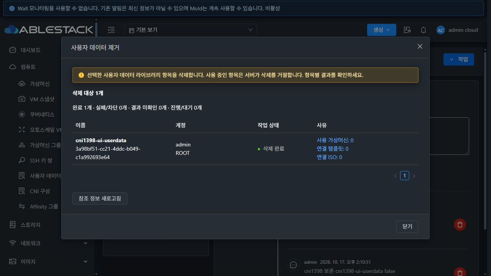
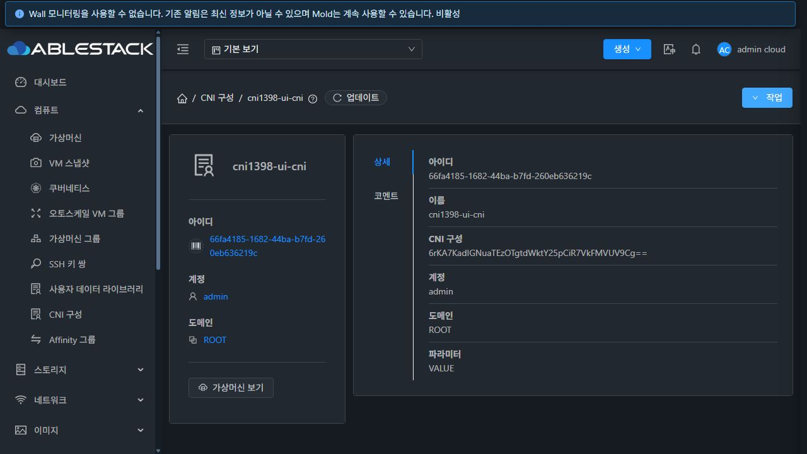
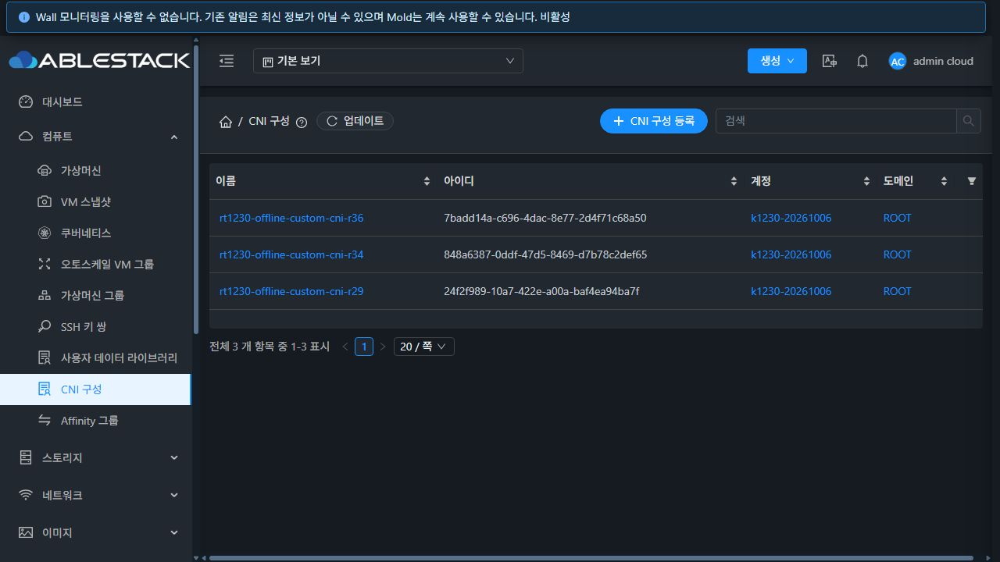

<!-- Licensed to the Apache Software Foundation (ASF) under one
or more contributor license agreements. See the NOTICE file
for additional information regarding copyright ownership.
The ASF licenses this file to You under the Apache License, Version 2.0
(the "License"); you may not use this file except in compliance
with the License. You may obtain a copy of the License at
http://www.apache.org/licenses/LICENSE-2.0
Unless required by applicable law or agreed to in writing, software
distributed under the License is distributed on an "AS IS" BASIS,
WITHOUT WARRANTIES OR CONDITIONS OF ANY KIND, either express or implied.
See the License for the specific language governing permissions and
limitations under the License. -->

# CNI / UserData 삭제 유형 분리 검증 (#1398)

2026-10-17, 클러스터 31. 구현 `81ab56c4a8f`, 브랜치 `dhslove/epic-1395-cni`, 누적 Epic PR #1409. 최신 upstream/ablestack-europa `dc31262567f2afe5f6278fae61c1cef7e307fe3e` 기반이며 #1396/#1397을 유지했다. [설계](../../design/cni-delete-type-1398.ko.md).

## 구현 및 결과

삭제 API 진입점이 기대하는 for_cks를 명시하여 공용 서버 helper를 호출한다. 실제 유형이 다르면 올바른 삭제 API를 안내하고 본체/코멘트/참조를 수정하지 않는다. 기존 UUID OperateEntry ACL과 계정·도메인·프로젝트 소유 판정, VM/템플릿 사용 중 삭제 방어를 유지했다. 본체와 Annotation 제거는 동일 DB 트랜잭션에서 수행하여 본체 삭제 false/예외 및 코멘트 저장소 오류가 커밋되지 않도록 했다.

| 검증 | 결과 | 근거 |
| --- | --- | --- |
| API 계약 테스트 | 6 tests PASS. CNI dispatch, 실패 응답, 상속 UUID ACL/소유 파라미터 및 일반 UserData 회귀 | [로그](api-tests.log) |
| 변경 server 모듈 package | BUILD SUCCESS, 82 tests PASS. 양방향 유형/실패/트랜잭션 22개, 기존 ManagementServerImpl 44개, 등록 회귀 16개 | [로그](server-module-build.log) |
| 수정 전 재현 | 전용 동일 소유자 자원의 양방향 교차 삭제가 성공하고 코멘트도 제거되는 기존 동작 확인 | [응답](predeploy-reproduction.json) |
| 수정 후 실제 API | 73 checks PASS | [행렬](api-matrix.json), [실패 경로](api-phase1.log), [정상 삭제](api-phase2.log) |
| 실패 경로 데이터 보존 | 본체 12개/코멘트 24개/참조 집계 2행 = 38행 전후 바이트 동일 | [DB 요약](failed-delete-db-summary.json), [API 스냅샷](failed-delete-snapshots.json) |
| 실제 UI | CNI/UserData 각 코멘트 2개 표시·정상 삭제·API 본체/코멘트 0 확인. UserData 완료/목록 복귀 포함 7 checks | [UI 확인](ui-checks.json), [삭제 응답 확인](ui-delete-receipts.json), 아래 화면 |
| 배포 | 변경 클래스 1개, 나머지 JAR 엔트리 204,494개 동일. 백업 후 Mold 재시작 | [산출물](backend-artifact.json), [배포](backend-deployment.txt) |
| UI 보존 | 기존 #1397 production build 정적 파일 870개 해시 일치, 운영 config.json/WEB-INF 유지 | [자산 확인](ui-assets-verification.json) |
| 정리/운영 보존 | 활성 전용 잔여 0, 기존 CNI 3개/Kubernetes 7개 API 및 운영 DB 36행 동일 | [정리](cleanup.log), [응답](cleanup-receipts.json), [요약](cleanup-summary.json), [잔여](residual-counts.tsv) |

## API 시나리오

전용 일반 계정 A/B, 하위 도메인 관리자 D, root, A/B 소유 프로젝트를 사용했다. CNI 6개와 일반 UserData 6개에 일반 표시·관리자 전용 Annotation을 각각 1개씩 추가했다.

- root가 모든 전용 계정/프로젝트 자원을 상대 유형 API로 삭제하면 431 유형 오류와 올바른 API 안내를 받는다. 일반 사용자 A의 자기 계정/프로젝트, 도메인 관리자 D의 허용 계정/프로젝트도 유형 오류로 차단된다.
- A의 타 계정 UUID 삭제 및 프로젝트 UUID 단독 삭제는 531 ACL 오류다. 비회원 프로젝트 ID를 명시하면 기존 프로젝트 API 진입 제한에서 432로 거부된다. D의 상위 ROOT 도메인 전용 자원 접근은 531로 차단된다. 잘못된 API 유형을 함께 사용해도 권한 차단이 유지된다.
- 각 실패마다 root API로 본문·변수·이름·소유 범위와 두 Annotation을 대조했다. 모든 실패 후 DB 38행이 byte 동일하며 SHA256은 `41ba70c0239abe574b0222f593c92dbef9dc757a96092b3ed1e52455a9747cfa`다.
- id 생략/잘못된 UUID/없는 UUID는 양쪽 API에서 431로 거부한다.
- A의 자기 계정/프로젝트, D의 허용 계정/프로젝트 및 root의 ROOT 전용 자원은 올바른 API로 정상 삭제했다. 본체와 Annotation은 함께 사라지고 양쪽 API의 재삭제는 431로 거부된다.

프로젝트 진입 제한의 기존 432 응답을 확인하여 검증 도구의 예상 코드를 보정하고 실패 행렬을 다시 실행했다. 이를 권한 회귀나 유형 검증 실패로 계산하지 않았다.

## 실제 UI

배포 후 로그인하여 CNI 상세의 코멘트 2개를 확인하고 작업 > CNI 구성 제거 > 확인을 실행했다. 성공 알림 후 API에서 해당 본체와 Annotation이 0건임을 확인했다. **삭제 후 CNI 상세가 남는 기존 UX는 #1403의 미완료 범위**다. 목록으로 이동한 뒤 검증 자원이 사라지고 기존 CNI 3개만 남는 것을 확인했다.

일반 UserData 상세에서도 코멘트 2개를 확인한 뒤 사용자 데이터 제거를 실행했다. 완료 1개/실패 0개가 표시됐고 닫기 후 목록으로 복귀했으며 API 본체와 Annotation은 0건이었다.

## 배포 범위와 한계

WSL ext4 작업 트리에서 API 대상 테스트와 변경 server Maven 모듈만 실행했다. `mvn -pl api ... test`, `mvn -pl server ... package`에 대상 테스트를 지정했고 checkstyle/RAT는 생략했다. API 명령의 production 소스와 UI 소스는 변경하지 않았다. UI lint/build/정적 재배포는 실행 대상이 없으며 현재 배포된 #1397 빌드 870개 파일의 해시와 실제 메뉴 동작을 확인했다. 전체 Cloud/Release CI, RPM 및 수동 GitHub Actions 빌드는 실행하지 않았다.

현재 설치 JAR에 `ManagementServerImpl.class`만 변경 모듈 산출물로 교체했고 전체 엔트리의 변경 집합을 비교했다. JAR SHA256은 `e310771ca52823f41c9f21806c6691a06bba283189d1b2cbb05f5b1a37015398`다. 진행 중 비동기 작업 0건을 확인하고 `/root/cni-1398-backend-20261017-141304`에 백업 후 Mold를 재시작했다. PID는 1466313 → 1471742다. 최종 Mold active, /client/ HTTP 200, WEB-INF 유지 및 클래스 연결 오류 0건을 확인했다. [런타임](runtime-after.txt)

VM/템플릿 사용 중 삭제 방어와 저장소 오류의 트랜잭션 커밋 경계는 집중 Java 테스트로 검증했다. 이번 실환경에서 VM/템플릿을 새로 생성하거나 DB 장애를 주입하지 않았다. Kubernetes 사용처/생성 경쟁/사용 중 CNI 삭제 보호는 #1399 범위다. 전체 패키지나 전체 CI 성공을 주장하지 않는다.

## 자원 정리와 후속

수정 전 재현 2개를 포함해 전용 CNI 7개/일반 UserData 7개와 Annotation 26개가 제거됐다. 프로젝트 2개, 일반 계정 2개, 도메인 관리자 1개, 전용 하위 도메인 1개와 프로젝트 계정도 정리했다. 모든 전용 활성 본체·코멘트·계정·사용자·프로젝트·프로젝트 계정·도메인 잔여는 0이다. VM/Kubernetes/네트워크/호스트 자원은 생성하거나 수정하지 않았다.

운영 DB 36행(기존 UserData/CNI 5, Kubernetes 7, Annotation 1, 계정 16, 프로젝트 4, 도메인 3)의 안정 필드가 전후 byte 동일하다. SHA256은 `2d61f159980ac4fa490f62c74e16ce6024ac1f8bb9210c2c6caaa366c74357f7`다. CNI 3개/Kubernetes 7개의 본문·변수·소유/상태/참조는 API로도 대조했다. 기존 Windows/WSL FTCTL 작업 사본은 수정하지 않았다.

다음은 P1 #1399 CNI 사용 클러스터 조회 API와 사용 중 삭제 보호다. 이후 #1400 사용처 UI, #1403 삭제 확인/완료 UX 순으로 연결한다. VM 메뉴 표준의 전체 스타일 #1408은 미완료 범위로 유지한다. Epic은 #1396/#1397/#1398의 3/13 완료이며 누적 PR은 초안으로 유지한다.
