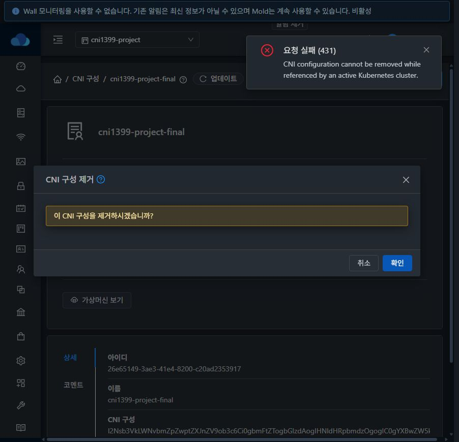
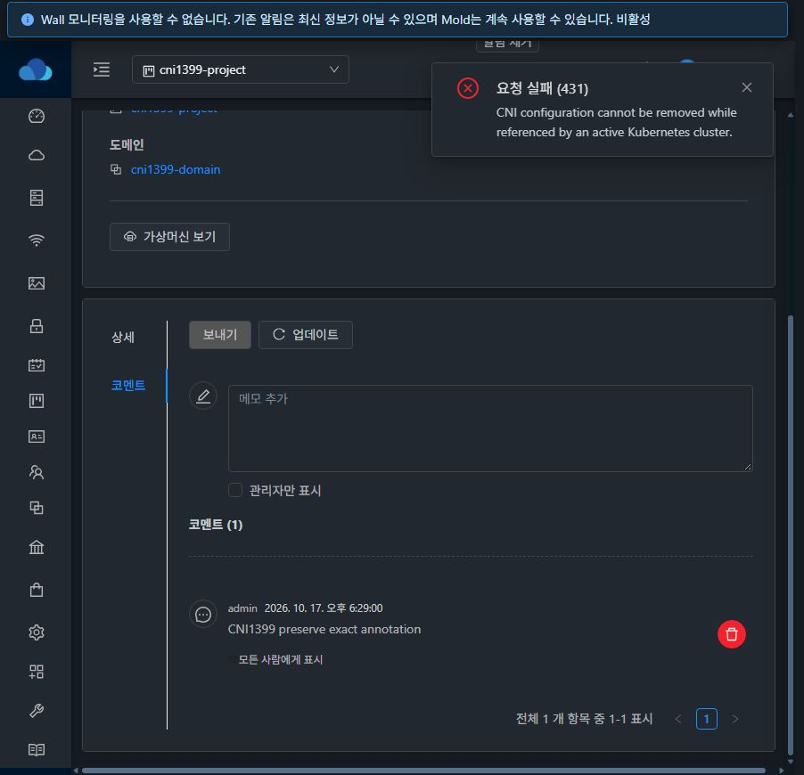
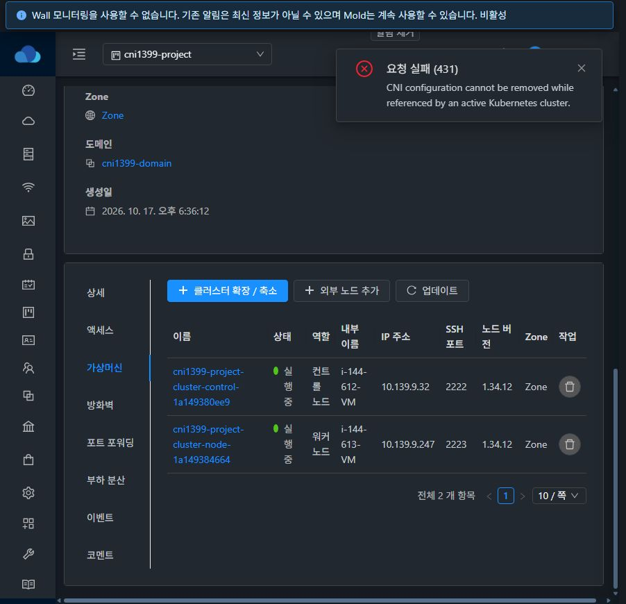
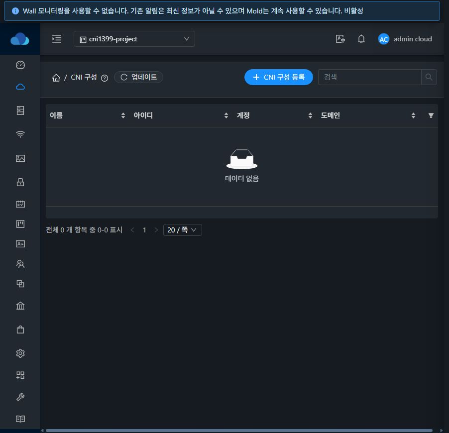
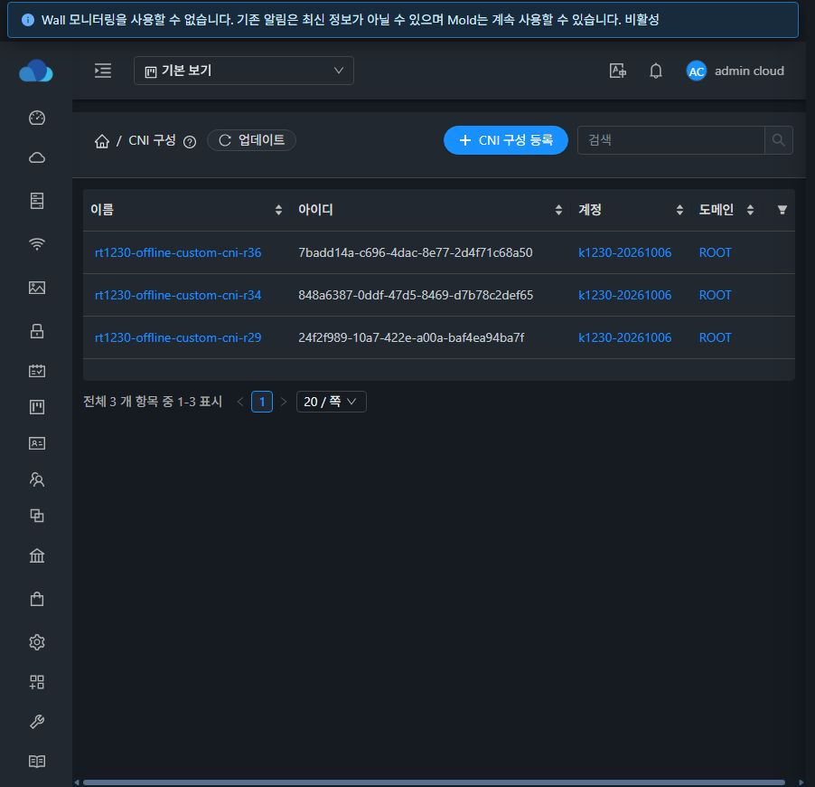

# #1399 CNI 사용처 조회·사용 중 삭제 보호 검증

2026-10-17, 31번 클러스터. 기반 Europa `dc31262567f2afe5f6278fae61c1cef7e307fe3e`, 누적 브랜치 `dhslove/epic-1395-cni`, 직전 #1398 커밋 `2c37dddff11799ea79c2b81789f8b700806da4cb`. [설계](../../design/cni-references-1399.ko.md).

## 구현 결과

`listKubernetesClusters(cniconfigurationid=<CNI UUID>)`가 기존 ACL·프로젝트·페이지·총계 계약으로 활성 사용처를 조회한다. 생성은 실제 CNI 유형·활성 여부·UseEntry 권한 및 선택된 계정/프로젝트 소유자를 검증한다. 생성의 참조 커밋과 삭제의 참조 확인/삭제 커밋은 같은 CNI별 GlobalLock으로 직렬화한다. 버전 → CNI 잠금 순서를 고정했다.

서버는 공용 API 인터페이스를 통해 위임된 Kubernetes 플러그인 컨텍스트의 검사기를 요청 시점에 조회한다. 미삭제 클러스터는 상태·GC 여부와 무관하게 삭제를 막는다. 검사기가 없거나 조회에 실패해도 삭제하지 않는다. 기존 UserData, VM/템플릿 보호, ACL 및 본체/Annotation 트랜잭션을 유지했다. server에서 Kubernetes 플러그인으로의 역방향 의존은 추가하지 않았다.

## 빌드와 집중 테스트

WSL ext4 작업 사본에서 변경 모듈만 빌드했다. Java **192건**, 실패/오류/생략 **0**.

| 모듈 | 수행 | 통과 |
| --- | --- | ---: |
| api | install, DeleteCniConfigurationCmdTest / DeleteUserDataCmdTest | 6 |
| engine/schema | install, CniConfigurationReferencesTest | 4 |
| server | package, UserDataDeletion / ManagementServerImpl / CniRegistration / UserDataRegistration | 88 |
| kubernetes-service | package, CniReferences / CniReferenceDao / ClusterManager / VersionReferences / CniUserData | 94 |

잠금 양방향 실행 순서, 시간 초과·예외 해제, 실제 생성 경로의 사전 검증, ACL/소유자/프로젝트, 페이지/총계, 검사기 부재·오류 시 거부와 기존 삭제 경로를 검증했다. DAO 테스트는 `cni_config_id` 및 `removed IS NULL`을 사용하고 `state`/`check_for_gc` 제한이 없음을 확인한다. Error/Alert/Destroying 등은 이 집중 테스트로 검증했고 실환경 상태를 DB로 주입하지 않았다.

원시 로그: [api](api-module-build.log), [schema](schema-module-build.log), [server](server-module-build.log), [Kubernetes](kubernetes-module-build.log). Maven checkstyle/RAT는 생략했다. UI production 소스 변경이 없어 lint/build/정적 배포는 실행하지 않았다. 전체 Cloud/Release CI·RPM·수동 Actions 빌드는 실행하지 않았다.

## 실제 API·UI·게스트 검증

- 실제 API **27 checks**, UI **9 checks** 통과. 개수는 [API matrix](api-matrix.json), [UI checks](ui-checks.json) 항목 수다.
- 새 전용 프로젝트의 CNI와 클러스터 `770b5fa2-53b1-414e-a954-cf7195d974d5`를 생성했다. Created에서 관리자와 프로젝트 회원의 필터 결과가 동일한 클러스터 UUID·이름·상태·프로젝트를 반환하며 page 2도 총계 1을 보존했다. 타 계정·비회원 프로젝트·일반 UserData·다른 소유 CNI·삭제된 CNI는 거부됐다.
- 새 클러스터가 수동 DB/게스트 보정 없이 Running으로 완료됐고 실제 노드 2개가 Ready였다. 게스트에서 Calico 사용자 구성과 MTU1450을 확인했다. [게스트 근거](guest-progress.txt). 이번 검증의 변수 치환은 완료 주장에 포함하지 않는다. 당시 테스트 생성 요청의 변수 맵 키에 오타가 있었고 선택 확인용 audit_token도 리터럴로 남았다. 이 관찰만으로 치환 동작의 원인을 판정하지 않으며, 이 토큰은 CNI 설치·참조 보호에 사용되지 않는다. 변수 전달의 기존 #1396 검증을 대체하지 않는다.
- Created·Running·Stopped에서 직접 `deleteCniConfiguration`이 431로 거부됐다. 거부 후 CNI 본문 바이트와 Annotation이 그대로였다. 실제 UI 삭제 버튼도 같은 오류를 표시하고 대화상자와 코멘트를 유지했다.
- 정지한 클러스터를 정상 `deleteKubernetesCluster` API로 제거한 뒤 사용처가 0이 됐다. 같은 CNI를 UI로 삭제했고 API/DB에서 본체·코멘트 제거를 확인했다. 자동 완료 경로는 프로젝트 대시보드로 이동했다. 목록 복귀 등 UX는 #1403에서 개선한다.
- 두 독립 세션이 같은 전용 CNI에 생성·삭제를 동시에 요청했다. 실제 경합은 삭제 승리 / 생성 `Invalid CNI configuration` 거부 / 활성 클러스터 0이었다. [동시 실행 근거](api-race.json). 반대 순서는 공용 잠금 집중 테스트로 검증했다.
- 일반 사용자 자신의 미사용 CNI 삭제와 프로젝트 일반 UserData 삭제도 성공했다. 타 계정 삭제는 권한 오류로 차단됐다.

## 배포와 초기 실패 처리

최종 JAR SHA256: `5ef511623cdfa29df4b5e0d519a46a0acdc0bb1b2c239902bc5c63e608671174`.

변경한 클래스 묶음 19개를 반영했다(기존 17개 교체, 공용 인터페이스/잠금 클래스 2개 추가). 기존 **204,478개** 엔트리의 압축 페이로드·메타데이터를 바이트 비교해 보존을 확인했다. 최종 엔트리는 204,497개다. [산출물 해시·엔트리 검증](backend-artifact.json).

최종 배포 백업 `/root/cni-1399-backend-20261017-183506`, Mold PID `1510297`. 기존 UI 파일 **870개 해시 일치**, WEB-INF/config.json/FTCTL 표식 보존, Mold active 및 `/client/` HTTP 200. [배포](backend-deployment.txt), [정적 파일](ui-assets-verification.json), [최종 런타임](runtime-after.txt). 첫 #1399 배포 이전 정상 JAR 백업은 `/root/cni-1399-backend-20261017-182224`에 보존했다.

초기 시도는 PASS가 아니다. 서버 초기 주입 목록이 비어 전용 사용 중 CNI 삭제가 잘못 허용됐고 생성 작업이 첫 노드 배포 전에 실패했다. 오류를 수정하고 최종 검증은 새 CNI·클러스터에서 처음부터 진행했다. 최초 실패 자원은 VM 매핑 0·endpoint 없음·bootstrap 미시작·생성 작업 실패를 확인한 후 **해당 전용 자원의 lifecycle 정리 메타데이터만** 복구하고 정상 삭제 API로 제거했다. 클러스터 cni_config_id, 기존 운영 참조, 상태·removed 값은 SQL로 변경하지 않았다. [실패/정리 범위 기록](initial-attempt.json). 최종 정상 클러스터의 생성·정지·삭제에는 이러한 복구가 없었다.

## 정리와 기존 데이터 보존

전용 CNI **5개**·일반 UserData **1개**·Annotation **2개**, 클러스터 **2개**(중단 시도 포함), 노드 VM **2개**·라우터 **1개**, 네트워크·프로젝트·프로젝트 계정, 사용자 계정 **2개**·도메인을 정리했다. [정리 API 근거](cleanup-receipts.json).

활성 본체·코멘트·클러스터 참조·VM 매핑·VM·볼륨·네트워크·소유 범위·사용자·API 키 잔여 **0**. 호스트 3대의 해당 VM/라우터 도메인도 **0**이다. [DB 잔여](residual-counts.tsv), [제거 VM](removed-vm-receipts.tsv), [호스트](host-domain-cleanup.json).

기존 CNI **3개**의 전체 API 응답, 기존 Kubernetes **7개**의 UUID/이름/상태/소유 범위/CNI/버전/네트워크/노드 UUID가 일치한다. 기존 본문·변수·코멘트·클러스터·계정·프로젝트·도메인을 포함한 DB **36행**이 바이트 단위로 동일하다. [대조 요약](cleanup-summary.json).

후속은 #1400 사용 Kubernetes/노드 UI, 이후 #1403 삭제 UX다. #1408 VM 표준 스타일 작업은 계속 열린 범위다. #1399 완료는 Epic 전체 완료·PR 병합·전체 CI 성공을 의미하지 않는다.
