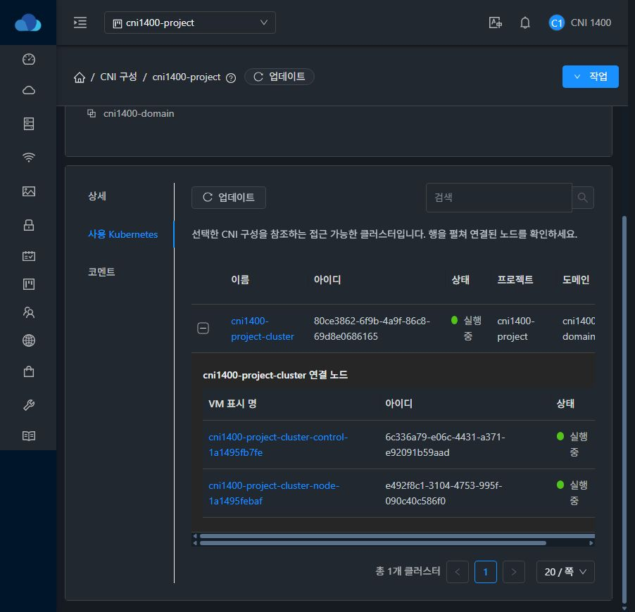
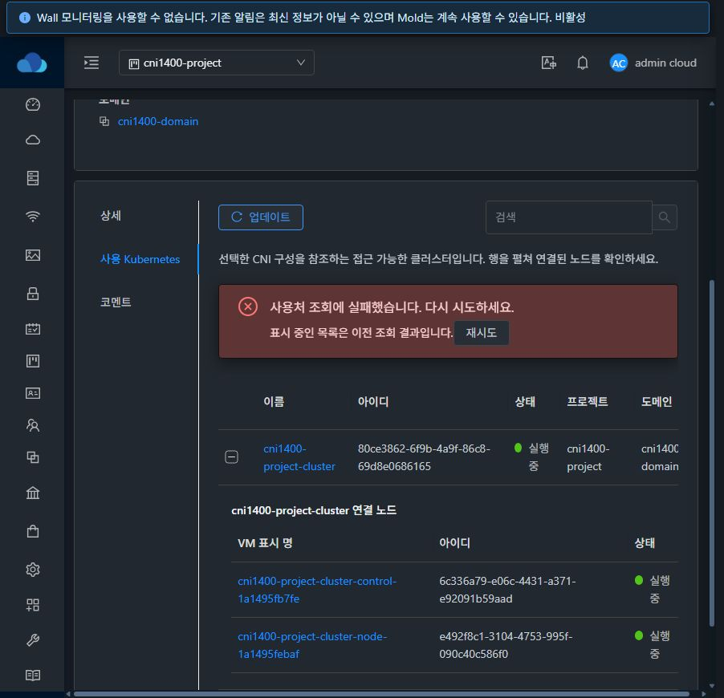
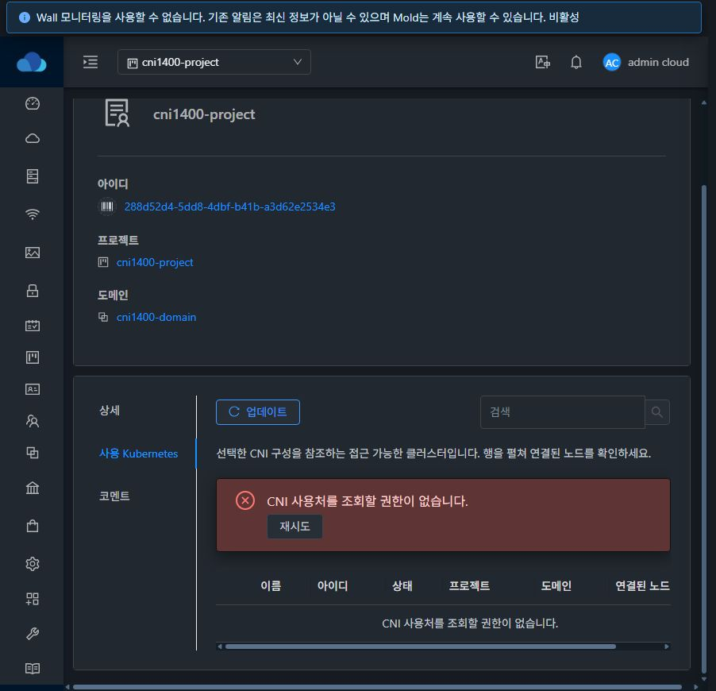
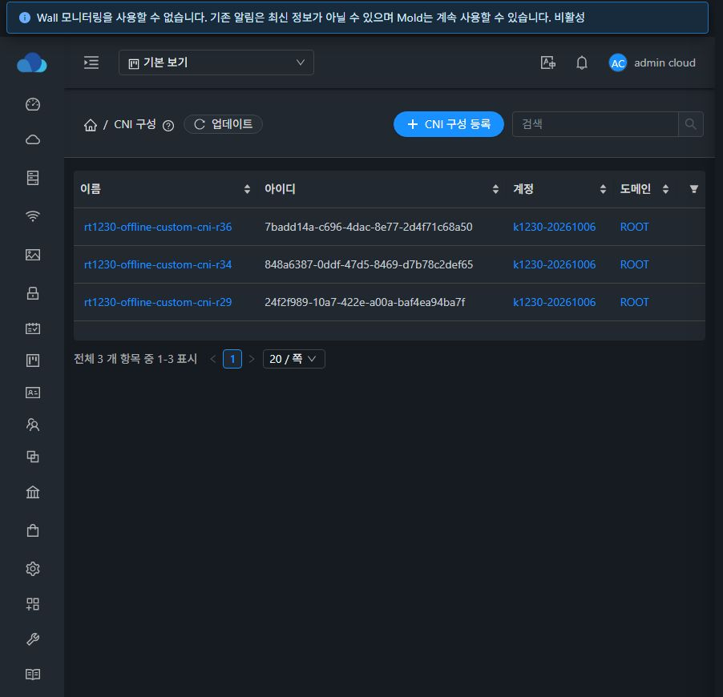

# #1400 CNI 사용 Kubernetes·노드 UI 검증 (2026-10-17)

## 결과와 구현 범위

CNI 상세의 잘못된 전체 VM 바로가기를 제거하고 **사용 Kubernetes** 탭을 구현했다. #1399의 `cniconfigurationid` 필터와 명시적 계정/프로젝트 범위를 사용하며, 클러스터 응답의 실제 `virtualmachines` 관계에서만 노드를 표시한다. 이름·UUID·상태·소유 범위·노드 수와 정확한 Kubernetes/VM 상세 링크를 제공한다. 일반 UserData의 기존 `userdataid` 바로가기·사용처 탭은 유지한다.

[설계](../../design/cni-usage-ui-1400.ko.md). 기반 Europa는 `dc31262567f2afe5f6278fae61c1cef7e307fe3e`, 작업 브랜치는 `dhslove/epic-1395-cni`, 시작 커밋은 `4addcd30a654aa003b37cd9d76f71f65d89a573c`다. WSL ext4 작업 사본에서 구현·빌드했고 기존 Windows/FT 작업 사본을 변경하지 않았다.

- CNI 식별 정보 전후 조회, 응답의 CNI/소유 범위·노드 UUID 검증, API discovery 필터 지원 확인으로 잘못된 전체 조회를 차단한다.
- 최초·다른 범위 로딩은 초기화하고 동일 범위 새로고침은 정상 빈 표와 펼친 노드를 유지한다. 일시 오류는 이전 결과임을 표시하고 재시도하며 권한 거부·대상 소실·식별 불일치는 기존 데이터를 지운다.
- CNI/프로젝트/로그인/권한/탭 변경과 늦은 응답을 분리한다. 검색·페이지·페이지 크기·탭은 URL/브라우저 이력에 보존하고 범위를 벗어난 페이지를 보정한다.
- 공용 VM 상세 탭 toolbar/pagination·중간 크기 표·상태 컴포넌트·32px 제어/20px 간격을 사용한다. 현재 브라우저의 다크 화면에서 노드·오류/빈 표와 수평 스크롤을 확인했다. 전체 CNI 메뉴의 반응형·라이트/다크 스타일 완료는 #1408 범위다.

## 집중 검증과 빌드

| 검증 | 결과 | 근거 |
| --- | --- | --- |
| CniUsage + UserDataUsage + SSHKeyPairUsage | **3 suites / 105 tests PASS** | [실행 로그](focused-tests.txt) |
| UI lint `--no-fix` | PASS | [lint.txt](lint.txt) |
| UI production build | PASS | [ui-build.txt](ui-build.txt) |
| 실제 로그인 API | **18 checks PASS** | [API matrix](api-matrix.json) |
| 실제 브라우저 UI | **19 checks PASS** | [UI checks](ui-checks.json) |

실행 환경은 WSL ext4/Node 20.20.2이며 `NODE_OPTIONS=--openssl-legacy-provider`를 적용했다. 집중 테스트는 `npm run test:unit -- --runTestsByPath tests/unit/views/compute/CniUsage.spec.js tests/unit/views/compute/UserDataUsage.spec.js tests/unit/views/compute/SSHKeyPairUsage.spec.js --runInBand --coverage=false`, lint는 `npm run lint -- --no-fix`, production은 `npm run build`다.

테스트는 정확한 CNI/계정·프로젝트 필터·전후 식별 조회, 미지원 필터의 무필터 대체 금지, 실제 노드와 프로젝트 링크, API/응답 오류·중복 UUID·잘못된 소유 범위, 정상 빈 표/데이터 표 새로고침 보존과 재시도, 권한 상실 시 삭제, 요청 세대/탭/사용자/소유 범위 경합, URL/페이지 보정 및 실제 Ant Table 렌더링의 이름 이스케이프를 포함한다. ResourceView의 CNI 탭 이력/숨김 탭 복귀와 일반 UserData/SSH 탭 회귀를 함께 확인했다.

기존 Browserslist 및 bundle 크기 경고가 있다. Maven 소스 변경이 없어 Maven 빌드는 하지 않았다. 전체 Cloud/Release CI, RPM 및 수동 GitHub Actions 빌드는 요청·실행하지 않았다. 위 결과는 집중 검증과 테스트 서버 정적 UI 배포 근거다.

## 31번 실환경과 UI

전용 도메인·일반 계정 A/B·프로젝트·CNI 3개·일반 UserData 1개·Annotation 1개·네트워크 1개·Kubernetes 클러스터 1개를 만들었다. 기존 구성과 참조는 변경하지 않았다.

- 프로젝트 CNI: `288d52d4-5dd8-4dbf-b41b-a3d62e2534e3`
- 클러스터: `80ce3862-6f9b-4a9f-86c8-69d8e0686165` (`cni1400-project-cluster`)
- control VM: `6c336a79-e06c-4431-a371-e92091b59aad`, worker VM: `e492f8c1-3104-4753-995f-090c40c586f0`

관리자/프로젝트 회원 API가 같은 CNI에 대해 **클러스터 1개·Running·노드 UUID 2개**를 반환했다. 이름 검색 일치/불일치, page 2의 빈 결과와 총계 1, 미사용 계정/관리자 CNI 0, 타 계정·비회원 프로젝트 거부, 일반 UserData를 CNI로 조회 거부 및 기존 VM 필터 회귀를 확인했다.

실제 UI에서 다음을 확인했다.

- 미사용 CNI는 명시적 0개이며 전체 VM 바로가기가 없다.
- 프로젝트 사용처와 펼친 노드의 이름/UUID/상태/역할이 API와 일치한다. 클러스터 및 control VM 링크가 정확한 UUID·projectid로 열리고 뒤로 이동하면 사용처 탭이 복구된다.
- 검색 불일치 0 → 검색 해제 1, 페이지 크기 20 → 10, 범위 밖 page 2 → page 1 보정, 브라우저 재로딩 후 탭/페이지 크기 복구가 된다.
- 이 브라우저의 사용처 XHR만 일시 정지/503/403으로 응답하는 장애 주입을 사용했다. 정상 빈 표와 기존 데이터/펼친 노드는 동일 범위 갱신 중 유지된다. 503은 이전 결과 안내와 재시도를 제공하고 403은 이전 클러스터·노드를 지운다. 초기 시간 초과도 0건으로 오인하지 않고 재시도해 복구했다. 종료 전 주입 규칙을 비웠다.
- 일반 프로젝트 회원 A도 같은 클러스터/노드 2개를 본다. 기본 계정 범위의 개인 CNI는 0이며 이전 프로젝트 노드가 남지 않는다. 일반 UserData의 사용 VM 0/기존 탭과 바로가기는 보존된다. 비회원 B의 프로젝트 CNI 직접 경로는 기존 라우트 가드가 대시보드로 돌리고 이전 UUID가 표시되지 않는다.
- 정상 `deleteKubernetesCluster` 성공 후 CNI 자체를 남긴 채 사용처가 UI/API 모두 0개임을 확인한 다음 CNI를 명시적으로 삭제했다.

추가 화면: [미사용 0](unused-cni-zero.png), [관리자 사용처](project-usage-nodes.png), [비회원 경로 차단](nonmember-guard.png), [클러스터 삭제 후 0](after-cluster-removal-zero.png).

### 전용 클러스터 준비 중 환경 관찰과 검증 한계

이번 네트워크는 VLAN 44를 배정받았다. 초기 control VM(31.2)은 라우터/worker(31.3)와 호스트가 달랐고, gateway ARP 미응답·metadata HTTP 000·cloud-init datasource 실패가 발생했다. 같은 시점 worker의 metadata는 200이었다. 호스트 bridge/uplink forwarding 상태만으로 물리 스위치 원인을 확정하지 않는다.

전용 control VM만 정상 `migrateVirtualMachine` API로 라우터/worker와 같은 31.3 호스트로 이동하고 `rebootVirtualMachine`을 실행해 복구했다. 호스트 네트워크나 DB 참조·상태, 게스트 파일을 보정하지 않았다. 그 뒤 최초 생성 job이 성공하고 클러스터 Running, 두 노드 Ready 및 Calico/MTU1450을 확인했다. [게스트 최종 근거](guest-ready.txt). 따라서 이번 결과를 **환경 복구가 없는 클러스터 생성 전체 체인 PASS로 주장하지 않는다**. #1400의 사용처 UI는 실제 Running 클러스터/노드 관계에서 검증했다.

이번 CNI의 선택 확인 문자열 `{{ audit_token }}`은 올바른 변수 맵을 보낸 뒤에도 게스트에 리터럴로 남았다. 변수 치환은 이번 이슈 완료 범위가 아니며 #1405 설계/실검증에서 이 관찰을 확인해야 한다. 이전 #1399 보고서도 변수 맵 오타와 리터럴 관찰 사이의 원인을 단정하지 않도록 정정했다. CNI 설치·참조 관계·노드 조회에는 이 문자열을 사용하지 않는다.

## 배포와 런타임 보존

production 정적 UI **873개 파일**을 manifest 해시로 확인해 `/usr/share/cloudstack-management/webapp`에 배포했다. 기존 자산은 삭제하지 않고 index를 마지막에 교체했으며 config.json, WEB-INF/META-INF 및 서버 JAR를 보존했다. 서비스 재시작은 없다.

- 백업: `/root/cni-1400-ui-20261017-193510` (기존 정적 파일/manifest/배포 tar)
- 정적 tar SHA256: `2e89f7c04736307d4f6e4ff93806f9a4c149e0b4af7b6aa6388c3f595a0c980d`
- JAR SHA256: `5ef511623cdfa29df4b5e0d519a46a0acdc0bb1b2c239902bc5c63e608671174` (유지)
- config.json SHA256: `b7de5f6a1f7a3a17310ee7d34ca801bb316fc6f841039f865fbabf154cd59a13` (유지)
- Mold PID **1510297** 유지, active, `/client/` HTTP **200**, WEB-INF 존재, FTCTL `blockingLoadingState`/`fetchSyncProgress`/`extractJobId`와 CNI `cni.usage`/`cniconfigurationid` 표식 확인.

[배포 직후](deployment-verification.txt) · [정리 후 최종 런타임](runtime-after.txt) · [873개 manifest](cni-1400-manifest.json). 이번 배포에는 JAR·호스트 패키지 변경이 없다.

## 자원 정리와 기존 데이터 보존

클러스터 정상 삭제 job `45cbc78b-0367-4bac-8986-1bc3b98ce462` 성공 → 사용처 0 → CNI 3개/일반 UserData 1개/네트워크/프로젝트/계정 A·B/도메인 순서로 정상 API에서 정리했다. CNI의 Annotation과 프로젝트 계정도 정리됐다. [정상 삭제 후 0](after-cluster-removal.json), [정리 API 영수증](cleanup-receipts.json).

- CNI/UserData·Annotation·클러스터·CNI 참조·클러스터 VM 매핑·VM·볼륨·네트워크·프로젝트·계정·도메인·사용자·API keypair 활성 잔여 **모두 0**. [DB 집계](residual-counts.tsv)
- 세 호스트에서 전용 `i-148-615-VM`, `i-148-616-VM`, `r-614-VM` 도메인 **0**. [호스트 근거](host-domain-cleanup.txt)
- 기존 CNI **3개** API 객체가 동일하다. 기존 Kubernetes **7개**의 UUID/이름/상태/계정/도메인/프로젝트/CNI 참조/버전/네트워크/노드 UUID가 동일하다.
- 본문 해시/변수/코멘트/참조/소유 범위 등 기존 DB **36행**이 전후 바이트 동일하다. UD 5/K8S 7/ANN 1/ACCOUNT 16/PROJECT 4/DOMAIN 3, SHA256 `2d61f159980ac4fa490f62c74e16ce6024ac1f8bb9210c2c6caaa366c74357f7`. [비교 요약](cleanup-summary.json)
- 관리자 기본 보기/CNI 목록으로 복귀하고 브라우저 장애 주입 규칙을 제거했다. 생성된 비밀번호/세션/개인 API 응답은 이 보고서·저장소에 포함하지 않는다.

## 후속 이슈

다음은 **#1403 삭제 확인·사용 여부 안내·완료 후 목록 복귀**다. #1398 유형 분리와 #1399 참조 보호에 이번 사용처 계약이 준비되어 선행 조건을 충족했다. 유령 상세/작업 메뉴 제거, 실패 시 대상 유지, 최신 사용처를 0건과 오류로 구분하고 검색·페이지·소유 범위를 보존하는 흐름을 검증한다.

본문 #1401과 검색 #1402는 독립 착수 가능하다. 메뉴 전체 스타일 #1408은 계속 열어 두며 이번 탭 검증으로 전체 완료를 대신하지 않는다. Epic #1395는 13개 중 5개 구현 범위가 완료된 누적 초안이고 전체 종료/PR 병합은 하지 않는다.
