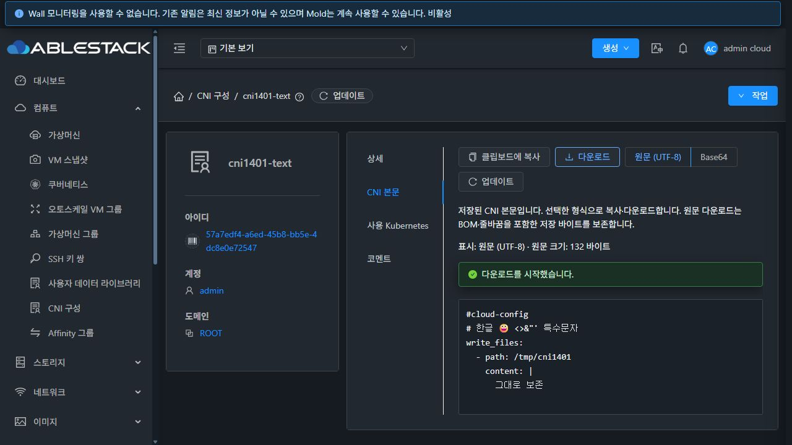
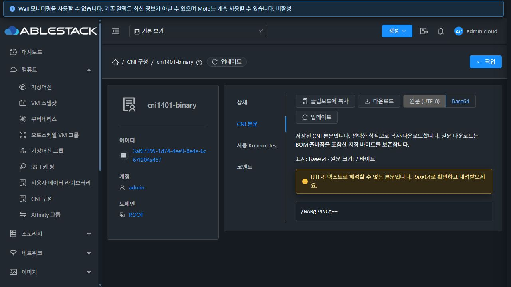
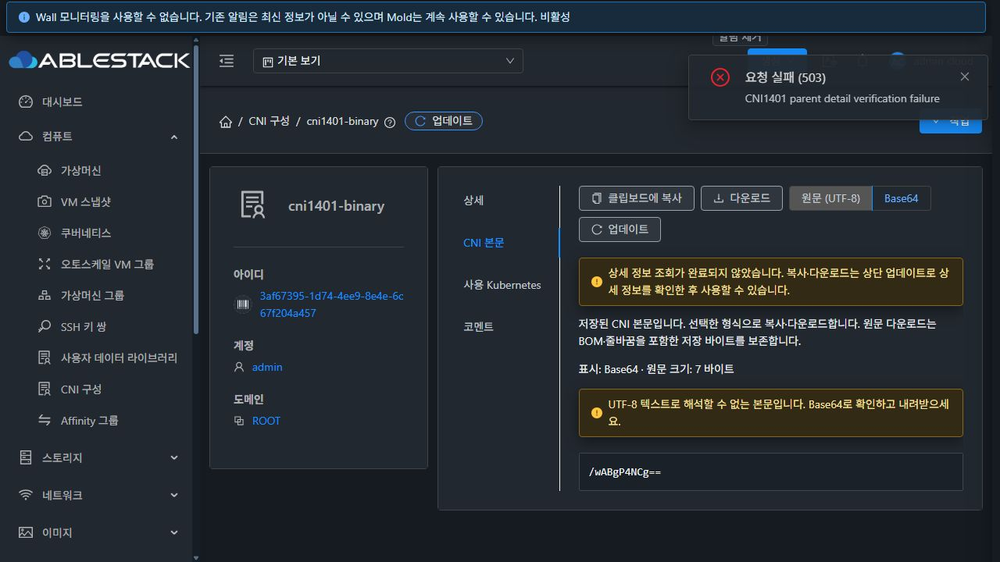

# #1401 CNI 본문 보기·복사·다운로드 검증 (2026-10-17)

## 결과와 구현

CNI 상세에 `CNI 본문` 탭을 추가하고 중복 Base64 상세 행을 제거했다. 기존 `UserDataContent` 화면·`userDataContent` 엄격한 디코딩·복사/다운로드 패턴을 재사용한다. CNI는 `listCniConfiguration/listcniconfigurationresponse.cniconfig`와 자체 조회 권한을 사용하고 UUID·이름·계정/도메인 또는 프로젝트를 확인한 뒤 본문을 공개한다. [설계](../../design/cni-content-1401.ko.md).

- UTF-8 원문이 기본이며 Base64와 왕복 전환한다. 줄바꿈을 유지하는 스크롤 가능한 `pre/code`에 텍스트로 표시한다. BOM·CRLF·마지막 개행·한글·이모지·특수문자를 보존하고 원문 크기와 선택 형식을 안내한다.
- 복사·다운로드는 선택한 표시 형식을 따른다. UTF-8 원문 다운로드는 원래 Uint8Array, Base64 다운로드는 저장 ASCII 문자열이다. 비 UTF-8은 경고와 Base64 내보내기를 제공하며 손상된 Base64·빈 기존 본문·조회 실패를 구분한다.
- 현재 로그인·대상·소유 범위·경로와 성공한 조회 범위가 일치해야 내보낼 수 있다. 요청 중·권한 없음·부재·식별 불일치·오류·빈 본문은 복사/다운로드를 차단하고 늦은 응답을 폐기한다. 일반 503은 이전 본문을 명시적으로 표시하되 내보내지 않는다.
- 실제 상위 업데이트 경로에서 이전 복사 제어가 활성인 결함을 추가 발견해 수정했다. AutogenView의 CNI 상세 요청 중/마지막 실패/현재 범위·UUID를 ResourceView readiness에 연결했다. 하위 탭은 상위 조회 시작 시 읽기 세대를 폐기하고 미확인 상태를 안내하며, 상위 복구 후 본문도 다시 조회한다. 같은 범위에서 스피너를 생략하는 갱신도 포함한다.
- 실제 목록 링크와 본문 탭 이동에서 `cnireturn`의 검색·페이지 문맥과 브라우저 뒤로/앞으로 이력을 보존한다. 본문 편집·파일 가져오기·복제·전체 메뉴 스타일 통일은 후속 이슈 범위다.

upstream Europa는 `dc31262567f2afe5f6278fae61c1cef7e307fe3e`, 시작 커밋은 `4427104f8b72d4e7916b14d23dfa8b917c8f9eae`, 작업 브랜치는 `dhslove/epic-1395-cni`다. WSL ext4 작업 사본에서 구현·검증·빌드했다. 기존 Windows/FT 작업 사본은 수정하지 않았다.

## 검증 결과

| 항목 | 결과 | 근거 |
| --- | --- | --- |
| CNI 본문·일반 UserData·VM·미리보기·CNI 사용처·SSH 상세·ResourceView 집중 검증 | **7 suites / 261 tests PASS** | [집중 테스트](focused-tests.txt) |
| UI 전체 lint 및 최종 변경 파일 lint | PASS | [전체 lint](lint.txt), [변경 lint](changed-lint.txt) |
| 최종 UI production build | PASS | [빌드](ui-build.txt) |
| 31번 실제 로그인 API | **20 checks PASS** | [API matrix](api-matrix.json) |
| 실제 브라우저 UI | **56 checks PASS** | [UI matrix](ui-checks.json) |
| 실제 Windows OS 클립보드 | **14 checks PASS** | [OS clipboard](os-clipboard-checks.json) |
| 실제 다운로드 파일 | 저장 값/복원 바이트 대조 PASS | [다운로드 바이트](download-byte-manifest.json), [저장 바이트 기준](fixture-byte-contract.json) |

집중 명령은 `npm run test:unit -- --runTestsByPath tests/unit/views/compute/CniContent.spec.js tests/unit/views/compute/UserDataContent.spec.js tests/unit/views/compute/CniUsage.spec.js tests/unit/views/compute/VmUserData.spec.js tests/unit/views/compute/UserDataVersions.spec.js tests/unit/views/AutogenSSHKeyPairIdentity.spec.js tests/unit/components/view/ResourceView.spec.js --runInBand --coverage=false`다. 상위 갱신 결함 수정 후 집중 테스트·전체 lint/build·정적 배포를 다시 진행했고 최종 배포본에서 상위 지연/503/복구와 CNI/일반 UserData의 실제 OS 복사·파일 바이트를 재확인했다. 최종 parent readiness는 실제 ResourceView → CniContent → 공통 본문 컴포넌트의 결합 테스트로 검증했다. scope/권한/로그인/탭/unmount 이후 응답·부정확한 소유자·불완전 응답·복사 실패 fallback·바이트 보존도 포함한다.

Node 20.20.2와 `NODE_OPTIONS=--openssl-legacy-provider`를 사용했다. 기존 Browserslist/bundle 크기 및 테스트 환경 Vue 경고는 로그에 남겨 구분한다. 서버/Maven 소스 변경이 없어 Maven 빌드는 필요하지 않으며 전체 Cloud/Release CI·RPM·수동 GitHub Actions 빌드는 실행하지 않았다.

## 실제 UI/API 근거

전용 CNI 7개(관리자 5·일반 소유자 1·프로젝트 1), 일반 UserData 1개, 일반 계정 2개/도메인/프로젝트를 사용했다. Kubernetes·게스트·호스트 보호 설정과 기존 CNI는 변경하지 않았다.

- UTF-8 본문 **132바이트**에는 BOM·CRLF 7개·마지막 빈 줄·한글·이모지·HTML 특수문자를 넣었다. 화면 textContent와 실제 OS 클립보드, 원문 파일 SHA256은 `76692cfa928a842a9fba7435838e7b05b05c4f5438343eb86217b660bbaadd99`로 일치했다. Base64 ASCII **176바이트**도 복사·파일이 저장 문자열과 같고 다시 디코딩하면 원문 바이트와 같다.
- 큰 본문 **18,500바이트**의 화면·OS 복사·파일 해시는 `7652246c74bef14db8f7e2568b1dedf130cb582a880b4dc6c1ef59b5cef41d84`로 일치했다. 비 UTF-8 **7바이트**는 대체 문자를 만들지 않고 Base64 **12바이트**를 표시·복사·다운로드하며, 파일을 복원한 SHA256 `b6aca61714dea926b920603d506c0058dd4e72f924cd2ec4f2c2d7ded43065a4`가 원본과 같다.
- 빈/손상 legacy 데이터는 정상 API 등록한 새 UUID 2개의 본문만 정확한 UUID·이름 조건으로 변경해 재현했다. 실제 조회 API가 해당 값을 반환하는지 확인했고, 화면의 빈 상태/형식 오류·내보내기 차단을 확인했다. 원래 본문을 복원한 뒤 UI 재시도 정상화를 확인하고 삭제 API로 정리했다. 운영 데이터의 본문을 수정하지 않았다.
- 실제 본문 XHR에 503/403(API531)·소유자 불일치 응답을 주입했다. 503은 이전 본문/재시도·내보내기 차단, 403과 식별 불일치는 본문 제거를 확인했다. 탭을 떠난 뒤 지연 응답을 보내도 적용되지 않고 재진입 시 정확한 UUID를 다시 조회한다. 상위 상세 업데이트 중 및 실패 후 차단과 정상 복구도 최종 배포본에서 확인했다.
- 일반 소유자와 프로젝트 회원 UI에서 원문·OS 복사·다운로드 바이트가 일치했다. 타 계정의 상세와 프로젝트 비회원 링크는 본문/내보내기 없이 차단됐다. 비회원의 실제 프로젝트 요청은 API432였고 별도 로그인 API에서도 타 소유자/비회원 접근 거부를 확인했다. 응답 주입과 실제 ACL 검증을 구분한다.
- 일반 UserData는 기존 API·본문 탭을 유지하며 **164바이트**의 실제 OS 복사·원문 파일이 일치했다. VM/미리보기 회귀는 집중 테스트 범위다.

자동화 도구의 clipboard API는 별도 가상 클립보드를 사용하므로 성공 토스트나 가상 값만으로 OS 검증을 판정하지 않았다. 해당 계측을 사용하지 않는 새 검증 탭의 실제 복사 버튼을 누른 뒤 Windows `Get-Clipboard -Raw`로 읽고 선택 형식의 기대 문자열·UTF-8 바이트·BOM·CRLF·SHA256을 대조했다. 다운로드는 UI 클릭으로 받은 실제 download 이벤트의 파일을 읽었다.

초기 구현에 추가했던 바이너리 직접 `.bin` 경로는 실제 파일 수신을 확인하지 못해 최종 구현에서 제외했다. 최종 바이너리는 일반 UserData와 같은 Base64 내보내기 계약이다. 브라우저 안전 설정은 변경하지 않았으며 직접 `.bin` 다운로드를 통과했다고 주장하지 않는다.

추가 화면: [기존 Base64 상세](before-base64-details.png), [빈 기존 본문](legacy-empty.png), [손상 형식](legacy-invalid.png), [503의 이전 본문 차단](network-stale-blocked.png), [권한 오류](permission-cleared.png), [일반 UserData](userdata-regression.png), [일반 소유자](owner-body.png), [프로젝트 회원](project-member.png), [비회원 차단](nonmember-blocked.png), [정리 후 기존 CNI 3개](clean-list.png).

## 배포 보존과 정리

- 최종 정적 **877개 파일**을 백업·해시 대조해 배포했다. 백업은 `/root/cni-1401-ui-20261017-220453`, 정적 tar SHA256은 `4709ac9ab65ff49bad53ecade53cf89cb1048d489fdd8e44c91e30d351352e29`다. [배포](deployment-verification.txt), [최종 런타임](runtime-after.txt).
- active webapp의 WEB-INF·config.json을 보존하고(META-INF는 배포 전후 부재) JAR/프로세스는 교체·재시작하지 않았다. Mold PID **1510297**, JAR SHA256 **5ef511623cdfa29df4b5e0d519a46a0acdc0bb1b2c239902bc5c63e608671174**, config SHA256 **b7de5f6a1f7a3a17310ee7d34ca801bb316fc6f841039f865fbabf154cd59a13**가 유지됐다. Mold active·/client/ HTTP200·FTCTL/CNI/parent readiness 표식을 확인했다.
- 전용 CNI **7개**, 일반 UserData **1개**, 프로젝트·일반 계정 2개·프로젝트 계정·도메인을 정상 API로 삭제했다. legacy 원문은 삭제 전에 복원했다. 전용 활성 잔여 **0**이다. [삭제 근거](cleanup-receipts.json), [기존 데이터 대조와 잔여](cleanup-summary.json).
- 기존 CNI **3개**의 전체 API 객체, Kubernetes **7개**의 UUID/이름/상태/소유자/CNI 참조/버전/네트워크/노드 UUID가 일치했다. 기존 운영 DB **36행**(UserData 5·Kubernetes 7·Annotation 1·Account 16·Project 4·Domain 3)은 바이트 단위로 같고 SHA256 **2d61f159980ac4fa490f62c74e16ce6024ac1f8bb9210c2c6caaa366c74357f7**가 유지됐다. 원시 Kubernetes/인증 응답과 생성 비밀번호는 공개 근거에 포함하지 않는다.

## 후속 범위

다음 권장 작업은 **#1402 CNI 목록의 UUID 및 소유 범위 고급 검색 연결**이다. #1404 파일 가져오기/도움말과 #1406 복제의 #1401 선행 조건도 준비됐다. 전체 목록·상세·모든 탭·대화상자의 VM 표준 스타일 점검은 **#1408**에 남아 있다. 이번 완료는 #1401 구현·집중 검증이며 Epic 전체 완료나 PR 병합을 의미하지 않는다.
