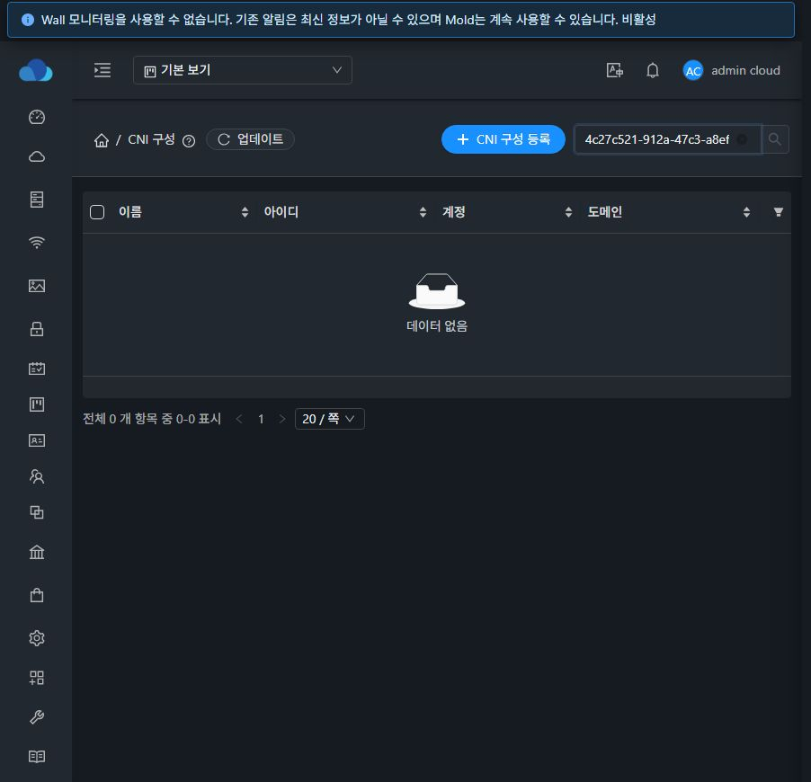
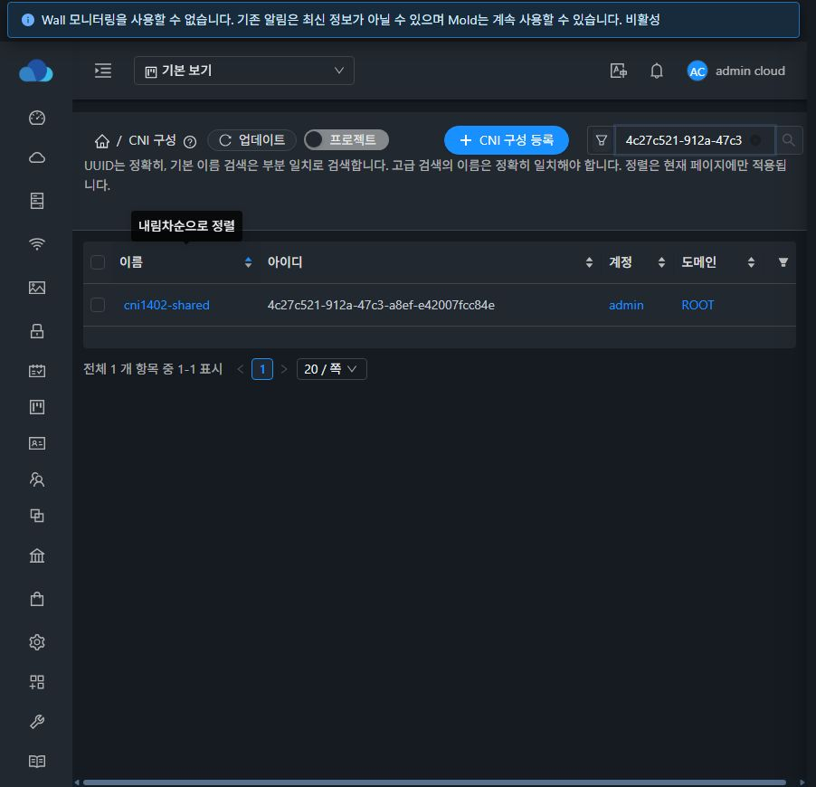
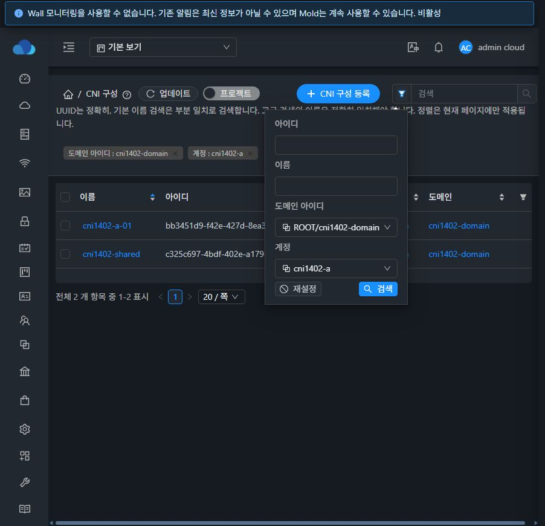
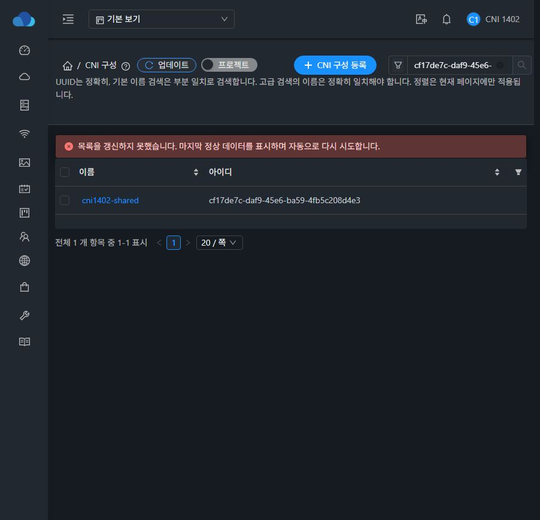
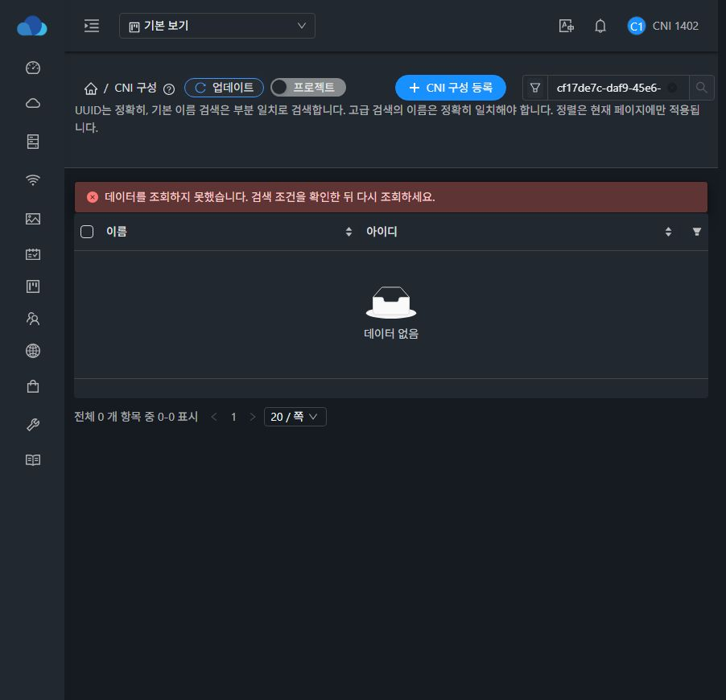
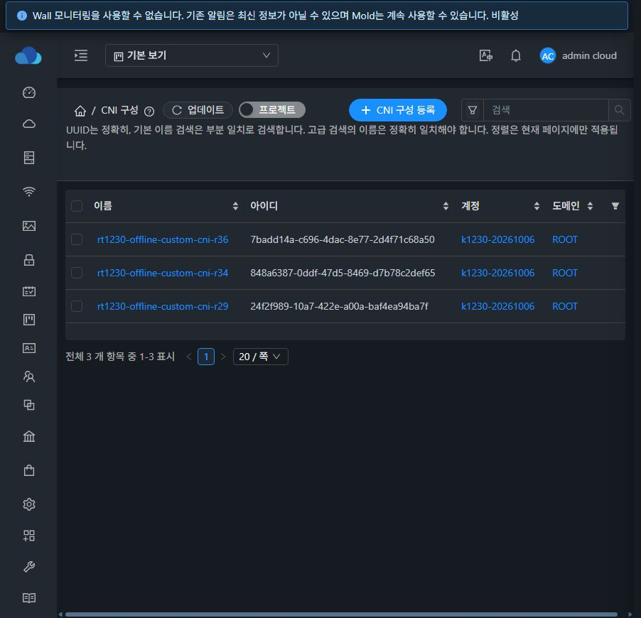

# CNI UUID·소유 범위 검색 구현 및 31번 검증 — #1402

Epic [#1395](https://github.com/ablecloud-team/ablestack-cloud/issues/1395), 누적 Draft PR [#1409](https://github.com/ablecloud-team/ablestack-cloud/pull/1409)의 구현 단위다. #1402의 구현·배포·검증을 완료했으며 Epic 전체 완료나 PR 병합을 의미하지 않는다.

## 변경과 설계

[설계](../../design/cni-search-1402.ko.md). 작업 시작 기준은 Epic 브랜치 `dhslove/epic-1395-cni`의 `8ca62fd664d9b9c12cfb13e4a898936a88fd1efb`이며 최신 upstream Europa `dc31262567f2afe5f6278fae61c1cef7e307fe3e`를 포함한다.

- UUID 기본 검색은 `id`, 일반 문자열은 이름 부분 일치 `keyword`로 보낸다. 고급 검색의 id/name/domainid/account를 API에 연결하고 정확 이름과 부분 이름의 차이를 안내한다.
- CNI도 공통 전체 프로젝트 스위치를 제공한다. 선택 프로젝트 주입은 기존 공용 요청 인터셉터를 유지한다. 지원 조회/ACL/페이지 필드만 보내며 q/tab/sortkey/sortorder/forcks는 전달하지 않는다.
- 검색·필터 제거/초기화 및 페이지 크기 변경 시 1페이지로 복귀한다. 검색/페이지/크기/정렬을 URL에 보존하고 상세 복귀 상태의 id/q 누락을 보완했다. 표 정렬은 현재 서버 조회 페이지에만 적용한다.
- CNI 고급 검색 폼은 URL부터 복원한다. 열기만 해도 기본 검색어가 지워지지 않으며, 도메인 변경 시 이전 계정과 늦은 선택지 응답을 차단한다. 일반 UserData의 동적 검색 경로는 유지한다.
- 첫 배포에서 부재 UUID의 HTTP 431 뒤 대시보드로 이탈하는 공통 오류 경로를 재현했다. CNI 조회에 보존형 GET/20초 제한과 로컬 오류 분기를 추가했다. 최초/다른 범위 실패와 부재·권한 오류는 이전 행을 지우고, 같은 범위의 일시 오류는 이전 행을 유지하며 선택을 비운다. 검색 조건 수정/상단 업데이트로 복구한다. 오류 안내의 한국어·영어 번역도 보완했다.

## 검증 결과

| 구분 | 결과와 근거 |
| --- | --- |
| 집중 자동 테스트 | **8 suites / 242 tests PASS**. 실제 Autogen 검색·URL·페이지·정렬·경합·431/432/503 복구와 SearchView 폼/도메인 경합, CNI 본문/삭제, UserData, 공용 GET/POST 프로젝트 주입·기존 인증 오류 처리 회귀. [요약](focused-tests.txt) |
| 정적 검사/빌드 | 전체 UI lint 및 production build PASS. WSL ext4에서 Node20, openssl legacy provider 사용. [lint](lint.txt), [build](ui-build.txt). 번들 크기/Browserslist 등의 경고는 남아 있다. 오류 번역의 정적 JSON은 최종 원본을 dist에 바이트 단위로 복사·대조한 뒤 manifest에 포함했다. [정적 번역 근거](static-locale-verification.txt) |
| 실제 API | **45 checks PASS**. 28 CNI UUID 전수, 부분/정확 이름, 계정/도메인, 관리자·회원 P/Q·비회원, 부재 값, 20/8 페이지 분할, 일반 UserData 분리. [행렬](api-matrix.json), [UI 대조용 API 결과](ui-expected.json) |
| 실제 브라우저 | **57 scenarios PASS**. 관리자·일반 A/B, 기본/전체/선택 프로젝트, UUID/정확·부분 이름/계정/도메인/교차 필터, 빈 결과, 칩 제거/초기화, 2페이지·크기50, 현재 페이지 정렬, URL 새로고침/Back/상세 복귀, 일반 UserData 회귀. 최종 오류 보완 배포에서 핵심 관리자/비회원·프로젝트·UserData 경로를 다시 확인했다. [행렬](ui-checks.json) |
| UI→API | 실제 UI 요청 **52개**의 비밀값을 제외한 매개변수 기록. UUID는 id로 전송되고 CNI 요청에 미지원 q/tab/sortkey/sortorder/forcks가 없음을 확인했다. [요청](ui-requests.json) |
| 오류/재시도 | 실제 부재 UUID 431 후 CNI 경로·입력 유지 및 정상 UUID 복구. 타 계정 UUID는 ACL의 정상 0건. 해당 CNI XHR에만 제어 503/403을 반환해 기존 행 유지/제거와 정상 재조회 복구를 확인했다. 503 상태는 자동 재시도로 짧아질 수 있어 즉시 DOM/화면을 확인했다. [제어 응답](faults.json). 모든 Fetch override는 제거했다. |

전용 자원은 `cni1402-*` 도메인, 일반 계정 A/B, A 소유 프로젝트 P/Q, CNI 28개(계정22/2/1·프로젝트2/1), 일반 UserData 2개다. 동일 이름을 여러 소유 범위에 두어 이름 일치만으로 다른 소유자의 UUID가 선택되지 않음을 대조했다. 데이터 생성·삭제는 정상 API를 사용했다. 비밀값/원문 응답은 공개 근거에 포함하지 않았다.

프로젝트 선택과 전체 프로젝트 스위치는 기존 Mold 공용 보기 상태를 따른다. 전체 프로젝트 스위치는 공용 세션 상태이며 URL 단독으로 저장하는 새 정책을 만들지 않았다. 검색/페이지/정렬의 URL 복원은 동일 보기 범위에서 검증했다. 전체 서버 정렬, 공용 보기 정책 재설계 및 전체 스타일 검증은 이번 구현 범위가 아니다.

## 배포와 보존

[배포 근거](deployment-verification.txt), [배포 전](runtime-before.txt), [정리 후](runtime-after.txt), [현재 manifest의 CNI/FTCTL 표시](current-manifest-markers.json), [정적 artifact SHA256](static-artifact.sha256).

- 31번 `/usr/share/cloudstack-management/webapp`에 정적 **877개 파일 해시 일치**. index.html을 마지막에 복사하고 기존 정적 파일을 삭제하지 않았다.
- 최종 백업 `/root/cni-1402-ui-20261017-230418`. WEB-INF 존재, META-INF는 전후 부재. 설정 파일·관리 JAR·PID `1510297` 보존. Mold active, `/client/` HTTP 200.
- 관리 JAR SHA256 `5ef511623cdfa29df4b5e0d519a46a0acdc0bb1b2c239902bc5c63e608671174`, config SHA256 `b7de5f6a1f7a3a17310ee7d34ca801bb316fc6f841039f865fbabf154cd59a13`, 최종 index SHA256 `ca6ffe77d31f18598a3cf563a5187e66771aebde1e6ae564c7251c24c708fad7`.
- Java/호스트 소스 변경이 없어 Maven/JAR/호스트 패키지 배포는 필요하지 않았다. 전체 Cloud 빌드·Release CI는 실행하지 않았다. 집중 검증을 전체 CI 성공으로 표현하지 않는다. GitHub 체크 상태는 PR의 현재 상태와 함께 별도로 확인한다.

## 테스트 정리

[정리 대조](cleanup-summary.json), [정상 API 삭제 영수증](cleanup-receipts.json), [활성 잔여 건수](residual-counts.tsv).

전용 CNI 28개·UserData 2개·프로젝트2·계정2·도메인1을 삭제했다. 준비 중 저장 정보가 완성되지 않은 전용 계정 1개도 재생성 전에 정리했다. 기존 CNI API 전체 3개와 Kubernetes의 안정 필드/노드 UUID 7개가 검증 전과 같다. [DB 비교 쿼리](baseline.sql)로 선택한 식별·소유·참조·본문 해시 필드 **36행(UD5/K8S7/ANN1/ACCOUNT16/PROJECT4/DOMAIN3)**이 바이트 단위로 같고 SHA256은 `2d61f159980ac4fa490f62c74e16ce6024ac1f8bb9210c2c6caaa366c74357f7`다. 전용 활성 데이터·사용 참조·VM/볼륨/네트워크·프로젝트/계정/도메인/사용자/API 키 잔여는 모두 0건이다.

관리자 기본 보기의 원래 CNI 3개 화면으로 복귀했으며 임시 브라우저 제어 응답과 Windows의 임시 테스트 자격증명 파일을 제거했다.

## 화면

배포 전 같은 UUID 검색은 0건, 최종 배포본은 정확히 1건이다.

## 다음 구현

| 우선순위 | 이슈 | 진행 방향 |
| --- | --- | --- |
| 다음 P2 | #1408 | VM 표준 대비 목록·상세·현재 탭·대화상자 매핑/공용 스타일 기반부터 정리. 이후 새 화면마다 적용하고 최종 전체 스타일 완료는 관련 UI가 모두 반영된 범위에서 판정 |
| P3 | #1404 | 파일 입력·인코딩/크기/오류/취소·전송 본문 미리보기·예시·CNI 전용 도움말. 선행 #1397/#1401 완료 |
| P3 | #1405 | 변수 추출과 Kubernetes 치환 미리보기. 선행 #1396/#1397 완료 |
| P3 | #1406 | 복제로 새 UUID 등록 및 원본 관계. 선행 #1397/#1401 완료 |
| P3 | #1407 | 복제 이력·본문/변수 비교. #1406 완료 후 진행 |

#1402 완료 후 Epic은 **8/13**이다. 남은 5개 이슈와 Epic 및 Draft PR은 열어 둔다.
