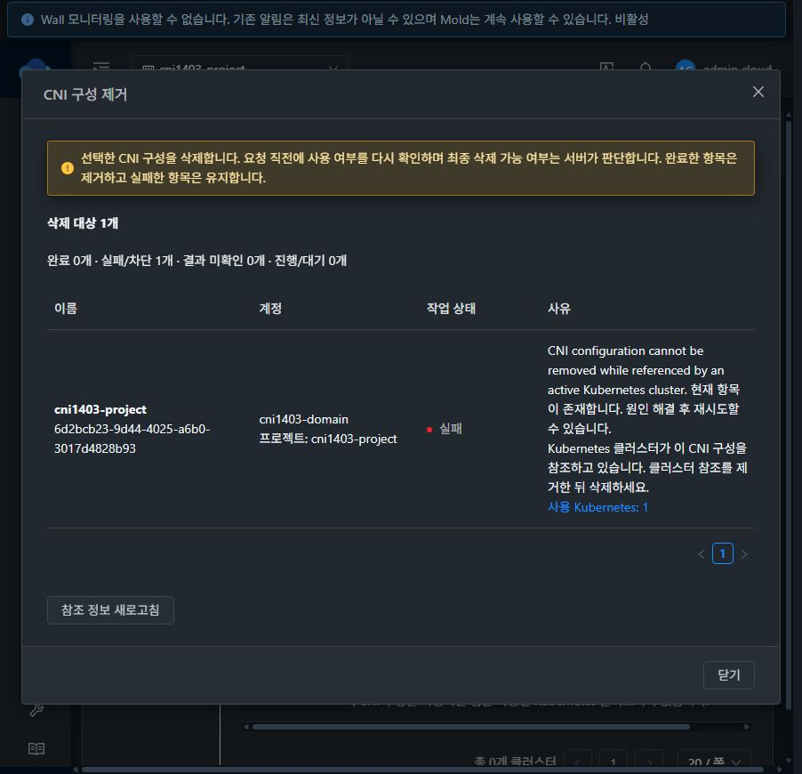
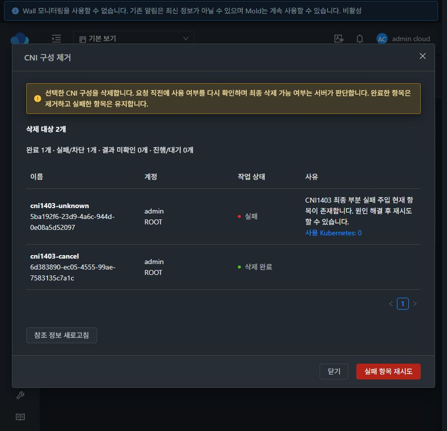
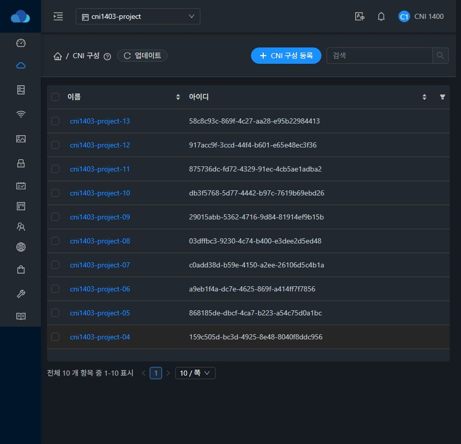
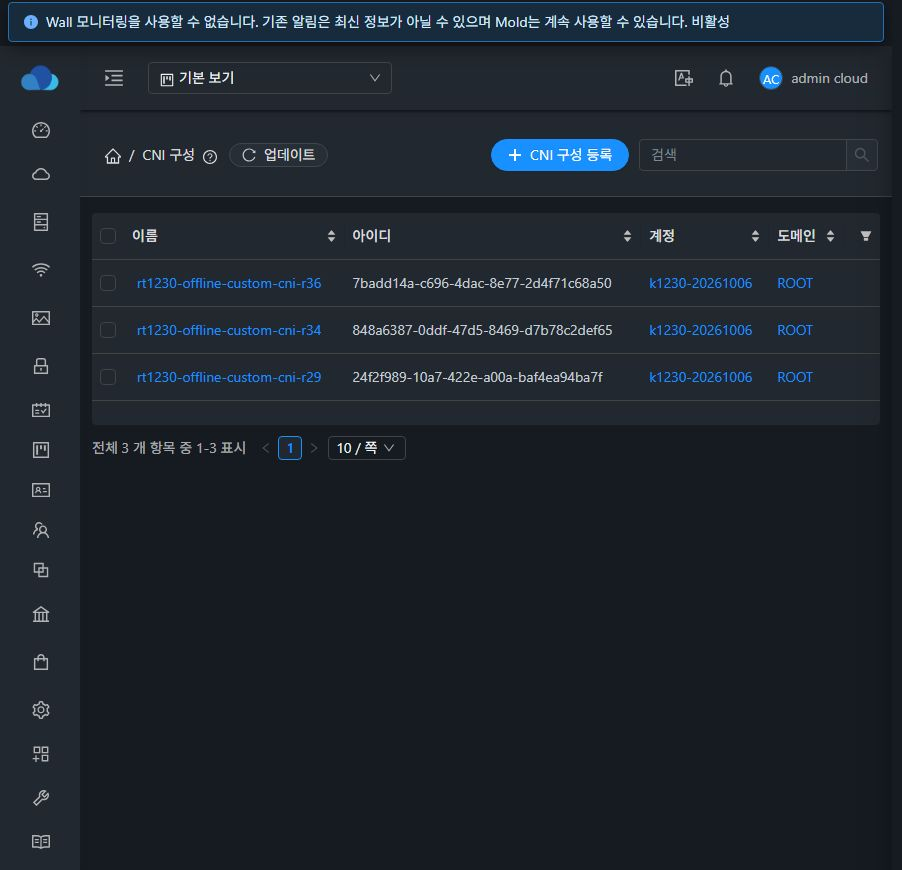

# #1403 CNI 삭제 확인·사용 여부·목록 복귀 검증 (2026-10-17)

## 결과와 설계

CNI 삭제에 전용 self-managed MoldDialog를 연결했다. 선택 당시 이름·UUID·계정/도메인/프로젝트를 동결하고 CNI 식별 → 정확한 사용처 → 식별을 확인한다. 제출 직전에 다시 조회하며 사용 중/조회 실패/권한·필터 미지원은 미사용과 구분한다. 최종 참조 판정은 #1399 서버 보호를 따른다. [설계](../../design/cni-deletion-ui-1403.ko.md).

- 항목별 상태·사유·클러스터 수와 사용처 탭 링크를 제공한다. 오류는 모달·원래 대상을 유지하며 실패한 원래 UUID만 재시도한다. 완료한 행에는 삭제된 대상의 사용처 링크를 남기지 않는다.
- 중복 실행·모달 닫기·Escape·라우트 이동을 요청 중 차단한다. 로그인/프로젝트/경로/대상/권한 변경·unmount 후 응답은 후속 삭제·목록 이동을 일으키지 않는다.
- UUID 변환 431은 바로 부재로 처리하지 않고 완전한 소유 범위/이름 조회에서 원래 UUID를 확인한다. 같은 이름의 대체 UUID는 삭제하지 않는다. 타임아웃·불완전 성공 응답은 현재 UUID 재조회로 성공/실패/미확인을 구분하고 미확인 상태를 자동 재삭제하지 않는다.
- 삭제한 상세의 resource/items/count/선택·로드 캐시와 읽기 세대를 먼저 비우고 원래 목록 위치로 `router.replace`한다. 지원하는 검색·페이지·정렬·소유 범위를 `cnireturn`에 보존한다. UI 전용 값은 API에 보내지 않으며 복귀 경로는 CNI 목록으로 고정한다. 마지막 페이지가 사라지면 실제 마지막 페이지로 보정한다.
- 기존 CNI groupAction 메타데이터를 목록 체크박스/명명된 삭제 도구모음에 연결했다. 부분 성공 후 닫으면 완료 UUID만 제거하고 실패·사용 중인 선택과 현재 목록 범위를 유지한다.
- 일반 UserData의 삭제 컴포넌트/계약은 변경하지 않고 검증된 스냅샷·조회/오류 유틸리티와 결과 처리 패턴을 재사용한다. CNI는 `listCniConfiguration/cniconfig`, `deleteCniConfiguration`만 사용한다.

최신 확인 Europa는 `dc31262567f2afe5f6278fae61c1cef7e307fe3e`, 시작 커밋은 `96adcf9b718e85e9d0ff625d56277b440549c692`, 작업 브랜치는 `dhslove/epic-1395-cni`다. WSL ext4 작업 사본에서 구현·테스트·빌드했고 Windows/기존 FT 작업 사본은 수정하지 않았다.

## 집중 검증

| 검증 | 결과 | 근거 |
| --- | --- | --- |
| DeleteCniConfiguration + DeleteUserData + CniUsage | **3 suites / 141 tests PASS** | [집중 테스트](focused-tests.txt) |
| UI 전체 lint `--no-fix` | PASS | [전체 lint](lint.txt) |
| 최종 변경 파일 lint `--no-fix` | PASS | [최종 lint](changed-lint.txt) |
| 최종 UI production build | PASS | [빌드 로그](ui-build.txt) |
| 31번 실제 로그인 API | **33 checks PASS** | [API matrix](api-matrix.json) |
| 실제 브라우저 UI | **22 checks PASS** | [UI checks](ui-checks.json) |

Node 20.20.2/WSL ext4에서 `NODE_OPTIONS=--openssl-legacy-provider`를 적용했다. 테스트 명령은 `npm run test:unit -- --runTestsByPath tests/unit/views/compute/DeleteCniConfiguration.spec.js tests/unit/views/compute/DeleteUserData.spec.js tests/unit/views/compute/CniUsage.spec.js --runInBand --coverage=false`다. 전체 `npm run lint -- --no-fix` 후 최종 변경 파일도 eslint로 확인했다. production은 `npm run build`다.

집중 테스트는 실제 API/응답 키·명시적 소유 범위, CNI 식별/참조 순서와 무필터 대체 금지, 변경된 소유자/이름·불완전 응답·431 fallback·같은 이름의 대체 항목, 참조 생성 경쟁·서버 오류·사용 중/실패/미확인·부분 성공/실패 UUID 재시도, 잠금/라우트/로그인/권한/대상 변경·늦은 응답, 목록 URL·상세/캐시 제거 및 일반 UserData 회귀를 포함한다.

기존 Browserslist/bundle 크기와 테스트 환경의 Vue 컴포넌트 경고가 있다. Maven 소스 변경이 없어 Maven 빌드는 하지 않았다. 전체 Cloud/Release CI, RPM 또는 수동 GitHub Actions 빌드는 실행하지 않았다. 미확인 응답 후 UUID 확인·전체 세션/권한 경합은 집중 테스트 범위이고 운영 DB/서버 장애를 주입하지 않았다.

## 실제 UI/API 검증

새 도메인·일반 계정 A/B·프로젝트에 전용 CNI/일반 UserData/Annotation/네트워크/클러스터를 만들었다. 기존 CNI와 Kubernetes 참조는 변경하지 않았다.

- 미사용 CNI 확인창에 이름·UUID·계정/도메인과 사용처 0이 표시되고, 취소 시 원래 CNI가 유지된다.
- 사용처 XHR에 503을 주입하면 확인 실패/차단이며 0건·삭제 버튼으로 표현하지 않는다. 참조 정보 새로고침으로 정상 0/삭제 가능 상태가 복구된다.
- 삭제 POST에 HTTP403/API531을 주입하면 원래 UUID·대화상자·오류 사유가 유지되고, API로 대상 존재를 확인했다. 주입 제거 후 같은 UUID 재시도가 성공하고 원래 keyword/page/pagesize 목록으로 돌아간다. 실제 비회원/타 계정의 조회·삭제 ACL 거부도 별도 API에서 확인했다. 브라우저 주입과 서버 ACL 검증을 혼동하지 않는다.
- 모달이 0개를 확인한 뒤 실제 삭제 POST를 브라우저에서 잠시 정지했다. 다른 로그인 API 세션에서 같은 CNI로 실제 클러스터를 생성한 후 정지한 POST를 그대로 서버로 보냈다. 서버가 `CNI configuration cannot be removed while referenced by an active Kubernetes cluster.`로 거부했고 UI는 실패 사유·최신 사용처 **1개**를 표시했다. CNI 원문과 Annotation은 보존됐다. 요청 중 닫기/중복 실행 제어도 잠긴 상태였다.
- 새로 여는 사용 중 확인창은 1개/차단이며 삭제 제어가 없다. 사용처 링크는 같은 프로젝트의 정확한 CNI 사용 Kubernetes 탭으로 이동한다.
- 미사용으로 확인한 원래 CNI를 외부 API에서 삭제하고 같은 이름의 새 UUID를 등록했다. 기존 확인창에서 실행하면 원래 부재를 판정해 목록으로 복귀하며 대체 UUID는 유지한다.
- 프로젝트 검색 결과 13개/2페이지/10개씩에서 03 항목을 상세 삭제한 뒤 같은 프로젝트·검색·2페이지·10개씩의 목록(12개)으로 복귀했다. 이전 상세·작업 메뉴가 남지 않았다.
- 02 미사용 + 원래 사용 중 CNI를 일괄 선택해 **1개 완료/1개 차단**을 확인했다. 닫으면 완료 UUID만 없어지고 사용 중 UUID 1개 선택과 2페이지/검색이 유지됐다.
- 일반 프로젝트 UserData 2개는 하나의 POST에 503을 주입해 1개 완료/1개 실패와 사유 유지를 확인했다. 재시도는 남은 UUID만 삭제하고 목록은 정상 0개였다. CNI와 UserData의 양방향 유형 혼용 거부도 API에서 확인했다.
- 일반 계정 A가 자기 CNI를 UI로 삭제했다. 정상 클러스터 삭제 후 같은 프로젝트 회원 A가 원래 사용 중 CNI의 **현재 0개**를 확인해 삭제했다. 2페이지의 마지막 행이 사라지자 동일 프로젝트·검색·10개씩을 유지하고 1페이지(10개)로 보정했다.

첫 배포에서 위 기능을 검증한 후, 오류 설명 중복 표시와 완료 행의 사용처 링크를 정리했다. 최종 소스로 집중 테스트/변경 lint/production 빌드·정적 배포를 다시 수행했고, 최종 UI에서 조회 실패 문구 1회·재시도 및 일괄 부분 성공/완료 행 링크 제거·정상 완료를 다시 확인했다. 상세 목록 복귀·UUID/참조·삭제 프로토콜은 같은 구현이다.

추가 화면: [최종 미사용 확인](unused-confirmation-final.png), [최종 조회 실패](usage-error-blocked-final.png), [권한 오류](delete-permission-error.png), [필터 목록 복귀](deleted-return-filter.png), [사용 중 확인](in-use-confirmation.png), [프로젝트 2페이지 복귀](project-page2-return.png), [실패 선택 유지](batch-failed-selection.png), [일반 UserData 부분 실패](userdata-partial-regression.png).

### 경합용 클러스터 준비

프로젝트 CNI `6d2bcb23-9d44-4025-a6b0-3017d4828b93`, 클러스터 `a1a28cab-8be9-4a65-90ce-3db013e752d0`, 노드 `5e444985-5572-406b-9050-76db12df3b52`/`3361d0e1-5535-4a65-b955-7722f2ada97e`를 사용했다. 실제 생성 job은 **성공/Running**, 게스트 노드 **2개 Ready**, 시스템 Pod Running을 확인했다. [게스트 근거](guest-ready.txt), [실제 참조 생성 시점](reference-created.json).

이번 준비에는 호스트 이동·재부팅·DB/참조/게스트 파일 수동 보정이 없었다. control/worker는 31.2, 라우터는 31.3이었고 gateway ARP와 metadata HTTP200을 확인했다. 이전 #1400의 호스트 간 metadata 관찰을 이번 실패로 취급하지 않는다. Kubernetes 생성 UI 전체 재검증이나 변수 치환 완료를 주장하지 않는다.

## 배포 보존과 정리

production 정적 UI **876개**를 manifest SHA256으로 확인해 `/usr/share/cloudstack-management/webapp`에 배포했다. 기존 정적 자산을 삭제하지 않고 index를 마지막에 교체했으며, WEB-INF/META-INF/config.json과 JAR/PID를 보존했다. Mold 재시작과 JAR/호스트 패키지 변경은 없다.

- 최종 백업: `/root/cni-1403-ui-20261017-210404`
- 최종 정적 tar SHA256: `62c4a50ae3eb0b4740fceb073cf8c5f549564997188574c4e52992b4600a2004`
- JAR SHA256: `5ef511623cdfa29df4b5e0d519a46a0acdc0bb1b2c239902bc5c63e608671174` (유지)
- config.json SHA256: `b7de5f6a1f7a3a17310ee7d34ca801bb316fc6f841039f865fbabf154cd59a13` (유지)
- Mold PID **1510297** 유지·active, `/client/` HTTP **200**, WEB-INF 존재, FTCTL 표식 및 `cni-delete-dialog`/`cnireturn` 확인.

[최종 배포 직후](deployment-verification.txt) · [정리 후 런타임](runtime-after.txt) · [876개 manifest](cni-1403-manifest.json).

클러스터를 정상 `deleteKubernetesCluster` job `e26e93c8-29a0-489b-9b6b-cb84406e58b0`으로 삭제해 사용처 0을 확인한 뒤 원래 CNI를 UI로 삭제했다. 전용 **CNI 20개**(동일 이름 대체 UUID 포함)/**일반 UserData 2개**/**Annotation 1개**·클러스터/노드 2개/라우터·네트워크·프로젝트와 프로젝트 계정/일반 계정 2개/도메인을 정상 API/UI로 정리했다. [클러스터 삭제 후 사용처](after-cluster-removal.json) · [프로젝트 정리](cleanup-project-receipts.json) · [마지막 정리](cleanup-root-receipts.json).

- 활성 CNI/UserData·Annotation·클러스터·참조·VM 매핑·VM·볼륨·네트워크·프로젝트·계정·도메인·사용자·API keypair 잔여 **모두 0**. [집계](residual-counts.tsv) · [조회 SQL](residuals.sql)
- 세 호스트의 전용 `i-152-618-VM`, `i-152-619-VM`, `r-617-VM` 도메인 **0**. [호스트 근거](host-domain-cleanup.txt)
- 기존 CNI **3개** API 객체, Kubernetes **7개**의 안정 필드/노드 UUID가 동일하다. 기존 본문/변수/코멘트/참조/소유 범위 DB **36행**이 전후 바이트 동일하며 SHA256은 `2d61f159980ac4fa490f62c74e16ce6024ac1f8bb9210c2c6caaa366c74357f7`다. [비교 요약](cleanup-summary.json)
- 관리자 기본 범위/CNI 목록으로 복귀하고 브라우저 장애 주입 규칙을 제거했다. 생성 비밀번호·세션/API 키·개인 API 응답은 저장소에 포함하지 않았다. 클러스터 기계 사용자 API 키 1행은 removed가 있는 삭제 이력으로 보존되며 활성 키는 0개다.

## 후속 작업

다음은 **#1401 CNI 본문 디코딩 보기·원문 전환·복사·다운로드**다. UTF-8/BOM/CRLF/마지막 개행/특수문자와 바이너리·손상 데이터를 구분하고 실제 클립보드·다운로드 바이트를 검증한다. #1402 UUID/소유 범위 고급 검색은 독립 착수 가능하다. 전체 CNI 목록/상세/탭/콘텐츠/대화상자의 라이트/다크·반응형 표준 점검은 #1408에 남긴다.

Epic #1395는 13개 중 6개 구현 범위가 완료된 누적 초안이며 전체 Epic 종료/PR 병합은 하지 않는다.
