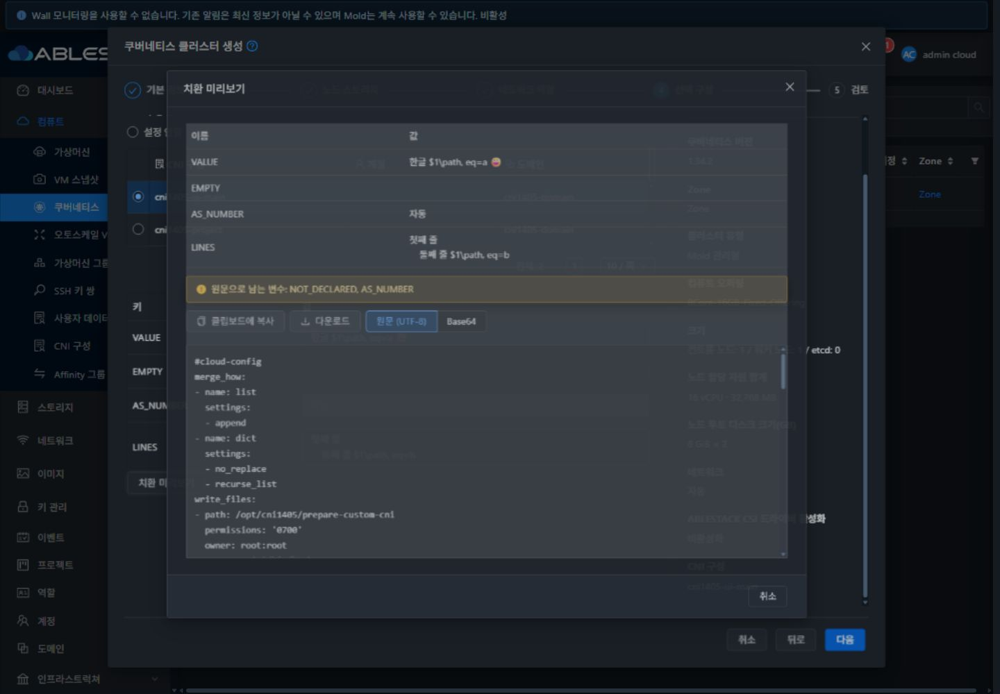
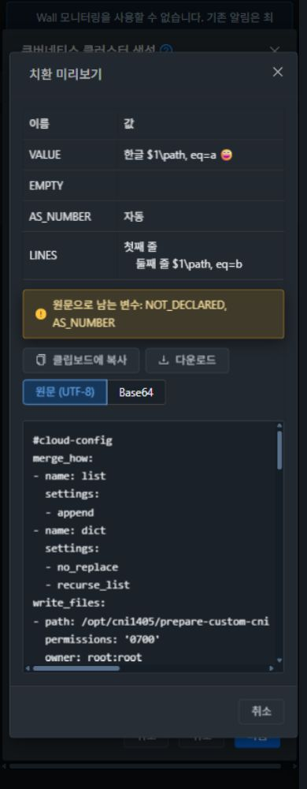
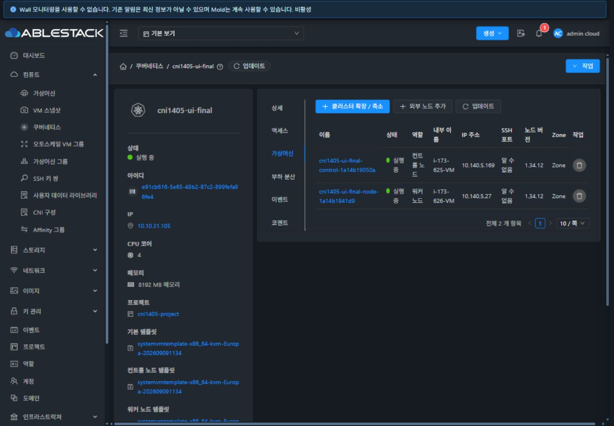

# #1405 CNI 변수 추출·서버 치환 미리보기 — 31번 검증

2026-10-18. Epic #1395 / 누적 Draft PR #1409. [설계](../../design/cni-variables-preview-1405.ko.md).

## 결과

등록 UI에서 본문의 변수 후보를 추출·확인·적용해 전용 프로젝트 CNI를 등록했다. Kubernetes UI에서 한글·이모지·달러·역슬래시·쉼표·등호·명시적인 빈 문자열·개행 값을 입력하고 서버 미리보기, 실제 POST, cluster/VM DB JSON, 게스트 CNI MIME 본문과 생성 파일을 대조했다. 최종 새 클러스터는 게스트 수동 보정 없이 생성 성공·컨트롤/워커 2개 Ready·사용자 정의 Calico 적용·정상 삭제를 완료했다.

일반 변수는 선언된 단순 토큰만 리터럴 치환하며 반복/인접·이스케이프를 지원한다. 미선언 토큰과 미할당 AS_NUMBER는 원문과 미해결 상태를 보존한다. Jinja 일반 표현식은 실행하지 않으며 메타데이터 참조 후보만 표시한다. AS_NUMBER는 네트워크/VPC 할당값 우선, 제안값, 미할당 순으로 실제 생성과 같은 함수를 사용한다. 세부 정책과 API 계약은 설계에 기록했다.

## 집중 검증

| 구분 | 결과 | 근거 |
| --- | --- | --- |
| UI 집중 테스트 | 7 suites / 142 tests PASS | [결과 로그](test-results.txt) |
| 변경 Kubernetes 모듈 | 102 tests / package PASS | 같은 로그, renderer·preview command·manager·참조/merge 회귀 |
| 변경 server 모듈 | 62 tests / package PASS | NetworkModel/CommandSetupHelper의 JSON·legacy·빈 맵 회귀 |
| 전체 UI lint·production build | PASS | 같은 로그 |
| 실제 API·DB·게스트 | 50 checks PASS | [체크별 결과](api-checks.json), [실제 전달 증거](end-to-end-proof.json) |
| 실제 UI 기능 | 23 checks PASS | [UI 기록](ui-evidence.json), [인증정보를 제외한 POST](ui-network.json) |

Maven은 WSL ext4 dhslove 사본에서 `-pl server`와 `-pl plugins/integrations/kubernetes-service`만 수행했다. 대상 집중 테스트를 실행했고 해당 package에서는 RAT/checkstyle을 생략했다. 전체 Cloud 빌드/Release CI/GitHub Actions 실행 결과를 의미하지 않는다. 브라우저/소스 세대·권한 변경과 늦은 응답 차단은 집중 테스트에 포함했다. 실제 ACL 거부는 API에서 확인했으며 UI의 모든 네트워크 실패 조합을 주입했다는 주장은 하지 않는다.

## 실제 생성과 바이트 대조

- UI 등록 CNI `cni1405-ui-main` / UUID `2f944205-54a9-4e89-a50b-58a15de88ff2`, params `VALUE,EMPTY,AS_NUMBER,LINES`.
- 최종 UI 생성 `cni1405-ui-final` / UUID `e91cb616-5e65-48b2-87c2-899fefa96fe4`, job `68e39760-2699-4a44-bb5e-842292f3e18e` 성공.
- 프로젝트 UUID `0f11cc46-dcb9-469e-a01b-7d7069219d11` / 전용 네트워크 `769890ed-aa07-4496-a977-4b45070afe08`. version `1.34.12-Mold-1280-r1-3f24d481`, offering `RT1230-GFS2-2C4G-Strict`, 컨트롤 1/워커 1, CSI 비활성.
- 입력 `VALUE=한글 $1\path, eq=a 😀`, `EMPTY=""`, `LINES`는 실제 개행과 YAML 블록 들여쓰기를 포함한다. [정확한 입력 JSON](end-to-end-proof.json), [시험 원문](sample-cni.yaml), [독립적으로 계산한 결과](expected-cni.txt).
- preview POST와 create POST는 같은 원시 값을 보냈고 AS_NUMBER를 custom details에 넣지 않았다. DB의 cluster `cni_config_details`와 control VM `user_data_details` JSON을 각각 파싱한 값이 입력과 일치했다. 비 ASCII 문자를 escape해 utf8mb3 컬럼에서도 이모지까지 보존했다.
- 실제 게스트의 gzip 사용자 데이터를 풀고 MIME CNI part를 디코드했다. CNI part는 정확히 1개, **1,957 bytes**, 미리보기/게스트 SHA-256 모두 **`14ee6f365089910e32e34384e35e674f41d58001297e724bb07ff4691176b190`**.
- `/opt/cni1405/values.txt`와 `lines.txt`의 실제 파일 바이트가 독립 YAML 해석 결과와 일치했다. 인접/반복·빈 값·이스케이프·미선언 보존·특수문자·한글/이모지/개행을 확인했다. 기본 bootstrap MIME part 1개와 kubeadm/admin.conf도 보존됐다.
- 두 노드는 v1.34.12 Ready, providerID가 실제 Cloud VM UUID와 일치한다. Calico daemonset 2/2 Ready, kube-system pod 13개 Ready, MTU1450과 사용자 정의 annotation을 확인했다. [게스트 읽기 결과](guest-proof.json).
- 이 시험 네트워크에는 AS가 할당되지 않아 미리보기와 실제 게스트 모두 `{{ AS_NUMBER }}`를 유지했다. 숫자 치환과 네트워크/VPC의 할당값 우선은 실제 preview API 및 Java 집중 테스트로 검증했다. 실제 BGP/AS 할당 클러스터를 생성했다는 주장은 하지 않는다.

## UI 및 VM 공통 표준

| 신규 영역 | 적용한 표준과 실제 검증 |
| --- | --- |
| 등록 변수 추출 | 기존 CniFileImport 툴바 슬롯, 명시적 텍스트 버튼, MoldDialog md, 작은 선택 표·내부 스크롤·푸터. 추출만으로 원문/선언 변경 없음, 선택 적용·취소·CtrlEnter 차단, 실제 등록 바이트/소유 범위 대조 |
| Kubernetes 값 입력 | 기존 CNI 선택 영역의 작은 표, 자동 높이 textarea로 실제 개행 입력, AS_NUMBER 자동값 표시, 누락 시 다음/제출 차단 |
| 치환 미리보기 | MoldDialog lg·UserDataContent 원문/Base64·코드 내부 스크롤·공용 복사/다운로드. 실제 본문·클립보드·다운로드 바이트 대조, 취소 후 값 유지·CtrlEnter 오제출 차단 |
| CNI 변경/해제 | 이전 값 제거, 재선택 후 빈 입력, preview POST에 이전 cniconfigdetails가 없는 것을 확인 |
| 오류 및 안내 | 예약 변수의 한글 오류·비활성 적용, 누락/미해결 목록. 상시 기능 설명/API placeholder를 추가하지 않고 정책은 전용 도움말에 기록 |
| 회귀 | VM 목록과 일반 UserData 등록 UI 정상 표시, 일반 UserData에는 CNI 추출 버튼이 없음. 기존 API/DB 데이터 동일 |

1440/1024/768/390px × 라이트/다크에서 추출/미리보기/예약 이름 오류를 검증했다. **최종 대화상자 폭·테마·상태 조합 28개**, 성공 클러스터·노드·VM/일반 UserData·정리 후 목록을 포함해 **선택 화면 33개**를 공개한다. 다수 행/긴 이름은 300자 변수와 후보 66개로, 본문은 1,957 byte 다중 행으로 확인했다. 화면 전체 가로 넘침·모달 좌우 이탈·푸터 이탈을 DOM으로 검사했고 모바일 실제 화면에서 표와 코드 내부 스크롤을 확인했다. [화면별 DOM 측정](ui-evidence.json).

## 발견·수정 및 별도 결함

1. 최초 실환경 preview의 응답 객체 이름 누락과 미할당 AS 경로의 null unboxing을 수정했다. 최종 실제 API/생성은 수정본으로 검증했다.
2. 예약 이름의 로컬 오류가 번역 키로 표시되는 것을 수정하고 한글 오류 표시를 실제 UI에서 재검증했다.
3. 실제 VM start에서 가상 라우터 `CommandSetupHelper`도 구형 쉼표 파서로 JSON을 읽는 별도 경로가 드러났다. JSON/legacy/빈 맵을 지원하도록 수정하고 회귀 테스트·변경 server 모듈 빌드·재배포 뒤 새 UI 클러스터로 검증했다.
4. **첫 시도는 실패이며 PASS로 계산하지 않았다.** 노드 미부팅 상태에서 일반 런타임 예외가 lifecycle 실패 영수증을 남기지 않아 정상 삭제가 ServiceDeletionRequest에서 막혔다. 해당 시험 cluster 83의 UUID/이름/Error·빈 endpoint·bootstrap 미시작·VM Stopped를 확인하고, 그 행의 실패 phase/job 영수증만 보완한 뒤 정상 삭제를 재시도했다. 이 Kubernetes lifecycle 복구 문제는 [#1410](https://github.com/ablecloud-team/ablestack-cloud/issues/1410)으로 별도 등록했으며 **미구현·열림**이다. 최종 새 cluster 84는 수동 보정 없이 생성/검증/정상 삭제했다.

## 배포와 정리

- 정적 UI **879개 파일 해시 일치**, UI 백업 `/root/cni-1405-ui-20261018-030908`, index SHA `d56010f253be8fc30e1d5e38679b9e8be89efee346d948044b27daca69ea7232`.
- 최종 JAR 백업 `/root/cni-1405-backend-20261018-031830`, SHA **`3b9bc6d9e6b766938e46ecde613ea00d073a08a435fc864c89e9827f560a36eb`**, 최종 Mold PID1589408. 원본 JAR의 **204,481 엔트리 압축 바이트 보존**, 기존 16개 클래스 엔트리 교체·신규 3개 추가, 총 204,500. 현재 빌드 클래스와 배포 receipt의 해시도 대조했다. [JAR receipt](backend-artifact.json).
- WEB-INF/config 보존, META-INF는 전후 부재, Mold active, `/client/`와 ko/en 도움말 HTTP200, 현재 번들의 CNI/preview/FTCTL 표식 확인. [최종 런타임](final-runtime.json). static rollout 당시 보존한 JAR/PID와 이후 최종 backend restart를 구분한다.
- CNI 4개·일반 UserData 1개·성공/실패 cluster 2개·생성된 사용자 VM 3개·라우터 1개·네트워크·프로젝트·계정 2개·도메인을 정리했다. 성공 cluster와 최종 삭제 작업은 정상 API로 수행했다. 첫 실패의 시험 행 영수증 복구는 위와 같이 별도 기록했다.
- 활성 잔여 **13종 전부 0**, 세 호스트 시험용 도메인 `r-623-VM`, `i-173-624/625/626-VM` 없음. [정리 결과](cleanup-summary.json), [호스트 결과](host-domain-cleanup.json).
- 기존 CNI3/Kubernetes7 API(노드 UUID 포함)와 선택 DB36행 동일. DB SHA **`2d61f159980ac4fa490f62c74e16ce6024ac1f8bb9210c2c6caaa366c74357f7`**. 운영 원문/인증정보/전체 bootstrap은 공개하지 않았다. 기본 보기·원래 다크 테마·뷰포트 복원 후 CNI 목록으로 복귀했다.

## 다음 작업

CNI Epic의 다음 구현은 **#1406 복제 기반 새 구성·원본 관계 → #1407 복제 이력·본문/변수 비교**다. 해당 신규 화면도 같은 VM 표준과 실제 배포 검증을 수행한다. #1410은 별도 Kubernetes 복구 결함으로 열어 둔다. Epic #1395와 PR #1409는 전체 완료/병합 상태로 바꾸지 않는다.
