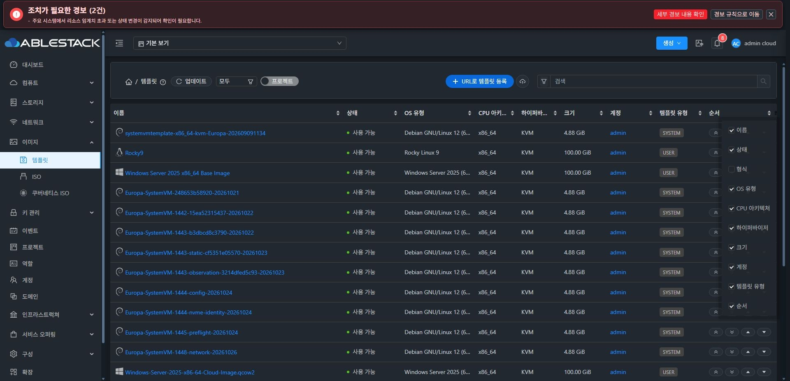
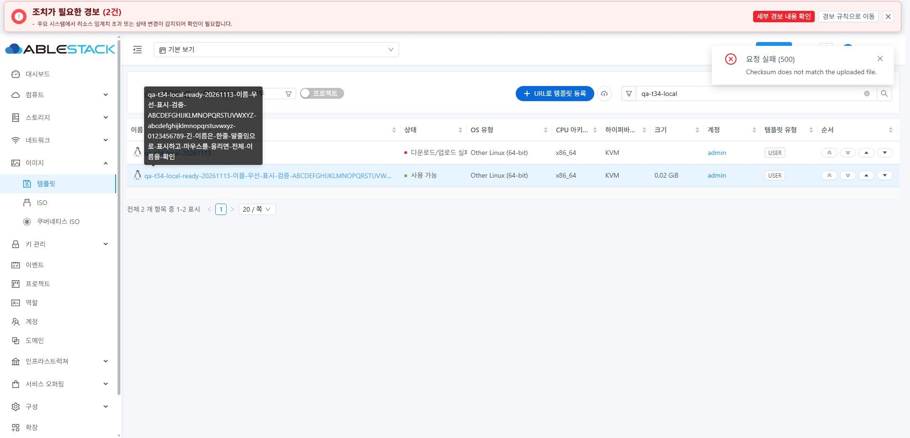
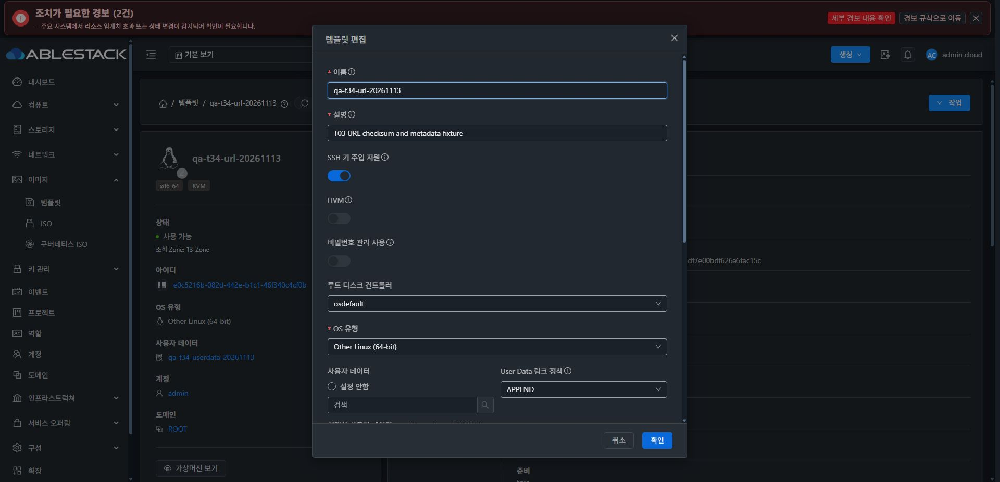
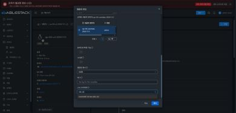
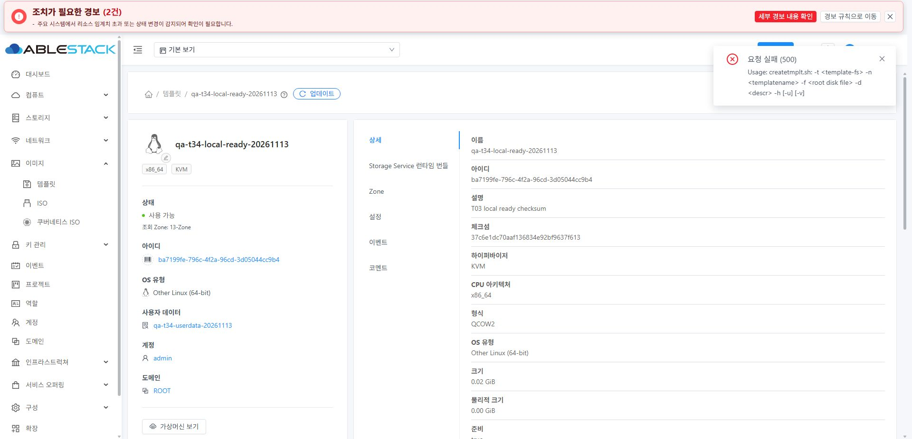
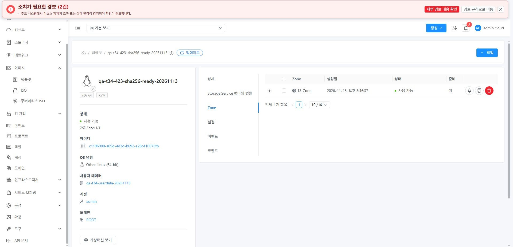
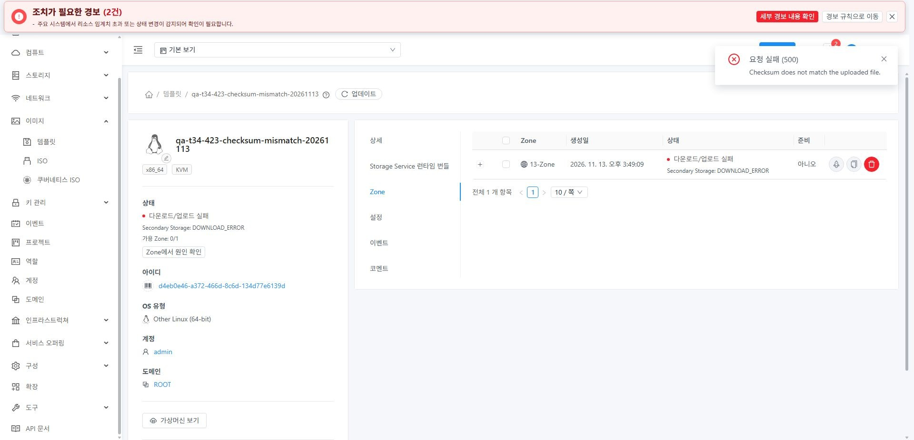
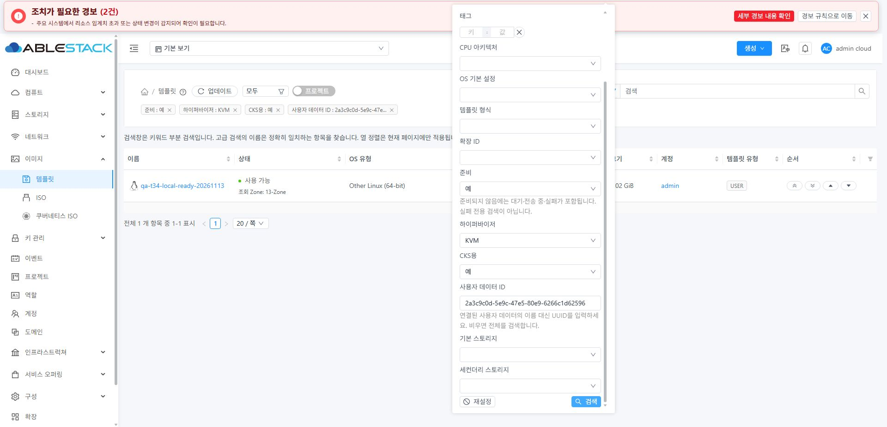
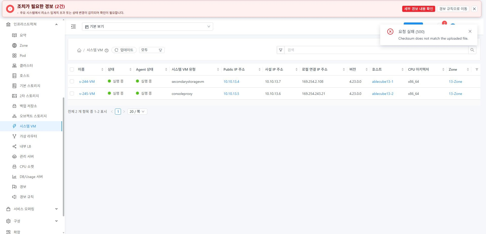
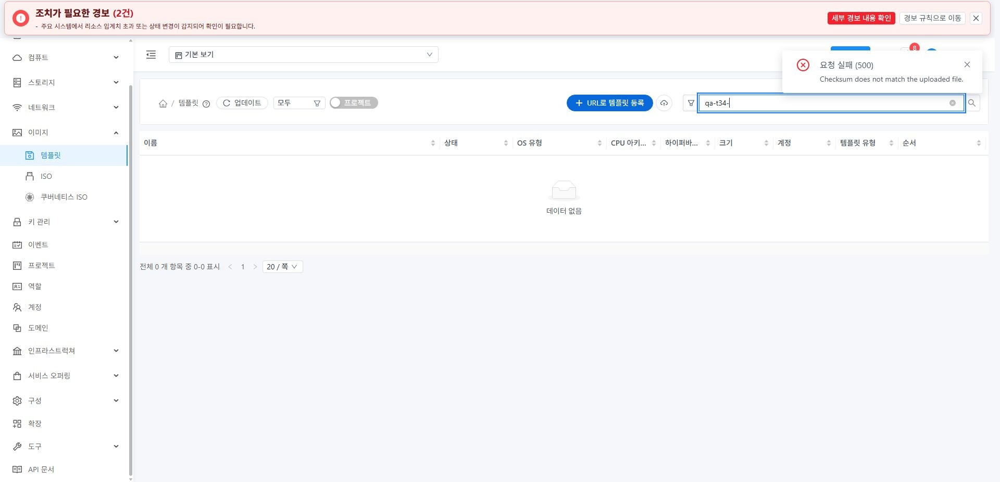

<!--
Licensed to the Apache Software Foundation (ASF) under one
or more contributor license agreements.  See the NOTICE file
distributed with this work for additional information
regarding copyright ownership.  The ASF licenses this file
to you under the Apache License, Version 2.0 (the
"License"); you may not use this file except in compliance
with the License.  You may obtain a copy of the License at

  http://www.apache.org/licenses/LICENSE-2.0

Unless required by applicable law or agreed to in writing,
software distributed under the License is distributed on an
"AS IS" BASIS, WITHOUT WARRANTIES OR CONDITIONS OF ANY
KIND, either express or implied.  See the License for the
specific language governing permissions and limitations
under the License.
 -->

# 템플릿 T03·T04 구현 및 13번 클러스터 검증

[상위 Epic #1638](https://github.com/ablecloud-team/ablestack-cloud/issues/1638) · [T03 #1641](https://github.com/ablecloud-team/ablestack-cloud/issues/1641) · [T04 #1642](https://github.com/ablecloud-team/ablestack-cloud/issues/1642) · [PR #1647](https://github.com/ablecloud-team/ablestack-cloud/pull/1647)

2026-11-13 KST. T03 → T04 순서로 구현하고 13번 환경의 실제 UI에서 검증했다. 4.21 업로드 검증 후 SSVM·콘솔 프록시를 새 4.23 시스템 이미지로 재생성하고 4.23 업로드도 검증했다. 두 이슈의 구현·범위 내 수용 검증을 완료했다. PR은 리뷰 대상으로 유지하며 병합하지 않았다. T05–T08 (#1643–#1646)은 후속 작업이다.

## 변경 결과

- 편집의 `arch` 초기값을 복원하고 false 값과 변경하지 않은 값의 보존을 구분했다. API 스키마에 따라 SSH 키 주입/HVM을 편집하고 로컬 업로드의 체크섬/CKS/SSH 옵션을 전달한다.
- 등록·업로드를 기존 MoldDialog 크기·본문·footer·busy·focus 계약에 맞췄다. 사용자 데이터 연결만 실패하면 이미 성공한 등록/수정을 반복하지 않고 연결만 재시도한다.
- 파일 전송을 시도한 뒤의 실패는 일회성 전송 URL을 다시 사용하지 않는다. 등록된 이미지 상태로 이동해 원인을 확인한다. 전송 전 사전 연결 실패의 재시도는 유지했다.
- 준비/하이퍼바이저/CKS/사용자 데이터 UUID 검색을 추가했다. 준비되지 않음은 전송 중·대기·실패를 포함한다. `isready=false`의 서버 조건을 SQL 개수·페이지 계산 전에 적용하도록 수정했다.
- 정확한 이름 검색과 키워드 부분 검색, 필터 초기화, 검색/페이지/페이지 크기의 상세·breadcrumb·뒤로 가기 복원을 검증했다. 프로젝트 전환과 늦은 조회 응답에서 이전 검색·초안을 덮어쓰지 않게 했다.
- breadcrumb와 목록 사이의 비표준 상시 검색 안내 문단을 제거했다. 설명은 필요한 입력 필드의 도움말 안에서만 제공한다.
- 이름 열에 남는 폭을 배정하고 최소 400px을 확보했다. 상태 140px, OS 유형 180px 등 보조 열을 제한했다. 이름과 보조 정보는 한 줄 말줄임으로 표시하며 전체 값은 툴팁으로 확인한다. 열 선택과 폼의 명칭도 ‘템플릿 유형’으로 통일했다.

긴 이름 화면의 500 알림은 앞서 의도적으로 수행한 체크섬 불일치 시험 결과다. 최종 화면에서는 시험 알림을 닫았다.

## T03 실제 UI 검증

| 검증 | 결과와 근거 |
| --- | --- |
| 아키텍처 편집 | x86_64 초기값, aarch64·s390x 저장/재열기, 다른 필드만 수정, 취소 후 기존 값 유지 |
| false 값 | SSH/HVM/CKS 명시 해제와 다른 필드만 저장할 때의 기존 false 보존 |
| URL 등록 | SHA-256 접두어, SSH/CKS, private 값의 실제 요청 및 최종 Ready 확인 |
| 로컬 입력 | 잘못된 체크섬의 인라인 차단·입력 보존, 이름 초기 초점, 아키텍처/유형 타이핑 검색 오류 교정 |
| 부분 실패 | 사용자 데이터 연결 요청만 의도적으로 중단. 등록 1회 또는 메타데이터 수정 1회 후 연결만 재시도 |
| 폼 표준 | 라이트/다크, 390×844, footer 노출, 본문 가로 넘침 없음, 취소/초점/busy 확인 |
| 재시도 경계 | 전송 전 연결 실패는 기존 ID로 재시도. 전송 후 HTTP 500은 상태 확인으로 이동하고 파일 재전송 안 함 |

### 4.21·4.23 업로드 수용 결과

| 실제 SSVM 런타임 | 정상 파일 | 잘못된 체크섬 | 최종 판정 |
| --- | --- | --- | --- |
| 4.21.0.0-Mold.Diplo-202609221440 | MD5 `37c6e1dc70aaf136834e92bf9637f613`, Ready, userdata APPEND | 유효한 형식의 다른 MD5, HTTP 500 체크섬 불일치, DOWNLOAD_ERROR/Ready=false | 통과 |
| 새 4.23.0.0 | `{SHA-256}a868962514df6e6678042c72d4eebca7b842a2e4edd1df7e00bdf626a6fac15c`, Ready, SSH/CKS=true, userdata ALLOWOVERRIDE | 유효한 형식의 다른 MD5, HTTP 500 체크섬 불일치, DOWNLOAD_ERROR/Ready=false | 통과 |

정상 시험 파일은 196,616바이트/가상 크기 16MiB인 빈 QCOW2다. 파일 전송·체크섬·이미지 준비 검증이며 게스트 OS 부팅 검증은 포함하지 않는다. 두 런타임의 정상/불일치 시험은 UI에서 직접 파일을 선택해 수행했다.

4.21에서 먼저 노출된 서버 오류는 `createtmplt.sh`의 인자 처리였다. 템플릿 스크립트의 `-c`는 인자 없는 cloud 플래그인데 업로드 체크섬을 값과 함께 중복 전달했다. 템플릿은 파일을 이동하는 스크립트 실행 전에 MD5/SHA-256/SHA-512를 검증하고 잘못된 `-c value`를 전달하지 않게 했다. 볼륨 스크립트의 기존 체크섬 인자는 보존했다.

4.23 재생성 직후 첫 사전 연결은 시간 초과됐다. UI의 전송 전 재시도로 같은 업로드 ID를 사용했고, 전송과 사용자 데이터 연결 및 최종 Ready까지 성공했다. 인증서 경고 우회나 브라우저 보안 설정 변경은 없었다.

## T04 실제 UI 검증

- 기존 `isready=false`는 초기 45개 전체를 반환했다. 수정 후 초기 기준 미준비 2개/준비 43개/조건 생략 45개를 반환했다. 미준비 조건에서 페이지 크기 1, 2페이지는 전체 개수 2와 행 1개를 반환했다.
- Ready=true + KVM + CKS=true + 사용자 데이터 UUID 조합은 정상 로컬 시험 이미지 1개를 반환했다. CKS=false 조합은 URL 시험 이미지 1개를 반환했다.
- 고급 이름에 일부 이름만 입력하면 0개, 키워드에 같은 일부 이름을 입력하면 2개를 반환했다. 검색 초안은 늦게 끝난 옵션 조회 뒤에도 유지됐다.
- Europa 키워드의 2페이지(21–36/36)에서 상세 진입 후 브라우저 뒤로 가기와 breadcrumb로 돌아왔을 때 검색어·2페이지·크기 20을 복원했다. 새 조건 적용 시 1페이지로 이동했다.
- 잘못된 사용자 데이터 UUID의 Ctrl+Enter는 인라인 차단하며 API를 호출하지 않았다. 구조화된 유효성 검사 거절로 인한 console 오류도 교정했다.
- 프로젝트 보기 전환 시 이전 필터와 query를 지우고 기본 보기를 복원했다. 여러 역할/여러 Zone ACL의 전체 조합 검증은 T08 범위다.
- 응답이 요청 필터와 일치하지 않으면 넓은 결과를 성공처럼 보여주지 않도록 방어했다. API 미지원·소유자/경로 변경·지연 응답의 방어는 단위 테스트로 검증했다.
- 이미지 형식(QCOW2 등)과 템플릿 유형(USER/SYSTEM 등)의 표시·열 선택을 구분했다. 일괄 템플릿 삭제는 추가하지 않았다. 정렬은 기존 현재 페이지 동작을 유지한다.

### 목록 너비·한 줄 표시

| 뷰포트 | 이름 열 | 상태 열 | OS 유형 열 | 행 높이 | 페이지 가로 넘침 |
| --- | --- | --- | --- | --- | --- |
| 1920px | 567px | 140px | 180px | 48.5px | 없음 |
| 1280px | 400px | 140px | 180px | 48.5px | 없음, 목록 내부 스크롤 |
| 390px | 400px | 140px | 180px | 48.5px | 없음, 목록 내부 스크롤 |

긴 이름 시험의 링크 표시 폭은 529px, 원문 폭은 1,231px였다. `nowrap`/`ellipsis` 상태에서 높이 22px을 유지하고 마우스 오버로 전체 이름을 표시했다. OS 유형/상태 등도 한 줄을 유지하고 전체 값/원인을 title 툴팁으로 제공한다. 검증 후 원래 다크 테마·기본 뷰포트·프로젝트 기본 보기·열 선택을 복원했다.

## 필요한 산출물만 배포

작업 시작 시 upstream → 로컬 `ablestack-europa` 동기화 후 기능 브랜치를 rebase했다. 기준 `0edd20dcc9218312b3da533582f03e11535c5eb8`, 로컬 base/upstream 차이 `0 0`. origin의 `dhslove/epic-1638-template-ui`에만 push했다.

- UI: 실제 운영 기준 `460b33770cb071d869f61c2aac0d81773890ebc3`에 T03/T04 변경만 적용해 빌드했다. 다른 upstream의 ResourceTags/Annotations 변경은 제외했다. JavaScript 빌드 `c0f2be7dddfaf575239bf63ae3acc18c8d965e0e`, 최종 정적 번역 `981f90d36c9817c690281246077b791ef84bdff1`이다. 마지막 문구 수정은 번역 JSON만 교체했다.
- 최종 UI 런타임 975개 파일 해시가 빌드 산출물과 모두 일치했다. index SHA-256은 `cfdf94a85c440bc80c21fb3573d8a127d425edda946497e6f9461defd1da9920`이다. `config.json`/`WEB-INF/web.xml` 및 테마 변수 921개를 보존했다. UI 배포를 위해 Mold를 재시작하지 않았다.
- Mold: 기존 4.23 management jar 안 `QueryManagerImpl.class` 1개만 교체하고 `mold.service`를 1회 재시작했다. 다른 jar 엔트리는 동일하며 DB 스키마 변경은 없다. 최종 jar SHA-256 `341d2e120fd575c2fe6104ac4cab540c2cd4378e972859a3a0c0f8d0d417b85d`, PID `2323824`, active를 확인했다.
- 4.21 검증: 실제 배포 소스와 동일 바이트를 재현한 JDK11 빌드로 기존 SSVM의 postUpload 메서드와 새 helper만 반영했다. 다른 메서드·내부 클래스·jar 엔트리 동일을 검증했다. 이 임시 패치는 이후 요청한 VM 재생성과 함께 제거됐다.
- 4.23 재생성: 세 호스트의 기존 4.23 `agent.zip`에서 secondary jar의 같은 메서드와 helper만 반영했다. 다른 archive 엔트리와 cloud-scripts/patch 스크립트는 동일하다. 호스트 에이전트를 재시작하지 않았다. 세 호스트의 archive SHA-256은 `fba45526bd0b4b2b0cd691a5accd9adae60f5b1de0a66e4606c0ce653ffa0aca`로 같다.
- 4.23 OS 이미지: 2026-11-12 생성된 `8ad2d1e` 이미지 이후 OS 빌드 입력의 변경이 없음을 확인해 재사용했다. 새 SYSTEM 템플릿이 Ready인 것을 확인한 뒤 UI에서 기존 SSVM, 이어 콘솔 프록시를 파기해 재생성했다. 일반 VM·라우터·볼륨에 대한 변경 작업은 수행하지 않았다.

| 시스템 VM | 이전 | 새 VM | 현재 버전·상태 |
| --- | --- | --- | --- |
| SSVM | s-1-VM / 9742ba56-41a5-4e13-b836-561483205264 | s-244-VM / 3e69aa81-9951-403c-9145-4149e0b0cb85 | 4.23.0.0 / Running / Agent Up / host 13.1 |
| Console Proxy | v-2-VM / 1d45f165-5803-49d9-bd55-eba569c4c229 | v-245-VM / 147cd89a-9b5b-4bcd-a0ca-a1ac88584578 | 4.23.0.0 / Running / Agent Up / host 13.2 |

새 SSVM의 `/etc/cloudstack-release`, 실제 secondary jar와 helper 해시, cloud.service active도 확인했다. [4.23 런타임 근거](ssvm423-runtime-after.json)를 참조한다.

백업은 배포 JSON에 정확히 기록했다. 최신 UI `/var/tmp/epic1638-t34-ui-backup-rti3a9ht`, 번역 `/var/tmp/epic1638-t34-locale-backup-1mab_y7i`, Mold backend `/var/tmp/epic1638-t34-backend-backup-l7gn85he`, 호스트별 systemvm archive 백업은 [배포 manifest](systemvm-host-packages-deployment.json)에 있다.

## 시험 자원 정리와 회귀

6개 시험 템플릿을 각 Zone의 정상 삭제 UI로 삭제했다. 강제 삭제는 사용하지 않았다. 모든 삭제 async job이 `jobstatus=1`, `success=true`다. 이후 참조 0개를 확인한 시험 사용자 데이터도 삭제했다.

- `qa-t34-` 검색: 0개. 사용자 데이터 목록: 0개.
- 템플릿 전체: 기존 45개 + 새 운영 SYSTEM 템플릿 1개 = 46개.
- 유지: `Europa-SystemVM-4.23-T34-20261113`, UUID `1feac62d-67e0-499b-94f1-eb36651ad6f8`. 새 시스템 VM과 이후 재생성에 사용하는 운영 템플릿이다. 원본 다운로드 경로도 유지한다.
- 작은 QA HTTP 파일과 디렉터리는 해시·경로를 확인한 뒤 제거했다. 비밀번호·키·업로드 서명·일회성 업로드 URL은 근거 파일에 저장하지 않았다.
- 호스트 3개는 모두 실행 중/리소스 정상이다. host 13.3의 기존 HA Disabled와 기존 경보 2건은 보존했다. VM 목록(103개)과 ISO 목록(8개)의 읽기 회귀를 확인했다.

## 검증과 기존 CI 부채

- UI 관련 14 suite / 165 tests 통과. 마지막 정적 번역을 사용하는 2개 테스트도 재확인했다. 변경 UI 소스·테스트 18개 파일 ESLint 통과, production UI build 통과(846.2초).
- SQL 준비 조건 JUnit 3개 통과. 체크섬 JUnit 6개는 현재 소스 및 실제 4.21/4.23 런타임 의존성에서도 통과했다. 배포용 기준 클래스는 각각 기존 배포 클래스와 정확히 일치함을 먼저 검증했다.
- 기존 [라이선스 부채 #926](https://github.com/ablecloud-team/ablestack-cloud/issues/926): [완료된 확인 run](https://github.com/ablecloud-team/ablestack-cloud/actions/runs/43377229337)은 기존 4,079건으로 실패했다. PR의 신규 Java/JS/Vue 파일 16개는 전부 AL이다.
- 기존 [전체 pre-commit 부채 #1044](https://github.com/ablecloud-team/ablestack-cloud/issues/1044): [확인 run](https://github.com/ablecloud-team/ablestack-cloud/actions/runs/43377229178)에서 전체 저장소 이미지/라이선스/Markdown 등의 기존 실패를 확인했다. 이번 기능 변경 파일에 대한 해당 실패 지적은 없고 범위 ESLint를 별도로 통과했다.
- merge-conflict triage의 이전 403 권한 실패는 #926에 별도로 기록했다. 이후 triage는 성공했고 PR은 MERGEABLE이다. 전체 CI를 통과했다고 판정하지 않는다. 최신 문서 push의 CI는 PR 상태를 따른다.

다중 역할/Zone ACL 전체 조합, 다른 하이퍼바이저 및 실제 OS 부팅은 이번 두 이슈의 범위 내 검증으로 주장하지 않는다. 후속 T05–T08에서 상세/탭·Zone 작업·환경별 회귀를 이어간다.

## 근거 파일

- [선택적으로 수집한 UI API 요청·응답](ui-api-evidence.json), [시험 개체 ledger](test-resources.json), [삭제 작업 결과](cleanup-jobs.json)
- [소스·빌드 경계](source-boundary.json), [UI 배포](deployment.json), [최종 정적 번역](locale-deployment.json), [최종 런타임 검증](final-runtime-verification.json)
- [Mold 변경 경계](backend-patch.json), [4.21 변경 경계](ssvm-patch.json), [4.23 변경 경계](ssvm423-patch.json)
- [목록 측정값](final-list-metrics.json), [기존 CI 분류](final-ci-classification.json)
