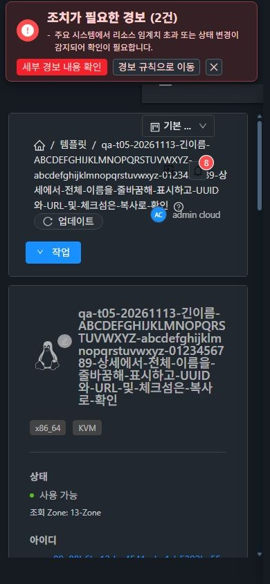
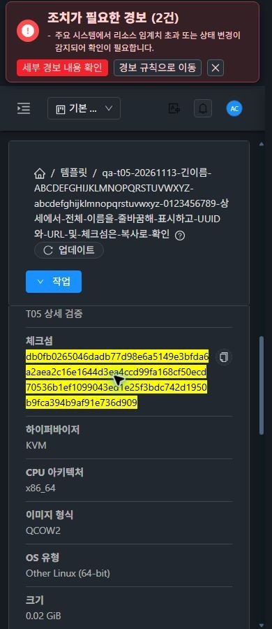
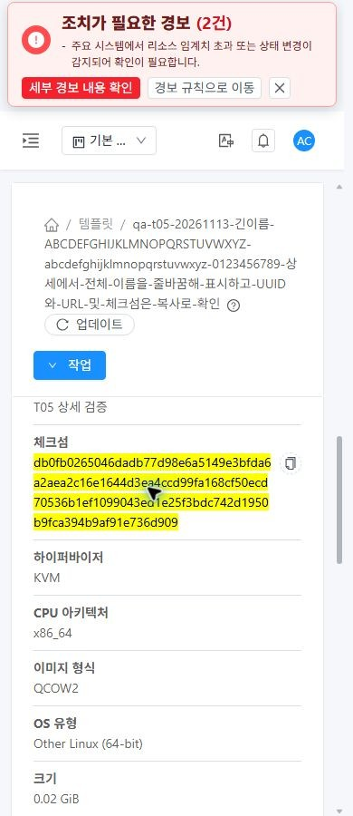
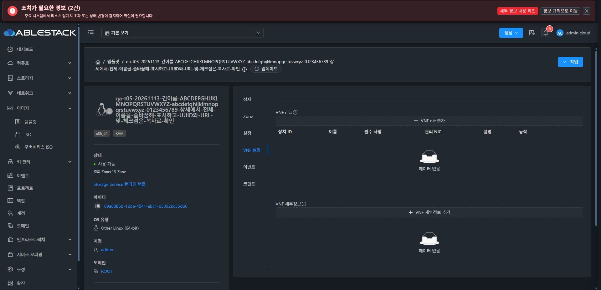
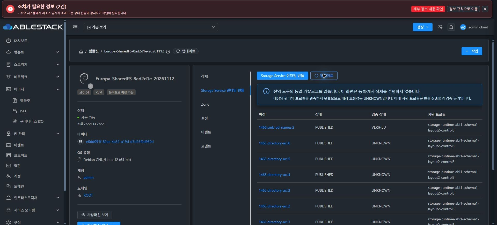
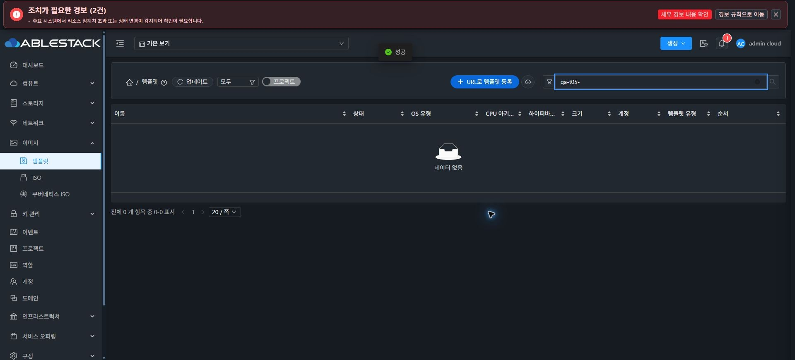

<!--
Licensed to the Apache Software Foundation (ASF) under one
or more contributor license agreements.  See the NOTICE file
distributed with this work for additional information
regarding copyright ownership.  The ASF licenses this file
to you under the Apache License, Version 2.0 (the
"License"); you may not use this file except in compliance
with the License.  You may obtain a copy of the License at

  http://www.apache.org/licenses/LICENSE-2.0

Unless required by applicable law or agreed to in writing,
software distributed under the License is distributed on an
"AS IS" BASIS, WITHOUT WARRANTIES OR CONDITIONS OF ANY
KIND, either express or implied.  See the License for the
specific language governing permissions and limitations
under the License.
 -->

# 템플릿 T05 상세·탭 개선 구현과 13번 UI 검증

[Epic #1638](https://github.com/ablecloud-team/ablestack-cloud/issues/1638) · [T05 #1643](https://github.com/ablecloud-team/ablestack-cloud/issues/1643) · [PR #1647](https://github.com/ablecloud-team/ablestack-cloud/pull/1647) · 2026-11-13 KST

T01–T04 다음 순서로 T05를 구현하고 필요한 UI 정적 파일만 13번 클러스터에 배포했다. 실제 UI에서 화면·탭·공통 상세 회귀와 시험 자원 정리를 완료했다. 체크섬 클립보드 복사/붙여넣기는 사용자가 직접 정상 동작을 확인했으며 이 결과를 자동 검사와 구분해 기록했다. T06–T08은 후속 범위이고 PR은 병합하지 않았다.

## 구현 결과

- 상세의 `templatetype` 중복과 `type` 별칭을 정리해 템플릿 유형을 한 번 표시한다. 이미지 형식(QCOW2)과 유형(USER/VNF/SYSTEM/SHAREDFS)을 구분한다.
- UUID·URL·체크섬은 전체 문자열을 줄바꿈하고 복사 버튼을 제공한다. 이름과 요약 카드에도 템플릿에 한정한 너비·줄바꿈 보정을 적용했다.
- 불리언은 예/아니오로 표시하며 false를 누락하거나 참으로 처리하지 않는다. 실제 API 필드명 `crossZones`를 유지했고 SSH/HVM 지원도 상세에서 확인한다. 날짜는 기존 locale formatter를 사용한다.
- 런타임 탭은 서버가 식별한 실제 `SHAREDFS` 유형과 Admin/API 권한으로 노출한다. 이름·태그·SYSTEM 여부나 임의 프로필 문자열로 용도·호환성을 추정하지 않는다.
- 일반 USER/VNF/SYSTEM에는 전역 카탈로그 도구 링크를 제공한다. SHAREDFS의 카탈로그에서도 대상 호환성 UNKNOWN을 명시하며 번들 게시/검증 상태를 이미지 호환성으로 해석하지 않는다.
- 관리 서버의 기존 전역 카탈로그 조회를 유지했다. 경로/용도/역할/API/프로젝트/세션 변경 및 deactivation 후 늦은 응답을 배제한다.
- 숨겨진 runtime/VNF 탭 주소와 유형 변경 후 사라지는 탭은 표시 가능한 상세 탭으로 복귀한다. 기존 Zone·설정·이벤트·코멘트와 조건부 VNF 설정 탭을 유지한다.

## 실제 화면 검증

전용 이미지에 긴 한글/영문 이름, 128자리 SHA-512, 긴 URL을 사용했다. URL 등록은 UI로 제출했고 최종 Ready를 확인했다. 시험 파일은 196,616바이트/가상 크기 16MiB인 빈 QCOW2로, OS 부팅 시험은 포함하지 않는다.

| 테마 | 뷰포트 폭 | 상세 패널 폭 | 내용 폭 | 유형 표시 | 결과 |
| --- | --- | --- | --- | --- | --- |
| 다크 | 1680px | 829px | 829px | 1회 | 통과 |
| 다크 | 1024px | 451px | 451px | 1회 | 통과 |
| 다크 | 390px | 296px | 296px | 1회 | 통과 |
| 라이트 | 1680px | 829px | 829px | 1회 | 통과 |
| 라이트 | 1024px | 451px | 451px | 1회 | 통과 |
| 라이트 | 390px | 296px | 296px | 1회 | 통과 |

개선 전 동일 시험 개체의 390px 상세는 패널 296px에 내용 982px로 잘렸다. 개선 후 6개 조건 모두 카드·패널·페이지의 가로 넘침이 없으며 이름·UUID·URL·체크섬 원문이 보존됐다. SSH=예, HVM=아니오, 크로스 Zone=아니오와 현지화된 생성일을 확인했다. 검증 후 다크 테마와 기본 뷰포트를 복원했다.

### 복사 검증의 구분

2026-11-13 사용자가 “체크섬 클립보드 복사/붙여넣기 내가 직접 확인했고 이상 없어”라고 확인했다. 이 수동 수용 결과를 PASS로 기록했다. 자동화의 OS 클립보드 값 대조가 성공했다고 주장하지 않는다. UUID/URL/체크섬의 전체 표시와 버튼 접근, 공통 복사 위젯에 전달하는 정확한 전체 값은 UI 및 단위 검사로 확인했다.

## 탭·조회·공통 회귀

| 대상 | 실제 UI 확인 |
| --- | --- |
| USER | 런타임 탭 없음, 전역 도구 링크 있음. `tab=runtime.catalog` 주소는 `tab=details`로 복귀 |
| VNF | VNF 설정 탭 유지, 런타임 탭 없음. VNF 탭 선택 중 USER로 저장하면 상세로 복귀 |
| SYSTEM | 런타임 탭 없음, 전역 도구 링크 있음. 숨겨진 런타임 주소는 상세로 복귀 |
| 실제 SHAREDFS | 전용 탭·전역 링크·조회/새로고침·2페이지 200 응답. 대상 호환성 UNKNOWN 명시 |
| 관리 서버 | 기존 전역 카탈로그와 UNKNOWN 표시 유지 |
| 모바일 런타임 | 390px에서 카탈로그 폭/내용 폭 296px, 페이지 가로 넘침 없음 |
| 기타 탭 | Zone Ready, 설정 조회, 이벤트 3건, 코멘트 0건의 정상 조회 및 접근 확인 |
| VM/ISO/볼륨 | 같은 자원의 전후 상세 라벨이 모두 일치. 패널/내용 폭도 각각 970/970, 999/999, 974/974px |

Storage Service 검증은 기존 `Europa-SharedFS-8ad2d1e-20261112`를 읽기만 했다. 관리 서버 및 번들에 대한 변경 작업은 수행하지 않았다. VNF 유형 변경은 전용 시험 템플릿에만 수행했고 NIC/속성을 추가하지 않았다.

실제 로그인은 Admin이다. 역할/API 미지원 및 지연 응답의 방어는 단위 검사로 검증했고, 다중 역할·다중 Zone 전체 ACL 행렬은 T08 후속 범위다.

## 배포 경계와 검증

- 구현/빌드 SHA: `8f631d4095104abb9b2d3bb367da32517e47fd27`.
- 작업 재개 때마다 upstream/origin fetch 후 로컬 `ablestack-europa`를 갱신·확인하고 기능 브랜치를 rebase했다. 기준 `0edd20dcc9218312b3da533582f03e11535c5eb8`, local base/upstream `0 0`. origin 기능 브랜치에만 push했다.
- 실제 운영 UI 기준 `460b337`과 기존 T01–T04 변경을 보존한 빌드 입력에 T05의 git diff만 적용했다. 다른 upstream ResourceTags/Annotations/resourceTags 변경은 제외했다.
- UI 정적 파일 21개(새 해시 자산 19개 + index/color.less 2개)만 배포했다. index는 마지막에 원자 교체했고 이전 해시 자산을 보존했다.
- 최종 runtime 파일 975개가 빌드 산출물과 모두 해시 일치했다. index SHA-256은 `9b0f5756bed182aa54667c570dfd3f0dcf8f899ac04f140e7db1b274cbfeb738`이다.
- `config.json`/`WEB-INF/web.xml`과 운영 테마 변수를 보존했다. T05를 위한 백엔드·DB·SSVM·호스트 agent 변경과 서비스 재시작은 없다.
- Mold PID `2323824`/active 및 기존 management jar SHA-256 `341d2e120fd575c2fe6104ac4cab540c2cd4378e972859a3a0c0f8d0d417b85d`가 유지됐다.
- 롤백 백업: `/var/tmp/epic1638-t05-ui-backup-n3z_yk5e`.

검증: 범위 ESLint 통과, 22 suites/342 tests 통과, 실제 운영 빌드 입력의 상세·카탈로그 2 suites/43 tests 통과, production build 통과(679초). 전체 저장소 CI 성공으로 확대하지 않는다.

## 시험 자원 정리

전용 템플릿 `09a88b6b-12de-4541-abc1-b5392bc55d66`을 Zone 정상 삭제 UI로 정리했다. 강제 삭제는 사용하지 않았다. async job `ea45ccce-531b-4564-836f-bbe391f51ce2`의 `jobstatus=1`, `success=true`를 확인했다.

`qa-t05-` 검색 0개, 전체 템플릿 47→46 복원을 확인했다. QA HTTP 파일은 정확한 경로·SHA-256을 확인하고 파일 및 빈 디렉터리를 제거했다. 기존 4.23 운영 시스템 템플릿과 원본 경로는 보존했다. 일반 VM·ISO·볼륨은 조회만 수행했다.

## 기존 CI 부채

- [License run 43388099674](https://github.com/ablecloud-team/ablestack-cloud/actions/runs/43388099674): 기존 미승인 4,077건으로 실패. 변경 9개 파일은 전부 AL이다. 수정한 기존 두 파일의 헤더를 보완해 4,079→4,077로 줄였다. 나머지는 [#926](https://github.com/ablecloud-team/ablestack-cloud/issues/926)에서 추적한다.
- [Lint run 43388099981](https://github.com/ablecloud-team/ablestack-cloud/actions/runs/43388099981): 전체 저장소 pre-commit 부채로 실패. 실패 블록에 이번 변경 파일의 지적이 없음을 대조했다. [#1044](https://github.com/ablecloud-team/ablestack-cloud/issues/1044)와 분리 관리한다.
- merge-conflict triage는 성공했다. 최신 보고서 push의 CI는 PR Checks를 따르며 전체 green으로 표현하지 않는다.

## 근거

[화면 측정·탭·회귀·사용자 확인](ui-validation-final.json), [UI가 발생시킨 API 근거](ui-api-evidence-final.json), [자원 ledger](test-resources.json), [단위/수용 결과](validation.json), [배포 경계](source-boundary.json), [배포 manifest](deployment.json), [최종 런타임 해시 검증](final-runtime-verification.json), [CI 분류](ci-final-classification.json).
