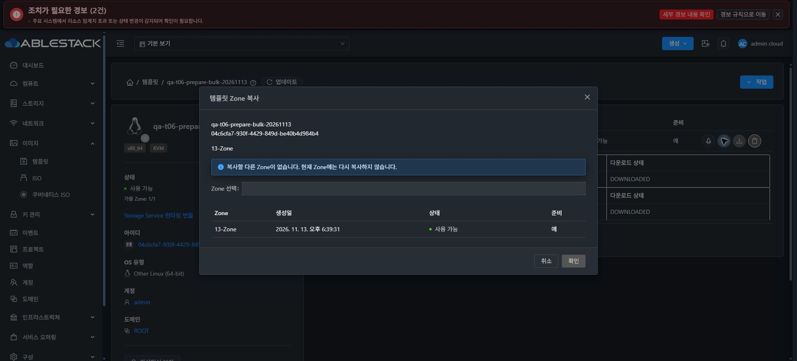
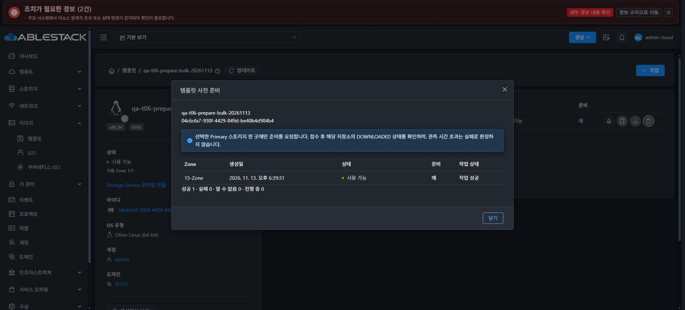
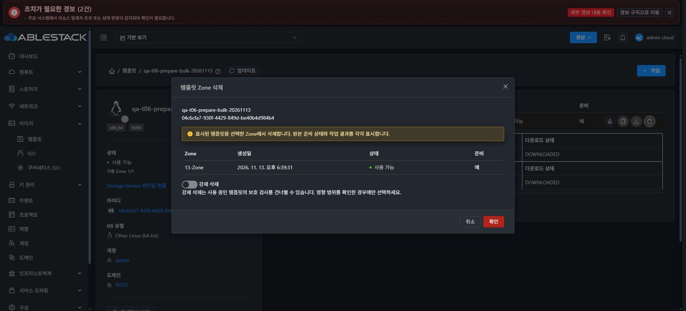
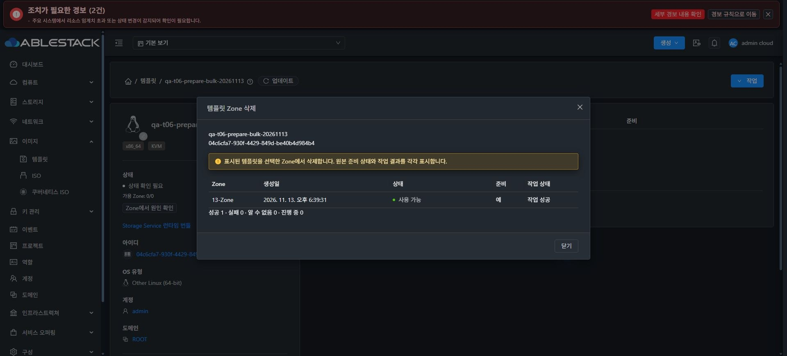
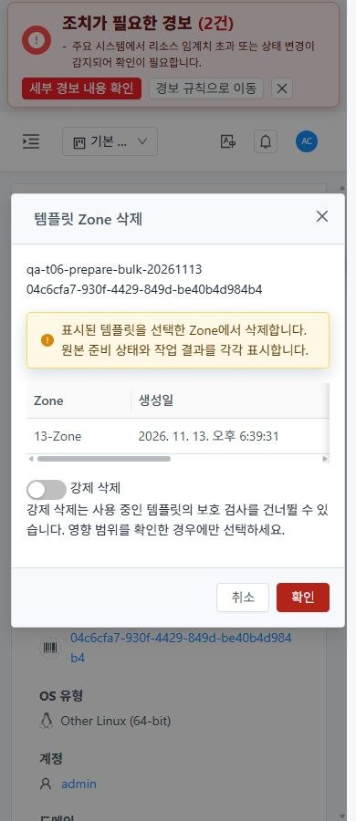
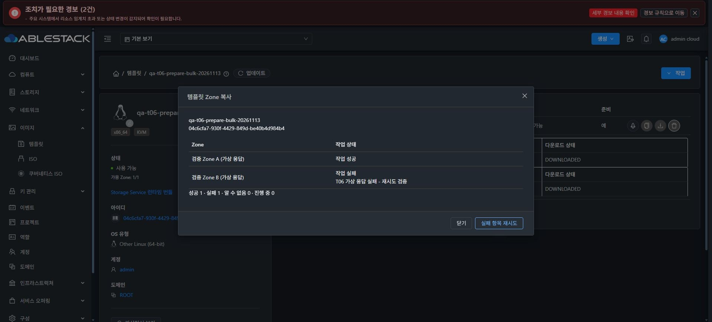
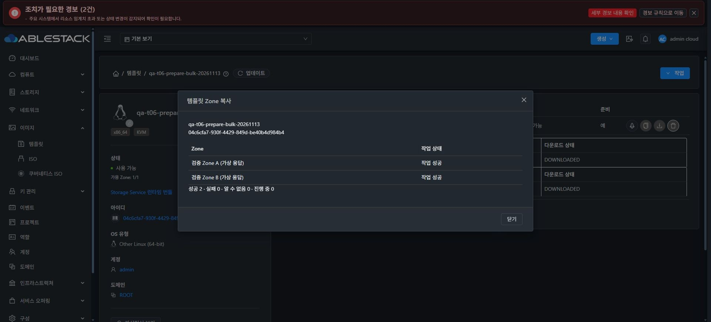
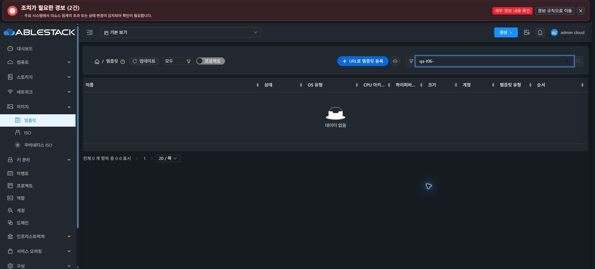

<!--
Licensed to the Apache Software Foundation (ASF) under one
or more contributor license agreements.  See the NOTICE file
distributed with this work for additional information
regarding copyright ownership.  The ASF licenses this file
to you under the Apache License, Version 2.0 (the
"License"); you may not use this file except in compliance
with the License.  You may obtain a copy of the License at

  http://www.apache.org/licenses/LICENSE-2.0

Unless required by applicable law or agreed to in writing,
software distributed under the License is distributed on an
"AS IS" BASIS, WITHOUT WARRANTIES OR CONDITIONS OF ANY
KIND, either express or implied.  See the License for the
specific language governing permissions and limitations
under the License.
 -->

# 템플릿 T06 Zone 작업·사전 준비 구현과 13번 UI 검증

[Epic #1638](https://github.com/ablecloud-team/ablestack-cloud/issues/1638) · [T06 #1644](https://github.com/ablecloud-team/ablestack-cloud/issues/1644) · [PR #1647](https://github.com/ablecloud-team/ablestack-cloud/pull/1647) · 2026-11-13 KST

T01–T05 다음으로 T06을 구현했다. 원본 상태가 바뀌는 삭제 확인 화면과 마지막 Zone 삭제 후 결과가 사라지는 동작을 수정하고, 명시한 Primary 스토리지에 사전 준비하는 관리자 UI를 추가했다. 13번 클러스터에서 실제 준비·단일 삭제·선택 삭제를 UI로 완료했다. T07/T08 및 전체 CI 부채는 별도 범위로 유지하며 PR은 병합하지 않았다.

## 구현 결과

- 기존 MoldDialog/MoldDialogActions의 외곽·본문·하단 버튼·busy·ESC·초점 규칙을 사용한다. 이름·UUID·Zone과 강제 삭제 의미를 확인 화면에서 제공한다.
- 선택 행을 복제하여 원본 상태·준비 boolean·생성일을 보존한다. 별도의 operationState/jobid/error를 유지하고 열은 key/dataIndex로 결정한다. 제출 전에 InProgress로 바꾸지 않는다.
- 단일/선택 삭제 결과는 마지막 Zone이 없어져도 사용자가 닫을 때까지 유지한다. 보유 중인 작업의 부모 자원 조회와 늦은 응답이 화면을 제거하지 않게 했다. 닫으면 T04의 목록 복귀 맥락으로 이동한다.
- 복사 대상이 없으면 표준 알림으로 이유를 표시하고 실행을 비활성화한다. 목적지마다 독립된 작업 결과를 유지하고 확실히 실패한 항목만 재시도한다. 전송 결과가 불명확하면 자동 POST를 반복하지 않으며 알려진 job은 같은 job만 재조회한다.
- prepareTemplate은 Admin/API 권한·storageid 스키마와 KVM/QCOW2/비직접 다운로드 조건에서 제공한다. 같은 Zone의 Up·unmanaged NetworkFilesystem/SharedMountPoint 풀을 직접 선택해야 하며 전체 풀 자동 선택은 없다.
- 준비 API는 BaseCmd의 동기 접수다. jobid를 요구하거나 async job을 폴링하지 않는다. exact template/Zone/Primary 역할/선택 datastoreId의 DOWNLOADED 증거로 완료를 판정한다. 관측 상한(60초) 초과·혼합 증거는 실패로 단정하지 않고 상태 확인 필요로 유지한다.
- 서버는 명시 storageid의 존재·Zone·Up·managed 여부·파일 캐시 유형·하이퍼바이저를 enqueue 전에 검증한다. storageid 생략의 레거시 API 흐름은 보존한다. 서버의 기존 파일 캐시 허용 범위와 이번 UI MVP 범위를 구분한다.
- 실제 관측을 막던 Primary 증거 생성 오류도 수정했다. Secondary image-store ID로 Primary 풀을 찾던 부분을 VMTemplateStoragePoolVO의 poolId로 조회한다. ISO의 기존 별도 처리 경로는 유지했다.

## 실제 13번 UI 검증

모든 제품 변경 요청은 UI에서 제출했다. API 기록은 이 UI가 발생시킨 요청/응답을 관찰한 근거이며, 직접 API 호출만으로 기능을 통과 처리하지 않았다. 실제 환경은 Zone 1개, KVM SharedMountPoint Primary 풀 1개다. 시험 이미지는 196,616바이트/가상16MiB의 빈 QCOW2로 OS 부팅 시험은 아니다.

| 경로 | 실제 수행과 판정 |
| --- | --- |
| 복사 대상 0 | 이유 표시·실행 비활성, 복사 POST 없음. 초기 빌드의 미등록 empty 컴포넌트를 표준 alert로 교정하고 최종 빌드에서 재확인 |
| 사전 준비 | 선택 전 실행 불가 → Primary 풀 명시 → 동기 접수 → 동일 풀의 Primary DOWNLOADED/100 확인 → 성공 |
| 단일 Zone 삭제 | 정상 삭제(force=false), 실제 async status1/success=true, 마지막 Zone이 없어져도 결과 유지, 닫기 후 목록 복귀 |
| 선택 Zone 삭제 | 실제 Zone 1건 선택. 제출 전 준비=예·원본 상태·현지화 날짜, 삭제 후 성공1 결과와 원본 값 유지, 닫기 후 목록 복귀 |
| 잘못된 storageid | 옵션 응답에만 가상 ID를 제시한 뒤 실제 서버로 제출. HTTP431로 거부, UI 실패 표시, job 생성 없음 |
| 좁은 화면 | 390×900 다크/라이트. 대화상자390px·본문364px, 가로 넘침 없음, footer 하단686.75px, ESC 취소 확인 |
| 정리·서비스 | qa-t06- 검색0, 전체48→46 복원. 호스트3대 실행 중/정상. 3번 호스트의 기존 HA 비활성 상태 보존 |

준비 대상: 템플릿 `04c6cfa7-930f-4429-849d-be40b4d984b4`, Zone `f4fd8c56-ed31-4dfd-bf3c-10e3000fd10f`, 스토리지 `90b0c4e3-7078-4372-8da0-9625bc0e806a`. 응답의 datastoreRole=Primary, datastoreId=선택 UUID, downloadState=DOWNLOADED, downloadPercent=100을 확인했다. prepareTemplate 응답에 jobid는 없었고 준비용 queryAsyncJobResult 호출도 없다.

단일 삭제의 실제 job은 `3c4d60b3-9eb3-4ea6-b098-4349c68d43fd`다. 선택 삭제의 실제 성공과 결과 유지·목록 복귀는 화면으로 확인했으나 해당 시점의 브라우저 네트워크 관측 연결이 해제되어 job UUID는 기록하지 못했다. 이 경로에 API job 캡처가 있다고 주장하지 않는다.

## 응답 주입·단위 검사와 한계

실제 두 Zone 간 전송과 2개 이상 실제 Zone의 동시 삭제는 수행할 수 없는 단일 Zone 환경이다. 가상 Zone A/B를 명확히 표시한 UI 응답 주입으로 다음을 별도 검증했다. 실제 인프라 복사 성공으로 계산하지 않는다.

- 복사 A 성공/B 실패 → 실패 B만 재시도 → 성공2. 캡처한 제출 순서 A,B,B.
- 삭제의 원본 Ready/DownloadError와 예/아니오·생성일 보존, A 성공/B 실패 → B만 재시도 → 성공2와 결과 보존.
- 실제 풀의 상태를 Disabled로 바꾼 응답에서 후보 없음 이유와 실행 비활성 확인. 실제 풀 상태를 변경하지 않았다.
- 초기 주입 패턴이 POST 본문의 command를 놓쳐 가상 목적지 복사 2건이 실제 서버에 도달했으나 HTTP431로 거부됐고 복사는 실행되지 않았다. 이후 넓은 API XHR/Fetch 패턴으로 주입을 교정한 A,B,B 검증을 기록했다. 최종 주입 설정은 모두 해제했다.

단위 검사는 중복 제출·불명확한 전송의 POST 재실행 차단·기존 job 재관측·지연 응답/범위 변경 무효화·부모 조회 보유·권한/schema·풀 제한·정확한 Primary 증거를 검증한다. 서버 계약 검사는 누락/다른 Zone/Disabled/managed/지원하지 않는 풀·집계 풀/다른 hypervisor 거부 및 동기/optional storageid 계약을 포함한다.

실제 다중 Zone·전체 역할/프로젝트 ACL·다른 스토리지/하이퍼바이저·OS 부팅은 T08의 실환경 행렬로 남긴다. prepare UI가 기존 #1232의 다른 캐시 잠금 결함을 해결한다고 간주하지 않는다.

## 검사와 배포 경계

| 검사 | 결과 |
| --- | --- |
| 기능·공통 UI 회귀 | 25 suites/379 tests 통과 |
| 실제 운영 빌드 입력 | 4 suites/46 tests 통과 |
| 서버 계약 | JUnit 10개 통과, 배포 런타임 의존성으로 javac17 --release11 컴파일 |
| 정적 검사/빌드 | 범위 ESLint 통과, production build 통과(최종843초, 최초958.2초) |
| 최종 배포 무결성 | runtime975개 모두 해시 일치, config.json/WEB-INF/web.xml 보존 |

전체 Maven reactor/전체 기존 TemplateManagerImplTest 실행 성공으로 확대하지 않는다. 변경한 기존 테스트 fixture와 새 계약 테스트는 구분한다.

- 기준 branch `ablestack-europa`를 upstream/origin fetch 후 갱신·확인했다. base `0edd20dcc9218312b3da533582f03e11535c5eb8`, local↔upstream `0 0` 확인 후 기능 브랜치를 rebase했다. origin 기능 브랜치에만 push했다.
- 제품 소스 최종 `241d79387dae71dea09ccd3547ad25ec6726364e`; 핵심 구현/백엔드 `1c402b3b2eddadc518e622334abb1c317427d122`. corrective 커밋은 복사 대상 없음 alert와 해당 회귀 검사다.
- 실제 UI 기준 `460b337`+기존 T01–T05 빌드 입력에 T06 diff만 적용했다. 다른 upstream ResourceTags/Annotations/resourceTags 변경을 제외했다.
- UI 최초15개(신규 해시11+공개4), corrective7개(신규 해시5+index/color2) delta만 배포했다. 이전 해시 자산 보존·index 마지막 원자 교체. 운영 테마 변수905개가 최종 빌드와 같음을 비교했다.
- 최종 index SHA-256 `519581b0826e2236a92a91eab34ea759c8bea044f0ec871357dc1ad2577594b8`.
- 기존 배포 클래스3개를 정확히 재현한 뒤 해당 메서드/annotation만 이식하고 validation helper 1개를 추가했다. TemplateManagerImpl.prepareTemplate, TemplateJoinDaoImpl.newTemplateResponse/신규 poolId helper 외의 메서드를 보존했다. PrepareTemplateCmd는 설명 annotation만 변경했다. 다른 jar 항목은 모두 동일하다.
- management jar SHA-256 `341d2e120fd575c2fe6104ac4cab540c2cd4378e972859a3a0c0f8d0d417b85d` → `2f2aa2f44c8c51ce4402d0b1e496853e70efa187809e8854a200c9db334a3dab`. Mold 한 번 재시작(PID2323824→2352863), 최종 active와 동일 PID 확인.
- DB 스키마/데이터 직접 변경·호스트 agent·SSVM 변경은 없다. 앞선 T03/T04의 4.21/4.23 검증·배포는 해당 보고서 경계를 따른다.
- 롤백 백업: backend `/var/tmp/epic1638-t06-backend-backup-e89512pj`, 최초 UI `/var/tmp/epic1638-t06-ui-backup-7ssbgjhn`, corrective UI `/var/tmp/epic1638-t06-ui-backup-sgnmcon6`. UI는 corrective부터 역순 복원하고 backend jar를 복원한 뒤 Mold를 재시작한다.

## 시험 자원 정리

전용 QA 두 개(`04c6cfa7-930f-4429-849d-be40b4d984b4`, `58263e35-b804-40eb-bcc7-3f97fd930d7b`)를 정상 Zone 삭제 UI로 정리했다. force=false를 사용했고 일반 VM/라우터/볼륨은 변경하지 않았다. qa-t06- 잔여0·전체46 복원을 확인했다.

임시 QCOW2의 정확한 경로와 SHA-256을 검사해 파일 및 빈 디렉터리를 제거했다. 기존 4.23 운영 SYSTEM 템플릿과 `/systemvm-4.23-20261113/systemvmtemplate-4.23-t34.qcow2.bz2` 원본은 보존했다. Primary/Secondary의 비동기 GC 완료·즉시 물리0바이트를 주장하지 않는다. 다크 테마·기본 뷰포트를 복원했고 자격 증명은 저장하지 않았다.

## 기존 CI 부채

- [License run43404630697](https://github.com/ablecloud-team/ablestack-cloud/actions/runs/43404630697): 기존 RAT 미승인4077건으로 실패. 이번 Java/JS/Vue 수정13파일은 전부 AL. [#926](https://github.com/ablecloud-team/ablestack-cloud/issues/926)에서 계속 추적한다.
- [Lint run43404630606](https://github.com/ablecloud-team/ablestack-cloud/actions/runs/43404630606): 전체 pre-commit 기존 부채로 실패. identity 훅의 단순 파일 목록을 제외하고 실패 훅 블록을 이번15개 경로와 대조해 기능 파일 지적0을 확인했다. [#1044](https://github.com/ablecloud-team/ablestack-cloud/issues/1044)와 분리 관리한다.
- merge-conflict triage는 성공했다. 최종 보고서 push의 상태는 PR Checks를 따르며 전체 CI green으로 표현하지 않는다.

## 근거

[실제/주입 UI 결과](validation-results.json), [UI 관측 API](ui-api-evidence.json), [주입 제출 기록](injected-requests.json), [시험 자원 ledger](resource-ledger.json), [검사 범위](validation.json), [소스/빌드 경계](source-boundary.json), [백엔드 baseline 재현](backend-baseline-proof.json), [메서드 이식 경계](backend-method-proof.json), [백엔드 배포](backend-deployment.json), [최종 UI 배포](deployment.json), [최종 runtime 검증](final-runtime-verification.json), [CI 분류](ci-classification.json).
