<!--
Licensed to the Apache Software Foundation (ASF) under one
or more contributor license agreements.  See the NOTICE file
distributed with this work for additional information
regarding copyright ownership.  The ASF licenses this file
to you under the Apache License, Version 2.0 (the
"License"); you may not use this file except in compliance
with the License.  You may obtain a copy of the License at

  http://www.apache.org/licenses/LICENSE-2.0

Unless required by applicable law or agreed to in writing,
software distributed under the License is distributed on an
"AS IS" BASIS, WITHOUT WARRANTIES OR CONDITIONS OF ANY
KIND, either express or implied.  See the License for the
specific language governing permissions and limitations
under the License.
 -->

# 템플릿 T07 VNF 설정·NIC·비밀 값 구현과 13번 UI 검증

[Epic #1638](https://github.com/ablecloud-team/ablestack-cloud/issues/1638) · [T07 #1645](https://github.com/ablecloud-team/ablestack-cloud/issues/1645) · [PR #1647](https://github.com/ablecloud-team/ablestack-cloud/pull/1647) · 2026-11-13–14 KST

T01–T06 다음으로 T07을 구현했다. VNF 속성을 서버 지원 키에서 선택하고, NIC·속성의 원본과 편집 초안을 분리해 실패 후 수정·재제출할 수 있게 했다. 비밀 값은 원문을 다시 표시하지 않고 기존 값 유지와 명시 교체를 구분한다. 13번 클러스터에서 기능별 UI 검증·시험 자원 정리를 완료했다. T08과 기존 전체 CI 부채는 별도로 유지하며 PR은 병합하지 않았다.

## 구현 결과

- listDetailOptions의 실제 응답과 현재 서버의 허용 키 15개를 대조하고 교집합만 제공한다. 임의 키·중복 키를 제출하지 않는다. 대소문자는 소문자로 정규화하며 포트1–65535와 지원 접근 방법을 검증한다.
- 속성 추가·편집은 기존 MoldDialog(md)/MoldDialogActions를 사용한다. 대상 이름·UUID, 본문 스크롤·고정 footer·busy·초점 복귀·ESC 규칙을 유지한다. 기존 NIC 편집 틀도 같은 footer 규칙으로 맞췄다.
- 성공 응답 전에는 기존 목록을 바꾸지 않는다. 실패 시 원본·초안·선택을 유지하고 일반 오류를 폼에 표시한다. 원문 서버 오류에 비밀 값이 섞일 가능성을 피하도록 이 경로의 오류 표시는 일반화했다. 실패를 성공 토스트나 무조건 폼 종료로 처리하지 않는다.
- NIC의 음수/중복/비연속 ID·빈 이름·필수 순서를 검증한다. 첫 ID는0, 이후 연속이어야 한다. 중간 삭제는 남은 ID를 다시 매기고 마지막 삭제는 cleanupvnfnics=true로 전달한다.
- NIC 이동은 목록 끝과 필수/선택 경계를 비활성화한다. 이동하면서 required 값을 다른 NIC와 자동 교환하던 동작을 제거했다. 같은 그룹의 이동은 이름·관리 여부·필수 여부·설명을 보존한다.
- Admin·같은 계정/도메인의 소유자·DomainAdmin의 같은/하위 도메인·선택한 프로젝트 문맥과 API 권한을 확인한다. listUsers에 없는 사용자 경로 필드를 가정하지 않고, DomainAdmin의 교차 도메인 판정은 listDomains(id).path로 호출자와 대상 ID를 각각 확인한다. 조회 실패·API 부재는 작업을 막고 재조회를 제공한다. 프로젝트 템플릿은 계정 이름만 같다는 이유로 다른 프로젝트 문맥에서 수정하지 않는다. 서버 ACL은 유지한다.
- 자원·소유자·역할·프로젝트·API·세션·경로 변경과 deactivation/unmount 때 초안·비밀 입력을 정리하고 늦은 응답을 배제한다. 지원 옵션 조회 실패는 속성 편집을 막고 재조회를 제공한다.
- VNF 저장 성공 시 부모 상세를 갱신해 탭 재진입·새로고침 뒤에도 서버의 최신 정의를 표시한다. 공통 ResourceView의 해당 이벤트는 템플릿 VNF 탭에 한정했다.

검증 중 속성 편집 제목의 번역 누락과 NIC 입력 취소 뒤 남는 검증 문구를 교정했다. 취소 교정판을 캐시 무시 새로고침해 app.9b22b795.js에서 입력 오류가 폼에만 나타나고 취소 뒤 사라짐을 확인했다. 후속 도메인·재시도 보완을 포함한 최종판은 app.527e4cd6.js를 실제 로드했다. 다른 자원의 상시 안내 문구는 추가하지 않았다.

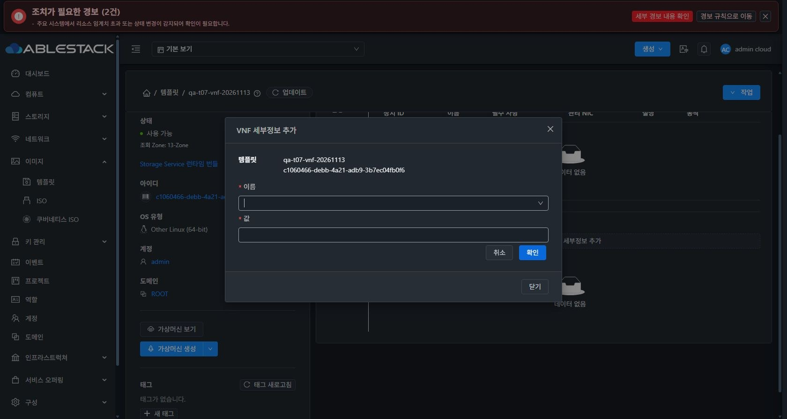

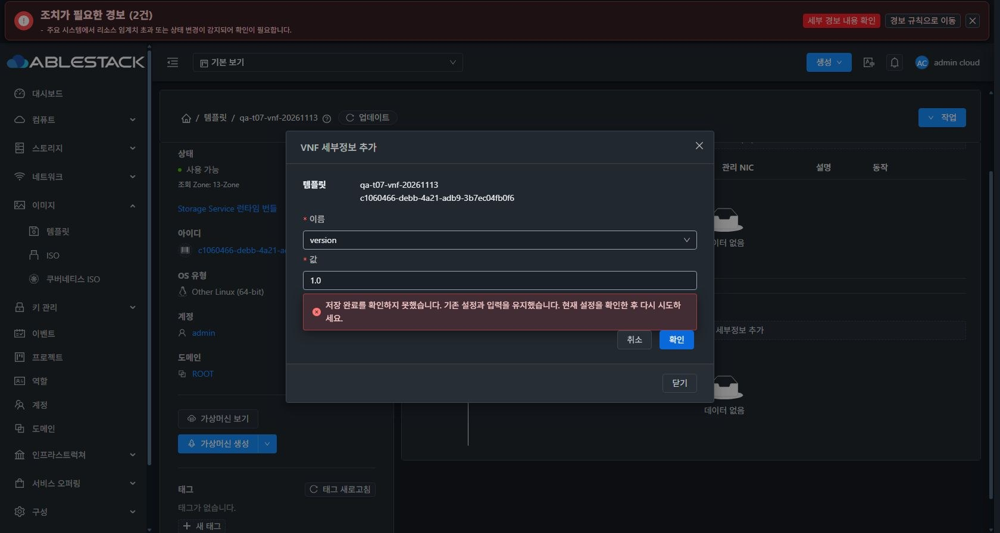

## 실제 UI 검증

실제 로그인은 Admin이다. 제품 변경은 모두 브라우저 UI에서 제출했으며 해당 UI 요청·응답을 관찰했다. 시험 자원은 `qa-t07-vnf-20261113` / `c1060466-debb-4a21-adb9-3b7ec04fb0f6` 한 개다. 196,616바이트/가상16MiB 빈 QCOW2를 VNF로 URL 등록해 Ready를 확인했다. OS 부팅과 실제 VM/NIC 장치 생성 시험은 포함하지 않는다.

| 기능 | UI 수행과 최종 판정 |
| --- | --- |
| 미지원 키 | 개선 전 qaAudit 제출431 재현. 개선 후 선택 후보 없음·제출 차단·POST0 확인 |
| VERSION | 기존 값 삭제/마지막 속성 cleanup → 추가 → 실패 후 재제출 →1.0 저장 →2.0 편집, 비밀 값 추가 후3.0 편집 통과 |
| 실제 서버 거부 | UI가 만든 요청의 속성 키를 qaAudit 또는 NIC ID를2로 바꾸는 시험 훅으로 실제431 유발. 원본/초안 유지 후 훅 해제·정상 재제출 성공 |
| NIC 추가·입력 | Management0, 선택 Data1/Spare2 추가. 음수/중복/비연속 ID와 빈 이름은 요청 없이 차단 |
| NIC 편집·이동 | Data 이름/설명 편집, 선택 NIC 사이 위/아래 이동 성공. 관리 NIC의 required/management=true 보존, 필수/선택 경계는 실행 비활성 |
| 필수 순서 | 선택 NIC 뒤를 필수로 바꾸는 입력 차단·원본 보존. 검증용 Prefix-probe 정의도 정상 삭제 |
| NIC 삭제 | 중간 Data 삭제 후 Spare2→1, 단독 Spare 삭제, 마지막 Management 삭제의 cleanupvnfnics=true 확인 |
| 포트·접근 방법 |0/65536 포트는 POST0,22 저장 성공. https와 ssh-password 복수 선택·서버 정렬 결과 https,ssh-password 확인 |
| 취소·편집 제목 | 번역된 속성 편집 제목, 최종 빌드에서 비연속 ID 오류 후 취소·잔류 문구0 확인 |
| 정리·공통 회귀 | 모든 VNF 속성/NIC 정의 정리, 정상 Zone 삭제 후 결과 유지·목록 복귀. 시험 검색0·전체46, 호스트3대 실행 중/정상 |

서버 거부 시험은 정상 UI 요청에 한 항목만 바꾼 fault injection이다. 실제 서버의 거부 응답을 확인했지만 변경된 잘못된 요청이 UI의 일반 제출 경로라고 표현하지 않는다. 해당 훅은 즉시 해제하고 원래 입력으로 다시 제출했다.

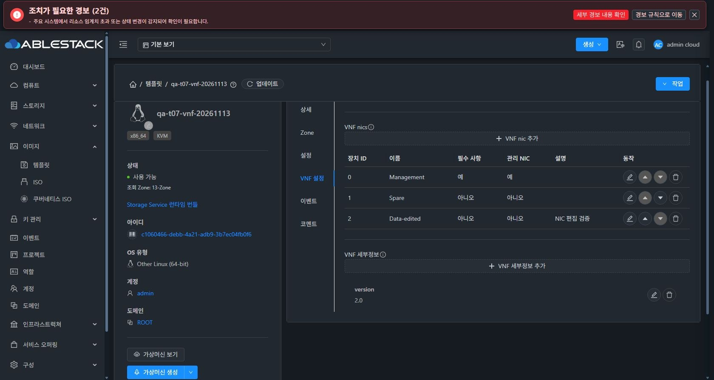

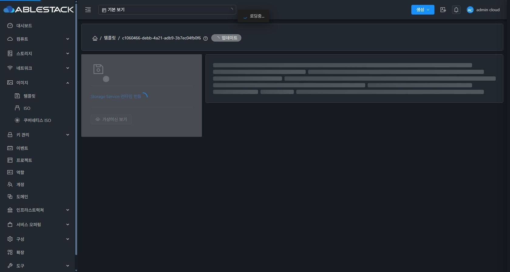

## 비밀 값과 로그

PASSWORD/SSH_PASSWORD/WEB_PASSWORD에는 실제 로그인에 쓰이지 않는 임의 시험 값을 사용했다. 원문은 Node 실행 메모리에만 두고 비교 결과 boolean과 키 이름만 증거에 기록했다. 요청/응답의 password 계열 키는 대소문자와 관계없이 마스킹하며 운영 로그인 자격 증명과 시험 비밀 값을 파일·스크린샷에 남기지 않았다.

- 세 필드 모두 type=password 입력과 저장 후 ******** 표시를 확인했다.
- 기존 값 편집은 입력이 비어 있고 비활성 상태로 열리며 기본 선택은 기존 값 유지다. 그대로 확인하면 updateVnfTemplate 요청0이다.
- 명시 교체를 선택한 뒤 빈 값은 차단(요청0), 새 값 입력은 저장1회로 완료했다. 다른 두 비밀 값은 유지됐다.
- VERSION 변경·포트/접근 방법 저장·재조회에서도 세 비밀 값이 이전 값과 동일함을 실제 UI 응답으로 대조했다. 비밀 속성 삭제 후에도 나머지 비밀 값 일치를 확인했다.
- 서버의 속성 API는 전체 map을 교체하므로 변경하지 않은 비밀 값은 메모리의 원본 map에서 보존해 전송한다. 권한 있는 API 응답의 기존 값 반환 계약은 유지하며 기존 값을 입력 폼에 채워 넣지 않는다.
- 사용자/관리자 updateVnfTemplate의 requestHasSensitiveInfo와 responseHasSensitiveInfo를 true로 선언했다. 동기 응답 감사 경로는 별도이므로 ApiServer.buildAuditTrail에서 JSON/XML vnfdetails가 포함된 응답 본문을 기록하지 않도록 했다. queryAsyncJobResult/copyTemplate 등 중첩 VNF 응답도 같은 조건으로 보호한다.
- 일반 템플릿의 감사 맥락과 기존 bucket 응답 억제는 계약 검사로 보존을 확인했다. 운영 TRACE를 추가 활성화해 원문을 출력하는 방식은 사용하지 않았다.

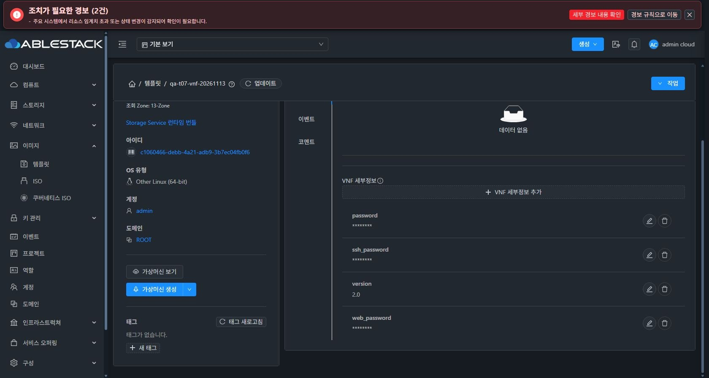

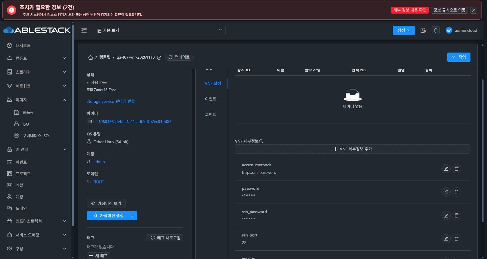

## 역할·프로젝트·수명주기 검증의 구분

서버 계정/역할/프로젝트 권한을 만들거나 바꾸지 않았다. 실제 Admin 세션은 그대로 두고 listUsers와 시험 템플릿의 조회 응답만 가상 값으로 바꿔 UI 제약을 비교했다. 가상 응답이라는 이름을 헤더/프로젝트에 명시했고 이 단계에서는 변경 요청을 제출하지 않았다.

| UI 응답 조건 | 개선 전 | 개선 후 |
| --- | --- | --- |
| 같은 도메인 DomainAdmin, 다른 계정 | NIC/속성 추가 불가 | 허용 |
| 일반 소유자, 같은 계정/도메인 | 기존 허용 경로 | 허용 |
| 일반 사용자, 다른 계정 | 기존 차단 경로 | 차단 |
| 계정은 같고 선택하지 않은 프로젝트의 템플릿 | 잘못 허용 | 차단 |

### 도메인 API 계약과 실제 재시도

최종 API 대조에서 listUsers의 UserResponse에 domainpath가 없음을 확인했다. 하위 도메인 판정을 사용자 응답의 임의 필드에 의존하지 않게 고쳤다. 실제 listDomains 응답은 호출자 경로를 ROOT(끝의 / 없음)로 반환했고, 이를 정규화해 하위 경로와 비교했다. 가상 사용자 응답에도 경로 필드를 넣지 않았다.

| 조건 | 최종 UI 확인 |
| --- | --- |
| 사용자 경로 없음 | 개선 전 추가 불가/도메인 조회0 → 개선 후 두 도메인 ID를 조회하고 하위 도메인 추가 허용 |
| 경로 접두어 경계 | ROOT/A/와 ROOT/AB/는 다른 범위로 차단 |
| 도메인 조회 실패 | 대상 조회431 주입 → 경고/작업 차단/재시도 버튼 → 실제 버튼 클릭 후 재조회·허용 복구 |
| 지원 키 조회 실패 |431 주입 → 속성 추가 차단 → 버튼 클릭으로 실제 API200/15키를 읽고 편집 복구 |
| 최종 실제 Admin | 가상 응답 해제 후 VERSION 저장·마지막 속성 삭제와 시험 이미지 정리 성공 |

호출자 도메인의 ROOT 경로는 실제 UI가 요청한 서버 응답이며, 하위/범위 밖 대상 도메인은 가상 응답이다. 실제 DomainAdmin 계정의 서버 ACL 시험으로 계산하지 않는다. 경고의 action 슬롯이 현재 Ant Design에서 표시되지 않음을 UI로 찾아 description 슬롯으로 교정했다. 실제 Alert·Button을 사용하는 렌더/클릭 검사2개와 실제 재시도 클릭을 모두 통과했다.

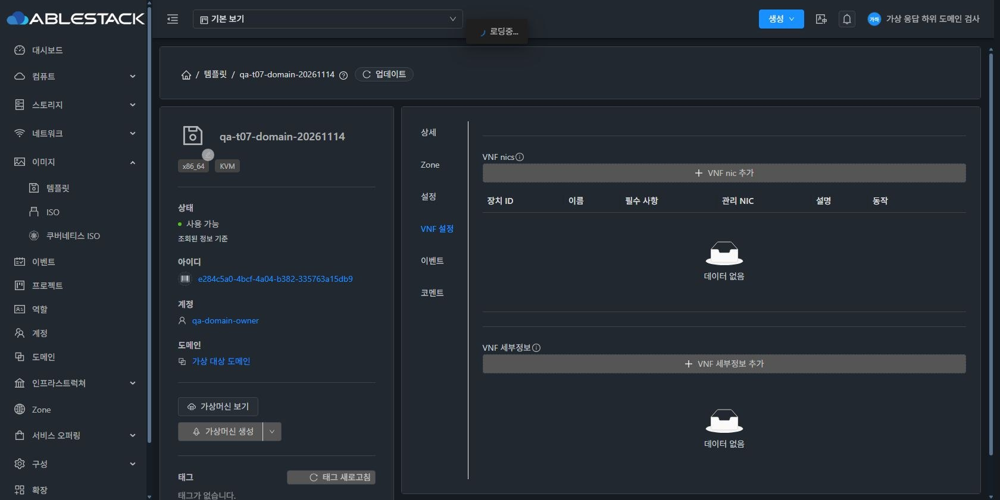

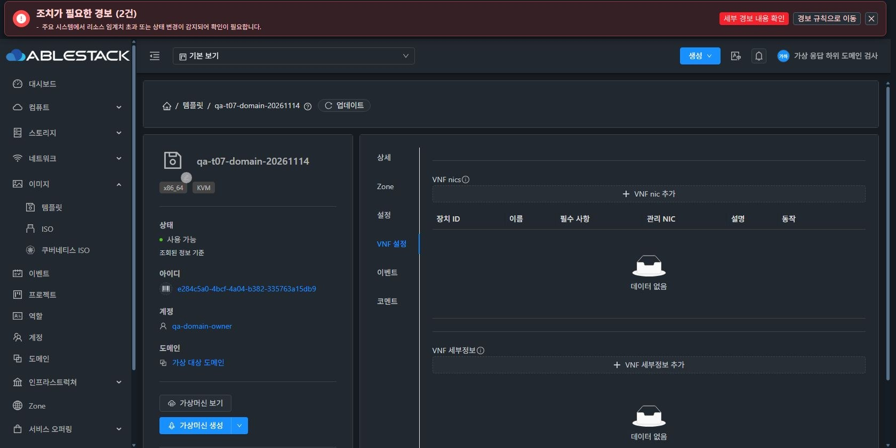

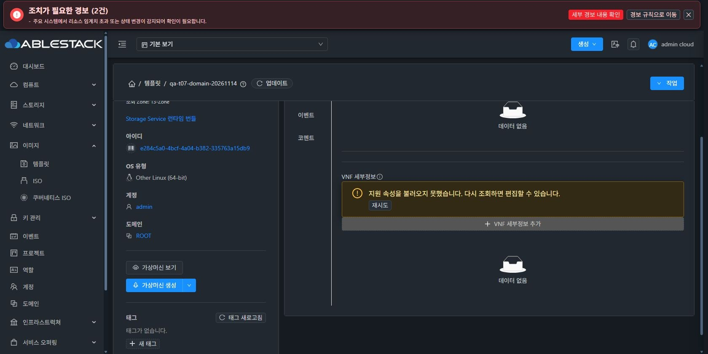

정확히 선택한 프로젝트의 허용, API 없음/철회, 옵션/저장/도메인 지연 응답의 무효화는 단위 검사로 추가 검증했다. API 발견 응답을 제거하는 UI 시도는 브라우저 재연결로 완료하지 못해 UI 통과로 계산하지 않았다. **실제 일반 계정·DomainAdmin·프로젝트 서버 ACL 전체 행렬은 T08 후속 범위**다. 가상 역할 UI 검증을 실제 해당 계정의 로그인·ACL 수용 성공으로 확대하지 않는다. 모든 응답 주입을 해제하고 실제 Admin 조회로 복귀했다.

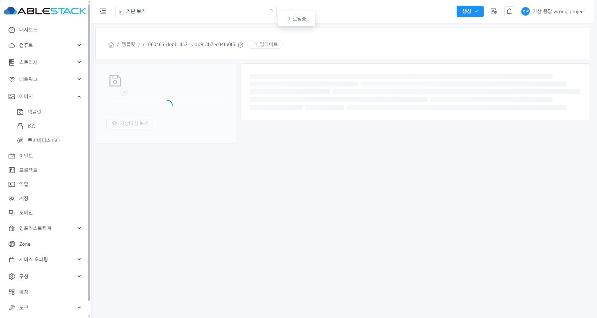

## 반응형·테마

| 대화상자 | 테마 | 뷰포트 | 본문 client/scroll 폭 | footer 하단 | 결과 |
| --- | --- | --- | --- | --- | --- |
| NIC | 다크 |390×900 |364/364px |790px | 통과 |
| NIC | 라이트 |390×900 |364/364px |790px | 통과 |
| 비밀 속성 | 라이트 |390×900 |364/364px |684px | 통과 |
| 비밀 속성 | 다크, 최종 코드 |390×900 |364/364px |684px | 통과 |

대화상자 폭390px, 가로 넘침 없이 하단 버튼을 확인했다. NIC ESC 취소와 초점 복귀를 확인했고 최종 다크 테마·기본 뷰포트(관측1680×841)를 복원했다. 브라우저 재연결과 세션 재로그인 뒤 정리를 재개해 최종 상태를 확인했다.

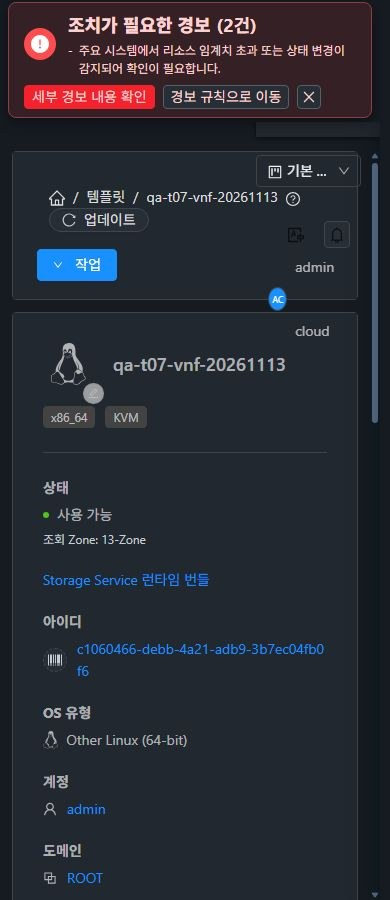

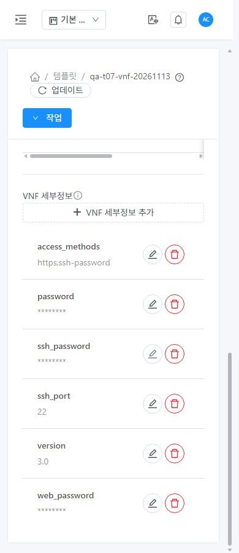

## 검사·한정 배포

| 검사 | 결과 |
| --- | --- |
| 기능·공통 UI 회귀 |25 suites/408 tests 통과 |
| 실제 운영 빌드 입력 |3 suites/100 tests 통과 |
| 서버 계약 |API 민감 정보2개+감사 메서드4개, 총6개 통과 |
| 정적 검사·빌드 | 범위 ESLint 통과, 최종 production build676.4초 성공 |
| 최종 배포 검증 |runtime975개 해시 일치, 보호 설정/테마/서비스 상태 정상 |

서버 검사는 배포 런타임 의존성에 javac17 --release11로 컴파일한 두 API 클래스와 실제 감사 메서드를 추출한 fixture의 JUnit 검사다. 전체 Maven reactor/전체 ApiServer 테스트 성공으로 계산하지 않는다.

- 최신 소스/최종 UI 빌드 `7096f6fc95e223732d1bcabced9a741e76630990`, 백엔드 `3de46e65491a7b4b24486b896e65afd2d52d0bae`. 최초 성공 UI 빌드는011905e5(692.2초), 편집 제목 번역 보완519b108은 최종 빌드에 포함했다.
- upstream/origin fetch 후 로컬 ablestack-europa를 갱신·확인하고 기능 브랜치를 rebase했다. base0edd20dcc9218312b3da533582f03e11535c5eb8, local↔upstream0 0. 최종 보고서 전 fetch에서도0 0이다. origin 기능 브랜치에만 push했다.
- 실제 UI 기준460b337+기존 T01–T06 빌드 입력에 T07 diff만 적용했다. 다른 upstream ResourceTags/Annotations/resourceTags 변경은 계속 제외했다.
- UI 정적 delta 최초10개(신규 해시6+공개4), 번역 JSON2개, 취소 교정7개(신규 해시5+index/color2), 도메인 보완9개(신규 해시5+공개4), 최종 재시도 교정7개(신규 해시5+index/color2)만 순차 배포했다. 이전 해시 자산을 보존하고 index는 마지막에 원자 교체했다. 테마 변수905개 일치를 확인했다.
- 최종 index SHA-256 `f1e113dacbda0da3e9c6ce4474714287d43c64866ddd8431b48c7a9ec687bc59`. config.json/WEB-INF/web.xml 보존, 최종 runtime975개 모두 빌드 산출물과 일치한다.
- 두 API 클래스의 배포 baseline을 byte 단위로 재현하고 annotation만 변경했음을 검증했다. ApiServer는 배포 중인 buildAuditTrail과 baseline 메서드 일치 후 해당 메서드만 이식했고 다른 메서드는 모두 보존했다.
- management jar는3개 class entry만 변경했다. 다른 entry는 모두 동일하며 기존 T04/T06 백엔드 수정도 보존했다. SHA-256 `2f2aa2f44c8c51ce4402d0b1e496853e70efa187809e8854a200c9db334a3dab` → `fd63680c7c9d0396aad05adc416ff8796ab2dfa16fc97e71b23d3de6b40346cb`.
- Mold1회 재시작(PID2352863→2381637), 최종 active/같은 PID 확인. DB 스키마·직접 DB 변경·호스트 agent·SSVM 변경은 없다. 앞선4.21/4.23 업로드 결과와 운영4.23 원본을 보존했다.
- 롤백 백업: backend `/var/tmp/epic1638-t07-backend-backup-iroj8e7x`; UI 최초 `/var/tmp/epic1638-t07-ui-backup-upk9e5ux`, 번역 `/var/tmp/epic1638-t07-locale-backup-i0zscec2`, 취소 `/var/tmp/epic1638-t07-ui-backup-5s281ejz`, 도메인 `/var/tmp/epic1638-t07-ui-backup-56fmtqzx`, 최종 `/var/tmp/epic1638-t07-ui-backup-ne2px5s6`. 전체 T07 롤백은 UI 백업을 최종→도메인→취소→번역→최초 역순 복원하고 backend jar를 복원한 뒤 Mold를 재시작한다.

## 시험 정리

VNF NIC/비밀/일반 속성을 정상 UI로 정리하고 마지막 속성의 cleanupvnfdetails=true를 확인했다. 전용 템플릿 두 개도 force=false인 Zone 삭제로 정리했다. 최초 QA c1060466-debb-4a21-adb9-3b7ec04fb0f6의 job `d2902945-53b6-4e61-b4c1-bc9acde993fd`, 추가 도메인 QA e284c5a0-4bcf-4a04-b382-335763a15db9의 job `08ed22a7-b71e-4384-9b2a-4cb1b73d7b29` 모두 status1/success=true다. 마지막 Zone 삭제 후 결과 유지와 명시 닫기 후 목록 복귀를 확인했다.

각 시험 단계에서47→46으로 복원했고 최종 qa-t07- 검색0·전체46, 호스트3대 실행 중/정상이다. 3번 호스트의 기존 HA 비활성 상태는 그대로다. 임시 QCOW2는 정확한 경로와 SHA-256을 검사한 뒤 파일 및 빈 디렉터리를 제거했다. 운영4.23 SYSTEM 원본은 보존했다. 물리 스토리지 GC 완료/즉시0바이트를 주장하지 않는다.

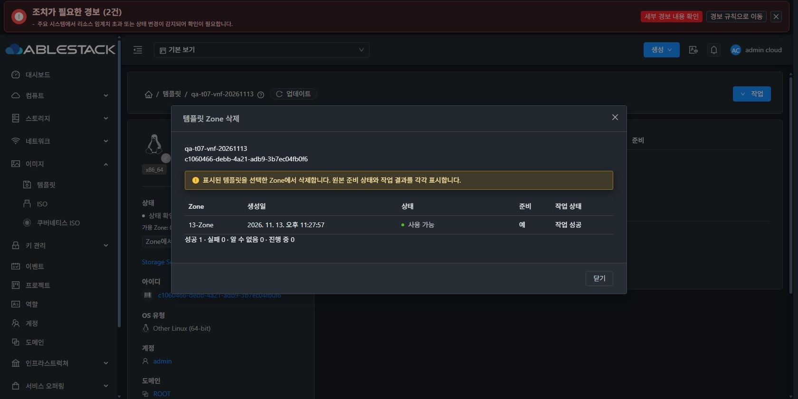

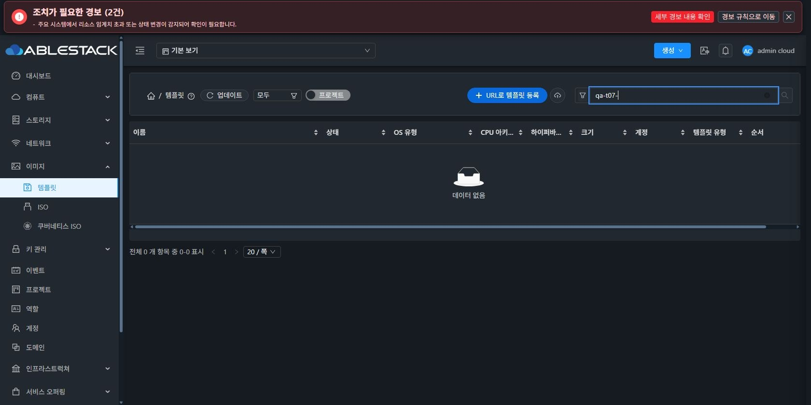

## 기존 CI 부채

- [License43461499818](https://github.com/ablecloud-team/ablestack-cloud/actions/runs/43461499818): 기존 RAT 미승인4077건으로 실패. 이번 Java/JS/Vue9파일은 모두 AL. [#926](https://github.com/ablecloud-team/ablestack-cloud/issues/926)에서 별도로 유지한다.
- [Lint43461499709](https://github.com/ablecloud-team/ablestack-cloud/actions/runs/43461499709): 최종 소스의 전체 pre-commit은 기존 부채로 실패했다. identity 파일 목록을 제외한 실패 블록을 이번11경로와 대조해 기능 파일 지적0을 확인했다. 범위 ESLint와 실컴포넌트 검사는 통과했다. [#1044](https://github.com/ablecloud-team/ablestack-cloud/issues/1044)를 유지하며 전체 green으로 표현하지 않는다.
- merge-conflict triage는 성공했다. 보고서 Markdown/JSON/민감 값 검사 결과와 최신 push CI는 PR Checks를 따른다. 전체 CI green으로 표현하지 않는다.

## 근거

[실제/주입 UI 결과와 원문 없는 비밀 값 대조](validation-results.json), [추가 도메인·재시도 UI 결과](domain-resolution-results.json), [UI 관측 API](ui-api-evidence.json), [시험 자원 ledger](resource-ledger.json), [검사 범위·receipt](validation.json), [소스·빌드 경계](source-boundary.json), [API baseline/annotation 증명](backend-proof.json), [감사 메서드 이식 증명](backend-audit-proof.json), [백엔드 배포](backend-deployment.json), [최종 UI 배포](deployment.json), [최종 runtime 검증](final-runtime-verification.json), [CI 분류](ci-classification.json).
