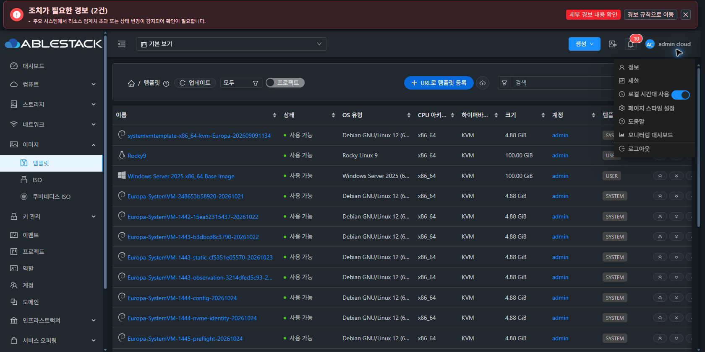

<!--
Licensed to the Apache Software Foundation (ASF) under one
or more contributor license agreements.  See the NOTICE file
distributed with this work for additional information
regarding copyright ownership.  The ASF licenses this file
to you under the Apache License, Version 2.0 (the
"License"); you may not use this file except in compliance
with the License.  You may obtain a copy of the License at

  http://www.apache.org/licenses/LICENSE-2.0

Unless required by applicable law or agreed to in writing,
software distributed under the License is distributed on an
"AS IS" BASIS, WITHOUT WARRANTIES OR CONDITIONS OF ANY
KIND, either express or implied.  See the License for the
specific language governing permissions and limitations
under the License.
 -->

# Epic #1638 T08 통합 UI 회귀 완료

2026-11-14 KST · 13번 클러스터 · [#1646](https://github.com/ablecloud-team/ablestack-cloud/issues/1646) · [Epic #1638](https://github.com/ablecloud-team/ablestack-cloud/issues/1638) · [PR #1647](https://github.com/ablecloud-team/ablestack-cloud/pull/1647)

## 수용 판정

**조정된 완료 범위에서 PASS. 필수 미해결 항목 0개.** 실제 계정 8개와 기존 Root 관리자로 ACL 및 통합 UI를 검증하고, 확인한 결함을 수정·배포·재검증했다. 기능 작업과 기존 CI 부채 #926/#1044를 분리한다. PR 병합과 전체 CI green을 의미하지 않는다.

사용자가 추가 환경을 제공하기 어렵다고 확인하고, **멀티 존 기능은 삭제하지 않고 현재 환경으로 검증 완료 범위를 조정**했다. 실제 다중 Zone 전송·비KVM·다른 아키텍처는 `NOT_RUN_SCOPE_ADJUSTED`다. 복수 Zone/부분 실패/중복 제출/오래된 응답 계약은 자동 검사로 유지했으며 실제 환경 성공으로 계산하지 않는다. [범위 승인](evidence/scope-decision.json)

98개 관측 중 PASS 91개이며, 수정 전 제품 실패 5개·이전 제공 방식의 환경 거부 1개·수동 파일 수신 대기 1개는 각각 후속 PASS와 연결했다. 과거 실패 기록을 지우거나 모두 성공으로 덮어쓰지 않았다. [관측](evidence/ui-cases.json) · [최종 해결 연결](evidence/final-case-resolution.json)

## 실제 UI에서 수정하고 재검증한 문제

| 문제 | 변경과 최종 동작 |
|---|---|
| 일반 사용자 상세·Zone·편집 조회가 관리자용 all 필터로 431 | 역할에 맞는 executable 조회와 shared 보완 조회. 현재 프로젝트·페이지 범위를 유지하고 이전 응답을 폐기한다. |
| VM 생성 주 버튼이 단일 Zone에서도 동작하지 않음 | 한 Zone이면 직접 생성 화면으로 이동한다. 여러 Zone은 선택 메뉴를 유지하며 조회 결과가 없을 때 전체 Zone으로 대체하지 않는다. ISO 조회 계약도 보존한다. |
| 개인 템플릿 공유 수신자의 수정 요청을 서버가 수락 | launch 사용 권한과 Operate 수정 권한을 분리했다. 실제 B의 동일 세션 재검증에서 531 거부 및 소유자 내용 보존을 확인했다. |
| DomainAdmin의 타인 개인 VNF 수정 버튼이 서버 정책과 불일치 | Root·소유자·허용된 프로젝트 소유 자원·API 권한을 교차 검사한다. 도메인 경로만으로 타인 수정 권한을 추정하지 않는다. |
| 프로젝트에 공유한 개인 템플릿을 실제 멤버가 조회하지 못함 | 선택된 프로젝트의 멤버십과 launch grant를 함께 확인한다. 기본 보기·다른 프로젝트·비멤버로 권한을 확장하지 않는다. |
| 프로젝트 공유 템플릿으로 VM 생성 시 비동기 검증 530·일부 VM 잔여 | ApiDispatcher에서 엔터티 검증 전에 프로젝트 문맥을 복원한다. 실제 재시도 job1/Stopped·올바른 프로젝트 소유를 확인했다. 실패 당시 남은 VM도 정리했다. |
| 공유 대상 식별·빈 대상·reset·ISO 응답·영문 안내 | 프로젝트 UUID를 전송하고 계정 이름을 정규화한다. 빈 대상은 전송을 차단하고 reset은 이전 대상/플래그를 보내지 않는다. ISO 권한 응답의 실제 envelope를 사용한다. |
| Zone 대화상자 ESC 후 BODY로 초점 이동 | 열 때 트리거를 보관하고 같은 문맥의 연결·표시·활성 버튼으로만 초점을 복원한다. 필터·프로젝트·권한·Zone 선택기에 native label을 연결했다. |

T07의 주입한 계정 문맥만으로 도메인 조상 수정 가능성을 판단한 결과는 이 보고서의 **실계정·서버 소유권 정책**으로 교정한다. 공개 이미지의 기존 서버 소유권 정책은 유지했다.

## 실계정 ACL 전체 행렬

허용 동작은 UI로 수행했다. 버튼 부재·비활성과 조회 거부를 확인하고, 서버 거부 검사는 같은 실제 로그인 세션의 UI 요청에서 대상 ID 또는 명령만 치환했다. 숨겨진 버튼을 UI에서 클릭했다고 주장하지 않는다. [계정·역할](evidence/acl-actors.json)

| 실제 계정/문맥 | 읽기와 사용 | 수정·경계 검증 |
|---|---|---|
| 기존 admin / Root | 타인 개인 자원 조회·사전 준비·삭제 | 타인 VNF 쓰기 허용, QA 소유자별 실제 정리 성공 |
| qa-t08-da / 상위 DomainAdmin | 하위 A 조회, 범위 밖 개인 자원 531 | 자신의 VNF 쓰기 허용, 하위 타인 쓰기 UI 차단·서버 531 |
| qa-t08-da-a / A DomainAdmin | 같은 도메인 타인 조회, A와 AB 경계의 비공개 조회 531 | 자신의 VNF 쓰기 허용, 타인·공개 AB 수정 UI 차단 |
| qa-t08-a / 일반 소유자 | URL·로컬 등록, 상세·편집·VM 생성 | VNF/NIC·메타데이터·공유 추가/제거/reset 허용 |
| qa-t08-b / 일반 사용자·공유 수신자 | 자신의 자원, 직접 공유 A 자원 및 실제 개인 VM 생성 | 자신의 VNF 쓰기 허용. 공유 A 수정 UI 차단·서버 531. 공유 제거/reset 후 접근 거부 |
| A ProjectAdmin / qa-t08-a | 프로젝트 소유 VNF와 프로젝트 범위 | 프로젝트 소유 VNF 쓰기 허용, UUID로 개인 템플릿 프로젝트 공유 |
| Regular 프로젝트 멤버 / qa-t08-b | 선택 P에서 공유 개인 템플릿 조회·목록 발견·실제 P VM 생성 | 프로젝트 소유 VNF 쓰기 허용. 타인 개인 템플릿 수정 불가. 기본 보기에서는 프로젝트 grant로 읽기 불가 |
| qa-t08-n / 비멤버 | A 비공개 531, 공개 C 읽기 허용, 프로젝트 선택지 없음 | 공개 C 수정 531. 위조 프로젝트 문맥의 조회/쓰기 거부 |
| qa-t08-c / AB 일반 소유자 | 공개한 자신의 VNF 조회, 타인 A 비공개 531 | 공개 자원 소유자 쓰기 허용 |
| qa-t08-o / 외부 도메인 일반 소유자 | 자신의 비공개 VNF 조회, 타인 A 비공개 531 | 자신의 VNF 쓰기 허용 |
| qa-t08-v / 실제 Read-Only User 역할 | 자신의 템플릿 상세 읽기 허용 | VNF·생성·변경 제어 부재/비활성. 쓰기 API 8개 모두 432 |

읽기 전용 거부 명령은 updateVnfTemplate, updateTemplate, updateTemplatePermissions, deleteTemplate, copyTemplate, prepareTemplate, registerTemplate, getUploadParamsForTemplate다.

프로젝트 grant만 있을 때 개인 보기 거부 → 선택 프로젝트 허용 → 프로젝트 grant 제거 후 거부를 확인했다. 이후 직접 계정 grant로 개인 VM 생성도 성공했다. 마지막에는 계정·프로젝트 grant를 함께 reset하고 두 보기 모두 거부되며 기존 프로젝트 멤버십/프로젝트 소유 VNF 읽기가 유지됨을 확인했다.

## 통합 수용 행렬

| 계획 ID | 최종 판정과 실제 근거 |
|---|---|
| RT01 URL | 실제 CirrOS 이미지 등록/Ready 및 게스트 부팅. qa-t08-a-url-cirros |
| RT02 로컬 | 실제 일반 계정 SHA-256 업로드 Ready·부팅. 잘못된 SHA-256은 서버 500 체크섬 불일치와 DOWNLOAD_ERROR/Ready=false, UUID 보존·중복 전송 없음 |
| RT03 편집 | 실제 소유자의 arch/false 옵션 보존·설명 편집. userdata 부분 성공/복구의 선행 T03 검증과 해당 회귀 검사 유지 |
| RT04 ACL | 위 실제 Root/일반 사용자/DomainAdmin/프로젝트/읽기 전용 전체 행렬 |
| RT05 복사 | 단일 Zone에서 대상 없음·확인 비활성. 실제 다중 Zone 전송은 NOT_RUN_SCOPE_ADJUSTED. 관련 자동 계약 유지 |
| RT06 삭제 | 실패 템플릿의 개별 마지막 Zone 삭제와 Ready 템플릿의 선택 Zone 삭제 모두 job1. 원본 상태/준비/생성일과 작업 결과를 별도로 보존하고 닫기 후 목록 복귀 |
| RT07 준비 | Root가 타인 QA 템플릿의 명시한 Primary에서 성공·DOWNLOADED 관측. 잘못된 pool/미지원/지연·부분 결과는 선행 T06 및 자동 검사와 구분 |
| RT08 VNF | 실제 소유자 속성 쓰기, NIC 2개 추가·관리 NIC 보존 편집·순서 이동·필수/선택 경계 제한·마지막 삭제. 기존 version 보존. 비밀 값 미변경/마스킹 계약은 선행 T07 및 자동 검사 유지 |
| RT09 원본 생성 | 정지 ROOT 볼륨·백업 스냅샷에서 템플릿 Ready, 두 복제 VM 실제 OS 부팅과 원본 표식 보존, 원본 전체 논리 내용 동일 |
| RT10 파일 | 추출 성공과 실제 수신을 구분. 운영자 별도 브라우저 다운로드 파일 bytes/SHA-256 일치. 보안 정책 우회 없음. 만료 상태 처리는 자동 검사이며 실제 만료 링크 수신을 주장하지 않음 |
| RT11 공통 | VM 생성/상세/볼륨·스냅샷 생성 흐름, ISO 목록 8개·상세·공통 권한 대화상자 읽기/취소. 기존 ISO 변경 없음 |
| RT12 표시·접근성 | 1680/1024/390/320px 다크 상세/준비 대화상자·라이트 목록/권한 대화상자. 이름 우선 폭 400px, 상태140/OS180, 한 줄 생략/전체 값 tooltip. breadcrumb 페이지2·고급 이름/KVM/false 조건 복원. 운영자 native Tab→Enter→Esc→동일 버튼 초점 PASS, 최종 배포 UI ESC 재확인 |
| RT13 정리 | 아래 전체 QA 자원 정리와 최초 계정/템플릿·호스트·시스템 VM 보존 |

[반응형 관측](evidence/responsive-matrix.json) · [목록 열 근거](evidence/list-primary-column.json) · [삭제 최종 결과](screenshots/selected-zone-delete-result.jpg) · [VNF NIC](screenshots/vnf-nic-boundary.jpg)

## 실제 OS 부팅과 파일 내용 보존

검증 원본은 [CirrOS 0.6.3 x86_64 공식 이미지](https://download.cirros-cloud.net/0.6.3/cirros-0.6.3-x86_64-disk.img)다. 파일 21,692,416 bytes, SHA-256 `7d6355852aeb6dbcd191bcda7cd74f1536cfe5cbf8a10495a7283a8396e4b75b`. QCOW2 가상 크기는 117,440,512 bytes다. [파일 수신 영수증](evidence/download-receipt.json)

| 경로 | 템플릿 UUID | 실제 부팅 VM UUID | 증거 |
|---|---|---|---|
| URL | b27269d3-c6e8-4128-bdaa-335171f4bc67 | 5304dae8-a66c-4ac5-a464-41f0fac4450a | [콘솔](screenshots/url-guest-boot-proof.jpg) |
| 로컬 | ad9b844f-2fdd-4502-acde-486caf9334c0 | fd87b9f1-89fa-4cdf-b3a6-ca42c8ee678f | [콘솔](screenshots/local-guest-boot-proof.jpg) |
| ROOT 볼륨 | cab5b9f8-d0bb-4c7d-99d6-6faed419026b | 8434ed98-f81d-4ad2-99be-9afa918abaca | [콘솔](screenshots/volume-clone-guest-proof.jpg) |
| 스냅샷 | 9ed853d1-f196-44a4-8c69-99d53f61a87b | e8e89f84-5489-4be5-8c7d-2a1109eca3fa | [콘솔](screenshots/snapshot-clone-guest-proof.jpg) |

4개 VM 모두 CirrOS 0.6.3, Linux 5.15.0-117-generic x86_64 실행을 확인했다. CirrOS가 기본 시리얼 콘솔을 사용하므로, 호스트의 보조 시리얼 셸로 실제 OS/커널/표식 해시 출력과 tty1 표시를 준비한 뒤 **UI noVNC 화면에서 관측**했다. 게스트 명령을 UI 키보드로 직접 입력했다고 주장하지 않는다. URL/로컬 시험 게스트의 데이터 소스 설정만 조정했으며 등록한 원본 이미지는 변경하지 않았다.

URL 원본 게스트에서 만든 `/home/cirros/t08-source-marker`의 SHA-256은 `42cb6197ed874d1ed24c70c0a42e46ffeeca40b2b43c35a97035ffab92c1c5e6`다. 두 복제 게스트에서는 표식을 새로 만들지 않고 같은 해시를 확인했다. [게스트 JSON 4개](evidence/guest-volume.json)

정지 원본 ROOT 볼륨 `dff588a0-1aa9-46d7-a297-0dbeab41721c`는 템플릿 생성 및 스냅샷/스냅샷 템플릿 생성 후 raw 기준점과 qemu-img compare0으로 논리 내용이 동일했다. 크기·형식·경로·정지 상태도 보존했다. 전체 논리 SHA-256은 `6929b434340d837cbc1517eac0dfd3149b80446f46bb715c1e1efc415854815c`다. [원본 기준점](evidence/source-volume-baseline.json) · [최종 비교](evidence/source-after-snapshot-template.json)

첫 URL VM 생성에서 1C1GB/RAW 조합은 VM 영속화 전 ALLOCATION_AGENT_UNAVAILABLE로 거부됐다. 기존 thin CKS Instance offering으로 재시도해 4개 부팅 경로를 완료했다. 호스트 agent·마운트는 조사만 했고 이 환경 제약을 해결하려고 다른 서비스/스토리지를 변경하지 않았다.

업로드의 **4.21 선검증 → 시스템 VM 4.23 재생성 → 4.23 재검증**은 [T03/T04 완료 보고서](../epic-1638-t03-t04-20261113/README.ko.md)에 bytes·체크섬·실제 런타임 근거가 있다. T08에서는 유지 중인 실제 4.23에서 부팅 가능한 일반 사용자 업로드와 잘못된 SHA-256 거부를 다시 확인했다. T08 중 시스템 VM을 다시 파기하거나 재생성하지 않았다.

## 검증과 배포 경계

- 집중 UI 27 suites / **434 tests PASS**, 최종 runtime 입력의 native AntD 선택기 검사 28개 PASS, production build 성공. [UI 로그](evidence/final-ui-tests.log) · [빌드 결과](evidence/ui-build-result.json)
- 배포한 실제 클래스에 결합한 JUnit: DomainChecker 14개, ApiDispatcher 3개 PASS. 배포 전 기준 메서드가 기존 배포 클래스와 일치함을 검증하고, 바꾼 메서드 외 bytecode를 보존했다. 전체 Maven 성공으로 표현하지 않는다. [ACL 근거](evidence/project-acl-backend-proof.json) · [비동기 문맥 근거](evidence/project-async-backend-proof.json)
- 최종 UI 소스 `ab5b5a93c65579ad0535ea984b31d89036aee357`. 운영 기준 archive `460b33770cb071d869f61c2aac0d81773890ebc3`에 필요한 Epic 입력만 적용했다. 전체 최신 트리를 빌드/배포하지 않았다. 중간 권한 변경 c9eba8d는 단독 배포하지 않고 후속 빌드에 포함했다.
- UI delta 5회: 13/7/12/8/10개 파일. 최종 10개는 해시 파일 8개 추가와 index/color.less 교체다. 이전 해시 파일과 rollback backup을 유지하고 index를 마지막에 교체했다. 설정 2개와 테마 변수 905개는 동일하다. [최종 배포](evidence/deployment.json) · [활성 파일 975개 대조](evidence/final-runtime-verification.json)
- 백엔드 delta 3회: DomainChecker의 checkAccess 한 메서드 보정 2회와 ApiDispatcher의 dispatch 한 메서드 보정 1회. 최종 jar SHA-256 `8fe7c6611dd1983084a3de8b5ed70b78f05a4551931022a4f1c0af5bb9f5e2c6`, PID2473572/active. 최종 정적 UI 배포는 관리 프로세스를 재시작하지 않았다.
- **T08 DB 스키마 변경 없음, 호스트 agent 배포/재시작 없음, SSVM 이미지·런타임 변경 없음.** UI로 만든 시험 네트워크의 자동 라우터는 시험 자원으로 정상 정리했다.
- local/origin/upstream base `ablestack-europa` = `0edd20dcc9218312b3da533582f03e11535c5eb8`, divergence0 0. 작업은 origin/dhslove/epic-1638-template-ui로만 push하고 upstream PR로 연결한다. [동기화](evidence/final-git-sync.json)

## 정리와 기존 자원 보존

| QA 자원 | 생성 | 정리 확인 |
|---|---:|---:|
| 템플릿 | 13 | 13 |
| VM | 7 | 7 (생성 실패 후 일부 남은 VM 포함, ROOT 볼륨 expunge 선택) |
| 볼륨 스냅샷 | 1 | 1 |
| 네트워크 | 3 | 3 (부팅 시험 라우터 포함 일반 삭제) |
| 프로젝트 | 1 | 1 |
| 도메인 | 4 | 4 |
| 실제 계정 | 8 | 8 |

[생성/정리 UUID](evidence/resource-ledger.json) · [최종 삭제 작업](evidence/cleanup-receipts.json) · [정리 요약](evidence/cleanup-summary.json)

템플릿 목록은 최초 46개로 복원됐고 QA 템플릿·개인/프로젝트 VM·네트워크 검색 결과는 0건이다. 기존 admin/baremetal-system-account/비활성 epic898-config-denied 계정 3개의 역할과 상태를 보존했다. ROOT 도메인만 남았으며 호스트 3대는 Up/Normal/KVM4.23이다. 호스트3의 기존 HA Disabled도 유지했다. s-244-VM/v-245-VM은 Running/Agent Up/4.23이다. 운영 `Europa-SystemVM-4.23-T34-20261113` 템플릿과 제공 경로는 보존했다.

임시 Mold HTTP 이미지와 호스트13.2의 112MiB raw 비교 기준점은 각각 원본 해시를 대조한 뒤 해당 파일과 빈 시험 디렉터리만 제거했다. 다운로드한 운영자 파일은 보존했다. 기존 스토리지 캐시·과거 해시 자산·rollback backup을 일괄 삭제하지 않았다. 물리 캐시 정리를 검증했다고 표현하지 않는다. [임시 파일 정리](evidence/fixture-cleanup.json)

기존 네트워크 UI에서 A 네트워크의 진행 중 job0에 scope 경고가 한 차례 나타났다. 삭제 명령을 재전송하지 않고 결과 조회만 재시도했고 job1 및 네트워크 부재를 확인했다. 이 화면의 코드는 T08 변경/배포 대상이 아니다. 도메인 삭제 뒤 삭제된 ID 재조회431도 삭제 실패로 계산하지 않고 최종 job1과 ROOT/계정 목록을 대조했다.

## CI 부채 분리

기능 검사와 production 빌드는 통과했다. 구현 SHA ab5b5a9의 License는 기존 4,077건으로, Lint는 기존 oxipng/라이선스·실행 권한/심볼릭 링크·문서 정비 등으로 실패했다. T08 변경 소스 22개는 RAT AL이며 나머지 JSON 2개는 기존 제외 대상이다. 최신 Lint 실패 진단에 T08 변경 소스 경로는 0개다. 저장소 전체 CI를 green으로 표시하지 않는다. [최신 분류](evidence/ci-classification.json)를 참조한다. #926/#1044를 이 Epic 완료와 함께 닫지 않는다.

증거에는 비밀번호·API 키/시크릿·세션 키·서명·콘솔 토큰을 포함하지 않는다. 이미지 자체·raw 볼륨·jar/class 바이너리는 보고서에 넣지 않았다. [증거 파일 해시](evidence-manifest.json)
