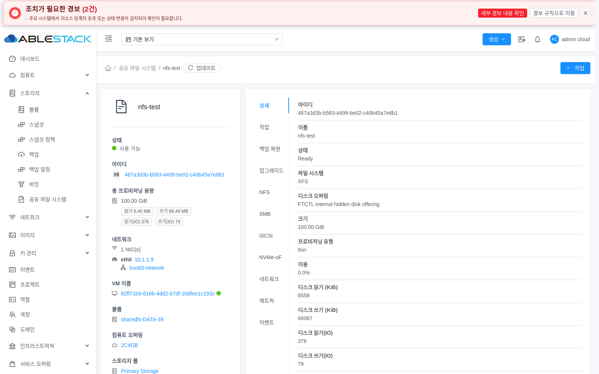
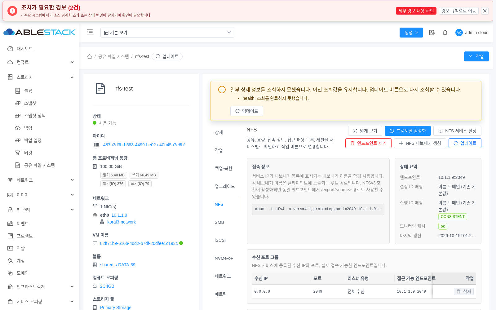
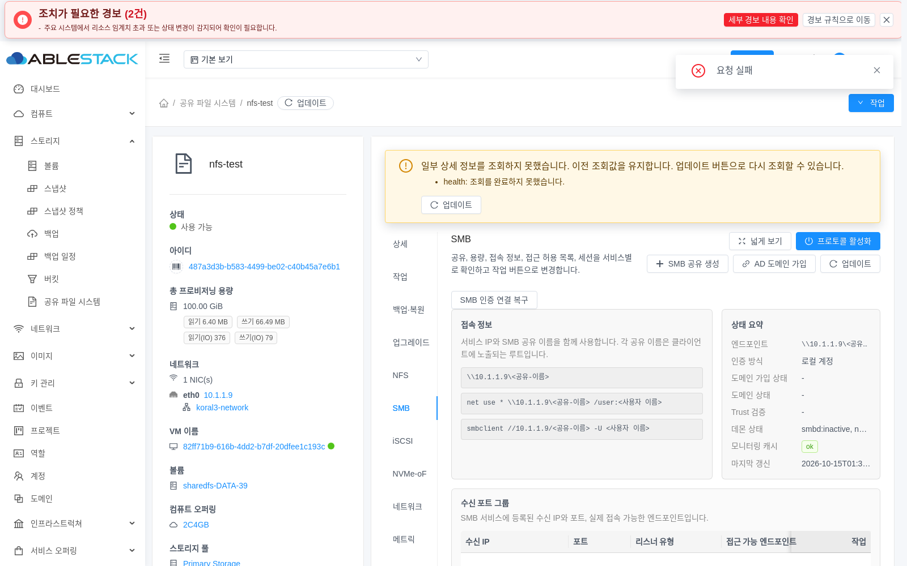
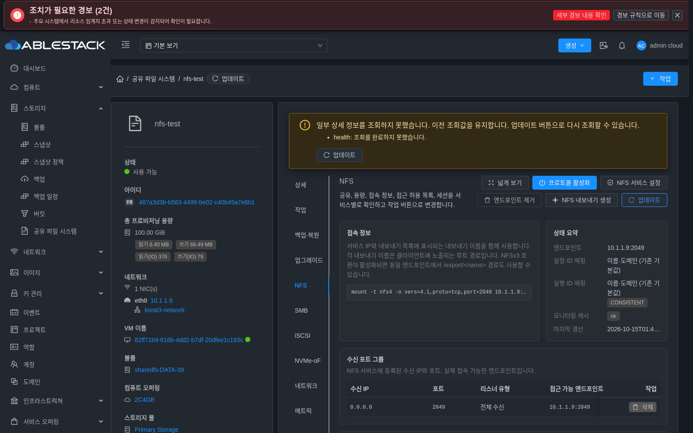
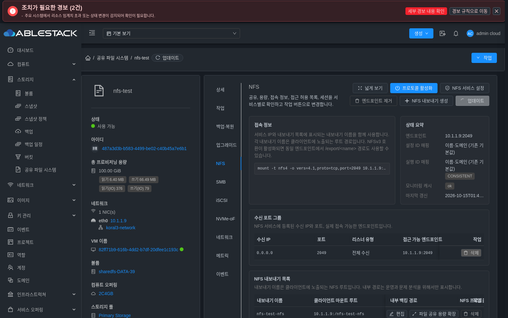

<!--
Licensed to the Apache Software Foundation (ASF) under one
or more contributor license agreements.  See the NOTICE file
distributed with this work for additional information
regarding copyright ownership.  The ASF licenses this file
to you under the Apache License, Version 2.0 (the
"License"); you may not use this file except in compliance
with the License.  You may obtain a copy of the License at

  http://www.apache.org/licenses/LICENSE-2.0

Unless required by applicable law or agreed to in writing,
software distributed under the License is distributed on an
"AS IS" BASIS, WITHOUT WARRANTIES OR CONDITIONS OF ANY
KIND, either express or implied.  See the License for the
specific language governing permissions and limitations
under the License.
-->

# #1269 상세 조회 무한 로딩·상태 정합성 완료 검증

공유 파일 시스템이 Ready여도 상세 조회의 일부 실패·지연·scope 전환으로 화면이 계속 로딩하거나 폐기된 화면이 브라우저 이동 이벤트를 처리하는 문제를 다룬다. 기존 유한 deadline·section별 보존·재시도·중복 요청 병합을 재사용하고, unmount 시 popstate 핸들러를 해제한다.

## 설계와 소스 반영

- 기준 a5a811387476ac87a8774fc729cc68021104684a와 로컬 ablestack-europa를 먼저 동기화한 뒤 Epic521개 커밋을 rebase했다. 기존 커밋 제목·순서, 비충돌 경로와 번역의 의미상 합집합을 검증했다.
- VMgroup과 SharedFS 조회 분기·오류 상태를 함께 보존했다. 독립 DB phase 추가도 양쪽을 유지했다. 이 동기화로 관리/KVM/게스트 모듈을 배포하지 않았다.
- 서비스 조회는 API당15초 deadline과 scope/token/generation 검증을 유지한다. 전체 최초 조회는 단계별 실행이므로 항상15초 이내라고 주장하지 않는다.
- 실패 section의 이전 값은 유지하고 성공 section만 갱신하며 공개 원인·화면 업데이트로 복구한다. 같은 scope의 진행 중 promise를 재사용하고 오래된 응답/unmount 후 응답은 커밋하지 않는다.
- created에서 popstate 핸들러 참조를 보관하고 beforeUnmount에서 제거한다. 기존 AD 작업 취소와 unmounted wide-layout 복원은 유지한다.
- 구현 source77b222a8d8c531c984ab1e2db274fcb2fc64172a. 제품 변경은 SharedFSTab.vue이며 회귀 테스트2개를 추가했다. 최종 UI1275 레이아웃 작업은 수행하지 않았다.

## 정상 검증과 빌드

- 신규 lifecycle 회귀2개는 수정 전 실패했다.
- 수정 후 관련286 tests/11 suites 모두 통과, 실패·skip0. API transport, scoped references, listRefresh, AutogenView, upstream VMgroup 연동과 SharedFS 로딩/화면/locale를 포함한다.
- 관련 lint --no-fix 통과.
- 정상 Vue CLI UI 컴파일 완료(약559초). 첫 npm 작업은 호출자가 commit SHA를 릴리스 버전값에 넣어 후처리에서 거절됐다. 원 실패를 보존하고 정식 v4.10.0-Europa-20261015로 postbuild만 다시 실행했다. 재실행 전후 컴파일 자산 SHA가 동일하고 최종859개 산출물을 검증했다.
- Node20에 프로세스 한정 OpenSSL legacy provider/heap8GiB를 사용했다. 소스 config와 작업 트리를 보존했다.

## 13번 환경 배포

- 운영 config를 제외한858개 static manifest 전체를 검증했다. 변경은 기존4개/새139개이며 기존 해시 자산 삭제0, 관리 서버 재시작0, 관리/KVM/게스트 및 DATA 변경0이다.
- 백업: /root/epic898-issue1269-ui-backup-20261015-102138.
- index를 마지막에 교체하고 HTTP200/SHA 7d3266b2ccabdcda2a6bac427dfa795305e00653aa30546d9afa4af2745c7591과 중요HTTP자산5개의 해시를 대조했다.
- 운영 config 심볼릭 링크 및 SHA d3e285317289b4eb4034141b63e4604ffd014d8bc1385aa28a007a4317c397f5, 관리 PID1430252 유지. WEB-INF와 기존 런타임은 배포 대상에서 제외했다.
- 운영 config의 제품 버전 표시는 보존했으므로 실제 실행 코드의 근거는 index/로드된JS의 해시다.

## API와 실제 UI 검증

실제13번 관리 서버의 기존 nfs-test(487a3d3b-b583-4499-be02-c40b45a7e6b1)를 사용한다. Linux Chromium을 실제 로그인·화면 조작하며, 앱/DOM/Vue 상태를 가짜로 주입하지 않는다. 네트워크 부정 시험은 해당 브라우저의 지정 GET만 실패·지연시키며 서버 서비스·볼륨에 fault를 주입하지 않는다. 기존 화면의 thin 표기는 원래 자원이며 신규 디스크 생성0이다. 상단 기존 인프라 경보2건은 조회 실패 경고와 구분한다.

실제 API/Chromium UI 인수11개 게이트가 모두 PASS다. 직접·목록 접근, 배포 전 로그인 세션의 새 자산 로드, 신규 로그인, 새로고침·빠른 탭 전환을 확인했다.

| 검증 | 실제 결과 |
| --- | --- |
| 부분 실패와 수동 재시도 | health530·연결 실패·15초 timeout에서 원인 표시·기존 NFS/ACL/100GiB/Ready 유지·spinner0. 화면 업데이트 버튼으로 복구 |
| 최초 조회와 참조 실패 | 원 상세에서 instances530 및 VM 참조530의 원인·Ready·로딩 종료·화면 재시도 복구 |
| 동시 갱신 | 01:33:32.599Z~01:33:41.830Z의 실제 겹친 버튼 조작에서 child instances GET1, parent SharedFS GET2. 부모의 trailing queue와 자식 promise 병합을 구분 |
| SPA·이탈·히스토리 | 동일 document에서 원 FS→목록→F1→뒤/앞 이동. 원 자원 값 혼입0, popstate3/1/3/1/3으로 증가0 |
| 실제 늦은 성공 응답 | 새 health530 안내가01:38:26.974Z에 표시된 뒤 옛 health200을01:38:28.053Z에 전달.29.033Z에도 새 경고 유지, 후속 화면 retry로 해제 |
| 라이트·다크 | 정상 상세/NFS와 다크모드530 안내·실제 버튼 복구 가독성 확인 |
| 일반 캐시 | routing이 없는 정상 로그인 context에서 일반 reload2회. 실제 HTTP cache 사용, Ready/XFS/100GiB/spinner0/partial0과 현재 script URL 확인 |
| 직접 API | FS8·서비스8·원 VM Running·ROOT/DATA2 Ready의 신원·상태·용량 매핑 전후 동일, health ok/NFS enabled Ready. F1현재볼륨5 SPARSE Ready |
| 실행 코드·종료 | 실제 script9개의 HTTP SHA가77b manifest와 일치. 정상 logout HTTP200, 소유 브라우저/하네스0, 비밀 파일 저장0 |

[실제 인수 요약](issue1269-final/acceptance-summary-ko.md), [11개 게이트와 원시 증거 해시](issue1269-final/acceptance-summary-public.json), [단위·통합 검증](issue1269-final/verification-summary.json), [빌드](issue1269-final/production-build-proof.json), [배포](issue1269-final/deployment-proof.json)를 함께 보관한다.

하네스의 URL 끝 슬래시 누락, 주입 순서가 달랐던 시도, 자동 갱신이 수동 복구보다 먼저 끝난 관측, 선택적 빈 목록 응답 해석은 원 기록에 남겼다. 이런 시도를 제품 실패 또는 성공한 인수로 잘못 세지 않았으며, 의도한 주입·응답·화면 순서를 확인한 경우만 최종 판정에 사용했다.

## 대표 실제 화면

## 완료 절차

사용자 최신 지시에 따라 설계·구현·모듈 빌드·13번 배포·API/실제UI 인수·Epic PR 반영을 마친 뒤 기존 이슈에 완료 근거를 남기고 닫는다. Epic PR 자체 병합은 이번 이슈 닫기와 구분하며 미병합 여부를 보고한다. 새 이슈를 생성하지 않는다. 다음 제시 대상은892이고 자동 착수하지 않는다.
