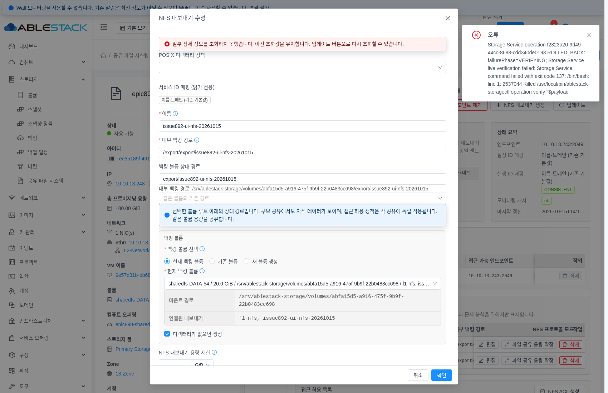
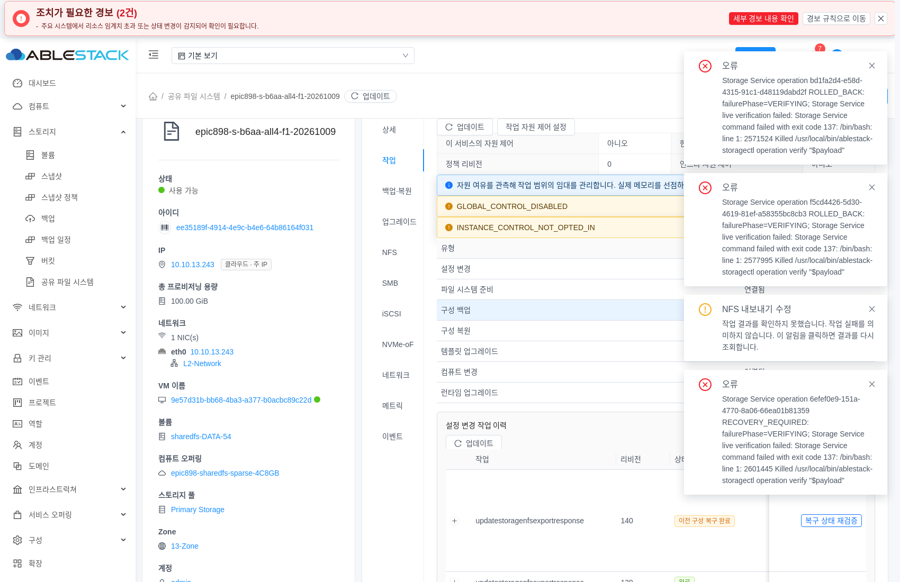

# #892 공유 파일 시스템 설정 변경 실패 복구 — 구현·검증 결과

13번 환경에서 #892 범위의 구현·정상 모듈 빌드·배포·API와 실제 UI 검증·시험 자원 정리를 완료했습니다. 검증 완료 기록은 **2026-10-16T00:37:27.734007+09:00 KST**이며 최종 정리 proof의 기록 시각입니다. 파일명은 작업 시작일인 20261015를 유지합니다.

설정 변경이 실패하면 기존 DB 항목과 실제 서비스 구성을 함께 SOURCE snapshot으로 원복합니다. 삭제 실패로 기존 레코드가 유실되지 않게 하고, 중복 요청이 같은 변경을 다시 적용하지 않도록 공통 operation·idempotency key·revision으로 묶었습니다.

기존 DesiredStateChange의 validate → prepare → apply → verify → commit 흐름을 재사용했습니다. 원복을 확인하면 ROLLED_BACK으로 끝내고, 확인하지 못하면 RECOVERY_REQUIRED로 다음 변경을 차단한 뒤 **같은 operation의 수동 복구**로 연결합니다. 원래 실패 단계와 복구 결과도 남깁니다.

LOCAL SMB의 원본 신원과 권한, iSCSI WWN, NVMe controller·namespace 식별자를 보존합니다. SOURCE 근거·소유권·BOOT·원래 기한을 유지하며, 실행 본문에 들어가기 전의 엄격한 writer BUSY 응답만 기한 안에서 재관찰합니다. UI는 입력과 요청 key를 유지하고 known-job 응답 조회가 끊기면 같은 job의 READ를 재개합니다.

| 검증 | 결과 |
|---|---|
| 정상 백엔드 모듈 | 39모듈·131묶음·1,066테스트, 실패·오류·건너뜀0 및 Checkstyle PASS |
| UI 관련 검증 | 영향 범위26묶음·588테스트·lint·정상 production PASS |
| 배포 | 관리 서버 변경 클래스1개, 13번 호스트3대의 KVM 변경 클래스, 새 UI 정적864파일 적용 |
| 실제 API12 | NFS·SMB·iSCSI·NVMe CRUD 각각 장애1회·자동 원복·같은 key 중복 방지·새 key 정상 재시도 PASS |
| 실제 Namespace3 | 생성·수정·삭제의 장애·원복·정상 재시도와 식별자 보존 PASS |
| 실제 UI | 4프로토콜+Namespace의5폼, 응답 유실·known-job 재조회·복구 차단/수동 복구·reload 없는 gate 해제 PASS |
| 최종 정리 | 소유 시험 자원 정상 삭제, SPARSE20GiB550 전용 detach/delete 및 원본5디스크 보존 PASS |

범위가 겹치는 테스트 수는 합산하지 않습니다. 배포 출처는 backend65c·HOSTa2·서명 native91·새 UI1df03으로 구분했습니다. [빌드·배포](issue892-final/build-deploy-public-summary.json), [API12 독립 대조](issue892-final/final-core12-public.json), [Namespace3](issue892-final/final-namespace3-public.json)

각 실패는 native13축·DB11그룹과 원본 file/block sentinel·디스크·BOOT를 비교했습니다. 실제 UI5폼은 fault/normal job과 operation·source/commit revision 및 허용 변경을 기록했습니다. 응답 유실은 HTTP2번에도 같은 key의 operation1·native 반영1, known-job은 실제 GET 응답4회 유실 뒤 같은 job READ와 추가 자원 POST0을 확인했습니다. 이중 장애 뒤 수동 복구는 새 operation0·기존 작업 ROLLED_BACK·동일 문서의 gate 해제를 확인했습니다. 최종11탭은 로딩·오류·변경 POST0이었고 두 actor 모두 종료됐습니다. [실제 UI 근거](issue892-final/final-browser-ui-public.json)

원복 뒤 reader hold 한 건은 writer 종료 후139.52초에 제한 시간으로 해제됐습니다. 이를 명시 해제로 바꾸어 기록하지 않았습니다. 수동 복구에서는 선택적 hold를 사용하지 않았고, critical 구간의 native ancillary 조회0·제품 타이머 변경0을 유지했습니다.

작업 영속화에는 cloud.storage_service_operation의 **17컬럼·4인덱스**, previous_snapshot_json·snapshot_json·result_json의 LONGTEXT 저장과 migration phase Complete가 필요합니다. 실제13번 메타데이터를 정확히 확인했습니다. 현재 UI 보완의 추가 DDL은 없습니다. [전체 컬럼·인덱스](issue892-final/operation-schema-public.json)

정리에서는 참조0·RAW/unmounted·SPARSE를 확인한 소유550만 서비스 전용 detach API로 분리하고 삭제했습니다. API 목록에서550 부재, 승인 binding6→5, source143·native13·DB11·fstab 및 원본 데이터를 확인했습니다. 최종 binding9행은 partition을 포함하며 type=disk인 원본 디스크는5개입니다. 보호 중인 원본10TiB021b는 건드리지 않았고 THIN 디스크를 만들지 않았습니다. [최종 정리](issue892-final/final-owned-volume-cleanup-public.json)

Native 관련336회귀는 통과했습니다. 확대722검증에는 독립 기준선과 같은 실패1·오류1이 남아 전체 GREEN으로 표시하지 않습니다. 이전 a2/7d66 UI 부분 시도와 실패한 시험 도구 실행은 현재 최종 인수 건수에 더하지 않았습니다. [검증 한계](issue892-final/native-regression-limits-public.json), [공개 근거 SHA](issue892-final/public-evidence-source-manifest.json)

의도적으로 주입한 VERIFYING137 실패의 토스트 이력이 남아 있습니다. 이 장면은 DB 상태 조회 복구 후 같은 입력과 확인 버튼이 활성화된 상태이며, 후속 정상 재시도와 Ready 결과는 실제 ROOT 증거로 별도 확인했습니다.

의도적 이중 장애 이력이 남아 있지만 동일 문서에서 기존 operation 수동 복구와 gate 해제가 성공했습니다. GLOBAL_CONTROL_DISABLED·INSTANCE_CONTROL_NOT_OPTED_IN 표시는 실행 옵트인 정책으로 구분하며, 실제 복구 결과는 원본13축·DB11과 함께 검증했습니다.

#892의 구현·검증 범위는 완료했습니다. 다음 #897은 대기 상태이고, #1275 최종 UI 표준 정리는 미착수·사용자 지시 대기입니다.
