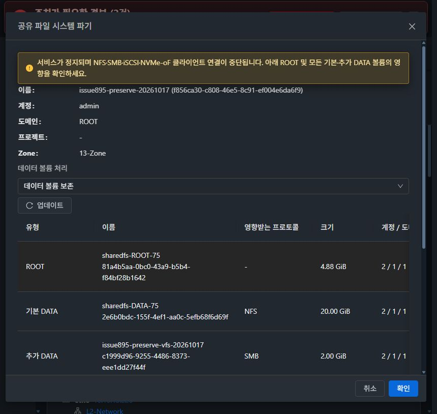
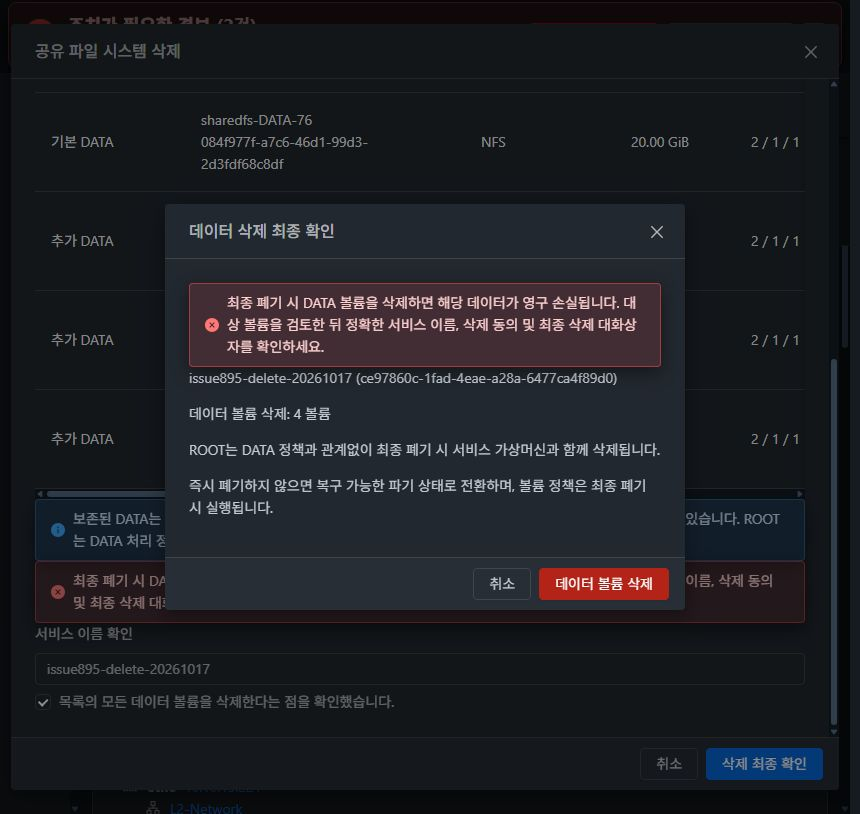
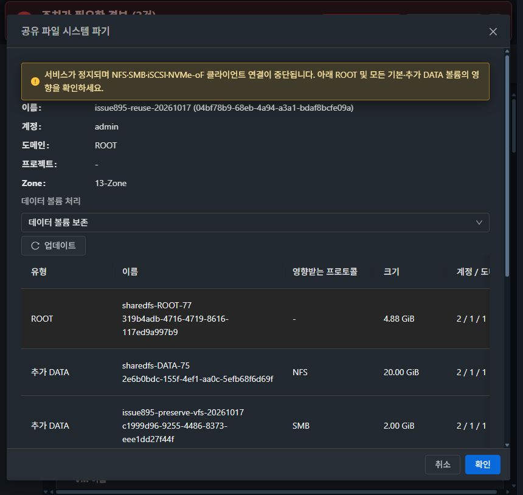
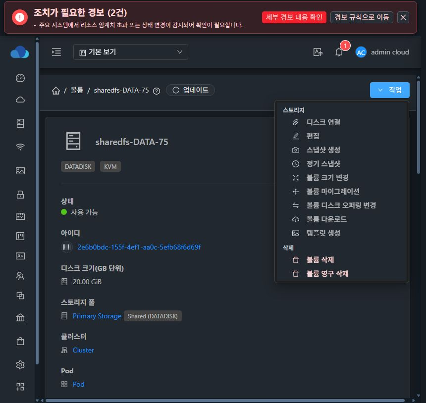

# #895 DATA 보존·분리·삭제 정책 구현 및 검증 완료

13번 환경에서 설계·구현·정상 모듈 빌드·배포·API와 실제 UI 기능 검증을 완료했다. DATA 보존 후 새 서비스에서 NFS·SMB·iSCSI·NVMe-oF의 기존 데이터를 읽었고, 삭제의 실제 부분 실패와 동일 계획 재시도도 확인했다. 테스트 자원을 정상 API로 정리한 뒤 별도 API·3호스트 검사로 VM 3개와 디스크 12개의 부재를 확인했다. 기존 보호 자원은 유지됐다.

기존 epic/898-sharedfs와 [Epic PR #1271](https://github.com/ablecloud-team/ablestack-cloud/pull/1271)에 통합한다. [설계](20261017-issue895-design.md)와 아래 공개 증거는 검증 종료 시점의 기록이며 최종 완료 댓글·상태의 권위는 [#895](https://github.com/ablecloud-team/ablestack-cloud/issues/895)다. 새 이슈·브랜치·PR은 만들지 않았다. #1275 최종 UI 표준화는 HOLD이며 시작하지 않았다.

기본 정책은 PRESERVE_VOLUMES다. 서비스 VM의 ROOT와 기본·추가 DATA를 구분하고 NFS·SMB·iSCSI·NVMe-oF 연결과 계정·도메인·프로젝트·zone·pool·크기를 영향 목록에 표시한다. DELETE_VOLUMES에는 승인한 계획 hash, 정확한 서비스 이름, 손실 동의와 별도 최종 확인이 필요하다. DATA 계획 hash의 기존 계약은 유지하면서 NVMe 서브시스템의 빈 volume 참조를 실제 namespace DATA 연결과 구분했다.

정상 VM shutdown과 Stopped 확인 후 DATA를 분리하고 VM을 최종 폐기한다. 부분 detach 실패는 남은 DATA 삭제와 VM 폐기를 중단한다. 효과 시작 후 원래 계획·정책·hash를 고정하고 provider 완료 receipt를 남겨 감사/DAO 단계 실패의 재시도가 provider 효과를 반복하지 않게 했다. known job은 같은 jobid를 추적하며 응답 유실·불명 상태에서 변경 POST를 자동 재전송하지 않는다. sharedfsvm의 일반 VM 삭제 진입도 태그 유무와 관계없이 차단한다. 이번 변경의 추가 DDL은 없다.

| 게이트 | 결과 및 범위 | 공개 증거 ID |
|---|---|---|
| Backend 정상 모듈 | 39 reactors / 148 suites / 1,308 tests, 실패·오류·skip 0, Checkstyle PASS | BACKEND_BUILD |
| Native 정상 모듈 | 52 modules / 817 tests, 실패·오류·skip 0 | NATIVE_BUILD |
| UI 정상 모듈 | 49 suites / 1,030 tests, 실패·오류·skip 0, 전체 lint·production PASS | UI_BUILD |
| 최종 소스 정합 | Backend Java/XML 10,609개·Native 624개·UI 1,097개 전체 바이트 대조 PASS | WHOLE_SOURCE_338, NATIVE_SOURCE_8BEC, UI_SOURCE_73BA |
| 13번 Backend/UI 반영 | 초기4 class·최종 중복2 class 변경으로 총4종류 반영; UI8파일 반영·903 static, heap2GiB·기존 config 유지 | MGT_INITIAL_FOUR_CLASSES, MGT_FINAL_TWO_CLASSES_RESUMED, UI_DEPLOYMENT |
| 런타임 반영 | 정상 TEST 서명 CODE3 두 번 게시·검증·AVAILABLE, 전용 VM75/76/77 정상 preflight/upgrade | CODE3_PUBLICATION_1, CODE3_PUBLICATION_2, UPGRADE_75, UPGRADE_76, UPGRADE_77 |
| 디스크 | SPARSE ROOT 5,000MiB + 기본 DATA20GiB, 추가 DATA 각2GiB. QCOW2 metadata·L2/noBacking 확인, THIN 0 | SPARSE_FIVE_75, SPARSE_FIVE_76, SPARSE_TWO_77 |
| 실제 UI 영향·확인 보호 | PRESERVE 기본값·ROOT/4 DATA 구분, DELETE 이중 확인 취소 | FOUR_DATA_DELETE_PREVIEW_UI, 이미지 |
| 잘못된 계획·이름 | stale hash 및 valid hash+wrong name 실제 API431, VM Running 유지 | NEGATIVE_PLAN_AND_NAME |
| soft destroy·recover·start | 실제 UI 조작 성공·새 BOOT, 기존4 canary/파일시스템 보존·health READY | UI_RECOVER_START |
| 최종 폐기·DATA4 보존 | 실제 UI PRESERVE 성공, FS/VM/ROOT 정상 조회 부재; DATA4 Ready/unattached 및 소유 범위·UUID·size/path/SPARSE 유지 | UI_HARD_PRESERVE |
| 보존 DATA4 실제 재사용 | 새 SPARSE 서비스77 생성·정상 upgrade, FILE2 MOUNT_EXISTING·RAW2 연결, health 정상 | CREATE_REUSE_77, REUSE_IMPORT_AND_HEALTH |
| 기존 바이트·FS 보존 | NFS/SMB 각64KiB FILE canary·FS UUID 일치, iSCSI/NVMe 외부 클라이언트 원래64KiB 영역 read 일치, 재포맷·canary 재생성·권한 변경0 | REUSE_ALL_FOUR_FINAL, REUSE_ALL_FOUR_READ |
| 재사용 실제 UI | 네 프로토콜 탭 로딩 완료, 기존 DATA UUID·Ready/SPARSE 및 endpoint222 확인, 5 DATA PRESERVE 미리보기 취소·UI 변경 POST0 | REUSE_FOUR_TABS_UI |
| 실제 부분 실패·동일 계획 재시도 | 정확한 DATA 한 행의 유한 row lock→job2/530→해제→실제 UI 명시 재시도 job1/0; 고정4 DATA hash 유지 | REAL_BOUNDED_PARTIAL_FAILURE, ROWLOCK_CONTROLLER_CLOSED, UI_SAME_FROZEN_PLAN_RETRY_LOGICAL |
| 삭제 정책 결과 | 승인4 DATA만 Destroy/unattached, audit PLANNED→STARTED→FAILED_RETRYABLE→STARTED→COMPLETE | UI_SAME_FROZEN_PLAN_RETRY_LOGICAL, DELETE_DESTROY_GC_CONTRACT |
| 클라이언트·시험 정리 | 정상 logout/disconnect, identity 유지. 재사용 VM은 PRESERVE로 폐기, 이후 정확한 시험 DATA만 정상 deleteVolume | REUSE_CLIENTS_CLOSED, REUSE_77_CLEANUP_PRESERVES_FOUR, NORMAL_TEST_WASTE_PURGE_76, NORMAL_TEST_WASTE_PURGE_OLD4 |
| 최종 독립 부재 | API 원본25VM·39볼륨·10FS·10instance·3host의 정확 ID/선택 필드 전후 일치. 13.1/13.2/13.3 각각 own3 domain/qemu·literal12 backing 부재를 두 번 확인, GFS2 정상 | INDEPENDENT_FINAL_API_AND_3HOST_ABSENCE |
| 정리 후 원본 보호 | F1/ref59/ret61·기존 복구 필요10행 및 MGT/UI 유지. partial021b API/DB-only, 직접 guest·수정0 | PROTECTED_BEFORE, PROTECTED_BEFORE_FINAL_CLEANUP, PROTECTED_AFTER_FINAL_CLEANUP |

각 수치는 해당 정상 모듈 실행 결과다. 집중 회귀나 이전 이슈 수와 합산하지 않았으며 저장소 전체 테스트를 뜻하지 않는다. Backend 최종 소스는 3388505d84f6e1438de60ff5653261e0415ee237, Native는 8bec8b78f921a5eca55307d056a3a046421d2db5, UI는 73ba9f545152392370ee6dbc5c1b5cd9fd0dd0f2다. 최종338의 각 전체 소스가 정상 빌드 당시 바이트와 일치함을 별도 검증했다. 이 qualification을 빌드 재실행으로 계산하지 않는다. Native/UI의 당시 POSIX mode도 일치하며, 역사 mode snapshot이 없는 Backend는 당시 바이트와 현재 index/빌드 HEAD 실행비트 검증을 구분했다.

최종 MGT PID2434895 / startTicks141287500 / BOOT361dc102-9a49-4e79-9317-f20d37d43d74, server JAR SHA는 3eacab6ec27fa558c624ebd2d65ef8aeea8c601be8aa5cb36dc714b2cb5c589f다. UI index SHA는 92d46c96843b6f89d8f93de67a20592ad641de0d1033d182d0314b744094c31c, 관리 config SHA는 d3e285317289b4eb4034141b63e4604ffd014d8bc1385aa28a007a4317c397f5다. 전체 최신 JAR나 기존 보호 VM의 Native 전체를 교체하지 않았다. TEST catalog/trust/namespace는 정상 검증한 두 항목 추가만 유지하며 운영 기본 전체 SystemVM 템플릿·서명키 전환을 뜻하지 않는다.

검증 결과의 한계와 실제 실패 기록도 함께 보존한다.

- DELETE_VOLUMES는 CloudStack 기존 Destroy→GC 계약을 따른다. 정책 완료 자체를 즉시 물리 expunge로 주장하지 않는다. 별도의 시험 DATA 정상 purge 뒤 독립 3호스트 검사로 최종 물리 부재를 확인했다. 즉시 API 부재를 기대했던 원본 false 관측은 보존하고 논리 삭제 계약의 조건부 판정을 별도로 연결했다.
- 독립 guest unmount API는 추가하지 않았다. 정상 shutdown→Stopped 확인→detach→expunge 순서다. 실제 fault는 bounded row lock에 의한 detach 경계 실패이며 kernel D-state/unmount fault 실증은 아니다. 감사/DAO 실패와 프로젝트·비소유자 접근은 회귀 테스트 범위다. 실제 비소유자 계정 생성이 실패해 해당 실제 권한 시나리오는 PASS로 표기하지 않는다.
- 재사용 FILE2는 QGA의 O_RDONLY/O_NOATIME 읽기이며 SMB 외부 네트워크 I/O 완료를 주장하지 않는다. RAW2는 실제13.1의 iSCSI/NVMe target·session/device 매핑을 확인한 외부 읽기다. 별도 초기 NFS 외부 mount/read/write 검증은 성공했다. 이 검증은 canary 바이트와 FS UUID 보존이며 전체 볼륨의 내용 hash는 아니다.
- 최초 빈 SMB SOURCE 검증 문제를 Native8bec에서 보완했고 정상 서명 업그레이드 후 인수했다. 재사용 가져오기 중 writer admission exit75가 한 번 발생해 공식 reconcile1회로 복구했다. 당시 lock holder는 특정하지 못했다. 목표13단계의 import POST는14회(성공13·실패1), reconcile POST는 별도1회다. 앞8단계 중복 실행·자동 POST 재시도0이다. 원래 current의5필드와 raw SHA는 복구됐지만 공식 atomic rewrite로 inode/mtime가 달라진 점을 기록했다.
- 최종 Backend2class 배포는 실행 활성화 누락으로 최초 stop1/start0에서 멈췄다. JAR 미변경·backup 부재를 읽기 전용 확인한 뒤 명시 재개해 누적 stop1/start1로 완료했다. 원래 실패 기록을 성공으로 덮어쓰지 않았다.
- 클라이언트13.1의 시험용 nvme_tcp는 원래 unloaded였고 정상 modprobe -r 1회로 제거했다. 이 명령은 당시 미사용인 NVMe 의존 모듈4개도 자동 제거했다. dry-run에는 tcp만 나타났으며 엄격한 단일 모듈 제거 검증은 false로 보존했다. 네 의존 모듈의 최초 시험 전 loaded 여부 기록이 없어 전체 원래 모듈 집합 복원을 주장하지 않는다. 전후 NVMe controller/subsystem0·기존 iSCSI 연결·전체 block inventory·identity3파일·BOOT는 같았다. 강제 제거·추가 재로드·서비스/네트워크 변경0이며, 이 조건부 결과는 CLIENT_MODULE_STRICT_ORIGINAL과 CLIENT_MODULE_CONDITIONAL에 있다.
- 진단 관측기의 로컬 이름 충돌·잘못된 phase/AST 가정은 진단 도구 문제로 분리했다. 실패한 public getter를 실제 MGT payload/RSA 검증 성공으로 사용하지 않았다. Source guard 약화나 private journal/DB/구성 pin의 수동 변경0이다.

아래 이미지는 실제 13번 UI다.

PRESERVE 기본값과 ROOT/DATA 영향:

부분 실패 이후 같은 계획의 최종 삭제 확인:

새 서비스에서 기존 DATA4를 재사용한 뒤 새 기본 DATA까지 포함한 영향 목록:

일반 볼륨 화면의 Ready·재사용 액션:

[최종 소스·증거 정합 확인](20261017-issue895-final-source-qualification-public.json)은 제품 소스 변경0·기존 정상 빌드 연결·공개 근거46개와 실제 이미지4개의 SHA 및 로컬 링크 검증을 기록한다. [공개 검증 근거](20261017-issue895-completion-public.json)는 증거 ID별 원본 경로·전체 SHA·검토한 공개 JSON과 이미지 SHA를 담는다. 큰 배포 inventory/catalog를 포함한 큰 inventory 필드만 명시적 projection으로 줄였고 원본 SHA는 축소 전 파일을 가리킨다. 자격증명·private key는 공개 자료에 포함하지 않는다.

local ablestack-europa와 origin/upstream을 dc31262567f2afe5f6278fae61c1cef7e307fe3e로 맞추고 차이0/0을 확인했다. 기존 origin 작업 브랜치만 갱신한다. Epic의 남은 범위가 있어 PR1271은 Draft로 유지한다. 다음 제시 대상은 **#909 구성 백업 번들 내보내기·업로드 및 마지막 정상 구성 복원 지원**이며 자동 착수하지 않는다. #1275는 추가 지시 전까지 HOLD다.
