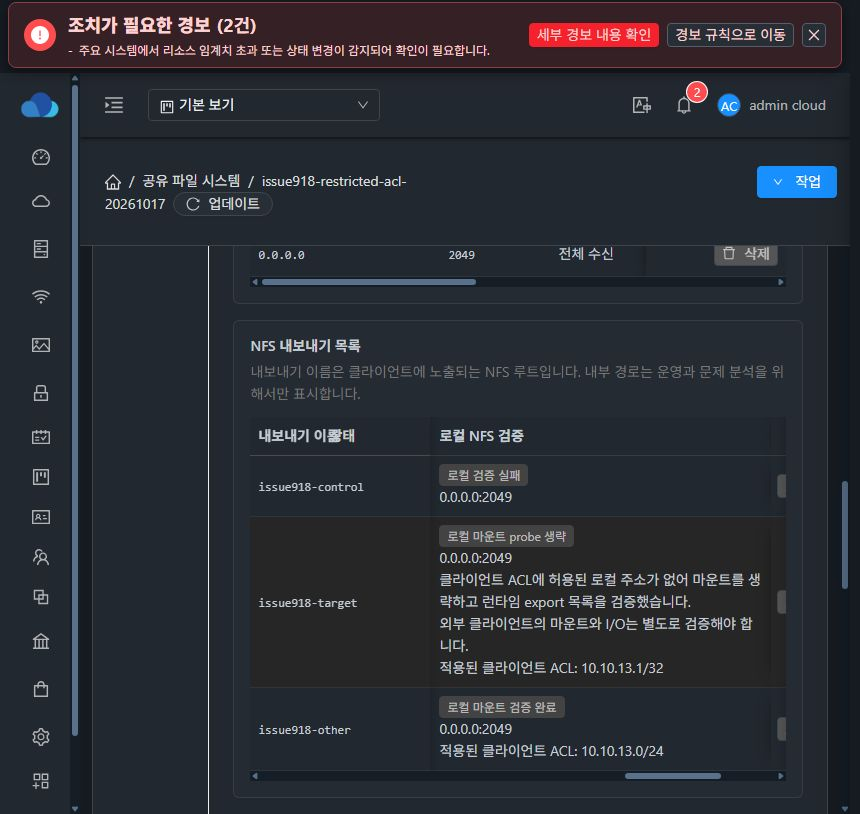
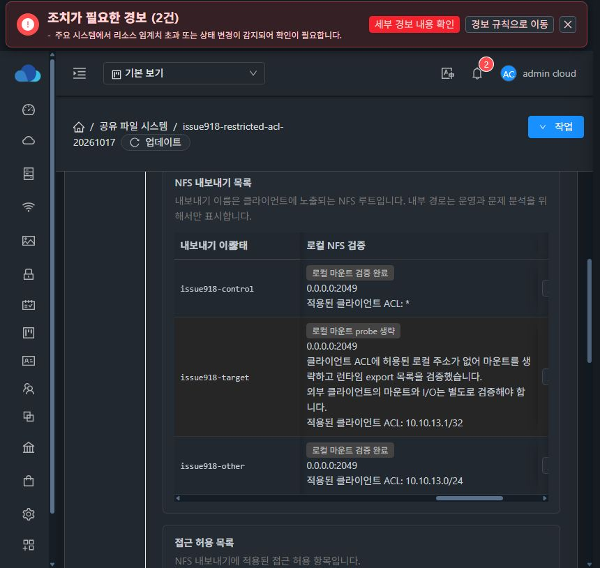

# #918 설계·구현·배포·검증 완료

13번 환경의 구현·정상 모듈 빌드·배포·API·실제 UI·외부 NFS 검증 및 테스트 자원 정상 삭제를 완료했다. 별도 읽기 전용 검사로 API와 호스트3개의 VM/domain·프로세스·정확한 ROOT/DATA backing 부재를 확인했고 기존 보호 자원을 보존했다. 기존 epic/898-sharedfs와 [Epic PR #1271](https://github.com/ablecloud-team/ablestack-cloud/pull/1271)에 통합한다. 이 문서는 검증 종료 시점의 기록이며 완료 댓글과 최종 이슈 상태는 [#918](https://github.com/ablecloud-team/ablestack-cloud/issues/918)를 따른다.

[설계 기록](20261017-issue918-design.md)의 generation·SOURCE 보호를 재사용했다. 제한 ACL에 SystemVM 주소가 없으면 ACL_RESTRICTED_NO_LOCAL_SOURCE로 로컬 mount probe를 생략하고, 정확한 설정·프로세스·소유 listener·실제 export/ACL 검증을 유지한다. 일반 ACL 변경은 기존 generation/FD9·고정 SOURCE를 재사용해 DBus로 적용하고 실패 시 SOURCE 복구와 API 실패를 남긴다. Backend는 명시적 null을 보존하며 UI는 정상·생략·실패·미관측을 구분한다.

실증 범위는 own74의 SPARSE ROOT 5,000MiB + DATA 20GiB, Dual NFS export 3개다. ext4 UUID는 ffa6da8e-0a13-4906-8ca3-5f650a0d7ad7이다. 최초 포맷 이후 MOUNT_EXISTING으로만 재사용했다. C1=13.1, C2=13.3, 서비스=13.229이며 다른 실제 서비스를 테스트 대상으로 사용하지 않았다.

| 게이트 | 결과 | 검증 수준 | 증거 ID |
|---|---|---|---|
| Native 정상 모듈 | PASS: 52 modules / 794 tests, 실패·오류·skip 0, cdab7b48 | 정상 빌드·회귀 | NATIVE |
| Backend 모듈·배포 | PASS: 39 reactors / 146 suites / 1,287 tests, 정상 class 1개 교체, default heap 2GiB 유지 | 정상 빌드 + 실제 원자 배포·source 정합 | BACKEND, BACKEND_CLASS, MGT_DEPLOY, SOURCE_B9, SOURCE_CDAB |
| UI 정상 모듈·배포 | PASS: 49 suites / 989 tests·lint·production, 5d4921be 배포, static898·변경6파일, MGT 재시작0 | 정상 빌드 + 실제 배포 | UI_V2_LOCAL, UI_V2_DEPLOY |
| CODE3·정상 upgrade | PASS: TEST 공개 서명 bundle 정상 등록·검증·AVAILABLE, preflight/apply known job 각각1/0, formatted SOURCE 보존 | 실제 정상 API·guest | CODE_PUBLISH, CODE_UPGRADE |
| 디스크·3 exports·제한 ACL | PASS: SPARSE2개, 생성/ACL 5POST 모두1/0, target=C1 /32·control=wildcard·other=로컬 CIDR, SystemVM 자동 추가0 | 실제 API·물리 metadata·fresh config/DBus | PHYSICAL, EXPORTS, BASELINE |
| UI grant/revoke·외부 v3/v4 | PASS: 거부→UI 허용→기존 canary read·자기 파일 write/fsync→UI 철회→재거부 | 실제 UI + C1/C2 외부 I/O | CLIENT_INITIAL, CLIENT_GRANT, CLIENT_REVOKE |
| 동적 ACL·DBus 구간 열린 I/O | PASS: control/target 각각 최소1,608 read·append/fsync, 오류0, PID/FD/mount 유지 | reconcile startup 이전 실제 I/O | CLIENT_DBUS, GRANT_RUNTIME, GRANT_DIFF |
| DBus ACK 후 실제 실패·SOURCE 복구 | QUALIFIED PASS: 실제 1 exports updated·TARGET ACL readback 후 fault, job2/530·ROLLED_BACK·SOURCE 복구 | 실제 실패·API·QGA·외부 I/O | DBUS_QUALIFIED, DBUS_ORIGINAL_FALSE |
| 정상 no-op 재적용 | PASS: job77de1228… 1/0, current revision9 | 실제 정상 API | NOOP |
| SystemVM 자기 mount 거부 | PASS(조건 포함): v3 명시적 접근 거부, v4 NOT_VISIBLE_OR_DENIED, SOURCE/PID 동일·잔여 mount0·DATA write0 | 실제 private namespace | SELF_DENIAL |
| userspace PROBE 실패 격리 | QUALIFIED PASS: 실제 child73753 exit32·control 실패/정리 완료, target ACL 생략, other v3/v4 성공, fault 시 PID73567 유지 | 실제 userspace fault·상태 readback | PROBE_QUALIFIED |
| startup/probe 구간 I/O | 각 EIO1회 후 같은 FD/mount로 회복. 후속3973→4188 read/write 동안 추가 오류0 | 결합 구간의 원인·시점은 미분리 | CLIENT_STARTUP_OBSERVATION, CLIENT_AFTER_PROBE |
| 실제 UI 실패·생략·정상 표시 | PASS: 실패 control·ACL 생략 target·정상 other가 같은 실제 화면에서 구분되고 새 열이 읽힘 | 실제 브라우저·화면 검토 | UI_FAILURE |
| 정상 복구·실제 UI | PASS: 16게이트, PID73567 유지, control fresh v3/v4 2개·other 검증 cache2개·ACL skip1개, READY 복구 | 실제 서비스 + 실제 UI | NORMAL_RECOVERY, UI_RECOVERY |
| 정상 cold boot | QUALIFIED PASS: restart jobf0cfa283… 1/0, 새 BOOT f1ffe439…, 자동 fresh probe4·ACL skip1·current9·SPARSE2·format 영수증 보존, 수동 reconcile/포맷0 | 실제 정상 재부팅·24게이트 | COLD_QUALIFIED, COLD_JOB |
| 재부팅 후 외부 접근·UI | PASS: 기존 canary5개 v3/v4 readback·C2 재거부, 새 파일/쓰기0, 실제 UI 정상 | 실제 외부 NFS + 실제 브라우저 | COLD_EXTERNAL, UI_COLD |
| actor/fault·정상 자원 정리 | PASS: phase1/coldboot의 C1/C2 모두 CLOSED·mount/session/socket 정리, fault 잔존0, 정상 삭제2POST·FS/VM/ROOT/DATA API 부재 | 실제 종료·정상 삭제 API | C1_PHASE1_CLOSED, C2_PHASE1_CLOSED, C1_COLD_CLOSED, C2_COLD_CLOSED, NORMAL_CLEANUP |
| 원본 보호 AFTER | PASS: F1/ref59/ret61·history10 보존, partial021b API/DB-only·guestCalls0, MGT/UI898 보존 | 정리 전후 독립 읽기 전용 확인 | PROTECTED_PRE_CLEANUP, PROTECTED_AFTER_CLEANUP |
| own74의 독립 3호스트 부재 | PASS: fresh API·호스트3개 domain UUID/name·정확한 qemu process·두 backing 모두 부재, pool mounted/gfs2 확인 | 별도 읽기 전용 검사, POST0/guest0/host write0 | INDEPENDENT_ABSENCE |

판정에는 다음 한계를 함께 보존한다.

- v4 mount 실패를 EACCES로 단정하지 않는다. 같은 실제 pseudo에서 거부→UI 허용 후 v3/v4 read/write→철회 후 재실패라는 제어된 전이로 검증했다.
- DBus 복구의 canonical7·current full5·고정 SOURCE·Ganesha raw config/effective ACL/PID 일치를 확인했다. NFS desired raw SHA는 달랐고 원본 false 증거도 보존했다. raw7 바이트 일치나 공백만의 차이를 주장하지 않는다.
- grant/revoke/DBus까지의 I/O 오류0과 이후 정상 reconcile startup/probe 구간의 각 EIO1회를 분리한다. startup에서 Ganesha51167→73567로 바뀐 뒤 fault가 주입됐으며 EIO의 정확한 원인·시점은 분리하지 못했다. 전체 실증 오류0·무중단을 주장하지 않는다.
- cold boot에서 fstab의 기존 주석 swap2행에 주석 prefix가 추가됐다. 이 정확한 변환을 되돌리면 캡처한 전 SHA가 재현되며 활성12행과 기존 DATA/alias행은 동일하다. network JSON은 동일6필드 객체이고 키 순서·구분자에 따른 전후 raw SHA를 정확히 재현했다. timestamp 변경을 추정하지 않는다. 원본 엄격 raw 비교 false도 보존했다.
- grant 전후 변경 export1개·기록된 mount probe0개다. 공개 health에는 직접 DBus 호출 카운터가 없어 계획상 UpdateExport1회와 측정 호출 수를 구분한다. 실제 probe 실패 주입은 userspace 종료32이며 kernel D-state 실증은 아니다.
- #1275 UI 표준 정리는 HOLD이며 시작하지 않았다. 5d4921be는 #918 새 검증 열의 가시성 보완이다. 전체 탭·대화상자 레이아웃 정리는 별도 지시를 기다린다.

실제 UI에서 ACL 허용·철회를 조작하고 검증 상태를 확인했다. 아래 이미지는 새 probe 상태 열을 실제 화면에서 읽을 수 있도록 기능 가시성을 보완한 뒤 캡처한 화면이며 목업이 아니다. 이미지 원본 SHA는 공개 검증 근거에 있다.

실패 control·ACL 생략 target·정상 other:

정상 cold boot 후 정상 control/other·ACL 생략 target:

증거 ID별 결과·원본 경로·전체 SHA 및 검토한 공개 근거는 [공개 검증 자료](20261017-issue918-completion-public.json)에 있다. 큰 배포 inventory·catalog namespace만 명시적 필드 projection으로 줄였으며 원본 SHA는 줄이기 전 파일을 가리킨다. raw 비교 실패 원본과 조건부 판정도 보존한다. 테스트 수는 실행별 정상 범위이며 집중 회귀나 이전 이슈 수와 합산하지 않았다.

이슈 본문의 예시 클라이언트 192.168.3.11 대신 13번 실제 허용 클라이언트 10.10.13.1/32·추가 클라이언트 10.10.13.3/32·서비스 10.10.13.229로 동등 조건을 검증했다. config parse/process/listener의 실제 정상 게이트와 실패 처리 회귀를 확인했으며 이 세 종류의 실제 파괴적 장애 주입을 수행한 것으로 확대하지 않는다. 실제 실패 주입은 위 DBus ACK 이후 예외와 userspace probe 종료32 두 종류다.

정상 TEST 서명 CODE3는 전용 own74에서 검증했다. 기존 보호 VM 전체 Native 교체나 새 전체 SystemVM 템플릿·운영 서명키 전환은 수행하지 않았다. 관리 서버는 정상 class1개와 UI static6파일만 반영했고 추가 DDL은 없다. last-apply 관측에는 시간 TTL을 두지 않고 BOOT/config/PID/startTicks/소유 listener/fresh DBus를 결합하며 monitor cache TTL30초와 구분한다. 미관측·binding 불일치는 UNKNOWN이다.

upstream과 local ablestack-europa를 dc31262567f2afe5f6278fae61c1cef7e307fe3e로 맞추고 차이0/0을 확인했다. 기존 origin/epic/898-sharedfs만 갱신하며 새 이슈·브랜치·PR은 만들지 않는다. Epic 전체 미완료 범위가 있어 PR1271은 Draft로 유지한다. 다음 제시 대상은 #895이며 자동 착수하지 않는다. 최종 UI 표준화 #1275는 사용자 추가 지시 전까지 HOLD다.
