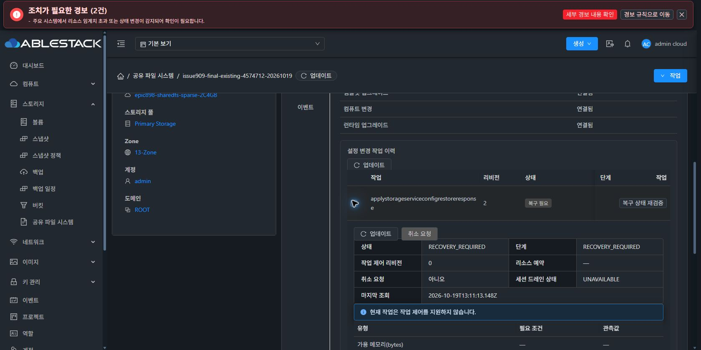

# #909 최종 실환경 검증 — 활성화·자동 rollback 오류로 중단

**Backend/API 오류로 검증을 중단했습니다. 이슈 종료 조건에 도달하지 못했으며 #909 OPEN·Epic PR #1271 Draft를 유지하고 다음 지시를 기다립니다.**

## 실제 진행과 오류

- local base/upstream248653b5892 차이0/0, 제품252a9228a3b 및 13번 배포 JAR cdb54f66·class45767827·UI index7c6a5db4·PID2720487을 확인했습니다. 이번 작업 중 제품 수정·빌드·재배포는0회입니다.
- 실제 Chrome에서 동일 IMPORT c1181cde·대상 SharedFS886e9f06/VM374ff78d·DATA4의 새 계획을 검토했습니다. STATIC13.227/16·PRIMARY·EXISTING/PRESERVE·생성14·blocker0을 확인하고 SMB/CHAP 비밀값과 대상 이름을 재입력했습니다.
- 적용은1회 접수됐습니다. 신규 VM/볼륨 생성·MAC 변경은0회입니다. UI 작업 ID와 API의 실제 ApplyStorageServiceConfigRestoreCmd 작업을 대조했습니다. 브라우저 이벤트 관찰에서는 적용 POST가 포착되지 않았으므로 Network 이벤트만으로 접수 횟수를 주장하지 않습니다. 실제 UI 표시·API 작업/새 Storage 작업1개로 접수를 확인했습니다.
- API job: 35061611-3e0a-4760-bee7-a1e5d3f15391
- Storage operation: 71e0d23c-541d-4b61-85d4-5cbc0d0ca473, revision2
- 결과: jobstatus2 / jobresultcode530 / RECOVERY_REQUIRED
- 진단: failurePhase=APPLYING; Rendered generation activate failed; inspect its scoped recovery receipt | rollback: Rendered generation rollback failed; inspect its scoped recovery receipt
- API 작업 생성: 2026-10-19 22:06:38 KST. Storage 작업 생성:22:07:18, 종료:22:08:41.

이전의 /24 대 /16 불일치로 인한 stage 실패를 지나 이번에는 activation이 시작됐습니다. Native 영수증은 prerequisitesStarted/Verified=true, changedDomains=NFS/SMB/ISCSI/NVMEOF, startedDomains=[NFS], activeDomain=NFS, appliedDomains=[]를 기록합니다. 첫 NFS 활성화 진행 중 실패했고 자동 rollback도 완료되지 않았습니다. 하위 activation·rollback 실패 원인은 공개 진단/현재 영수증만으로 아직 확정하지 않았습니다.

## 오류 이후 읽기 전용 확인

| 항목 | 확인 상태 |
|---|---|
| 작업 | Backend와 실제 Chrome 작업 탭 모두 RECOVERY_REQUIRED/복구 필요 |
| Native generation | 기존 baseline1·원래 configuration SHA e3465707 유지. generationStatus=PENDING, pending operation은 이번71e0d23c |
| Rendered current | baseline1/원래 manifest88858b25. activation phase RECOVERY_REQUIRED, bootHeld=true |
| 보호 상태 | 현재 generation·기존 SOURCE checkpoint journal/cipher 동일. pending.json·template-maintenance.json·service-maintenance.json은 변경됨 |
| 서비스 제공 | 정상 복구를 주장할 수 없음. 수동 복구/재검증/보호 해제는 실행하지 않음 |
| VM/볼륨 | 동일 VM Running, ROOT+DATA5개 Ready/SPARSE, MAC02:0d:00:cc:00:2e와 BOOT ID 동일 |
| DB/LKG | 초기 미사용 NFS1개와 ACTIVE_LKG1/SHA ca302769 유지. 이를 Native의 복구 완료와 동일시하지 않음 |
| IMPORT | plan/cloneAllocation/volumeExecutionPlan/cloneInitialBaseline/requestedVolumeMapping 동일. cloneRestoreOperation은 이번 작업을 기록하고 restoreState=FAILED |
| 데이터 | FILE6개 및 RAW2디스크 총4개64KiB 영역 내용/SHA·파일 inode/UID/GID/mode·FS UUID 동일. 전체 볼륨 해시 검증 아님 |
| 남은 변경 | NFS DATA의 추가 bind mount /export/issue909-mixed-nfs가 남음. 기존 backing mount도 유지 |

읽기 전용 검사 코드의 첫 비교는 mountpoints까지 동일해야 한다는 과도한 가정으로 실패했습니다. 검사 결과를 보존하도록 시험 코드만 교정해 내용/해시·파일 메타데이터·마운트 차이를 분리했습니다. 위 추가 bind mount만 차이였고 데이터 내용은 동일합니다. 이를 별도의 제품 재시도나 복구 성공으로 계산하지 않습니다.

## 중단 범위

제품 오류 이후 복원 재시도·수동 rollback/reconcile·서비스 보호 해제·클라이언트 I/O·신규 SPARSE DATA 분기·시험 자원 정리는 모두0입니다. 작업의 자동 rollback 실패와 그 이후 읽기 전용 상태 확인을 구분합니다.

현재 시험 자원과 실패 영수증을 보존합니다. 하위 NFS activation/rollback 원인 확인 및 안전한 복구, 같은 대상의 성공 복원과 네 클라이언트 검증, 신규 SPARSE DATA 분기·정리가 남았습니다. #909를 닫지 않고 #920 미착수·#1275 HOLD를 유지합니다.

- [공개 API·Native·데이터 근거 및 SHA](20261019-issue909-activate-recovery-stop-public.json)

