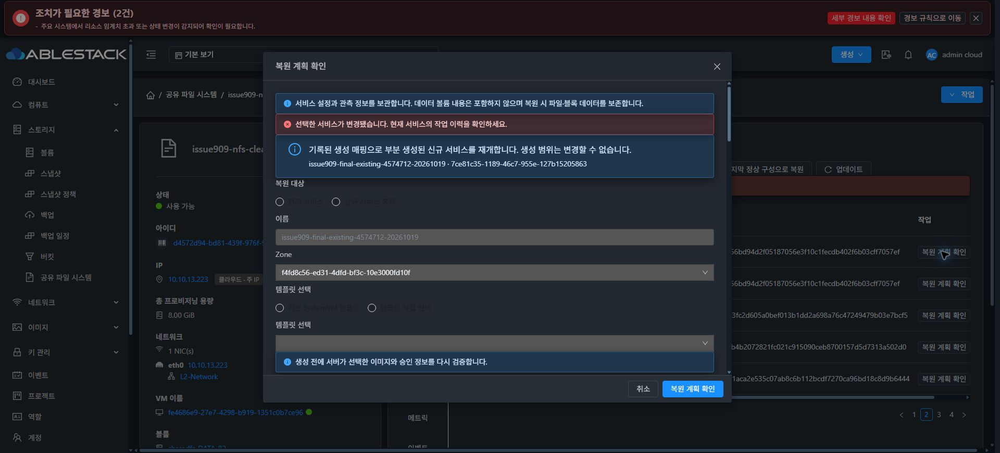

# #909 최종 실환경 검증 — 복원 재개 UI 결함으로 중단

**이슈 종료 조건에 도달하지 못했습니다. 실제 Chrome UI에서 동일 IMPORT의 복원 계획을 다시 검토하는 단계에 제품 UI 오류가 확인돼 추가 실행을 중단했습니다. #909 OPEN / Epic PR #1271 Draft를 유지하고 다음 지시를 기다립니다.**

## 이번 실행 범위와 결과

- 최신 upstream fetch 후 local ablestack-europa와 upstream 간 차이 0/0을 확인했습니다. Epic 브랜치와 13번 배포 제품 소스는 0b3f6730427f4f05eaf6b7e4b40816c8c7009742입니다.
- 재사용할 동일 IMPORT c1181cde-33d2-4209-9721-0dfc86308838, SharedFS 886e9f06-a01e-4840-8bc5-970aca706295, VM 374ff78d-4bbd-41bd-8c37-f46643fa28bf를 사전 확인했습니다. ROOT+DATA 5개 Ready/SPARSE, Native IN_SYNC/baseline1, pending 없음, 검증 프로필1과 서명된 런타임 bundle37d077c9/CLI0cc82538이 일치했습니다.
- anchor의 백업·복원 탭에서 해당 IMPORT의 **복원 계획 확인**을 1회 열었습니다. 화면에는 동일 대상의 기록된 생성 매핑으로 재개한다는 안내가 표시됐지만, 이어서 **“선택한 서비스가 변경됐습니다. 현재 서비스의 작업 이력을 확인하세요.”** 오류가 나타났습니다. 서비스 화면을 이동하거나 매핑을 편집하지 않았습니다.
- **확인한 계획 적용 버튼은 나타나지 않았고 복원 적용은 0회**입니다. 새 VM·디스크 생성, DATA 연결/포맷, MAC 변경, Native 런타임 교체도 0회입니다. 오류 이후 UI 재시도·API 적용 우회·신규 DATA 분기·클라이언트 I/O를 수행하지 않았습니다.
- 이번에는 초기 NFS 재사용 개선의 실환경 적용까지 도달하지 못했습니다. 이전 Backend 실패가 재발했다고 판단하지 않습니다.

## 확인한 UI 코드 원인

StorageServiceConfiguration.vue의 openPlan은 부분 생성 복원의 원래 requestedVolumeMapping에서 템플릿·DATA·수신 주소를 동기적으로 복원한 뒤 preparePlan의 API 응답을 기다립니다. 이때 planTarget.metadata deep watcher가 지연 실행돼 clearCloneZoneOptions()를 호출합니다.

그 초기화 함수는 clearCloneTemplates()로 clone.templateid를 삭제하고 DATA/수신 주소 매핑도 비웁니다. preparePlan은 대기 전에 저장한 템플릿 UUID와 대기 후 값을 비교하므로, 실제 서비스가 바뀌지 않았는데도 서비스 변경 오류를 발생시킵니다. 화면의 비활성 템플릿 선택도 비어 있습니다.

현재 Vue3 런타임과 제품 소스의 실제 초기화 메서드를 사용하는 로컬 재현에서, 동일 서비스/대상 유지 상태로 템플릿 UUID가 null, DATA 매핑이 4→0, 주소 매핑이 1→0으로 바뀌고 같은 비교 조건이 실패함을 확인했습니다. 이 재현의 제품 API 호출과 저장소 코드 수정은 0입니다. 기존 메서드 단위 fixture가 Vue watcher의 지연 실행을 포함하지 않아 실제 재개 화면을 놓친 경우입니다.

- [metadata watcher](https://github.com/dhslove/ablestack-cloud/blob/0b3f6730427f4f05eaf6b7e4b40816c8c7009742/ui/src/views/storage/StorageServiceConfiguration.vue#L344)
- [복원 재개 초기화](https://github.com/dhslove/ablestack-cloud/blob/0b3f6730427f4f05eaf6b7e4b40816c8c7009742/ui/src/views/storage/StorageServiceConfiguration.vue#L565)
- [Zone 후보·매핑 초기화](https://github.com/dhslove/ablestack-cloud/blob/0b3f6730427f4f05eaf6b7e4b40816c8c7009742/ui/src/views/storage/StorageServiceConfiguration.vue#L689)
- [템플릿 변경 검증](https://github.com/dhslove/ablestack-cloud/blob/0b3f6730427f4f05eaf6b7e4b40816c8c7009742/ui/src/views/storage/StorageServiceConfiguration.vue#L790)

## 중단 후 읽기 전용 확인

- Storage Service 작업 개수는 사전 점검과 같으며 새 복원 작업은 없습니다. 이전 작업 18767ce5-c6f6-4baf-9e16-f1916201e452는 ROLLED_BACK 그대로입니다.
- IMPORT의 원래 계획·생성 매핑·실행 계획·baseline·이전 복원 작업 기록은 모두 동일합니다.
- BOOT·Mold 할당 MAC 02:0d:00:cc:00:2e·Native 보호 파일 6개와 마지막 정상 구성 LKG1은 동일합니다.
- ROOT+DATA 5개의 identity/크기/Ready/SPARSE 상태가 동일합니다.
- 보존 FILE 데이터 6개의 64KiB SHA-256·inode·UID/GID·mode와 파일시스템 UUID가 동일합니다. RAW 2개 디스크의 각 1MiB/2MiB 위치 64KiB, 총 4영역 SHA-256도 동일합니다. 전체 볼륨 체크섬 검증을 뜻하지 않습니다.

## 개선 방향과 남은 완료 조건

후속 지시가 있으면, 불변 재개 매핑을 일반 Zone/후보 초기화와 분리해 hydration 중 watcher가 지우지 않도록 수정해야 합니다. 실제 서비스·계정·Zone·사용자 매핑 변경 시 기존 무효화와 승인 계획/토큰 검증은 유지해야 합니다. Vue mounted/nextTick을 포함한 회귀 검증으로 동일 IMPORT 열기→새 검토→비밀값 재입력→동일 creator 적용 화면까지 확인해야 합니다.

이 수정은 이번 검증 중에는 수행하지 않았습니다. 이후 같은 IMPORT·VM·DATA4의 복원 적용, API·실제 UI·네 클라이언트 I/O와 데이터 보존, 신규 SPARSE DATA 분기, 소유 시험 자원 정리가 남아 있습니다. #920 미착수, 최종 UI 표준화 #1275 HOLD를 유지합니다.

