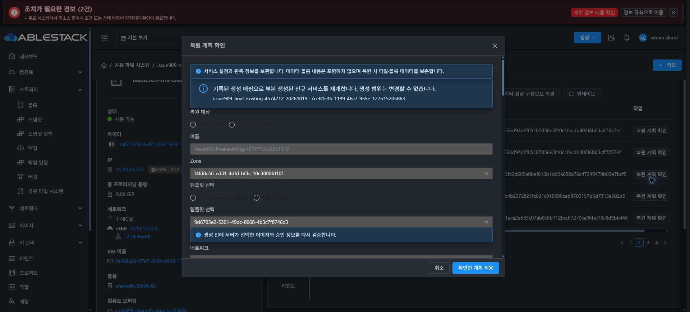
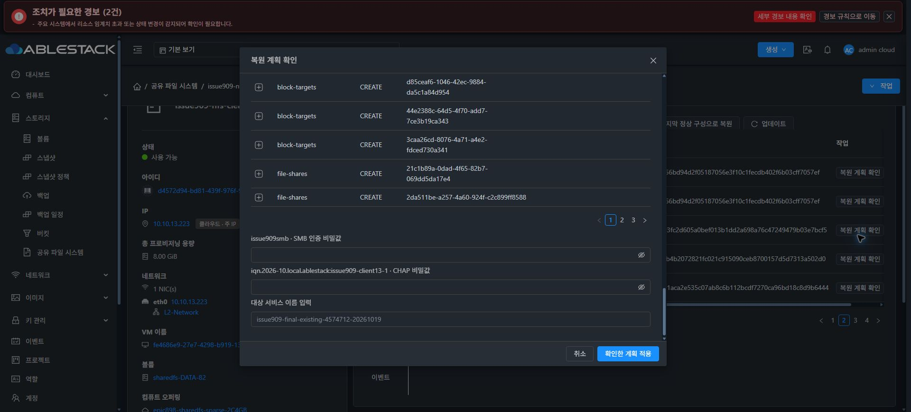

# #909 L2 STATIC prefix 개선·검증 재개 준비

이번 작업은 실패 원인 수정, 모듈 빌드, 13번 Backend 배포 및 복원 재개 전 확인까지입니다. 실제 복원 적용은 수행하지 않고 다음 지시를 기다립니다. #909 OPEN·Epic PR #1271 Draft, #1275 HOLD·#920 미착수를 유지합니다.

## 원인과 수정

실패한 작업 6b3d97bb-1831-4756-b73e-a8eb4cbfa36d는 Native 렌더링의 네트워크 검사에서 거부됐습니다. L2 Network/NIC의 CIDR·netmask는 NULL이지만 SharedFS STATIC 선언과 실제 eth0는 10.10.13.227/16입니다. Backend가 NULL netmask를 /24로 추정해 생성한 요청이 실제 prefix와 충돌했습니다. Native의 foreign MAC or prefix 오류가 빈 JSON 파싱 오류와 일반 Rendered generation stage failed로 축약됐습니다.

단일/복합 프로토콜의 개수 차이가 원인은 아닙니다. 동일한 /24 요청은 NFS 하나에서도 실패했고, /16만 교정한 요청은 네 프로토콜에서 통과했습니다. 이전 통합 시험의 WILDCARD 수신은 PRIMARY 바인딩 검사를 거치지 않는 경로였습니다.

- 소유한 기본 NIC의 SharedFS STATIC CIDR를 먼저 확인하고, 실제 NIC netmask 또는 주소를 포함하는 유효 CIDR에서 prefix를 결정합니다. 근거가 없거나 비연속 netmask이면 /24를 만들어내지 않고 ENDPOINT_PREFIX_UNAVAILABLE로 실패합니다.
- 수신 주소 적용과 endpoint 표시가 같은 prefix 생성기를 사용합니다. pre-NIC 동기화 상태도 SharedFS 선언의 primary IP를 보존합니다.
- Rendered stage 전 네트워크 바인딩을 읽기 전용으로 검사합니다. PRIMARY MAC/prefix·활성 상태와 Native readback을 확인하고, 선언 불일치는 ENDPOINT_PREFIX_MISMATCH 등 구체적인 Backend 오류로 처리합니다. writer·SOURCE·Native identity 보호는 유지합니다.
- Native/Agent의 일반 stderr 전달·빈 JSON 처리 코드는 이번에 변경하지 않았습니다. 확인된 원인을 Backend에서 수정하고 공개 읽기 전용 사전 검사를 추가했습니다.

## 빌드·배포·사전 확인

| 항목 | 확인 결과 |
|---|---|
| 소스 동기화 | local ablestack-europa와 upstream 248653b5892 일치 후 Epic rebase. 기존 SharedFS 제품 코드 보존, locale union 및 Autogen 충돌 통합 검증 |
| 구현 | 252a9228a3b6798562d13bf44218d139504cde67, Backend1 파일·회귀 시험2 파일 |
| Backend | 26 reactors package BUILD SUCCESS, 8 suites / 108 tests, 실패·오류·skip 0 |
| 변경 파일 스타일 | Checkstyle8.18·저장소 cloud-style.xml로 변경 Java3 파일 PASS |
| 전체 스타일 제한 | 최신 upstream의 CNI/user-data 시험5 파일에 기존 AvoidStarImport11건. 해당 파일은 upstream과 같으며 변경하지 않음. package는 checkstyle.skip=true로 수행 |
| upstream UI 충돌 통합 | 관련3 suites / 24 tests 및 AutogenView lint PASS, en/ko locale 양쪽 변경 보존 |
| 배포 | 13번 mold, StorageServiceManagerImpl.class1개만 overlay. 기존1042 멤버 유지·Java55 일치, 나머지 JAR204663 항목 SHA 동일 |
| 배포 확인 | 서비스 active·PID2720487·UI HTTP200·API 정상. UI index/config 동일, Agent/Native/DDL 변경0 |
| prefix 검사 | 최종 컴파일 클래스가 실제 L2 관측값을 반영한 DAO fixture에서 만든4포트 요청 모두 /16. 실제 대상 VM Native inspect 성공·sideEffects=false·eth0/MAC/prefix 일치, 검사 전후 네트워크 동일 |
| 실제 Chrome UI | 같은 IMPORT의 계획 POST1/HTTP200·생성14·blocker0·STATIC13.227/16·PRIMARY·같은DATA4. 비밀값2개와 이름 확인란은 공란, 적용 버튼만 표시 |
| 보호 상태 | 같은 VM/BOOT/MAC·ROOT+DATA5 Ready/SPARSE·IMPORT의 고정 계획/할당/실행/baseline 동일·초기 미사용NFS1·LKG1·Native IN_SYNC·pending/hold 없음·validation profile2 유지 |
| 데이터 | 기존 시험 FILE6 및 RAW4 검사 영역·FS UUID 동일. 읽기 전용 확인, DATA 쓰기0 |

## 검증 범위와 다음 단계

이번에는 복원 적용·신규 VM/볼륨 생성·DATA 연결/포맷·MAC 변경·Native 업그레이드가 모두 0입니다. 실제 네 프로토콜 서비스 활성화, 외부 클라이언트 동시 I/O 및 성공 LKG 생성은 다음 실환경 검증에서 확인해야 합니다. 읽기 전용 검사와 회귀 시험 통과를 실제 복원 성공으로 간주하지 않습니다.

다음 지시 후 같은 IMPORT·VM·DATA4에서 검토 토큰을 새로 발급하고 비밀값을 재입력해 복원 적용을 1회 진행합니다. API 작업/Native generation·네 프로토콜 UI·각 외부 클라이언트 접속 및 기존 FILE6/RAW4 영역 보존을 확인합니다. 명확한 UI/API/Backend 오류가 발생하면 중단하고 원인과 증거를 보고합니다.

## 근거

- [공개 검증 결과·전체 SHA](20261019-issue909-prefix-binding-ready-public.json)
- 제품 커밋: 252a9228a3b6798562d13bf44218d139504cde67
- 관리 서버 백업: /var/backups/mold/issue909-252a9228a3b6-prefix-binding/
- 이번 실제 UI는 계획 검토만 진행했으며 적용0입니다. 보이는 CREATE_NEW는 이미 부분 생성된 동일 대상의 재개 모드이며 새 VM을 생성한 결과가 아닙니다.

