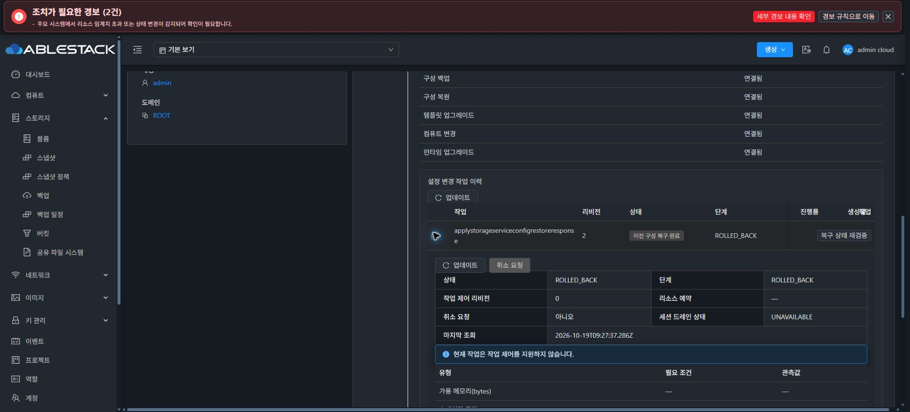

# #909 최종 실환경 재검증 — 렌더링 staging 오류로 중단

**복원 적용의 API·Backend 오류가 확인돼 추가 실행을 중단했습니다. 최종 검증 및 이슈 종료 조건에 도달하지 못했습니다. #909 OPEN / Epic PR #1271 Draft를 유지하고 다음 지시를 기다립니다.**

## 이번에 진행한 내용

- 최신 upstream/local base 차이0/0과 Epic 브랜치 동기화를 확인했습니다. UI76e42c791bfb와 Backend JAR f85b9758의 13번 배포 상태가 일치했습니다. 이번 검증 중 제품 코드 수정·빌드·배포는0회입니다.
- 동일 IMPORT c1181cde-33d2-4209-9721-0dfc86308838, SharedFS886e9f06, VM374ff78d, 기존 DATA4개를 재사용했습니다. 새 VM/디스크 생성과 MAC 변경은 없습니다.
- 실제 Chrome에서 기록된 CREATE_NEW 계획을 새로 검토했습니다. 생성14·프로토콜4·blockers0과 기존 DATA UUID/PRIMARY 매핑을 확인했고, SMB·CHAP 비밀값과 정확한 대상 이름을 재입력했습니다.
- 접수되지 않은 브라우저 클릭은 Network/API 작업 이력으로 전송이 없음을 확인하고 제어 방식을 교정했습니다. 실제 접수된 복원 적용은1회이며 작업 ID는 아래와 같습니다.
- 클라이언트 도구·경로·기존 세션 부재 사전 점검은 통과했습니다. 실제 클라이언트 접속/I/O와 신규 SPARSE DATA 분기는 시작하지 않았습니다.

## 확인된 제품 오류

- API 작업: f0cebb17-d509-4bae-b700-89717239389b
- Storage Service 작업: 6b3d97bb-1831-4756-b73e-a8eb4cbfa36d, revision2
- API 결과: jobstatus2 / jobresultcode530
- 적용 단계: APPLYING
- 오류: Rendered generation stage failed; inspect its scoped recovery receipt
- 작업 생성: 2026-10-19 18:23:11 KST / 자동 복구 완료: 18:24:14 KST

복원 재개 UI의 이전 서비스 변경 오류를 통과해 실제 작업 제출까지 진행했으나, Native 렌더링 staging 명령의 실패가 Backend를 통해 API 오류로 반환됐습니다. 후속 재시도·수동 복원·검증용 상태 변경은 수행하지 않았습니다.

현재 API·Native의 공개 영수증으로는 어떤 하위 검증이 staging을 거부했는지까지 확정할 수 없습니다. Native의 작업 영수증은 원래 baseline과 ROLLED_BACK을 기록하고 있으며, staging 대상의 새 rendered generation은 현재 포인터로 게시되지 않았습니다. 특정 프로토콜·네트워크·서명 결함으로 추정해 단정하지 않습니다.

## 자동 복구 후 읽기 전용 확인

- DB 작업 ROLLED_BACK, Native IN_SYNC/baseline1 및 원래 configuration SHA e3465707 유지, pending 없음.
- rendered baseline은 원래 작업50bf8055/revision1·manifest88858b25 그대로이며 activation COMPLETE, maintenance bootHeld=false.
- 실제 Chrome 작업 탭에서도 이번 실패의 ROLLED_BACK/이전 구성 복구 완료와 진단을 확인했습니다. 복구 상태 재검증 버튼은 누르지 않았습니다.
- VM Running, ROOT+DATA5개 Ready/SPARSE, Mold 할당 MAC02:0d:00:cc:00:2e·BOOT·LKG1 유지.
- 초기 NFS cc00c23d 행1개가 원래 미사용 상태로 복원됐고, 나머지 구성 변경은 되돌려졌습니다.
- FILE6개의 각64KiB SHA·inode·UID/GID·mode·파일시스템 UUID가 동일합니다. RAW2개 디스크의 각1MiB/2MiB 위치64KiB, 총4개 검사 영역 SHA도 동일합니다. 전체 볼륨 해시 검증을 의미하지 않습니다.
- 기존 보호 파일6개 중5개는 바이트 단위로 같습니다. service-maintenance.json은 이번 작업6b3d97bb의 RELEASED/owners[] 해제 기록으로 갱신됐으며 hold는 없습니다.
- 원래 IMPORT의 plan·cloneAllocation·volumeExecutionPlan·cloneInitialBaseline·requestedVolumeMapping은 같습니다. cloneRestoreOperation은 이번 실제 시도의 작업6b3d97bb를 가리키도록 갱신됐습니다.

## 남은 범위와 대기 상태

렌더링 staging의 실제 하위 실패 원인 확인과 개선, 같은 IMPORT/VM/DATA4의 복원 성공 및 API·실제 UI·네 클라이언트 I/O, 신규 SPARSE DATA 분기와 소유 시험 자원 정리가 남았습니다.

**제품 오류 이후 복원 재시도는0회입니다.** 새 이슈·별도 구현 브랜치를 만들지 않았고, #920 미착수·최종 UI 표준화 #1275 HOLD를 유지합니다. 시험 자원은 원인 확인을 위해 보존하고 다음 지시를 기다립니다.

