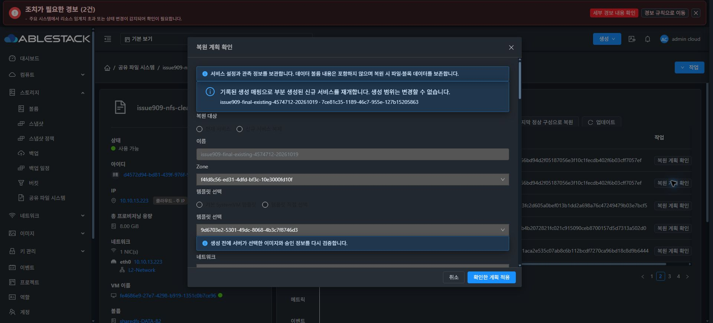
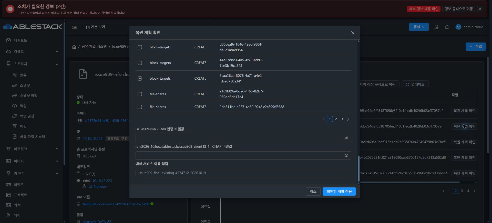

# #909 복원 재개 UI 개선·13번 반영 및 검증 재개 준비 완료

**UI 개선·모듈 빌드·13번 배포·API와 실제 Chrome 사전 확인을 완료했습니다. 복원 적용은 실행하지 않았으며 다음 검증 재개 지시를 기다립니다. #909 OPEN / Epic PR #1271 Draft를 유지합니다.**

## 원인과 수정

부분 생성 복원의 저장된 매핑을 불러올 때 planTarget.metadata 감시자가 일반 신규 구성용 초기화를 실행해 템플릿·DATA·주소 매핑을 지웠습니다. UI가 이를 실제 서비스 변경으로 판단해 검토 결과를 거부했습니다.

- 재개 경로에서는 기존 불변 계획 검증 함수를 사용해 기록된 대상·템플릿·볼륨 할당·수신 주소를 비교합니다. 정상 초기화, 동일 metadata 교체와 receipt/state 갱신에서는 매핑을 유지합니다.
- 고정된 매핑 또는 소유 범위가 바뀌면 검토 토큰·확인·비밀 입력을 지우고 적용을 차단합니다. 후보 목록 초기화와 고정된 선택값 보존을 구분했습니다.
- 대화상자를 닫거나 같은 IMPORT를 다시 연 뒤 도착한 이전 검토 응답은 요청 세대를 확인해 무시합니다.
- 기존 승인 계획/토큰·대상 identity·수신 주소/볼륨 비교, 비밀값 재입력과 실제 변경 감지 검증을 유지합니다.
- 제품 변경은 StorageServiceConfiguration.vue 1개 파일입니다. Backend·Native·DB·프로토콜 동작·최종 UI 표준화 #1275는 변경하지 않았습니다.

제품 코드 커밋: 76e42c791bfb2d52bcfe8c7191cebf6a44eed3b2.

## 모듈 검증과 배포

- Vue mounted/nextTick·지연 API 응답을 포함한 회귀 테스트10건을 추가했습니다. 수정 전8건 실패/2건 통과를 확인했고, 수정 후 관련 UI6 suites/138 tests와 변경 파일2개의 lint PASS입니다.
- production UI build PASS입니다. 빌드용 worker 제한은 커밋 소스에 포함하지 않았고 설정 파일을 바이트 단위로 복원했습니다.
- 13번에 새 UI 자산6개와 index를 배포했습니다. 기존 JS/CSS2,684개·보호 파일21개·Backend JAR SHA·관리 서버 PID2705101을 보존했고 서비스 재시작은0회입니다.
- 새 자산과 index 총7개를 HTTP200 및 SHA-256 일치로 확인했습니다. 기존 설정과 locale은 보존했습니다.
- index SHA-256: 7c6a5db4eacae50416277c7fbc915dc7577a16b3ff6b0d27a7302a06abdbc15e.
- 서버 index 백업: /root/issue909-ui-resume-fix-76e42c791bfb/index.html.before.

## 실제 API·Chrome 사전 확인

동일 IMPORT c1181cde-33d2-4209-9721-0dfc86308838에서 복원 계획 확인을1회 실행했습니다. 기록된 SharedFS886e9f06 / VM374ff78d / 실제 생성 인스턴스7ce81c35를 재사용하는 경로입니다. 원래 계획의 할당 예정 target UUID a09fef97와 실제 생성 target UUID7ce81c35를 구분해 보존합니다.

- 이전 서비스 변경 오류가 사라졌고, 비활성 상태인 템플릿9d6703e2·컴퓨트 오퍼링·초기 DATA·나머지 DATA 매핑이 지워지지 않습니다.
- 계획 검토 API는 HTTP200, 새 검토 토큰 있음, CREATE_NEW / 생성14 / blockers0을 반환했습니다. 토큰 원문은 근거 파일·보고서에 저장하지 않았습니다.
- DATA4개는 원래 UUID에 EXISTING/PRESERVE로 매핑되며, 원본0.0.0.0→PRIMARY와 실제 주소10.10.13.227을 유지합니다.
- SMB·CHAP 비밀값 재입력란과 대상 이름 확인란, 확인한 계획 적용 버튼까지 표시됩니다. 비밀값과 이름 확인은 입력하지 않았고 **복원 적용 POST는0회**입니다.

## 상태 보존 및 중단 지점

API·Native 읽기 전용 점검에서 원래 IMPORT 계획·생성 매핑·실행 계획·baseline·LKG1과 이전 작업18767ce5의 ROLLED_BACK 상태가 동일했습니다. 새 복원 작업은 없습니다.

ROOT+DATA5개 Ready/SPARSE, BOOT·Mold 할당 MAC·Native 보호 파일6개·서명된 runtime bundle37d077c9/CLI0cc82538·프로필1은 동일합니다. FILE6개의 64KiB SHA·inode·UID/GID·mode·파일시스템 UUID와 RAW2디스크의 총4개 64KiB 검사 영역 SHA도 동일했습니다. 전체 볼륨 해시 또는 이번 실행의 클라이언트 I/O 완료를 주장하지 않습니다.

**검증 재개 준비까지만 완료했습니다.** 기존 초기 NFS 재사용 Backend 개선의 실제 복원 적용과 네 프로토콜 클라이언트 I/O, 신규 SPARSE DATA 분기, 소유 시험 자원 정리는 후속 검증에 남습니다. 재개할 때 같은 IMPORT의 새 검토 토큰을 발급받아야 하며, 대기 중인 토큰을 무조건 재사용하지 않습니다.

#909 OPEN / PR Draft / #920 미착수 / #1275 HOLD를 유지하고 다음 명령을 기다립니다.

