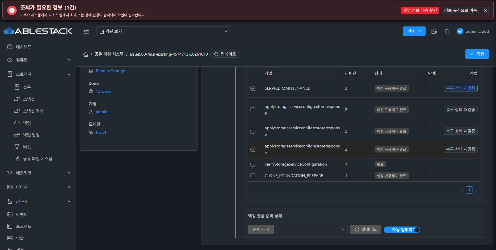

# #909 메모리 요청 전달 개선·배포와 검증 재개 준비 완료

수정 소스 6669160a39c를 Epic 브랜치에 반영하고 13번 관리 서버·호스트 3대·SharedFS 런타임에 배포했다. 실제 Chrome에서 기존 c794 작업의 원래 작업 복구를 한 번 실행해 이전 빈 baseline1 복구를 완료했다. 원본 신원·DATA·Native 상태를 대조했으며 **최종 전체 복원 검증을 재개할 준비가 됐다**. 새 전체 복원 적용은 실행하지 않았다. #909 OPEN / PR #1271 Draft를 유지하며 다음 지시를 기다린다.

## 원인과 수정

NativeRenderedRuntime이 요청을 sealed memfd로 전달한 뒤 operation quiesce가 하위 service-quiesce를 실행하면서 작업 잠금 FD9만 상속했다. 요청 경로만 복사해 하위 프로세스가 입력을 읽지 못했다. ROOT maintenance enter에도 같은 결함이 있었다.

두 위임 경로를 기존 /dev/stdin → sealed memfd 처리기로 통일했다. FD9, 입력 크기 제한, 소유권·scope·신원 보호는 유지했다. 유지보수 입력 읽기 실패에만 고정 GEN / TRANSPORT / NATIVE_CHILD_INPUT_UNAVAILABLE 진단을 추가하고 Native·KVM·관리 서버에서 안전하게 전달한다. 임의 reason·stderr·비밀값을 공개 진단으로 승격하지 않는다.

이전 회귀 시험은 일반 파일 또는 quiesce 성공 대체 응답을 사용해 실제 두 번째 CLI 호출을 놓쳤다. 이번에는 변경하지 않은 기존 코드의 실패 재현을 근거로 실제 패키지 CLI 경계 시험을 추가했다. DB schema 변경은 없다.

## 빌드·검증

| 범위 | 결과 |
|---|---|
| 전체 Native, 실제 중첩 CLI 8건 포함 | 총 1,129 / 1,123 PASS / 조건부 6 SKIP / 실패·오류 0 |
| 별도 Native 진단 계약 | 18 PASS |
| 관리 서버·KVM 진단 회귀 | 18 PASS |
| 관리 서버·KVM 및 의존 모듈 | 38-reactor package BUILD SUCCESS |
| 변경 Java 4파일 Checkstyle | PASS |
| 실제 Ganesha/NFS | 3/3 PASS |
| 실제 Samba | 11/11 PASS |
| 실제 SERVICE 요청 전달→캡슐 export/import | PASS |

계정/SAM 시험은 private /etc·/var·/run·/tmp 또는 폐기 가능한 컨테이너에서 수행했다. SERVICE 연계 컨테이너는 이미 정지된 빈 SOURCE이며 실제 unit cgroup·PID 정지를 대신 검증했다고 간주하지 않는다. 실행 중이던 13번 SMB 감독자와 acceptor의 실제 종료는 아래 공식 복구 후 별도로 확인했다.

최종 CLI SHA: eaf3929e26ca345721bbd2a988f30cabc041a844439350f2cbaa603b601569af. 서명은 RAM sealed descriptor에서 수행하고 개인키 입력 버퍼와 descriptor를 정리했다.

## 13번 배포

- 관리 서버와 각 호스트의 기존 JAR 전체와 ABI를 확인했다. 멤버와 class major55가 동일하며 변경된 main class 한 개씩만 교체했다. 관리 서버 나머지 204,663개 엔트리, 호스트별 나머지 514/514/506개 엔트리를 검증했다.
- 관리 서버 mold 및 3대 mold-agent는 active이며 호스트는 모두 Up/Enabled다. UI 파일은 수정하지 않았다.
- 정상 카탈로그·서명·preflight·업그레이드 경로로 bundle e20cd81f-9e7c-4ec5-abd6-c269b5c01e6f / upgrade 871aaf44-d1f7-4567-982b-9821121d13bb가 COMPLETE다.
- 런타임 버전: 4.23.0.0-epic898-909-6669160a39-fdrelay-20261020.
- 공식 profile API로 5→6을 반영하고 실제 CLI pin을 확인했다. 기존 SOURCE checkpoint/key를 다시 만들거나 덮어쓰지 않았다.

## 실제 UI·API·Native 준비 상태

2026-10-20 06:21:49 KST에 Chrome의 원래 작업 복구가 완료됐다. 대상은 기존 operation c794a8f9-06fe-47cc-9e62-fbf1b37c446f이며 새 작업 또는 클론으로 대체하지 않았다.

- API: ROLLED_BACK / INTERRUPTED_RENDERED_WRITER_ROLLED_BACK / 100%.
- Native: 원래 baseline1/e3465707… / IN_SYNC, pending 없음.
- SERVICE: RELEASED, template maintenance marker 없음, 설정 변경 차단 해제.
- 실제 SMB 감독자310275와 acceptor310276 종료, endpoint registry0.
- 계정 파일 4개는 인증된 SOURCE로부터 계산한 전체 bytes·SHA·mode·uid·gid와 일치.
- 원래 없던 passdb/secrets TDB와 관리 신원 메타데이터 3개는 다시 부재 상태로 복구. 이는 사용 중이던 TARGET SAM을 그대로 두었다는 결과가 아니다.
- baseline SMB 설정 SHA 일치, 원래 LOCAL checkpoint6·generic checkpoint SHA와 ACTIVE_LKG1 유지.
- FILE6 / RAW4와 FS UUID·BOOT·Mold MAC, ROOT/DATA5 Ready/SPARSE 보존. 포맷·재부팅·MAC 변경·자원 복제 없음.

원래 실패 진단 문자열은 이력으로 남아 있다. 현재 복구 완료 여부는 terminal state, Native IN_SYNC, SOURCE 신원 대조와 데이터 보존으로 확인했다.

## 관리 서버 디스크 분석과 정리

첫 배포 백업 복사 시 여유 공간이 부족했다. 배포 도구의 사전 용량 점검 누락을 보완했으며, 당시 운영 JAR·서비스는 바뀌지 않았다. 불완전한 41.8MB 백업만 검증 후 제거했다. 이전 JAR 백업5개를 체크섬 검증한 WSL 사본으로 옮겨 배포 공간을 확보했다.

이후 사용자가 기존 백업 전체 정리를 요청해 관리 서버를 분석했다. 주요 사용량은 /root 약27.8GB, MySQL 약24.7GB, /var/tmp 약5.6GB, 컨테이너 약8.1GB였다. 과거 UI·Backend 배포 백업과 임시 자료가 누적돼 있었다.

프로세스 열린 파일·cwd, mount, 배포 경로의 symlink 참조를 확인한 후 /root의 과거 백업201개와 /var/tmp의 과거 배포 임시 디렉터리191개를 정리했다. 삭제 전 경로·inode·device·범위를 고정했고 운영 DB·컨테이너·배포된 webapp·현재 복구 키/체크포인트는 제외했다.

실제 확보 공간은 약31.5GB이며 최종 여유 공간은 약32.6GB, 사용률은 약63%다. /root의 기존 백업과 /var/backups/mold의 백업 파일은 남아 있지 않다. 현재 배포의 원복 JAR도 WSL의 보호된 보관 경로에 체크섬 검증해 보존했다. 관리 서비스 active 및 UI HTTP200을 확인했다. MySQL과 컨테이너의 운영 데이터는 정리 대상이 아니었다.

## 다음 검증

다음 지시를 받으면 같은 서비스의 fresh RESTORE_EXISTING 계획을 UI에서 다시 검토한 뒤 최종 네 프로토콜 복원과 외부 클라이언트 동시 I/O를 재개한다. 기존 계획·이전 시험 성공을 이번 최종 forward 검증의 대체 결과로 사용하지 않는다. 이번에는 전체 복원 적용0회이며 #909를 닫지 않는다. #920 미착수, UI 표준화 #1275 HOLD를 유지한다.

[공개 근거](20261020-issue909-fdrelay-ready-public.json).
