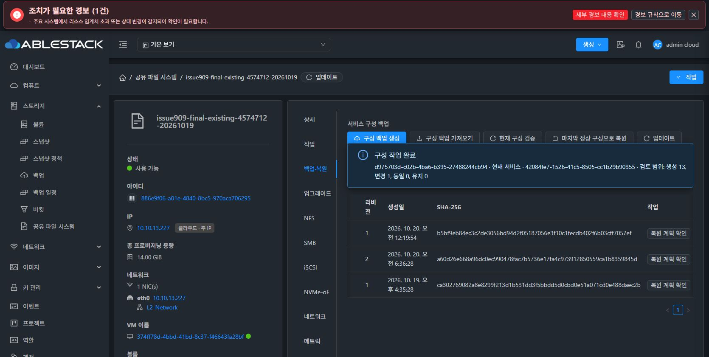
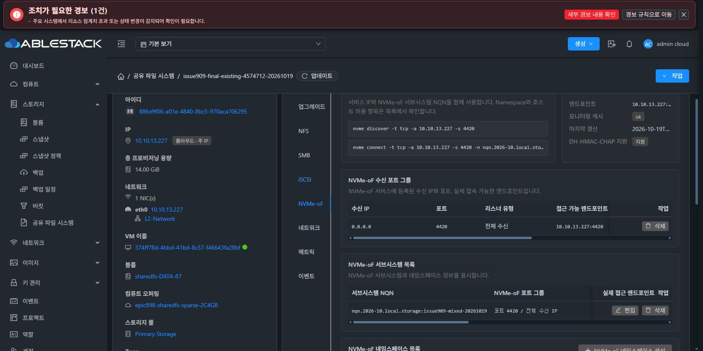

# #909 최종 실환경 기능 검증 성공과 API 메타데이터 결함 중단

동일 서비스의 전체 구성 복원과 네 프로토콜 실제 UI·클라이언트 I/O·DATA 보존 검증은 모두 성공했다. 다만 최종 API 응답 대조에서 **성공 후에도 과거 CONFIG_RESTORE_FAILED가 남는 메타데이터 결함**을 확인했다. 사용자의 UI/API/Backend 오류 시 중단 지시에 따라 추가 수정·재적용 없이 중단한다. #909는 종료하지 않으며 Epic PR #1271 Draft를 유지한다.

## 이번에 완료한 실제 검증

- 대상 SharedFS: 886e9f06-a01e-4840-8bc5-970aca706295, SystemVM374ff78d-4bbd-41bd-8c37-f46643fa28bf, IP10.10.13.227.
- 배포 소스6669160a39c / CLIeaf3929e… / profile6, 시작 Native baseline1 IN_SYNC·pending없음.
- 기존 Chrome 다운로드 ZIP83ab8370…의 SHA b5bf9eb8…와 네 DATA 볼륨을 다시 확인했다.
- Chrome에서 같은 IMPORT42084fe7…의 RESTORE_EXISTING 계획을 새로 검토했다. 백업의 wildcard0.0.0.0을 유지하고 기존 NFS cc00…를 명시 매핑했다. DATA4는 같은 UUID로 매핑했고 13CREATE·1UPDATE·0PRESERVE·blocker0·automaticFormat=false였다.
- SMB 로컬 인증·iSCSI CHAP 비밀값을 UI에서 재입력하고 승인된 서비스 중단 경로로 한 번 적용했다.
- job d975703d-c02b-4ba6-b395-27488244cb94가 2026-10-20 06:35:30~06:36:29 KST에 jobstatus1/jobresultcode0, runtime.success=true/statusCOMPLETE로 끝났다.
- operation182ae436-0c80-422a-967c-d71a3b7f9ae2는 COMPLETE/100%/진단없음이다.
- Native revision2 IN_SYNC/pending없음, rendered NFS·SMB·ISCSI·NVMEOF 모두 적용·검증 COMPLETE, bootHeld=false다.
- 실제 UI의 NFS·SMB·iSCSI·NVMe-oF 탭에서 리소스·ACL·볼륨 매핑과 Ready 상태를 관측했다. NFS 제한 ACL의 로컬 mount 생략은 예상된 안내이며 허용된 외부 클라이언트에서 실제 mount/I/O를 별도로 완료했다.

## 외부 클라이언트와 DATA 결과

클라이언트10.10.13.1에서 네 연결을 동시에 유지하고 다음을 통과했다.

| 프로토콜 | 결과 |
|---|---|
| NFSv4.1 | mount, 기존64KiB 파일 검증, 새 파일 쓰기·fsync·읽기, 정상 unmount |
| SMB3.1.1 | 로컬 사용자 인증, 기존64KiB 검증, 새 파일 쓰기·읽기, 정상 unmount |
| iSCSI | CHAP 로그인, 원래 블록 검증과 쓰기·읽기, SCSI status0, 정상 logout |
| NVMe-oF/TCP | NQN·NSID·실제 device UUID 식별, 2GiB 확인, 직접 I/O 검증, 정상 disconnect |

네 세션은 실제로 겹치는 구간을 확인했다. 이는 기능 동시 접속 시험이며 장시간 부하·성능 시험을 뜻하지 않는다. SMB 비밀값은 0600 sealed memfd, iSCSI 비밀값은 프로세스 stdin으로만 전달했다.

SystemVM의 독립적인 읽기 전용 검사에서 기존 파일6개와 raw검사영역4개의 바이트·체크섬을 보존했고, 클라이언트가 새로 쓴 파일2개도 서버에서 확인했다. 새 파일은 고유 이름을 사용했다. FS UUID·기존 파일 inode/UID/GID/mode, BOOT·Mold MAC은 유지됐다. ROOT와 DATA 총5개는 모두 Ready/SPARSE다. 신규 VM·디스크·포맷·MAC 변경은 없다.

검사 도구는 복원 후 추가되는 NFS bind alias를 데이터 동일성과 구분했다. Mold의 namespace 리소스 UUID와 커널의 NVMe device UUID도 구분해 현재 NQN/NSID·실제 UUID·정확한 볼륨 serial/크기를 함께 검증했다. 제품 또는 자원 변경으로 검사 조건을 맞추지 않았다.

새 ACTIVE_LKG2는 a686acba-bba8-46e4-bcc7-ee3c23d52733 / SHA a60d26e6…이며 기존 LKG1은 SUPERSEDED 이력으로 남았다.

## 발견한 결함과 영향

성공한 같은 API 응답에 다음 값이 함께 포함됐다.

- jobstatus=1 / jobresultcode=0
- runtime.success=true / runtime.status=COMPLETE
- IMPORT metadata.restoreState=COMPLETE
- IMPORT metadata.errorCode=CONFIG_RESTORE_FAILED

이는 이번 복원 실행이 다시 실패한 것이 아니다. 이전에 실패했던 같은 IMPORT를 재사용하면서 과거 오류 코드가 지워지지 않은 것이다. 의도적으로 버전이 붙은 실패 이력 필드도 아니다.

StorageServiceConfiguration.java925의 실패 처리에서 errorCode를 넣고, 일반 성공 경로920~921은 restoreState를 COMPLETE로 바꾸면서 이 값을 제거하지 않는다. compactRow1107이 그대로 응답에 포함한다. 반면 clone publication 복구 성공 경로937은 errorCode를 명시적으로 지운다.

현재 데이터·서비스는 정상이다. 다만 metadata.errorCode를 읽는 자동화나 클라이언트가 성공을 실패로 오판할 수 있으므로 API 응답 정합성 결함으로 기록한다. 원래 실패 job·operation 진단을 보존하는 것과 현재 IMPORT의 오류 상태를 정리하는 것은 구분해야 한다.

## 중단 상태와 개선 방향

이번 실제 적용은1회이며 오류 확인 후 추가 apply·원복·서비스 재시작·제품 수정은 없다. 현재 revision2와 네 서비스는 유지한다. 이슈 종료는 보류한다.

개선은 검증된 정상 완료 경로에서 현재 errorCode를 제거하는 것이다. 이전 실패 job과 operation 진단은 그대로 유지한다. 같은 IMPORT의 실패→새 계획→성공 회귀 시험으로 COMPLETE 응답의 오류 코드 부재와 과거 실패 이력 보존을 함께 확인해야 한다.

이 수정과 검증은 아직 시작하지 않았다. 새 이슈를 분기하지 않으며 다음 명령을 기다린다. 최종 UI 표준화 #1275 HOLD도 유지한다.

[공개 근거](20261020-issue909-final-functional-pass-api-metadata-stop-public.json).
