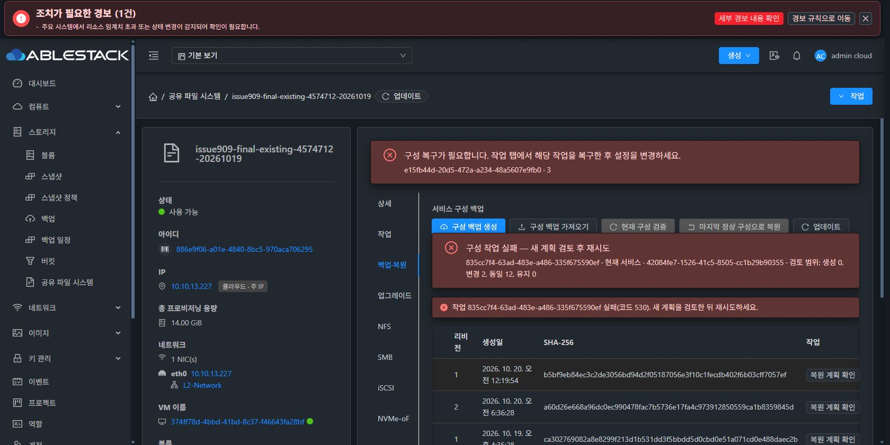

# #909 마지막 실환경 검증 — render-stage 백엔드 오류로 중단

## 결과

2026-10-20 10:52:58 KST에 실제 Chrome UI에서 기존 IMPORT42084fe7-1526-41c5-8505-cc1b29b90355를 동일 서비스7ce81c35-1189-46c7-955e-127b15205863에 한 번 적용했습니다. 10:53:28 KST에 비동기 작업835cc7f4-63ad-483e-a486-335f675590ef가 jobstatus2 / jobresultcode530으로 실패했습니다.

오류 응답: Rendered generation stage failed; inspect its scoped recovery receipt

서비스 operation e15fb44d-20d5-472a-a234-48a5607e9fb0, revision3은 RECOVERY_REQUIRED / progress0이며 진단은 Approved service maintenance requires its scoped recovery입니다. 이는 제품 백엔드 오류이므로 사용자 지시에 따라 즉시 중단했습니다.

완료 상태 개선 코드7a39cb4b10b8의 검증된 성공 후 오류코드 정리 지점에 도달하기 전에 stage가 실패했습니다. 이번 결과로 해당 성공 경로의 실환경 검증을 통과했다고 판정할 수 없습니다. stage가 거부된 구체적인 하위 원인은 아직 확정하지 않았습니다.

## 적용 전 확인과 실제 UI 계획

- 관리서버에 배포된 수정 클래스2개의 SHA-256이 7a39cb4b10b8 빌드 결과와 일치합니다.
- 실제 다운로드 ZIP 10,285바이트의 SHA-256은 b5bf9eb84ec3c2de3056bd94d2f05187056e3f10c1fecdb402f6b03cff7057ef로 기존 기록과 일치합니다.
- 원래 VM·MAC·BOOT와 DATA4/ROOT1의 Ready·SPARSE 상태를 확인했습니다.
- UI에서 각 원본 볼륨4·리소스14·전체 수신 주소0.0.0.0을 기존 대상에 명시 매핑했습니다.
- 최종 검토 계획은 expectedRevision2, CREATE0 / UPDATE2 / KEEP12 / PRESERVE0 / blocker0, dataPolicy PRESERVE / automaticFormat false입니다.
- SMB 로컬 암호와 iSCSI CHAP 비밀값은 보관하지 않고 UI에 재입력했습니다. 유지보수 중단 및 정확한 대상 이름을 확인한 뒤 UI 적용 버튼을 한 번 클릭했습니다.
- UI 제어의 드롭다운 애니메이션/선택 오차와 Chrome 연결 해제는 제출 전에 교정했으며, 최종 API 계획의 매핑과 blocker0을 확인했습니다. 변경 POST는 재전송하지 않았습니다.

## 중단 시 영향

읽기 전용으로 API·Native receipt·DATA 샘플을 확인했습니다.

- 마지막 정상 Native generation은 revision2 / operation182ae436-0c80-422a-967c-d71a3b7f9ae2를 유지합니다.
- ACTIVE_LKG a686acba-bba8-46e4-bcc7-ee3c23d52733 revision2를 유지하며 revision3으로 승격하지 않았습니다.
- Native pending은 실패 operation e15fb44d… / revision3 / PREPARED이고 service-maintenance는 HELD입니다.
- 원래 NFS Ganesha와 SMB listener가 유지보수 절차로 중지된 상태이며 health는 degraded입니다. 관측한 NFS·SMB listener는 false, iSCSI3260·NVMe4420 listener는 true입니다. 실패 후 외부 클라이언트 접속은 시험하지 않았습니다.
- 파일8개와 raw 영역4개의 내용·기록된 파일시스템/메타데이터가 적용 전과 일치합니다.
- VM은 Running이며 원래 MAC·BOOT와 5개 Ready/SPARSE 디스크를 유지합니다. 신규 VM·DATA 생성·포맷·MAC 변경은 없습니다.
- IMPORT restoreState FAILED / errorCode CONFIG_RESTORE_FAILED입니다.

## 다음 지시 대기

실패 후 재시도0회, 복구/reconcile/원복 명령0회, 추가 클라이언트 시험0회입니다. 서비스는 복구가 필요한 중단 상태로 보존했습니다. 제품 코드 변경·추가 빌드·배포는 하지 않았습니다.

#909는 종료할 수 없으며 OPEN, Epic PR #1271 Draft를 유지합니다. 원인 분석과 해당 scoped recovery의 개선/복구는 다음 사용자 지시를 기다립니다.

별도 완료 조건 대조에서 현재 4DATA CREATE_NEW의 기존 DATA 재사용 분기와 신규 SPARSE DATA4 분기, owned 시험 자원·계정 종료 정리의 최종 인수 증거도 아직 남아 있음을 확인했습니다. 과거 단일 NEW DATA의 NFS/SMB CREATE_NEW 성공을 네 프로토콜 두 분기의 완료로 확대하지 않았습니다. 이번 백엔드 오류 이후 해당 시험을 새로 시작하지 않았습니다.

공개 근거: [20261020-issue909-final-render-stage-stop-public.json](20261020-issue909-final-render-stage-stop-public.json)
